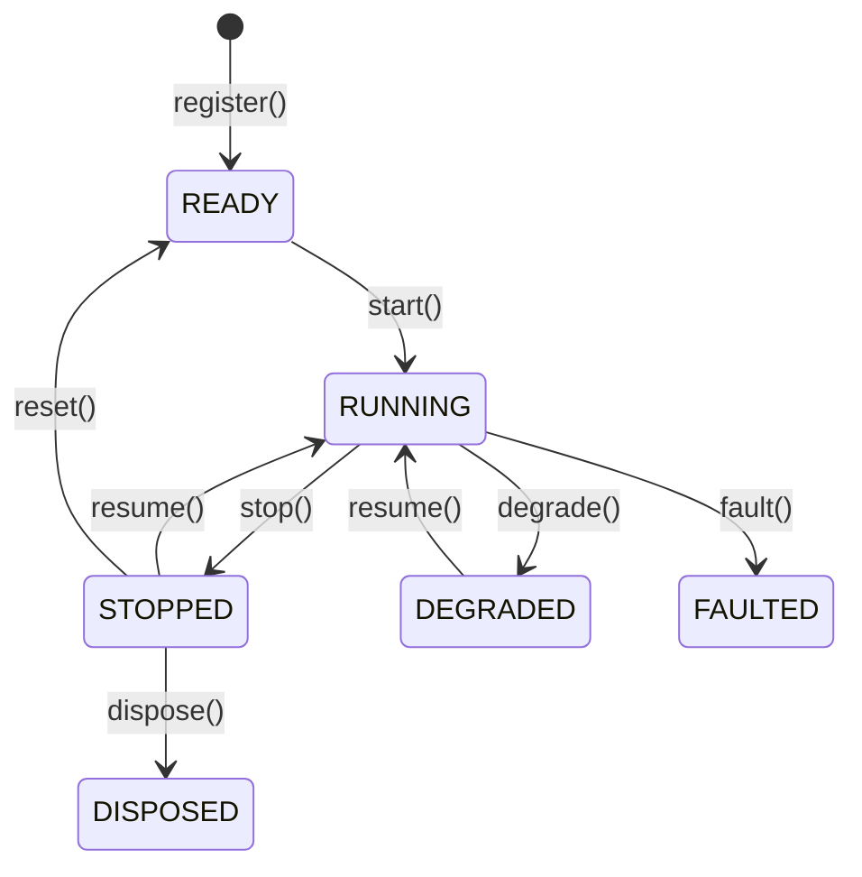

# Actors

**数据 actor** 接收请求与订阅的数据，处理系统事件，并管理组件状态。
Python 中继承 `DataActor` 类，Rust 中实现 `DataActor` trait。
策略在此之上增加订单管理能力。

**能力**：

- 行情与自定义数据的订阅和请求。
- 自定义数据与信号的发布。
- 事件、定时器与提醒的处理。
- 缓存访问。
- 结构化日志。

## 基础 Python 示例 {#basic-python-example}

Actor 的配置方式与策略类似。把自定义字段声明为仅关键字参数，并接受
`**_kwargs`，让基础字段（`actor_id` 与日志设置）透传给
`DataActorConfig.__new__`，由它在同一次调用中读取。

若用位置参数，它会被匹配到 `actor_id` 上，抛出 `TypeError`。

```python
from nautilus_trader.common import DataActor
from nautilus_trader.config import DataActorConfig
from nautilus_trader.model import Bar
from nautilus_trader.model import BarType


class MyActorConfig(DataActorConfig):
    def __init__(self, *, bar_type: BarType, **_kwargs) -> None:
        super().__init__()
        self.bar_type = bar_type


class MyActor(DataActor):
    def __init__(self, config: MyActorConfig) -> None:
        super().__init__(config)

        # Keep runtime state on the actor
        self.count_of_processed_bars: int = 0

    def on_start(self) -> None:
        # Subscribe to bars matching the configured bar type
        self.subscribe_bars(self.config.bar_type)

    def on_bar(self, bar: Bar) -> None:
        self.count_of_processed_bars += 1
```

## Actor 配置与 ID {#actor-configuration-and-ids}

数据 actor 可以接收一个 `DataActorConfig` 子类。基础配置接受可选的 `actor_id`。
提供 ID 时，actor 以该 ID 注册；未提供时，Python actor 以其类名注册。

同一 actor 运行多个实例时，必须给每个实例显式的 `actor_id`，
因为重复的 ID 会在注册时被拒绝（Python 中抛 `RuntimeError`）。

把配置视为 actor 的构造数据。用户设置的项通过 `self.config` 读取，
运行时状态保存在 actor 自身上。

:::info Rust 实现
Rust actor 把运行时身份与状态存在 `DataActorCore` 中。通过
`actor_id()` 读取运行时 ID，不要指望生成的 ID 会写回 `DataActorConfig`。
未配置 `actor_id` 的 Rust actor，无论其具体类型，都以 `DataActor` 注册，
因此要给每个 Rust actor 显式的 `actor_id`。

Rust 侧实现 `DataActor` 并使用 `self` 上的门面方法。
`DataActorNative` 是供运行时接线与借用核心状态使用的 native-only 访问，
只在同二进制性能路径或内部运行接线时导入它。
:::

## 生命周期 {#lifecycle}

Actor 在下列主要稳定状态之间迁移：



只画主要流程，过渡状态和较少见的合法边已省略。对有生命周期处理器的动作，
actor 要等该处理器成功后才进入目标状态。

覆写以下方法以挂接生命周期事件：

| 方法         | 调用时机                                                                                                            |
| -------------- | ---------------------------------------------------------------------------------------------------------------------- |
| `on_start()`   | actor 执行启动迁移时。在此订阅数据。                                                           |
| `on_stop()`    | actor 执行停止迁移时。在此清理 actor 自有资源。                                               |
| `on_resume()`  | actor 在停止或降级后恢复时。                                                                        |
| `on_reset()`   | actor 重置时，包括回测各次运行之间。钩子成功后 actor 会释放其保留的数据订阅。 |
| `on_degrade()` | actor 进入降级状态，可能只能提供部分功能。                                         |
| `on_fault()`   | actor 遇到故障后进入故障状态。                                                       |
| `on_dispose()` | actor 正被处置，必须释放其余资源。                                                      |

## 定时器与提醒 {#timers-and-alerts}

actor 可以使用时钟进行调度：

```python
from datetime import timedelta

from nautilus_trader.common import TimeEvent


def on_start(self) -> None:
    self._schedule_clock_events()


def on_resume(self) -> None:
    self._schedule_clock_events()


def on_stop(self) -> None:
    self._cancel_clock_events()


def on_degrade(self) -> None:
    self._cancel_clock_events()


def _cancel_clock_events(self) -> None:
    self.clock.cancel_timer("my_actor.timer")
    self.clock.cancel_timer("my_actor.alert")


def _schedule_clock_events(self) -> None:
    # Set a recurring timer with a callback that fires every 5 seconds
    self.clock.set_timer(
        "my_actor.timer",
        timedelta(seconds=5),
        callback=self._on_timer,
    )

    # Set a one-time alert with a callback
    self.clock.set_time_alert(
        "my_actor.alert",
        self.clock.utc_now() + timedelta(minutes=1),
        callback=self._on_alert,
    )


def _on_timer(self, event: TimeEvent) -> None:
    self.log.info("Timer fired!")


def _on_alert(self, event: TimeEvent) -> None:
    self.log.info("Alert triggered!")
```

传入 `callback` 可把 `TimeEvent` 导向你自己的方法。不传时，actor 运行时
会把时钟注册的默认处理器接到 `on_time_event()`。

要调度按本地时间重复触发的任务（例如无论夏令时如何切换都在纽约时间 09:30），
用 `set_timer_zoned()`。设置与投递行为见
[日历定时器示例](./strategies.md#calendar-timers)。

多个组件共享同一时钟时：

- 用**显式回调**把事件路由到目标组件。
- 在时钟命名空间内使用**唯一的定时器名**。注册同名定时器会替换已有的。

## 系统访问 {#system-access}

actor 可以访问核心系统组件：

| API                                         | 说明                                          |
| ------------------------------------------- | ---------------------------------------------------- |
| `self.cache`                                | 工具、订单与持仓的共享状态。 |
| `self.clock`                                | 当前时间，以及定时器与提醒的调度。          |
| `self.log`                                  | 结构化日志。                                  |
| `publish_data()` / `subscribe_data()`       | 结构化的自定义数据消息。                    |
| `publish_signal()` / `subscribe_signal()`   | 轻量告警与通知。                |
| `publish_message()`                         | 在应用主题上发布一个 Python 对象。     |
| `subscribe_topic()` / `unsubscribe_topic()` | 管理 Python 对象回调。                      |
| `subscribe_queue_state()`                   | 实时运行器队列压力状态变化。            |
| `subscribe_socket_state()`                  | 实时 socket 传输状态变化。                 |
| `reconnect_socket()`                        | 请求恢复某个实时 socket 端点。        |
| `unsubscribe_queue_state()`                 | 停止接收运行器队列压力状态变化。  |
| `unsubscribe_socket_state()`                | 停止接收 socket 传输状态变化。       |
| `on_queue_state()`                          | 处理运行器队列压力状态变化。         |
| `on_socket_state()`                         | 处理 socket 传输状态变化。              |

Python 的 `DataActor` 和 `Strategy` API 不暴露 `self.msgbus`。
结构化载荷用自定义数据，轻量值用信号，
任意进程内 Python 对象用[主题消息](./message_bus.md#python-topic-messaging)。

### 队列压力状态 {#queue-pressure-state}

actor 可以订阅运行器队列压力状态的变化：

```rust tab="Rust"
use nautilus_common::{
    actor::DataActor,
    messages::system::QueueStateChanged,
};

impl DataActor for MyActor {
    fn on_start(&mut self) -> anyhow::Result<()> {
        self.subscribe_queue_state(None, Some(50));
        Ok(())
    }

    fn on_stop(&mut self) -> anyhow::Result<()> {
        self.unsubscribe_queue_state(None);
        Ok(())
    }

    fn on_queue_state(&mut self, event: &QueueStateChanged) -> anyhow::Result<()> {
        log::warn!(
            "Queue {:?} changed {:?} to {:?} at depth {}",
            event.channel,
            event.condition,
            event.state,
            event.queue_depth,
        );
        Ok(())
    }
}
```

```python tab="Python"
from nautilus_trader.common import QueueStateChanged


def on_start(self) -> None:
    self.subscribe_queue_state(priority=50)


def on_stop(self) -> None:
    self.unsubscribe_queue_state()


def on_queue_state(self, event: QueueStateChanged) -> None:
    self.log.warning(
        f"Queue {event.channel} changed {event.condition} to {event.state} "
        f"at depth {event.queue_depth}",
    )
```

#### 过滤与投递 {#filters-and-delivery}

可选的 priority 控制匹配订阅者之间的投递顺序，**值大的先执行**。
第二次订阅不会改变已有优先级；要改优先级，先退订再以新优先级订阅。

传 `channel` 可选定单个运行器通道，例如 Python 中
`self.subscribe_queue_state(channel=SystemChannel.DATA_EVENTS)`。
`SystemChannel` 从 `nautilus_trader.common` 导入。

- 省略 `channel` 即订阅所有被监控的通道。
- 退订时向 `unsubscribe_queue_state` 传**相同的 channel**；省略它只移除无过滤的订阅。
- 相互重叠的订阅，事件匹配时各自都会调用回调。

运行器队列由多个客户端共享，因此没有客户端过滤器。

#### 队列事件内容 {#queue-event-contents}

`QueueStateChanged` 包含 trader ID、运行器通道、队列条件、条件状态、
队列深度、平均分发时间、事件 ID 与时间戳。投递使用类型化的进程内消息总线，
没有对外传输的表示。触发与解除的语义见
[队列压力监控](./live.md#queue-pressure-monitoring)。

### Socket 传输状态 {#socket-transport-state}

actor 可以订阅会上报状态的实时适配器的 socket 状态变化：

```rust tab="Rust"
use nautilus_common::{
    actor::DataActor,
    messages::system::SocketStateChanged,
};

impl DataActor for MyActor {
    fn on_start(&mut self) -> anyhow::Result<()> {
        self.subscribe_socket_state(None, None, Some(50));
        Ok(())
    }

    fn on_stop(&mut self) -> anyhow::Result<()> {
        self.unsubscribe_socket_state(None, None);
        Ok(())
    }

    fn on_socket_state(&mut self, event: &SocketStateChanged) -> anyhow::Result<()> {
        log::info!(
            "Socket {} for {} changed to {:?}",
            event.endpoint,
            event.client_id,
            event.state,
        );
        Ok(())
    }
}
```

```python tab="Python"
from nautilus_trader.common import SocketStateChanged


def on_start(self) -> None:
    self.subscribe_socket_state(priority=50)


def on_stop(self) -> None:
    self.unsubscribe_socket_state()


def on_socket_state(self, event: SocketStateChanged) -> None:
    self.log.info(
        f"Socket {event.endpoint} for {event.client_id} changed to {event.state}",
    )
```

#### 过滤与投递 {#filters-and-delivery-1}

可选的 priority 控制匹配订阅者之间的投递顺序，**值大的先执行**。
第二次订阅不会改变已有优先级；要改优先级，先退订再以新优先级订阅。

传 `client_id`、`endpoint` 或两者可过滤 socket 事件。Python 中
`self.subscribe_socket_state(client_id=ClientId("BINANCE"), endpoint="binance-futures-market-streams")`
选定一条传输。`ClientId` 从 `nautilus_trader.model` 导入。

- 省略的过滤器匹配该字段的所有取值。
- 给出的值按字面匹配，点号和通配字符也不例外。
- 要向 `unsubscribe_socket_state` 传**相同的过滤器**才能移除该订阅；
  两者都省略时只移除无过滤的订阅。
- 相互重叠的订阅，事件匹配时各自都会调用回调。

#### Socket 事件内容 {#socket-event-contents}

`SocketStateChanged` 包含 trader ID、客户端 ID、可选的场所、稳定的端点标签、
传输状态、事件 ID 与时间戳。端点是不含机密信息的逻辑标签，不是原始连接 URL。
`SocketState.DISCONNECTED` 表示活动传输丢失。

:::note
`SocketState.CONNECTED` 报告的是**传输可用**，不代表已认证、
已重放订阅或适配器已就绪。
:::

投递使用类型化的进程内消息总线，没有对外传输的表示。支持的适配器与
精确的连接边语义见 [Socket 传输状态](./live.md#socket-transport-state)。

### 重连 socket 端点 {#reconnect-a-socket-endpoint}

实时 actor 与策略可以请求恢复单个端点，而不重启其数据或执行客户端。
传入 `client_id` 与 `SocketStateChanged` 报告的端点标签：

```rust tab="Rust"
use nautilus_common::actor::DataActor;
use nautilus_model::identifiers::ClientId;

impl MyActor {
    fn recover_market_socket(&self) -> anyhow::Result<()> {
        self.reconnect_socket(
            ClientId::from("POLYMARKET"),
            "polymarket-market-streams",
        )?;
        Ok(())
    }
}
```

```python tab="Python"
from nautilus_trader.model import ClientId


def recover_market_socket(self) -> None:
    self.reconnect_socket(
        client_id=ClientId("POLYMARKET"),
        endpoint="polymarket-market-streams",
    )
```

#### 观察恢复过程 {#observe-recovery}

:::note
该 API 是**发出后即观察**的。成功返回只表示命令通过了本地校验并入队，
不代表内核已接受请求，也不代表恢复已完成。
:::

用相同的 `client_id` 和 `endpoint` 过滤器调用 `subscribe_socket_state`，
再检查 `SocketStateChanged` 事件。被接受的请求会报告：

1. 传输进入重连模式时的 `SocketState.DISCONNECTED`。
1. 传输恢复后的 `SocketState.CONNECTED`。

#### 请求失败 {#request-failures}

- **同步失败**：无效的端点标签、不可用或已关闭的运行器通道会同步失败。
  端点标签只接受 ASCII 字母、数字、`.`、`-`、`_`。请传逻辑标签，不要传原始 URL。
- **内核拒绝**：内核会记录未知客户端、不受支持的客户端、未知或有歧义的端点、
  重复请求、正在断开的传输和已关闭的传输。这些拒绝不产生 socket 状态变化，
  也不影响其他端点。

## 数据处理与回调 {#data-handling-and-callbacks}

系统把请求响应与订阅更新分开分发，由操作类型决定哪个回调处理数据。

### 请求响应与订阅 {#request-responses-and-subscriptions}

系统区分两条数据流：

1. **请求响应**：
   - 经 `request_bars()`、`request_quotes()` 等方法接收。
   - 由按类型的批量处理器处理，如 `on_historical_bars()`、
     `on_historical_quotes()`。
   - 自定义数据每个响应用一次 `on_historical_data()`。单个
     `CustomData` 以该对象到达，批量则以一个列表到达（空列表也是列表）。
   - 用于初始数据加载与历史分析。

2. **订阅数据**：
   - 经 `subscribe_bars()`、`subscribe_quotes()` 等方法接收。
   - 由具体处理器处理，如 `on_bar()`、`on_quote()`。
   - 用于持续的事件处理。

### 回调处理器 {#callback-handlers}

常见数据操作与处理器的对应关系：

| 操作                       | 类别     | 处理器                         | 用途                                    |
| ------------------------------- | ------------ | ------------------------------- | ------------------------------------------ |
| `subscribe_data()`              | 订阅 | `on_data()`                     | 自定义数据更新。                       |
| `subscribe_signal()`            | 订阅 | `on_signal()`                   | 信号更新。                            |
| `subscribe_instrument()`        | 订阅 | `on_instrument()`               | 工具定义更新。             |
| `subscribe_instruments()`       | 订阅 | `on_instrument()`               | 某场所的工具定义更新。 |
| `subscribe_book_deltas()`       | 订阅 | `on_book_deltas()`              | 订单簿增量。                         |
| `subscribe_book_depth()`        | 订阅 | `on_book_depth()`               | 订单簿深度快照。                |
| `subscribe_book_at_interval()`  | 订阅 | `on_book()`                     | 按定时间隔的订单簿快照。         |
| `subscribe_quotes()`            | 订阅 | `on_quote()`                    | 报价更新。                             |
| `subscribe_trades()`            | 订阅 | `on_trade()`                    | 成交更新。                             |
| `subscribe_mark_prices()`       | 订阅 | `on_mark_price()`               | mark 价格更新。                        |
| `subscribe_index_prices()`      | 订阅 | `on_index_price()`              | 指数价格更新。                       |
| `subscribe_bars()`              | 订阅 | `on_bar()`                      | bar 更新。                               |
| `subscribe_funding_rates()`     | 订阅 | `on_funding_rate()`             | 资金费率更新。                      |
| `subscribe_instrument_status()` | 订阅 | `on_instrument_status()`        | 工具状态更新。                 |
| `subscribe_instrument_close()`  | 订阅 | `on_instrument_close()`         | 工具收盘更新。                  |
| `subscribe_option_greeks()`     | 订阅 | `on_option_greeks()`            | 期权 Greeks 更新。                      |
| `subscribe_option_chain()`      | 订阅 | `on_option_chain()`             | 期权链切片快照。              |
| `request_data()`                | 请求      | `on_historical_data()`          | 历史自定义数据。                    |
| `request_book_deltas()`         | 请求      | `on_historical_book_deltas()`   | 历史订单簿增量。              |
| `request_book_depth()`          | 请求      | `on_historical_book_depth()`    | 历史订单簿深度。               |
| `request_book_snapshot()`       | 请求      | `on_book()`                     | 订单簿快照。                     |
| `request_instrument()`          | 请求      | `on_instrument()`               | 工具定义。                     |
| `request_instruments()`         | 请求      | `on_instrument()`               | 工具定义集合。                    |
| `request_quotes()`              | 请求      | `on_historical_quotes()`        | 历史报价。                         |
| `request_trades()`              | 请求      | `on_historical_trades()`        | 历史成交。                         |
| `request_bars()`                | 请求      | `on_historical_bars()`          | 历史 bar。                           |
| `request_funding_rates()`       | 请求      | `on_historical_funding_rates()` | 历史资金费率。                  |

### 请求与订阅示例 {#request-and-subscription-example}

下例同时演示请求与订阅的处理：

```python
from collections.abc import Sequence

from nautilus_trader.common import DataActor
from nautilus_trader.config import DataActorConfig
from nautilus_trader.model import Bar
from nautilus_trader.model import BarType


class MyActorConfig(DataActorConfig):
    def __init__(self, *, bar_type: BarType, **_kwargs) -> None:
        super().__init__()
        self.bar_type = bar_type


class MyActor(DataActor):
    def __init__(self, config: MyActorConfig) -> None:
        super().__init__(config)

    def on_start(self) -> None:
        # Limit the historical response, which is handled by on_historical_bars()
        self.request_bars(
            bar_type=self.config.bar_type,
            limit=100,
        )

        # Deliver subscribed updates to on_bar()
        self.subscribe_bars(self.config.bar_type)

    def on_historical_bars(self, bars: Sequence[Bar]) -> None:
        for bar in bars:
            self.log.info(f"Received historical bar: {bar}")

    def on_bar(self, bar: Bar) -> None:
        self.log.info(f"Received subscribed bar: {bar}")
```

请求与订阅处理器分离，让 actor 能区分引导数据与持续更新：用历史 bar
初始化指标或基线状态，对响应批次与逐条订阅更新采用不同的校验或日志。

:::tip
排查数据流时先确认数据源对应的处理器。若日志里有 bar 但 `on_bar()` 没收到，
去查 `on_historical_bars()`——它可能来自请求而非订阅。
:::

## 订单事件处理 {#order-event-handling}

数据 actor 不管理订单，也不定义订单事件回调。订单事件在 `Strategy` 中
通过专属订单回调或 `on_order_event()` 处理。其他组件需要派生值时，
用自定义数据或信号传给数据 actor。回调列表见
[策略：订单管理](./strategies.md#order-management)。

## 相关指南 {#related-guides}

- [策略](./strategies.md)：策略在 actor 之上扩展订单管理能力。
- [数据](./data/index.md)：actor 可用的数据类型与订阅。
- [消息总线](./message_bus.md)：actor 用于通信的消息系统。
