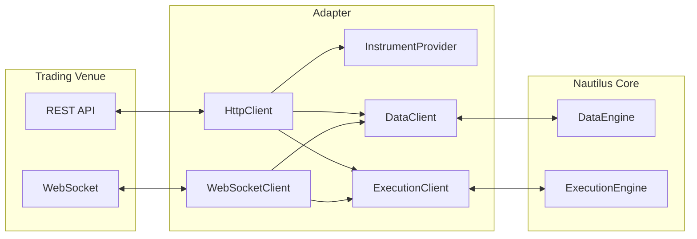

# 适配器 {#adapters}

适配器把数据提供商和交易场所接入 NautilusTrader。它们把场所专有协议翻译成数据引擎与执行引擎使用的领域对象和事件。官方 Python 适配器可从 `nautilus_trader.adapters` 获取，受支持的能力见[集成指南](./../integrations/index.md)。

一个适配器通常包含以下组件：



| 组件                 | 用途                                                     |
| -------------------- | -------------------------------------------------------- |
| `HttpClient`         | REST API 通信。                                          |
| `WebSocketClient`    | 实时数据流连接。                                         |
| `InstrumentProvider` | 从交易场所加载并解析金融工具定义。                       |
| `DataClient`         | 处理行情数据订阅与请求。                                 |
| `ExecutionClient`    | 处理订单提交、修改与撤销。                               |

## 配置与路由 {#configuration-and-routing}

每个适配器都为其支持的客户端暴露配置类型和工厂。配置选择场所专有设置，如产品线（product）、环境、凭据和金融工具加载策略。构造 `LiveNode` 时由工厂创建客户端。actor 和策略随后使用通用的 Nautilus API，而不直接调用适配器的传输层。

一个节点可以注册多个数据客户端和执行客户端。当某个请求、订阅或订单必须由特定客户端处理时，在 actor 或策略中传入 `client_id`。未显式指定客户端时，数据引擎和执行引擎使用节点配置的场所路由与默认路由。

## 自定义适配器 {#custom-adapters}

可以把适配器开发为独立的 Python 包，无需重新构建 NautilusTrader。自定义适配器承担与内置适配器相同的数据与执行职责，并可与它们共存于同一个 `LiveNode`。策略继续使用标准的请求、订阅和订单 API，节点把这些操作路由到已注册的客户端。

自定义包的客户端可以用 Python 实现，也可以把场所操作委托给它自己的 Rust/PyO3 扩展。两种方式都使用 [Python 客户端接口](./../developer_guide/python_adapters.md)。

独立扩展通过 PyO3 和 GIL 与已安装 NautilusTrader wheel 中的 Python 对象交互，不需要共享 Rust ABI，也不需要第二份 Nautilus 模型类型。请选择针对你已安装的 NautilusTrader 版本测试过的包版本。

用不同的客户端名把该包的工厂和配置注册到节点。自定义配置可保留场所专有字段，可导入配置（importable config）支持从包路径加载工厂。场所路由与默认路由的设置方式和内置客户端相同，也可以在策略中显式选择客户端。

[确定性 Python 模板](https://github.com/nautechsystems/nautilus_trader/blob/develop/examples/live/_template/README.md)演示了无场所连接下的数据交付、执行对账和订单成交。

### 缓存与状态归属 {#cache-and-state-ownership}

自定义客户端拿到的是只读缓存视图。它们可以查看金融工具、报价、订单、账户和持仓，但不能修改核心缓存。返回的对象是快照：改动快照不会影响策略或引擎看到的状态。

适配器运行在同步核心边界之外，向核心提交类型化数据、响应和执行事件，由核心处理。因此，适配器发出输出的调用返回，并不代表对应的缓存更新已经发生。这样缓存变更和引擎状态转换始终归核心所有。

缓存访问和输出绑定在所属节点的线程与生命周期上。仅有 GIL 并不意味着可以在其他线程访问，或在 dispose 之后访问。

### 启动与停止 {#running-and-stopping}

节点自己拥有事件循环时用 `node.run()`；在现有 asyncio 应用内则 await `node.run_async()`。两种启动方式都支持自定义 Python 客户端和独立 PyO3 客户端。节点在连接前把客户端绑定到运行中的事件循环，然后走正常的启动、对账和关闭流程。构造函数不会启动网络或后台任务。

对每个自定义客户端，命令和订阅变更按准入顺序执行。历史请求与对账可独立推进。慢命令会拖延该客户端后续的命令；命令队列满时，新工作会被拒绝而不是被悄悄丢弃。

关闭宿主事件循环之前，先等关闭流程完成。断开连接会停止准入，并要求适配器工作终止。发起取消并不能证明工作已经结束，未完成的清理会被上报。客户端实例只属于一次节点运行，不得复用到另一次运行。

两种启动方式下，自定义客户端都不支持 Redis/PostgreSQL 缓存支撑（cache backing）。该接口还要求把 v1 的 Cython 适配器迁移过来，而不是原样接受其源码。

历史请求完成、修订 bar、自定义发布/订阅以及网络 API 的差异，见[迁移细节与剩余限制](./../developer_guide/python_adapters.md#migration-from-v1)。独立扩展见[包构造与已安装 wheel 的校验](./../developer_guide/python_adapters.md#independent-rustpyo3-packages)。

## 金融工具提供商 {#instrument-providers}

金融工具提供商（instrument provider）加载场所定义并解析为 Nautilus 的 `Instrument` 对象。这部分行为由各适配器自行负责，其 Python API 可能提供独立加载器、专用提供商配置、经客户端配置控制的加载行为，或几者的组合。

`InstrumentProvider` 服务两类场景：

- 独立发现可用的金融工具，用于研究或回测
- 在 `sandbox` 或 `live` [环境上下文](./architecture.md#environment-contexts)中于运行时加载，供 actor 和策略使用

### 研究与回测 {#research-and-backtesting}

下例通过公共 Python API 加载一个 Binance USD-M 金融工具：

```python
import asyncio

from nautilus_trader.adapters.binance import BinanceDataClientConfig
from nautilus_trader.adapters.binance import BinanceEnvironment
from nautilus_trader.adapters.binance import BinanceInstrumentProviderConfig
from nautilus_trader.adapters.binance import BinanceProductType
from nautilus_trader.adapters.binance import load_binance_instruments


async def main() -> None:
    config = BinanceDataClientConfig(
        product_type=BinanceProductType.USD_M,
        environment=BinanceEnvironment.LIVE,
        instrument_provider=BinanceInstrumentProviderConfig(
            load_all=False,
            load_ids=["BTCUSDT-PERP.BINANCE"],
        ),
    )
    instruments = await load_binance_instruments(config)

    for instrument in instruments:
        print(instrument.id)


if __name__ == "__main__":
    asyncio.run(main())
```

### 实时交易 {#live-trading}

各集成的启动加载方式不同。例如 Binance 提供商配置可以加载完整目录：

```python
from nautilus_trader.adapters.binance import BinanceInstrumentProviderConfig

BinanceInstrumentProviderConfig(load_all=True)
```

也可以只加载指定金融工具：

```python
BinanceInstrumentProviderConfig(
    load_all=False,
    load_ids=["BTCUSDT-PERP.BINANCE", "ETHUSDT-PERP.BINANCE"],
)
```

`load_ids` 里填的是含场所后缀的 Nautilus 金融工具 ID，而不是场所原始代码。

金融工具加载的设置、默认值和过滤器因集成而异。把配置照搬到另一个适配器之前，先查阅相应的集成指南。

订阅、提交订单和执行对账本身不会加载金融工具。要么配置适配器在启动时加载每个所需工具，要么显式请求，并等其进入缓存后再使用。对账如何处理工具未加载的报告，见
[金融工具可用性](./execution/reconciliation.md#instrument-availability)。

## 数据客户端 {#data-clients}

数据客户端负责某个交易场所的行情订阅与请求。它们连接场所 API，把入站数据规范化为 Nautilus 类型。

### 请求数据 {#requesting-data}

actor 和策略可以用内置方法请求数据，数据通过回调返回：

```python
from collections.abc import Sequence
from typing import Any

from nautilus_trader.model import Bar
from nautilus_trader.model import BarType
from nautilus_trader.model import InstrumentId
from nautilus_trader.trading import Strategy


class MyStrategy(Strategy):
    def on_start(self) -> None:
        # Request an instrument definition
        self.request_instrument(InstrumentId.from_str("BTCUSDT-PERP.BINANCE"))

        # Request historical bars
        self.request_bars(BarType.from_str("BTCUSDT-PERP.BINANCE-1-HOUR-LAST-EXTERNAL"))

    def on_instrument(self, instrument: Any) -> None:
        self.log.info(f"Received instrument: {instrument.id}")

    def on_historical_bars(self, bars: Sequence[Bar]) -> None:
        self.log.info(f"Received {len(bars)} historical bars")
```

### 订阅数据 {#subscribing-to-data}

实时数据使用订阅方法：

```python
from nautilus_trader.model import Bar
from nautilus_trader.model import BarType
from nautilus_trader.model import InstrumentId
from nautilus_trader.model import TradeTick
from nautilus_trader.trading import Strategy


class MyStrategy(Strategy):
    def on_start(self) -> None:
        # Assumes the instrument has already been loaded into the cache
        self.subscribe_trades(InstrumentId.from_str("BTCUSDT-PERP.BINANCE"))
        self.subscribe_bars(BarType.from_str("BTCUSDT-PERP.BINANCE-1-MINUTE-LAST-EXTERNAL"))

    def on_trade(self, trade: TradeTick) -> None:
        self.log.info(f"Trade: {trade}")

    def on_bar(self, bar: Bar) -> None:
        self.log.info(f"Bar: {bar}")
```

:::tip
全部请求与订阅方法及对应回调的完整参考见 [Actor](./actors.md) 文档。
:::

## 执行客户端 {#execution-clients}

执行客户端负责某个交易场所的订单管理。它们把 Nautilus 订单命令翻译成场所专有 API 调用，并把执行报告转回 Nautilus 事件处理。

职责：

- 提交、修改、撤销订单。
- 处理成交与执行报告。
- 与交易场所对账订单状态。
- 处理账户与持仓更新。

执行客户端可以声明历史对账所适用的最早时间界限，以及必需的订单、成交和持仓来源是否完整。适配器提供这份契约后，引擎即可恢复权威的订单状态；对现有证据不足以支撑的历史持仓或组合经济事项，引擎不会强行套用。见
[有界历史安全](./execution/reconciliation.md#bounded-history-safety)。

### Reduce-only 执行契约 {#reduce-only-execution-contract}

执行客户端**绝不能静默丢弃** `reduce_only=true`。要么发送能强制同样意图的、已文档化的场所指令，要么在发送前拒绝订单。编码后的指令仍可能被交易场所拒绝，原因包括：

- 该产品不支持该指令。
- 订单不会减少现有持仓。
- 其他场所规则使该组合无效。

等效的强制指令可以代替字面上的场所标志。例如，Binance Futures 的全平仓条件单在 Nautilus 订单中保留 `reduce_only=true`，但适配器发送 `closePosition=true`，不带 Binance 不兼容的 `reduceOnly` 字段。见
[Binance Futures 平仓单](./../integrations/binance.md#close-position)。

回测和 sandbox 撮合引擎在启用 `use_reduce_only` 时强制执行 reduce-only，禁用时拒绝 reduce-only 订单。自定义执行客户端和外部路由遵循同样的"发送或拒绝"契约。

订单命令与场所结果是异步的。`OrderSubmitted` 表示适配器已开始提交路径，不代表场所已接受订单。传输失败可能让结果未知，因此适配器使用数据流更新、查询或对账，而不是假定订单被拒。

对新订单，`ExecutionEngine` 依次使用显式选择的客户端、场所路由或配置的默认路由。对已有订单的后续命令，在可知时返回其 originating client。从策略视角看订单管理，见 [执行](./execution/index.md) 指南。

:::tip
构建自定义适配器见[适配器开发指南](./../developer_guide/adapters.md)。
:::

## 相关指南 {#related-guides}

- [实时交易](./live.md)：用适配器配置并运行实时交易。
- [执行](./execution/index.md)：经由适配器执行订单。
- [数据](./data/index.md)：适配器提供的行情数据。
