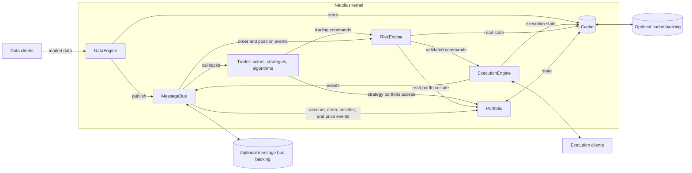
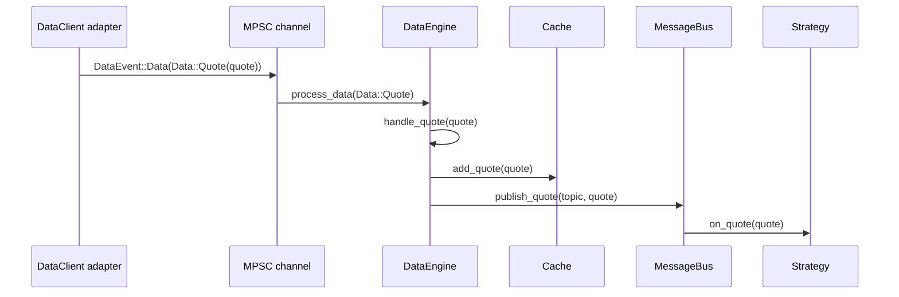
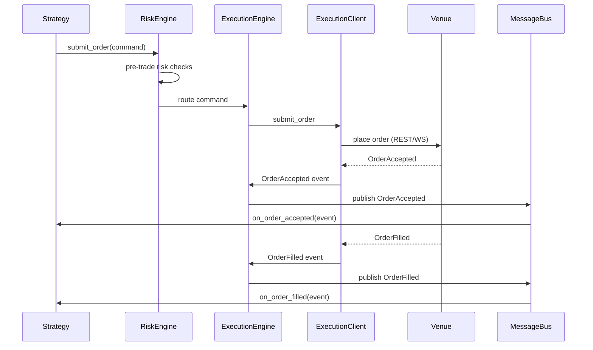
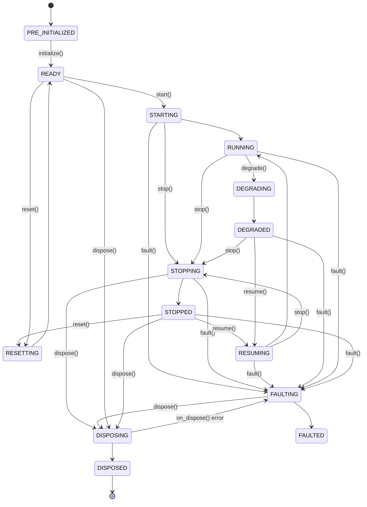
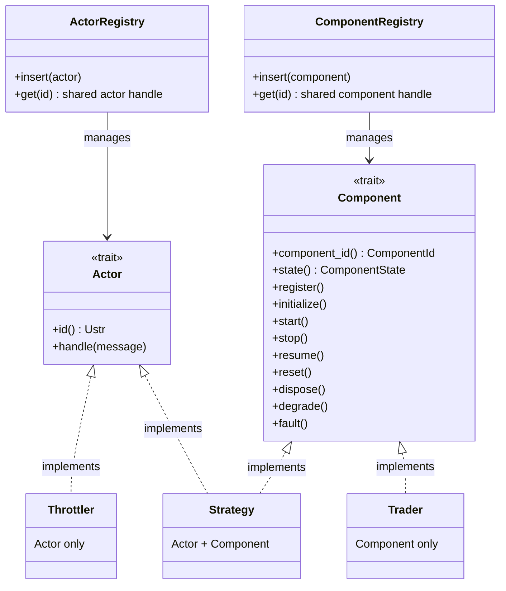
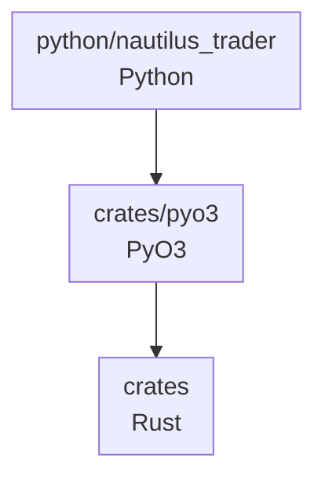
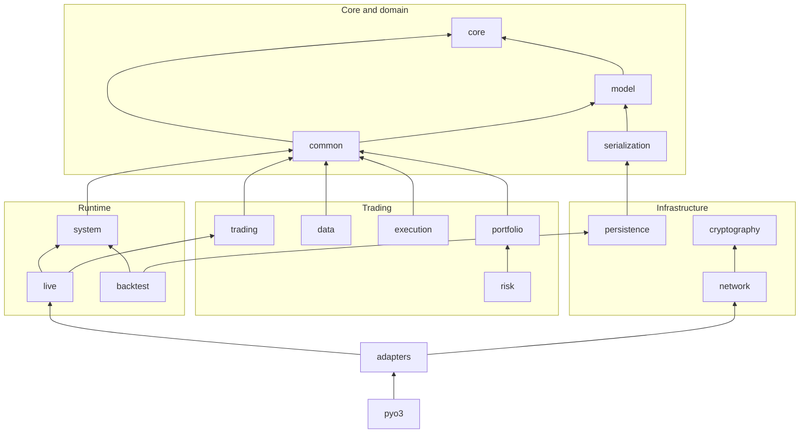

# 架构

本页介绍 NautilusTrader 的组件、运行时边界和数据流。[设计原则与策略](./../developer_guide/design_principles.md)指导着这一结构。

:::note
在本指南中，**Nautilus 系统边界**指一个 Nautilus 节点实例的运行时。
:::

## 架构风格 {#architectural-style}

NautilusTrader 采用以下架构技术与设计模式：

- [领域驱动设计（DDD）](https://en.wikipedia.org/wiki/Domain-driven_design)
- [事件驱动架构](https://en.wikipedia.org/wiki/Event-driven_programming)
- [消息传递模式](https://en.wikipedia.org/wiki/Messaging_pattern)（发布/订阅、请求/响应、点对点）
- [端口与适配器](https://en.wikipedia.org/wiki/Hexagonal_architecture_(software))
- [仅崩溃设计](#crash-only-design)

这些技术支持的优先级与契约见[设计原则与策略](./../developer_guide/design_principles.md)。

## 系统架构 {#system-architecture}

NautilusTrader 既提供组装交易系统的框架，也为若干[环境上下文](#environment-contexts)提供默认实现。

内核拥有共享的交易核心。适配器通过引擎边界交换行情与执行消息。

### 核心组件 {#core-components}

#### `NautilusKernel` {#nautiluskernel}

中央编排组件：

- 初始化并管理共享的核心组件。
- 配置消息基础设施。
- 选择环境专有的时钟与行为。
- 协调共享资源与生命周期管理。
- 为系统操作提供单一生命周期边界。

#### `MessageBus` {#messagebus}

`MessageBus` 集中路由组件间通信：

- **发布/订阅**：把事件和数据广播给多个消费者。
- **请求/响应**：把请求与其响应对应起来。
- **命令/事件消息**：通过类型化端点路由动作与状态变更。
- **可选外部支撑**：经 Redis 等支撑发送选定的发布消息，并为实时节点接收配置好的外部流。这些流提供实时传输；持久的状态恢复属于缓存或事件存储。

#### `Cache` {#cache}

`Cache` 在内存中保存交易状态：

- 存储金融工具、账户、订单、持仓等。
- 为交易组件提供索引化读取。
- 可通过缓存数据库支撑持久化所配置的状态。

#### `DataEngine` {#dataengine}

在系统内处理并路由行情数据：

- 处理报价、成交、bar、订单簿、自定义数据及其他受支持类型。
- 通过数据客户端管理订阅与配对的请求/响应流。
- 让每个客户端订阅保持活动，直到最后一个持有者释放；保留最初的客户端路由与参数，用于最终退订。
- 按各消费者的订阅与请求把结果数据路由给它们。
- 管理数据从外部来源到内部组件的流动。

#### `ExecutionEngine` {#executionengine}

管理订单生命周期与执行：

- 把交易命令路由到合适的执行客户端。
- 跟踪订单与持仓状态。
- 与风险管理系统协作。
- 处理来自交易场所的执行报告与成交。
- 应用对账事件，并对各场所的报告分别对账。

实时执行中，`ExecutionManager` 跟踪对账状态并协调各项对账操作；`LiveNode` 拥有周期检查、截止时间与取消。各自的职责与依赖见
[对账组件图](./execution/reconciliation.md#component-responsibilities)。

#### `RiskEngine` {#riskengine}

提供风险管理：

- 校验订单字段、余额、数量、名义金额、reduce-only 行为和交易状态。
- 应用可配置的提交与修改速率限制。
- 跟踪其控制项所依赖的订单与持仓事件。

#### `Portfolio` {#portfolio}

维护派生的账户与持仓状态：

- 跟踪余额、净持仓、保证金、已实现与未实现盈亏（PnL）以及暴露。
- 根据账户、订单、持仓、报价、bar 和 mark 价格事件更新状态与估值。

#### `Trader` {#trader}

协调用户交易组件：

- 注册 actor、策略和执行算法。
- 管理它们的生命周期、时钟和事件订阅。

### 环境上下文 {#environment-contexts}

环境上下文定义节点的数据来源与执行场景：

- `Backtest`：历史数据加模拟执行。
- `Sandbox`：实时数据加模拟执行。
- `Live`：实时数据加真实场所连接，账户可为模拟盘或真实账户。

### 通用核心 {#common-core}

回测、sandbox 和实时系统共用 `nautilus-system` crate 中的 `NautilusKernel` 结构体。内核拥有公共的缓存、投资组合、引擎、trader、时钟和消息基础设施。

*端口与适配器*架构风格让模块化组件能通过显式的客户端、支撑存储和组件接口集成到核心中，包括自定义实现。

### 数据与执行流模式 {#data-and-execution-flow-patterns}

#### 数据流：一个 quote tick 的旅程 {#data-flow-life-of-a-quote-tick}

下面的追踪展示一个 `QuoteTick` 从网络到策略的完整路径。成交和 bar 走同样的"先缓存后发布"路径，只是 handler 名不同。订单簿 delta 和深度快照走另一条路线（见步骤下方的注）。

1. **适配器收到原始数据。** 某个场所专有的 `DataClient`（如 Binance 或 Bybit）收到 WebSocket 消息，解析并构造出 `QuoteTick`。
1. **适配器发送数据事件。** 适配器经 MPSC 通道发送 `DataEvent::Data(Data::Quote(quote))`。实时模式下这是异步无界通道；回测中引擎直接喂数据。
1. **`DataEngine` 处理事件。** 通道接收端把事件路由到 `DataEngine::process_data`，后者分发给 `handle_quote`。
1. **`Cache` 存储报价。** `handle_quote` 调用 `cache.add_quote(quote)`。插入成功后，各组件即可通过 `self.cache.quote(instrument_id)` 读到它。
1. **`MessageBus` 发布。** 引擎在由工具 ID 推导的主题上发布该报价，如 `data.quotes.BINANCE.BTCUSDT-PERP`。`MessageBus` 找到订阅该主题的全部 handler。
1. **策略 handler 运行。** 每个订阅策略的 `on_quote(quote)` 在单线程核心上运行。`self.cache.quote(instrument_id)` 返回同一报价的前提是：插入成功，且读取前没有更新的报价将其替换。

:::note
对报价、成交和 bar，引擎先尝试写入缓存再发布：

- 同步的持久化或入队错误会阻止内存插入，但引擎记录错误后仍会发布该值。因此同步插入失败后，已发布的报价可能不在缓存中。
- 内置数据库支撑的实体写入是异步完成的，之后的数据库错误不会回滚缓存插入。

回调也可能观察到比其所处理事件更新的缓存状态，同步重入时同样如此。投递顺序不提供事件时刻的快照，[排队分发要求](./../developer_guide/callback_dispatch.md#maintenance-and-observable-state)也不会补上。

订单簿 delta 和深度快照直接发布，当前簿状态由 `BookUpdater` 订阅单独维护。
:::

#### 执行流：一个订单的旅程 {#execution-flow-life-of-an-order}

这条简化的追踪展示直接提交订单、场所成功接受、随后成交的过程，省略了执行算法、模拟执行和传输结果不明等情况。相关路径见 [执行](./execution/index.md)和[命令结果](./execution/policies.md#command-outcomes)。适配器把场所消息翻译成下图所示的执行事件：

1. **策略创建命令。** 策略调用 `self.submit_order(order)`。
1. **`RiskEngine` 校验。** 运行配置好的订单、余额、数量、名义金额、交易状态和速率检查。任一检查失败时，策略收到 `OrderDenied`，订单不会到达交易场所。
1. **`ExecutionEngine` 路由。** 命令被路由到目标场所的 `ExecutionClient`。
1. **`ExecutionClient` 提交。** 适配器经 REST 或 WebSocket 把订单发往场所。
1. **事件回流。** 场所返回确认与成交。每个事件（`Accepted`、`Filled`、`Canceled`、`Rejected` 或 `Expired`）流经 `ExecutionEngine`，引擎在 `Cache` 中更新订单状态，并把事件送达策略的 handler。成交事件还会触发持仓与投资组合更新。

#### 组件状态管理 {#component-state-management}

实现 `Component` trait 的类型使用有限状态机。`ComponentState` 定义稳定态与过渡态，`ComponentTrigger` 约束合法的转换：

**稳定态**：

- **PRE_INITIALIZED**：组件已存在，但尚未就绪到可履行其规格。
- **READY**：组件已配置，可以启动。
- **RUNNING**：组件正常运行，可履行其规格。
- **STOPPED**：组件已成功停止。
- **DEGRADED**：组件可能无法满足完整规格。
- **FAULTED**：组件因检测到故障而关闭。
- **DISPOSED**：组件已关闭并释放资源。

**过渡态**：

- **STARTING**：组件正在执行 `start` 动作。
- **STOPPING**：组件正在执行 `stop` 动作。
- **RESUMING**：组件在停止或降级后正在执行 `resume` 动作。
- **RESETTING**：组件正在执行 `reset` 动作。
- **DISPOSING**：组件正在执行 `dispose` 动作。
- **DEGRADING**：组件正在执行 `degrade` 动作。
- **FAULTING**：组件正在执行 `fault` 动作。

过渡态覆盖相应的生命周期回调，应当保持简短。回调返回错误时，转换停留在其过渡态。

`dispose()` 是例外：`on_dispose` 失败会把组件转入 FAULTED，使其仍可被退役。`on_stop` 或 `on_fault` 失败则让组件停留在过渡态，trader 退役流程仍可从中调用 `dispose()` 完成清理。

reset 成功后，组件在回到 READY 之前释放其保留的数据订阅。下次启动时针对重置后的数据引擎获取新的订阅。`on_reset` 失败时，组件停留在 RESETTING，订阅保持不变。

正常退役过程中，trader 先运行 `on_dispose`，再释放组件保留的数据订阅，最后移除其注册与簿记条目。`on_dispose` 失败时，组件保持注册状态、订阅不变。退役由此产生的 FAULTED 组件时会释放这些订阅，但不会再次调用失败的 disposal 钩子。

每个组件释放时会移除其消息总线 handler，并递减所路由数据客户端的持有计数。只有当最后一个持有者释放同一物理订阅时，数据客户端才向上游发送退订。引擎管理的资源同样遵循"最后持有者"规则，包括订单簿快照、合成数据流、价差报价、内部 bar 和期权链。

#### Actor 与 Component trait 的分工 {#actor-vs-component-traits}

Rust 实现把定向消息分发与生命周期管理分开：

**`Actor` trait：消息分发**

- 提供 `handle` 方法，接收经 actor 注册表分发的消息。
- 支持按 actor ID 查找。类型化的非检查访问器在运行时核对具体 actor 类型，返回 `ActorRef` 守卫。
- 供接收定向消息的类型使用，如策略和限流器（throttler）。

**`Component` trait：生命周期管理**

- 管理 `start`、`stop`、`resume`、`reset`、`dispose` 等状态转换。
- 把组件注册到 trader ID、时钟和缓存。
- 通过上述有限状态机跟踪组件状态。
- 供需要受管生命周期行为的 actor、策略、执行算法和 `Trader` 使用。数据、风控和执行引擎暴露各自的生命周期方法，但不实现该 trait。

:::note
访问消息总线不依赖 `Actor` trait。运行在节点线程上的代码可以使用线程局部的 `MessageBus` API；`Actor` 的特定作用是启用基于注册表、按 actor ID 的分发。
:::

这种分离带来三种组合：

- **仅 Actor**：无生命周期的轻量消息处理器，如 `Throttler`。
- **仅 Component**：有生命周期管理、但不需要定向 actor 分发的类型，如 `Trader`。
- **两者兼有**：需要生命周期管理和定向分发的数据 actor，包括策略和执行算法。

:::warning
两套独立的线程局部注册表支撑这些访问模式。两个注册表的 `get` 方法都返回共享的 `Rc<UnsafeCell<dyn ...>>` 句柄。

- **Component 访问**：生命周期包装函数用私有借用守卫拒绝重叠的生命周期访问。该保护不适用于通过原始注册表句柄的任意访问。
- **Actor 访问**：类型化访问器返回 `ActorRef` 守卫，它不能阻止同一 actor 上同时存在两个守卫。

创建重叠的可变引用是未定义行为。请在同一个同步作用域内获取、使用并丢弃 `ActorRef`，**绝不保存它，也不跨 `.await` 点持有**。同一 actor 的重入查找是当前分发模型的限制，不是安全的别名保证。

对排队分发而言，仅释放 actor 守卫并不构成安全交付边界：外层可变运行时借用也必须结束。嵌套扇出期间，仅靠订阅者准入顺序无法保持发布顺序。待投递需要注册与生命周期身份，才能落实[分发要求](./../developer_guide/callback_dispatch.md)。
:::

### 消息传递 {#messaging}

`MessageBus` 在组件之间传递数据、命令和事件，组件之间无需持有彼此的直接引用。

#### 线程模型 {#threading-model}

在节点内部，核心在**单线程**上消费并分发消息，包括：

- `MessageBus` 与 actor 回调分发。
- 策略逻辑与订单管理。
- 风控检查与执行协调。
- 缓存读写。

串行处理协调节点内的状态变更。同步重入仍受上文所述限制约束。嵌套回调间的发布顺序由[排队分发要求](./../developer_guide/callback_dispatch.md)定义。实时输入与延迟可能导致行为与回测不同。组件以*类似*[actor 模型](https://en.wikipedia.org/wiki/Actor_model)的方式同步消费消息。

:::note
[LMAX 架构](https://martinfowler.com/articles/lmax.html)是单线程事务处理的一个相关范例。
:::

后台服务使用独立线程或进程级多线程 Tokio 运行时，运行时的工作线程数可配置：

- **网络与适配器**：WebSocket 连接、REST 客户端和数据源以异步任务运行。
- **日志**：worker 在同步核心之外接收日志事件。
- **持久化**：Redis 和 PostgreSQL 缓存支撑把写入排入异步任务。DataFusion 在 Tokio 运行时上执行数据目录查询 future。

异步生产者通过通道发送数据与执行事件。节点 runner 接收它们，并用线程局部的 `MessageBus` 在核心线程上分发到引擎端点。每个线程拥有自己的总线实例，通道负责桥接其他线程或任务的工作。

## 仅崩溃设计 {#crash-only-design}

处理不可恢复的故障时，NautilusTrader 借鉴了[仅崩溃设计](https://en.wikipedia.org/wiki/Crash-only_software)。仓库的 release 构建在 panic 时中止（abort），让外部 supervisor 重启进程，而不是让进程带着可能无效的状态继续运行。

恢复行为：

- **启动恢复**：配置好的缓存与事件存储恢复在正常启动流程中执行，没有单独的"仅崩溃"入口。常规启动和专门的恢复测试走同一条初始化流程。
- **外部状态**：配置好的支撑存储跨进程重启保留选定状态，减少恢复工作量与状态丢失风险。持久性取决于支撑存储及其设置。
- **Supervisor 管理的重启**：不可恢复故障后，重启策略归外部进程 supervisor。abort 会跳过故障进程内的优雅清理；实际停机时间取决于 supervisor、已配置状态和支撑存储。
- **快速恢复**：设计目标是 supervisor 重启进程后借助正常启动恢复，尽量缩短停机时间。恢复耗时取决于要恢复的状态及其支撑存储。
- **执行恢复**：发往场所的命令通常不能盲目重试，这个边界由执行对账处理。

:::note
正常运行仍走优雅关闭流程，如 `stop` 和 `dispose`：它们拆解客户端，并在配置允许时保存状态、刷写写入器。仅崩溃行为只针对不可恢复的故障——此时继续正常清理可能并不安全。
:::

该设计与[数据完整性策略](./../developer_guide/design_principles.md#data-integrity-and-failure)相辅相成：由不可恢复的不变量破坏引发的 panic，会立即终止以仓库 release 配置构建的进程。

**参考文献**：

- [Crash-Only Software](https://www.usenix.org/conference/hotos-ix/crash-only-software)：Candea 与 Fox，HotOS 2003。
- [Microreboot: A technique for cheap recovery](https://www.usenix.org/events/osdi04/tech/candea.html)：
  Candea 等，OSDI 2004。
- [The properties of crash-only software](https://brooker.co.za/blog/2012/01/22/crash-only.html)：
  Marc Brooker。
- [Crash-only software: More than meets the eye](https://lwn.net/Articles/191059/)：LWN.net。
- [Recovery-Oriented Computing (ROC) Project](http://roc.cs.berkeley.edu/)：加州大学伯克利分校与斯坦福。

## 框架组织 {#framework-organization}

Rust workspace 把相关行为归入 `crates/` 下的各个 crate。`python/nautilus_trader/` 下的公共包在 Rust 实现之上提供 Python 门面与配套工具。

### 核心与领域 {#core-and-domain}

- `core`：底层时间、字符串、序列化与运行时原语。
- `model`：交易领域类型，包括金融工具、账户、订单、持仓和行情数据。
- `common`：共享运行时服务，包括缓存、消息总线、时钟、actor、组件与日志。
- `serialization`：模型与事件类型的 schema 和编码支持。

### 交易与分析 {#trading-and-analysis}

- `analysis`：交易绩效统计与分析。
- `indicators`：技术指标。
- `data`：行情数据引擎、聚合与数据工具。
- `execution`：订单执行、模拟执行与对账原语。
- `portfolio`：投资组合核算与状态。
- `risk`：交易前控制、仓位规模与交易状态。
- `trading`：策略与执行算法。

### 基础设施与运行时 {#infrastructure-and-runtimes}

- `network` 与 `cryptography`：网络客户端、传输支持、签名与加密提供商。
- `infrastructure`、`persistence` 与 `event_store`：数据库支撑、数据目录、对象存储与事件存储集成。
- `system`：回测、sandbox 和实时[环境上下文](#environment-contexts)共享的内核。
- `backtest` 与 `live`：环境专有的引擎与节点。
- `adapters/*`：交易场所、经纪商、数据、区块链与 sandbox 集成。
- `pyo3`：Python 扩展聚合器。
- `plugin`、`cli` 与 `testkit`：插件接口、命令行工具与测试支持。

## 代码结构 {#code-structure}

`crates/` 目录包含 Rust 实现。PyO3 把其 Python 绑定收集进 `nautilus_trader._libnautilus` 扩展模块，`python/nautilus_trader/` 暴露公共 Python 门面。

`nautilus-core` 和 `nautilus-model` crate 为原生消费者保留可选的 C FFI。workspace 中其他 crate 使用 Rust API 或 PyO3 绑定。

### 依赖流 {#dependency-flow}

### Rust crate {#rust-crates}

Rust crate 清单声明 workspace 依赖和可选 feature 标志。feature 用于启用可选功能，且不会进入最小化构建。

下面展示部分直接的 workspace 依赖。箭头指向被依赖方；对整体方向没有说明作用的边已省略。

**Feature 标志**：

| Feature     | 主要 crate                                | 效果                                                             |
| ----------- | ----------------------------------------- | ---------------------------------------------------------------- |
| `streaming` | `data`、`system`、`live`、`backtest`      | 增加目录流式的持久化支持。                                       |
| `cloud`     | `persistence`                             | 增加 AWS、Azure、GCP 和 HTTP 对象存储后端。                      |
| `python`    | 面向 Python 的 crate                      | 增加 PyO3 绑定及各 crate 所需的传递 feature。                    |
| `defi`      | 领域、数据、运行时与绑定 crate            | 增加 DeFi 与区块链类型及运行时代码路径。                         |

:::note
源码构建需要 Rust。预编译 Python wheel 运行时无需 Rust 工具链。
:::

### 类型安全 {#type-safety}

Rust 代码库依赖编译器对安全代码的保证。每个 `unsafe` 块显式退出这些保证，内存与类型安全因此取决于其文档化的不变量。见[开发指南](./../developer_guide/rust.md)的 Rust 部分。

PyO3 校验绑定参数，并把 Rust 错误转换为 Python 异常：

:::info
给类型化的 PyO3 参数传入不兼容的 Python 值时，在 Rust 方法体运行之前就会抛出 Python 异常。
:::

### 错误与异常 {#errors-and-exceptions}

API 文档描述 NautilusTrader 的预期错误及其产生条件。

:::warning
Python 标准库和第三方依赖也可能在这些契约之外抛出异常。
:::

### 进程与线程 {#processes-and-threads}

:::warning[每进程一个节点]
同一进程内**并发**运行多个 `LiveNode` 或 `BacktestNode` 实例不受支持，因为它们的运行时状态没有隔离：

- **Logger 模式与时间戳**：日志子系统使用全局状态。回测会在静态与实时模式之间切换日志时钟。
- **线程局部运行时状态**：节点会为其所在线程安装消息总线、actor 与组件注册表以及通道发送端。
- **进程级运行时状态**：Tokio 运行时和日志 worker 由整个进程共享。

每个节点在下一个启动前 dispose，即可支持多个节点顺序执行。在同一线程上构造替代的 `LiveNode` 之前，还要丢弃前一个节点，或释放 Python 中对它的全部引用；仅 dispose 不会释放其构造守卫。聚焦测试会演练顺序节点构造与缓存支撑的状态恢复。

生产部署时，把多个策略加入同一进程中的一个 `LiveNode`。需要并行执行或负载隔离时，让每个节点运行在各自独立的进程中。
:::

### 内存分配 {#memory-allocation}

事件驱动核心在消息分发、订单事件处理和订单簿维护过程中不断分配和释放对象。分配器的选择可能影响吞吐量与常驻内存，影响大小取决于负载、平台和构建配置。

`nautilus` CLI 和 Python wheel 使用 [mimalloc](https://crates.io/crates/mimalloc) 承担 Rust 分配。为自定义二进制选择分配器之前，请在有代表性的负载上比较各分配器。按[基准测试指南](./../developer_guide/benchmarking.md)记录源码版本、构建设置、环境、测量方法、吞吐量和常驻内存。

一个 Rust 二进制链接恰好一个全局分配器，库不强加分配器，因此 NautilusTrader 的 crate 保持分配器中立。直接针对这些 crate 构建时，从你自己的二进制显式选用（见 [Rust 指南](./rust.md#memory-allocator)）。

## 相关指南 {#related-guides}

- [设计原则](./../developer_guide/design_principles.md)：原则、策略与权衡。
- [标识符存储](./../developer_guide/rust.md#identifier-storage)：标识符的生命周期与内存成本。
- [行为模型](./behavioral_models.md)：模型表示与分发。
- [概览](./overview.md)：NautilusTrader 高层介绍。
- [Python](./python.md)：Python 所有权、运行时与公共 API 边界。
- [Rust](./rust.md)：原生 Rust API 与运行时用法。
- [消息总线](./message_bus.md)：核心消息基础设施。
