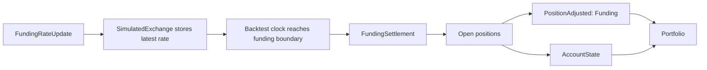

# 回测账户与保证金 {#backtest-accounts-and-margin}

回测场所使用模拟账户处理余额、保证金和资金费结算。完整账户模型与保证金公式见[记账](./../accounting.md)。

## 资金费 {#funding}

回测在资金费边界处用 `FundingRateUpdate` 数据结算永续合约资金费：

- 带 `next_funding_ns` 时，模拟交易所保存最新费率，回测时钟在该时间戳发出一次 `FundingSettlement`。
- 不带 `next_funding_ns` 时，只有 `ts_event` 落在 `interval` 边界上才结算。
- 未落在边界上的更新只是普通策略数据，不产生资金费收付。



结算先调整持仓中仓位和对应账户余额，Portfolio 随后才观察到新状态。

`PositionAdjusted` 仍是持仓记账事件。**正资金费率**对多头扣款、对空头入账。该调整改变已实现盈亏，对应的账户余额更新记录现金变动。

## 账户 {#accounts}

每个回测场所使用 `CASH`、`MARGIN`、`BETTING` 三种 `account_type` 之一。低层 API 直接接受模型类型：

```python
from decimal import Decimal

from nautilus_trader.backtest import BacktestEngine
from nautilus_trader.config import BacktestEngineConfig
from nautilus_trader.execution import MakerTakerFeeModel
from nautilus_trader.model import AccountType
from nautilus_trader.model import Money
from nautilus_trader.model import OmsType
from nautilus_trader.model import Venue

engine = BacktestEngine(BacktestEngineConfig())
engine.add_venue(
    venue=Venue("BINANCE"),
    oms_type=OmsType.NETTING,
    account_type=AccountType.CASH,
    starting_balances=[Money.from_str("10_000 USDT")],
    fee_model=MakerTakerFeeModel(
        maker_rate=Decimal("0.001"),
        taker_rate=Decimal("0.001"),
    ),
)
```

高层 API 接受同样的枚举值，但初始余额用字符串表示：

```python
from decimal import Decimal

from nautilus_trader.config import BacktestVenueConfig
from nautilus_trader.execution import MakerTakerFeeModel
from nautilus_trader.model import AccountType
from nautilus_trader.model import BookType
from nautilus_trader.model import OmsType

venue = BacktestVenueConfig(
    name="SIM",
    oms_type=OmsType.NETTING,
    account_type=AccountType.CASH,
    book_type=BookType.L1_MBP,
    starting_balances=["10_000 USDT"],
    fee_model=MakerTakerFeeModel(
        maker_rate=Decimal("0"),
        taker_rate=Decimal("0"),
    ),
)
```

## 保证金模型 {#margin-models}

保证金账户默认使用 `LeveragedMarginModel`。若希望按工具固定的初始保证金与维持保证金比例预留、且不受账户杠杆下调影响，传入 `StandardMarginModel`。

```python
from decimal import Decimal

from nautilus_trader.config import BacktestVenueConfig
from nautilus_trader.execution import MakerTakerFeeModel
from nautilus_trader.model import AccountType
from nautilus_trader.model import BookType
from nautilus_trader.model import OmsType
from nautilus_trader.model import StandardMarginModel

venue = BacktestVenueConfig(
    name="SIM",
    oms_type=OmsType.NETTING,
    account_type=AccountType.MARGIN,
    book_type=BookType.L1_MBP,
    starting_balances=["1_000_000 USD"],
    margin_model=StandardMarginModel(),
    fee_model=MakerTakerFeeModel(
        maker_rate=Decimal("0"),
        taker_rate=Decimal("0"),
    ),
)
```

`BacktestVenueConfig` 直接接受内置的 `StandardMarginModel` 和 `LeveragedMarginModel`
对象。高层配置不会从类路径字符串加载自定义保证金模型。
