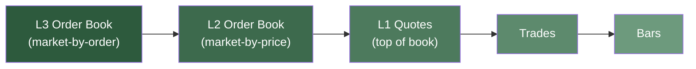

# 回测数据与交易场所 {#backtest-data-and-venues}

## 数据 {#data}

历史数据推动回测时钟前进、更新模拟市场状态，并驱动策略回调。场所的 `book_type` 决定哪些数据能更新撮合订单簿，因此配置必须与可用数据匹配。

订单簿数据比 quotes、trades 或 bars 暴露更多执行细节。但即便是录制下来的订单簿，也无法展示模拟订单会如何改变市场。NautilusTrader 支持的下列数据按细节程度从高到低排列：

粒度更细的数据能还原更多录制到的排队与深度信息；粒度更粗的数据则需要更多模拟假设。

- **L3 订单簿数据（market-by-order）**：每个记录价位的逐笔订单。
- **L2 订单簿数据（market-by-price）**：每个记录价位的汇总数量。
- **L1 quote ticks（market-by-price）**：最优买卖价格与数量。
- **Trade ticks**：记录下来的成交。
- **Bars**：固定区间内价格与成交量的聚合。

### 选择数据：成本与精度 {#choosing-data-cost-vs-accuracy}

策略开发早期，bar 数据往往够用，而且比逐笔或订单簿数据更便宜、更易获取。但 bar 无法确定区间内的价格顺序、价差、深度和排队位置，因此对执行敏感的策略需要更细粒度的验证。

:::tip
条件合适时，先用 bar 验证核心信号。若结果依赖价差、区间内精确顺序、紧止损出场或排队位置，先换用 quotes、trades 或深度数据再下结论。
:::

## 交易场所 {#venues}

初始化回测场所时，要为执行处理指定其内部订单
`book_type`：

- `L1_MBP`：Level 1 按价聚合（默认）。只维护订单簿第一档。
- `L2_MBP`：Level 2 按价聚合。维护订单簿深度，每个价位聚合为一笔订单。
- `L3_MBO`：Level 3 逐笔委托。维护订单簿深度，按数据提供的内容跟踪所有单笔订单。

`book_type` 决定哪些数据能更新簿状态并驱动撮合。对于不适用于所选簿类型的数据：

- 撮合引擎忽略它，不更新簿和价格。
- 外层回测时钟照常前进。
- 策略仍能经数据引擎收到已订阅的数据。

精度校验取决于撮合路径。例如被 L2 或 L3 场所忽略的 bar，会在可执行 bar 精度检查之前就返回。

| 数据类型          | L1_MBP            | L2_MBP            | L3_MBO            |
| ----------------- | ----------------- | ----------------- | ----------------- |
| `QuoteTick`       | 更新订单簿      | *已忽略*         | *已忽略*         |
| `TradeTick`       | 触发撮合 | 触发撮合 | 触发撮合 |
| `Bar`             | 更新订单簿      | *已忽略*         | *已忽略*         |
| `OrderBookDelta`  | *已忽略*         | 更新订单簿      | 更新订单簿      |
| `OrderBookDeltas` | *已忽略*         | 更新订单簿      | 更新订单簿      |
| `OrderBookDepth`  | 更新订单簿      | 更新订单簿      | 更新订单簿      |

数据粒度必须与订单 `book_type` 匹配。Nautilus **无法**从 quotes、trades 或 bars 等低层级数据**生成更高粒度**（L2 或 L3）的数据。

:::warning[L2 与 L3 的订单簿数据]
若场所的 `book_type` 指定为 `L2_MBP` 或 `L3_MBO`，quotes 和 bars 不会更新订单簿。请确保提供了订单簿 delta 数据，否则订单可能看起来永远无法成交。
:::

:::warning[L1 忽略订单簿 delta]
使用 `L1_MBP`（默认）时，撮合引擎会忽略订单簿 delta。若你要订阅订单簿 delta，请把场所 `book_type` 设为 `L2_MBP` 或 `L3_MBO`。sandbox 执行同理，其撮合引擎使用相同的 `book_type` 配置。
:::
