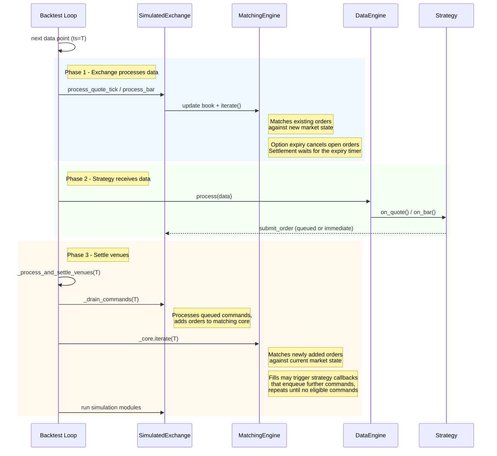

# 回测执行流程 {#backtest-execution-flow}

回测循环先处理市场状态再执行策略回调，然后结算同一时间戳产生的命令。

## 数据与消息顺序 {#data-and-message-sequencing}

回测主循环先为新市场数据执行订单撮合处理，再由数据引擎把数据分发给 actor 和策略。

### 主循环流程 {#main-loop-flow}

对每个数据点，引擎依次执行三个阶段：

1. **交易所处理**：模拟交易所用新流入的市场数据更新订单簿，并驱动撮合引擎遍历一遍，撮合与新市场状态匹配的已有订单。
1. **策略回调**：数据引擎通过回调（如 `on_quote`、`on_bar`）把该数据点分发给 actor 和策略。策略可能在这些回调中提交、撤销或修改订单。
1. **场所结算**：引擎排空所有排队的场所命令，再驱动撮合引擎撮合新提交的订单。如此重复，直到没有任何可执行的命令，因此级联订单（例如 `on_order_filled` 中提交的对冲单）能在同一时间戳内结算。更早的、被延迟的延迟命令遵循[命令结算](#command-settling)下的按工具限定规则。



三个阶段保证已挂单先于新提交订单看到新流入的市场数据。

定时器事件使用同一套结算机制，按时间戳分批。时间戳 T 上的所有回调先执行完，随后场所为 T 结算，时钟才推进到 T+1。只包含组合快照定时器的时间戳不会释放更早的延迟命令。

内部聚合 bar 所用定时器见
[内部 bar 聚合定时](./bar-execution.md#internal-bar-aggregation-timing)。

### 延迟的期权结算 {#deferred-option-settlement}

在期权的到期时间戳，自动到期检查会关闭其市场、撤销未成交订单并拒绝新订单。持仓结算要等到该时间戳上的所有市场数据处理完毕，使结算能看到该时间戳可用的最新标的价格。

显式的 `InstrumentClose`（`InstrumentCloseType::ContractExpired`）会立即尝试结算。流式批次必须把**同一时间戳的全部数据保持在一起**，`BacktestNode` 会自动做到这一点。

`SimulatedVenueConfig.defer_option_settlement` 默认为 `true`。回测引擎会把结算安排在到期时间戳的全部市场数据之后，无需等到下一个时间戳。直接驱动 `SimulatedExchange` 时，请把到期处理排在该时间戳的数据之后，或显式设置 `defer_option_settlement=false` 以立即结算。立即结算可能用到**较旧的标的价格**——若同时间戳的另一条更新尚未处理。

### 命令结算 {#command-settling}

#### 同周期命令 {#same-cycle-commands}

一笔成交可能触发策略回调再提交另一笔订单，例如 `on_order_filled` 里的止损单。引擎排空场所命令队列，并处理这些事件产生的命令，直到当前周期没有任何可执行命令。在该时间戳创建、且已到期的命令会在同一周期内结算，包括针对其他工具的零延迟和同 tick 命令。

模拟模块在命令循环结束后运行一次。

#### 延迟命令 {#latency-delayed-commands}

`LatencyModel` 会把每条命令放入场所的 inflight 队列，附带到达时间戳。命令到期后，由结算点决定引擎是否放行它：

| 结算点                 | 放行的到期命令                                                           |
| ------------------------------ | -------------------------------------------------------------------------- |
| 市场数据                    | 同时间戳命令，以及该数据所属工具的更早命令。      |
| 仅组合快照定时器 | 同时间戳命令。                                                   |
| 其他定时器                    | 定时器时间戳上全部到期命令。                                   |
| 资金费结算        | 资金费结算时间戳上全部到期命令。                      |
| 关闭排空                 | 时钟推进到最后一次 inflight 到达期间到期的全部命令。 |

其他工具的市场数据不会让一条旧命令基于过时的市场状态被执行。到达时间戳在未来的命令留在 inflight 队列中。

### Sandbox 入站延迟 {#sandbox-inbound-latency}

`SandboxExecutionClientConfig.latency_model` 直接接受 `StaticLatencyModel` 对象，
沿用 `fee_model` 的配置模式。它按模型的 insert、update、delete 延迟分别推迟提交、修改和撤销，然后命令才到达撮合引擎。

场所生成的事件（受理、成交、撤销、到期）不被延迟，模型只覆盖**入站链路**。不配置延迟模型时，客户端行为不变。

```python
from decimal import Decimal

from nautilus_trader.adapters.sandbox import SandboxExecutionClientConfig
from nautilus_trader.execution import MakerTakerFeeModel
from nautilus_trader.execution import StaticLatencyModel
from nautilus_trader.model import Money
from nautilus_trader.model import Venue

config = SandboxExecutionClientConfig(
    venue=Venue("BINANCE"),
    starting_balances=[Money.from_str("10_000 USDT")],
    latency_model=StaticLatencyModel(base_latency_nanos=1_000_000_000),
    fee_model=MakerTakerFeeModel(
        maker_rate=Decimal("0.001"),
        taker_rate=Decimal("0.001"),
    ),
)
```

#### 事件与命令时序 {#event-and-command-timing}

无论是否配置延迟模型，客户端的每个事件都按产生顺序走 runner 的执行 channel：

- 订单的 `OrderSubmitted` 先于其场所事件。
- 来自市场数据的成交，先于对其之后放行命令的响应。

**命令时序**：

- 命令先于其到期时间之后处理的任何市场数据生效。客户端在每条 tick 前排空队列；没有数据流入时，由时钟提醒释放排队命令。
- 延迟腿为零的命令在到达时立即应用，除非已有另一条到期命令尚未放行——那种情况下它排在该命令之后。
- cancel-all 只撤销场所已收到的订单。提交仍在途中的订单不受影响，直到场所处理其提交。

#### 或有订单 {#contingent-orders}

回测和 sandbox 中，或有动作都以场所是否收到为准：

- 成交、更新、到期和撤销，不能激活、修改或撤销场所尚未收到的关联订单。
- 每个提交列表作为一个整体到达。
- 场所已收到的 OTO 子单，在父单成交后仍可激活。
- 迟到的提交会与其关联订单的当前状态核对，若关联订单已关闭，可能被拒绝。
- 场所收到之前被跳过的或有数量变更，不会在提交到达时补做。除非另有适用规则，订单保持提交时的数量。

#### 停止时在途的命令 {#stopping-with-commands-in-flight}

停止客户端会丢弃所有在途内容：

- 被丢弃的提交、修改、定向撤销会收到拒绝（`OrderRejected`、`OrderModifyRejected`、
  `OrderCancelRejected`），避免订单永远停留在 `SUBMITTED` 或挂起状态。sandbox 不产生订单状态报告，否则没有任何东西能为其收尾。
- 被丢弃的 `CancelAllOrders` 直接丢掉即可。策略没有为它把任何订单标记为 `PENDING_CANCEL`，因此无需释放挂起状态。

### 关闭语义 {#shutdown-semantics}

`BacktestEngine::end()` 与
[回测 API 与重复运行](./apis-and-runs.md#shutdown-on-error)中的 `shutdown_on_error` 配置是两回事。它会调用每个策略的 `on_stop`，排空并结算其中发出的命令（例如 `close_all_positions`、`cancel_all_orders`），然后停止各引擎。

- `on_stop` 中的命令走正常的场所排队与延迟，不会插更早的 inflight 命令的队。
- 若停前订单先于 `on_stop` 的撤单到达场所，它仍可能成交。随后 reduce-only 平仓可能因净敞口已变化而被拒。
- 需要确定性清仓的策略，应在停止前进入只出场状态，并在撤销与平仓命令在途期间不再开新仓。
- 策略已进入 `Stopped`，其事件处理函数不会为结果事件触发。`OrderFilled` 等事件会记录日志但绕过 `on_order_filled` 及相关处理函数。依赖成交响应的逻辑必须在 `on_stop` 返回前执行。
- 模拟模块不会在关闭时重跑。`SimulationModule::process` 每个时间戳只运行一次；第二次调用会重复施加外汇展期利息之类的副作用。
- `LatencyModel` 会给尾部命令（在最后一个数据 tick 或 `on_stop` 中发出的）加上配置的延迟。关闭路径会把引擎时钟推进到最晚的 inflight 到达时间戳，让这些命令仍在引擎停止前完成结算。

## 纯定时器回测 {#timer-only-backtests}

回测引擎支持只有定时器、没有市场数据的运行，适合定时任务或测试基于定时器的逻辑。定时器按时间顺序触发。

## 确定性成交 ID {#deterministic-trade-ids}

模拟交易所（回测与 sandbox 执行共用）为每笔产生的成交发出确定性的 `TradeId`：格式为 `T-{hash:016x}-{count:03d}`。16 位十六进制是 `(venue, raw_id, ts_init)` 的 FNV-1a 哈希；末尾计数器区分同一 `ts_init` 上的多笔成交（例如 bar 驱动成交的多个腿）。

确定性成交 ID 具有以下性质：

- **跨运行确定**：同样的回放数据每次产生相同的 `TradeId`，使下游去重与 golden 输出对比保持稳定。
- **重置后无碰撞**：`ts_init` 在回测数据中是固定的，在实时/sandbox 中单调递增。因此 `BacktestEngine.reset()` 不会铸造出与缓存中已有值碰撞的 `TradeId`。同样的保证适用于持久化订单的 sandbox 中内存 `IdsGenerator` 的重置。
- **长度有界**：不论场所名多长，哈希都把标识控制在 36 字符的 `TradeId` 上限之内。

场所标志 `use_random_ids` 仍决定 `VenueOrderId` 和 `PositionId` 的生成方式，但 `TradeId` 始终是确定性的，不受该标志影响。
