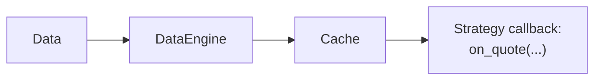

# 缓存 {#cache}

`Cache` 是交易状态与近期行情的中央内存存储。actor 和策略通过它读取数据引擎与执行引擎维护的数据，或按应用自定义的键共享原始字节。

缓存的作用：

- 存储当前订单簿，以及报价、成交、bar 及其他行情的有界历史。
- 跟踪订单、持仓、账户、金融工具和货币，直到被清除（purge）或重置。
- 在组件之间共享调用方自行序列化的数据；配置了支撑数据库时还会将其持久化。

## 缓存的工作方式 {#how-caching-works}

事件在系统中流转时，引擎把内置数据加入 `Cache`。实时适配器异步向引擎喂事件，因此缓存的变化发生在**引擎处理事件时**，而不是适配器最先收到数据时。

对报价、成交和 bar，`DataEngine` 会先尝试写入 `Cache`，再发布给订阅者。写入成功后，策略 handler 运行时即可读到最新值。订单簿 delta 和深度快照则直接发布，当前簿状态由 `BookUpdater` 订阅单独维护：



完整的逐步追踪见
[数据流：一个 quote tick 的旅程](./architecture.md#data-flow-life-of-a-quote-tick)。

### 基本示例 {#basic-example}

在策略内部，通过 `self.cache` 访问共享的 `Cache`：

```python
def on_bar(self, bar: Bar) -> None:
    # Read recent bars from the cache.
    last_bar = self.cache.bar(self.bar_type, index=0)  # Same bar after a successful cache write.
    previous_bar = self.cache.bar(self.bar_type, index=1)
    third_last_bar = self.cache.bar(self.bar_type, index=2)

    # Read current position state.
    if self.last_position_opened_id is not None:
        position = self.cache.position(self.last_position_opened_id)
        if position is not None and position.is_open:
            open_quantity = position.quantity

    # Read open orders for the instrument.
    open_orders = self.cache.orders_open(instrument_id=self.instrument_id)
```

## 配置 {#configuration}

用 `CacheConfig` 类配置 `Cache` 的行为与容量。按[环境上下文](./architecture.md#environment-contexts)把它传给 `BacktestEngine` 或 `LiveNode`。

两种环境使用相同的容量设置：

```python
from nautilus_trader.config import BacktestEngineConfig
from nautilus_trader.config import CacheConfig
from nautilus_trader.config import LiveNodeConfig

# For backtesting
engine_config = BacktestEngineConfig(
    cache=CacheConfig(
        tick_capacity=10_000,  # Store last 10,000 ticks per instrument
        bar_capacity=5_000,  # Store last 5,000 bars per bar type
    ),
)

# For live trading
node_config = LiveNodeConfig(
    cache=CacheConfig(
        tick_capacity=10_000,
        bar_capacity=5_000,
    ),
)
```

:::tip
默认情况下，`Cache` 每个工具的 tick 序列最多保留 10,000 条，每种 bar 类型最多保留 10,000 根 bar。这是两个独立的限额，不是合计值。每项容量应设为 `[1, 1_000_000]` 内的值。策略需要更长的内存内回看窗口、且可接受额外内存开销时，再调大它们。
:::

### 配置选项 {#configuration-options}

`CacheConfig` 类型支持以下参数：

```rust
use nautilus_common::{cache::CacheConfig, enums::SerializationEncoding};

let config = CacheConfig {
    encoding: SerializationEncoding::MsgPack,
    timestamps_as_iso8601: false,
    buffer_interval_ms: None,
    bulk_read_batch_size: None,
    use_trader_prefix: true,
    use_instance_id: false,
    flush_on_start: false,
    drop_instruments_on_reset: true,
    tick_capacity: 10_000,
    bar_capacity: 10_000,
    persist_account_events: true,
    save_market_data: false,
};
```

:::note
每种 bar 类型各自维护容量。例如同时使用 1 分钟和 5 分钟 bar 时，每种都最多存储 `bar_capacity` 根。
达到 `bar_capacity` 后，`Cache` 自动移除最旧的数据。
:::

### 数据库配置 {#database-configuration}

配置数据库支撑后，重启即可恢复已成功持久化的、受支持的缓存记录。可恢复的记录包括通用数据、货币、金融工具、工具收盘（instrument close）、账户、订单和持仓。启动时不会恢复有界行情历史或运行中的进程。

只要配置了支撑数据库，instrument close 就会持久化。`save_market_data` 管不到它们，因为它们是恢复快照，而非有界行情历史。

`CacheConfig` 控制缓存行为；连接设置属于具体的支撑配置，如 `RedisCacheConfig` 或 `PostgresCacheConfig`。

支撑（backing）是恢复机制，不是完整事件归档，也不是同步的分布式缓存。每个节点拥有自己的内存缓存。把多个节点指向同一个数据库命名空间并不能让这些缓存保持一致。

Rust 原生调用方构造具体的数据库配置，再用 `CacheDatabaseFactory` trait 创建传给系统 builder 的适配器：

```rust
use nautilus_common::{
    cache::{CacheConfig, database::CacheDatabaseFactory},
    enums::SerializationEncoding,
};
use nautilus_infrastructure::redis::cache::RedisCacheConfig;

let config = CacheConfig {
    encoding: SerializationEncoding::MsgPack,
    timestamps_as_iso8601: true,
    buffer_interval_ms: Some(100),
    ..Default::default()
};

let database = RedisCacheConfig {
    host: Some("localhost".to_string()),
    port: Some(6379),
    connection_timeout: 2,
    response_timeout: 2,
    ..Default::default()
};

let cache_database = database
    .create(trader_id, instance_id, config.clone())
    .await?;
```

Rust 原生实时节点要在启动前挂上适配器：

```rust
let node_config = LiveNodeConfig {
    trader_id,
    ..Default::default()
};
let mut node = LiveNode::build("LiveNode".to_string(), Some(node_config))?;
node.set_cache_database(cache_database)?;
node.run().await?;
```

:::warning
`LiveExecutionEngineConfig.load_cache` 默认为 `true`，节点会先恢复持久化的缓存状态并重建派生索引，然后才连接客户端或对账执行状态。设置 `CacheConfig.flush_on_start = true` 则改为清空支撑。Postgres 支撑只清除该节点的 trader 行（见下文）。
:::

Python 把同样的数据库配置传给 `LiveNodeBuilder.with_cache_database_factory`。节点在启动时构造并持有适配器，因此连接只在节点运行时才打开：

```python
from nautilus_trader.common import Environment
from nautilus_trader.infrastructure import RedisCacheConfig
from nautilus_trader.live import LiveNode
from nautilus_trader.model import TraderId

node = (
    LiveNode.builder("LiveNode", TraderId("TRADER-001"), Environment.LIVE)
    .with_cache_database_factory(RedisCacheConfig(host="localhost", port=6379))
    .build()
)

try:
    node.run()
finally:
    node.dispose()
```

改用 `PostgresCacheConfig` 可以把缓存数据支撑到 Postgres。Postgres 不支持 actor 或策略状态持久化，不要与 `load_state` 或 `save_state` 同时使用。两个配置都来自 `nautilus_trader.infrastructure`。

Postgres 支撑按节点的 trader ID 划分作用域，多个节点可共用一个数据库：

- 节点只加载和写入自己（按 trader 为键）的订单、持仓、快照和账户。因此两个 trader 可以复用相同的客户订单 ID 或持仓 ID。
- `flush_on_start` 只删除该 trader 的行。
- 货币、金融工具、instrument close、行情数据和通用数据在各 trader 间共享。

:::warning
升级已有数据库是必做的迁移步骤。 trader 作用域之前持久化的账户事件没有 trader 归属，也无法确定应属哪个 trader，只要存在这类记录，连接就会失败，占用该数据库的每个节点都会被阻塞。错误信息会列出受影响的账户。先运行 `nautilus database init`，再把每个账户指派给其 trader：

```bash
nautilus database assign-account --account-id <ACCOUNT_ID> --trader-id <TRADER_ID>
```

:::

:::warning
务必 dispose 节点。`dispose()` 会关闭支撑：设置了 `CacheConfig.buffer_interval_ms` 时，缓冲区中尚未落盘的写入会在此刷出。直接从 `run()` 返回可能丢掉这些写入。
:::

## 使用缓存 {#using-the-cache}

### 访问行情数据 {#accessing-market-data}

`Cache` 提供对订单簿、报价、成交、bar 及其他行情数据的访问。有界行情序列使用倒序索引，**最新条目位于索引 0**。

#### 访问 bar {#bar-access}

```python
# Get all cached bars for a bar type.
bars = self.cache.bars(bar_type)  # Returns list[Bar] or None.

# Get the most recent bar.
latest_bar = self.cache.bar(bar_type)  # Returns Bar or None.

# Get a historical bar by index (0 = most recent).
second_last_bar = self.cache.bar(bar_type, index=1)  # Returns Bar or None.

# Check whether bars exist and get the count.
bar_count = self.cache.bar_count(bar_type)
has_bars = self.cache.has_bars(bar_type)
```

bar 按 bar 类型**从新到旧**保存。更新的 bar 会被加入；更旧的 bar 会被跳过，但仍会包含在响应中。

- **时间 bar**：`ts_event` 相同的 bar 会替换缓存中的那一根（较新的数据胜出），因此重叠历史请求产生的重复不会累积。
- **非时间 bar**：Renko 砖块或 volume bar 由单次更新产生时，合法地可能共享同一个 `ts_event`。同一时间戳的所有 bar 都会保留，包括重叠请求重新送达的。
- **内部请求聚合**：请求生成的 bar 会按其有序位置插入缓存，而不是被跳过。缓存是它们的唯一送达路径。

报价与成交同样会累积全部 tick，包括共享时间戳的。

#### 报价 tick {#quote-ticks}

```python
# Get quotes.
quotes = self.cache.quotes(instrument_id)  # Returns list[QuoteTick] or None.
latest_quote = self.cache.quote(instrument_id)  # Returns QuoteTick or None.
second_last_quote = self.cache.quote(instrument_id, index=1)  # Returns QuoteTick or None.

# Check quote availability.
quote_count = self.cache.quote_count(instrument_id)
has_quotes = self.cache.has_quote_ticks(instrument_id)
```

#### 成交 tick {#trade-ticks}

```python
# Get trades.
trades = self.cache.trades(instrument_id)  # Returns list[TradeTick] or None.
latest_trade = self.cache.trade(instrument_id)  # Returns TradeTick or None.
second_last_trade = self.cache.trade(instrument_id, index=1)  # Returns TradeTick or None.

# Check trade availability.
trade_count = self.cache.trade_count(instrument_id)
has_trades = self.cache.has_trade_ticks(instrument_id)
```

#### 订单簿 {#order-book}

```python
# Get the current order book.
book = self.cache.order_book(instrument_id)  # Returns OrderBook or None.

# Check whether an order book exists.
has_book = self.cache.has_order_book(instrument_id)

# Get the number of applied book updates.
update_count = self.cache.book_update_count(instrument_id)
```

#### 访问价格 {#price-access}

```python
from nautilus_trader.model import PriceType

# Get the current price by type. Returns Price or None.
price = self.cache.price(
    instrument_id=instrument_id,
    price_type=PriceType.MID,  # Options: BID, ASK, MID, LAST
)
```

#### bar 类型 {#bar-types}

```python
from nautilus_trader.model import AggregationSource, PriceType

# Get all available bar types for an instrument. Returns list[BarType].
bar_types = self.cache.bar_types(
    instrument_id=instrument_id,
    price_type=PriceType.LAST,  # Options: BID, ASK, MID, LAST
    aggregation_source=AggregationSource.EXTERNAL,
)
```

#### 简单示例 {#simple-example}

```python
from nautilus_trader.model import Bar, BarType
from nautilus_trader.trading import Strategy


class MarketDataStrategy(Strategy):
    def on_start(self) -> None:
        # Subscribe to 1-minute bars.
        self.bar_type = BarType.from_str(f"{self.instrument_id}-1-MINUTE-LAST-EXTERNAL")
        self.subscribe_bars(self.bar_type)

    def on_bar(self, bar: Bar) -> None:
        bars = (self.cache.bars(self.bar_type) or [])[:3]
        if len(bars) < 3:
            return

        # Access the latest three bars for analysis.
        current_bar = bars[0]
        prev_bar = bars[1]
        prev_prev_bar = bars[2]

        # Read the latest quote and trade.
        latest_quote = self.cache.quote(self.instrument_id)
        latest_trade = self.cache.trade(self.instrument_id)

        if latest_quote is not None:
            current_spread = latest_quote.ask_price - latest_quote.bid_price
            self.log.info(f"Current spread: {current_spread}")
```

### 交易对象 {#trading-objects}

`Cache` 提供对以下交易对象的访问：

- 订单
- 持仓
- 账户
- 金融工具

#### 订单 {#orders}

可按交易场所、策略、金融工具、账户或订单方向查询订单。

##### 基本订单访问 {#basic-order-access}

```python
# Get a specific order by its client order ID
order = self.cache.order(ClientOrderId("O-123"))

# Get all orders in the system
orders = self.cache.orders()

# Get orders filtered by specific criteria
orders_for_venue = self.cache.orders(venue=venue)  # All orders for a specific venue
orders_for_strategy = self.cache.orders(
    strategy_id=strategy_id
)  # All orders for a specific strategy
orders_for_instrument = self.cache.orders(
    instrument_id=instrument_id
)  # All orders for an instrument
```

##### 订单状态查询 {#order-state-queries}

```python
# Get orders by their current state
open_orders = self.cache.orders_open()  # Orders currently active at the venue
closed_orders = self.cache.orders_closed()  # Orders that have completed their lifecycle
emulated_orders = self.cache.orders_emulated()  # Orders being simulated locally by the system
inflight_orders = (
    self.cache.orders_inflight()
)  # Orders submitted (or modified) to venue, but not yet confirmed
local_active_orders = (
    self.cache.orders_active_local()
)  # Orders still managed locally (initialized, emulated, or released)

# Check specific order states
exists = self.cache.order_exists(
    client_order_id
)  # Checks if an order with the given ID exists in the cache
is_open = self.cache.is_order_open(client_order_id)  # Checks if an order is currently open
is_closed = self.cache.is_order_closed(client_order_id)  # Checks if an order is closed
is_emulated = self.cache.is_order_emulated(
    client_order_id
)  # Checks if an order is being simulated locally
is_inflight = self.cache.is_order_inflight(
    client_order_id
)  # Checks if an order is submitted or modified, but not yet confirmed
is_active_local = self.cache.is_order_active_local(
    client_order_id
)  # Checks if an order is still managed locally
```

##### 订单统计 {#order-statistics}

```python
# Get counts of orders in different states
open_count = self.cache.orders_open_count()  # Number of open orders
closed_count = self.cache.orders_closed_count()  # Number of closed orders
emulated_count = self.cache.orders_emulated_count()  # Number of emulated orders
inflight_count = self.cache.orders_inflight_count()  # Number of inflight orders
local_active_count = (
    self.cache.orders_active_local_count()
)  # Number of locally active orders (initialized, emulated, or released)
total_count = self.cache.orders_total_count()  # Total number of orders in the system

# Get filtered order counts
buy_orders_count = self.cache.orders_open_count(
    side=OrderSide.BUY
)  # Number of currently open BUY orders
venue_orders_count = self.cache.orders_total_count(
    venue=venue
)  # Total number of orders for a given venue
```

#### 持仓 {#positions}

`Cache` 保留持仓直到被清除或重置，并提供多种查询方式。

##### 访问持仓 {#position-access}

```python
# Get a specific position by its ID
position = self.cache.position(PositionId("P-123"))

# Get positions by their state
all_positions = self.cache.positions()  # All positions in the system
open_positions = self.cache.positions_open()  # All currently open positions
closed_positions = self.cache.positions_closed()  # All closed positions

# Get positions filtered by various criteria
venue_positions = self.cache.positions(venue=venue)  # Positions for a specific venue
instrument_positions = self.cache.positions(
    instrument_id=instrument_id
)  # Positions for a specific instrument
strategy_positions = self.cache.positions(
    strategy_id=strategy_id
)  # Positions for a specific strategy
long_positions = self.cache.positions(side=PositionSide.LONG)  # All long positions
```

##### 持仓状态查询 {#position-state-queries}

```python
# Check position states
exists = self.cache.position_exists(position_id)  # Checks if a position with the given ID exists
is_open = self.cache.is_position_open(position_id)  # Checks if a position is open
is_closed = self.cache.is_position_closed(position_id)  # Checks if a position is closed

# Get position and order relationships
orders = self.cache.orders_for_position(position_id)  # All orders related to a specific position
position = self.cache.position_for_order(
    client_order_id
)  # Find the position associated with a specific order
```

##### 持仓统计 {#position-statistics}

```python
# Get position counts in different states
open_count = self.cache.positions_open_count()  # Number of currently open positions
closed_count = self.cache.positions_closed_count()  # Number of closed positions
total_count = self.cache.positions_total_count()  # Total number of positions in the system

# Get filtered position counts
long_positions_count = self.cache.positions_open_count(
    side=PositionSide.LONG
)  # Number of open long positions
instrument_positions_count = self.cache.positions_total_count(
    instrument_id=instrument_id
)  # Number of positions for a given instrument
```

#### 账户 {#accounts}

```python
# Access account information
account = self.cache.account(account_id)  # Retrieve account by ID
account = self.cache.account_for_venue(venue)  # Retrieve account for a specific venue
account_id = self.cache.account_id(venue)  # Retrieve account ID for a venue
```

只有当某交易场所（账户 ID 前缀，如 `BINANCE-001` 中的 `BINANCE`）下恰好只签发了一个账户时，按场所查找才能解析。同一场所存在多个账户时，`account_for_venue` 和 `account_id` 返回 `None`，需按 ID 获取这些账户。

#### 金融工具 {#instruments}

```python
# Get instrument information
instrument = self.cache.instrument(instrument_id)  # Retrieve a specific instrument by its ID
all_instruments = self.cache.instruments()  # Retrieve all instruments in the cache

# Get instruments for a venue.
venue_instruments = self.cache.instruments(venue=venue)  # Instruments for a specific venue

# Get instrument identifiers
instrument_ids = self.cache.instrument_ids()  # Get all instrument IDs
venue_instrument_ids = self.cache.instrument_ids(
    venue=venue
)  # Get instrument IDs for a specific venue
```

### 清除缓存数据 {#purging-cached-data}

长时间运行的会话会累积已关闭订单、已关闭持仓、账户事件和不再使用的金融工具。缓存提供定点与批量清除方法，让策略和实时交易引擎无需重启系统即可控制内存占用。

#### 定点清除 {#targeted-purges}

以下方法用于丢弃单个实体。实体仍处于活动状态时，清除会被拒绝。

- `cache.purge_order(client_order_id)`：移除订单及每个以订单为键的索引条目。跳过未关闭的订单。
- `cache.purge_position(position_id)`：移除持仓、其快照和以持仓为键的索引条目。跳过未平仓持仓。
- `cache.purge_instrument(instrument_id)`：移除该金融工具及其瞬态的按工具映射（订单簿、报价、成交、mark/index/funding 价格、工具状态与收盘、greeks，以及引用该工具的 bar）。只要有关联订单处于非终态（即尚未到达关闭状态的任何状态，包括 initialized、submitted、accepted、emulated、released 和 inflight 订单），或有关联持仓未平仓，就跳过。缓存中的订单与持仓在单独清除前保持索引，保留历史查询和已实现 PnL。

:::warning
`purge_instrument` 面向自带生命周期逻辑、能自行判断工具何时不再需要的 actor 和策略。清除其他组件仍在依赖的工具，会导致查不到工具、丢失行情历史。活动订阅归数据引擎所有，不再需要更新时应先退订再清除。
:::

#### 批量清除 {#bulk-purges}

以下方法按时间早晚清扫较旧的条目。参数为当前时间戳，以及以秒为单位的缓冲或回看窗口。

- `cache.purge_closed_orders(ts_now, buffer_secs)`：关闭时间早于 `buffer_secs` 的已关闭订单。
- `cache.purge_closed_positions(ts_now, buffer_secs)`：关闭时间早于 `buffer_secs` 的已关闭持仓。
- `cache.purge_account_events(ts_now, lookback_secs)`：早于 `lookback_secs` 的账户状态事件。取 `0` 时清除全部事件。

:::warning
`HEDGING` 翻转（flip）的虚拟源（source）持仓，在其订单仍可能收到成交时要保留。清除它会删掉路由后续成交所需的历史，可能导致引擎拒绝这些成交。
:::

#### 实时交易中的自动清除 {#automatic-purging-in-live-trading}

`LiveExecutionEngineConfig` 用定时器调度批量清除。所有清除间隔默认为 `None`，即禁用对应的循环。设置间隔即可启用循环，再设置其缓冲或回看窗口来控制最近多久内的条目受保护。下例使用实时交易配置指南推荐的起始值：

```python
from nautilus_trader.config import LiveExecutionEngineConfig

exec_engine = LiveExecutionEngineConfig(
    purge_closed_orders_interval_mins=15,
    purge_closed_orders_buffer_mins=60,
    purge_closed_positions_interval_mins=15,
    purge_closed_positions_buffer_mins=60,
    purge_account_events_interval_mins=15,
    purge_account_events_lookback_mins=60,
)
```

间隔越短，清除越频繁；缓冲或回看越短，删除的数据越新。结合内存限制，以及对账或分析所需的近期执行上下文，为每个取值单独决策。完整参数参考见
[配置实时交易：内存管理](./../how_to/configure_live_trading.md)。

:::note
工具清除没有自动循环，因为丢弃某个工具的合适时机取决于策略状态，而非时间早晚。应由拥有该工具生命周期的 actor 或策略调用 `cache.purge_instrument`。
:::

### 自定义数据 {#custom-data}

`Cache` 以应用定义的字符串键存储原始字节。写入前先序列化，读出后再反序列化。actor 和策略可用这些条目共享少量应用数据。

#### 基本存取 {#basic-storage-and-retrieval}

```python
# Store serialized data.
self.cache.add(key="my_key", value=b"some binary data")

# Retrieve serialized data.
stored_data = self.cache.get("my_key")  # Returns bytes or None.
```

:::warning
`Cache` 不是通用数据库。大数据集或复杂查询请使用专门的存储。
:::

## 最佳实践与常见问题 {#best-practices-and-common-questions}

### Cache 与 Portfolio 的分工 {#cache-vs-portfolio-usage}

`Cache` 与 `Portfolio` 用途不同：

**Cache**：

- 保留执行对象、部分对象历史和近期的有界行情数据，直到清除或重置。
- 立即应用本地状态变更，例如提交前初始化订单。
- 在引擎处理外部事件时应用它们，例如订单成交时。

**Portfolio**：

- 聚合持仓、暴露和账户信息。
- 基于缓存状态和市场价格计算当前组合价值。

```python
from nautilus_trader.model import PositionChanged
from nautilus_trader.trading import Strategy


class MyStrategy(Strategy):
    def on_position_changed(self, event: PositionChanged) -> None:
        # Read the fills retained by the cached position.
        position = self.cache.position(event.position_id)
        fills = position.events() if position is not None else []

        # Read current aggregate exposure from the portfolio.
        current_exposure = self.portfolio.net_exposure(event.instrument_id)
```

### Cache 与策略变量 {#cache-vs-strategy-variables}

共享的序列化数据放缓存条目，本地工作状态放策略变量。

**缓存存储**：

- 共享系统缓存的 actor 和策略都可访问。
- 配置了支撑数据库且写入完成时，通用字节条目可持久化。
- 单个策略重置时缓存条目仍然可用，但缓存或执行引擎重置会清空内存条目。

**策略变量**：

- 把类型化的、策略专有的计算和中间值封装在策略内部。
- 不会把值暴露给其他组件，也不会自动持久化。

actor 和策略状态跨进程重启的持久化使用独立的 `on_save` 和 `on_load` 钩子，并需要受支持的支撑。见实时交易指南的
[缓存数据库配置](./../how_to/configure_live_trading.md#cache-database-configuration)一节。

共享数据先序列化再写入缓存：

```python
import json

from nautilus_trader.trading import Strategy


class MyStrategy(Strategy):
    def on_start(self) -> None:
        shared_data = {
            "last_reset": self.clock.timestamp_ns(),
            "trading_enabled": True,
        }
        self.cache.add("shared_strategy_info", json.dumps(shared_data).encode())
```

另一个策略可以这样读取缓存数据：

```python
import json

from nautilus_trader.trading import Strategy


class AnotherStrategy(Strategy):
    def on_start(self) -> None:
        data_bytes = self.cache.get("shared_strategy_info")
        if data_bytes is not None:
            shared_data = json.loads(data_bytes)
            self.log.info(f"Shared data retrieved: {shared_data}")
```

## 相关指南 {#related-guides}

- [数据](./data/index.md)：存入缓存的数据类型。
- [策略](./strategies.md)：策略通过缓存访问行情与状态。
- [报告](./reports.md)：基于缓存数据生成报告。
