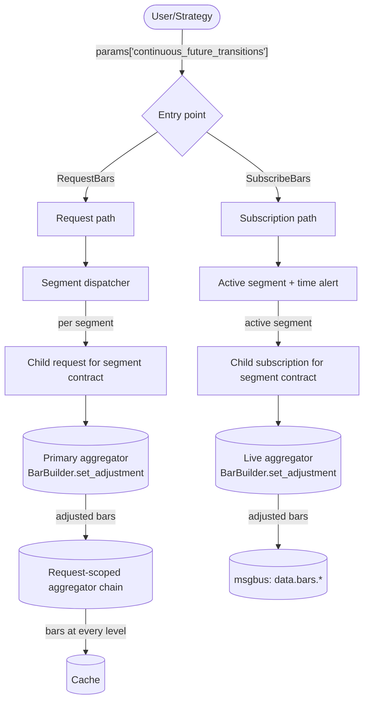
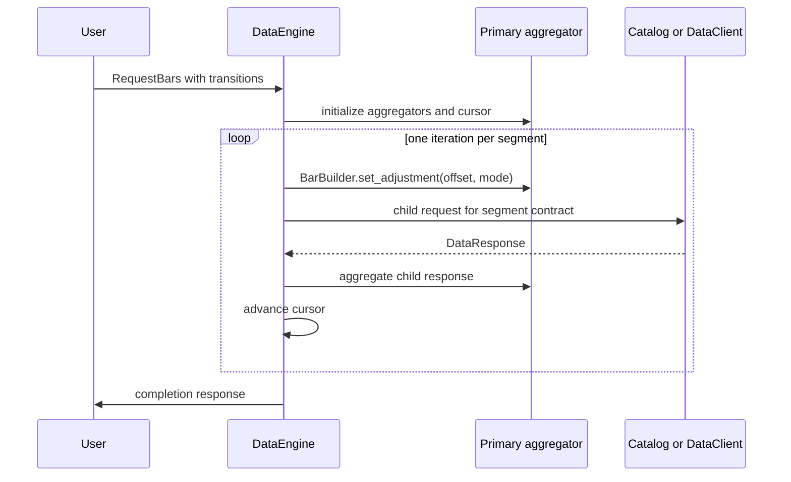
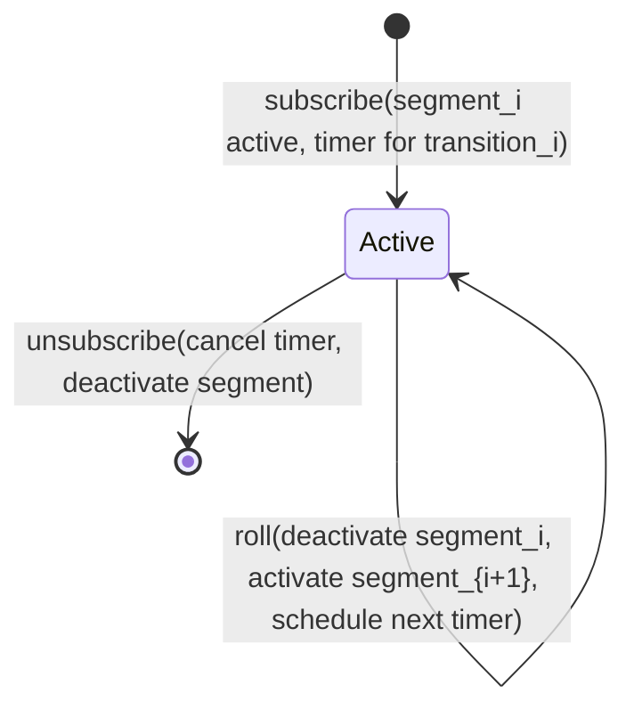
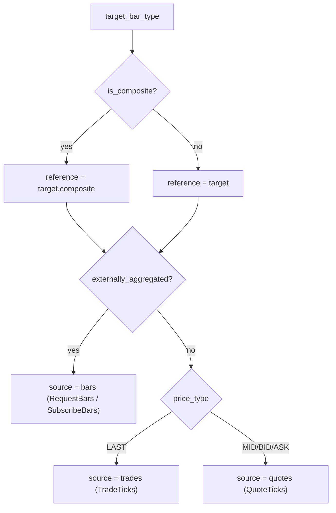
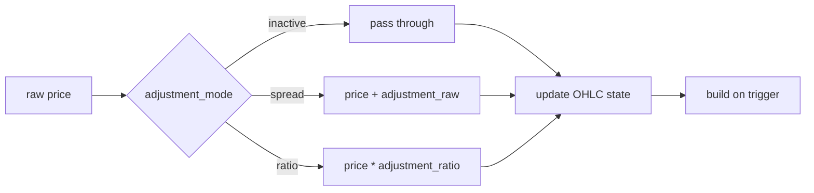

# 连续期货 {#continuous-futures}

**连续期货（continuous future）** 是一条派生序列，把连续的期货合约拼接为一条调整后的
价格流。底层合约会陆续到期，因此连续序列在切换点滚动（roll）到下一份合约。
每个片段都被调整到统一的价格坐标系中，合约切换不会引入人为的价格跳变。

Nautilus 把连续期货建模为目标 `BarType`，加上在请求或订阅参数中显式给出的切换列表。
对每个时间段，数据引擎选出真实合约并计算其累计价格调整量，
再把调整后的源数据送入常规的 K 线聚合路径。

## 调整模式 {#adjustment-modes}

`ContinuousFutureAdjustmentType` 将方向（向后或向前）与运算（价差或比率）组合：

| 模式              | 运算      | 锚定片段                      |
| ----------------- | -------------- | ----------------------------------- |
| `BACKWARD_SPREAD` | 加法       | 调整范围内的最后一份合约。  |
| `FORWARD_SPREAD`  | 加法       | 调整范围内的第一份合约。 |
| `BACKWARD_RATIO`  | 乘法 | 调整范围内的最后一份合约。  |
| `FORWARD_RATIO`   | 乘法 | 调整范围内的第一份合约。 |

设切换总数为 `N`，片段 `k` 处的累计调整量为：

```text
BACKWARD_SPREAD: sum over i in [k, N) of (post_i - pre_i)
FORWARD_SPREAD:  sum over i in [0, k) of (pre_i - post_i)
BACKWARD_RATIO:  product over i in [k, N) of (post_i / pre_i)
FORWARD_RATIO:   product over i in [0, k) of (pre_i / post_i)
```

价差模式累加加法偏移。比率模式累乘乘法因子，要求价格为严格正数。

## 输入 {#inputs}

连续期货的请求或订阅，就是 `params` 中携带 `continuous_future_transitions` 条目的
任意 `RequestBars` 或 `SubscribeBars`：

```python
params = {
    "continuous_future_transitions": [
        {
            "transition_time_ns": 1773671460000000000,  # when ESH26 rolls to ESM26
            "pre_instrument_id": "ESH26.XCME",
            "post_instrument_id": "ESM26.XCME",
            "pre_price": "6001.00",  # last ESH26 price pre-roll
            "post_price": "5995.50",  # first ESM26 price post-roll
        },
        # ... more transitions ...
    ],
    "continuous_future_adjustment_mode": "BACKWARD_SPREAD",
    # Optional: cap the upper end of cumulative adjustment at the transition whose
    # post_instrument_id matches (the backward-mode anchor).
    # "last_post_instrument_id": "ESM26.XCME",
    # Optional: cap the lower end of cumulative adjustment at the transition whose
    # pre_instrument_id matches (the forward-mode anchor).
    # "first_pre_instrument_id": "ESM26.XCME",
}
```

省略 `continuous_future_adjustment_mode` 时默认为 `BACKWARD_SPREAD`。

请求或命令上的 `bar_type` 是**目标**连续 bar 类型，例如
`"ES.XCME-1-MINUTE-LAST-INTERNAL@1-MINUTE-EXTERNAL"`。根标识（`ES.XCME`）是
连续根，不是真实合约。每个片段的原始源数据来自切换列表中对应的真实合约。

连续目标 bar 类型必须是**内部聚合**的。外部聚合的 bar 不能作为连续目标，
但可以作为片段的源。

### 有界链 {#bounded-chains}

两个可选边界限制哪些切换参与累计调整，它们不会从请求或订阅中移除合约片段：

- `last_post_instrument_id` 把上端截断在第一个 `post_instrument_id` 匹配的切换处。
  向后模式把匹配的 post 合约作为零调整锚点；向前模式则把其后的切换排除在累计调整之外。
- `first_pre_instrument_id` 把下端截断在第一个 `pre_instrument_id` 匹配的切换处。
  向前模式把匹配的 pre 合约作为零调整锚点；向后模式则把其前的切换排除在累计调整之外。

有了这两个边界，调用方可以传入更宽的切换表，同时自行选择调整范围。

## 校验 {#validation}

请求与订阅两条路径在分配聚合器或子片段状态之前，应用相同的切换参数校验规则：

- 若提供了 `continuous_future_adjustment_mode`，必须能解析为有效的
  `ContinuousFutureAdjustmentType`。
- `continuous_future_transitions` 必须是非空的切换行数组。
- 每行必须包含非负整数 `transition_time_ns`，且切换时间严格递增。
- 每个 `pre_instrument_id` 和 `post_instrument_id` 必须能解析为有效的 `InstrumentId`，
  其交易场所与目标场所一致。
- 链必须连续：第 `i` 行的 `post_instrument_id` 必须等于第 `i + 1` 行的
  `pre_instrument_id`。
- 每行必须包含有限的 `pre_price` 和 `post_price`。比率模式还要求两个价格均为正。
- 若调用方提供了 `last_post_instrument_id`，它必须能解析为 `InstrumentId`、与目标场所
  一致，并出现在切换列表的某个 `post_instrument_id` 中。`first_pre_instrument_id`
  的要求同理。

校验出错时，两条路径都会在启动聚合工作流之前返回错误。

校验通过后，请求路径若在初始化或首个片段分发时失败，会释放请求级作用域的聚合器。
分发后续片段时失败，请求仍以完成响应结束，并正常清理聚合器。

## 目标工具自动合成 {#target-instrument-auto-synthesis}

连续根（例如 `ES.XCME`）是一个没有自身行情数据的合成 id，但下游消费者
（聚合器、缓存查询、序列化）仍期望缓存中存在一个 `Instrument`。校验通过后，
请求与订阅两条路径都会确保目标工具存在：

- 目标 id 已在缓存中时，目标初始化是空操作。调用方可预先注册自定义连续工具，
  引擎会予以尊重。
- 否则，目标初始化从缓存取出第一个片段的工具并克隆，只覆盖 `id` 和 `raw_symbol`，
  并把 `activation_ns` 和 `expiration_ns` 清零。其余字段（币种、精度、增量、乘数、
  手数、标的、费用、保证金、交易所、tick scheme、info）全部复用该片段的值。
- 若第一个片段尚未进入缓存或不是 `FuturesContract`，初始化记录一条警告并返回，
  此时调用方必须手动注册连续工具。

## 架构总览 {#architecture-overview}



请求路径的 bar 落入缓存，订阅路径的 bar 发布到消息总线。

两条路径使用相同的分段、源解析与调整计算。请求路径按顺序逐段处理；
订阅路径保持一个源处于活动状态，在下一个切换的时间提醒触发时切换源。

## 片段 {#segments}

**片段（segment）** 是由单一真实合约拥有的连续时间切片，切换点分隔片段。
给定 `transitions[0..N)`：

- 片段 0：`(-inf, transitions[0].time)`，合约为 `transitions[0].pre_instrument_id`。
- 片段 k，k 在 `[1, N)`：`[transitions[k-1].time, transitions[k].time)`，合约为
  `transitions[k].pre_instrument_id`。
- 片段 N：`[transitions[N-1].time, +inf)`，合约为 `transitions[N-1].post_instrument_id`。

请求路径把每个片段裁剪到请求的时间范围内并按序分发。订阅路径用引擎时钟
选定活动片段，并调度下一个未到来的切换。

## 请求流程 {#request-flow}

请求路径每次通过引擎常规请求处理分发一个子请求。因此，已注册的数据目录会先服务于
一个片段，客户端再填补剩余空缺。子响应到达后，引擎聚合其数据并进入下一个片段。
跨越目录与客户端数据的片段，要等各部分全部到达后才推进。



:::info
每处理一个子响应，调整后的 bar 就写入缓存。完成响应只表示请求已结束并报告源记录数，
不包含调整后 bar 的合并向量。
:::

### 链式聚合器 {#chain-aggregators}

若请求为多级内部聚合设置了 `bar_types = (bar_type_1, bar_type_2)`，引擎会为每个层级
创建独立的请求级作用域聚合器。片段源响应进入主连续目标，其输出的 bar 供给匹配的
下游聚合器。只有主构建器接收调整量，更高层级对已调整的数据再聚合。

## 订阅流程 {#subscription-flow}

每个活动订阅由一个小状态机驱动，同一时刻只有一个待触发的时间提醒：



切换触发时，引擎执行：

1. 退订数据源，停用当前片段。
1. 应用下一个片段的调整量。
1. 订阅新的数据源。
1. 为再下一个切换设置定时器。

## 源解析 {#source-resolution}

对任意连续期货目标 `BarType`，喂给主聚合器的原始数据位于**片段合约**上，
而非连续 id 上。目标的形态决定源类型：



内部聚合的源中，`LAST` 使用成交，`BID`、`ASK`、`MID` 使用报价。
其他价格类型不被报价聚合支持。

## BarBuilder 调整 {#barbuilder-adjustment}

构建器在每次 `update(price, ...)` 和 `update_bar(bar, ...)` 调用中**于入口处**应用调整量，
因此进行中的 OHLC 状态始终处于调整后的统一坐标系中。bar 进行中更改调整量，
只影响其后的输入。



`BarBuilder` 只用模式来选择加法或乘法。引擎在调用 `set_adjustment` 之前
就把调整方向解析为累计值。`reset()` 方法清除当前 bar 的 OHLCV 状态供下一根 bar 使用，
但保留片段级调整量。

## bar 中途的滚动边界 {#mid-bar-roll-boundary}

若滚动点落在进行中的目标 bar 内部，构建器保留当前 OHLC 状态，新调整量只作用于
其后的更新：边界前的部分维持旧偏移，边界后的部分使用新偏移。
要按新调整量重写已有的 OHLC，需要构建器并未保留的原始输入。

## 局限 {#limitations}

- 该特性依赖调用方提供的切换元数据。引擎不发现滚动、不选择合约、也不推断滚动价格，
  这些都是调用方的责任。
- 比率调整先把因子和每个价格转为 `f64`，再重建调整后的 `Price`。高精度工具的结果
  可能与等价的 `Decimal` 乘法有差异。价差调整直接加在 `PriceRaw` 上，
  在定点数表示中保持精确。
