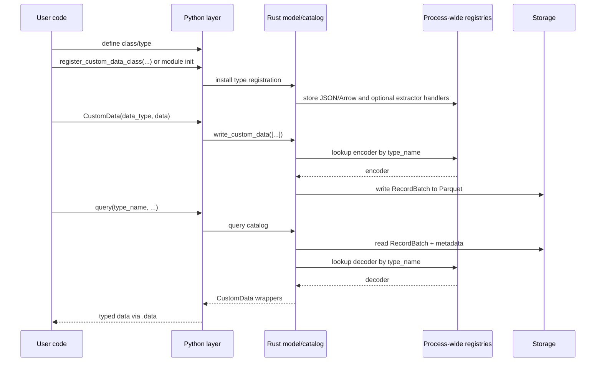
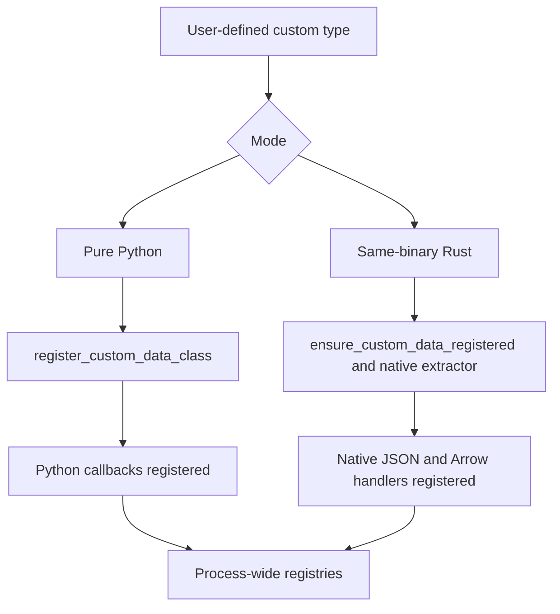
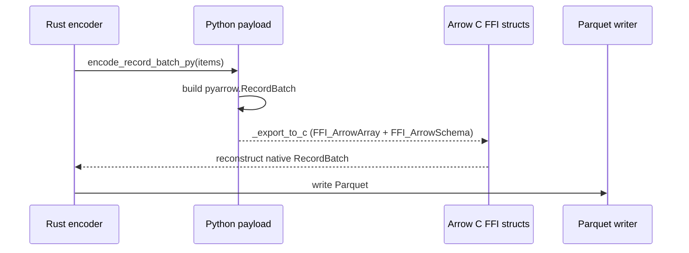

# 自定义数据 {#custom-data}

NautilusTrader 支持用 Python 或 Rust 编写自定义数据。两种方式与内置数据共用
同一套运行时路由、持久化与查询管线。

本文说明自定义数据如何：

- 在运行时注册。
- 跨越 Python/Rust 边界进行包装。
- 与 Arrow/Parquet 相互序列化。
- 经由 actor 和策略路由。

## 目标 {#goals}

自定义数据架构满足以下要求：

- 用户可以用纯 Python 定义自定义数据，无需编写 Rust 代码。
- Rust 定义的自定义数据可使用原生 Rust JSON 和 Arrow 处理器。
- 在 PyO3 边界保持单一的用户侧 `CustomData` 包装器。
- 在 `ParquetDataCatalog` 中持久化时采用动态类型注册，而非硬编码模式。
- 自定义数据可走常规的数据引擎、actor、策略订阅流程进行路由。

## 高层模型 {#high-level-model}

NautilusTrader 支持两种编写模式：

| 模式             | 编写形式                                  | 注册路径                                                 | 编码/解码路径            | 包装器后端           |
| ---------------- | ----------------------------------------------- | ----------------------------------------------------------------- | ----------------------------- | ------------------------- |
| 纯 Python      | 带 JSON 和 Arrow 方法的类               | `register_custom_data_class(...)`                                 | Python 回调 + Arrow C FFI | `PythonCustomDataWrapper` |
| 同二进制 Rust | `#[custom_data]` 或 `#[custom_data(pyo3)]` 类型 | `ensure_custom_data_registered::<T>()` 及提取器注册 | 原生 Rust                   | 原生 Rust 载荷       |

两种模式最终汇聚到同一个外层 PyO3 `CustomData` 包装器和同一套
`DataType` 身份模型。

## 端到端流程 {#end-to-end-flow}

## 核心组件 {#core-components}

### 注册表模块 {#registry-module}

`crates/model/src/data/registry.rs` 持有进程级的 JSON、Arrow 和
Python 提取器注册表。注册使用原子的 `DashMap::entry()` 操作，
因此并发的 `register_*` 与 `ensure_*` 调用在抢占条目时不会竞态。

该模块通过 `OnceLock` 初始化其注册表状态，保存：

- 以 `type_name` 为键的 JSON 反序列化器。
- 以 `type_name` 为键的 Arrow 模式、编码器与解码器。
- 把 Python 对象转换为 `Arc<dyn CustomDataTrait>` 的 Python 提取器。
- 为同二进制类型生成 Python 提取器的 Rust 提取器工厂。

NautilusTrader 不把每种类型硬编码进主二进制，而是用 `DataType` 和 Parquet
元数据中存储的 `type_name` 在运行时解析处理器。

### `CustomData` {#customdata}

外层 PyO3 `CustomData` 包装器是跨越 FFI 边界的通用容器。

构造签名：`CustomData(data_type, data)`，`DataType` 在前，内层载荷在后。

它包含：

- 一个 `DataType`。
- 一个实现 `CustomDataTrait` 的内层自定义载荷（包装为
  `Arc<dyn CustomDataTrait>`）。

时间戳（`ts_event`、`ts_init`）委托给内层
`CustomDataTrait` 实现，并以属性形式暴露在包装器上。

Python 侧的 `CustomData` 实现了 `__eq__` 与 `__repr__`。Rust 的 `PartialEq`
实现比较 `DataType` 并把载荷相等性委托给内层值。实例被有意设为不可哈希，
使相等性与载荷比较保持一致。

该包装器在两种自定义数据模式间共享。用户代码只面对一个 API，
尽管底层载荷可能是：

- Python 支撑的包装器。
- 同二进制的 Rust 值。

#### `CustomData` JSON 信封 {#customdata-json-envelope}

序列化到 JSON 时（如 `to_json_bytes` / `from_json_bytes`、SQL 缓存或 Redis），
`CustomData` 使用统一的标准信封，反序列化因此不依赖用户载荷的字段名：

- `type`：自定义类型名（来自 `CustomDataTrait::type_name`）。
- `data_type`：含 `type_name`、`metadata` 和可选
  `identifier` 的对象。
- `payload`：仅内层载荷（`CustomDataTrait::to_json`
  的结果解析为值）。注册的反序列化器只把这个值传给
  `from_json`，因此用户结构体可以使用任意字段名（包括 `value`），
  不会与包装器元数据冲突。

该信封由 Rust 的 `CustomData` 序列化产生，注册表模块从 JSON 反序列化
自定义数据时消费它。

### `DataType` {#datatype}

`DataType` 为路由和持久化标识自定义数据。

构造函数：`DataType(type_name, metadata=None, identifier=None)`。

它包含：

- `type_name`。
- 可选的 `metadata`。
- 可选的 `identifier`，用于持久化路径与缓存数据库查询，
  不影响路由、相等性或哈希。

**相等性、哈希与主题路由**只由 `type_name` 和 `metadata` 决定。类型名与元数据相同、
标识符不同的两个 `DataType` 相等，并发布到相同的消息总线主题。

`identifier` 决定目录中 `data/custom/<type_name>/<identifier...>` 下的路径，
并参与 PostgreSQL 与 Redis 过滤。

持久化会为每个 `CustomData` 值存储完整的 `DataType`，查询时还原；
而处理器查找使用 `type_name`。因此同一逻辑类型可以携带不同的元数据或标识符，
仍通过同一个注册处理器解码。

## 注册架构 {#registration-architecture}

注册弥合 Python 对象与 Rust trait object 之间的差距。

### 纯 Python 注册 {#pure-python-registration}

Python 代码调用 `register_custom_data_class(MyType)` 时：

1. Rust 保留该类用于 JSON 重建。
1. Rust 注册调用类回调的 JSON 和 Arrow 处理器。
1. 构造 `CustomData` 时，若已注册的原生提取器能接受该对象，Rust 使用它；
   否则把对象包装进
   `PythonCustomDataWrapper`。

供目录使用时，在注册前通过 `_schema` 或 `arrow_schema_py()` 提供 Arrow 模式，
或使用 `@customdataclass`。没有模式的类也可注册，用于 JSON 和消息总线；
目录写入会强制满足[目录模式要求](#catalog-write-flow)。

此路径上的 JSON 和 Arrow 回调在 Python GIL 下运行。

### 同二进制 Rust 注册 {#same-binary-rust-registration}

对编译进进程的 Rust 类型：

1. `#[custom_data]` 或 `#[custom_data(pyo3)]` 生成 trait 与 JSON
   实现，默认还生成 Arrow 实现。
1. `ensure_custom_data_registered::<T>()` 把原生模式/编码器/解码器
   处理器插入进程级注册表。
1. `ensure_rust_extractor_registered::<T>()` 为 PyO3 暴露的类型注册
   提取器工厂。经 Python 类注册激活后，提取器可以恢复具体 Rust 类型，
   而不使用 Python 包装器。

此路径的编码/解码全程保持 Rust 原生。

### 注册优先级 {#registration-precedence}

`register_custom_data_class(...)` 按以下顺序解析处理器：

1. 若原生提取器和原生 JSON/Arrow 处理器已注册，优先使用它们。
1. 否则使用 Python 包装器与回调处理器。

幂等的 `ensure_*` 注册不会覆盖已有处理器。对每个类型名，第一个
Arrow 注册保留其模式、编码器和解码器。若已注册的 Python 类的 Arrow 模式
需要修正，修正后须重启进程再重新注册。

## 包装器后端 {#wrapper-backends}

内部而言，外层 `CustomData` 包装器可持有不同的载荷实现。

### `PythonCustomDataWrapper` {#pythoncustomdatawrapper}

用于纯 Python 自定义数据。

职责：

- 保存对 Python 对象的引用。
- 缓存 `ts_event`、`ts_init` 和 `type_name`。
- 实现 `CustomDataTrait`。
- 支持在 GIL 下调用 Python 的 JSON 与 Arrow 回调路径。

当没有注册提取器能接受该对象时，它是构造的回退选择。Python 的 JSON 和 Arrow
解码器也直接产生这个包装器。

### 原生同二进制 Rust 载荷 {#native-same-binary-rust-payload}

对编译进进程的 Rust 类型，内层载荷就是具体 Rust 类型，可直接从
`Arc<dyn CustomDataTrait>` 向下转型。

序列化与解码都不需要 Python 回调路径。

## 持久化架构 {#persistence-architecture}

### 为什么需要动态 Arrow 注册 {#why-dynamic-arrow-registration-is-needed}

内置 NautilusTrader 数据类型的模式与编码器在 Rust 二进制中是静态已知的，
自定义数据则不是。持久化层因此用注册的 `type_name` 动态解析自定义数据。

### 目录写入流程 {#catalog-write-flow}

`ParquetDataCatalog` 期望自定义写入以 `CustomData` 值的形式传入。

自定义数据的写入路径：

1. 从内层载荷取 `type_name`，从首个值的 `DataType` 取
   `metadata` 和 `identifier`。
1. 校验注册的 Arrow 模式包含 `ts_init`，且任何 `ts_event` 或
   `ts_init` 字段使用 `timestamp("ns", tz="UTC")`。
1. 在进程级注册表中查找 Arrow 编码器。
1. 把值编码为 `RecordBatch`。
1. 追加一个 `data_type` 列，存放持久化的 `DataType`。
1. 把 `type_name` 与元数据附加到 Arrow 模式上。
1. 把批次写入自定义数据路径下的 Parquet。

路径布局为 `data/custom/<type_name>/<identifier...>`。

标识符在成为路径段之前会先规范化。

### 目录读取流程 {#catalog-read-flow}

查询时：

1. 目录读取匹配的 Parquet 文件。
1. 从模式元数据中提取 `type_name`。
1. 向进程级注册表请求解码器。
1. 把 `RecordBatch` 解码为 `Vec<Data>`。
1. 用原始 `DataType` 重建 `CustomData`。

这使得自定义数据的查询解析与写入时注册对称。

在 Feather 到 Parquet 的转换中（例如回测结束后），自定义数据分支转换 Arrow
批次，并把结果直接写入匹配的自定义数据路径：

- 以 `custom/{TypeName}` 传入数据类，类型名与注册值逐字一致。Feather 会话把
  自定义数据存于 `data/custom/{TypeName}`，而不是 snake_case 目录。
- 打算手动转换时设置 `promote_on_close=False`。关闭时提升（promote）是默认行为。
  转换一个已提升过的会话会在不同文件名下重写同一 `ts_init` 区间，
  目录会以其非不相交（non-disjoint）为由拒绝。

:::info
Python 的 `StreamingFeatherWriter.write()` 对已注册、支持 Arrow 的类型接受
`CustomData` 包装器，`convert_stream_to_data` 会把暂存的 Feather 流转换为
Parquet。要跳过暂存，用 `ParquetDataCatalog.write_custom_data`
把自定义数据直接写入目录。
:::

读取只使用 `data/custom/{TypeName}`。仍使用旧的 Python 写入布局
`data/custom_<snake_case>`（例如 `data/custom_binance_bar`）的目录，请用
[nautilus catalog migrate-parquet](./../how_to/migrate_parquet_catalog.md) 迁移。

## Arrow C FFI 桥 {#the-arrow-c-ffi-bridge}

纯 Python 自定义数据没有原生 Rust Arrow 编码逻辑。对这类数据，
NautilusTrader 通过 Arrow C FFI 接口在 Python 与 Rust 之间传递
`RecordBatch`，无需 JSON 或二进制序列化。

### 纯 Python 编码路径 {#pure-python-encode-path}

纯 Python 类的编码：

1. Rust 获取 GIL。
1. Rust 在首个 Python 载荷上调用 `encode_record_batch_py(...)`。
1. Python 把对象转换为 `pyarrow.RecordBatch`。
1. Python 通过 `_export_to_c` 把批次导出为 Arrow C FFI 结构。
1. Rust 从 FFI 结构重建原生 `RecordBatch` 并写入。

### 纯 Python 解码路径 {#pure-python-decode-path}

反方向：

1. Rust 把其 `RecordBatch` 转为 Arrow C FFI 结构。
1. Python 通过 `RecordBatch._import_from_c` 导入批次。
1. Python 在类上调用 `decode_record_batch_py(metadata, batch)`。
1. Rust 把返回的 Python 对象包装进 `PythonCustomDataWrapper`。

### 原生路径 {#native-paths}

同二进制 Rust 自定义数据不使用 Arrow C FFI 桥，
它们使用主进程中注册的原生 Rust 编码/解码处理器。

## 查询时的重建 {#reconstruction-on-query}

从目录加载回自定义数据时，重建方式取决于后端：

- 同二进制 Rust 类型直接解码为原生 Rust 值。
- 纯 Python 类型经由注册类的
  `decode_record_batch_py(...)` 回调重建。

所有情况下，调用方在 PyO3 API 边界收到的都是同一个外层 `CustomData` 包装器。

## 运行时集成 {#runtime-integration}

自定义数据同样参与 NautilusTrader 的运行时路由。

相关集成点包括：

- `crates/data/src/engine/dispatch.rs` 通过消息总线发布 `CustomData`。
- `crates/common/src/msgbus/switchboard.rs` 从 `DataType` 派生自定义主题。
- `crates/common/src/actor/*` 把自定义数据路由到 actor 订阅。
- `crates/trading/src/python/strategy.rs` 把自定义数据暴露给 Python
  策略的 `on_data`。
- `crates/backtest/src/engine.rs` 把 `Data::Custom` 视为
  数据引擎投递的输入，而非交易所路由的数据。

注册的自定义类型可以通过与内置数据族相同的运行时接口进行持久化、查询、
订阅和消费。

## 缓存数据库集成 {#cache-database-integration}

PostgreSQL 与 Redis 缓存数据库实现支持 `CustomData`。

- PostgreSQL 把自定义数据存入 `custom` 表。
- 存储的记录包含 `data_type`、`metadata`、`identifier` 和完整的
  JSON 载荷。
- 读取时用 `CustomData::from_json_bytes(...)` 重建 `CustomData`。
- Python SQL 绑定暴露 `add_custom_data` 与 `load_custom_data`。
- Redis 缓存把自定义数据存于
  `custom:<ts_init_020>:<uuid>` 键下，值为完整的 `CustomData` JSON。
- Redis 的 `add_custom_data` 和 `load_custom_data` 按 `DataType`
  （type_name、metadata、identifier）过滤，结果按 `ts_init` 排序返回。
  这通过 PyO3 的 `RedisCacheDatabase` API 暴露。

## 实际影响 {#practical-implications}

纯 Python 编写与 Rust 原生编码/解码是同一个概念上的自定义数据系统的两个后端，
而不是彼此分离的 Python-only 和 Rust-only 功能集。
