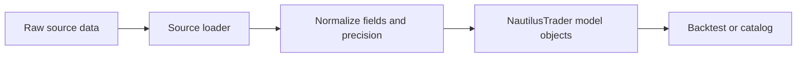

# 数据 {#data}

NautilusTrader 支持细粒度订单簿数据、quotes、trades、bars、参考价和自定义数据。本概览链接到各内置类型，并解释回测、sandbox 和实时环境共用的概念。

## 内置数据类型 {#built-in-data-types}

每种主要的内置行情数据类型都有专门指南，介绍其字段、行为与构造方式。

| 数据类型                                        | 类别             | 说明                                          |
| --------------------------------------------- | -------------------- | ---------------------------------------------------- |
| [`OrderBookDelta`](./order_book_delta.md)       | 订单簿           | 单条订单簿增量变更。                |
| [`OrderBookDeltas`](./order_book_deltas.md)     | 订单簿           | 相关订单簿 delta 的批次。                  |
| [`OrderBookDepth`](./order_book_depth.md)       | 订单簿           | 可变深度的买卖盘快照。                |
| [`QuoteTick`](./quote_tick.md)                  | 盘口一档          | 最优买卖价格与数量。                   |
| [`TradeTick`](./trade_tick.md)                  | 成交               | 单笔场所成交或撮合事件。                   |
| [`Bar`](./bar.md)                               | 聚合          | 特定 `BarType` 的 OHLCV bar。                  |
| [`MarkPriceUpdate`](./mark_price_update.md)     | 衍生品参考 | 衍生品工具的标记价格。             |
| [`IndexPriceUpdate`](./index_price_update.md)   | 衍生品参考 | 衍生品市场使用的指数价格。            |
| [`FundingRateUpdate`](./funding_rate_update.md) | 衍生品参考 | 资金费率及下次资金费元数据。              |
| [`OptionGreeks`](./option_greeks.md)            | 期权              | 交易场所提供的 Greeks 与隐含波动率。        |
| [`InstrumentStatus`](./instrument_status.md)    | 工具事件     | 交易、报价与停牌状态变化。           |
| [`InstrumentClose`](./instrument_close.md)      | 工具事件     | 收盘、结算或其他场所收盘价事件。 |

消息总线上按主题寻址的数据保持在 `data` 根下：

- 实时流使用 `data.<kind>...`。
- 数据管道使用 `data.pipeline.<kind>...`。

主题层级见[消息总线](./../message_bus.md#topic-hierarchy)。

## 订单簿 {#order-books}

Rust 的 `OrderBook` 在回测和实时交易中为单个金融工具维护状态。NautilusTrader 支持以下簿类型：

- `L3_MBO`：Level 3 逐笔委托（MBO）数据，每个价位档按订单 ID 索引。
- `L2_MBP`：Level 2 按价聚合（MBP）数据，按价位汇总。
- `L1_MBP`：Level 1 按价聚合（MBP）盘口一档数据，即最优买卖价（BBO）。

回测中，quote、trade 和 bar 数据（`QuoteTick`、`TradeTick`、`Bar`）也可以驱动 `L1_MBP` 订单簿。

### Delta 标志与事件边界 {#delta-flags-and-event-boundaries}

每条 `OrderBookDelta` 都带有 `flags` 字段，使用 `RecordFlag` 位掩码值向 `DataEngine` 标识事件边界：

- `F_LAST`：标记逻辑事件组中的最后一条 delta。启用 `buffer_deltas` 后，`DataEngine` 先累积 delta，遇到 `F_LAST` 才发布给订阅者。每个事件组**必须**以设置了 `F_LAST` 的 delta 结尾。`BacktestNode` 也以此标志切分每个回放的 `OrderBookDeltas` 批次。参见[订单簿 delta 回放](./../backtesting/apis-and-runs.md#order-book-delta-replay)。
- `F_SNAPSHOT`：标记属于快照（而非增量更新）的 delta。快照序列以 `Clear` 动作开始，随后用 `Add` delta 重建完整订单簿状态。快照的最后一条 delta 同时设置 `F_SNAPSHOT | F_LAST`。

:::warning[缺少 F_LAST 会卡住缓冲消费者]
事件组最后一条 delta 若缺少 `F_LAST`，缓冲型消费者会无限累积 delta 而不发布。增量更新和快照都是如此，包括只发出 `Clear` delta 的空订单簿快照。
:::

## 金融工具 {#instruments}

所有行情数据都属于某个金融工具。工具定义提供标识、精度、价格与数量最小变动单位、限额、货币和合约语义，数据才有意义。

工具分类及各类型指南见[金融工具](./../instruments/index.md)。

## Bar 与聚合 {#bars-and-aggregation}

### Bar 简介 {#introduction-to-bars}

**bar**（也称蜡烛图、K 线或 kline）汇总一个区间内的价格与成交量：

- 开盘价
- 最高价
- 最低价
- 收盘价
- 成交量（或以笔数作为成交量的代理）

**聚合方法**定义 NautilusTrader 如何把输入数据分组成 bar。

### 数据聚合的用途 {#purpose-of-data-aggregation}

聚合把细粒度行情数据转换为 bar，用于：

- 为技术指标和策略提供输入。
- 匹配策略所需的时间分辨率。
- 相比高频订单簿数据，减少存储与处理开销。

### 聚合方法 {#aggregation-methods}

NautilusTrader 支持以下聚合方法：

| 名称               | 说明                                               | 类别    |
| :----------------- | :-------------------------------------------------------- | :---------- |
| `TICK`             | 逐笔数据笔数。                                          | 阈值   |
| `TICK_IMBALANCE`   | 逐笔数据的买卖失衡度。                              | 阈值   |
| `TICK_RUNS`        | 逐笔数据连续同向买卖的连串数。                        | 信息 |
| `VOLUME`           | 成交量。                                            | 阈值   |
| `VOLUME_IMBALANCE` | 成交量的买卖失衡度。                      | 阈值   |
| `VOLUME_RUNS`      | 成交量连续同向买卖的连串数。                | 信息 |
| `VALUE`            | 成交名义金额，即 dollar bars。          | 阈值   |
| `VALUE_IMBALANCE`  | 成交名义金额的买卖失衡度。               | 阈值   |
| `VALUE_RUNS`       | 成交名义金额连续同向买卖的连串数。         | 信息 |
| `RENKO`            | 固定价格移动，砖块大小以 tick 计。 | 价格       |
| `MILLISECOND`      | 毫秒粒度的时间区间。              | 时间        |
| `SECOND`           | 秒粒度的时间区间。                   | 时间        |
| `MINUTE`           | 分钟粒度的时间区间。                   | 时间        |
| `HOUR`             | 小时粒度的时间区间。                     | 时间        |
| `DAY`              | 天粒度的时间区间。                      | 时间        |
| `WEEK`             | 周粒度的时间区间。                     | 时间        |
| `MONTH`            | 月粒度的时间区间。                    | 时间        |
| `YEAR`             | 年粒度的时间区间。                     | 时间        |

阈值、信息、时间这几个类别对应 `BarSpecification` 的谓词。`RENKO` 由价格驱动，没有对应谓词。下文的广义信息驱动概念同时包含 imbalance 和 runs 两类 bar。

### 信息驱动 bar {#information-driven-bars}

信息驱动 bar 的采样频率随市场活跃度自适应，而非固定间隔。它们基于**主动方方向**（aggressor side，即成交发起方是买方还是卖方）的概念，分为两个家族：**imbalance**（失衡）和 **runs**（连串）。

**Imbalance bars** 在买卖*净*活动绝对值达到配置的步长时收线。每笔成交贡献一个带符号的值：买方发起为正，卖方发起为负。反向成交相互抵消，因此均衡市场中这类 bar 成形更慢，单边行情中更快。

**Runs bars** 在*连续的*同方向活动达到阈值时收线。主动方方向一变就重置计数器，因而对持续的单边压力敏感，而对净失衡不敏感。

两个家族按测量对象各有三种变体：

| 变体 | Imbalance          | Runs          | 测量对象              |
| :------ | :----------------- | :------------ | :---------------------------- |
| Tick    | `TICK_IMBALANCE`   | `TICK_RUNS`   | 成交笔数。             |
| Volume  | `VOLUME_IMBALANCE` | `VOLUME_RUNS` | 成交数量。              |
| Value   | `VALUE_IMBALANCE`  | `VALUE_RUNS`  | 价格乘以数量。 |

信息驱动 bar 需要 `TradeTick` 数据，因为要用 `aggressor_side` 字段给每笔成交分类，无法只从 `QuoteTick` 数据聚合。

### 聚合的输入类型 {#types-of-aggregation}

NautilusTrader 支持三种聚合输入：

| 输入          | 结果                                      | 价格类型               | 语法要求   |
| ------------- | ----------------------------------------- | ---------------------- | ------------------- |
| `TradeTick`   | 成交到 bar 的聚合。                 | `LAST`                 | 不带 `@` 来源。      |
| `QuoteTick`   | 报价到 bar 的聚合。                 | `BID`、`ASK` 或 `MID` | 不带 `@` 来源。      |
| 更小周期的 `Bar` | bar 到 bar 的聚合，合成更大周期的 bar。 | 目标 bar 的价格类型。 | 来源写在 `@` 之后。 |

### Bar 类型 {#bar-types}

`BarType` 由以下要素标识一个 bar：

- **Instrument ID**（`InstrumentId`）：bar 所属的金融工具。
- **Bar 规格**（`BarSpecification`）：
  - `step`：区间或频率。
  - `aggregation`：聚合方法。
  - `price_type`：价格基准，如 bid、ask、mid 或 last。
- **聚合来源**（`AggregationSource`）：bar 由 NautilusTrader 聚合，还是由外部交易场所或数据提供商聚合。

Rust/PyO3 的 `BarSpecification` 会校验固定子单位的时间聚合，使 bar 与父级时钟或日历单位整齐对齐：

- `MILLISECOND` 步长必须整除 1000 且小于 1000。
- `SECOND` 和 `MINUTE` 步长必须整除 60 且小于 60。
- `HOUR` 步长必须整除 24 且小于 24。
- `MONTH` 步长必须整除 12，可以等于 12。

除 `12-MONTH` 外，步长等于父级单位时应改用更大的聚合单位，例如用 `1-HOUR` 而不是 `60-MINUTE`。

在该模型中，`DAY`、`WEEK`、`YEAR`、阈值、信息驱动和 `RENKO` bar 不受固定子单位规则限制。时间聚合还必须能换算为时长和纳秒区间，因此过大的 `DAY`、`WEEK` 或 `YEAR` 步长会被拒绝。

Bar 类型还可分为*标准*和*复合*两类：

- **标准**：由细粒度行情数据生成，如 quote ticks 或 trade ticks。
- **复合**：由更细粒度的 bar 类型派生，例如从 1 分钟 bar 聚合出 5 分钟 bar。

### 聚合来源 {#aggregation-sources}

Bar 数据聚合分为*内部*和*外部*两种：

- `INTERNAL`：由 NautilusTrader 聚合。
- `EXTERNAL`：由交易场所或数据提供商聚合。

bar 到 bar 聚合时，目标一定是 `INTERNAL`；来源可以是 `INTERNAL` 或 `EXTERNAL`。

### 用字符串语法定义 bar 类型 {#defining-bar-types-with-string-syntax}

#### 标准 bar {#standard-bars}

用以下格式定义标准 bar 类型：

`{instrument_id}-{step}-{aggregation}-{price_type}-{INTERNAL | EXTERNAL}`

下例定义由 NautilusTrader 本地聚合的 AAPL 5 分钟成交 bar：

```python
bar_type = BarType.from_str("AAPL.XNAS-5-MINUTE-LAST-INTERNAL")
```

#### 复合 bar {#composite-bars}

用以下格式定义复合 bar 类型：

`{instrument_id}-{step}-{aggregation}-{price_type}-INTERNAL@{step}-{aggregation}-{INTERNAL | EXTERNAL}`

- 派生 bar 类型必须使用 `INTERNAL` 聚合来源（bar 就是这样聚合出来的）。
- 被采样的 bar 类型必须比派生 bar 类型粒度更细。
- 被采样工具的 Instrument ID 默认与派生 bar 类型一致。
- 复合 bar 可以从 `INTERNAL` 或 `EXTERNAL` 聚合来源聚合*而来*。

下例定义从外部 1 分钟 bar 聚合出的内部 5 分钟 AAPL 成交 bar：

```python
bar_type = BarType.from_str("AAPL.XNAS-5-MINUTE-LAST-INTERNAL@1-MINUTE-EXTERNAL")
```

### 聚合语法示例 {#aggregation-syntax-examples}

`BarType` 字符串格式同时编码目标 bar 类型和可选的来源数据类型：

```text
{instrument_id}-{step}-{aggregation}-{price_type}-{source}@{step}-{aggregation}-{source}
```

`@` 之后的部分只用于 bar 到 bar 聚合：

- **不带 `@`**：`LAST` 从 `TradeTick` 对象聚合；`BID`、`ASK` 或 `MID` 从 `QuoteTick` 对象聚合。
- **带 `@`**：从指定来源类型的现有 `Bar` 对象聚合。

#### 成交到 bar 示例 {#trade-to-bar-example}

```python
def on_start(self) -> None:
    # LAST selects TradeTick data as the source
    bar_type = BarType.from_str("6EH4.XCME-50-VOLUME-LAST-INTERNAL")
    start = self.clock.utc_now() - timedelta(days=30)

    # Deliver historical bars to on_historical_bars
    self.request_bars(bar_type, start=start)

    # Deliver live bars to on_bar
    self.subscribe_bars(bar_type)
```

#### 报价到 bar 示例 {#quote-to-bar-example}

```python
def on_start(self) -> None:
    # Create 1-minute bars from QuoteTick ask prices
    bar_type_ask = BarType.from_str("6EH4.XCME-1-MINUTE-ASK-INTERNAL")

    # Create 1-minute bars from QuoteTick bid prices
    bar_type_bid = BarType.from_str("6EH4.XCME-1-MINUTE-BID-INTERNAL")

    # Create 1-minute bars from QuoteTick mid prices
    bar_type_mid = BarType.from_str("6EH4.XCME-1-MINUTE-MID-INTERNAL")
    start = self.clock.utc_now() - timedelta(days=30)

    self.request_bars(bar_type_ask, start=start)
    self.subscribe_bars(bar_type_ask)
```

#### bar 到 bar 示例 {#bar-to-bar-example}

```python
def on_start(self) -> None:
    # Create 5-minute bars from 1-minute Bar objects
    # Format: target_bar_type@source_bar_type
    # The price type appears only on the target side
    bar_type = BarType.from_str("6EH4.XCME-5-MINUTE-LAST-INTERNAL@1-MINUTE-EXTERNAL")
    start = self.clock.utc_now() - timedelta(days=30)

    self.request_bars(bar_type, start=start)

    # Deliver live updates to on_bar
    self.subscribe_bars(bar_type)
```

#### 进阶 bar 到 bar 示例 {#advanced-bar-to-bar-example}

用 NautilusTrader 已聚合的 bar 构建更长的聚合链：

```python
# Create 1-minute bars from TradeTick objects
primary_bar_type = BarType.from_str("6EH4.XCME-1-MINUTE-LAST-INTERNAL")

# Create 5-minute bars from the 1-minute bars
intermediate_bar_type = BarType.from_str("6EH4.XCME-5-MINUTE-LAST-INTERNAL@1-MINUTE-INTERNAL")

# Create hourly bars from the 5-minute bars
hourly_bar_type = BarType.from_str("6EH4.XCME-1-HOUR-LAST-INTERNAL@5-MINUTE-INTERNAL")
```

### Bar 的使用：request 与 subscribe {#working-with-bars-request-vs-subscribe}

NautilusTrader 提供两个处理 bar 的操作：

| 方法               | 用途                 | 交付回调       |
| ------------------ | ----------------------- | ---------------------- |
| `request_bars()`   | 获取历史 bar。  | `on_historical_bars()` |
| `subscribe_bars()` | 订阅实时 bar。 | `on_bar()`             |

`subscribe_bars()` 要求 `BarType` 对应的金融工具已在 `Cache` 中。其他实时行情订阅也有同样的前置条件。

典型工作流中两个方法配合使用：

1. `request_bars()` 加载历史数据，初始化指标或策略状态。
1. `subscribe_bars()` 接着以实时 bar 继续数据流。

请求会返回一个关联 ID。历史数据以 `Sequence[Bar]` 形式经 `on_historical_bars()` 送达；实时数据经 `on_bar()` 逐个 bar 送达。

```python
from collections.abc import Sequence


def on_start(self) -> None:
    bar_type = BarType.from_str("6EH4.XCME-5-MINUTE-LAST-INTERNAL")
    start = self.clock.utc_now() - timedelta(days=30)

    # Register indicators before requesting history
    self.register_indicator_for_bars(bar_type, self.my_indicator)

    self.request_bars(bar_type, start=start)
    self.subscribe_bars(bar_type)


def on_historical_bars(self, bars: Sequence[Bar]) -> None:
    for bar in bars:
        self.log.info(f"Historical bar: {bar}")


def on_bar(self, bar):
    # Process individual bars from subscribe_bars()
    pass
```

### 先注册指标再请求数据 {#register-indicators-before-requesting-data}

先注册指标再请求历史数据，指标才能收到这些更新。

```python
start = self.clock.utc_now() - timedelta(days=30)

# Correct order
self.register_indicator_for_bars(bar_type, self.ema)
self.request_bars(bar_type, start=start)

# Incorrect order: the indicator misses historical updates
self.request_bars(bar_type, start=start)
self.register_indicator_for_bars(bar_type, self.ema)
```

### 性能考量 {#performance-considerations}

Bar 聚合器用定点数 `Price` 类型跟踪 OHLC 价格。聚合方法决定每次更新的额外工作量：

- **时间 bar**：每次更新累积 OHLCV 状态，由定时器发出 bar。
- **阈值 bar**：tick、volume、value bar 每次更新多一次计数器或累加器检查。单笔成交超过剩余阈值时，volume 和 value bar 会把它拆到多个 bar 中。
- **信息驱动 bar**：imbalance 和 runs bar 跟踪主动方方向与带符号累积。
- **Renko bar**：价格驱动的 bar 可能因一次大的价格移动发出多个 bar。
- **复合 bar**：处理已聚合的来源 bar，而不是逐笔底层 tick。

### 时间 bar 配置 {#time-bar-configuration}

`DataEngineConfig` 控制时间 bar 行为。以下选项适用于从毫秒到年的全部时间聚合：

| 选项                                | 类型                        | 默认值     | 说明                                                                                                                                                  |
| :---------------------------------- | :-------------------------- | :---------- | :----------------------------------------------------------------------------------------------------------------------------------------------------------- |
| `time_bars_interval_type`           | `BarIntervalType` 或 `str`  | `LEFT_OPEN` | `LEFT_OPEN`：不含起点、含终点。`RIGHT_OPEN`：含起点、不含终点。Python 构造函数也接受 `"left-open"` 和 `"right-open"`。 |
| `time_bars_timestamp_on_close`      | `bool`                      | `True`      | 为 `True` 时 `ts_event` 是 bar 收盘时刻；为 `False` 时是开盘时刻。                                                                |
| `time_bars_skip_first_non_full_bar` | `bool`                      | `False`     | 聚合从区间中间启动时跳过发出不完整的 bar，避免启动时出现残 bar。                                                                  |
| `time_bars_build_with_no_updates`   | `bool`                      | `True`      | 为 `True` 时，即使区间内没有任何行情更新也会发出 bar。                                                                         |
| `time_bars_origin_offset`           | `dict[BarAggregation, int]` | `{}`        | 把聚合类型映射到纳秒偏移，平移 bar 的对齐位置。                                                                                       |
| `time_bars_build_delay`             | `int`                       | `0`         | 构建 bar 前的延迟（微秒）。回测中可确保 bar 边界时间戳上的数据先于定时器处理。              |
| `time_bars_time_zone`               | `str` 或 `None`             | `None`      | 天及以上日历边界使用的 IANA 时区，默认 UTC。                                                                            |

例如，给 `BarAggregation.DAY` 设置 `34_200_000_000_000` 纳秒偏移，可把日线边界对齐到 09:30 UTC。

```python
from nautilus_trader.config import DataEngineConfig

config = DataEngineConfig(
    time_bars_timestamp_on_close=True,
    time_bars_build_with_no_updates=False,
    time_bars_skip_first_non_full_bar=True,
)
```

设置 `time_bars_time_zone` 可让日线、周线、月线、年线对齐本地日历。例如以下配置让日线在纽约时间 09:30 收线，跨夏令时切换也成立：

```python
from nautilus_trader.config import DataEngineConfig
from nautilus_trader.model import BarAggregation

config = DataEngineConfig(
    time_bars_time_zone="America/New_York",
    time_bars_origin_offset={BarAggregation.DAY: 34_200_000_000_000},
)
```

#### 时区覆盖 {#time-zone-overrides}

对内部聚合的 bar，可通过请求或订阅参数覆盖引擎配置的时区：

- 订阅时传入 `params={"time_zone": "UTC"}`。
- 历史聚合请求中，在 `"bar_types"` 请求参数之外加入 `"time_zone"`。

显式的 `"UTC"` 会覆盖非 UTC 配置。共享同一实时 bar 类型的订阅必须使用同一时区。带 `"update_subscriptions": True` 的历史请求也共享该实例，时区不同会被拒绝。独立的请求聚合器可用别的时区。

#### 日历边界 {#calendar-boundaries}

Origin 偏移先作用于名义本地边界，再做 DST 解析：

- **DST 空缺**：落在空缺中的边界向后平移空缺时长。
- **重复边界**：重复的边界取第一次出现。
- **月末钳制**：只钳制受影响的边界，后续月份保持名义 origin。

Build delay 在每个解析后的边界之上追加若干微秒。bar 时间戳仍是 UTC UNIX 纳秒，不足一天的周期保持 UTC 对齐。这些日历边界不包含交易所时段、节假日和提前收盘。

## 时间戳 {#timestamps}

许多行情、订单和事件对象带有两个时间戳：

- `ts_event`：事件发生时刻的 UNIX 纳秒时间戳。
- `ts_init`：NautilusTrader 初始化该对象时刻的 UNIX 纳秒时间戳。

### 典型含义 {#typical-meanings}

| 事件类型          | `ts_event`                             | `ts_init`                                        |
| ----------------- | -------------------------------------- | ------------------------------------------------ |
| `TradeTick`       | 交易场所的成交时间。               | 本地对象初始化时间。                |
| `QuoteTick`       | 交易场所的报价时间。               | 本地对象初始化时间。                |
| `OrderBookDelta`  | 交易场所的订单簿更新时间。         | 本地对象初始化时间。                |
| `Bar`             | 按配置取 bar 开盘或收盘边界。 | 本地聚合或对象初始化时间。 |
| `DefiData`        | 区块或池事件时间。              | 来自链上数据的对象初始化时间。  |
| `OrderFilled`     | 交易场所的成交时间。                | 本地成交事件初始化时间。            |
| `OrderCanceled`   | 交易场所的撤单时间。        | 本地撤单事件初始化时间。    |
| 自定义新闻事件 | 发布时间。                      | 本地对象初始化时间。                |
| 自定义事件      | 由自定义事件自行定义的时间。      | 本地对象初始化时间。                |

:::note
`ts_init` 的含义是初始化时间，不一定等于接收时间。命令和内部生成的事件也使用它，尽管 NautilusTrader 并非从外部来源接收它们。
:::

### 延迟分析 {#latency-analysis}

只有产生两个时间戳的时钟相互同步时，`ts_init - ts_event` 才度量实际观察到的延迟。否则结果还混入了时钟偏移，不能单独代表系统延迟。

### 各环境的行为 {#environment-specific-behavior}

#### 回测环境 {#backtesting-environment}

- 数据按 `ts_init` 做稳定排序。
- DeFi 数据（`DefiData`）在 `ts_init` 相同时按链上位置（区块号、交易索引、日志索引）打破平局，使同一区块的事件按链上规范顺序回放。
- 该排序保证回测回放是确定性的。

#### 实时交易环境 {#live-trading-environment}

实时交易按数据到达顺序处理。对来自交易场所的数据，`ts_event` 记录外部事件时间，`ts_init` 通常记录接收后的本地对象初始化时间。

### 其他说明与注意事项 {#other-notes-and-considerations}

- 外部来源的数据，`ts_init` 通常是本地接收或归一化时间。由于时钟偏差，`ts_init` 不保证大于或等于 `ts_event`。
- 在 NautilusTrader 内部创建的数据，`ts_init` 和 `ts_event` 可以相同。
- 某些带 `ts_init` 的类型没有 `ts_event`，原因是：
  - 对象初始化与事件本身发生在同一时刻。
  - 不存在外部事件时间这一概念。

#### 持久化数据 {#persisted-data}

`ts_init` 字段保留最初的初始化时间戳。对交易场所数据，它通常是接收时间；对内部创建的数据，它是对象的创建时间。

## 数据流 {#data-flow}

从 `DataEngine` 开始，数据在每个[环境上下文](./../architecture.md#environment-contexts)（回测、sandbox、实时）中走相同的路径。入口路径则有差别：

- 实时和 sandbox 模式下，由场所适配器创建归一化数据对象，经 channel 发送。
- 回测中，引擎直接喂入数据。

在各环境中，`DataEngine` 把可缓存类型存入 `Cache`，并把数据经 `MessageBus` 发布给订阅的处理函数。带时序图的逐步追踪见[数据流：一个 quote tick 的一生](./../architecture.md#data-flow-life-of-a-quote-tick)。

要定义并发布其他数据类型，见[自定义数据](#custom-data)。

## 加载数据 {#loading-data}

把外部记录转换为 NautilusTrader 模型对象后，才能加入回测或写入数据目录。转换路径取决于数据来源：

- 仓库为来源格式提供了适配器 loader 时，优先使用。
- 已有规范化行数据或 DataFrame 时，直接构造目标模型类型。
- 已遵循 NautilusTrader schema 的 Arrow IPC 流，使用 PyO3 数据 wrangler。

### 数据加载器 {#data-loaders}

数据加载器与来源格式绑定：Binance 订单簿 CSV 与
[Databento Binary Encoding (DBN)](https://databento.com/docs/knowledge-base/new-users/dbn-encoding/getting-started-with-dbn)
格式完全不同。

`load_binance_order_book_deltas(...)` 把 Binance 深度 CSV 读成规范化 DataFrame，再按工具的报价与数量精度把这些行转换为 `OrderBookDelta` 对象。完整的目录与回测工作流见[教程](./../../tutorials/index.md)。

### Arrow IPC wrangler {#arrow-ipc-wranglers}

PyO3 persistence 模块为 schema 兼容的 Arrow IPC 流提供以下 wrangler：

| Wrangler                     | 构造时的标识                 | 返回类型               |
| ---------------------------- | ---------------------------------- | ---------------------- |
| `OrderBookDeltaDataWrangler` | Instrument ID 与两种精度。 | `list[OrderBookDelta]` |
| `OrderBookDepthDataWrangler` | Instrument ID 与两种精度。 | `list[OrderBookDepth]` |
| `QuoteTickDataWrangler`      | Instrument ID 与两种精度。 | `list[QuoteTick]`      |
| `TradeTickDataWrangler`      | Instrument ID 与两种精度。 | `list[TradeTick]`      |
| `BarDataWrangler`            | Bar 类型与两种精度。      | `list[Bar]`            |

每个构造函数的参数依次是字符串形式的标识、`price_precision` 和 `size_precision`。把完整的 Arrow IPC 流以 `bytes` 传给 `process_record_batch_bytes(...)`。

### 定点精度与原始值 {#fixed-point-precision-and-raw-values}

NautilusTrader 对 `Price` 和 `Quantity` 使用定点算术。原始值（raw value）必须与其声明精度对应的量纲一致。

#### 原始值要求 {#raw-value-requirements}

用 `from_raw()` 构造 `Price` 或 `Quantity` 时，raw 值应来自：

- 现有值的 `.raw` 字段，例如 `price.raw`。
- NautilusTrader 的定点转换函数。

来自当前 Arrow 列的小数值，应使用 `Price.from_decimal` 或 `Quantity.from_decimal`，不要用 `from_raw()`。

:::warning[原始值不做校验]
精度低于 `FIXED_PRECISION` 时，raw 值必须能被 `10^(FIXED_PRECISION - precision)` 整除。构造时不会拒绝无效的倍数，可能得到错误的值。
:::

当前目录中定点行情数据的价格和数量列使用 `Decimal128(38, 16)`。解码后得到小数值；其物理尾数用的是存储量纲，可能与模型的 raw 整数标度不同。`from_raw()` 只用于已按当前模型标度编码的整数。

#### 旧版原始值修正 {#legacy-raw-value-correction}

旧版目录写入器用 `int(value * FIXED_SCALAR)` 计算 raw 值，可能引入浮点误差。显式迁移会把这些受影响的 price 和 quantity 值修正到其精度下最近的合法量纲倍数，哨兵值保持不变。这类目录在运行时查询前必须先显式迁移。修正会在 Arrow 解码时增加少量开销。

### 转换流水线 {#transformation-pipeline}

1. 来源专用的 loader 读取原始数据。
1. 转换环节规范化字段名、时间戳、枚举和精度。
1. 模型构造函数校验并创建 NautilusTrader 数据对象。
1. 应用把这些对象传给回测或目录 writer。



转换必须保持价格和数量值精确无损。用小数或字符串构造 `Price` 和 `Quantity`，不要让离散值经过二进制浮点数中转。

## 数据目录 {#data-catalog}

数据目录用 [Parquet](https://parquet.apache.org) 文件存储 NautilusTrader 数据，供回测、实时交易和研究使用。初始化、存储选项、写入、查询与文件操作见[数据目录指南](./catalog.md)。

## 数据迁移 {#data-migrations}

`nautilus_model` crate 定义内部数据格式。NautilusTrader 把这些模型序列化为 Arrow record batch，存入 Parquet 文件。

用 `nautilus catalog migrate-parquet` 把按旧 schema 或旧[精度模式](./../../getting_started/installation.md#precision-mode)写入的目录重写为当前 Arrow 格式。试运行、远程存储选项与迁移报告见[迁移 Parquet 数据目录](./../../how_to/migrate_parquet_catalog.md)。

## 自定义数据 {#custom-data}

自定义负载用 `DataType` 做标识与路由，用 `CustomData` 作为通用包装：

- **Python 负载**：纯 Python 负载可在不注册的情况下使用兜底包装做进程内路由。每个用 `CustomData` 包装的 Python 负载——包括未注册的进程内负载——必须把 `ts_event` 和 `ts_init` 暴露为 UNIX 纳秒时间戳。
- **注册**：从 JSON 重建类型，或使用 Arrow、Parquet、Feather 持久化之前，必须先注册。
- **Rust 负载**：同一二进制内的 Rust 类型可注册原生处理器。仅实时使用的 Rust 类型可以不提供 Arrow 支持。

注册表、包装与持久化架构见[自定义数据](./../custom_data.md)。

### 纯 Python 目录示例 {#pure-python-catalog-example}

与目录配合使用的 Python 类需提供时间戳、JSON 回调、Arrow schema 和 Arrow 批次回调。`@customdataclass` 根据类注解生成序列化方法和 schema，同时提供 `ts_event` 和 `ts_init`。这两个参数直接传给构造函数，不要声明为 dataclass 字段。

启动时注册一次该类：

```python
from nautilus_trader.model import CustomData
from nautilus_trader.model import DataType
from nautilus_trader.model import NautilusDataType
from nautilus_trader.model import register_custom_data_class
from nautilus_trader.model.custom import customdataclass
from nautilus_trader.persistence import ParquetDataCatalog


@customdataclass()
class MarketTickPython:
    symbol: str = ""
    price: float = 0.0
    volume: int = 0


register_custom_data_class(MarketTickPython)

catalog = ParquetDataCatalog("/path/to/catalog")
data_type = DataType("MarketTickPython", metadata={"exchange": "NASDAQ"})
wrapped = [
    CustomData(
        data_type,
        MarketTickPython(ts_event=1, ts_init=1, symbol="AAPL", price=150.5, volume=1000),
    ),
]

catalog.write_custom_data(wrapped)
result = catalog.query_custom_data(NautilusDataType.Custom("MarketTickPython"))
ticks = [item.data for item in result]
```

手写类也可以自己提供同样的接口：`ts_event` 和 `ts_init`、`type_name_static()`、`to_json()`、`from_json()`、`encode_record_batch_py()` 和
`decode_record_batch_py()`。

**Arrow schema 要求**：

- 注册时从 `_schema` 类属性读取 schema，没有则回退到 `arrow_schema_py()` 类方法。`encode_record_batch_py` 产出的批次必须与其一致。
- schema 必须包含 `ts_init`，目录用它做时间过滤。
- 任何 `ts_event` 或 `ts_init` 字段必须使用 `timestamp("ns", tz="UTC")`。

缺少 `ts_init`，或任一时间戳字段类型不对时，`write_custom_data` 会直接抛错，而不是写出无法查询的文件。

早前用整数时间戳写入的文件，用 `nautilus catalog migrate-parquet` 转换。自定义数据写入必须按 `ts_init` 升序。

`BacktestDataConfig` 只接受内置目录数据类型，不接受任意自定义类型。要回放查询得到的 `CustomData` 包装，直接把它们加入配置好的 `BacktestEngine`：

```python
engine.add_data(result)
```

`BacktestEngine.add_data` 默认按 `ts_init` 排序。仅当输入已满足回放顺序时才传 `sort=False`。

### 发布与订阅 {#publishing-and-subscribing}

Actor 和策略发布、接收的都是 `CustomData` 包装：

```python
from nautilus_trader.model import CustomData
from nautilus_trader.model import DataType


data_type = DataType("MarketTickPython", metadata={"exchange": "NASDAQ"})
custom = CustomData(data_type, MarketTickPython(ts_event=1, ts_init=1))
self.subscribe_data(data_type)
self.publish_data(data_type, custom)


def on_data(self, data: CustomData) -> None:
    if data.data_type == data_type:
        tick = data.data
```

`publish_data` 根据其 `data_type` 参数推导消息总线主题，包括该参数的 metadata。该参数可以覆盖 `CustomData` 包装自带的 `data_type`。除非有意覆盖，两处应使用同一个值。

`on_data` 会收到所有已订阅的自定义数据，使用前先检查 `data_type` 再取 `.data`。

关于 `subscribe_data`：

- 不带 `client_id` 时，只安装本地消息总线订阅。
- 带 `client_id` 时，还会把订阅请求发给该数据客户端。

### 缓存存储 {#cache-storage}

通用 `Cache` 以应用自定义的键存储序列化字节。注册负载类型后，actor 或策略可以对完整的 `CustomData` 包装做序列化往返：

```python
cache_key = "market_tick:AAPL"
self.cache.add(cache_key, custom.to_json_bytes())

cached = self.cache.get(cache_key)
if cached is not None:
    restored = CustomData.from_json_bytes(cached)
```

### 发布与接收信号数据 {#publishing-and-receiving-signal-data}

**信号**（signal）是一种具名自定义数据消息，其 Python 值会被转换为字符串。在 actor 或策略中发布和订阅：

```python
self.subscribe_signal("signal_name")
self.publish_signal("signal_name", value, ts_event)


def on_signal(self, signal):
    print("Signal", signal)
```

`ts_event` 为 0 时，`publish_signal` 使用当前时钟时间。信号消息内部走自定义数据管道，`subscribe_signal` 把它们分发给 `on_signal`。

## 相关指南 {#related-guides}

- [自定义数据](./../custom_data.md)：运行时注册、包装、路由与持久化。
- [金融工具](./../instruments/index.md)：数据引用的金融工具。
- [期权](./../options.md)：期权工具、期权链订阅与行权价过滤。
- [希腊字母](./../greeks.md)：交易场所提供与本地计算的期权 Greeks。
- [Cache](./../cache.md)：数据存储与读取。
- [适配器](./../adapters.md)：数据源与连接。
