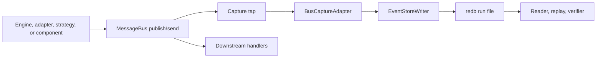
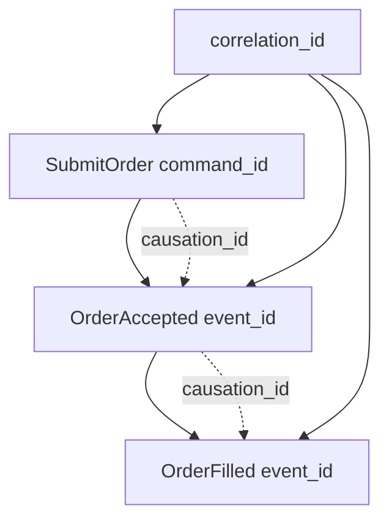
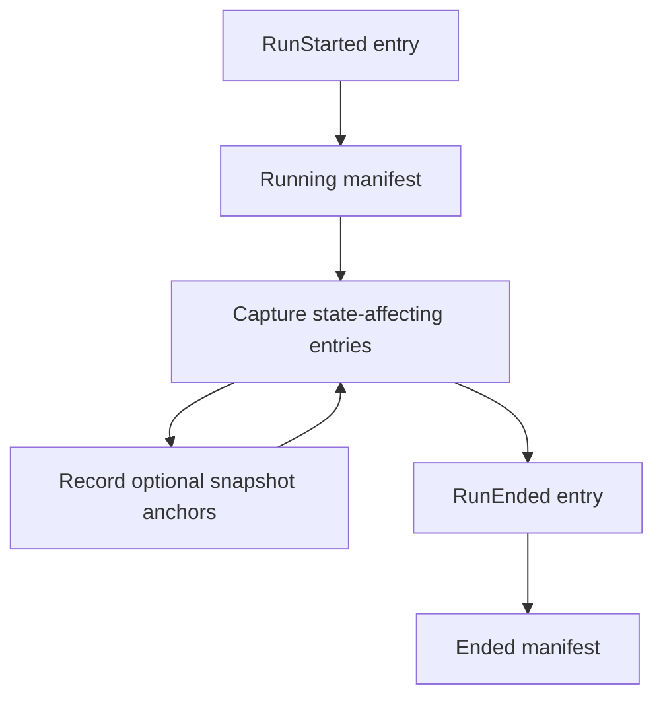
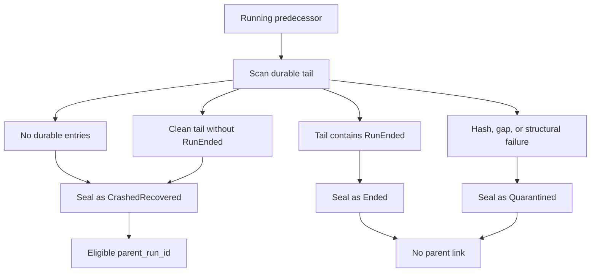
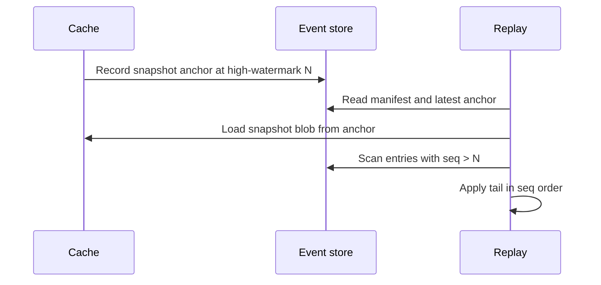

# 事件溯源

事件溯源为 NautilusTrader 提供一份持久、有序的记录，保存改变引擎状态的消息。事件存储在系统边界处记录这些消息。读取器、回放工具和校验器随后使用同一份日志重建当时发生的事，并重建状态。

**核心原则**：

- 事件存储是影响状态历史的持久权威。
- 缓存是 write-through 投影，不是事实来源。
- 缓存回放把捕获的历史应用到缓存自有状态上，从而重建状态。
- 行情数据留在数据目录中。事件存储记录影响状态的消息。
- 外部 I/O 只有被 Nautilus 捕获为命令、原始报告或其他影响状态的输入时，才可回放。

:::note
事件存储的捕获、回放、校验、恢复和保留规划都有针对性测试覆盖，但 API 面仍在演进。请把本页当作设计契约，把
[`nautilus-event-store` README](https://github.com/nautechsystems/nautilus_trader/blob/develop/crates/event_store/README.md)
和 [docs.rs](https://docs.rs/nautilus-event-store) 当作 API 参考。
:::

## 为什么要事件溯源 {#why-event-sourcing}

缓存回答"现在什么是真的"，事件存储回答"Nautilus 怎么走到这一步"。它为读取器、回放工具和校验器提供按运行划分的完整历史。这份历史无需策略逻辑、场所查询或活动缓存，就能解释过去的状态。

事件存储为以下事项提供持久基础：

- 在回放或归档前证明一个已封存（sealed）的运行是否干净。
- 检查某个订单或组件意图背后确切的命令、报告与事件序列。
- 从捕获的历史重建缓存状态，包括一个快照锚点加上本次运行的尾部。
- 追踪一个意图，看它在引擎侧引发了哪些后续消息。
- 进程退出或写入器停摆后，在下一次运行开始前封存旧的运行文件。

## 术语 {#terms}

- **Run（运行）**：一个实例、一个二进制、一份配置对应的一次内核会话。
- **Entry（条目）**：一条捕获的消息加回放元数据。
- `seq`：写入器分配的每运行序号，用作回放顺序。
- **High-watermark（高水位线）**：后端已持久确认的最大 `seq`。
- **快照锚点**：随缓存快照一起记录的高水位线。
- **Headers（头部）**：随捕获消息传播的关联（correlation）与因果（causation）元数据。

## 存储记录什么 {#what-the-store-records}

事件存储为单个交易实例的单次运行记录影响状态的消息总线流量。运行从内核启动开始，到进程正常停止或崩溃时结束。

**捕获的条目包括**：

- 执行命令，如提交、修改、撤销。
- 定义 actor 或策略观察窗口的数据订阅命令。
- 触发的时间事件，以及生成的订单、持仓、账户事件。
- 对账合成派生事件之前的原始场所执行报告。
- 由这些原始报告产生的对账输出。
- 跨越消息总线且影响状态的请求/响应消息，或其与审计相关的元数据。
- 运行生命周期条目，如 `RunStarted` 和 `RunEnded`。

流式行情观察留在数据目录中。事件存储记录命令流、原始报告、生成事件和元数据，凭它们可回放引擎对那个世界的反应。

两条捕获规则把数据响应与工具收盘同流式观察区分开：

- **数据响应**：对引擎请求的每个响应都会被捕获，包括订单簿、期权链参考价和自定义数据响应。其中只有 [缓存回放](#cache-replay) 一节列出的类型有回写缓存状态的规则，其余仅作检查记录。
- **Instrument close**：每次发布的 `InstrumentClose` 都会被捕获，因为合约到期会使持仓结算。

## 边界 {#boundaries}

事件存储有意保持窄范围：

- 不取代数据目录。
- 不提供分析或 OLAP 查询。
- 不把多个 trader 实例聚合成共识日志。
- 尚未定义脱敏、静态加密或防篡改证明。

## 捕获流程 {#capture-flow}

捕获发生在消息总线分发边界，因此采样点（tap）能在下游 handler 观察到每条影响状态的消息之前先看到它。



捕获从喂养下游 handler 的同一次分发上分叉，读取器永远只访问持久后端。

捕获是**异步的**，不是分发的准入门。捕获成功即把条目入队给写入器。写入器线程随后分配下一个 `seq`、提交一个批次，并在后端确认持久后推进高水位线。

读取器通过一个没有追加操作的接口扫描已封存或运行中的后端。

写入器经有界通道接收条目，有两条不同的失败路径：

- **背压**：提交受阻超过配置的 `halt_threshold` 时触发停摆（halt）信号。背压绝不静默丢弃已接受的条目。
- **后端提交失败**：写入器触发停摆信号、丢弃待提交批次并结束其循环。这些条目永远不会持久。

:::warning
**fail-stop 不会打断运行**。采样点记录失败日志，消息照常送达其 handler。一旦停摆，采样点停止记录，该会话剩余部分处于未捕获状态。

没有运行时组件轮询停摆信号去停止 trader。下次启动时的恢复清扫会封存该运行，尾部干净时记为 `CrashedRecovered`。
:::

有些消息预期会跨过多个采样点可见的边界：

- 执行引擎把订单事件发往 portfolio 端点，同时在策略 topic 上发布同一事件。
- 交易命令从策略到风控再到执行逐跳传递。

同一条消息的重复分发落在同一个引擎周期内。因此捕获适配器会对照近期捕获消息身份（event id、command id）的有界窗口去重。每条逻辑消息只成为一个条目，回放不会重复应用同一事件。

## 生命周期选项 {#lifecycle-options}

`EventStoreConfig` 是可序列化的运行策略。进程级构造策略位于 `EventStoreLifecycleOptions`，高级调用方通过 `EventStoreLifecycle::boot_with_options(...)` 传入。

默认情况下，生命周期打开 `RedbBackend`，并安装默认的编码器与数据标记提取器注册表。生命周期选项可替换三者中任意一个：

- 编码器注册表，或按运行构建注册表的工厂；在总线采样点开始捕获之前应用。
- 后端打开器（backend opener），为新运行返回任意 `EventStore` 实现。
- 针对配置的标记类的数据标记提取器注册表工厂。

后端打开器是内存捕获的模拟安全路径。DST harness 或聚焦测试可以通过正常生命周期打开 `MemoryBackend`，使用同样的总线采样点与写入器语义，封存后在进程内读取捕获条目。用 `MemoryBackend` 打开器时，捕获不需要 `redb` 运行文件。

在 `cfg(madsim)` 下，写入器对每次提交同步落盘，因此捕获的 `seq` 顺序是确定的。

## 条目模型 {#entry-model}

每个事件存储条目是一条捕获消息加元数据：

- `seq`：每运行回放顺序的权威。
- `ts_init`：捕获消息上的领域时间戳。
- `ts_publish`：总线接受或写入器接收的时间戳。
- `topic`：总线主题或逻辑端点。
- `payload_type`：编码后的消息类型。
- `payload`：编码后的消息字节。
- `headers`：关联与因果元数据。
- `entry_hash`：条目内容的规范化哈希。

回放按 `seq` 排序。时间戳帮助解释运行，但不覆盖 `seq`。

二级索引支持按 `client_order_id` 和 `venue_order_id` 查找。当有具体的检查调用方需要按 `correlation_id` 查找时，可以增加相应索引。在那之前，关联扫描可以遍历捕获流。

## 关联模型 {#correlation-model}

目标模型用三层身份区分作用域、血缘和消息身份：

- `correlation_id`：逻辑工作流或链条。
- `causation_id`：直接导致本消息的父消息。
- `command_id`、`event_id` 或 `report_id`：本条消息自身的身份。



一个 `correlation_id` 贯穿整个工作流，`causation_id` 则把每条消息链接到其直接父消息。

:::warning
**头部传播尚不完整**，因此多数捕获条目的头部为空。请把上面的图当作设计契约，而不是对已捕获运行内容的描述。

默认编码器注册表为交易命令、数据命令和数据响应注册了提取器，提取器原样转发消息携带的内容。实际情况：

- **数据消息**：只有数据请求与数据响应能产出非空头部。请求贡献其 `request_id`；响应携带必需的 `correlation_id`。
- **交易命令**：树内生产者不设置 `correlation_id` 和 `causation_id`。
- **事件与报告**：订单、持仓、账户事件、执行报告和时间事件没有提取器。

:::

头部有内容时，运维人员可以回答两个常见问题：

- "显示这个工作流的全部消息"：按 `correlation_id` 过滤或扫描。
- "显示这个事件为什么发生"：沿 `causation_id` 回溯到直接父消息。

## 运行文件与清单 {#run-files-and-manifests}

默认后端是 `redb`，按运行存放一个文件：

```text
<base>/<instance_id>/<run_id>.redb
```

每个运行文件包含：

- 以 `seq` 为键的条目。
- 订单标识符的二级索引。
- 运行开始时写入、结束时封存的清单（manifest）。
- 可选的快照锚点，用于缓存恢复。

清单记录运行身份与可复现性输入：

- 运行身份：
  - `run_id`
  - `parent_run_id`
  - `instance_id`

- 构建身份：
  - `binary_hash`
  - `schema_version`
  - `crate_versions`
  - `feature_flags`
  - `adapter_versions`

- 配置身份：
  - `config_hash`
  - `registered_components`
  - `seed`

- 生命周期状态：
  - `start_ts_init`
  - `end_ts_init`
  - `high_watermark`
  - `status`

运行状态取 `Running`、`Ended`、`CrashedRecovered` 或 `Quarantined` 之一。

## 运行生命周期 {#run-lifecycle}



运行以 `RunStarted` 打开、以 `RunEnded` 关闭。快照锚点是清单保持 `Running` 期间记录的可选节点。

- `RunStarted` 是全新运行的第一个条目。同进程内重复 `open()` 会先封存当前会话，再开始新运行。
- 清单处于 `Running` 时，总线采样点记录影响状态的条目；缓存快照可对照持久高水位线记录锚点。
- 干净关闭、内核 drop 或 reset/rerun 封存会追加 `RunEnded`，并把清单封存为 `Ended`。
- fail-stop（停摆）的会话跳过进程内封存，由下次启动的恢复清扫接管。停摆信号的作用域限于触发它的运行；后续 `open()` 会重新装载新的信号，因此一次停摆不会毒化同进程内的后续运行。

## 恢复封存 {#recovery-sealing}

前驱（predecessor）指同一实例较旧的运行文件，其清单仍写着 `Running`。这意味着上一个进程没有走完正常生命周期，或写入器在清单封存完成前就停摆了。



启动恢复扫描每个 `Running` 前驱，按持久尾部决定最终清单状态：

| 持久尾部                                  | 封存状态           | 可作父运行 |
| ----------------------------------------- | ------------------ | ---------- |
| 无条目                                    | `CrashedRecovered` | 是         |
| 干净、不含 `RunEnded`                     | `CrashedRecovered` | 是         |
| 干净、以 `RunEnded` 结尾                  | `Ended`            | 否         |
| 哈希不匹配、缺口或结构性故障              | `Quarantined`      | 否         |

清扫绝不会因某个运行文件损坏就让 trader 无法启动：

- **修复**：硬杀（SIGKILL、OOM kill 或断电）之后，redb 拒绝以只读方式打开该运行文件。列目录时退回可写打开，redb 会在恢复继续之前先执行其修复过程。
- **跳过并重试**：文件仍打不开或缺少清单时，恢复跳过它并记录错误，下次启动再试。恢复与保留照常处理健康的运行。

只有 `CrashedRecovered` 前驱会成为 `parent_run_id`。配置了 `replay_from_run_id` 时，校验通过后它覆盖恢复出的父运行。

只读校验器另行检查已封存的运行而不修改它们，并报告 `quarantine=not-performed`。

## 回放输入 {#replay-inputs}

回放只遵循一条排序规则：按 `seq` 顺序应用事件存储条目。`ts_init` 和 `ts_publish` 解释消息何时发生，但 `seq` 才是持久的回放顺序。

Rust 回放输入 API 把规划与执行分开：

- 仅事件存储的回放输入只返回条目。
- 连接目录的回放输入额外加入调用方选定的目录切片，用于上下文分析。

目录规划器接受显式的 `CatalogSliceSelector` 和只读 `ReplayCatalog`：

- **规划**：除非选择器提供显式边界，否则从事件存储扫描解析目录时间边界。它报告缺失的目录切片，并保持 `seq` 作为条目排序的权威。
- **加载**：返回 `ReplayInputs`，事件存储条目按 `seq` 排序，目录记录按所选切片分组。

Rust 调用方可以启用默认关闭的 `persistence` feature，用 `nautilus_event_store::ParquetReplayCatalog` 包装 `ParquetDataCatalog`，从而规划选定的目录文件与按文件名推导的时间区间。该桥接把 `quotes`、`trades` 和 `bars` 加载为类型化的 `CatalogReplayRecord`。

:::note
持久化桥接是只读的：它使用目录的发现与查询 API，但**不向目录写入**。不支持的目录类会导致加载失败，直到回放为该类别加入类型化负载契约。
:::

这些 API **不会**：

- 打开实时场所客户端
- 运行策略或 actor
- 重新执行对账
- 删除文件
- 重放时钟的注册/取消生命周期

## 缓存回放 {#cache-replay}

内核管理的回放使用 `EventStoreConfig::replay_from_run_id`。设置后，内核从已封存的运行恢复缓存状态，并把该运行记为新子运行的父运行。它跳过实时引擎、客户端、启动流程和场所对账。

**回放要求**：

- 被隔离（Quarantined）的运行会被拒绝。
- 回放要求 `load_state=true`。禁用时，内核记录错误并直接返回，既不恢复缓存也不打开子运行。

缓存回放加载器**只处理状态**。它恢复缓存自有的快照，按 `seq` 顺序扫描事件存储尾部，解码受支持的、影响缓存的负载，并直接应用到 `Cache`。受支持的负载包括：

- 合成的账户、订单和持仓事件
- 捕获的订单列表
- 金融工具、报价、成交、资金费率和 bar 的完整数据响应
- Instrument close：与实时执行一样结算二元期权持仓。结算之后回放的成交或成交作废会更新其订单，但不更新已结算的持仓

加载器**不会**：

- 把回放条目发布到实时消息总线
- 运行策略或 actor 代码
- 查询交易场所
- 执行对账
- 重新推导标识符
- 重新装载时钟

在这条路径上，触发的 `TimeEvent` 和原始场所报告只是检查记录。回放应用的是运行中后续捕获的合成订单、持仓和账户事件。

## 数据标记边车 {#data-marker-sidecar}

:::note
标记边车（marker sidecar）通过 `EventStoreConfig.data_markers` 选择性启用，默认关闭。
:::

精确的数据交付顺序不是从目录时间戳推断的。标记边车把消息总线分发边界观察到的数据记录在 `<base>/<instance_id>/<run_id>.markers.redb`，与事件存储运行文件并列。它不把完整行情负载写进 `EventStoreEntry` 行。

边车只支持一条审计声明：启用标记捕获后，Nautilus 在该运行的总线边界按 `marker_seq` 顺序观察到数据交付。每个标记携带足以回联候选目录行的身份信息。它不能：

- 证明仅凭目录时间戳就能定义总线顺序。
- 目录行缺失或被改动时重建那个数据点。
- 证明 Nautilus 观察到消息之前场所的发送顺序。
- 对未启用标记捕获的运行说明任何情况。
- 保证每条观察到的数据消息都产生了标记。

边车用完整性换取与交易路径的隔离，因此不继承条目写入器的背压契约。标记提交发现有界通道已满时直接丢弃该标记，而不是阻塞调用方或停摆运行。其序号会进入一条缺口（gap）记录：

- `Overflow`：后续某次提交把被丢弃的区间刷出。
- `WriterClosed`：被丢弃区间仍待处理时写入器关闭。

### 顺序与身份 {#ordering-and-identity}

标记不消耗事件存储的 `seq` 值，也不在条目表中制造缺口。每个标记有自己单调递增的 `marker_seq`，外加 `event_seq_before`——标记被观察到之前分配的最大事件存储 `seq`。对影响状态的条目，事件存储 `seq` 仍是回放顺序的权威。

分析已封存运行时：

- 标记之后的下一个事件存储条目由 `event_seq_before + 1` 推出。
- `event_seq_before` 相同的标记按 `marker_seq` 排序。

边车有两类标记：

- **游标快照**：`DataCursorSnapshot` 是默认捕获模式。每个快照记录 `marker_seq`、`event_seq_before`、`ts_init`，以及自上一个快照以来前进的 `StreamCursor` 条目。`StreamCursor` 携带流 `slot`、该 slot 见过的最大 `ts_init`（`ts_init_hi`）和记录 `count`。`StreamDictEntry` 把每个 `slot` 映射到其 `data_cls`（`BookDeltas`、`BookDepth`、`Quote`、`Trade`、`Bar`）和工具 `identifier`。
- **高保真标记**：`HiFiMarker` 通过 `DataMarkerConfig.high_fidelity` 按工具选择性启用。每条记录 `marker_seq`、`event_seq_before`、`slot`、`ts_event`、`ts_init`、`same_ts_ordinal`，以及对规范化类型化行字段计算的 32 字节 `record_fingerprint`。

`same_ts_ordinal` 和 `record_fingerprint` 用于区分同一时间戳的重复数据，且无需存储价格、数量、尺寸或 MessagePack 负载。同一键和时间戳的两条目录行可能字节完全相同。此时边车能证明 Nautilus 按某个标记顺序观察到两次交付；但目录压实（compaction）重写行顺序之后，它无法指认唯一的物理目录行。

### 校验与回放边界 {#verification-and-replay-boundaries}

标记校验证明 `marker_seq` 序列全部有据可查，已记录的缺口计为覆盖。**读缺口记录**才能知道丢了什么。

稳定的契约是标记 schema、选择性启用的捕获与读取原语、标记序列校验和目录连接规则。分析工具可以基于该契约选择窗口、解释场所专有数据、对标记排序或聚类、出具报告、打包运行束。

禁用标记捕获时不会安装数据标记写入器。缓存回放和实时重启都不读这个边车。快照尾部回放仍按 `seq` 顺序应用事件存储条目；实时重启仍从缓存自有状态加事件存储父链接启动。

## 快照锚定恢复 {#snapshot-anchored-recovery}

缓存快照归缓存所有，事件存储只保存快照锚点：快照时的高水位线、指名快照的不透明 `blob_ref`（缓存所有），以及该 blob 的缓存所有 `content_hash`。



恢复加载锚点指名的快照，然后只应用锚点高水位线之后的条目。

各恢复场景按消息推进到的程度排列：

| 故障点                          | 恢复行为                                                            |
| ------------------------------- | ------------------------------------------------------------------- |
| 入队之前                        | 消息从未到达写入器，适用生产者的重试策略。                          |
| 入队之后、提交之前              | 在途批次未持久，高水位线不会推进。                                  |
| 提交之后、快照锚点之前          | 加载上一个快照并重放尾部。                                          |
| 快照锚点之后                    | 加载最新快照并重放锚点之后的条目。                                  |

:::info
实时重启目前仍走"快照加对账"。只有当捕获覆盖和回放规则覆盖每条影响状态的路径之后，事件存储恢复才会成为实时重启路径。
:::

回放正确性依赖四项检查：

- 条目以不可变的 `seq` 寻址。
- 写入拒绝乱序提交。
- 读取器能发现高水位线内部的缺口。
- 快照重放规划会拒绝指向持久高水位线之后的锚点。

## 保留规划 {#retention-planning}

保留以完整运行文件为回收单位。事件存储暴露一个非破坏性规划器：列出已封存运行的清单，检查其最新快照锚点状态，返回候选运行文件，由 supervisor 或运维进程之后回收。

规划器支持三种模式：

- `Full`：保留每个已封存运行，不返回回收候选。
- `Bounded { keep_last }`：保留最新的若干已封存运行，并至少保留一个已知良好的恢复点。
- `SnapshotAnchored`：只回收早于最新已知良好恢复点的已封存运行。

已知良好恢复点指一个已封存、非 `Quarantined` 的运行，其快照锚点有效，且锚点高水位线不超过该运行的持久高水位线。规划器对照磁盘上的最后条目做比较，而非清单记录值，因此尾部被裁剪过的运行不能算恢复点。

**保留保障**：

- `Running` 的运行永远不会被列为已封存运行或回收候选。
- 缺失、损坏或无效的快照锚点不算恢复点。无法证明至少保留一个结构有效的恢复点时，规划器不返回候选。

**校验局限**：规划器从不加载快照 blob，检查止于锚点，因此无法排除 blob 缺失或被改动导致的恢复失败。

## 完整性与校验 {#integrity-and-verification}

每个条目携带覆盖其完整内容的规范化哈希。读取器和校验器重算哈希并报告不匹配。校验器还检查清单/高水位线状态，并对照条目表验证二级索引，报告解码失败或指向持久高水位线之后的快照锚点。

:::warning
`clean` 结论证明的是结构完整，不是可恢复性或捕获完整性：

- 校验器检查快照锚点，但从不加载或哈希其指名的 blob。blob 缺失或被改动的运行仍会校验为 clean，却会在恢复时失败。保留规划器基于同样的"仅锚点"证据挑选恢复点。
- 标记校验把已记录缺口计为覆盖，因此在背压下丢过标记的运行仍校验为 clean。
- 会话中途 fail-stop 的运行，就其已捕获的部分校验为 clean，对停摆之后的消息不作任何说明。

:::

运行校验与调用方进程隔离。这一点很重要：某些损坏的 `redb` 文件会在打开或首次读取时 panic，而 release 构建使用 `panic = "abort"`。校验器把扫描放到工作子进程中运行，坏文件只会 abort 工作进程，不影响调用方。

校验一个已封存的运行文件：

```bash
cargo run -p nautilus-event-store --bin verify -- ./event_store/trader-001/1700000000-cafe0001.redb
```

干净的输出形如：

```text
clean run_id=1700000000-cafe0001 status=Ended high_watermark=3 entries_scanned=3 markers=absent
```

损坏的输出包含 `quarantine=not-performed`：

```text
corrupt run_id=1700000000-cafe0001 status=Ended high_watermark=3 entries_scanned=3 findings=1 marker_findings=0 markers=absent quarantine=not-performed
- hash mismatch at seq 2
```

`markers=` 字段报告边车扫描结果：

| 值                   | 含义                                                                                              |
| -------------------- | --------------------------------------------------------------------------------------------------- |
| `absent`             | 运行文件旁没有 `<run_id>.markers.redb`。                                                          |
| `clean` 或 `corrupt` | 边车已读取，附快照、高保真标记、缺口和字典条目的扫描计数。                                        |
| `error`              | 边车存在但无法打开或扫描。                                                                        |

退出码：

- `0`：运行干净。
- `1`：运行存在损坏发现，或工作进程 abort、超时。
- `2`：校验器无法打开或无法针对请求的文件运行。

大型已封存运行可加大工作进程超时：

```bash
env NAUTILUS_EVENT_STORE_VERIFY_TIMEOUT_SECS=120 \
    cargo run -p nautilus-event-store --bin verify -- ./event_store/trader-001/1700000000-cafe0001.redb
```

在 Rust 中读取已封存运行：

```rust
use nautilus_event_store::{EventStoreReader, RedbBackend, ScanDirection};

fn inspect_run() -> Result<(), Box<dyn std::error::Error>> {
    let backend =
        RedbBackend::open_sealed_file("./event_store/trader-001/1700000000-cafe0001.redb")?;
    let reader = EventStoreReader::new(backend);
    let high_watermark = reader.high_watermark()?;

    for entry in reader.scan_range(1, high_watermark, ScanDirection::Forward) {
        let entry = entry?;
        println!("{} {}", entry.seq, entry.topic);
    }

    Ok(())
}
```

:::note
校验器报告损坏但不修改运行文件。隔离（quarantine）是运维或 supervisor 的策略。
:::

## 校验覆盖 {#verification-coverage}

事件存储测试套件为 alpha 面固定以下核心正确性保证：

- 默认编码器注册表覆盖经审计的、影响状态的捕获面。
- 触发的 `TimeEvent` 经 `TimeEventHandler::run` 命中已安装的事件存储采样点。
- 写入器在有界背压下停摆，而不是丢弃已接受的条目。
- 条目哈希校验能发现字节级负载损坏。
- 进程隔离校验把截断或尾部清零的运行文件报告为损坏。
- 对生成的捕获事件流，缓存回放重建出与实时缓存相同的账户、订单和持仓观察状态。
- 跨多个总线边界分发的同一订单事件只捕获一次。
- 解码失败或指向持久高水位线之后的快照锚点会作为校验器发现上报，而不是校验为 clean。
- 连接目录的回放输入规划覆盖所选切片、缺失切片、时间边界和事件存储 `seq` 排序。
- 崩溃恢复按持久尾部把 `Running` 前驱封存为 `Ended`、`CrashedRecovered` 或 `Quarantined`，只有 `CrashedRecovered` 运行成为父运行。
- 启动恢复修复硬崩溃的运行文件，跳过不可读的文件而不是让整个清扫失败。

## 与 DST 的关系 {#relationship-to-dst}

事件存储与[确定性模拟测试](./dst.md)（DST）解决回放中不同的部分。

- 事件存储提供捕获的输入历史。
- DST 控制调度、时间、种子化随机数及其他范围内的非确定性。

两者结合，可让一次运行在确定性模拟范围内复现引擎行为。清单在捕获日志之外，还记录标识这种运行的输入：`seed`、`binary_hash`、`config_hash` 和 `schema_version`。

在 `cfg(madsim)` 下，写入器同步提交而不派生写入线程。模拟 harness 通过生命周期选项提供 `MemoryBackend` 打开器时，捕获留在进程内，不需要 `redb` 文件。在该高级选项路径之外，redb 仍是默认的持久后端。

适配器网络 I/O 保持在比特级一致回放之外，除非 Nautilus 把相关原始输入捕获下来并经确定性接口路由。
