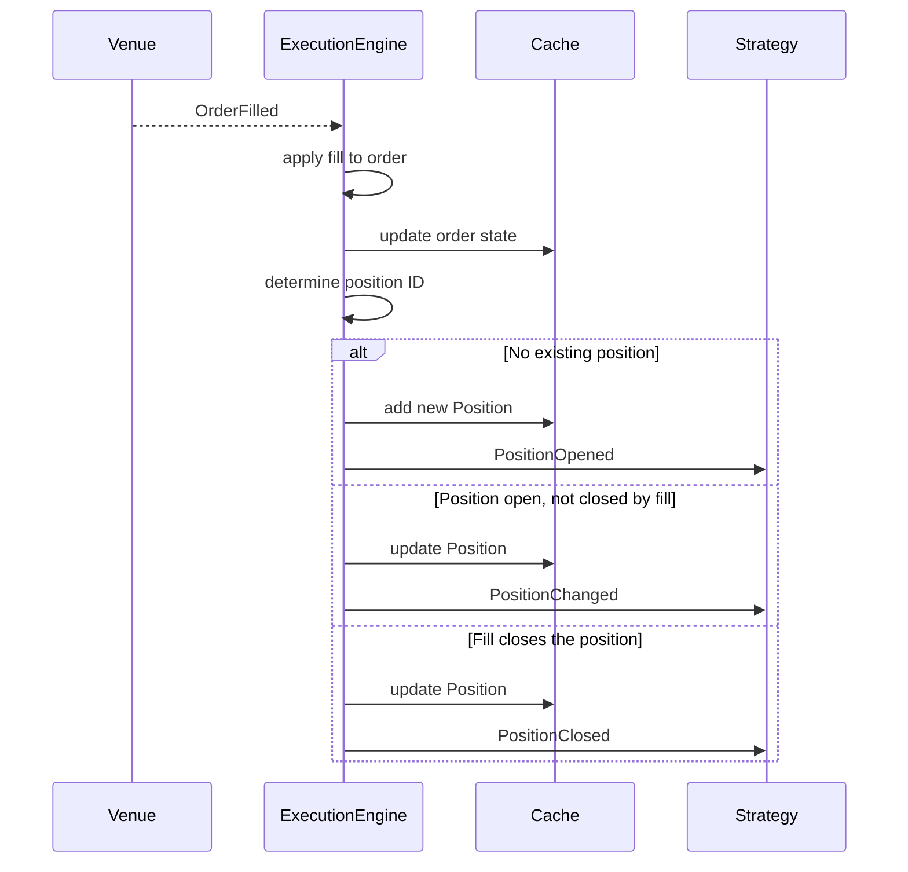

# 事件 {#events}

NautilusTrader 把执行、持仓、账户和时间的变化建模为事件。`MessageBus` 把这些事件路由给相关组件，并在支持的地方送达策略处理函数。本篇介绍事件类型、它们的分发方式，以及成交与成交更正如何产生持仓事件。

## 事件类别 {#event-categories}

| 类别 | 示例                                          | 来源                            |
| -------- | ----------------------------------------------- | ------------------------------- |
| 订单    | `OrderAccepted`、`OrderFilled`、`OrderCanceled` | 执行流水线              |
| 持仓 | `PositionOpened`、`PositionAdjusted`            | 成交与记账变化    |
| 账户  | `AccountState`                                  | `ExecutionClient` / `Portfolio` |
| 时间     | `TimeEvent`                                     | `Clock`（定时器与提醒）     |

## 处理函数分发 {#handler-dispatch}

事件到达策略时，系统按固定顺序调用处理函数。**专用处理函数**先于**汇总处理函数**执行，因此可以任选一种粒度，或两者都用。

策略只在**运行期间**把事件交给处理函数。启动前或停止后到达的事件不会分发。

Python 数据 actor 不暴露订单事件回调，也不暴露原始消息总线。要把派生值从策略传给数据 actor，使用信号。参见
[Actor：订单事件处理](./../actors.md#order-event-handling)。

### 订单事件 {#order-events}

1. 专用处理函数（例如 `on_order_filled`）。
1. `on_order_event`（接收全部订单事件）。

### 持仓事件 {#position-events}

分发给策略的持仓生命周期事件：

1. 专用处理函数（例如 `on_position_opened`）。
1. `on_position_event`（接收全部分发的持仓生命周期事件）。

### 时间事件 {#time-events}

定时器和提醒产出 `TimeEvent` 对象。调用 `set_timer` 或 `set_time_alert` 时传入 `callback`，可把事件定向到自己的方法。

省略 callback 时：

- 若同名回调此前已注册，则沿用该回调。
- 否则事件送到 `on_time_event`。

## 订单事件 {#order-events-1}

订单事件负责初始化订单、改变其状态或更正其成交历史。执行流水线先把事件应用到订单和 `Cache`，再发布到 `MessageBus`。下表列出主要状态迁移。部分成交、外部和触发式订单还有其他迁移，见完整的[订单状态流](./../orders/index.md#order-state-flow)。

| 事件                                              | 主要迁移                                           | 处理函数                   |
| ------------------------------------------------- | ------------------------------------------------------ | -------------------------- |
| [`OrderInitialized`](./order_initialized.md)        | 创建或实化订单                            | `on_order_initialized`     |
| [`OrderDenied`](./order_denied.md)                  | Initialized -> Denied                                  | `on_order_denied`          |
| [`OrderEmulated`](./order_emulated.md)              | Initialized -> Emulated                                | `on_order_emulated`        |
| [`OrderReleased`](./order_released.md)              | Emulated -> Released                                   | `on_order_released`        |
| [`OrderSubmitted`](./order_submitted.md)            | Initialized/Released -> Submitted                      | `on_order_submitted`       |
| [`OrderAccepted`](./order_accepted.md)              | Submitted -> Accepted                                  | `on_order_accepted`        |
| [`OrderRejected`](./order_rejected.md)              | Submitted -> Rejected                                  | `on_order_rejected`        |
| [`OrderTriggered`](./order_triggered.md)            | Accepted -> Triggered                                  | `on_order_triggered`       |
| [`OrderPendingUpdate`](./order_pending_update.md)   | Accepted -> PendingUpdate                              | `on_order_pending_update`  |
| [`OrderPendingCancel`](./order_pending_cancel.md)   | Accepted -> PendingCancel                              | `on_order_pending_cancel`  |
| [`OrderUpdated`](./order_updated.md)                | PendingUpdate -> 原状态                       | `on_order_updated`         |
| [`OrderModifyRejected`](./order_modify_rejected.md) | PendingUpdate -> 原状态                       | `on_order_modify_rejected` |
| [`OrderCancelRejected`](./order_cancel_rejected.md) | PendingCancel -> 原状态                       | `on_order_cancel_rejected` |
| [`OrderCanceled`](./order_canceled.md)              | PendingCancel/Accepted -> Canceled                     | `on_order_canceled`        |
| [`OrderExpired`](./order_expired.md)                | Accepted -> Expired                                    | `on_order_expired`         |
| [`OrderFilled`](./order_filled.md)                  | Accepted -> Filled/PartiallyFilled                     | `on_order_filled`          |
| [`OrderFillVoided`](./order_fill_voided.md)         | 更正已知成交，或对未知成交断言终态 | `on_order_fill_voided`     |

### Python 订单事件的公共字段 {#common-python-order-event-fields}

每个具体的 Python 订单事件都暴露以下字段：

| 字段              | 说明                                                       |
| ----------------- | ------------------------------------------------------------ |
| `trader_id`       | Trader 实例标识。                                  |
| `strategy_id`     | 订单关联的策略。                          |
| `instrument_id`   | 订单所属金融工具。                                    |
| `client_order_id` | 客户端分配的订单标识。                            |
| `event_id`        | 事件唯一标识。                                     |
| `ts_event`        | 事件发生时刻的 UNIX 纳秒时间戳。        |
| `ts_init`         | 事件初始化时刻的 UNIX 纳秒时间戳。 |
| `causation_id`    | 引发本事件的源事件或报告（若已知）。    |

各订单事件页面会列出其特有字段。`venue_order_id`、`account_id` 和 `reconciliation` 只在暴露这些字段的 Python 事件类上出现。例如
[`OrderFilled`](./order_filled.md) 额外有 `last_qty`、`last_px`、`trade_id` 和 `commission`。
[`OrderFillVoided`](./order_fill_voided.md) 标识被更正的那笔成交，并携带其累计作废数量。

## 持仓事件 {#position-events-1}

持仓生命周期事件描述由成交和成交更正引起的缓存持仓变化。`ExecutionEngine` 处理每个 `OrderFilled`，更新或创建持仓，并发出对应的生命周期事件。

当 `OrderFillVoided` 更正一笔已本地应用的成交时，引擎会按剩余的有效成交历史重建每个受影响的缓存持仓，不会发出反向成交。发布更正后，若被更正的持仓仍然持有，引擎发出 `PositionChanged`；若已平掉，则发出 `PositionClosed`。只涉及订单的更正不产生持仓事件。

| 事件                                       | 触发时机                                     | 处理函数              |
| ---------------------------------------- | ---------------------------------------------- | --------------------- |
| [`PositionOpened`](./position_opened.md)   | 成交创建了新持仓。                 | `on_position_opened`  |
| [`PositionChanged`](./position_changed.md) | 成交或更正改变了持仓中数量。 | `on_position_changed` |
| [`PositionClosed`](./position_closed.md)   | 成交或更正使数量归零。  | `on_position_closed`  |

:::warning[PositionAdjusted 不会送达任何持仓处理函数]
[`PositionAdjusted`](./../positions.md#position-adjustments) 记录常规成交之外的数量或已实现盈亏变化，例如以基础货币计的手续费和资金费。`ExecutionEngine` 会发布它，但 `on_position_event` 和任何专用处理函数都收不到。要查看记录的历史，检查 `position.adjustments()`。
:::

### 从成交到持仓：因果链 {#from-fill-to-position-the-causal-chain}

下图展示单个 `OrderFilled` 事件如何产生持仓事件，即订单管理与持仓跟踪之间的衔接。



逐步说明：

1. **成交到达**：`ExecutionEngine` 经执行流水线收到 `OrderFilled` 事件。
1. **订单状态**：引擎把成交应用到订单对象，并把更新后的订单写回 `Cache`。
1. **持仓 ID**：引擎根据 OMS 类型和策略配置确定这笔成交归属哪个持仓。
1. **持仓生命周期**：引擎按以下三种方式之一创建或更新持仓：
   - **该 ID 尚无持仓**：引擎根据成交创建 `Position`，加入 `Cache`，发出 `PositionOpened`。
   - **持仓存在且成交后仍持有**：引擎把成交应用到持仓，更新 `Cache`，发出 `PositionChanged`。
   - **持仓存在且被关闭**（数量归零）：引擎应用成交，更新 `Cache`，发出 `PositionClosed`。
1. **持仓反转**：成交使持仓反向时（例如对 10 手多头卖出 15 手），引擎把成交拆成两部分：一部分平掉原持仓（`PositionClosed`），另一部分开出新持仓（`PositionOpened`）。

### 持仓事件字段 {#position-event-fields}

三个持仓生命周期事件类共用一组核心字段，并随持仓推进暴露更多字段。对勾表示该 Python 类暴露此字段；短横表示该类没有此字段。

| 字段               | Opened | Changed | Closed | 说明                                       |
| ------------------ | ------ | ------- | ------ | -------------------------------------------- |
| `trader_id`        | ✓      | ✓       | ✓      | Trader 实例标识。                  |
| `strategy_id`      | ✓      | ✓       | ✓      | 持仓所属策略。             |
| `instrument_id`    | ✓      | ✓       | ✓      | 持仓所属金融工具。                 |
| `position_id`      | ✓      | ✓       | ✓      | 持仓唯一标识。                  |
| `account_id`       | ✓      | ✓       | ✓      | 持仓所属账户。             |
| `opening_order_id` | ✓      | ✓       | ✓      | 开仓订单。              |
| `closing_order_id` | -      | -       | ✓      | 平仓订单。              |
| `entry`            | ✓      | ✓       | ✓      | 开仓成交的方向。                    |
| `side`             | ✓      | ✓       | ✓      | 当前持仓方向。                       |
| `signed_qty`       | ✓      | ✓       | ✓      | 带符号数量（负数为空头）。            |
| `quantity`         | ✓      | ✓       | ✓      | 不带符号的持仓数量。                  |
| `peak_quantity`    | -      | ✓       | ✓      | 历史最大持仓量。                       |
| `peak_qty`         | -      | ✓       | ✓      | `peak_quantity` 的兼容别名。     |
| `last_qty`         | ✓      | ✓       | ✓      | 本次成交或更正的数量。          |
| `last_px`          | ✓      | ✓       | ✓      | 本次成交或更正的价格。             |
| `currency`         | ✓      | ✓       | ✓      | 持仓的计价货币。                     |
| `avg_px_open`      | ✓      | ✓       | ✓      | 平均开仓价。                         |
| `avg_px_close`     | -      | ✓       | ✓      | 平均平仓价（若有）。            |
| `realized_return`  | -      | ✓       | ✓      | 已实现收益率（比值）。                  |
| `realized_pnl`     | ✓      | ✓       | ✓      | 当前周期的已实现盈亏（成本货币计）。 |
| `unrealized_pnl`   | -      | ✓       | ✓      | 引擎置为零。                   |
| `duration`         | -      | -       | ✓      | 持有时长（纳秒）。                    |
| `ts_opened`        | -      | ✓       | ✓      | 持仓开仓时间戳。              |
| `ts_closed`        | -      | -       | ✓      | 持仓平仓时间戳。              |
| `event_id`         | ✓      | ✓       | ✓      | 事件唯一标识。                     |
| `ts_event`         | ✓      | ✓       | ✓      | 触发事件的时间戳。           |
| `ts_init`          | ✓      | ✓       | ✓      | 事件创建时间戳。            |

### 从订单追溯到持仓 {#tracing-orders-to-positions}

`Cache` 提供在订单与持仓之间导航的方法：

```python
# From a position, find all orders that contributed fills
orders = self.cache.orders_for_position(position.id)

# From an order, find the position it belongs to
position = self.cache.position_for_order(order.client_order_id)

# The opening order is stored directly on the position
opening_order_id = position.opening_order_id
```

## 账户事件 {#account-events}

`AccountState` 事件表示余额与保证金快照。触发时机：

- 交易场所上报账户更新（经执行客户端）。
- 持仓更新后 `Portfolio` 重新计算账户状态（针对启用了 `calculate_account_state` 的保证金账户）。

账户状态包含余额、保证金、账户类型和基础货币。`Portfolio` 内部订阅这些事件，以维护敞口和余额跟踪。完整字段列表见
[`AccountState`](./account_state.md)。

## 相关指南 {#related-guides}

- [订单](./../orders/index.md) - 订单类型与状态机。
- [持仓](./../positions.md) - 持仓生命周期与盈亏。
- [执行](./../execution/index.md) - 执行流程与风控检查。
- [策略](./../strategies.md) - 策略中的处理函数实现。
- [架构](./../architecture.md) - 数据与执行流模式。
