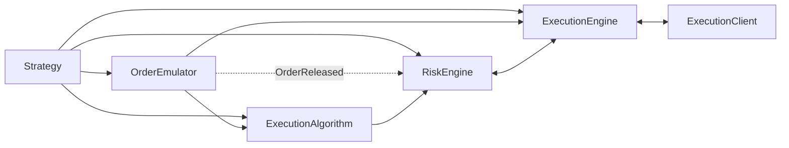
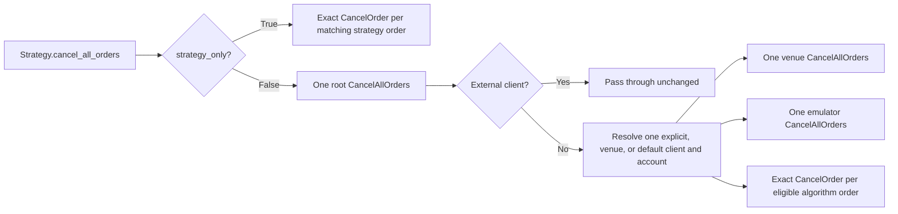

# 执行

NautilusTrader 在多个策略与多个交易场所之间协调订单提交、风控检查、场所执行、一致性对账和持仓更新。本页介绍支撑执行的组件与消息流。

按你要回答的问题选用执行指南：

| 问题                                                 | 指南                                                               |
| ---------------------------------------------------- | ------------------------------------------------------------------ |
| 哪些组件处理订单命令？            | 本页：[执行流程](#execution-flow)。                      |
| 订单可以有哪些状态和迁移？    | [订单：订单状态流](./../orders/index.md#order-state-flow)。   |
| 哪些策略治理场所边界的执行？      | [执行策略](./policies.md)。                                 |
| 执行算法如何拆分并管理订单？ | [执行算法](./algorithms.md)。                             |
| 实时状态如何恢复并保持一致？     | [执行对账](./reconciliation.md)。                     |
| 如何配置实时节点？                      | [实时节点配置](./../../how_to/configure_live_trading.md)。 |
| 实时节点如何调度与监控执行？ | [实时交易](./../live.md)。                                        |

主要执行组件：

- `Strategy`
- `ExecutionAlgorithm`
- `OrderEmulator`
- `RiskEngine`
- `ExecutionEngine`
- `ExecutionClient`

## 执行流程 {#execution-flow}

`Strategy` 在数据 actor 能力之上增加了订单与执行管理方法：

- `submit_order(...)`
- `submit_order_list(...)`
- `modify_order(...)`
- `cancel_order(...)`
- `cancel_orders(...)`
- `cancel_all_orders(...)`
- `close_position(...)`
- `close_all_positions(...)`
- `query_account(...)`
- `query_order(...)`

这些方法经消息总线发送点对点执行命令。创建订单时还会发布 `OrderInitialized` 等事件。

命令走不同的路由：

- `submit_order(...)`：模拟订单路由到 `OrderEmulator`；设置了 `exec_algorithm_id` 时路由到 `ExecutionAlgorithm`；其余路由到 `RiskEngine`。
- `submit_order_list(...)`：按模拟与 `exec_algorithm_id` 做同样的分支。
- 模拟订单的 `modify_order(...)` 路由到 `OrderEmulator`。非模拟订单在带有 `exec_algorithm_id` 且仍在本地系统内活跃时路由到 `ExecutionAlgorithm`，否则路由到 `RiskEngine`。
- 撤销与查询命令按命令和订单状态，可直接路由到 `OrderEmulator`、`ExecutionAlgorithm` 或 `ExecutionEngine`。

新订单通常进入以下路径之一：

`Strategy` -> `OrderEmulator` 或 `ExecutionAlgorithm` 或 `RiskEngine`

后续流向：

`OrderEmulator` -> `ExecutionAlgorithm` 或 `ExecutionEngine`

`ExecutionAlgorithm` -> `RiskEngine` -> `ExecutionEngine` -> `ExecutionClient`



执行路径在到达执行引擎与客户端之前，按模拟与算法路由分流。

## 订单管理系统（OMS） {#order-management-system-oms}

**订单管理系统**（OMS）类型决定某工具的订单如何映射到持仓。策略和场所——无论模拟还是实时——都使用 `OmsType`
枚举定义的 OMS 类型。

`OmsType` 枚举有三个变体：

- `UNSPECIFIED`：策略使用其所属执行客户端的 OMS 类型。
- `NETTING`：持仓按工具与策略合并为一个持仓。
- `HEDGING`：同一工具与策略可以同时持有多个持仓。

策略与场所 OMS 类型不一致时，`ExecutionEngine` 会在 `OrderFilled` 事件上指派或改写 `position_id`。**虚拟持仓**只存在于 NautilusTrader，场所侧没有对应的独立持仓。

| 策略 OMS     | 场所 OMS    | 结果                                                              |
| ------------ | --------- | ------------------------------------------------------------------- |
| `NETTING`    | `NETTING` | 每个工具与策略一个持仓。                           |
| `HEDGING`    | `HEDGING` | 每个工具与策略多个持仓。                     |
| `NETTING`    | `HEDGING` | 跨场所持仓的一个虚拟持仓。                    |
| `HEDGING`    | `NETTING` | 针对场所单一净额持仓的多个虚拟持仓。 |

成交解析到了另一工具的缓存持仓时，`ExecutionEngine` 记录错误并丢弃该成交。订单保持非终态，以便后续合法成交仍可应用。

削减继承而来的仓位见[削减外部持仓](./reconciliation.md#reducing-external-positions)。

### OMS 配置 {#oms-configuration}

策略省略 `oms_type` 或使用 `UNSPECIFIED` 时，`ExecutionEngine` 采用所属执行客户端的 OMS 类型。显式的 `NETTING` 或 `HEDGING` 策略覆盖具有更高优先级。

引擎按操作识别归属：

- **提交校验**：使用命令路由选定的客户端。
- **成交处理**：使用缓存订单记录的客户端来源。来源不可用时，使用账户与成交匹配、且处理该成交工具场所的**唯一一个**已注册客户端。该账户查找也覆盖没有缓存订单的组合腿成交。

对关联订单的成交，已存在的缓存持仓保持其记录的 OMS 类型。

归属缺失或有歧义时，成交按 `NETTING` 处理，除非策略提供显式覆盖。场所和默认命令路由不选择成交的 OMS 类型。配置回测场所时，使用被建模场所实际采用的 OMS 类型。

场所持仓模式可能需要适配器特有配置，例如
[Binance Futures 对冲模式](./../../integrations/binance.md#futures-hedge-mode)。

### 自定义持仓 ID 与 NETTING {#custom-position-ids-and-netting}

自定义持仓 ID 只在 `HEDGING` OMS 下有效。`NETTING` 下每个工具与策略只有一个持仓，ID 是形如 `{instrument_id}-{strategy_id}` 的确定性值。

`ExecutionEngine` 在提交时执行该规则。有效 OMS 解析为 `NETTING` 时，`submit_order`（或 `submit_order_list`）传入的
`position_id` 必须匹配 `{instrument_id}-{strategy_id}`。不匹配则拒绝订单，`OrderDenied` 事件会说明不匹配之处。

该规则仍允许常见的平仓写法：`Strategy.close_position(position)` 转发
`position.id`，在 `NETTING` 下它恰好就是确定性 ID，因此被接受。要用任意 ID 标记或划分持仓，把策略配置为
`oms_type=HEDGING`。

对 `submit_order_list`，只要传入 `position_id`，引擎还会拒绝任何跨工具的混合列表，与 OMS 无关。持仓属于单一工具，这种组合会被拒绝并给出显式的 `OrderDenied` 原因。跨工具组合的更多注意事项见
[订单列表](./../orders/advanced.md#order-lists)。

### NETTING 跨周期的持仓回放 {#position-replay-across-netting-cycles}

`NETTING` 下引擎在平仓与重开周期之间复用同一个持仓 ID，因此持仓的回放日志会累积该 ID 上曾应用的每笔成交。
`ExecutionEngineConfig.carry_replay_events_on_reopen` 选项控制该日志是否跨重开保留：

| `carry_replay_events_on_reopen` | 行为                                                         |
| ------------------------------- | -------------------------------------------------------------- |
| `False`（默认）               | 只保留当前周期状态，约束逐笔成交开销。    |
| `True`                          | 早先的成交仍可更正，但持仓状态可能持续增长。 |

- **实时交易**：`LiveExecutionEngineConfig` 始终携带回放日志（`True`），使引用更早周期的场所
  [`OrderFillVoided`](./../events/order_fill_voided.md) 仍可解析。
- **回测**：模拟交易所从不发成交作废，回测采用有界的默认值。
- **自定义或外部执行客户端**：客户端若可能更正早前周期的成交，需显式启用该选项。没有携带的日志时，引擎找不到匹配的持仓片段，会拒绝更正。

已实现盈亏快照跟随更正走。触及更早周期的成交作废会跨周期边界重建持仓，改变其归档快照所描述的边界。于是引擎把这些快照结算进更正后历史自身的已平周期，已实现盈亏对每个周期只计一次。只涉及当前周期的作废不影响归档。参见
[持仓快照](./../positions.md#position-snapshotting)。

## 风控引擎 {#risk-engine}

`RiskEngine` 是每个 Nautilus 系统的组件，覆盖回测、sandbox 和实时环境。它位于提交与修改路径上，也接收来自 `OrderEmulator` 的 `OrderReleased` 等订单事件。撤销与查询命令直接路由给其他执行组件，不经过 `RiskEngine`。

除非在 `RiskEngineConfig` 中旁路，引擎会校验：

- 工具的价格与触发价精度。
- 价格为正，除非工具允许负价（期货、期权、期货价差、期权价差和现货商品）。反向期货与期货价差仍要求正价。
- 数量精度及基础数量的上下限。
- GTD 订单尚未过期。
- `reduce_only` 订单不会增加所引用的持仓。
- 引擎级 `max_notional_per_order` 限额，以及工具的 `min_notional` 和 `max_notional` 字段，按名义金额量级比较。
- 非保证金账户的现金账户余额影响。
- 提交与修改的速率限制。
- 交易状态限制（`ACTIVE`、`HALTED`、`REDUCING`）。

提交时风控检查失败，系统生成带标准化[原因代码](#order-denied-reasons)的 `OrderDenied` 事件。修改时风控检查失败，生成 `OrderModifyRejected` 事件。

### 账户选择 {#account-selection}

余额、保证金和持仓检查使用即将执行该命令的执行客户端的账户，早于 `OrderSubmitted` 为订单指派账户。风控引擎按以下顺序选择账户：

1. 已有账户的订单（例如正在修改的订单）使用该账户。
1. 面向外部客户端（`external_clients`）的命令，仅当该场所下签发了唯一一个账户时才使用场所账户。
1. `client_id` 点名已注册执行客户端的命令，使用该客户端的账户。
1. 其他命令使用工具场所路由到的客户端的账户，再退到默认客户端的账户。`client_id` 既不指向已注册也不指向外部客户端的命令，执行引擎也按同样的方式路由。
1. 既无场所路由也无默认客户端的命令，仅当该场所下签发了唯一一个账户时才使用场所账户。

订单列表从命令的 `client_id` 与工具中选出唯一账户。解析不出账户，或选定客户端的账户尚未进入缓存时，风控引擎以 `VALIDATION_FAILED` 拒绝订单或驳回修改，绝不回退到其他账户。持仓与挂单只在属于所选账户时，才计入减仓类检查。

### 整仓条件出场 {#whole-position-conditional-exits}

部分执行客户端支持条件出场：触发时刻由场所根据未平持仓决定平仓数量。Nautilus 订单仍携带一个占位数量供本地校验。`RiskEngineConfig` 与
`LiveRiskEngineConfig` 的 `full_position_exit_venues` 设置列出的场所，其执行客户端执行这种语义。默认为空。

只有以下条件全部成立，订单才符合占位数量豁免：

- 订单单独提交，不在订单列表中。
- 其场所列于 `full_position_exit_venues`。
- 使用受支持的期货或永续工具。
- 是带触发价且 `close_position=true` 的 `StopMarket` 或 `MarketIfTouched` 订单。
- 占位数量为正，且 `reduce_only=true`。
- 命令、订单与关联的缓存持仓使用同一工具与持仓 ID。
- 关联持仓属于[所选账户](#account-selection)。
- 关联持仓未平、订单方向为平仓方向，且占位数量不超过持仓数量。

对符合条件出场单，风控引擎按下表处理：

| 风险检查                                                          | 处理方式                                      |
| --------------------------------------------------------------------- | ------------------------------------------- |
| 数量精度与为正                                     | 强制执行。                                   |
| 价格与触发价精度及为正                      | 强制执行。                                   |
| GTD 过期、交易状态限制与提交速率限制 | 强制执行。                                   |
| 持仓敞口、保证金与余额                                | 按减仓处理。               |
| 工具数量上下限                               | 对占位数量跳过。       |
| 工具名义金额上下限                               | 对占位名义额跳过。       |
| 配置的 `max_notional_per_order`                                   | 对占位名义额跳过。       |
| 不符合条件的订单                                                 | 照常适用全部常规风险检查。 |

只有当下游执行客户端确实执行整仓平仓时才把场所加入白名单。受支持的配置示例见
[Binance Futures 平仓订单](./../../integrations/binance.md#close-position)。

:::warning
模拟交易所不解释 `close_position`，也不会用未平持仓数量替换占位数量。把模拟回测场所留在 `full_position_exit_venues` 之外。回测出场请用显式数量加 `reduce_only` 建模。
:::

### 交易状态 {#trading-state}

状态的限制逐级收紧：

| 状态       | 数值     | 允许的命令                                                                   |
| ---------- | ------------: | ---------------------------------------------------------------------------- |
| `ACTIVE`   |             1 | 提交、修改、撤销与查询命令正常操作。                 |
| `REDUCING` |             2 | 合格的单笔 reduce-only 提交、撤销与查询。           |
| `HALTED`   |             3 | 仅撤销与查询。不允许新提交与修改。 |

`REDUCING` 下，单笔 `SubmitOrder` 只有全部满足以下条件才合格：

- 订单设置了 `reduce_only=true`。
- 命令与订单指明同一工具。
- 传入的持仓 ID 与订单在[所选账户](#account-selection)上的缓存未平持仓一致。
- 订单方向与持仓相反。
- 提交数量不超过缓存持仓数量。

订单列表与修改一律拒绝。

风控引擎在把命令转发给执行层之前应用这些规则。

:::warning[旁路交易状态检查]
启用 `RiskEngineConfig.bypass` 后不再强制执行交易状态。执行客户端仍遵循
[reduce-only 要么发送要么拒绝的契约](./../adapters.md#reduce-only-execution-contract)。
:::

配置细节见
[`RiskEngineConfig` API 参考](https://nautilustrader.io/docs/python-api-latest/config.html#nautilus_trader.risk.RiskEngineConfig)。

## 执行算法 {#execution-algorithms}

`ExecutionAlgorithm` 接收按 `exec_algorithm_id` 选中的主订单，并可将其拆分为更小的派生订单。NautilusTrader 支持自定义算法，并内置原生 Rust 实现的 TWAP。

TWAP 配置、自定义算法、派生订单行为与缓存查询见
[执行算法](./algorithms.md)。

## 全部撤销的路由 {#cancel-all-routing}

`Strategy.cancel_all_orders(...)` 支持限定到策略的撤销与宽范围撤销：

| `strategy_only` | 策略产出                                              | 范围                                                           | 下游路由                                               |
| --------------- | ------------------------------------------------------- | -------------------------------------------------------------- | --------------------------------------------------- |
| `True`          | 每个匹配订单一个 `CancelOrder`。                   | 与调用策略关联的匹配订单。          | 每个订单走各自的常规撤销路由。         |
| `False`         | 一个根 `CancelAllOrders`，即使本地没有匹配。 | 单一已解析执行客户端与账户的匹配订单。 | 执行引擎创建所需的子命令。 |

宽模式在策略检查自己的缓存之前先行委托。因此即使 NautilusTrader 本地没有匹配订单，命令仍会到达已解析的执行客户端。这样场所的批量撤销端点可以移除场所存在但本地缓存缺失的订单。适配器提供这种端点时，单条命令还能减少撤销请求量。

对本地执行客户端，`ExecutionEngine` 按以下顺序把根命令解析为恰好一个客户端：

1. 显式的 `client_id`（当其标识已注册的本地客户端时）。
1. 工具场所路由到的客户端。
1. 默认执行客户端。

然后引擎为选定的客户端及其账户创建新的子命令：

- 执行客户端一个 `CancelAllOrders`，覆盖匹配的场所订单。
- `OrderEmulator` 一个 `CancelAllOrders`，覆盖匹配的模拟订单。
- 每个合格的活跃本地执行算法订单一个 `CancelOrder`。



宽模式在扇出之前选定一个客户端，从不向所有执行客户端广播。要在多个客户端上撤销，对每个客户端各调用一次
`cancel_all_orders(...)`。

每个子命令有新的命令 ID，复制根命令的参数，与根操作关联，并把根命令记录为自身的原因。工具与可选方向过滤器应用于每条本地路由。选定的执行账户同样限定撮合引擎的撤销范围，包括 `SUBMITTED` 及其他可撤销在途状态中的订单。

客户端归属适用于本地模拟订单与执行算法订单：

- 已指派给其他客户端的订单保持不动。
- 根命令省略 `client_id` 时，匹配的未指派订单在本地撤销前由引擎选定的客户端认领。
- 根命令提供 `client_id` 时，未指派订单保持不动，因为引擎无法推断它们属于该显式客户端。
- 模拟订单按其交易工具匹配，即使其触发价来自另一个工具。

显式配置的外部执行客户端原样收到根命令，该边界之后所需的扇出由外部客户端自行负责。

## 命令结果 {#command-outcomes}

执行命令区分确定的本地失败、确定的场所结果与未知的实时结果。未知结果保持在途，等待流更新、轮询、查询或对账。重试耗尽后可以稍后施加合成终态对账事件。

证据类别、投递与重试限制、持久化边界与终态对账来源见
[执行策略](./policies.md#command-outcomes)。持续对账流程见
[运行时检查](./reconciliation.md#runtime-checks)。

## 订单拒绝原因 {#order-denied-reasons}

本地拒绝（`OrderDenied`）携带标准化的 `CATEGORY_CONDITION` 原因代码，可附诊断后缀。只有开头的代码是规范的。消息有以下几种形式：

- 无需诊断后缀时：`CODE`。
- 单个类型值或自由文本诊断：`CODE: value`。
- 多个类型值需要区分：`CODE: key=value, key=value`。
- 一个类型值后接自由文本诊断：`CODE: value; free text`。

下表覆盖执行算法与客户端发出的本地拒绝，以及风控引擎和执行引擎发出的拒绝。这些代码是本地拒绝订单的权威依据。

`OrderRejected` 的原因取决于来源：

- **场所确认的拒绝**：携带场所提供的含义。适配器在发出前去掉协议包装并限制不可信的场所文本，但不将其替换为标准化的本地拒绝代码。
- **合成对账拒绝**：使用
  [终态对账来源](./policies.md#terminal-reconciliation-provenance)下记录的原因。

价格与数量检查也可在 `OrderModifyRejected` 上发出这些代码开头的理由：

- `PRICE_PRECISION_EXCEEDS_MAXIMUM`
- `PRICE_NOT_POSITIVE`
- `QUANTITY_PRECISION_EXCEEDS_MAXIMUM`
- `QUANTITY_EXCEEDS_MAXIMUM`
- `QUANTITY_BELOW_MINIMUM`

价格类原因中，`field` 为 `PRICE` 或 `TRIGGER_PRICE`，指明被拒绝的命令字段。其他修改拒绝原因仍为自由格式，
`OrderDeniedCode` 不对其分类。

`OrderRejected.due_post_only` 仅当场所证据证明 post-only 订单会穿越或立即匹配时才是 `true`，其他场所拒绝保持 `false`。

<!-- Generated from the `OrderDeniedReason` enum (crates/model). Regenerate with: cargo test -p nautilus-model regenerate_order_denied_reasons_doc -- --ignored -->
<!-- BEGIN GENERATED: order-denied-reasons -->

| 代码                                             | 说明                                                                                |
| ------------------------------------------------ | ------------------------------------------------------------------------------------- |
| `PRICE_PRECISION_EXCEEDS_MAXIMUM`                | 价格精度超过工具上限。                                   |
| `PRICE_NOT_POSITIVE`                             | 价格不为正。                                                            |
| `QUANTITY_PRECISION_EXCEEDS_MAXIMUM`             | 数量精度超过工具上限。                                |
| `QUANTITY_CONVERSION_FAILED`                     | 订单数量无法转换为风控检查所需形式。                            |
| `QUANTITY_EXCEEDS_MAXIMUM`                       | 有效订单数量超过工具上限。                          |
| `QUANTITY_BELOW_MINIMUM`                         | 有效订单数量低于工具下限。                         |
| `INVALID_MAX_NOTIONAL_PER_ORDER`                 | 配置的单笔最大名义金额非法。                                 |
| `MISSING_EXPIRE_TIME`                            | GTD 订单缺少过期时间。                                               |
| `EXPIRE_TIME_IN_PAST`                            | 订单的过期时间在过去。                                               |
| `MISSING_TRAILING_OFFSET_TYPE`                   | 订单缺少必需的追踪偏移类型。                                 |
| `UNSUPPORTED_TRAILING_OFFSET_TYPE`               | 订单的追踪偏移类型不受支持。                                    |
| `MISSING_TRIGGER_TYPE`                           | 订单缺少必需的触发类型。                                         |
| `MISSING_TRAILING_OFFSET`                        | 订单缺少必需的追踪偏移。                                      |
| `INSTRUMENT_NOT_FOUND`                           | 缓存中未找到该金融工具。                                            |
| `POSITION_NOT_FOUND`                             | 未找到 reduce-only 订单对应的持仓。                                   |
| `MARKET_PRICE_UNAVAILABLE`                       | 订单风控检查没有可用市场价格。                                |
| `TRAILING_STOP_CALCULATION_FAILED`               | 无法计算追踪止损触发价。                              |
| `NOTIONAL_CALCULATION_FAILED`                    | 无法计算订单名义金额。                                     |
| `NOTIONAL_BELOW_MINIMUM`                         | 订单名义金额低于工具下限。                                   |
| `NOTIONAL_EXCEEDS_MAXIMUM`                       | 订单名义金额超过工具上限。                                    |
| `NOTIONAL_EXCEEDS_MAX_PER_ORDER`                 | 订单名义金额超过配置的单笔上限。                          |
| `NOTIONAL_EXCEEDS_FREE_BALANCE`                  | 订单名义金额超过账户可用余额。                                  |
| `INITIAL_MARGIN_CALCULATION_FAILED`              | 无法计算订单初始保证金。                                     |
| `INITIAL_MARGIN_EXCEEDS_FREE_BALANCE`            | 订单初始保证金超过账户可用余额。                            |
| `BETTING_BALANCE_LOCKED_CALCULATION_FAILED`      | 无法计算投注订单需锁定的余额。                    |
| `CUMULATIVE_NOTIONAL_EXCEEDS_FREE_BALANCE`       | 累计订单名义金额超过账户可用余额。                       |
| `CUMULATIVE_INITIAL_MARGIN_CALCULATION_FAILED`   | 无法计算累计初始保证金。                                |
| `CUMULATIVE_INITIAL_MARGIN_EXCEEDS_FREE_BALANCE` | 累计初始保证金超过账户可用余额。                       |
| `REDUCE_ONLY_WOULD_INCREASE_POSITION`            | reduce-only 订单将增加持仓。                                      |
| `ORDER_LIST_INCOMPLETE`                          | 缓存中订单列表缺少成员订单。                                        |
| `ORDER_LIST_DENIED`                              | 订单因其订单列表未通过风控检查而被拒绝。                       |
| `TRADING_HALTED`                                 | 交易已暂停；新提交与修改被拒绝。                      |
| `TRADING_STATE_REDUCING`                         | 交易处于只减仓状态；仅允许合格的 reduce-only 提交。             |
| `RATE_LIMIT_EXCEEDED`                            | 超出订单提交速率限制。                                         |
| `STREAM_RECONCILING`                             | 执行流不可用或正在恢复；恢复后重试。              |
| `NO_EXECUTION_CLIENT`                            | 未找到处理该路由命令的执行客户端。                                 |
| `CLIENT_VENUE_MISMATCH`                          | 执行客户端不处理该订单的场所。                                 |
| `SUBMIT_FAILED`                                  | 向执行客户端提交订单失败。                                  |
| `INVALID_CLIENT_ORDER_ID`                        | 客户端订单 ID 对该场所非法。                                         |
| `INVALID_POSITION_ID`                            | 传入的持仓 ID 对该订单提交非法。                         |
| `UNSUPPORTED_ORDER_LIST`                         | 场所不支持所请求的订单列表。                                  |
| `UNSUPPORTED_ORDER_TYPE`                         | 订单类型不受支持。                                                      |
| `UNSUPPORTED_REDUCE_ONLY`                        | 执行客户端或场所不支持所请求的 reduce-only 指令。 |
| `UNSUPPORTED_TIME_IN_FORCE`                      | 订单的有效期类型不受支持。                                           |
| `UNSUPPORTED_TP_SL`                              | 场所不支持所请求的止盈/止损参数。            |
| `VALIDATION_FAILED`                              | 订单在提交前的校验失败。                                        |

<!-- END GENERATED: order-denied-reasons -->

## 自有订单簿 {#own-order-books}

启用 `manage_own_order_books` 后，`ExecutionEngine` 为每个工具维护自己挂单的逐笔委托（MBO/L3）视图。策略可以把它从公开订单簿中扣减，估计净可用流动性。生命周期、查询、过滤与审计见[自有订单簿](./../order_book.md#own-order-book)。

### 安全的撤销查询 {#safe-cancellation-queries}

查询自有订单簿寻找撤销候选时，`status` 过滤器要排除 `PENDING_CANCEL`。

:::warning
包含 `PENDING_CANCEL` 可能发出重复撤销请求，并反复选中已在等待确认的订单。
:::

## 超量成交 {#overfills}

**超量成交**（overfill）指订单累计成交量超过其原始数量。例如 100 单位的订单累计成交 110 单位，超量 10 单位。

### 超量成交如何发生 {#how-overfills-occur}

上报数量超过订单数量时，引擎观察到超量成交。它可能代表真实的场所结果、不同 trade ID 下的重复投递，或场所报告不一致。仅凭数量无法定位原因。

实时成交可以经两个通道到达：

- 经 WebSocket 到达的实时成交事件。
- 周期性对账：向场所轮询成交历史与持仓状态。

稳定的 `trade_id` 让引擎跨两个通道对同一笔成交去重。若同一逻辑成交带着不同 ID 到达，引擎把报告当作不同成交处理。配置细节见
[持续对账](./../../how_to/configure_live_trading.md#continuous-reconciliation)。

### 系统行为 {#system-behavior}

`ExecutionEngine` 在应用每笔成交事件前检查潜在超量：把订单当前 `filled_qty` 加上新来的 `last_qty`，与原始 `quantity` 比较。

`allow_overfills` 配置项（默认：`False`）控制超量的处理方式：

| `allow_overfills` | 行为                                                                                  |
| ----------------- | ------------------------------------------------------------------------------------- |
| `False`           | 记录日志并拒绝该成交。独立的对账成交可能先抬高数量。 |
| `True`            | 记录警告、应用成交，并把超出部分记入 `overfill_qty`。            |

`allow_overfills` 为 false 且执行客户端允许该超量时，引擎把订单数量抬高到"已成交量加这笔成交"，然后应用该成交；已全成的订单不抬高。适配器成交事件、随订单报告打包的成交、以及 live-manager 投影的成交不走这次抬高。

允许超量时，订单的 `overfill_qty` 字段跟踪超出数量。订单迁移为 `FILLED` 状态，`leaves_qty` 钳制为零。

### 重复成交检测 {#duplicate-fill-detection}

`Order` 模型对每个 `trade_id` 只允许一笔带数量的成交。以该成交最新记录价格重复的成交作为重复被拒绝。以新价格重复的成交只重述该笔计入 `avg_px` 的价格，不改变数量、状态或原始存储的成交记录。

#### 核心引擎路径 {#core-engine-path}

应用成交前，`ExecutionEngine` 调用 `Order.is_duplicate_fill()`，对该 `trade_id` 的最新成交比较：

- `trade_id`
- `order_side`
- `last_px`
- `last_qty`

完全一致时跳过并警告。`trade_id` 相同但价格不同，视为价格重述：订单重述自身均价，引擎重述持仓均价，都不施加数量。其他字段不一致时，`Order.apply()` 拒绝这个被复用的 ID，引擎记录日志并丢弃该成交。

#### 对账路径 {#reconciliation-path}

对账路径在生成 `OrderFilled` 事件之前先检查 `trade_id`。该 ID 已存在于订单上时直接丢弃报告，不论其价格或数量。

合成与推断的对账成交使用确定性 ID。重启后重放同样的输入会产生同样的 `trade_id`，从而被去重。

### 被拒成交的通知 {#declined-fill-notification}

`ExecutionEngine` 拒绝（而非应用）`OrderFilled` 或 `OrderFillVoided` 时，会原样发布到 `events.order_fill_declined.{instrument_id}`。例如重复成交、超量成交，或找不到对应订单的事件。需要跟踪自己成交与更正是否被应用的适配器可以订阅该主题。

每个拒绝点都会记录原因，但发布的事件不携带原因。对账投影（只更新订单）不在此主题发布。

### 配置 {#configuration}

实时交易中，在 `LiveExecutionEngineConfig` 启用超量容忍：

```python
from nautilus_trader.config import LiveExecutionEngineConfig

config = LiveExecutionEngineConfig(
    allow_overfills=True,
)
```

:::warning
该设置要依据场所的执行契约来选。默认 `False` 保护本地状态，但场所的合法超量成交后可能留下差异。`True` 会应用超出数量，但不能替代重复成交检测。用
[执行对账](./reconciliation.md)检测差异。
:::

## 成交更正 {#fill-corrections}

部分场所可以在事后削减或作废一笔成交。Nautilus 将其记录为
[`OrderFillVoided`](./../events/order_fill_voided.md) 事件，绝不记为反向成交。事件标识原始成交，并携带累计作废数量与手续费更正。

执行引擎重建受影响的订单与持仓，刷新组合的持仓与盈亏缓存，然后把更正发布给策略和执行算法。支持成交更正的适配器在作废后会请求权威的账户刷新。

适配器必须在重开的更正、或使订单保持可执行的部分更正之前，发布被引用的成交。本地没有成交时，非重开的更正让整笔订单进入终态，即使 `voided_qty` 小于订单数量。之后挂单状态报告不会重开 `VOIDED`。完整契约见
[`OrderFillVoided` 契约](./../events/order_fill_voided.md#contract)。

### 成交作废的成因 {#how-voided-fills-occur}

作废是场所对自己已上报成交的动作。各资产类别反复出现下列成因：

- **错误执行审查**：场所撤销与成交时点市场状况明显不符的成交，也撤销因交易所系统故障产生的成交。
- **结算失败**：已撮合的交易未能结算，成交从未产生经济效力。
- **事件作废**：底层事件被放弃或竞争对手撤出，已撮合的仓位不再承载敞口。
- **交易后重述**：场所在清算中重述成交的数量或手续费。

场所价格调整使用一条新 `OrderFilled`：同一 `trade_id`、新价格。它重述成交的记账价格而不改变撮合数量。`OrderFillVoided` 本身更正的是数量，不是价格。

断点（break）到达客户端的方式因场所而异。FIX 场所通过
[`ExecType <150>`](https://www.onixs.biz/fix-dictionary/5.0.sp2/tagnum_150.html) 的
`H`（trade cancel）和 `G`（trade correct）值传递。带外通知的场所，其断点要靠
[执行对账](./reconciliation.md)浮出水面。

### 场所参考 {#venue-references}

各场所公布其行动条件：

| 场所             | 机制                                                     | 参考                                                                                                                                           |
| ---------------- | -------------------------------------------------------- | ------------------------------------------------------------------------------------------------------------------------------------------------ |
| Nasdaq           | 明显错误交易（Rule 11890）。             | [明显错误交易政策](https://www.nasdaqtrader.com/Trader.aspx?id=ClearlyErroneous)。                                           |
| NYSE             | 明显错误成交（Rule 7.10）。                | [明显错误成交审查](https://www.nyse.com/trade/cee)。                                                                            |
| Cboe 美股指 | 明显错误成交（BZX Rule 11.17）。           | [明显错误成交表单](https://www.cboe.com/us/equities/trading/cee_form/)。                                                          |
| CME Group        | 交易取消与价格调整（Rule 588）。    | [CME 规则手册第 5 章](https://www.cmegroup.com/rulebook/CME/I/5/5.pdf)。                                                                       |
| Betfair          | 作废注单，按累计作废数量（`sv`）上报。  | [Stream API 的作废注单](https://support.developer.betfair.com/hc/en-us/articles/360000391492-How-are-void-bets-treated-by-the-Stream-API)。 |
| Polymarket       | 链上回滚或重组后的 `FAILED` 成交状态。 | [用户频道](https://docs.polymarket.com/developers/CLOB/websocket/user-channel)。                                                              |

Nautilus 适配器在场所通过其所订阅的流发布作废时发出 `OrderFillVoided`。受支持的适配器与来源：

- [Betfair](./../../integrations/betfair.md#voided-fills)：订单变更消息的 `sv` 字段。
- [Polymarket](./../../integrations/polymarket.md#trades)：用户频道的成交状态。

## 相关指南 {#related-guides}

- [事件](./../events/index.md)：订单与持仓事件类型及分发。
- [执行算法](./algorithms.md)：TWAP、自定义算法与派生订单。
- [执行策略](./policies.md)：投递、状态、持久化与恢复
  边界。
- [执行对账](./reconciliation.md)：实时状态恢复与运行时一致性检查。
- [订单簿](./../order_book.md)：公开与自有订单簿行为。
- [订单](./../orders/index.md)：订单类型与管理。
- [持仓](./../positions.md)：由成交驱动的持仓跟踪。
- [策略](./../strategies.md)：策略的订单提交。
