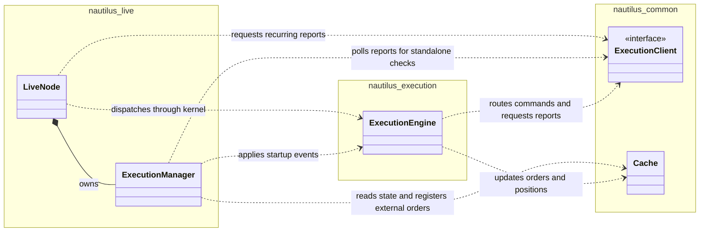
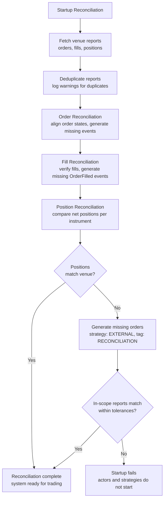

# 执行对账 {#execution-reconciliation}

执行对账（reconciliation）把交易场所实际的订单与持仓状态和系统内部事件溯源的状态对齐。本篇帮助理解启动时的状态恢复，以及发现运行时差异的持续检查。

未决的实时命令结果是状态分歧的来源之一。Nautilus 如何区分本地失败、确定结果与未知结果，见
[命令结果](./policies.md#command-outcomes)。

完整的节点生命周期见[实时交易](./../live.md)。可用设置与推荐值见
[配置实时交易节点](./../../how_to/configure_live_trading.md#executionengine-configuration)。

## 对账模型 {#reconciliation-model}

实时执行用场所报告核对本地状态。回测同时控制订单执行与结果状态，因此不需要场所对账。

两种场景：

- **存在缓存状态**：用报告数据生成缺失事件，把状态对齐。
- **没有缓存状态**：场所的全部订单与持仓从零生成。

:::info[持仓报告即市场敞口]
**显式的持仓报告具有权威性。启动对账期间，
引擎要么在对账容差内对齐该报告，要么失败关闭（fail closed）。**

具有权威性的持仓报告：

- 显式的持仓报告，包含数量与方向。
- 显式的空仓报告。

以下不构成空仓证据：

- 缺失报告。
- 数量为 null。
- 不发布持仓的场所。

成交窗口不决定报告是否具有权威性。缺失报告不等于空仓。

`generate_missing_orders` 默认启用。
引擎生成对齐本地状态到报告所需的订单与成交。
禁用生成并不会让未解决的报告通过启动检查。

该保证覆盖在启用对账时由持仓报告与工具
过滤器纳入的报告。未解决的报告会使 actor 和
策略无法启动。
:::

:::tip
把所有执行事件持久化到缓存数据库。这减少对场所历史的依赖，并让对账拥有解读短历史窗口所需的订单与持仓保留状态。
:::

### 组件职责 {#component-responsibilities}

`LiveNode` 拥有 `ExecutionManager` 并调度周期性对账。管理器跟踪活动、重试与成交标识，解读缓存状态，并准备对账事件。
`ExecutionEngine` 把事件应用到订单与持仓，并处理单条执行报告。

UML 图展示所有权与依赖。实心菱形表示所有权。虚线箭头从调用方指向其使用的组件。内核拥有引擎与共享缓存，为聚焦对账在此省略。

live 客户端门面在节点与引擎之间共享同一个适配器实例。事件循环处理其他工作时，待决的报告请求可能仍持有对客户端的借用。工具更新推迟到这些借用释放后，再随请求完成或取消一并刷出。

在 `nautilus-live` 内，各源模块按如下划分职责：

| 模块                          | 职责                                                                     |
| ----------------------------- | ------------------------------------------------------------------------ |
| `node/mod.rs`                 | 节点生命周期、事件循环与事件分发。                          |
| `node/reconciliation.rs`      | 周期性报告任务、截止时间、取消与结果处理。    |
| `execution/manager.rs`        | 对账状态、决策与单项对账检查。   |
| `execution/reconciliation.rs` | 共享类型、与状态无关的决策与定向报告请求。 |

独立的 `nautilus_execution::reconciliation` 模块提供与执行引擎共享的报告转事件与算术运算。

对账在启动和持续检查阶段走不同路径：

- **启动**：管理器发布原始报告，应用订单与成交事件，核验历史成交的应用情况，然后在更新后的缓存基础上评估持仓。
- **持续持仓检查**：节点先协调权威成交的查询与分发，再让管理器生成合成事件。活动修订号用于发现请求或回调期间的本地变更。应用权威成交后，合成对账推迟到拿到新的持仓报告。

准备失败或引擎未应用的成交同样推迟合成对账。该推迟只持续到其首次失败后经过 `position_check_threshold_ms`。之后的检查跳过该成交，转用合成方式对齐持仓。每个工具与账户的每次检查遇到第一个此类成交即停止，因此每笔被拒的成交至少让回退推迟一次检查。若被跳过的成交之后经其他路径（如执行流）应用，它会叠加到合成更正上。下一次持仓检查会调平差额。

管理器在不启用 `node` feature 时依然可用。独立调用方可以使用其单项轮询方法并自行应用返回的事件。独立的持仓轮询直接返回合成差异事件。节点额外加上权威成交恢复序列。

### 执行客户端来源 {#execution-client-origins}

**执行客户端来源**（execution-client origin）是订单与负责其执行的客户端之间一次性写入的绑定。

以下时机记录来源：

- 提交时来自显式客户端，或来自路由与场所校验之后、传输之前最终选定的客户端。
- 启动对账期间实化非合成外部订单时，来自发布 mass-status 的客户端。
- 外部订单由运行时场所报告实化、且报告的账户恰好匹配一个处理该工具场所的已注册客户端时。

以下情形来源可能缺失：

- 在解析来源持久化之前写入的缓存数据。
- 运行时报告未能按账户与工具场所恰好识别出一个已注册客户端的外部订单。
- 合成对账订单。

内置缓存后端在传输之前把解析好的来源入队等待持久化。其写入仍是异步的，因此入队顺序不能保证订单到达客户端之前来源已落盘。

启动时，每个客户端的 mass status 与缓存来源比对。客户端上报的订单应当绑定到该客户端本身。

- **来源缺失**：记录一条聚合警告，并对现有缓存数据保持兼容。
- **来源冲突**：记录一条聚合的废弃警告，并为兼容执行对账。未来版本会把冲突作为启动错误拒绝。

参见[启动场景](#startup-scenarios)中的来源相关行。

这与[外部订单认领](#external-order-creation)是两回事——后者把场所来源的订单归属到*策略*。执行客户端来源记录订单属于哪个*客户端*。

### 对账报告 {#reconciliation-reports}

执行引擎消费 live 适配器的四种对账报告变体。当匹配订单在缓存中缺失时，各变体的常规职责不同。显式限定的历史可改用[仅订单成交投影](#order-only-fill-projection)。

| 变体                   | 用途                     | 订单缺失时的动作                                           |
| ---------------------- | ------------------------ | ---------------------------------------------------- |
| `OrderStatusReport`    | 订单状态更新。      | 创建订单并推断任何已报告的成交。       |
| `FillReport`           | 独立成交。         | 先创建市价单，再应用成交元数据。  |
| `OrderWithFills`       | 订单状态加成交。  | 创建订单、应用成交并推断残差。 |
| `PositionStatusReport` | 场所持仓快照。 | 记录该报告。持仓仍由成交推导。        |

#### 各变体的适用时机 {#when-to-use-each-variant}

适配器按场所事件选择变体：

- 订单生命周期更新、且成交细节走独立数据流时，用 `OrderStatusReport`。
- 场所发起的平仓有成交但没有用户级订单时，用 `FillReport`。
  Hyperliquid 强平即属此类。
- 一个场所事件同时包含订单状态及其成交时，用 `OrderWithFills`。Binance
  Futures 对交易所生成的 ADL、强平与结算订单使用它。

### 快照新鲜度与成交更正 {#snapshot-freshness-and-fill-corrections}

快照不得撤销发生在其所描述状态之后的成交。在流事件之后收到快照，并不使快照更新：恢复期间 REST 请求与流分发可能重叠。例如某次请求观察到已成交为零，流随后送上一笔 5 单位的成交，而更早的响应最后才到。把该响应当作更正，就会错误作废这 5 个单位。

快照更正需要区分：

- **早于成交的快照**：其较低的已成交数量不能证明成交已被作废。
- **覆盖该成交并报告缩减的快照**：缩减可以代表一次真实更正，由保留的成交历史推导。
- **显式的场所成交作废事件**：按
  [OrderFillVoided 契约](./../events/order_fill_voided.md)处理，包括其身份、数量与顺序检查。它不依赖从快照总量推断更正。

确立覆盖关系时，时间戳的含义很重要：

- Derive 适配器报告的是订单更新时间戳。
- Betfair 的 `matchedDate` 描述的是最后一次撮合，不是快照或更正的时刻。

响应到达时间、相同的时间戳、来自不同时钟的时间戳，本身都不能证明快照包含某笔成交。

把真实更正当作过时数据拒绝，会让本地已成交数量与敞口持续偏高，直到后续对账调平。反过来，携带误导性较新时间戳的过时快照，若新鲜度检查信任该时间戳，仍可能造成错误作废。

即使快照不包含伴随成交，执行引擎也会把 mass-status 中已成交数量的减少应用到保留的成交上。

**成交活动重叠**：收集始于 `ExecutionMassStatus.ts_init`。若缓存成交或成交作废的本地初始化时间戳不早于该边界，引擎自动跳过该订单快照。这会跳过该订单报告的全部变更，包括状态、数量与价格更新。

引擎仍会发布原始报告，并按正常去重处理伴随成交；被跳过的快照不入队。收集起点晚于缓存成交活动之后的后续快照，即可应用真实更正。该跳过无需配置，也不抑制显式的成交作废事件。

这一保护适用于 `ExecutionEngine` 的运行时 mass-status 处理。启动对账使用 `ExecutionManager`，不施加该时间戳边界。

要获得运行时保护，适配器必须在收集报告之前、使用与成交事件相同的本地时钟捕获 mass-status 时间戳。该边界防的是与本地活动重叠，无法发现收集开始时就已经过时的场所状态。

### 仅订单成交投影 {#order-only-fill-projection}

启动对账期间，若该工具没有范围内的显式持仓报告，限定的历史成交不改变持仓或组合。缺省不等于空仓报告。订单仍达到所报告的状态与已成交数量。

显式持仓报告（无论持仓或空仓）是数量目标。引擎应用可用的成交，按配置生成差额，或让持仓保持未解决。

该投影只适用于对账恢复。原始报告仍可用。设置
`filter_position_reports` 后，即使 mass status 包含持仓报告，限定的历史成交也变为仅订单。未声明窗口的例外与保留成交规则见[有界历史安全](#bounded-history-safety)。

### 外部订单创建 {#external-order-creation}

报告引用的订单不在缓存中时，引擎创建一个**外部订单**。这涵盖场所发起的 ADL、强平或结算，其他进程下的订单，以及本地尚未观察到的订单。

命名上区分配置意图与运行时归属状态：

- `external_order_instrument_ids` 是可序列化的策略配置意图。它列出策略注册时应把外部订单指派给该策略的工具。
- **外部订单认领**（external order claim）是把一个 `InstrumentId` 映射到一个 `StrategyId` 的活跃缓存条目。代码用 `external_order_claims` 表示这些活跃条目的集合。

策略在 live 注册时用 `register_external_order_claims` 把配置的工具 ID 实化。该操作是增量且严格的：重复的工具或任何已有认领的工具（包括同一策略的认领）都会被拒绝。

策略方法 `set_external_order_instrument_ids(...)` 委托给缓存操作
`set_external_order_claims`。该操作把输入视为该策略期望的完整活跃集合：可以保留或释放该策略现有认领、获取无人认领的工具，但不能拿走其他策略的认领。

校验覆盖整个输入后才修改缓存，因此发生冲突时每个现有认领保持不变。

`ExecutionManager` 与 `ExecutionEngine` 处理外部报告时读取缓存中同一份规范认领映射。它们把外部订单指派给：

- 该报告工具活跃认领所指的策略。
- 兜底默认的 `EXTERNAL` 策略。

因此认领更新对两个组件立即可见，无需协调消息。外部订单创建时存在的认领决定指派。已缓存订单保持其已指派的 `StrategyId`，改变认领不会重新指派。

要在策略之间转移工具，当前持有方必须先释放，新持有方才能认领。跨策略交接不是原子的。释放与认领之间处理的报告没有活跃认领，被指派给 `EXTERNAL`。

缓存重置保留活跃认领，使已注册的路由保持配置状态；而下线策略会清除其认领。

外部订单在报告携带 `client_order_id` 时直接采用，否则由 `venue_order_id` 派生。引擎把订单加入缓存、注册其场所订单 ID，并发出相应的 `OrderAccepted`、`OrderFilled`、`OrderCanceled` 或 `OrderExpired` 事件。持仓随后经正常事件管道更新。

策略配置与运行时更新见[认领外部订单](./../strategies.md#claiming-external-orders)。

### 削减外部持仓 {#reducing-external-positions}

NETTING 下，策略可以用 reduce-only 成交削减继承来的 `EXTERNAL` 仓位。

#### 持仓选择 {#position-selection}

已有的缓存持仓关联保持权威。没有缓存关联时，reduce-only 成交优先使用策略自己的未平持仓。该持仓不存在或已平仓时，引擎寻找同时满足以下全部条件的持仓：

- 属于 `EXTERNAL` 且使用 NETTING。
- 处于未平状态且在成交的反方向。
- 与成交的工具和账户匹配。

只有**恰好一个**持仓匹配时引擎才选用该回退。成交数量不得超过该持仓的数量，但订单剩余量可以更大。若不存在安全的回退，其他方面合法的成交只更新订单，不开仓也不更新持仓。

#### 归属与事件 {#ownership-and-events}

成功削减后，引擎把订单与该外部持仓关联，后续成交沿用同一目标。持仓保持 `EXTERNAL` 归属：

- `OrderFilled` 携带执行削减策略的 ID，并标识外部持仓。
- `PositionChanged` 与 `PositionClosed` 使用 `EXTERNAL` 策略的事件主题。

#### 关联削减检查 {#linked-reduction-checks}

应用持仓经济学时，每次关联削减必须与外部持仓的账户一致，削减其未平数量，且不反转或重新开启它。成交违反这些检查时，引擎在**修改订单或持仓之前**拒绝它。

[仅订单成交投影](#order-only-fill-projection)绕过这些削减检查，因为它只修复订单历史而不改变持仓。

## 对账配置 {#reconciliation-configuration}

除非 `reconciliation` 设为 false，live 节点会为每个执行客户端运行启动对账。`reconciliation_lookback_mins` 参数经执行引擎控制向前请求多久的历史。启动开关与轮询间隔属于节点的 `LiveExecutionEngineConfig`。管理器接收用于对账决策的阈值、重试上限、过滤器与回看窗口。

:::tip
`reconciliation_lookback_mins` 留空即使用适配器文档化的默认值。许多适配器请求场所提供的最大执行历史，另一些用有界默认值以匹配场所的数据保留与请求限制。见所选场所的集成指南。
:::

:::warning
有界历史窗口的起点可能晚于开仓成交。一些场所还会过滤或丢弃更早的执行数据。这不改变上文的持仓报告规则：显式
报告仍是数量目标。
:::

全部实时交易选项见 `LiveExecutionEngineConfig`
[API 参考](https://nautilustrader.io/docs/python-api-latest/config.html#nautilus_trader.live.LiveExecutionEngineConfig)。

### 订单归属与标签 {#order-ownership-and-tags}

每个策略可以把 `external_order_instrument_ids` 配置为认领场所来源外部订单及特化工具的对账活动的意图。策略 live 注册时把该意图实化为活跃认领，策略可在运行时替换。这让策略在没有缓存状态时也能恢复管理未成交订单与持仓。

外部订单的策略 ID 与来源标签取决于其来源，以及是否有策略认领其工具。被认领的订单与成交使用认领策略的 ID，策略因此可以继续管理恢复的状态。

| 订单来源                    | 未被认领                       | 已被认领                                |
| ----------------------------- | -------------------------------- | --------------------------------------- |
| 场所订单                   | `EXTERNAL`，标签 `VENUE`          | 认领策略，无标签               |
| 持仓对账订单 | `EXTERNAL`，标签 `RECONCILIATION` | 认领策略，标签 `RECONCILIATION` |

:::tip
要在策略中识别未被认领的外部订单，检查 `order.strategy_id.value == "EXTERNAL"`。
归属与否都不妨碍这些订单参与持仓跟踪或组合计算。历史成交在适用时仍遵循[有界历史安全](#bounded-history-safety)规则。
:::

### 提交恢复 {#submission-recovery}

`submission_recovery_policy` 默认为 `ResolveLocally`。选择 `RetainUnresolved` 会启用：

- 提交身份跟踪。
- 耗尽诊断。
- 提交恢复预算保留至确认。

耗尽且未确认的提交保持未解决，并停止进一步的自动逐单恢复查询。客户端也可以独立于配置的策略要求这一保护。Polymarket 自动启用该保护。

保留的提交还影响[节点关闭结果](./../live.md#submission-recovery-at-shutdown)。提交恢复在 `delay_post_stop` 边界仍未完成时，Rust 的 `LiveNode::stop` 与 `run`，以及托管运行，会在拆除后报告未解决的客户端订单 ID。未显式选择的 Polymarket 也包含在内。耗尽诊断与成功拆除都不构成场所结果或持仓清零的证据。

#### 耗尽诊断 {#exhaustion-diagnostic}

启用跟踪后，原生 `LiveNode` 在未确认提交达到现有恢复上限时，在 `reconciliation.SubmissionRecoveryExhausted` 上发布 `SubmissionRecoveryExhausted`。诊断在处理完对账事件后发布，每个被跟踪的提交一次。

诊断携带原始提交身份、恢复来源、检查次数与事件时间戳。它不是订单事件，不构成场所结果的证据。

#### 恢复预算 {#recovery-budget}

确认之前派发的撤销或修改共享该提交的剩余恢复预算。重复注册与缺单记账不能重启该预算。确认使其退役，且不移交给重叠命令。

确认之后派发的命令，在派发时启动自己的在途检查，即使其 pending 事件尚未到达。它使用现有的命令清理规则。例如 `PARTIALLY_FILLED` 订单状态报告在两种策略下都会停止待撤消的超时。该清理规则不适用于独立成交报告。

没有提交跟踪（`ResolveLocally` 且客户端不要求保留）时，命令派发启动全新的恢复预算，原生成交或 `Triggered` 事件不会终止挂起命令的超时。

#### 确认 {#acknowledgement}

携带场所订单 ID 的匹配 `Submitted` 报告使原始提交的恢复退役。来报、批量或定向查询响应使用同样的确认检查。已应用的、带场所身份的 `OrderUpdated` 也确认提交。不带场所身份的本地更新不算。

注册表在后续活动中保留提交身份：

- **已确认的提交**：仅报告的确认也会被记住，包括尚未注册恢复的缓存订单，因此重复的提交注册不能重启超时。缺单记账不会为已确认的提交再次注册。
- **已耗尽的提交**：其身份留在注册表中直到场所证据将其裁决。重复注册与撤销或修改派发不能重启其自动恢复。

后续命令不产生提交耗尽诊断。

#### 注册 {#registration}

- **live 节点**：`LiveNode` 在派发前注册提交身份，并自动处理客户端要求的保留。
- **直接使用 `ExecutionManager` 的调用方**：提交用 `register_submission`。`register_inflight`
  只启动命令恢复，不会从缓存推断提交身份。直接宿主若要依赖 inflight 检查中的客户端要求保留，必须选择 `RetainUnresolved` 或先与客户端运行 `check_open_orders`。

#### 恢复上限 {#recovery-limits}

现有上限与覆盖检查仍然适用：

- **在途检查**：`inflight_check_retries` 统计检查次数。上限为 `N` 时，耗尽前允许 `N - 1`
  次中间订单查询。
- **缺单检查**：使用 `open_check_missing_retries`，并要求在报告耗尽之前完成匹配的客户端覆盖加一次成功且未找到订单的定向查询。失败或推迟的定向查询不产生该诊断。

### 工具可用性 {#instrument-availability}

适配器解析对账报告需要用到工具，因此报告引用的每个工具必须已加载。对账期间适配器不会向场所补拉缺失的工具。

工具范围来自适配器的 provider 配置而非引擎。
`InstrumentProviderConfig.load_ids` 决定适配器持有哪些工具，而
`reconciliation_instrument_ids` 只在适配器产出报告之后过滤报告。

显式 `load_ids` 范围之外的报告是预期行为，在 debug 级别丢弃。因此限定到单一工具的节点对场所其余部分保持安静。范围内的工具解析失败说明出了问题，无论它是 `load_ids` 点名的还是 `load_all=True` 覆盖的。结果取决于报告描述的内容：

- 未成交订单或持仓报告会使对账失败，系统不启动。无法定价的 live 持仓绝不会被静默丢弃。
- 已关闭或历史记录记录警告而不中断启动。适配器声明有界历史时，该记录还会把报告集标记为不完整，适用
  [有界历史安全](#bounded-history-safety)规则。到期通常会退役更早期成交仍引用的工具。

## 启动对账 {#startup-reconciliation}

所有适配器执行客户端遵循同一对账流程，调用三个方法产出 execution mass status：

- `generate_order_status_reports`
- `generate_fill_reports`
- `generate_position_status_reports`

这些报告代表外部现实。流程按图示顺序处理，使每次持仓检查都建立在对齐后的订单与成交状态之上。

### Mass-status 历史契约 {#mass-status-history-contract}

`ExecutionMassStatus` 可以声明其历史报告的出处：

- `lookback_start=None` 表示适配器未声明显式的时间下界。
- `lookback_start=Some(timestamp)` 表示历史订单与成交报告不包含该时间戳之前的场所活动。
- `reports_complete=true` 表示解读有界历史所需的每个订单、成交与持仓来源都已完成，且所有必需记录都成功映射。

历史来源失败时，适配器仍可返回权威的活跃订单与持仓报告，但把 mass status 标记为不完整以记录缺失的历史。不完整不妨碍从显式持仓报告恢复。

### 报告去重 {#report-deduplication}

- 批次内的订单报告去重并记录警告。
- 重复的 trade ID 作为警告记录，供排查。
- 持仓报告除 `report_id` 和 `ts_init` 外与更早报告一致时，在启动校验与持续持仓检查中只计一次，每个重复记录警告。任何其他字段（包括 `ts_last`）不同的报告单独计数。

### 订单对账 {#order-reconciliation}

- 生成并应用事件，把订单从缓存状态推进到当前状态。
- 为无法识别的客户端订单 ID 或缺少客户端订单 ID 的报告生成外部订单事件。

### 成交对账 {#fill-reconciliation}

- 为缺失的成交报告推断 `OrderFilled` 事件。
- 用基于容差的价格与手续费比较，校验成交报告数据的一致性。
- 既无订单报告也无缓存订单的成交组被丢弃，每个 mass status 对被丢弃的组记录一条聚合警告。成交携带 `venue_position_id` 的组单独处理：启用 `generate_missing_orders` 时引擎据此构建已成交订单，否则跳过。

### 事件顺序 {#event-ordering}

启动对账按时间顺序应用其生成的订单与成交事件：

- 成交按事件时间应用：`FillReport.ts_event` 中的场所成交时间，或推断成交所用报告的 `ts_last`。
- 每个场所订单的其他事件（如受理）不晚于其后最早的成交应用。场所上报最后更新时间或适配器使用本地时间时，报告的受理可能晚于订单自身的成交；但订单仍在成交应用之前被受理。
- 不同场所订单的事件保留各自的时间，包括与被其替换订单共用客户端订单 ID 的被替换订单。

顺序只改变应用时机。每个事件保留其上报的时间戳。

### 持仓对账 {#position-reconciliation}

- 按账户与工具，用账户的数量容差把净持仓与场所持仓报告匹配。
- 订单对账后持仓仍与场所不一致时，生成外部订单事件。
- 启用 `generate_missing_orders`（默认 True）时，生成策略 ID 为
  `EXTERNAL`、标签为 `RECONCILIATION` 的订单调平差异。
- 同一账户与工具的 NETTING 归属分散在多个策略时记录警告，因为场所持仓报告是账户级净持仓。

#### 合成订单 {#synthetic-orders}

对账以已知价格生成合成 MARKET 订单报告与成交：

- 从空仓开仓使用报告的 `avg_px_open`。
- 增加现有持仓使用以报告开仓均价为目标计算的价格。
- 削减现有持仓使用报告的开仓均价；报告缺失时回退到缓存均价。削减不改变剩余持仓的开仓均价。
- 平仓到零使用缓存开仓均价。
- 方向反转先平掉缓存持仓，再以其开仓均价开出报告的持仓。

标记其均价的报告会使其中一些价格变化，见
[报告的开仓均价](#reported-entry-averages)。

在工具数量精度下四舍五入为零的数量差，引擎直接跳过。启动校验仍会用账户的数量容差检查剩余差额。

#### 重放的成交 {#replayed-fills}

对账可以由场所持仓报告开出持仓。该持仓保持未平期间，同工具同账户、`ts_event` 更早的成交报告只更新订单、不更新持仓。报告已经包含这些执行。因此重启后重发成交的场所（如 Interactive
Brokers TWS）不会让持仓翻倍。该工具与账户没有此类未平持仓时，更早的成交照常应用。

该保护有以下已知缺口：

- **对账窗口**：合成开仓成交携带对账时刻而非报告时刻。落在持仓报告查询与对账之间的真实成交因此也不计入持仓。持续持仓检查只有在启用 `generate_missing_orders` 运行时才会将其对齐。
- **开仓订单清除**：保护需要缓存中存在合成开仓订单。启用已关闭订单清除后，`purge_closed_orders_buffer_mins` 短于场所重放延迟时会先把它清掉。
- **打包成交**：随订单状态报告一起到达的成交绕过该保护。

不计入持仓的成交仍保留在订单上，与
[仅订单成交投影](#order-only-fill-projection)相同，但有以下影响：

- **事件存储恢复**：从事件存储恢复缓存时，成交会应用到持仓，恢复的持仓可能高估场所数量。
- **成交作废**：该成交的场所作废被拒绝，订单保持已成交。
- **锁定余额**：本应由该成交关闭的未成交订单，其锁定余额保留到该工具与账户的下一个订单事件。
- **持仓检查**：若对账后的持仓在持续持仓检查对齐之前已平掉，后续检查会在该成交处停止，等其首次应用失败后经过 `position_check_threshold_ms`，再合成对齐持仓。

#### 启动持仓校验 {#startup-position-validation}

应用启动报告后，live 节点用缓存检查**每个范围内的显式持仓报告，包括空仓报告**。未解决的持仓会在 actor 或策略 `on_start` **之前**阻断启动。错误信息指出账户、工具、场所数量与恢复失败原因。

| 持仓情形                             | 缓存标识                  | 数量要求                 |
| ------------------------------------------ | ----------------------- | ------------------------ |
| HEDGING 且带场所持仓 ID            | 精确的场所持仓 ID | 精确数量           |
| NETTING，带或不带场所持仓 ID | 账户与工具  | 账户容差内       |
| 不带持仓 ID 的净额报告           | 账户与工具  | 账户容差内       |

场所同时报告多头与空头持仓时，两侧合计也必须匹配，仅净额相等不够。超出账户容差的残余差额保持未解决，即使在工具数量精度下四舍五入为零。容差内的差额保持可接受，包括接近零的微小残差。

未平持仓带报告的 `avg_px_open` 时，启动还用成交调整的相对容差 0.01% 检查开仓均价。均价可能落在两个工具价格档位之间，比较时不向工具价格精度取整。

NETTING 报告对每个报告方向使用数量加权的开仓均价。一个方向跨多份报告时，所有有贡献的报告都必须提供均价，才能确立该方向的价格目标。报告可以跳过该检查或放宽容差，见
[报告的开仓均价](#reported-entry-averages)。

数量匹配本身不能解决报告的开仓均价不匹配。数量已匹配时，持仓对账不会仅为改变均价而生成更正，剩余的价格不匹配会使启动失败。更正数量后，若结果均价仍超出容差，启动同样失败。合成恢复不能确立历史已实现盈亏。

#### 报告的开仓均价 {#reported-entry-averages}

`PositionStatusReport` 的两个字段告知对账如何解读 `avg_px_open`。默认值保持上文所述行为。

- `avg_px_open_reconciliation`：`MATCH`（默认）把均价与缓存开仓均价比较，并据此为合成成交定价。`OPENING_ONLY` 标记用另一种方法（如剩余 FIFO 批次）计算的均价。持仓被削减后，该均价合理地不同于缓存的数量加权均价。
- `avg_px_open_precision`：场所对均价舍入或截断时保留的小数位数。未设置时，比较不附加宽容量。

| 均价的用途                        | `OPENING_ONLY`                                          | 设置了 `avg_px_open_precision`                                          |
| --------------------------------- | ------------------------------------------------------ | ------------------------------------------------------------------------ |
| 启动开仓价格检查         | 该方向跳过。数量检查仍适用。     | 在 0.01% 加该方向最粗精度一个单位的范围内视为通过。 |
| 成交调整匹配             | 仅数量，因此价格差异保留真实成交。 | 使用同样的价格宽容容量。数量仍须精确匹配。        |
| 从空仓开仓或方向反转    | 使用报告的均价。                             | 使用报告的均价。                                               |
| 增加或削减持仓 | 使用缓存的均价。                               | 缓存均价已与报告一致时使用缓存均价。              |

`OPENING_ONLY` 下，从空仓开仓包含[成交调整](#fill-adjustment)在部分窗口前加入的合成开仓成交。两个条件同时成立时，标记了精度的报告以窗口成交的均价为该成交定价：窗口持仓与报告同方向，且其均价已与报告一致。任一条件不满足则该成交使用默认价格。

一份 `OPENING_ONLY` 报告使整个方向不可比较，因为该方向的加权均价会混合算法。对现有持仓的变动按缓存均价定价，保持其开仓均价，且削减不记合成交易盈亏。没有缓存均价时，合成成交回退到报告均价。

#### 恢复前提与过滤 {#recovery-prerequisites-and-filters}

在空缓存中由没有订单或成交历史的报告创建持仓，需要 `avg_px_open`。引擎不会臆造开仓价格。

- **缺单生成**：禁用 `generate_missing_orders` 不会绕过启动校验。
- **报告范围**：持仓报告与工具过滤器仍然适用，被排除的报告不检查。
- **对账禁用**：禁用对账则完全跳过该检查。

### 成交调整 {#fill-adjustment}

报告的成交无法解释当前场所持仓时，引擎可以分析零点穿越、移除已平生命周期，并生成一笔合成成交。

成交调整受以下条件约束：

- 声明了 `lookback_start` 不跳过调整。
- 没有报告的 `avg_px_open` 时，引擎保留原始订单与成交，不为合成成交调整臆造价格。
- 设置 `filter_position_reports` 会对声明与未声明的窗口都跳过成交调整。

成交调整使用以下术语：

- **零点穿越**：持仓数量穿越零（FLAT），标记一个生命周期边界。
- **生命周期**：两次零点穿越之间的成交序列，代表一个开平仓周期。
- **合成成交**：代表缺失活动的计算成交报告，定价使持仓均价正确。
- **容差**：成交调整使用 0.0001（0.01%）的相对开仓价格容差，吸收细微计算差异。启动校验使用同样的价格容差外加账户独立的数量容差。设置 `avg_px_open_precision` 的报告在该精度上加一个单位到价格容差。

禁用 `generate_missing_orders` 时，引擎仍处理原始场所订单报告。当前生命周期能解释场所持仓时，过滤掉已完成的生命周期。但它不会增补或替换合成报告去把成交窗口对齐到场所持仓，也不会为没有订单报告的成交组实化订单。

应用历史上限的适配器仍应通过
[mass-status 历史契约](#mass-status-history-contract)声明该上限。声明记录出处，
并不授权放任显式持仓报告不匹配。

### 有界历史安全 {#bounded-history-safety}

**显式持仓报告**对持仓具有权威性，无论持仓还是空仓。引擎
要么在对账容差内对齐该报告，要么失败关闭。它不会重放
有界窗口来决定报告是否具有权威性。

引擎应用可用的订单与成交，并默认生成达到报告所需的订单与成交。禁用 `generate_missing_orders` 不会放任不匹配存在。

其工具没有范围内显式持仓报告时，有界成交不开仓、不平仓也不改变持仓，也不更新组合经济学。订单仍达到报告的状态与已成交数量。原始对账报告仍可用。

为兼容起见，未声明 `lookback_start` 的 mass status 在不存在持仓报告时仍可应用历史成交。该例外不把缺失报告当作空仓。保留成交去重与旧生命周期投影在两条路径中都继续适用。

带显式 `venue_position_id` 的报告走持仓专属的对账路径，不需要 NETTING 生命周期推断。

### 失败处理 {#failure-handling}

- 单个来源失败后，适配器可以保留其余成功的报告分支。显式限定边界的 mass status 必须把结果标记为不完整。不完整不否决显式持仓报告。没有显式持仓报告的有界成交不改变持仓。
- 先于订单状态报告到达的成交报告被推迟，直到订单状态可用。

#### 手续费失败 {#commission-failures}

按[适配器契约](./../../developer_guide/adapters.md#commission-failure-handling)，适配器成交的手续费无法计算或表示时，报告请求失败。适配器不得丢弃该成交，也不得把其手续费替换为零或通用公式。启动在应用该客户端的 mass status 之前停止。

引擎请负责的执行客户端计算推断成交的手续费。失败会推迟推断的数量及依赖的终态迁移，直到后续对账周期成功。同一报告集中的合法显式成交仍可应用。外部订单的场景中，引擎在把订单加入缓存或发布初始事件之前先解决手续费，因此失败会推迟整个外部订单。负责的执行客户端不可用产生同样的失败关闭结果。

应用总体成功的 mass status 时推断成交手续费失败，本身不会停止启动。范围内显式持仓报告仍未解决时启动仍失败；否则未完成的工作留待后续对账周期。

启动对账因任何其他原因失败时，系统记录错误且不启动。

## 运行时检查 {#runtime-checks}

持续对账在启动对账完成后开始。它会：

- 监控在途订单是否超过配置阈值。
- 按配置间隔与场所核对未成交订单。
- 按配置间隔与场所核对持仓状态。
- 用场所公开订单簿审计内部*自有*订单簿。

`reconciliation_startup_delay_secs` 参数在启动对账完成*之后*再追加一段延迟，给系统稳定的时间。各检查的结果见[运行时场景](#runtime-scenarios)。

### 在途检查 {#in-flight-checks}

耗尽配置的重试后，在途检查器按以下方式裁决超时订单——除非订单从未被受理且提交保留规则适用：

- `SUBMITTED`：以原因 `INFLIGHT_TIMEOUT` 拒绝订单。
- `PENDING_CANCEL` 或 `PENDING_UPDATE`：把订单裁决为 `CANCELED`。

对从未被受理的订单，`SubmissionRecoveryPolicy::RetainUnresolved` 要求保留，Polymarket 无论配置如何也要求保留。保留会停止自动的逐单恢复查询，同时允许后续场所证据裁决订单。保留规则见
[提交恢复](#submission-recovery)。

[终态对账来源](./policies.md#terminal-reconciliation-provenance)区分本地策略裁决与场所报告的结果。

### 订单一致性检查 {#order-consistency-checks}

下表适用于缓存状态与场所状态不一致的情况。缺失的未成交订单报告本身不能证明挂起的修改或撤销结果。因此这些检查让那些状态保持未解决，直到其他检查能确定场所状态。

:::info[全历史检查]
*Not found*（未找到）各行只在全历史模式（`open_check_open_only=False`）适用，默认是仅未成交模式。提交保留同样在此适用：策略或其客户端要求保留时，未确认的 `SUBMITTED` 订单保持未解决。
:::

| 缓存状态           | 场所状态   | 裁决         | 理由                                                                     |
| ------------------ | ------------ | ------------ | ------------------------------------------------------------------------ |
| `SUBMITTED`        | *未找到*  | `REJECTED`   | 订单从未被场所确认（例如在网络错误中丢失）。 |
| `ACCEPTED`         | *未找到*  | `REJECTED`   | 订单在场所不存在，很可能从未成功下单。     |
| `ACCEPTED`         | `CANCELED`   | `CANCELED`   | 场所撤销了订单（用户操作或场所发起）。               |
| `ACCEPTED`         | `EXPIRED`    | `EXPIRED`    | 订单在场所到达 GTD 过期。                                   |
| `ACCEPTED`         | `REJECTED`   | `REJECTED`   | 场所受理后拒绝（罕见但可能）。             |
| `PENDING_UPDATE`   | *未找到*  | *未解决* | 修改结果保持未知。                                      |
| `PENDING_CANCEL`   | *未找到*  | *未解决* | 撤销结果保持未知。                                      |
| `PARTIALLY_FILLED` | `CANCELED`   | `CANCELED`   | 订单在场所被撤，保留成交。                            |
| `PARTIALLY_FILLED` | *未找到*  | `CANCELED`   | 订单不存在但曾有成交（核对成交历史）。            |

#### 仅未成交模式 {#open-only-mode}

场所"未成交订单"端点设计上排除已关闭订单，无法区分缺失订单与刚关闭的订单。缺单检查无法证明最终场所状态时，挂起的撤销/修改保持未解决。

#### 近期订单保护 {#recent-order-protection}

最后一个事件落在 `open_check_threshold_ms` 窗口内的订单跳过对账，防止场所仍在处理时因竞态产生误报。

#### 定向查询防护 {#targeted-query-safeguard}

应用终态"未找到"裁决之前，引擎向场所发起一次单订单查询，捕获批量查询限制或时延造成的漏报。

#### 已完成订单 {#completed-orders}

在场所"未找到"的 `FILLED` 订单被静默忽略。场所通常把已完成订单移出查询结果。

### 持仓检查 {#position-checks}

持仓检查按工具与账户使用独立的重试计数。持仓匹配成功即清除计数；反复未解决的差异会停止该组合的主动对账，直到差异消除。

场所持仓查询失败时，引擎在本周期跳过该场所的缓存持仓，而不是把缺失报告当作空仓。

### 重试协调 {#retry-coordination}

在途循环按 `inflight_check_retries` 递增自己的逐单重试计数，并把该值镜像进缺单跟踪。未成交订单循环按 `open_check_missing_retries` 递增缺单计数。每个循环只受自己的上限约束，两个设置不会互相覆盖。

未成交订单循环耗尽重试时，引擎发出一次定向 `GenerateOrderStatusReport` 探测——在应用终态、或让含糊的挂起撤销/修改保持未解决之前。场所返回该订单则继续对账并清除缺单跟踪。挂起状态仍未解决时，引擎还会重置在途计数，在配置的阈值过后再次检查。

`RetainUnresolved` 或注册客户端要求保留时，未被确认的被跟踪提交保持其原始在途预算而非重置。反复的缺单检查不能拖延该预算的耗尽。耗尽时保留未解决的提交，不产生合成终态事件。

### 单订单查询限流 {#single-order-query-throttling}

引擎用 `max_single_order_queries_per_cycle` 限制每周期的单订单查询数，其余订单推迟到下一周期。`single_order_query_delay_ms` 拉开连续查询的间隔以避免触发速率限制。这让数百个订单在批量查询失败时仍能处理，且不会压垮场所 API。

## 常见对账场景 {#common-reconciliation-scenarios}

下表覆盖启动对账（mass status）、运行时检查（在途订单检查、未成交订单轮询、自有簿审计）、成交调整与有界历史。

### 启动场景 {#startup-scenarios}

| 场景                                   | 描述                                                                               | 系统行为                                                                                                   |
| -------------------------------------- | -------------------------------------------------------------------------------------- | -------------------------------------------------------------------------------------------------------- |
| **订单状态差异**            | 本地状态与场所不同（例如本地 `SUBMITTED`，场所 `REJECTED`）。     | 更新本地订单以匹配场所状态，发出缺失事件。                                          |
| **遗漏的成交**                       | 完整的场所历史包含引擎错过的成交。                              | 生成缺失的 `OrderFilled` 事件并应用其经济学影响。                                     |
| **多笔成交**                     | 完整一致的报告集包含某订单的多笔成交。                   | 按事件顺序重建报告的成交历史。                                                   |
| **不完整的有界历史**         | 必需的订单、成交或持仓来源失败或无法映射。              | 对齐显式持仓报告，或使其保持未解决。无报告的成交保持仅订单。       |
| **含糊的有界生命周期**        | 有界报告不能证明一次连贯的 NETTING 持仓迁移。             | 显式持仓报告仍是数量目标。无报告的成交保持仅订单。          |
| **外部订单**                    | 订单存在于场所但不在本地缓存。                                          | 创建策略 ID 为 `EXTERNAL`、标签为 `VENUE` 的未认领订单。                                    |
| **客户端来源缺失**              | mass status 中的缓存订单没有记录执行客户端来源。             | 记录一条带计数与示例 ID 的聚合警告。按报告的客户端对账。        |
| **客户端来源冲突**          | 缓存订单的来源与提供报告的客户端不同。              | 记录一条聚合的废弃警告。兼容期内继续对账。        |
| **部分成交后撤销**     | 订单部分成交后被场所撤销。                                         | 状态更新为 `CANCELED`，保留成交历史。                                                     |
| **成交数据不同**                | 场所报告的成交价/手续费与缓存不同。                             | 保留缓存数据，记录差异。                                                               |
| **被过滤订单**                    | 通过配置标记过滤的订单。                                            | 按 `filtered_client_order_ids` 或工具过滤器跳过。                                        |
| **未解析工具**              | 报告引用了适配器未加载的范围内工具。                 | 未成交订单与持仓报告使启动失败。其他情形警告并把有界历史标记为不完整。 |
| **成交手续费失败**            | 适配器构建报告时无法表示必需的成交手续费。         | mass-status 生成失败，启动在应用该客户端报告前停止。                    |
| **推断成交手续费失败**   | 负责的执行客户端无法计算必需的手续费。               | 推迟推断工作。外部订单保持缺席，合法显式成交仍可应用。        |
| **重复订单报告**            | 多个订单共用同一标识。                                             | 去重并记录警告。                                                                        |
| **持仓数量不匹配（多头）**  | 内部多头持仓与场所不同（例如 100 对 150）。                   | `generate_missing_orders=True` 时以计算价格生成 BUY MARKET。                          |
| **持仓数量不匹配（空头）** | 内部空头持仓与场所不同（例如 -100 对 -150）。                | `generate_missing_orders=True` 时以计算价格生成 SELL MARKET。                         |
| **持仓削减**                 | 场所持仓小于内部（例如内部多头 150，场所多头 100）。 | 以计算价格生成反方向 MARKET 订单。                                              |
| **持仓方向翻转**                 | 内部持仓与场所方向相反（例如内部多头 100，场所空头 50）。  | 生成 MARKET 订单平掉内部持仓并开出外部持仓。                                     |
| **内部对账订单**     | 为调平持仓差异生成的订单。                                      | 标签 `RECONCILIATION`。有配置认领时使用认领，否则 `EXTERNAL`。                               |

### 运行时场景 {#runtime-scenarios}

| 场景                              | 描述                                                      | 系统行为                                          |
| ----------------------------------- | --------------------------------------------------------- | ----------------------------------------------- |
| **在途提交超时**        | `SUBMITTED` 超过重试耗尽仍未确认。    | 以 `INFLIGHT_TIMEOUT` 裁决为 `REJECTED`。 |
| **在途撤销/修改超时** | `PENDING_CANCEL` 或 `PENDING_UPDATE` 超过重试。 | 经对账裁决为 `CANCELED`。  |
| **未成交订单检查差异**   | 周期性轮询发现场所状态变化。               | 确认状态并应用迁移。        |
| **持仓检查差异**      | 周期性轮询发现持仓不匹配。                | 符合条件时生成对账事件。  |
| **手续费构造失败** | 必需的成交手续费无法表示。         | 受影响的工作推迟到后续周期。      |
| **自有簿审计不匹配**        | 自有订单簿偏离场所公开订单簿。          | 审计并记录不一致。                |

策略或其客户端要求提交保留时，在途超时各行不适用于未确认订单，该订单保持未解决。见[在途检查](#in-flight-checks)。

### 成交调整场景 {#fill-adjustment-scenarios}

以下场景与 mass status 是否声明 `lookback_start` 无关：

| 场景                                      | 描述                                                  | 系统行为                                                                                                                                                                                     |
| ----------------------------------------- | ------------------------------------------------------- | ---------------------------------------------------------------------------------------------------------------------------------------------------------------------------------------------- |
| **完整生命周期**                    | 从开仓到当前状态的全部成交都被捕获。   | 不调整。                                                                                                                                                                                 |
| **不完整单生命周期**           | 报告缺少开仓成交，且无零点穿越。     | 以计算价格添加一笔合成开仓成交。                                                                                                                                           |
| **多生命周期，当前匹配**  | 零点穿越分隔更早与当前生命周期。 | 过滤掉旧生命周期保留当前的。成交跨越穿越点的订单保留其更早成交，仅投影到订单状态，因此其已成交数量不被推断。 |
| **多生命周期，当前不匹配** | 当前生命周期与场所持仓不同。  | 生成合成持仓成交，保留报告订单用于回放去重，其更早成交仅投影到订单状态。                                              |
| **空仓**                         | 无论成交历史如何，场所报告为空仓。      | 不做调整。                                                                                                                                                                           |
| **没有成交**                              | 报告集中不含成交。                       | 返回空成交集。                                                                                                                                                                    |

### 有界历史场景 {#bounded-history-scenarios}

| 持仓报告            | 历史报告                                                  | 系统行为                                                                                                                    |
| ----------------- | --------------------------------------------------------- | --------------------------------------------------------------------------------------------------------------------------------- |
| **显式持仓** | 完整、不完整或含糊的有界历史。       | 应用可用报告并尝试恢复到报告的数量与开仓均价。未解决的差异阻断启动。 |
| **显式空仓** | 完整、不完整或含糊的有界历史。       | 应用可用报告，并在启用生成时关闭残余敞口。未解决的数量差异阻断启动。 |
| **缺失**       | 有界历史，有无缓存前驱皆可。    | 仅恢复订单状态。成交不改变持仓或组合经济学。                                                  |
| **被过滤**      | 持仓报告或工具过滤器排除了该报告。 | 持仓报告过滤使有界成交变为仅订单。工具过滤同时排除订单与持仓。                |

## 常见对账问题 {#common-reconciliation-issues}

:::tip
问题持续存在时，先检查场所报告与缓存归属，再考虑丢弃状态或清空账户。
:::

### 缺失成交报告 {#missing-trade-reports}

一些场所会过滤较早的成交。增大 `reconciliation_lookback_mins`，或把所有事件本地持久化。显式限定边界的适配器会把历史标记为不完整，使不受支持的成交不改变持仓或组合经济学。

### 持仓不匹配 {#position-mismatches}

早于回看窗口的外部订单会造成持仓漂移。加大窗口、恢复保留状态，或让权威的持仓报告对账当前数量。清空账户只能作为有意的运维恢复步骤。

### NETTING 归属分裂 {#split-netting-ownership}

多个策略可以对同一账户与工具持有缓存持仓，但场所报告的是单一的账户级净持仓。恢复外部状态时，每个 NETTING 账户/工具组合尽量只让一个策略认领。

### 重复订单 ID {#duplicate-order-ids}

对账会去重并记录警告。频繁重复可能说明场所数据完整性有问题。

### 未解析工具 {#unresolved-instruments}

报告引用了适配器从未加载的工具。把它加入 `load_ids` 或设置
`load_all=True`。显式 `load_ids` 范围之外的报告按设计丢弃，无需处理。

### 精度差异 {#precision-differences}

对账容差能吸收微小的数量与开仓价格差异。大的差异可能意味着订单缺失。

### 乱序报告 {#out-of-order-reports}

先于订单状态报告到达的成交报告被推迟，直到订单状态可用。

## 对账不变量 {#reconciliation-invariants}

对账路径对其处理的报告与持仓保持以下不变量：

1. **订单状态**：权威报告恢复精确的订单状态与已成交数量，
   即使历史成交仅应用于订单状态。
1. **显式持仓报告**：显式的持仓或空仓报告是数量目标。引擎
   向其对齐，按配置生成订单与成交，或使其保持未解决。缺失
   报告不等于空仓。
1. **缺失持仓报告**：没有范围内持仓报告时，显式限定的历史成交
   仅更新订单状态，不改变持仓或组合经济学。
1. **持仓数量**：对账后的持仓在适用的数量容差内匹配权威的
   场所报告。
1. **开仓价格**：启动继续之前，报告的开仓均价在容差内匹配，
   报告标记为 `OPENING_ONLY` 的均价除外。合成成交使用报告或计算的价格，不重建
   缺失的历史盈亏。
1. **ID 确定性**：合成的 `trade_id` 与 `venue_order_id` 是逻辑事件的确定性函数，
   因此回放能跨重启对其去重。

## 相关指南 {#related-guides}

- [实时交易](./../live.md) - 节点生命周期、配置、指标与关闭。
- [配置实时交易节点](./../../how_to/configure_live_trading.md) - 节点与引擎配置。
- [适配器](./../adapters.md) - 场所连接。
- [执行](./index.md) - 命令结果与执行流程。
- [执行策略](./policies.md) - 命令证据、持久化与恢复
  边界。
