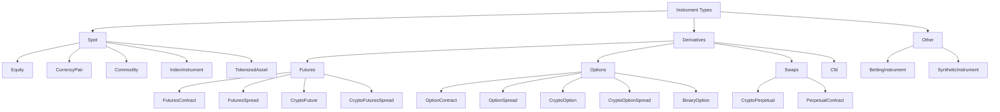

# 金融工具 {#instruments}

金融工具（instrument）是可交易资产、合约或本地合成市场的规格定义。行情数据、订单、持仓、记账、组合计算以及适配器的符号体系，都指向一个 `InstrumentId` 及其工具定义。

NautilusTrader 向 Rust 和 Python 用户暴露同一套金融工具模型。Rust 示例使用 `nautilus_model`，
Python 示例使用 `nautilus_trader.model`。

## 金融工具类型 {#instrument-types}

| 金融工具类型                                      | `InstrumentClass`  | 说明                                                     | 典型适配器                      |
| ------------------------------------------------- | ----------------- | ---------------------------------------------------- | ------------------------------- |
| [`Equity`](./equity.md)                             | `SPOT`            | 在现货市场交易的上市股票或 ETF。                       | Databento、Interactive Brokers。 |
| [`CurrencyPair`](./currency_pair.md)                | `SPOT`            | 以基础/计价形式表示的法币外汇或加密货币现货对。        | Binance、Kraken、OKX、Tardis。   |
| [`Commodity`](./commodity.md)                       | `SPOT`            | 黄金、原油等现货商品。                                 | Interactive Brokers。            |
| [`Cfd`](./cfd.md)                                   | `CFD`             | 跟踪标的资产的差价合约。                               | Interactive Brokers。            |
| [`IndexInstrument`](./index_instrument.md)          | `SPOT`            | 参考指数，不可直接交易。                               | Interactive Brokers。            |
| [`TokenizedAsset`](./tokenized_asset.md)            | `SPOT`            | 加密交易场所上的代币化资产。                           | Kraken。                         |
| [`FuturesContract`](./futures_contract.md)          | `FUTURE`          | 有到期日的期货合约。                                   | Databento、Interactive Brokers。 |
| [`FuturesSpread`](./futures_spread.md)              | `FUTURES_SPREAD`  | 交易所定义的多腿期货策略。                             | Databento、Interactive Brokers。 |
| [`CryptoFuture`](./crypto_future.md)                | `FUTURE`          | 有到期日的加密货币期货合约。                           | Bybit、Deribit、OKX。            |
| [`CryptoFuturesSpread`](./crypto_futures_spread.md) | `FUTURES_SPREAD`  | 交易所定义的加密货币期货价差。                         | Deribit、OKX。                   |
| [`CryptoPerpetual`](./crypto_perpetual.md)          | `SWAP`            | 加密货币永续期货合约。                                 | Binance、Bybit、dYdX。           |
| [`PerpetualContract`](./perpetual_contract.md)      | `SWAP`            | 跨资产类别的永续期货合约。                             | Architect AX、Binance。          |
| [`OptionContract`](./option_contract.md)            | `OPTION`          | 交易所交易的看跌或看涨期权。                           | Databento、Interactive Brokers。 |
| [`OptionSpread`](./option_spread.md)                | `OPTION_SPREAD`   | 交易所定义的多腿期权策略。                             | Databento、Interactive Brokers。 |
| [`CryptoOption`](./crypto_option.md)                | `OPTION`          | 以加密货币为标的的期权。                               | Bybit、Deribit、OKX、Tardis。    |
| [`CryptoOptionSpread`](./crypto_option_spread.md)   | `OPTION_SPREAD`   | 交易所定义的加密货币期权价差。                         | Deribit、OKX。                   |
| [`BinaryOption`](./binary_option.md)                | `BINARY_OPTION`   | 结算结果为 0 或 1 的二元工具。                         | Hyperliquid、OKX、Polymarket。   |
| [`BettingInstrument`](./betting_instrument.md)      | `SPORTS_BETTING`  | 体育或博彩市场的选项。                                 | Betfair。                        |
| [`SyntheticInstrument`](./synthetic_instrument.md)  | n/a               | 由公式派生的本地工具。                                 | 仅本地。                         |

## 分类体系 {#taxonomy}

**市场结构**：NautilusTrader 按金融工具所代表的市场结构进行分组。



## 公共字段 {#common-fields}

大多数具体金融工具共享相同的核心结构。各类型页面会列出该类型完整的构造函数和结构体字段。

| 字段              | 含义                                                               |
| ----------------- | ------------------------------------------------------------------- |
| `id`              | Nautilus 的 `InstrumentId`，由符号和交易场所组成。                  |
| `raw_symbol`      | Nautilus 规范化之前的交易场所原生符号。                             |
| `price_precision` | 价格值配置的小数位数。                                              |
| `size_precision`  | 数量值配置的小数位数。                                              |
| `price_increment` | 最小有效价格步长。                                                  |
| `size_increment`  | 最小有效数量步长。                                                  |
| `multiplier`      | 计算名义价值和盈亏时使用的合约乘数。                                |
| `lot_size`        | 交易场所公布时的整手或每手规模。                                    |
| `margin_init`     | 初始保证金率，为名义价值的小数比例。                                |
| `margin_maint`    | 维持保证金率，为名义价值的小数比例。                                |
| `max_quantity`    | 已知时的最大下单数量。                                              |
| `min_quantity`    | 已知时的最小下单数量。                                              |
| `max_notional`    | 已知时的最大下单名义价值。                                          |
| `min_notional`    | 已知时的最小下单名义价值。                                          |
| `max_price`       | 已知时的最大有效报价或订单价格。                                    |
| `min_price`       | 已知时的最小有效报价或订单价格。                                    |
| `tick_scheme`     | 用于价格导航的已注册 tick 方案名称。                                |
| `info`            | 从交易场所或数据源保留的适配器元数据。                              |
| `ts_event`        | 定义事件发生时刻的 UNIX 纳秒时间戳。                                |
| `ts_init`         | Nautilus 初始化该对象时刻的 UNIX 纳秒时间戳。                       |

## Tick 方案 {#tick-schemes}

具名 tick 方案定义了金融工具 `next_bid_price` 和 `next_ask_price` 方法所使用的价格网格。
固定步长用 `FixedTickScheme`，步长随价格区间变化时用 `TieredTickScheme`。

先把方案注册，再把它作为金融工具构造参数 `tick_scheme` 的名称传入。

**从数据目录加载已保存的金融工具定义之前**，必须先注册自定义方案。已保存的定义中记录的是
方案名称，加载时会用当前进程的注册表校验该名称。

**从 v1 迁移**：

- `FixedTickScheme` 不再接受 `min_tick` 或 `max_tick`，也没有 `min_price` 或 `max_price`
  属性。固定方案使用可表示的 `Price` 范围，包括负价格。内置的外汇方案不再施加 v1 的价格边界。
- `increment` 参数要求传入 `Price`。用 `Price.from_str("0.05")` 替换浮点值。

固定 tick 步长使用 `Price` 以保留其精确值。若金融工具的价格精度无法精确表示该步长，
导航方法返回 `None`。

```rust tab="Rust"
use nautilus_model::{
    instruments::{FixedTickScheme, TickScheme, TickSchemeRule, get_tick_scheme, register_tick_scheme},
    types::Price,
};

let fixed = FixedTickScheme::new(Price::from("0.05")).unwrap();
register_tick_scheme("FIVE_CENT", TickScheme::Fixed(fixed)).unwrap();
let scheme = get_tick_scheme("five_cent").unwrap();
assert_eq!(scheme.next_bid_price(1.13, 0, 2), Some(Price::from("1.10")));
assert_eq!(scheme.next_ask_price(1.13, 0, 2), Some(Price::from("1.15")));
```

```python tab="Python"
from nautilus_trader.model import FixedTickScheme, Price, get_tick_scheme, register_tick_scheme

register_tick_scheme(
    FixedTickScheme("FIVE_CENT", price_precision=2, increment=Price.from_str("0.05"))
)
scheme = get_tick_scheme("five_cent")
assert str(scheme.next_bid_price(1.13)) == "1.10"
assert str(scheme.next_ask_price(1.13)) == "1.15"
```

层级定义使用 `(start, stop, step)`，起始值包含、结束值不包含。每一层最多展开为
`max_ticks_per_tier` 个价格，包含结束值为无穷的层。Python 的默认值是 100。超过上限的有限层
会被截断且不报错。请选择足够大的上限，以覆盖每个所需价格。

```rust tab="Rust"
use nautilus_model::instruments::{TickScheme, TieredTickScheme, register_tick_scheme};

let tiers = [(0.05, 10.00, 0.05), (10.00, f64::INFINITY, 0.25)];
let scheme = TieredTickScheme::new(&tiers, 2, 1000).unwrap();
register_tick_scheme("OPTION_GRID", TickScheme::Tiered(scheme)).unwrap();
```

```python tab="Python"
from nautilus_trader.model import TieredTickScheme, register_tick_scheme

register_tick_scheme(
    TieredTickScheme(
        "OPTION_GRID",
        tiers=[(0.05, 10.00, 0.05), (10.00, float("inf"), 0.25)],
        price_precision=2,
        max_ticks_per_tier=1000,
    ),
)
```

### 注册与查找 {#registration-and-lookup}

- **名称**：ASCII 字符，去除首尾空白，大小写不敏感。
- **生命周期**：注册持续整个进程生命周期。已注册的名称不能被替换或移除。
- **受保护名称**：内置方案（如 `BETFAIR`、`TOPIX100`）以及别名（如 `FIXED_PRECISION_1`
  的别名 `FIXED_PRECISION_01`）不能被替换或移除。
- **列出**：`list_tick_schemes()` 按排序返回内置及已注册名称的规范形式。

**失败结果**：Rust 和 Python 返回不同的结果。

| 失败情形                               | Rust              | Python       |
| ------------------------------------------ | ----------------- | ------------ |
| 构造或注册输入无效                       | `TickSchemeError` | `ValueError` |
| 注册时名称重复                           | `TickSchemeError` | `ValueError` |
| 查找时名称未知                         | `None`            | `ValueError` |

Python 注册遇到不支持的对象时抛出 `TypeError`。原先捕获 v1 `KeyError`（针对未知或重复名称）
的调用方需改为捕获 `ValueError`。

## 符号体系 {#symbology}

每个金融工具都有一个唯一的 `InstrumentId`，由 Nautilus 符号和交易场所组成，中间用句点分隔。
独立的 `raw_symbol` 字段保留交易场所的原生符号。

**Binance Futures 示例**：以太坊永续合约使用如下标识符。

```text
ETHUSDT-PERP.BINANCE
```

原生符号在单个交易场所内应当唯一，但并非所有交易所都保证这一点。Nautilus 的
`{symbol}.{venue}` 组合必须在一个系统内保持唯一。

:::warning
金融工具定义必须与行情数据和交易场所的订单语义一致。错误的工具定义可能截断价格或数量，
或以错误的货币计算名义价值，也可能让回测接受实时交易场所会拒绝的价格。
:::

## Rust 与 Python 接口 {#rust-and-python-surfaces}

**Rust**：使用 `nautilus_model` 的金融工具结构体和 `InstrumentAny`。

```rust
use nautilus_model::instruments::{CurrencyPair, InstrumentAny};
```

**Python**：通常使用 `nautilus_trader.model` 中的金融工具类。

```python
from nautilus_trader.model import CurrencyPair
```

两种接口表达同一份金融工具契约：身份、精度、步长、货币、限额、保证金、费用、元数据和时间戳。

## 加载金融工具 {#loading-instruments}

**测试用金融工具**：通过 `TestInstrumentProvider` 实例化通用工具。

```python
from nautilus_trader.testkit.providers import TestInstrumentProvider

audusd = TestInstrumentProvider.default_fx_ccy("AUD/USD")
```

实时集成适配器提供缓存金融工具定义的 `InstrumentProvider` 对象。集成支持时可使用
`InstrumentProviderConfig(load_all=True)`，或用 `load_ids` 加载一组已知工具。提交订单要求
中央缓存中存在匹配的金融工具定义。

## 查找金融工具 {#finding-instruments}

**缓存查找**：策略和 Actor 从中央缓存获取金融工具。

```rust tab="Rust"
use nautilus_model::identifiers::InstrumentId;

let instrument_id = InstrumentId::from("ETHUSDT-PERP.BINANCE");
let instrument = cache.instrument(&instrument_id);
```

```python tab="Python"
from nautilus_trader.model import InstrumentId

instrument_id = InstrumentId.from_str("ETHUSDT-PERP.BINANCE")
instrument = self.cache.instrument(instrument_id)
```

**订阅**：订阅单个金融工具，或订阅某个交易场所的全部工具。

```python
self.subscribe_instrument(instrument_id)
self.subscribe_instruments(venue)
```

`DataEngine` 收到金融工具更新时，会把对象传递给 `on_instrument()` 处理器。

## 精度 {#precision}

订单校验时，`price_precision` 和 `size_precision` 限定 `RiskEngine` 接受的最大小数位数；
`price_increment` 和 `size_increment` 记录对应的最小步长。

| 字段              | 约束对象                             | 示例              |
| ----------------- | ------------------------------------ | ----------------- |
| `price_precision` | 订单价格、触发价格、成交。           | `2` -> `50000.01` |
| `size_precision`  | 订单数量和成交数量。                 | `5` -> `1.00001`  |

价格步长的精度必须与 `price_precision` 一致，数量步长的精度必须与 `size_precision` 一致。
例如 `price_precision=2` 搭配 `price_increment=Price(0.01, 2)`。

**舍入**：使用金融工具的工厂方法把数值舍入到配置的精度。

```python
instrument = self.cache.instrument(instrument_id)

price = instrument.make_price(0.90500)
quantity = instrument.make_qty(150)
```

这些方法按对应步长的精度舍入，而金融工具构造要求步长精度与声明的精度一致。它们不保证
结果是某个步长（如 `0.25`）的整数倍。

:::warning
`RiskEngine` 不会自动舍入。若为只支持 2 位小数的金融工具创建含 5 位小数的 `Price`，
订单会被拒绝。请用 `instrument.make_price()` 和 `instrument.make_qty()` 显式舍入。
`RiskEngine` 也不校验步长倍数，提交前请自行确保价格与数量符合交易场所的步长。
:::

## 限额、保证金与费用 {#limits-margins-and-fees}

**可选限额**：交易场所和适配器定义可以包含以下限额。

- `max_quantity` 和 `min_quantity`。
- `max_notional` 和 `min_notional`。
- `max_price` 和 `min_price`。

保证金模型使用 `margin_init` 和 `margin_maint` 计算初始保证金和维持保证金。

金融工具不携带 maker 或 taker 费率。回测和沙盒的佣金使用
[费用模型](./../behavioral_models.md)。实时佣金来自交易场所的成交。

**费用模型费率约定**：

- 正费率表示佣金。
- 负费率表示返佣。

更深入的记账行为见[记账](./../accounting.md)。

## 元数据 {#metadata}

`info` 字段以可 JSON 序列化的字典保留原始或适配器特定的元数据。当交易场所公布的有用细节
不属于统一的 Nautilus 金融工具 API 时，可以使用它。

## 相关指南 {#related-guides}

- [数据](./../data/index.md)介绍引用金融工具的行情数据类型。
- [订单](./../orders/index.md)介绍引用金融工具的订单字段。
- [合成工具](./../synthetics.md)介绍本地公式派生的金融工具。
- [Python API 参考](https://nautilustrader.io/docs/python-api-latest/model/instruments.html)列出 Python
  构造函数和成员。
