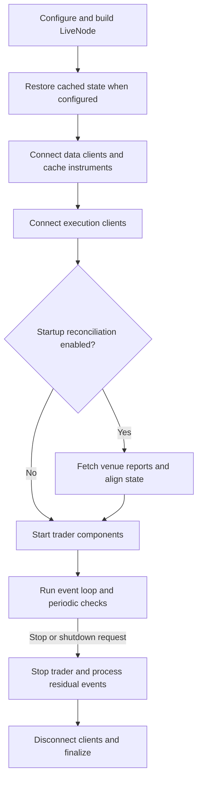

# 实时交易

同一份策略与执行算法代码可以跨回测和实时环境运行。实时执行还会引入模拟未必能复现的交易场所、传输、时序、持久化、外部活动和对账行为。

:::warning
**实时交易涉及真实的资金风险。** 部署到生产之前，请先弄清系统配置、节点操作、执行对账，以及回测与实时交易的差异。
:::

## 回测与实时的差异 {#backtest-and-live-differences}

回测用历史数据驱动一个受控时钟，在模拟交易场所上执行订单。实时节点与回测共享策略和执行算法代码，但要与进程边界之外的系统协作。

- **交易场所**：场所规则和适配器能力决定哪些订单类型、指令和事件可用。见 [适配器](./adapters.md)。
- **传输**：网络故障可能让订单命令的结果处于未知状态。见
  [命令结果](./execution/policies.md#command-outcomes)。
- **时序**：相互独立的输入可能交错，runner 不定义全局 FIFO 顺序。见 [分发优先级](#dispatch-priority-and-overload-behavior)。
- **持久化**：内置缓存支撑独立于场所传输处理写入，事件存储捕获也不会等持久提交后才放行分发。见
  [持久化先于传输](./execution/policies.md#persistence-before-transport)。
- **外部活动**：场所报告可能包含节点之外创建的订单。见
  [外部订单创建](./execution/reconciliation.md#external-order-creation)。
- **对账**：启动和运行时检查把本地保留状态与场所报告对齐。见
  [执行对账](./execution/reconciliation.md)。

## 执行客户端路由 {#execution-client-routing}

实时节点可以为同一交易场所注册多个独立命名的执行客户端。命令的 `client_id` 直接选中某个已注册客户端。当命令的 `client_id` 和基于账户的路由都没能解析出客户端时，由场所路由和默认路由选定。

:::warning[账户隔离]
为某交易场所注册多个客户端，并不能在同一场所的各账户之间为持仓和订单管理提供端到端的账户隔离。交易前风险检查使用执行各命令的那个客户端所属的账户。见 [账户选择](./execution/index.md#account-selection)。
:::

### 订单路由 {#order-routing}

通过每个客户端的 `RoutingConfig` 配置场所路由与默认路由：

- `venues` 把列出的交易场所指派给该客户端。这些显式路由优先于自动场所路由和默认客户端。
- `default=True` 使该客户端在没有场所路由适用时成为兜底选择。

某交易场所只注册了一个客户端时，它自动路由该场所，除非另一个客户端显式路由它。同一场所注册多个客户端时，必须有显式场所路由或默认客户端——即便策略为每条命令都提供了 `client_id` 也一样。重复的客户端 ID、冲突的场所路由、多个默认客户端都会在节点构造期报错。

### 金融工具更新 {#instrument-updates}

金融工具更新会送达每个场所匹配的客户端，以及被路由到该场所的客户端（如有）。每个匹配的客户端只收到一次。收到金融工具更新不会让该客户端成为订单命令的接收方。

### 直接 Rust 调用方 {#direct-rust-callers}

`ExecutionEngine::register_client` 注册客户端时不指派路由，之后需调用
`register_venue_routing` 或 `set_default_client` 配置场所或兜底路由。也可以用 `register_default_client` 一步完成注册并设为默认。

## 实时节点生命周期 {#live-node-lifecycle}

Rust 的 `LiveNode::run()` 在启动 trader 组件前准备好缓存和场所状态，随后拥有事件循环和协调关闭（coordinated shutdown）。



实时节点生命周期：先备好金融工具与执行状态，策略才开始交易。

连接了支撑数据库且启用了缓存加载时，才执行缓存恢复。连接、对账或 trader 启动失败会中止启动，并走协调清理路径。

### 关闭时的提交恢复 {#submission-recovery-at-shutdown}

Rust 的 `LiveNode::stop`、`run`、`run_with_mode` 与 Python 的 `run_async()` 使用同一个提交恢复边界：

1. 在 `delay_post_stop` 期间，节点继续处理场所证据和原生 managed-exit 定时器，但不启动新的对账查询。
1. 该窗口结束时，任何仍没有原生结果或场所确认的保留提交，都会让关闭返回错误。错误列出未解决的 client order ID。
1. 即使恢复不完整，客户端仍会断开、内核仍会停止。

此边界之后排空（drain）的证据无法改变已记录的关闭结果。

这适用于 `RetainUnresolved`，以及要求保留提交的客户端——包括恢复预算尚未耗尽的提交。Polymarket 自动要求保留，因此其调用方即使未选择启用策略也可能收到这个错误。不要求保留的客户端，其默认 `ResolveLocally` 策略保持不变。

提交获得确认即结束提交恢复。它不能证明已接受订单的撤销或修改已经完成，也不能证明持仓已平。managed exit 保留既有的尝试预算；该结果不会把清理扩展到 `delay_post_stop` 之外，也不实现跨重启的恢复。身份与查询预算规则见
[提交恢复](./execution/reconciliation.md#submission-recovery)。

## 托管事件循环 {#hosted-event-loops}

在 Python 中用 `run_async()` 让节点跑在你已拥有的事件循环上。例如，ASGI 服务器可以在节点旁边提供一个仪表盘。希望节点拥有调用线程和信号处理时，用 `run()`。

下面的生命周期草图把节点配置与请求服务留给应用：

```python
import asyncio

from nautilus_trader.live import LiveNode
from nautilus_trader.live import LiveNodeHandle


async def wait_until_running(
    handle: LiveNodeHandle,
    task: asyncio.Task[None],
) -> None:
    while not handle.is_running:
        if task.done():
            await task
            raise RuntimeError("LiveNode stopped during startup")
        await asyncio.sleep(0.01)


async def serve_with_node(node: LiveNode) -> None:
    cache, portfolio, handle = node.cache, node.portfolio, node.handle()
    run_task: asyncio.Task[None] | None = None
    service_task: asyncio.Task[None] | None = None
    try:
        run_task = asyncio.create_task(node.run_async())
        await wait_until_running(handle, run_task)

        service_task = asyncio.create_task(serve_requests(cache, portfolio, handle))
        done, _ = await asyncio.wait(
            (run_task, service_task),
            return_when=asyncio.FIRST_COMPLETED,
        )
        if run_task in done:
            await run_task
            raise RuntimeError("LiveNode stopped while the service was running")
        await service_task
    finally:
        if service_task is not None and not service_task.done():
            service_task.cancel()
            await asyncio.gather(service_task, return_exceptions=True)
        try:
            if run_task is not None:
                handle.stop()
                await run_task
        finally:
            node.dispose()
```

两个入口运行同样的生命周期，因此托管节点与自持节点执行相同的启动顺序、维护、对账和关闭。模式只决定信号处理的归属：托管节点不安装任何处理器，`SIGINT` 和 `SIGTERM` 留给宿主。

### 访问与关闭 {#access-and-shutdown}

`run_async()` 返回协程，并在运行期间把节点出借给它：

- **在启动之前**保存 `cache`、`portfolio` 和 `handle()`。节点运行时它们始终可用；而通过节点本身读取状态会抛异常，直到运行结束归还节点。
- `handle()` 全程可用，宿主正是靠它停止节点。`is_running` 也全程可用，因为它读的是同一个 handle。
- **等运行任务结束后**再调用 `dispose()` 释放节点资源。运行期间调用会直接返回、什么都不做，也不会延迟到之后执行。

`LiveNodeHandle` 从任意线程调用都安全，包括信号处理函数。`stop()` 请求优雅关闭后立即返回，因此 await 它的任务只在关闭完成后才 resolve。取消该任务同样会先请求关闭、等其完成，再重新抛出取消异常——这让 `asyncio.timeout` 和任务组保持调用方预期的行为。

所有托管节点都适用上文[关闭时的提交恢复](#submission-recovery-at-shutdown)契约。若 await 的 Python 任务被取消，拆解完成后取消仍会继续传播，且关闭错误会保留为取消异常的 cause。

### 宿主集成与限制 {#host-integration-and-limits}

兼容性已用默认 asyncio 事件循环和 uvloop 测试。由 Uvicorn 管理的 ASGI lifespan 可采用同样的所有权模式，且不必把信号处理移交节点。

ASGI lifespan 报告启动完成之前，要等 handle 报告 `Running`，其间检查运行任务是否已失败。启动后继续监督该任务，其意外结束应视为服务故障。

节点运行期间会周期性地让出宿主事件循环，因此事件突发不会饿死宿主自己的回调。启动和关闭排空队列时不让出，因此大批量加载金融工具、或关闭时的积压，可能在整个排空期间占住事件循环。

:::warning[每进程一个 LiveNode]
每个进程只并发运行一个 `LiveNode`。runner 把它的通道发送端和消息总线绑定在线程本地存储中，其他运行时状态则是进程级的。`run_async()` 还会拒绝同一事件循环上的第二个托管节点。更多节点请放到独立进程。

第一个节点存在或正在构造时，在同一线程上再构造一个 `LiveNode` 会报错。
在 Python 中，`node.build(...)` 是静态构造函数，会尝试创建另一个节点。

只调用 `dispose()` 并不能释放这个构造守卫。构造替代节点之前，要丢弃现有节点或释放 Python 中对它的全部引用：

- 只有一个 Python 引用时，先 `del node`：`node = LiveNode.build(...)` 会在旧节点仍存在时尝试构造。
- 异常和未完成的协程可能持有该节点，这些引用也要释放。
- 若不可达的引用循环使其存活，重建前先运行 `gc.collect()`。

ASGI 应用的 lifespan 构造节点时，该应用必须以单 worker 运行。实时交易不要使用热重载，因为它会重启 worker 及其节点。扩展 HTTP 请求处理能力，请用不构造交易节点的进程。
:::

配置了缓存数据库支撑的节点会在宿主事件循环上被拒绝。这类支撑靠阻塞调用线程来等待其 worker 任务，会把宿主事件循环整个卡死，而不只是拖慢。纯原生节点可以用 `run()` 搭配数据库支撑。自定义 Python 客户端在两种启动模式下都驱动 asyncio，因此都不支持缓存数据库支撑。

## 配置 {#configuration}

配置结构体如何处理默认值、`T` 与 `Option<T>` 语义以及 builder 模式，见 [配置](./configuration.md)概念指南。

节点与执行引擎设置、策略配置、缓存支撑和多场所接线，见
[配置实时交易节点](./../how_to/configure_live_trading.md)操作指南。

## 执行对账 {#execution-reconciliation}

提交、修改、撤销命令如何得到结果，见
[命令结果](./execution/policies.md#command-outcomes)。

启动时，对账在 trader 组件开始前把缓存的订单和持仓状态与场所报告对齐。之后，持续检查可在节点运行期间监测在途订单、挂单、持仓和自有订单簿。

适配器可以声明有界的历史报告。启动对账只有在报告集合与保留状态能证明持仓转换连贯时，才应用其中的成交经济信息。历史不完整或有歧义时，仍可恢复精确的订单状态，而不改动持仓或组合经济。

配置、恢复流程、运行时检查、场景和不变式见 [执行对账](./execution/reconciliation.md)。
针对过期快照的运行时保护，及其与真实更正、显式成交作废（fill-void）事件的区分，见 [快照新鲜度与成交更正](./execution/reconciliation.md#snapshot-freshness-and-fill-corrections)。

## Rust live runner 指标 {#rust-live-runner-metrics}

Rust `LiveNode` 通过 `LiveNodeHandle::metrics_snapshot()` 暴露基础的 runner 指标。在调用 `run()` 前从节点获取 handle，再从另一个任务轮询快照，用差值推导速率或利用率。

```rust
use std::time::Duration;

use nautilus_common::enums::Environment;
use nautilus_live::node::{LiveNode, RunnerMetricsDelta};

let mut node = LiveNode::builder(trader_id, Environment::Live)?
    // Add clients, actors, and strategies here.
    .build()?;

let metrics_handle = node.handle();

tokio::spawn(async move {
    let mut prev = metrics_handle.metrics_snapshot();
    let mut interval = tokio::time::interval(Duration::from_secs(1));

    loop {
        interval.tick().await;

        let next = metrics_handle.metrics_snapshot();
        let delta = RunnerMetricsDelta::from_snapshots(prev, next);
        if delta.elapsed_ns == 0 {
            prev = next;
            continue;
        }

        let elapsed_s = delta.elapsed_ns as f64 / 1_000_000_000.0;
        let data_event_rate = delta.data_events as f64 / elapsed_s;
        let data_event_staleness_ns = if next.data_events.last_dispatch_at_ns == 0 {
            0
        } else {
            next.elapsed_ns
                .saturating_sub(next.data_events.last_dispatch_at_ns)
        };

        log::info!(
            "Runner metrics: data_event_rate={data_event_rate:.0} \
             data_event_staleness_ns={data_event_staleness_ns} \
             dispatch_utilization={:.6} loop_utilization={:.6} \
             mean_dispatch_ns={} data_queue_depth={}",
            delta.dispatch_utilization(),
            delta.loop_utilization(),
            delta.mean_dispatch_ns(),
            next.data_events.queue_depth,
        );

        prev = next;
    }
});

node.run().await?;
```

### 快照范围与解读 {#snapshot-scope-and-interpretation}

快照覆盖 `LiveNode::run` 启动后的通道分发，包括关闭宽限期内的残余分发。**不**包含启动期缓冲、启动期刷写，以及循环结束后的最终排空。

- `dispatch_busy_ns` 覆盖五个分发分支；`maintenance_busy_ns` 和 `external_msgbus_busy_ns` 覆盖非分发的循环工作。
- 队列深度是节点运行期间维护 tick 上的即时采样，关闭宽限期内可能已过期。
- 快照无锁，跨字段视图未必一致。请对相邻快照做**饱和差值**来推导速率。
- `LiveNode::run` 进入稳态时计数器清零。

## 分发优先级与过载行为 {#dispatch-priority-and-overload-behavior}

live runner 的七个内部消息通道彼此独立且无界。多个通道同时就绪时，runner 按以下顺序轮询：

1. 时间与系统工作。
1. 执行事件。
1. 执行命令。
1. 外部消息总线入站。
1. 数据事件。
1. 数据命令。

在执行与数据两个通道对内，事件都先于命令。

这个轮询顺序保证行情积压不会压过就绪的执行流量。它不定义跨通道、跨适配器、跨场所的**全局 FIFO 顺序**。

每个被选中的分支都运行到完成，runner 才再次轮询，因此慢 handler 会拖延每个通道。runner 会周期性让出宿主事件循环，但让出既不改变通道优先级，也不会缩短慢 handler 的耗时。

:::warning[无界队列]
runner 通道不施加生产者背压、不合并消息、不丢弃行情、也不设队列深度上限。因此，持续超过分发能力的输入会推高队列深度、延迟和内存占用。越过某个阈值时，runner 不会自动限流数据源、停止交易或关闭。
:::

用 runner 指标和队列状态事件来发现这种压力。阈值是运维信号，不是服务时限承诺。压力持续时，由应用决定如何告警、削减输入、停止新的敞口或关闭节点。

## 队列压力监控 {#queue-pressure-monitoring}

设置了 `LiveNodeConfig.queue_monitor` 后，`LiveNode` 会把 runner 队列采样转换为类型化的状态迁移。监控**默认禁用**，字段未设置时不发布任何队列状态事件。

### 配置阈值 {#configure-thresholds}

下例为每个受监控的 runner 通道设置阈值：

```rust tab="Rust"
use nautilus_live::config::{LiveNodeConfig, QueueMonitorConfig};

let config = LiveNodeConfig {
    queue_monitor: Some(
        QueueMonitorConfig::builder()
            .queue_depth_trigger(1_000)
            .queue_depth_clear(500)
            .mean_dispatch_ns_trigger(250_000)
            .mean_dispatch_ns_clear(150_000)
            .build(),
    ),
    ..Default::default()
};
```

```python tab="Python"
from nautilus_trader.live import LiveNodeConfig
from nautilus_trader.live import QueueMonitorConfig

config = LiveNodeConfig(
    queue_monitor=QueueMonitorConfig(
        queue_depth_trigger=1_000,
        queue_depth_clear=500,
        mean_dispatch_ns_trigger=250_000,
        mean_dispatch_ns_clear=150_000,
    ),
)
```

这四个值适用于每个受监控的 runner 通道：

- `time_events`
- `exec_events`
- `exec_commands`
- `data_events`
- `data_commands`

每个清除阈值必须**低于对应的触发阈值**。阈值相等或倒挂时，配置校验会拒绝。

### 状态迁移 {#state-transitions}

live runner 在其 100 ms 维护 tick 上、采样当前队列深度之后评估监控器。队列深度是瞬时值；平均分发耗时使用自上次指标快照以来累计的消息数和分发忙碌时间。

| 条件         | 度量                                     | `Triggered`                                    | `Cleared`                                    |
| ------------ | ---------------------------------------- | ---------------------------------------------- | -------------------------------------------- |
| `Backlogged` | 瞬时队列深度。                           | `queue_depth >= queue_depth_trigger`           | `queue_depth <= queue_depth_clear`           |
| `Slow`       | 采样窗口内每通道的平均分发耗时。         | `mean_dispatch_ns >= mean_dispatch_ns_trigger` | `mean_dispatch_ns <= mean_dispatch_ns_clear` |

每个通道独立跟踪 `Backlogged` 和 `Slow`：

- 取值介于清除与触发阈值之间时保持先前状态，不发布新事件。
- 两个条件在同一 tick 同时越界时，节点发布两个事件，各自独立清除。
- 没有分发的采样窗口不评估 `Slow`。该条件保持先前状态，直到某个窗口内出现分发。

### 类型化投递 {#typed-delivery}

每次迁移都会在 `events.system.QueueStateChanged.<channel>` 上发布一个新的 `QueueStateChanged` 值，`<channel>` 是 Rust 变体名，如 Python `SystemChannel.DATA_EVENTS` 对应 `DataEvents`。事件标明配置的 trader、runner 通道、条件和迁移状态，还记录越界时的队列深度与平均分发耗时、新事件 ID 和事件时间戳。

actor 用 `subscribe_queue_state(...)` 订阅，通过 `on_queue_state(...)` 接收事件。Python API 从 `nautilus_trader.common` 暴露 `SystemChannel`、`QueueCondition`、`QueueState` 和 `QueueStateChanged`。发布只走进程内类型化消息总线，该事件没有用于外部消息总线流的线上表示。actor 示例见
[队列压力状态](./actors.md#queue-pressure-state)。

## Socket 传输状态 {#socket-transport-state}

### 发布与路由 {#publication-and-routing}

选择启用 socket 状态上报的适配器，其 actor 可以观察传输可用性。`LiveNode` 在 `events.system.SocketStateChanged.<client_id>.<endpoint>` 上发布 `SocketStateChanged`，携带 trader ID、客户端 ID、可选场所、稳定的端点标签、状态、新事件 ID 和事件时间戳。端点标签标识一条逻辑适配器传输，不暴露其 URL。

`LiveNode` 处理传输的中性状态通知时，用内核时钟设置两个时间戳。适配器经 runner 的系统事件通道发送该通知，与行情数据分开。这条内部通道不参与队列压力监控。

client ID 和 endpoint 两个成分会把 ASCII 字母、数字、`-`、`_` 以外的字节做百分号编码，因此标签中的点和通配符无法改变主题匹配。用 `subscribe_socket_state` 的过滤参数选择客户端、端点或两者，不必自己拼主题名。

### 状态语义 {#state-semantics}

| 传输事件或状态                    | 发布                                                   |
| --------------------------------- | ------------------------------------------------------ |
| TCP 或 WebSocket 变为可用。       | `Connected`。                                          |
| 活动传输丢失。                    | `Disconnected`。                                       |
| 连接或重试尝试失败。              | 无事件。                                               |
| 主动关闭。                        | 无断开事件。                                           |
| 重连尝试耗尽。                    | 已上报传输丢失后不再发布额外事件。                     |

`Connected` 报告的是**传输可用性**，不代表认证、订阅重放或适配器恢复已经完成。

:::warning
Socket 状态是运维证据，不是执行命令的结果。单纯断连不会拒绝、撤销或判定一条在途命令。相关证据由数据流更新、查询或对账按[命令结果策略](./execution/policies.md#command-outcomes)提供。
:::

### 死连接检测 {#dead-peer-detection}

连接可能在未关闭的情况下停止投递数据。NAT 或负载均衡器直接丢弃连接，不发 `FIN` 也不发 `RST`，于是写入仍不断成功进入发送缓冲区，丢失无人察觉。

#### 心跳超时 {#heartbeat-timeout}

handler 模式的 WebSocket 和原生 TCP 客户端在心跳超时后重连。配置了心跳时，默认超时为**三个心跳间隔**。显式的 `heartbeat_timeout_secs` 会覆盖该窗口。WebSocket 客户端收到任何入站帧都会重置计时；原生 TCP 客户端在字节到达时重置。

客户端期望对端回应心跳，因此没有心跳的传输拿不到默认窗口。显式设置超时也能在无心跳时启用检测。

对 WebSocket 客户端，该窗口统计所有帧：保活回应会刷新它，行情冷清也不会触发超时。

#### 数据流空闲超时 {#feed-idle-timeout}

适配器还可以单独设置空闲超时，用于检测传输仍然健康但数据流已停的行情。只有 Text 和 Binary 帧会刷新该超时。这第二个窗口适合按已知节奏推送数据的交易场所。场所用心跳回文本应答时，其回应与真实数据一样刷新空闲超时。因此，只有当该窗口小于心跳间隔时，它才有意义。

### 适配器与 actor 集成 {#adapter-and-actor-integration}

适配器集成构造 `SocketStateSink`，并通过网络客户端的 `state_sink` builder 选项设置。发布需要 `LiveNode` runner；独立的 `AsyncRunner` 不发布这些事件。

actor 用 `subscribe_socket_state(...)` 订阅，通过 `on_socket_state(...)` 接收事件。Python API 从 `nautilus_trader.common` 暴露 `SocketState` 和 `SocketStateChanged`。投递只走进程内类型化总线，外部消息总线流和线上格式不暴露这些事件。

### 端点重连命令 {#endpoint-reconnect-commands}

actor 或策略可以用状态事件里的端点标签调用 `reconnect_socket(client_id, endpoint)`。runner 把这条类型化命令经内核路由到拥有已注册端点的引擎。引擎只调用该传输的重连句柄，不会调用所属 `DataClient` 或 `ExecutionClient` 的断开/连接生命周期。

:::note
该 API 是**发后即观**（fire-and-observe）的。成功返回只表示命令通过本地校验并已入队，不代表内核已接受或恢复已完成。
:::

请求被接受后，选定端点会发出 `SocketStateChanged`：

1. 传输进入重连模式时的 `SocketState.DISCONNECTED`。
1. 传输恢复后的 `SocketState.CONNECTED`。

传输的正常重连控制器保持其认证、订阅重放和适配器恢复行为。

内核会记录：未知客户端、不支持的客户端、未知或有歧义的端点、重复请求、正在断开的传输和已关闭的传输。这些拒绝不产生 socket 状态变化，也不影响其他端点。端点标签只使用标识符字符，绝不包含原始 URL。

## 出错关闭 {#shutdown-on-error}

设置 `LiveNodeConfig.shutdown_on_error=True` 后，Rust 错误日志会请求实时节点关闭。Rust 日志器记录内核启动后发出的第一条 `log::error!`，包括来自其他线程的错误日志。内核在下一次实时事件循环检查关闭信号时发布 `ShutdownSystem` 命令。

关闭请求走正常的实时节点停止路径：停止 trader、等待 post-stop 延迟、断开客户端、停止引擎，不会强杀进程。

```python
from nautilus_trader.config import LiveNodeConfig

config = LiveNodeConfig(shutdown_on_error=True)
```

触发规则：

- 被组件过滤器或日志旁路模式抑制的错误日志，同样会请求关闭。
- 每次新的内核运行会清除并重新装载该触发器，进程无需重新初始化日志系统即可重启节点。
- 出错关闭观察的是 **Rust `log` 记录**，不是 Python 的 `logging.error(...)` 调用。

:::note
引擎级的 `graceful_shutdown_on_error` 选项已移除。请在节点/内核层级配置出错关闭。
:::

## 相关指南 {#related-guides}

- [执行对账](./execution/reconciliation.md) - 状态恢复与运行时一致性检查。
- [执行策略](./execution/policies.md) - 命令投递、持久化与恢复边界。
- [Python](./python.md) - Python 所有权、运行时与公共 API 边界。
- [配置实时交易节点](./../how_to/configure_live_trading.md) - 节点与引擎配置。
- [用 Rust 运行实时交易](./../how_to/run_rust_live_trading.md) - Rust 节点设置与场所连接。
- [适配器](./adapters.md) - 场所连接。
- [执行](./execution/index.md) - 命令结果与订单执行。
- [消息总线](./message_bus.md) - 进程内类型化发布订阅。
- [回测](./backtesting/index.md) - 部署前测试策略。
