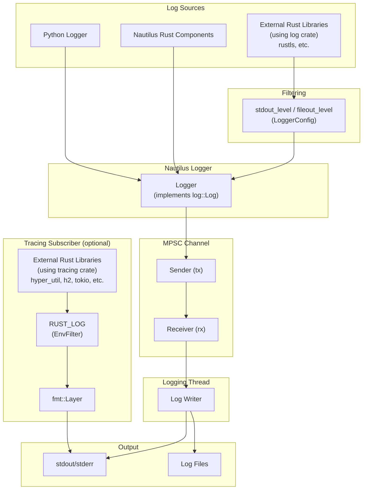

# 日志 {#logging}

平台通过标准 `log` crate 门面（facade）为回测和实时交易提供 Rust 日志。

核心日志器运行在独立线程上，通过多生产者单消费者（MPSC）通道接收日志消息，把日志输出 I/O 移出调用线程。消息参数仍在调用线程上完成格式化，然后才入队。

日志输出可配置，支持：

- **stdout/stderr 写入器**，输出到控制台
- **文件写入器**，把日志持久化存储

:::tip
可集成 [Vector](https://github.com/vectordotdev/vector) 等基础设施，在系统内收集和聚合事件。
:::

## 架构 {#architecture}

日志子系统从多个来源捕获事件，经 MPSC 通道路由到专用的日志线程：



- **Python 与 Nautilus 组件**：直接经由 Nautilus Logger 记录日志。
- **外部 `log` crate 使用者**：按 `LoggerConfig` 中的 `stdout_level`/`fileout_level` 过滤。
- **外部 `tracing` crate 使用者**：启用后输出直接写到 stdout（与 Nautilus 日志分离），按 `RUST_LOG` 环境变量过滤。
- **日志线程**：NautilusTrader 把所有日志事件经 MPSC 通道发给专用线程，因此日志 I/O 不会阻塞主线程。

## 配置 {#configuration}

导入 `LoggerConfig` 对象即可配置日志。默认情况下，`INFO` 级及以上的日志事件写入 stdout/stderr。

支持的日志级别：

- `OFF` - 禁用日志。
- `TRACE` - 最详尽的级别。
- `DEBUG` - 详细的诊断信息。
- `INFO` - 一般运行消息。
- `WARNING` - 不影响运行的潜在问题。
- `ERROR` - 可能影响功能的错误。

更多细节见 `LoggerConfig` 的 [API Reference](https://nautilustrader.io/docs/python-api-latest/common.html#nautilus_trader.common.LoggerConfig)。

日志支持以下配置方式：

- stdout/stderr 的最低 `LogLevel`。
- 日志文件的最低 `LogLevel`。
- 日志文件轮转（rotate）前的大小上限。
- 轮转时保留的备份日志文件最大数量。
- 按日期或时间戳成分自动命名日志文件，或自定义日志文件名。
- 写日志文件的目录。
- 纯文本或 JSON 日志文件格式。
- 按日志级别过滤各个组件。
- 日志行使用 ANSI 颜色。
- 完全绕过日志。
- 初始化时把 Rust 配置打印到 stdout。
- 启动时截断已有日志文件（`clear_log_file`）。

### 标准输出日志 {#standard-output-logging}

stdout/stderr 写入器把日志消息写到控制台。用 `stdout_level` 设置最低级别。

### 文件日志 {#file-logging}

日志文件默认写入当前工作目录。相关设置控制文件命名与轮转。

用 `FileWriterConfig.directory` 和 `FileWriterConfig.file_name` 设置日志目录与自定义文件基本名。

:::warning
启用文件日志时，若日志目录无法创建或日志文件无法打开，日志初始化就会失败。因此日志路径不可用的节点不会启动。从 `NAUTILUS_LOG` 惰性初始化日志的 Rust 二进制会报告该错误，然后仅以控制台日志继续运行。
:::

日志线程大约每 100 ms 把文件缓冲区刷给操作系统，但不会同步到磁盘。因此 tail 日志文件能看到及时的内容。阻塞的控制台输出可能推迟刷新；进程突然退出仍可能丢失已缓冲或排在日志线程队列中的行。

**日志文件格式**：

- `None`（默认）- 纯文本格式，扩展名 `.log`。
- `"json"` - JSON 格式，扩展名 `.jsonl`，适合日志聚合工具。

日志文件命名约定和轮转行为的详细信息，见下文 [日志文件轮转](#log-file-rotation) 和 [日志文件命名约定](#log-file-naming-convention) 两节。

#### 日志文件轮转 {#log-file-rotation}

轮转行为取决于是否设置大小上限、以及是否提供自定义文件名：

- **基于大小的轮转**：
  - 把 `FileWriterConfig.file_rotate` 设为 `(max_file_size, max_backup_count)` 元组，例如 `(100_000_000, 5)` 表示 100 MB、保留五个备份文件。
  - 写入某条日志会使当前文件超过该大小时，关闭当前文件并新建一个。
  - 轮转文件名精确到毫秒。若轮转结果解析为当前活动路径，日志继续写入该文件，可能短暂超过配置的大小上限。
- **基于日期的轮转（仅默认命名）**：
  - 仅当 `file_rotate` 和 `file_name` 都未设置时生效。
  - 每次 UTC 日期变更（午夜）后的首次写入时，日志器关闭当前日志文件并新建一个，即每个 UTC 日一个文件。
- **不轮转**：
  - 设置了 `file_name` 但未设置 `file_rotate` 时，日志持续追加到同一文件。
  - 注意：基于大小的轮转优先——同时提供自定义名和大小上限时，仍会轮转。
- **备份文件管理**：
  - `file_rotate` 的第二个值限制保留的轮转文件总数。
  - 超过该限制时，最旧的备份文件自动删除。
  - 该限制只作用于当前进程轮转出的文件，早前运行留下的轮转文件不会被删除。跨重启的保留策略请交给 `logrotate` 等外部工具。
- **轮转失败**：
  - 轮转失败（例如新文件打不开）时，日志继续写入当前文件，并在下一个大小或日期边界重试轮转。

#### 日志文件命名约定 {#log-file-naming-convention}

默认命名约定保证日志文件唯一可辨、且带时间戳。格式取决于是否启用文件轮转：

**启用文件轮转时**：

- **格式**：`{trader_id}_{%Y-%m-%d_%H%M%S-%3f}_{instance_id}.{log|jsonl}`
- **示例**：`TESTER-001_2025-04-09_210721-521_d7dc12c8-7008-4042-8ac4-017c3db0fc38.log`
- **成分**：
  - `{trader_id}`：trader 标识（例如 `TESTER-001`）。
  - `{%Y-%m-%d_%H%M%S-%3f}`：精确到毫秒的 UTC 日期时间。
  - `{instance_id}`：唯一实例标识。
  - `{log|jsonl}`：按格式设置决定的文件后缀。

**未启用基于大小的轮转（默认命名）**：

- **格式**：`{trader_id}_{%Y-%m-%d}_{instance_id}.{log|jsonl}`
- **示例**：`TESTER-001_2025-04-09_d7dc12c8-7008-4042-8ac4-017c3db0fc38.log`
- **成分**：
  - `{trader_id}`：trader 标识。
  - `{%Y-%m-%d}`：仅日期（YYYY-MM-DD）。
  - `{instance_id}`：唯一实例标识。
  - `{log|jsonl}`：按格式设置决定的文件后缀。
- **注意**：默认命名且无大小上限时，日志在 UTC 午夜按天轮转。

**自定义命名**：

设置了 `file_name`（例如 `my_custom_log`）时：

- 未启用轮转：文件名与所给名称完全一致（例如 `my_custom_log.log`）。
- 启用轮转：文件名包含自定义名和时间戳（例如 `my_custom_log_2025-04-09_210721-521.log`）。
- `file_name` 中自带的扩展名会被格式后缀替换，因此 `my_custom_log.log` 与 `my_custom_log` 产出的文件名相同。

### 组件日志过滤 {#component-log-filtering}

`component_levels` 参数为各个组件设置日志级别，输入应为组件 ID 字符串到日志级别字符串的字典：`dict[str, str]`。

下面是一个交易节点日志配置示例，用到了上文提到的部分选项：

```python
from nautilus_trader.common import LogLevel
from nautilus_trader.config import FileWriterConfig
from nautilus_trader.config import LoggerConfig
from nautilus_trader.config import LiveNodeConfig
from nautilus_trader.model import TraderId

config_node = LiveNodeConfig(
    trader_id=TraderId.from_str("TESTER-001"),
    logging=LoggerConfig(
        stdout_level=LogLevel.INFO,
        fileout_level=LogLevel.DEBUG,
        component_levels={"Portfolio": "INFO"},
        file_config=FileWriterConfig(file_format="json"),
    ),
)
```

回测可改用 `BacktestEngineConfig` 类替代 `LiveNodeConfig`，可选项相同。

### 环境变量配置 {#environment-variable-configuration}

`NAUTILUS_LOG` 环境变量提供另一种日志配置方式，值为分号分隔的规格字符串。这对纯 Rust 二进制、或希望不改代码覆盖日志设置的场景很有用。

```bash
export NAUTILUS_LOG="stdout=Info;fileout=Debug;RiskEngine=Error;is_colored"
```

**支持的键**：

| 键                    | 类型      | 说明                                             |
| --------------------- | --------- | ------------------------------------------------ |
| `stdout`              | 日志级别  | stdout 输出的最高级别。                          |
| `fileout`             | 日志级别  | 文件输出的最高级别。                             |
| `is_colored`          | 开关      | 启用 ANSI 颜色（默认：true）。                   |
| `print_config`        | 开关      | 启动时把配置打印到 stdout。                      |
| `log_components_only` | 开关      | 只记录有显式过滤器的组件。                       |
| `<Component>`         | 日志级别  | 组件专有级别（精确匹配）。                       |
| `<module::path>`      | 日志级别  | 模块专有级别（前缀匹配，仅 Rust）。              |

开关只需出现在规格字符串中即视为启用（无需取值）。日志级别不区分大小写：`Off`、`Trace`、`Debug`、`Info`、`Warn`、`Error`。

:::note
纯 Rust 二进制中，日志子系统在首次使用时惰性初始化。设置 `NAUTILUS_LOG` 即可完成配置，无需显式调用 `init_logging()`。
:::

### 仅记录组件日志 {#components-only-logging}

需要聚焦某几个嘈杂系统中的一部分时，启用 `log_components_only`，只记录 `component_levels` 中列出的组件的消息。其他组件一律抑制，不管全局 stdout 或文件级别如何。

示例（Python 配置）：

```python
logging = LoggerConfig(
    stdout_level=LogLevel.INFO,
    component_levels={
        "RiskEngine": "DEBUG",
        "Portfolio": "INFO",
    },
    log_components_only=True,
)
```

通过环境变量使用 Rust 规格字符串时，把 `log_components_only` 与组件过滤器并列，例如：

```bash
export NAUTILUS_LOG="stdout=Info;log_components_only;RiskEngine=Debug;Portfolio=Info"
```

### 模块路径过滤（仅 Rust） {#module-path-filtering-rust-only}

使用 `NAUTILUS_LOG` 环境变量时，除了组件名还可以按 Rust 模块路径过滤。含 `::` 的键按模块路径过滤器处理（前缀匹配），不含 `::` 的键按组件过滤器处理（精确匹配）。

```bash
# Filter all OKX adapter modules to Warn, but allow Debug for the websocket modules
export NAUTILUS_LOG="stdout=Info;nautilus_okx::=Warn;nautilus_okx::websocket=Debug"
```

最长匹配前缀优先。上例中，`nautilus_okx::websocket::handler` 使用 `Debug` 级（前缀更长），而 `nautilus_okx::data` 使用 `Warn`。

:::tip
未提供显式组件时，Rust 日志宏会自动捕获模块路径，因此普通日志调用也能享受模块级过滤。
:::

:::note
模块路径过滤只能通过 `NAUTILUS_LOG` 环境变量使用。Python 的
`component_levels` 配置只按组件名匹配。
:::

:::warning
若 `log_components_only=True`（或规格字符串中出现 `log_components_only`）且
`component_levels` 为空，stdout/stderr 和文件都不会输出任何日志。请至少添加一个组件过滤器，或关闭"仅组件"模式。
:::

### 日志颜色 {#log-colors}

ANSI 颜色码能提升终端里日志的可读性。在不支持 ANSI 颜色渲染的环境（如某些云环境或文本编辑器）中，颜色码会以原始文本出现，并不合适。
这类环境请设置 `LoggerConfig.is_colored=False`。

## Python 回调异常 {#python-callback-exceptions}

Python 回调错误会附带 traceback 和链式异常。若 traceback 格式化失败，上报会退化为只给出异常类型和消息。

Python 策略与执行算法的订单、持仓回调出错时，以 `ERROR` 级记录，附带组件身份和回调名。策略的市场退出（market-exit）回调使用同样的上报方式。Python 数据和定时器回调的错误同样达到 `ERROR` 级，这类记录的组件字段为发出日志的 Rust 模块。

对这类事件回调，异常只中断该次 Python 调用。默认情况下运行时继续分发事件，不会回滚回调在抛出前已完成的工作。

希望出错后请求正常关闭，可在[回测引擎](./backtesting/apis-and-runs.md#shutdown-on-error)或[实时节点](./live.md#shutdown-on-error)配置中启用 `shutdown_on_error`。该请求在下一次运行时检查关闭信号时生效，不会打断当前事件分发。

## 直接使用日志器 {#using-a-logger-directly}

可以在任何地方直接初始化和使用 `Logger` 对象，方式与 Python 内置 `logging` API 类似。

没有会初始化 `NautilusKernel` 和日志的对象（如 `BacktestEngine` 或 `LiveNode`）时，按下面的方式激活日志：

```python
from nautilus_trader.common import init_logging
from nautilus_trader.common import Logger
from nautilus_trader.common import LogLevel
from nautilus_trader.core import UUID4
from nautilus_trader.model import TraderId

log_guard = init_logging(
    trader_id=TraderId.from_str("TESTER-001"),
    instance_id=UUID4(),
    level_stdout=LogLevel.INFO,
)
logger = Logger("MyLogger")
```

更多细节见 [`init_logging` API Reference](https://nautilustrader.io/docs/python-api-latest/common.html)。

**保持返回的 `LogGuard` 存活**，直到不再需要直接日志。日志子系统最多支持 255 个并发 guard。

## LogGuard：管理日志生命周期 {#logguard-managing-log-lifecycle}

`init_logging` 返回一个 `LogGuard`，代表进程级日志子系统的一个使用者。`BacktestEngine` 和 `LiveNode` 在内部持有各自的 guard，应用代码无需从引擎或节点获取 guard。

### 引用计数实现 {#reference-counting-implementation}

日志系统用引用计数跟踪活动的 `LogGuard` 实例：

- **计数递增**：新建 `LogGuard` 时，原子计数器加一。
- **计数递减**：`LogGuard` 被丢弃时，计数器减一。
- **最后一个 guard**：计数归零时，待写的文件日志会被刷出并同步。进程级日志线程仍保留，供后续 guard 使用。
- **guard 上限**：系统最多支持 255 个并发 `LogGuard` 实例。超出时 `init_logging` 抛 `ValueError`，引擎或节点创建则抛 `RuntimeError`。

突然终止仍可能丢失缓冲的日志。请正常 dispose 引擎和节点，并让直接 `init_logging` 返回的 guard 一直保留到应用不再需要日志为止。

## 外部 Rust 库的 tracing 订阅器 {#tracing-subscriber-for-external-rust-libraries}

使用 `tracing` crate 的外部 Rust crate，可以启用 tracing 订阅器来显示其日志输出。这对调试外部依赖、或集成编译为独立 PyO3 扩展的自定义 Rust 组件（如特征提取器或适配器）很有用。

### 启用订阅器 {#enabling-the-subscriber}

直接初始化 tracing 订阅器：

```python
from nautilus_trader.common import init_tracing

init_tracing()
```

### 用 RUST_LOG 过滤 {#filtering-with-rust_log}

`RUST_LOG` 环境变量控制显示哪些 tracing 事件：

```bash
# Show debug logs from your crate, warn and above from hyper
RUST_LOG=my_feature_extractor=debug,hyper=warn python my_script.py
```

未设置 `RUST_LOG` 时，默认过滤级别是 `warn`。

### 工作原理 {#how-it-works}

tracing 订阅器使用 `tracing-subscriber` 的 fmt layer，配合自定义格式化器直接输出到 stdout。它与 Nautilus 日志基础设施相互独立——tracing 输出采用与 Nautilus 对齐的格式，时间戳精确到纳秒。

tracing 输出示例：

```
2026-01-24T05:51:42.809619000Z [DEBUG] hyper_util::client::legacy::connect::http: connecting to 104.18.5.240:443
2026-01-24T05:51:42.810543000Z [DEBUG] hyper_util::client::legacy::pool: pooling idle connection for ("https", api.example.com)
```

**与 Nautilus 日志的区别**：

- tracing 输出直接到 stdout，不经过 Nautilus 日志线程。
- tracing 事件不会写入 Nautilus 日志文件。
- 过滤完全由 `RUST_LOG` 控制，与 `LoggerConfig` 无关。

使用 `log` crate 的外部库（如 `rustls`），其事件经由 Nautilus 日志器，按 `LoggerConfig` 的 `stdout_level`/`fileout_level` 过滤。

:::tip
`RUST_LOG` 只影响使用 `tracing` 的 crate。使用 `log` 的 crate 请通过 `LoggerConfig` 或 `NAUTILUS_LOG` 环境变量配置详细程度（例如 `NAUTILUS_LOG=stdout=Debug`）。
:::

:::note
tracing 订阅器每个进程只能初始化一次。第二次调用 `init_tracing()` 会报错。
:::

## 平台相关注意事项 {#platform-specific-considerations}

### Windows 关闭行为 {#windows-shutdown-behavior}

在 Windows 上，解释器关闭期间非确定性的垃圾回收偶尔会把最后一个 `LogGuard` 的丢弃推迟到解释器拆解开始之后。最后一个 guard 的丢弃正是刷出并同步待写文件日志的时机，因此延迟丢弃可能导致日志被截断。

## 相关指南 {#related-guides}

- [架构](./architecture.md) - 系统架构，含日志基础设施。
