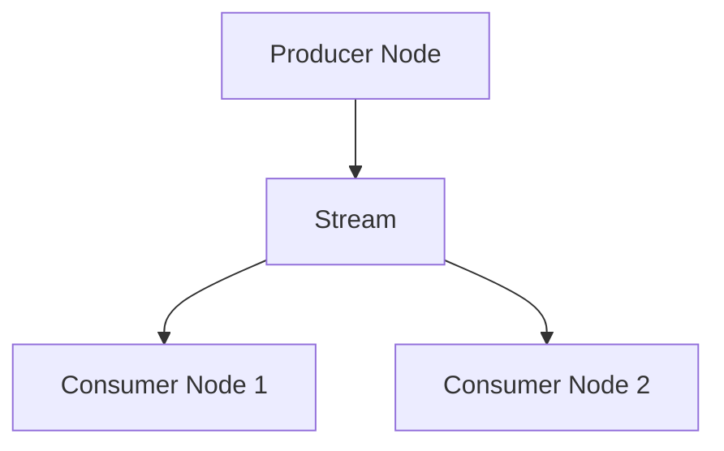

# 消息总线

`MessageBus` 通过消息传递实现系统组件之间的通信。这种设计形成松耦合架构，组件交互无需直接依赖。

*消息传递模式*包括：

- 点对点（Point-to-Point）
- 发布/订阅（Publish/Subscribe）
- 请求/响应（Request/Response）

经 `MessageBus` 交换的消息分为三类：

- 数据（Data）
- 事件（Events）
- 命令（Commands）

## 主题层级 {#topic-hierarchy}

Nautilus 把行情主题放在 `data` 根下。实时数据发布使用直接的 `data.<kind>...` 主题，例如 `data.book.deltas.XCME.ESZ24`。

被请求、回放或工作流生成的数据以主题可寻址的形式流经消息总线时，`DataEngine` 在 `data.pipeline.<kind>...` 下发布它。例如，pipeline 路径上的订单簿 delta 使用 `data.pipeline.book.deltas.XCME.ESZ24`。

长请求、分组请求和聚合链可以在父请求完成之前拆分、转换数据并提前回流。这些消息仍是数据消息，但不主张与普通实时发布相同的顺序与时序语义。

配对的请求响应通过以 correlation ID 为键的响应 handler 投递。`data.response` 主题是响应发布的捕获通道，不是 pipeline 数据路径。

## 消息完整性 {#message-integrity}

消息一旦创建，**其字段不得被修改**，包括 `params` 映射这类容器字段。组件可以读取消息并从中派生本地状态，但不能改写原始消息。

不可变消息保证每个消费者看到的是同一份输入，保留发布时刻的事实，并消除一类共享状态竞态。回放、调试和审计都依赖消息在分发后保持稳定。

由此引出三条所有权规则：

- 调用方提供的请求选项留在消息上。
- 返回给调用方的响应元数据留在响应上。
- 组件的工作流状态（有界日期区间、分组状态、回放游标、计数器、处理标志）保存在组件自有、以消息或请求 ID 为键的上下文中。

组件需要派生消息时，应新建一条携带所需值的消息，而不是改写原消息。

## 数据与信号发布 {#data-and-signal-publishing}

`MessageBus` 是较底层的组件，用户通常间接与之交互。`DataActor`、`Strategy` 和 `ExecutionAlgorithm` 在其之上提供类型化方法：

```python
def publish_data(self, data_type: DataType, data: CustomData) -> None:
def publish_signal(self, name: str, value, ts_event: int = 0) -> None:
```

这些方法发布自定义数据和信号，不把原始消息总线暴露给 Python。

## Python 主题消息 {#python-topic-messaging}

已注册的 Python `DataActor`、`Strategy` 和 `ExecutionAlgorithm` 组件可以通过 `publish_message(topic, message)` 发布任意 Python 对象，并用 `subscribe_topic(topic, handler, priority=0)` 和 `unsubscribe_topic(topic, handler)` 在同一运行时总线上管理回调。这些方法不构造、替换或 dispose 总线，也不暴露 `self.msgbus`。

在 `on_start` 等组件回调中订阅：

```python
from nautilus_trader.common import DataActor


class RiskObserver(DataActor):
    def on_start(self) -> None:
        self.subscribe_topic("app.risk.*", self.on_risk, priority=10)

    def on_risk(self, message: object) -> None:
        self.log.info(f"Risk update: {message}")
```

在另一个已注册组件中，向匹配的主题发布：

```python
self.publish_message("app.risk.limit", {"instrument": "BTCUSDT", "limit": 3})
```

发布要求主题非空、具体且不含通配符。订阅模式接受 `*`（零个或多个字符）和 `?`（恰好一个字符）。通配符可以跨越点号，因此 `app.risk.*` 也匹配 `app.risk.limit.eu`。

handler 收到的是原始对象，没有拷贝、字符串转换或序列化。请遵循[消息完整性](#message-integrity)：把发布的对象视为不可变。使用 `app.risk.limit` 这类应用自有主题。系统数据与事件主题有各自的负载类型。

这些回调接收的是经 `publish_message` 发布的对象，不是类型化行情或信号。那些负载请使用对应的类型化订阅方法。模式同时匹配到信号或自定义数据时，每遇到一个不兼容负载会记录错误，而不是调用 Python 回调。

Python 对象发布不会把对象发送到外部消息总线存储或传输。

投递是**同步的**：嵌套的发布在发布的回调继续之前完成。订阅优先级高的先运行；优先级相同不代表按订阅插入顺序。回调顺序重要时（包括可复现的回测），请使用不同的优先级。

handler 异常会被记录，投递继续到其余 handler。这种投递模型并不意味着可以安全重入调用栈中已在执行的组件。

订阅属于订阅它的组件：

- 重复注册相同的模式与可调用对象是空操作，包括试图更改其优先级的尝试。要改优先级，先退订再订阅。
- Python 定义的绑定方法按接收者和函数匹配，因此反复取 `self.on_risk` 识别的是同一个 handler。其他可调用对象（包括绑定内建方法）按对象身份匹配，请为它们保留引用以便之后退订。相等与表示方法都不会被执行。
- 退订只移除该组件拥有的精确模式与可调用对象。订阅不存在时是空操作，其他组件的订阅互不影响。
- 已被某次发布选中的回调，即使在该次发布期间被退订，仍可能运行。

stop 会保留订阅，组件停止期间原始主题回调仍可能运行；resume 同样保留这些订阅。成功的 reset 和 disposal 会释放组件的订阅与保留的可调用对象，reset 成功后需要重新订阅。disposal 失败时，订阅保留到退役清理成功为止。fault 清理也会释放订阅。

这些方法在以下情形抛 `RuntimeError`：运行时注册之前、成功 disposal 之后、来自外部线程、或正在释放订阅期间。已注册的总线不可用或被替换时也抛 `RuntimeError`。非法主题和模式抛 `ValueError`；handler 不可调用抛 `TypeError`。优先级必须是 `[0, 4294967295]` 内的整数，越界抛 `OverflowError`。

## 消息风格 {#messaging-styles}

NautilusTrader 是**事件驱动**框架，组件通过收发消息通信。理解不同的消息风格有助于构建交易系统。

本指南介绍 NautilusTrader 中四种主要消息模式：

| **消息风格**                                                   | **用途**                             | **最适合**                                            |
| :------------------------------------------------------------- | :----------------------------------- | :---------------------------------------------------- |
| **自定义数据发布/订阅**                                        | 结构化交易数据交换                   | 交易指标、指标数据、需要持久化的数据                  |
| **信号发布/订阅**                                              | 轻量通知                             | 简单告警、标志和状态更新                              |
| [**Python 对象发布/订阅**](#python-topic-messaging)            | 进程内 Python 对象交换               | Python 组件共享的应用主题                             |
| **Rust MessageBus 发布/订阅**                                  | 底层、类型化的主题通信               | 原生运行时组件                                        |

各方式用途不同，用本节决定该选哪种模式。

### Rust MessageBus 主题发布/订阅 {#rust-messagebus-publishsubscribe-to-topics}

#### 概念 {#concept}

`MessageBus` 是 NautilusTrader 所有消息的中央枢纽。Rust 组件可以向具名主题发布类型化消息，并把 handler 订阅到这些主题。这个低层接口不属于 Python 的 actor 或策略接口面。

#### 优势与场景 {#benefits-and-use-cases}

直接的总线访问适合需要以下能力的原生组件：

- 系统内的**跨组件通信**。
- **灵活**定义类型化主题与负载。
- 发布者与订阅者互不知晓的**解耦**。
- 一条消息可被多个订阅者接收的**全局触达**。
- 处理不适合 actor 模型的事件。
- 需要对消息传递完全控制的高级场景。

#### 注意事项 {#considerations}

- 主题名要手动维护（拼写错误可能导致漏收消息）。
- handler 要手动定义。

### 自定义数据发布/订阅 {#custom-data-publishsubscribe}

#### 概念 {#concept-1}

自定义数据在数据 actor 与策略之间交换结构化的值。一个 `CustomData` 值携带 `DataType`、负载、事件时间戳和初始化时间戳，用于路由和事件排序。

#### 优势与场景 {#benefits-and-use-cases-1}

数据发布/订阅方式适合需要：

- **交换结构化交易数据**，如行情、指标、自定义指标或期权 greeks。
- **事件时间戳**（`ts_event`、`ts_init`），用于回测中对输入排序。发布本身不排序消息。
- 通过注册的自定义数据类实现**数据持久化与序列化**，与 NautilusTrader 的数据目录体系集成。
- 系统组件间**标准化的交易数据交换**。

#### 注意事项 {#considerations-1}

- 负载必须暴露 `ts_event` 和 `ts_init`。
- 持久化要求注册可序列化的自定义数据类。

#### 速览代码 {#quick-overview-code}

```python
from dataclasses import dataclass

from nautilus_trader.model import CustomData
from nautilus_trader.model import DataType


@dataclass
class GreeksData:
    delta: float
    gamma: float
    ts_event: int
    ts_init: int


data_type = DataType("GreeksData")
data = CustomData(
    data_type,
    GreeksData(
        delta=0.75,
        gamma=0.1,
        ts_event=1_630_000_000_000_000_000,
        ts_init=1_630_000_000_000_000_000,
    ),
)
self.publish_data(data_type, data)

self.subscribe_data(data_type)


def on_data(self, data: CustomData) -> None:
    if data.data_type == data_type:
        greeks = data.data
        self.log.info(f"Delta: {greeks.delta}, Gamma: {greeks.gamma}")
```

注册与持久化见[自定义数据](./custom_data.md)。

### 信号发布/订阅 {#signal-publishsubscribe}

#### 概念 {#concept-2}

**信号**是 actor 框架内发布/订阅简单通知的轻量方式。它是最简单的消息方式，无需定义自定义类。

#### 优势与场景 {#benefits-and-use-cases-2}

信号方式适合需要：

- **简单轻量的通知/告警**，如 "RiskThresholdExceeded" 或 "TrendUp"。
- 不定义自定义类的**快速临时消息**。
- 以简单原始值**广播告警或标志**。
- 通过方法（`publish_signal`、`subscribe_signal`）**集成 API**。
- **多订阅者通信**：发布时所有订阅者都能收到信号。
- 无需类定义的**最小配置开销**。

#### 注意事项 {#considerations-2}

- 每个信号携带单个值。值在发布时转为字符串，handler 收到的 `signal.value` 恒为 `str`，复杂数据结构不会被保留。
- 在 `on_signal` handler 中用 `signal.name` 区分信号。

:::warning[信号回调重入]
信号发布可能同步重入一个活动中的 actor——直接或间接经另一个订阅者——在 Rust 和 Python 编写的 actor 中造成未定义行为。**释放缓存借用并不能让 actor 重入变安全。** 请避免在当前回调返回之前就再次调用同一 actor 的发布环。
:::

#### 速览代码 {#quick-overview-code-1}

```python
# Define signal constants for better organization (optional but recommended)
import types

from nautilus_trader.common import LogColor
from nautilus_trader.core.datetime import unix_nanos_to_dt

signals = types.SimpleNamespace()
signals.NEW_HIGHEST_PRICE = "NewHighestPriceReached"
signals.NEW_LOWEST_PRICE = "NewLowestPriceReached"

# Subscribe from a DataActor or Strategy
self.subscribe_signal(signals.NEW_HIGHEST_PRICE)
self.subscribe_signal(signals.NEW_LOWEST_PRICE)

# Publish from a DataActor or Strategy
self.publish_signal(
    name=signals.NEW_HIGHEST_PRICE,
    value=signals.NEW_HIGHEST_PRICE,  # value can be the same as name for simplicity
    ts_event=bar.ts_event,  # timestamp from triggering event
)


# Handler (fixed callback name)
def on_signal(self, signal):
    match signal.name:
        case signals.NEW_HIGHEST_PRICE:
            self.log.info(
                f"New highest price was reached. | "
                f"Signal value: {signal.value} | "
                f"Signal time: {unix_nanos_to_dt(signal.ts_event)}",
                color=LogColor.GREEN,
            )
        case signals.NEW_LOWEST_PRICE:
            self.log.info(
                f"New lowest price was reached. | "
                f"Signal value: {signal.value} | "
                f"Signal time: {unix_nanos_to_dt(signal.ts_event)}",
                color=LogColor.RED,
            )
```

### 总结与选型指南 {#summary-and-decision-guide}

#### 选型指南：该用哪种风格？ {#decision-guide-which-style-to-choose}

| **使用场景**                     | **推荐方式**                          | **需要的准备**                              |
| :------------------------------- | :------------------------------------ | :------------------------------------------ |
| 原生系统级通信                   | Rust `MessageBus` 发布/订阅           | 类型化主题与 handler                        |
| 结构化的 Python 组件数据         | `DataActor` 自定义数据方法            | `DataType`、`CustomData` 和 `on_data()`     |
| 任意进程内 Python 对象           | 组件主题方法                          | 应用主题与可调用对象                        |
| 简单 Python 告警与通知           | `DataActor` 信号方法                  | 信号名与 `on_signal()`                      |

## 外部出口与入口 {#external-egress-and-ingress}

`MessageBus` 可以把序列化后的消息写到外部流。本节描述外部总线的出口（egress）与入口（ingress）两侧。Rust 原生实时节点使用注入的 `MessageBusExternalEgress` 和 `MessageBusExternalIngress` 接口，因此核心节点不依赖 Redis、经纪商、共享内存实现或 socket 协议。

:::info
Redis 是内置的、面向可序列化消息的外部支撑。最低支持 Redis 6.2，因为 autotrim 使用的 `MINID` 流裁剪需要它。
:::

配置了外部出口后，出站发布消息先分发给进程内订阅者，再序列化进既有的 `BusMessage` 线上记录：

- `topic`：内部发布调用使用的确切消息总线主题，例如 `data.quotes.BINANCE.BTCUSDT` 或 `events.order.S-001`。
- `type`：规范化的负载类型名，例如 `QuoteTick` 或 `OrderEventAny`。
- `payload_kind`：控制、执行和对账负载会带上值 `typed`——这些固定类型名也可能与自定义负载重名。
- `encoding`：按消息总线编码策略选定的负载编码。
- `payload`：用所选编码序列化的字节。

直接向 Redis 流写入的外部生产者必须遵循这些规则：

- 包含 `topic`、`type` 和 `payload`。`topic` 必须是合法的发布主题，不能含 `*` 或 `?`。
- `encoding` 字段可选，缺省为 JSON。
- 接收节点会跳过没有 `type` 的条目，因为无法选择负载解码器。
- 固定类型化负载要把 `payload_kind` 设为 `typed`。缺少这个判别字段时，接收节点会把同一类型名当作自定义数据处理。

外部出口以 `publish(BusMessage)` 接收该记录。这个出站调用不得阻塞节点的总线线程。有界出口实现在队列满时丢弃，而不是向交易循环施加背压。关闭消息总线时会一并关闭配置好的出口。

入站外部流经独立的 Rust `MessageBusExternalIngress` trait 暴露。入口产出同样形状的 `BusMessage { topic, payload_type, encoding, payload }`。`republish_external_message` 解码支持的入站消息并在内部重新发布，不会把消息再转发出去。常规内部重发要求入站负载类型已注册流式，未注册的类型直接跳过、不解码。

Rust 的 `LiveNode::add_stream_processor` 与 Python 的 `LiveNode.add_stream_processor` 为类型化 JSON 或 MessagePack 负载注册回调。处理器按注册顺序在内部流式注册检查之前运行，因此即使内部重发被禁用，它们也能收到支持的类型化消息。Python 处理器收到一个附加了 `payload_type` 字段的映射。处理器出错会阻止后续处理器，并跳过该消息的内部重发。

对自定义数据，出口写出和入口期望的是 Redis `payload` 字段中的一个信封（envelope），而不是裸的自定义对象。规范 JSON 信封为：

```json
{
  "type": "MyData",
  "data_type": {
    "type_name": "MyData",
    "metadata": {
      "source": "external"
    },
    "identifier": "optional-storage-key"
  },
  "payload": {
    "value": 42,
    "ts_event": 0,
    "ts_init": 0
  }
}
```

信封必须包含 `type` 和 `payload`。`data_type` 在入口侧可选，缺省为取消息类型、不带 metadata 和 identifier。

- **规范输出**：`data_type.type_name` 使用同一个自定义类型名；`metadata` 是可以为空的对象；`identifier` 只在被赋值时出现。
- **类型匹配**：信封的 `type` 必须与 Redis 流的 `type` 一致。
- **负载**：信封的 `payload` 是传给已注册类 `from_json(...)` 方法的裸对象。

MessagePack 使用同样的映射字段，编码为 MessagePack 字节。

Python 自定义数据要在节点启动前注册类：

```python
from nautilus_trader.model import register_custom_data_class

register_custom_data_class(MyData)
```

外部客户端订阅会为流式注册负载类型，而 `register_custom_data_class(...)` 安装进程级 JSON 解码器。两者都必需。类的要求见[自定义数据](./custom_data.md#registration-architecture)。

对 Redis，消息总线经多生产者单消费者（MPSC）通道把消息发给一个独立的 Rust 任务，由该任务写入 Redis 流。

把 I/O 卸载到独立任务，发布线程得以不被阻塞。

使用 MessagePack 或 JSON 时，Rust 原生外部出口转发可序列化的类型化发布：

- 金融工具、报价、成交、bar、订单簿 delta 和可变深度快照。
- mark/index/funding 更新与期权 greeks（`OptionGreeks`）。
- 账户状态、投资组合快照、订单事件、持仓事件和自定义数据。
- 启用 `defi` feature 时，还有 DeFi 区块、池、流动性更新、fee collect 和 flash 事件。

完整订单簿快照、`GreeksData` 记录、期权链切片和 DeFi 池 swap 不会被转发，因为这些类型没有实现 Serde 序列化。

`external_streams` 非空时，JSON 或 MessagePack 出口还会转发订阅命令、交易命令和执行批量状态请求，以及订单状态报告、成交报告、持仓状态报告和执行批量状态报告。未配置外部流时，这些负载留在本地。

使用 SBE 或 Cap'n Proto 时，Rust 原生外部出口只转发以下有 schema 编解码器的内置行情负载：

- 报价
- 成交
- Bar
- 订单簿 delta
- 可变深度快照
- Mark 价格更新
- Index 价格更新
- 资金费率更新
- 期权 greeks

选择这些 schema 编码时，其他负载类型会被丢弃并记录 debug 日志。

## 配置 {#configuration}

消息总线的外部支撑采用"行为配置 + 技术自有支撑配置"的结构。`MessageBusConfig` 控制消息总线行为；`RedisMessageBusConfig` 拥有 Redis 连接设置并实现 `MessageBusBackingFactory`。

```rust
use nautilus_common::{
    enums::SerializationEncoding,
    msgbus::{MessageBusBackingFactory, MessageBusConfig},
};
use nautilus_infrastructure::redis::msgbus::RedisMessageBusConfig;

let config = MessageBusConfig {
    encoding: SerializationEncoding::Json,
    encoding_market_data: Some(SerializationEncoding::Sbe),
    timestamps_as_iso8601: true,
    buffer_interval_ms: Some(100),
    autotrim_mins: Some(30),
    use_trader_prefix: true,
    use_trader_id: true,
    use_instance_id: false,
    streams_prefix: "streams".to_string(),
    types_filter: Some(vec!["QuoteTick".to_string(), "TradeTick".to_string()]),
    ..Default::default()
};

let redis_config = RedisMessageBusConfig::default();
let backing = redis_config.create(trader_id, instance_id, config.clone())?;
```

现有 Rust 调用方可以继续用 `RedisMessageBusFactory::new(redis_config)`，它委托给配置的实现。

### 支撑配置 {#backing-config}

使用内置 Redis 支撑时必须提供 `RedisMessageBusConfig`。本地回环上的默认 Redis 部署可以直接传 `RedisMessageBusConfig::default()`。

Rust 类型本身就明确了 Redis 的选择，配置没有 `type = "redis"` 或 `backing_type = "redis"` 这类面向用户的选择器。

通过 `LiveNodeBuilder::with_external_msgbus_egress` 注入 `MessageBusExternalEgress` 的 Rust 原生调用方，在构造该出口接口时自行传入具体连接信息。核心消息总线对注入的出口不要求 `RedisMessageBusConfig`。

Rust 实时运行时接受 `MessageBusConfig` 中的 `external_streams`，并在调用方通过 `LiveNodeBuilder::with_external_ingress` 注入 `MessageBusExternalIngress` 后消费入站 `BusMessage`。配置列出外部流的键，注入的入口才是具体的运行时来源。

Rust 调用方可以用 `LiveNodeBuilder::with_external_msgbus_factory` 安装 `RedisMessageBusConfig`。工厂与另行注入的出口或入口组合时，构建失败。工厂总是安装出口，且仅在 `external_streams` 非空时创建入口。

Python 暴露同样的 builder 方法，唯一受支持的内置支撑配置是 `RedisMessageBusConfig`；现有 `RedisMessageBusFactory` 包装仍受支持。Python 不接受任意工厂类。

:::warning
内置 Redis 入口对每个配置好的流从当前时间戳开始消费，节点启动前已存在的条目不会被回放。启动后它为每个流推进 last-seen ID，并在连接重试间保留这些 ID。需要持久的启动前回放时，请使用缓存恢复或事件存储。`external_streams` 提供的是实时转发，不是消费者组的积压队列。
:::

### 编码 {#encoding}

Rust 原生外部消息总线出口支持这些编码名：

- JSON（`json`）
- MessagePack（`msgpack`）
- Cap'n Proto（`capnp`，需 Rust `capnp` feature）
- SBE（`sbe`，需 Rust `sbe` feature）

用 `encoding` 配置项控制写消息的编码。用 `encoding_market_data` 覆盖由外部总线二进制编解码器支撑的行情负载的编码。用 `encoding_builtin` 覆盖账户状态、投资组合快照、订单事件和持仓事件负载。自定义及未映射的负载类型始终使用 `encoding`。

`MessageBusConfig::validate` 要求默认 `encoding` 能支持自定义负载，即必须是 JSON 或 MessagePack。分类覆盖必须是该分类下每种发布负载类型所支持的。SBE 和 Cap'n Proto 只能用于 `encoding_market_data`，且必须启用对应的 Rust feature。在 schema 编解码器覆盖内置事件分类之前，`encoding_builtin = "sbe"` 和 `encoding_builtin = "capnp"` 都无法通过校验。

Redis 缓存负载路径只支持 MessagePack 和 JSON。SBE 与 Cap'n Proto 是 Rust 原生外部消息总线出口的 schema 负载编码，不是 Redis 缓存编码。对 Redis 缓存负载而言，这两种编码都是错误。

:::tip
默认使用 `json` 编码，便于阅读与互操作。负载大小与序列化性能是主要考量时，用 `msgpack`。
:::

### 时间戳格式 {#timestamp-formatting}

时间戳默认格式化为 UNIX 纪元纳秒整数。也可以设置 `timestamps_as_iso8601` 为 `true`，改用 ISO 8601 字符串格式。

### 消息流键 {#message-stream-keys}

消息流键标识各个 trader 节点，并组织流内消息。`trader-` 前缀、trader ID 和 instance ID 三个成分是否包含由下面的选项控制，streams 前缀则始终包含。三个成分全部启用时，trader 键的结构为：

```
trader-{trader_id}:{instance_id}:{streams_prefix}
```

默认选项（启用 `use_trader_prefix` 与 `use_trader_id`，禁用 `use_instance_id`）下，基础流键为 `trader-{trader_id}:{streams_prefix}`。

这些选项控制 Redis 流键，不会重写传给注入 `MessageBusExternalEgress` 的 `topic`——那个 topic 保持为内部消息总线的发布主题。`stream_per_topic` 为 `True` 时，Redis 出口把主题追加到流键后；为 `False` 时，Redis 把所有消息存在基础流键上，主题作为消息字段保留。

配置消息流键可用的选项：

#### Trader 前缀 {#trader-prefix}

键是否以 `trader-` 前缀开头。

#### Trader ID {#trader-id}

键是否包含该节点的 trader ID。

#### Instance ID {#instance-id}

每个 trader 节点都会获得唯一的 UUIDv4 实例 ID。消息分布到多个流时，它用于区分各个 trader。设置 `use_instance_id=True` 把它纳入 trader 键，即可在多节点交易系统里跨流识别 trader。

#### Streams 前缀 {#streams-prefix}

`streams_prefix` 字符串把一个 trader 实例的所有流归组，或为多个实例组织消息。做法是关闭其他前缀，再把字符串传给 `streams_prefix` 配置项。

#### 按主题分流 {#stream-per-topic}

设置 `stream_per_topic=True` 为每个主题写独立的流。这适合监听流时不支持通配符主题的 Redis 支撑。设为 `False` 则所有消息写入同一个流。

:::info
Redis 不支持通配符流主题。为更好地兼容 Redis，建议把该选项设为 False。
:::

### 类型过滤 {#types-filtering}

配置并启用消息总线支撑后，发布的消息会被序列化并写入流。可以把某些消息类型排除在外部发布之外，防止流被淹没（例如高频报价）。

外部发布过滤的做法是向消息总线配置的 `types_filter` 参数传入负载类型名列表。列出的类型不对外发布。某个名字同时被自定义负载和固定类型化负载使用时，两者都会被排除。

```python
from nautilus_trader.config import MessageBusConfig

# Create a MessageBusConfig instance with types filtering
message_bus = MessageBusConfig(types_filter=["QuoteTick", "TradeTick"])
```

### 流自动裁剪 {#stream-auto-trimming}

用 `autotrim_mins` 设置以分钟计的回看窗口，用 `autotrim_maxlen` 设置每个 Redis 流的近似最大条目数。两种策略可任选其一或同时配置。都设置时，消息总线移除超过时间窗口或条目数阈值任一项的条目。

Redis 以近似裁剪应用 `autotrim_maxlen` 以获得更好的写入性能，因此流中条目可能略多于配置阈值。

:::info
Redis 实现对每个流最多每分钟裁剪一次，因此条目可能比 `autotrim_mins` 窗口多保留约一分钟。
:::

## 外部流 {#external-streams}

`LiveNode`（节点）内部的消息总线称为"内部消息总线"。生产者节点把消息发布到外部流（见[外部出口与入口](#external-egress-and-ingress)）。消费者节点监听外部流，把反序列化后的消息负载发布到自己的内部消息总线上。



:::info
把 `LiveDataEngineConfig.external_clients` 设为代表外部流式客户端的 `client_id` 列表。`DataEngine` 会过滤掉这些客户端的订阅命令，因为外部流已经供给它们的订阅数据。

Rust `DataEngine` 跳过外部客户端订阅时，会在消息总线上注册相应的流式负载类型用于入站重发。
:::

### 配置示例 {#example-configuration}

在这个流式示例中，生产者节点对外发布 Binance 数据，下游消费者节点把这些数据消息发布到自己的内部消息总线。

#### 生产者节点 {#producer-node}

生产者节点的 `MessageBus` 发布到 `"binance"` 流。`use_trader_id`、`use_trader_prefix` 和 `use_instance_id` 均设为 `false`，让流拥有一个简单、可预测的键，供消费者节点登记。

```rust
let message_bus = MessageBusConfig {
    use_trader_id: false,
    use_trader_prefix: false,
    use_instance_id: false,
    streams_prefix: "binance".to_string(), // <---
    stream_per_topic: false,
    autotrim_mins: Some(30),
    ..Default::default()
};

let redis_config = RedisMessageBusConfig {
    connection_timeout: 2,
    response_timeout: 2,
    ..Default::default()
};

let mut node = LiveNode::builder(trader_id, Environment::Live)?
    .with_msgbus_config(message_bus)
    .with_external_msgbus_factory(Box::new(redis_config))
    .build()?;
node.run().await?;
```

#### 消费者节点 {#consumer-node}

消费者节点的 `MessageBus` 配置为从同一个 `"binance"` 流接收消息。`RedisMessageBusConfig` 依据 `external_streams` 创建入口，`LiveNode::run` 把收到的消息发布到节点内部消息总线。我们把客户端 ID `"BINANCE_EXT"` 声明为外部客户端，`DataEngine` 就不会向该客户端 ID 发送数据命令。

```rust
let data_engine = LiveDataEngineConfig {
    external_clients: Some(vec![ClientId::from("BINANCE_EXT")]),
    ..Default::default()
};

let message_bus = MessageBusConfig {
    external_streams: Some(vec!["binance".to_string()]), // <---
    ..Default::default()
};

let redis_config = RedisMessageBusConfig {
    connection_timeout: 2,
    response_timeout: 2,
    ..Default::default()
};

let mut node = LiveNode::builder(trader_id, Environment::Live)?
    .with_data_engine_config(data_engine)
    .with_msgbus_config(message_bus)
    .with_external_msgbus_factory(Box::new(redis_config))
    .build()?;
node.run().await?;
```

## 相关指南 {#related-guides}

- [Actor](./actors.md) - Actor 使用消息总线处理事件。
- [架构](./architecture.md) - 消息总线在系统架构中的角色。
