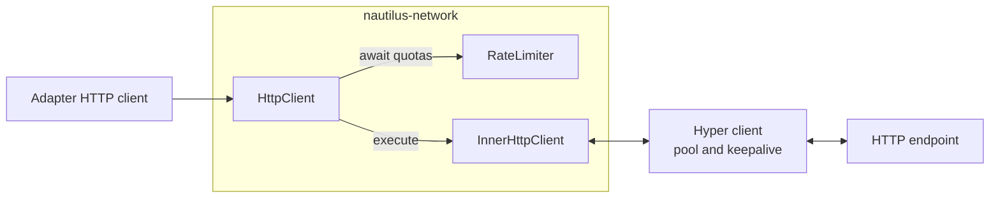
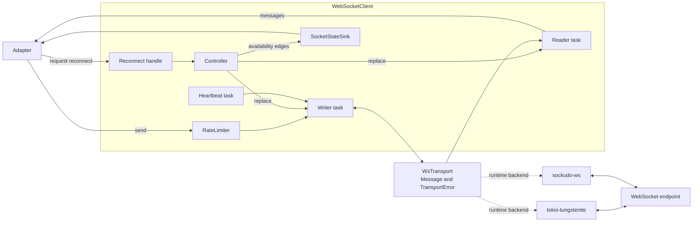
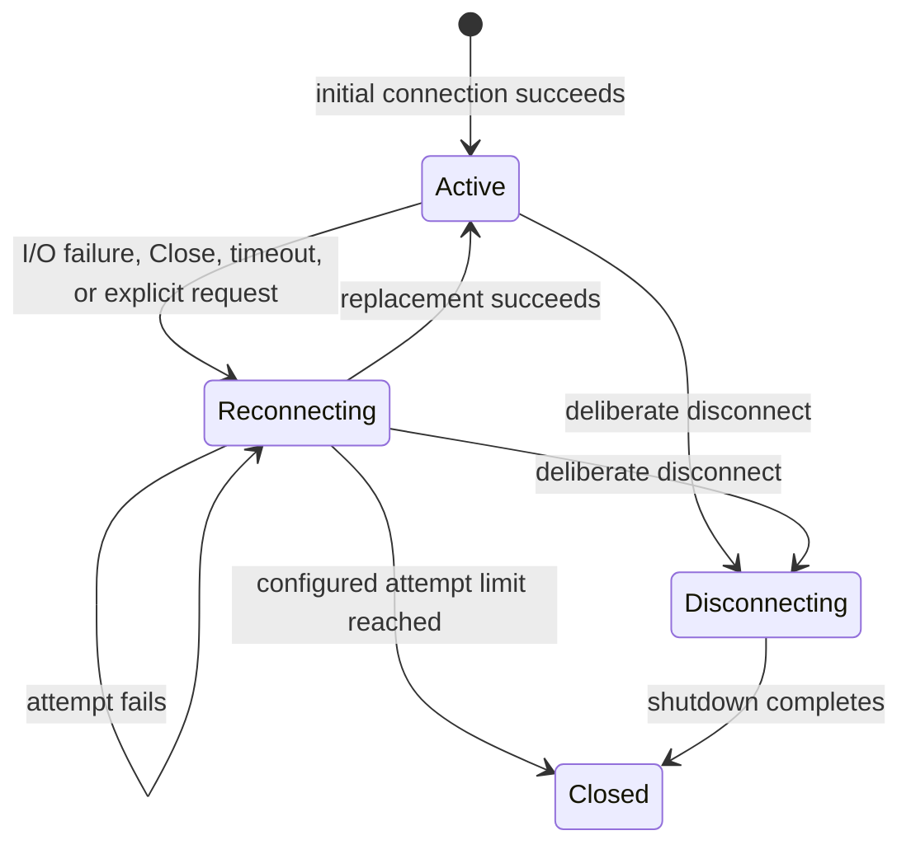
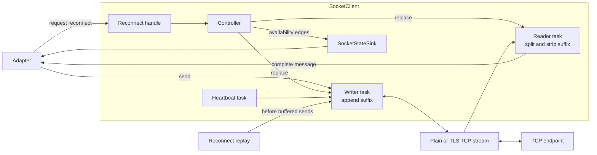
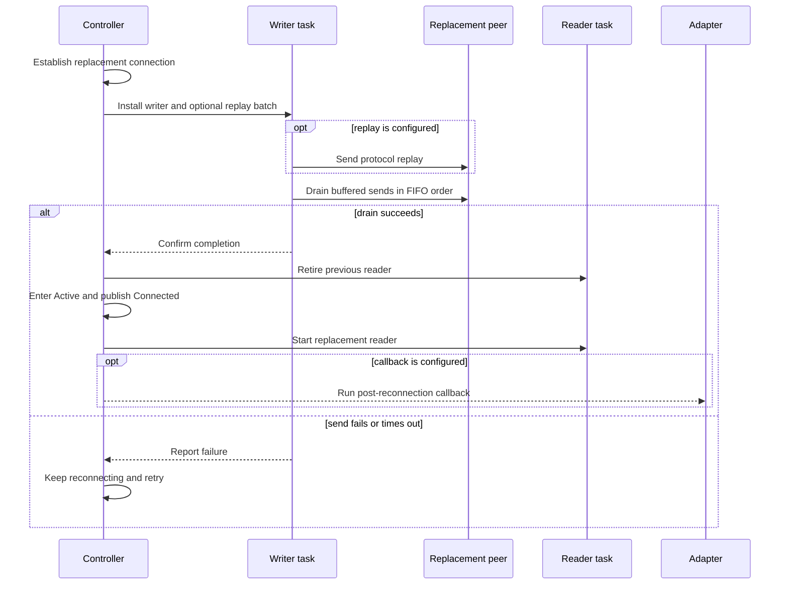

# 网络

NautilusTrader 适配器使用共享的 `nautilus-network` 客户端处理 HTTP 请求/响应 API、WebSocket 数据流和后缀分帧的 TCP 协议。这些客户端在底层 Rust 传输之上叠加了交易系统策略：限流、连接复用、保活检测、重连控制、重放协调和有界读取。

| 客户端          | 底层传输                            | 适用场景             | 附加策略                                                                                        |
| --------------- | ----------------------------------- | -------------------- | ----------------------------------------------------------------------------------------------- |
| HTTP            | Hyper                               | 有限次请求/响应操作  | 分层配额、连接池、keepalive、超时、代理路由和有界响应体                                          |
| WebSocket       | `tokio-tungstenite` 或 `sockudo-ws` | 长连接分帧数据流     | 运行时后端选择、配额、心跳、保活检测、重连和会话围栏（fencing）                                  |
| 原生 TCP socket | Tokio 与 `rustls`                   | 后缀分帧的字节流     | 分帧、初始重试、心跳、保活检测、重连和有序重放                                                   |

[适配器](./adapters.md)指南说明场所客户端如何把这些传输翻译成 Nautilus 领域消息。本页覆盖该边界之下的共享传输行为。

## HTTP 客户端 {#http-client}

[`HttpClient`](https://github.com/nautechsystems/nautilus_trader/blob/develop/crates/network/src/http/client.rs) 包装一个可复用的 Hyper 客户端和一个或多个共享限流器。请求先等每个适用配额就绪，再由内部客户端构建并执行。



外层客户端负责配额策略，可复用的内层客户端负责连接与响应策略。

Rust API 暴露 `http::Method`、`http::StatusCode` 和 `url::Url`。请求返回 `HttpResponse` 或 `HttpResponseStream`，失败返回 `HttpClientError`。

### 限流与请求 {#rate-limiting-and-requests}

限流器使用通用信元速率算法（GCRA），带一个默认配额和可选的按键覆盖。一个请求可以携带多个键（如端点加订单范围），并一起等待。配置多个限流器可让同一请求消耗相互独立的预算，例如按 IP 与按账户的限额。在多个 HTTP 客户端间共享它们的 `Arc`，能让预算保持进程级共享，而不是每条连接各有一份额度。

客户端接受默认头与请求级头、可重复值的查询参数、原始请求体，以及 `GET`、`POST`、`PUT`、`PATCH`、`DELETE` 方法。客户端级超时作用于所有请求，除非请求自带超时。

### 代理路由 {#proxy-routing}

客户端默认遵循环境中的代理配置。`use_system_proxy` 保持默认 `true` 且未显式设置 `proxy_url` 时，请求使用 `HTTP_PROXY`、`HTTPS_PROXY` 或 `ALL_PROXY`（含小写变体）指定的代理；被 `NO_PROXY` 匹配的目标绕过该代理。

这个默认行为有意信任进程环境。控制该环境的人，就等于选择了能观察全部明文 HTTP 流量和承载 HTTPS 的 CONNECT 隧道的代理。

显式的 `proxy_url`（可选）同时作用于 HTTP 与 HTTPS 流量，且始终优先于环境查找。传入 `use_system_proxy(false)` 会禁用环境查找，此时只有 `proxy_url` 未设置时请求才直连。

**HTTP 状态错误仍是正常的 `HttpResponse` 值**，让各适配器自行解读场所的响应体与重试规则。传输层重试只覆盖：

- 在复用连接上、尚未发出就被取消的请求。
- 远端 HTTP/2 `GOAWAY(NO_ERROR)` 或 `REFUSED_STREAM` 错误，允许重试两次。

其他传输失败和 HTTP 状态码不触发重试。适配器可以用 [`RetryManager`](https://github.com/nautechsystems/nautilus_trader/blob/develop/crates/network/src/retry.rs) 包装可重试操作，但哪些场所错误和操作可安全重试须由适配器决定。

### 连接复用与响应上限 {#connection-reuse-and-response-bounds}

每个生产 `HttpClient` 都启用 `TCP_NODELAY`，每台主机最多保留 32 条空闲连接，空闲连接最长保留 60 秒。HTTP/2 连接即使空闲也每 30 秒发送 keepalive 探测。复用客户端可保留连接池，避免每个请求都重新进行 TCP 和 TLS 握手。

HTTP/2 连接使用固定流控窗口：每流 16 MiB、每连接 32 MiB。也就是说，服务端在客户端确认之前最多可发送 16 MiB 响应数据。在构建客户端之前设置 `NAUTILUS_HTTP2_ADAPTIVE_WINDOW=true` 可改用 Hyper 的自适应窗口。取值 `false` 或变量未设置时保持固定窗口，其他取值会导致客户端构建失败。这些尺寸如何选定，见[流控窗口](#flow-control-windows)。

缓冲响应包含状态码、仅在构建客户端时选定的那几个响应头名，以及原始响应体字节。声明的响应体超过 100 MiB 时，客户端在读取前就拒绝。对分块或无上限的响应，累计字节即将越过同一限额时立即停止。传输错误消息携带请求 URL 但不含查询串和片段，因此查询串中的凭据不会经错误泄漏。路径本身可能含凭据的端点，可以使用脱敏后的请求路径——它在传输错误中省略 URL。

`HttpClient::get_stream` 返回状态和响应体分块，不累积完整响应，也不应用缓冲大小上限。一个绝对截止时间覆盖响应头和整个响应体，包括处理分块所花的时间。不提供限流键，因此不消耗配额。丢弃未完成的响应会释放整个交换过程，包括其持有的连接任务
[在模拟下](./dst.md#simulated-http-and-websocket-transport)。数据集下载走这条路径，先流式写入临时文件再重命名。下载为响应头和每次响应体读取分别配置超时，允许持续进展的传输超过该时长。

### HTTP 传输基准测试 {#http-transport-benchmarks}

[HTTP 对比](https://github.com/nautechsystems/nautilus_trader/blob/develop/crates/network/benches/BENCHMARKS.md#http-transport-comparison)于 2026-09-09 在一台 AMD Ryzen Threadripper 9980X 上测量，比较旧的 Reqwest 0.13.4 客户端与直接基于 Hyper 的实现。两者运行在同一个 `bench-lto` 二进制中，启用 fat LTO 与单 codegen unit。CPU governor 为 `performance`，按进程禁用 ASLR，客户端与服务端线程固定到不同的物理核。接受的会话期间没有采样到 Cargo 或编译器活动。

五个独立会话为每个负载提供 60 组成对样本。下面的 64 KiB 情形汇总了并发 1 和 16 下的 GET 与 POST。完整报告还包括 1 KiB 与 1 MiB 响应、p99 值、不确定度区间和资源度量。

| 64 KiB 负载          | Reqwest req/s | Hyper req/s | 成对吞吐变化 | 成对 p99 变化 |
| -------------------- | ------------- | ----------- | ------------ | ------------- |
| GET，并发 1          | 29,516        | 30,645      | +3.6%        | -3.1%         |
| POST，并发 1         | 27,054        | 28,223      | +4.1%        | -3.4%         |
| GET，并发 16         | 55,870        | 55,460      | -0.5%        | +0.4%         |
| POST，并发 16        | 47,779        | 47,631      | -0.3%        | +0.2%         |

吞吐列是样本摘要的中位数；变化列是组内成对比值的中位数。吞吐变化为正、p99 变化为负都利于 Hyper。

1 KiB 与 64 KiB 响应的串行吞吐提升 3.6% 到 5.0%。并发情形介于 -2.6% 到 +0.2%，1 KiB 并发 POST 的成对 p99 上升 1.8%。这些结果支持的结论是：串行有小幅改进，部分并发负载有回退。

基准测试通过回环 HTTP/1.1 演练完整请求，并校验响应体、状态、头部和连接复用。它不含 TLS、HTTP/2、代理、WAN 延迟和适配器解析，因此结果不能推出生产环境的整体加速。

### 流控窗口 {#flow-control-windows}

HTTP/2 流控限制服务端在客户端确认之前可发送的响应数据量。每个往返至多送达一个窗口，长路径上决定下载速度的可能是窗口而非链路。Hyper 提供两种模式：

- 自适应窗口从 65,535 字节起步，随 PING 探测测得的带宽时延积增长到 16 MiB，并通过 SETTINGS 帧抬升窗口。
- 固定窗口保持不变。Hyper 的默认值是每流 2 MiB、每连接 5 MiB。

`HttpClient` 使用固定窗口：每流 16 MiB、每连接 32 MiB。自适应窗口造成过两个问题：

- Cloudflare 重置：`api.tardis.dev` 前置 Cloudflare，其 Deribit 金融工具列表未压缩达 284 MB。自适应窗口下 21 次下载有 13 次在响应体中途被重置；固定窗口取 2、8 或 16 MiB 的 49 次下载全部完成。证据指向自适应增长的探测与 SETTINGS 流量是诱因，而非窗口大小。
- 新连接缓慢：每个大于 65,535 字节的响应体在窗口增长期间都需要额外往返。100 ms RTT 下，新连接上 1 MiB 响应在自适应窗口下耗时 616 ms，固定窗口下 207 ms。

Hyper 的固定默认值避开了这两个问题，但每往返至多送达 2 MiB，大响应体因此变慢。一个本地基准在回环 TLS 上、由中继增加往返延迟比较各配置。100 ms RTT 下的情形如下（中位数毫秒）：

| 响应体 | 连接 | 自适应 | 固定 2 MiB | 固定 8 MiB | 固定 16 MiB |
| ------ | ---- | ------ | ---------- | ---------- | ----------- |
| 64 KiB | 新建 | 308    | 206        | 206        | 206         |
| 1 MiB  | 新建 | 616    | 207        | 207        | 207         |
| 4 MiB  | 新建 | 875    | 413        | 209        | 208         |
| 16 MiB | 新建 | 1,185  | 1,037      | 416        | 211         |
| 1 MiB  | 热   | 154    | 103        | 104        | 103         |
| 4 MiB  | 热   | 105    | 310        | 105        | 105         |
| 16 MiB | 热   | 212    | 935        | 315        | 108         |

热连接此前已完成三个同尺寸请求，给了自适应窗口增长的时间。16 MiB 流窗口恰好等于自适应上限，因此响应从第一个往返就拿到满额容量，且没有探测流量。

测试覆盖 20、100、250 ms RTT，32 KiB 到 16 MiB 的响应体，新建与热连接。固定 16 MiB 与"自适应和 Hyper 默认中较快者"相比持平（1 ms 以内）或更快。固定 8 MiB 处理 16 MiB 响应体要慢两到三倍。32 MiB 连接窗口让同一连接上的两个大响应各能用满一个流窗口。

流控施加背压之前，慢读取器每流至多可收 16 MiB、每连接至多 32 MiB；自适应窗口下两者上限均为 16 MiB。

回环带宽近乎无限，因此基准高估了大响应体的收益。真实链路上，只有窗口小于带宽乘以 RTT 时它才限制吞吐。100 ms RTT 下，2 MiB 约合 20 MiB/s，16 MiB 约合 160 MiB/s。完整表格、方法与 Cloudflare 实测见
[HTTP/2 流控基准](https://github.com/nautechsystems/nautilus_trader/blob/develop/crates/network/benches/BENCHMARKS.md#http2-flow-control-windows)。

## WebSocket 客户端 {#websocket-client}

[`WebSocketClient`](https://github.com/nautechsystems/nautilus_trader/blob/develop/crates/network/src/websocket/client.rs) 把连接生命周期与帧传输分开。控制器拥有重连与关闭的状态转换；一个 writer 串行化所有 sink 访问；handler 模式为每个连接分配一个 reader 任务。可选的心跳任务经同一个 writer 发送保活流量。



生命周期任务使用同一个中性传输接口，适配器不依赖具体的 WebSocket 库。

### 连接模式 {#connection-modes}

| 模式    | Reader 归属            | 自动重连               | 保活行为                                       |
| ------- | ---------------------- | ---------------------- | ---------------------------------------------- |
| Handler | 内部回调任务           | 指数退避加抖动         | 心跳与应用数据空闲超时                         |
| Stream  | 调用方持有的 reader    | 禁用                   | 调用方上报失败并替换客户端                     |

长生命周期的适配器连接通常选 handler 模式。需要直接流式背压、或自有协议专有重连流程的适配器适合 stream 模式。

### 传输后端 {#transport-backends}

`WsTransport` 抽象把文本、二进制、Ping、Pong、Close 帧连同传输错误统一起来。`WebSocketConfig.backend` 在运行时选择后端：

| 后端                                                             | 可用性                                   | 升级头                                    | 代理行为                           |
| ---------------------------------------------------------------- | ---------------------------------------- | ----------------------------------------- | ---------------------------------- |
| [`tokio-tungstenite`](https://crates.io/crates/tokio-tungstenite) | 始终编译                                 | 经 WebSocket 握手透传                     | HTTP 与 HTTPS `CONNECT` 隧道       |
| [`sockudo-ws`](https://crates.io/crates/sockudo-ws)               | 启用 `transport-sockudo` feature 时默认  | 经本地 HTTP/1.1 握手透传                  | HTTP 与 HTTPS `CONNECT` 隧道       |

禁用默认 Cargo features 会移除 `sockudo-ws`，默认后端变为 Tungstenite。两个后端对 `wss://` 连接都使用 `rustls`，并在 Nautilus 创建 TCP 流的路径上设置 `TCP_NODELAY`。

:::warning
识别为 SOCKS 的代理 URL 会记录警告并**直连**，因为 WebSocket 的 SOCKS 隧道尚未实现。格式错误的代理 URL 和其他不支持的协议返回错误。
:::

### 入站大小限制 {#inbound-size-limits}

`WebSocketConfig.max_message_size_bytes` 和 `WebSocketConfig.max_frame_size_bytes` 限制单连接的入站消息与帧负载大小。不设置时采用各后端当前的默认配置：**每条消息 64 MiB、每帧 16 MiB**。

帧上限约束单个入站帧的内存。两个后端都是在读完该帧负载之后才应用消息上限，因此更低的消息上限并不能缩小缓冲区。取值为 0 时，builder 以及 handler 和 stream 两条连接路径都会拒绝。

超过消息上限、但能装进帧上限的消息，读取以 `MessageTooLarge` 失败。帧上限与单帧行为因后端而异：

- **Sockudo**：超过帧上限的帧先以 `FrameTooLarge` 失败。Sockudo 对分片消息应用消息上限；对已完成的单帧消息，仅当设置了 `max_message_size_bytes` 时才应用。其小帧解析器在整帧（125 字节以内）已全部缓冲时跳过帧上限检查，因此该场景不是可靠的拒绝。
- **Tungstenite**：每次超帧都报告为 `MessageTooLarge`。

### 保活与恢复 {#liveness-and-recovery}

配置的心跳按固定间隔发送 RFC 6455 Ping 或场所专有文本消息。配置心跳的同时也装载了响应期限：客户端期望对端回应，因此未设置 `heartbeat_timeout_secs` 时默认为三个间隔。要不同的窗口就显式设置该字段。没有心跳的传输拿不到默认窗口，因为没有任何东西能保证维持窗口所需的入站帧。

**心跳超时**在每个入站帧（含 Ping 和 Pong）上重置，用于检测完全停发的对端。另一个**空闲超时**只在文本或二进制应用数据上重置，控制流量掩盖不了静默的行情流。用心跳回文本应答的场所，其回应与真实数据一样刷新空闲超时。因此该窗口只有小于心跳间隔时才有意义。

超时未设置即关闭对应检测；唯一的例外是配置了心跳时，未设置的 `heartbeat_timeout_secs` 仍会推导出三个间隔。超时为 0 会被拒绝。暴露非可选整数的适配器把 0 映射为未设置，而不是原样传入。

读失败、写失败、Close 帧、心跳超时、空闲超时或显式重连请求，都会让 handler 模式客户端进入重连状态。重连使用带受限指数的指数退避加抖动，默认允许无限次尝试。替换连接稳定存活至少 10 秒后，尝试计数与退避重置。配置了最大次数时，连续失败或短暂存活的尝试达到该数后关闭客户端。



handler 模式在进入 `Reconnecting` 时发布 `Disconnected`，恢复后发布 `Connected`。单次尝试和主动断开不额外产生 state sink 边沿。

writer 先安装替换的 sink，控制器随后才启动其 reader 并发布重连通知。**连接纪元（epoch）**随每次 sink 替换推进。reader 围栏丢弃来自已退役会话的帧；感知纪元的 handler 与发送则让适配器把工作绑定到产生它的那个传输上。可变的连接头作用于后续握手，不打断当前活动连接。

适配器可以注册 `AuthTracker`，使断开同时使认证失效；还可以用该跟踪器给重连缓冲区设置门控——消息会等新会话完成认证。认证失败时，客户端丢弃缓冲区剩余内容。`SubscriptionState` 另行记录已确认、待订阅和待退订的意图，供适配器驱动重新订阅；它自己从不发送协议消息。

### 重连限流 {#reconnect-throttling}

滚动两分钟窗口内出现三次重连尝试后，每次后续尝试至少等待一秒，不论配置的退避如何。该窗口纯粹基于时间。熬过稳定阈值的替换连接仍会重置退避与尝试计数，但不影响这个下限。窗口内尝试数回落到三次以下后，限流自动解除。

交易场所会按 IP 限制新连接（Binance 每五分钟 300 个连接，OKX 每秒三个）。因此不限流的重连循环可能把一次短暂断线放大为影响该地址后全部客户端的 IP 级限流或封禁。任何窗口内的前三次尝试不额外承担限流延迟，配置的退避照常生效——单次断线仍能立即触发第一次重连。

### 状态上报与显式重连 {#state-reporting-and-explicit-reconnect}

配置了 `SocketStateSink` 的客户端按序发布 `Connected` 与 `Disconnected` 可用性边沿：

1. 初始连接成功发布 `Connected`。
1. 传输丢失或显式重连请求被接受时发布 `Disconnected`。
1. 替换连接成功发布 `Connected`。

初始连接失败、单次重试、重试耗尽、主动断开和客户端 drop 都不追加事件。sink 描述的是传输可用性，不报告所有内部 `ConnectionMode` 转换。

其回调同步执行并对边沿串行化，必须尽快返回，且不得经同一个 sink 请求另一次转换。

`request_reconnect()` 原子地请求 handler 模式控制器替换其活动传输。可克隆的 `WebSocketReconnectHandle` 让适配器任务获得同样能力而不拥有客户端，并区分已接受、已在重连、正在断开、已关闭和不支持的请求。
被接受的请求会先使已注册的认证状态失效，并发布 `Disconnected`，之后替换连接才可能变为活动。stream 模式报告 `Unsupported`，因为其 reader 归调用方。

### 发送语义 {#send-semantics}

应用的文本与二进制发送会等待其限流键和活动连接。普通发送方法在帧入队后返回，因此**成功不证明已送达**。

writer 对重连期间缓冲或写失败后的应用消息保持 FIFO 顺序，并在替换连接上重放。控制帧属于发出它的那条连接，失败的 Ping、Pong 或 Close 会被丢弃而不是重放。

这个内存缓冲提供的是重连连续性，不是持久或精确一次送达。

绑定所有权的文本发送携带期望的连接纪元并等待 writer 结果。所有权变化时它们失败，绝不在另一条连接上重放。绑定连接的 Pong 发送使用同样的纪元检查，响应不会泄漏到收到其 Ping 之后的连接上。

:::warning
绑定写入一旦开始后再超时，**送达状态未定**，调用方不得盲目重试。
:::

### Writer 容量 {#writer-capacity}

`WebSocketConfig::writer_capacity` 限制 writer 队列、在途写入和重连缓冲区中的普通消息总数，默认 1,024 条。

绑定所有权的发送、保活和控制帧共享一个同容量的独立额度，使认证在重放占满普通额度时仍能推进。额度满时新发送在入队前以 `SendError::BufferFull` 拒绝。这些限制约束的是**消息条数，不是负载字节数**。

### 后端基准测试 {#backend-benchmarks}

[WebSocket 基准](https://github.com/nautechsystems/nautilus_trader/blob/develop/crates/network/benches/BENCHMARKS.md)于 2026-07-29 测量。以下 512 B 结果是同一台 AMD Ryzen Threadripper 9980X 上三次连续运行的中位数：

| 指标                              | `tokio-tungstenite 0.30.0` | `sockudo-ws 2.0.1`       |
| --------------------------------- | -------------------------: | -----------------------: |
| 往返文本延迟，p99                 | 3.305 us                   | 0.651 us                 |
| 单向二进制突发延迟，p99           | 17.647 us                  | 15.053 us                |
| 文本接收吞吐                      | 718.7 万条/秒              | 850.4 万条/秒            |
| 文本发送吞吐                      | 640.0 万条/秒              | 720.7 万条/秒            |
| 文本往返吞吐                      | 53.0 万条/秒               | 185.2 万条/秒            |

在实测的 64 B、512 B 和 4,096 B 负载上，`sockudo-ws 2.0.1` 把往返 p99 延迟降低 73% 到 82%。512 B 时接收多处理 18%、发送多 13%、往返多 250%。

这些是后端帧传输的微基准，走已建立的、未压缩的 1 MiB 内存 Tokio duplex 流。不含 DNS、TCP 连接、TLS、HTTP 升级、内核网络 I/O、外部延迟、保活流量和重连客户端生命周期。这些 WebSocket 度量不覆盖 HTTP 或原生 TCP 客户端，其绝对数值只应在同一台机器上相互比较。

## 原生 TCP socket 客户端 {#raw-tcp-socket-client}

[`SocketClient`](https://github.com/nautechsystems/nautilus_trader/blob/develop/crates/network/src/socket/client.rs) 为使用固定后缀分隔消息的协议支持明文与 TLS 字节流。控制器协调连接；一个 reader 切分入站帧；一个 writer 追加后缀并串行化并发发送。



writer 拥有分帧与重放顺序。适配器收到不带配置后缀的完整消息。

### 分帧与保活 {#framing-and-liveness}

后缀至少一个字节，双向都适用。reader 跨多次读取保留部分帧，在调用回调前剥掉后缀。会话保持活动期间，按到达顺序产出一条条完整消息。未终结的帧超过约束值 10 MiB 时，reader 停止、控制器重连，不允许内存失控增长。

可选的心跳任务按固定间隔发送配置的字节负载。writer 为其追加与应用消息相同的后缀。原生 socket 没有 Ping 帧，所以负载必须提供。

`heartbeat_timeout_secs` 在窗口内没有字节到达时停止 reader。未设置时，配置了心跳则默认三个间隔，否则关闭检测。超时为 0 会被拒绝。

socket 启用 `TCP_NODELAY`，避免 Nagle 算法延迟小的协议消息。

### 连接与 TLS 策略 {#connection-and-tls-policy}

客户端接受 `host:port` 或 URL 输入，支持明文或 TLS 模式。TLS 使用标准 Web PKI 根证书。证书目录可以追加受信根；目录中同时含匹配的证书与私钥时，还可为双向 TLS 提供客户端身份。

初始连接建立默认最多尝试五次，单次尝试以 10 秒为上限，指数退避。

连接建立后，传输丢失使用可配置的重连超时、指数退避、受限抖动，默认尝试次数不限。与 WebSocket 客户端一样，稳定运行 10 秒重置重连周期。同一套重连限流在重连抖动时约束其尝试速率。可选的状态 sink 上报语义上的连接丢失与恢复。

### 状态上报与显式重连 {#state-reporting-and-explicit-reconnect-1}

可选的 `SocketStateSink` 与 WebSocket 客户端的可用性契约相同：初始连接成功后发布 `Connected`，活动传输进入重连时发布 `Disconnected`，恢复后发布 `Connected`。初始失败、单次尝试、重试耗尽、主动断开和 drop 都会被省略。其同步回调必须尽快返回，不得经同一 sink 请求另一次转换。

`request_reconnect()` 原子地请求控制器替换活动的明文或 TLS 传输。可克隆的 `SocketReconnectHandle` 让适配器任务在不拥有客户端的情况下发出该请求，并报告请求是否被接受。客户端已在重连、正在断开或已关闭时请求被拒绝。被接受的请求在唤醒控制器之前先发布 `Disconnected`，随后正常的重连重放与缓冲顺序适用于替换连接。

### 重放与送达边界 {#replay-and-delivery-boundaries}

重连期间，writer 按 FIFO 缓冲应用消息。恢复按以下步骤进行：

1. 安装替换 writer 后，先发送适配器提供的协议重放消息，如登录或会话建立序列。
1. writer 排空缓冲的应用消息。
1. 排空成功后才启动替换 reader。

writer、缓冲和 reader 就绪后，运行 post-reconnection 回调。



原生 TCP 的替换连接只有在可选协议重放与缓冲应用消息成功排空后才进入活动状态。reader 和 post-reconnection 回调在其后启动。

:::warning
`send_bytes` 在消息进入 writer 通道时返回，而不是对端收到时。并发断线仍可能阻止送达。重连重放与缓冲都在进程内存中，需要持久或精确一次送达的协议，必须在 socket 客户端之上自行保证。
:::

### Writer 容量 {#writer-capacity-1}

`SocketConfig::writer_capacity` 限制排队、在途和重放消息的总数，默认 1,024。写满后 writer 以 `SendError::BufferFull` 拒绝新发送，包括经 `SocketClient::writer_tx` 的发送。已接受的消息保持其重放策略。这限制的是消息条数，不是负载字节数。

## TCP socket 选项 {#tcp-socket-options}

WebSocket 与原生 TCP socket 客户端对每条出站连接（包括到 HTTP `CONNECT` 代理的那一跳）应用同一组选项。HTTP 客户端使用独立的 Hyper connector 并启用 `TCP_NODELAY`；其 keepalive 在空闲 15 秒后启动，探测间隔 15 秒、重试三次，并在 Linux、Android 和 Fuchsia 上使用 30 秒的 `TCP_USER_TIMEOUT`。下表适用于 WebSocket 与原生 TCP 客户端。

| 选项               | 取值                            | 检测或防止                                    |
| ------------------ | ------------------------------- | --------------------------------------------- |
| `TCP_NODELAY`      | 启用                            | Nagle 让小帧等待未确认的前一帧                |
| Keepalive          | 空闲 20 s、间隔 10 s、探测 3 次 | 已消失但未关闭的空闲对端                      |
| `TCP_USER_TIMEOUT` | 1 分钟，仅 Linux                | 永远得不到确认的出站数据                      |

这些设置抓的是"停止投递但不关闭"的连接。NAT 或负载均衡器丢弃状态而不发 `FIN` 和 `RST` 时就处于该状态：写入仍不断成功进入发送缓冲区，对端永远收不到的消息照样返回 `Ok`。内核默认需要约 15 分钟才能发现这种故障，这些设置把检测限制在约一分钟内。

`TCP_USER_TIMEOUT` 的量级特意大于 keepalive 探测预算。在 Linux 上它还会覆盖 `TCP_KEEPCNT`，检测因此跟随超时而非探测次数——探测次数的方式适用于 macOS 和 Windows。

把它们当作兜底。心跳超时通常先触发；与心跳不同的是，这些选项无需配置，且对 reader 任务已停止推进的连接同样有效。拒绝某个选项的 socket 仍可使用，因此设置失败只记录日志，连接照常进行。

## 测试 {#testing}

network crate 把算法检查与操作系统 I/O、模拟故障拓扑分开，让故障留在局部：状态机不变量应在没有 socket 的情况下失败；线上行为应在一个小型回环对端前失败；重连竞态应在可复现的网络调度下失败。

### 单元与组件测试 {#unit-and-component-tests}

实现旁的测试覆盖配置校验、状态转换、限流、退避、重试预算、分帧、传输转换、认证、订阅状态和重连缓冲策略。纯逻辑使用假时钟与直接的状态模型。异步任务测试使用暂停的 Tokio 时间、内存 duplex 流、注入的传输或临时回环服务器，从而在没有外部服务的情况下演练真实的 reader、writer、心跳和控制器任务。

各客户端测试套件再测自己的协议边界。HTTP 测试覆盖请求序列化、响应头与响应体上限、超时、代理行为和 URL 脱敏。WebSocket 与原生 TCP 测试覆盖并发发送、保活超时、分帧、连接纪元、状态 sink、显式重连、重放顺序和关闭竞态。共享的 TLS 测试覆盖证书加载与完整的双向 TLS 握手。另有独立的回环集成套件演练针对明文 `ws://` 上游的 WebSocket HTTP `CONNECT` 代理路径。

### 属性测试 {#property-tests}

[`proptest`](https://github.com/proptest-rs/proptest) 为示例用例无法穷举的不变量生成取值和操作轨迹。测试套件把 GCRA 的决策与参考模型比对，检查退避与重试边界；让传输消息经两个 WebSocket 后端往返；演练认证、订阅和重连缓冲状态机。部分套件把最小化后的失败持久化在 `crates/network/proptest-regressions`，使发现的用例成为永久的回归测试。

### 确定性网络模拟 {#deterministic-network-simulation}

[`turmoil`](https://crates.io/crates/turmoil) 测试通过 crate 的 `net` 接缝，把生产环境的原生 TCP 与 WebSocket 客户端编译到模拟 TCP 类型上。固定种子使故障可复现；压力运行改变任务顺序与消息延迟。场景注入连接中断、分区与修复、停滞的对端、握手失败，以及在退避或恢复期间的断开。断言覆盖最终状态收敛、尝试上限、心跳行为、消息顺序、认证门控和干净关闭。另有独立套件在同一模拟协议上分别演练 Tungstenite 与 Sockudo 后端。

默认测试保留真实 Tokio 回环网络，排除仅模拟的套件。启用 `turmoil` feature 会替换 TCP 层并包含这些套件：

```bash
cargo nextest run -p nautilus-network
cargo nextest run -p nautilus-network --features turmoil
```
