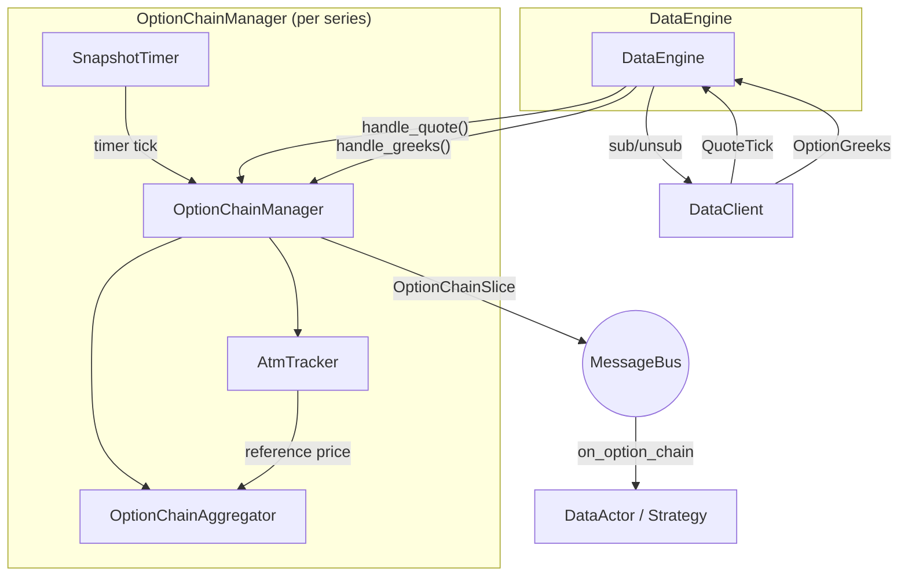

# 期权 {#options}

Nautilus 支持传统市场与加密市场的期权交易，提供期权专属的工具类型、场所提供的
Greeks 数据流、期权链聚合，以及用于风险管理的本地 Black-Scholes Greeks 计算器。

## 期权工具类型 {#option-instrument-types}

平台定义了若干期权工具类型：

| 工具           | 说明                                                                  |
| -------------------- | ---------------------------------------------------------------------------- |
| `OptionContract`     | 交易所上市的期权，有标的、行权价与到期日。              |
| `OptionSpread`       | 交易所定义的多腿期权策略，作为单一合约挂牌。                      |
| `CryptoOption`       | 加密期权，报价/结算为加密货币，可为反向或 quanto 风格。    |
| `CryptoOptionSpread` | 加密期权价差，支持反向、结算币种与小数数量。 |
| `BinaryOption`       | 固定赔付期权，结算为 0 或 1。                                  |

与 Greeks 相关的元数据因工具类型而异：

- `OptionContract`、`CryptoOption`：完整的 Greeks 输入，包括 `strike_price`、
  `option_kind`（CALL/PUT）、`expiration_ns`、`underlying`、`multiplier`。
- `OptionSpread`、`CryptoOptionSpread`：交易所定义的多腿策略，作为单一可交易工具发布。
  有 `underlying`、`expiration_ns` 和 `strategy_type`（场所定义的组合代码）。
  价差本身没有 `strike_price` 或 `option_kind`。适配器提供腿细节时存入 `info`。
  订单按单一合约对价差执行。`CryptoOptionSpread` 还额外携带 `is_inverse` 和
  `settlement_currency`，用于 Deribit 这类场所。
- `BinaryOption`：有 `expiration_ns` 和 `outcome`/`description`，
  没有 `strike_price`、`option_kind` 或 `underlying`。

## 期权标识 {#option-identifiers}

### 系列引用 {#series-references}

`OptionSeriesId` 的相等性、哈希与排序都包含参考价的 `InstrumentId`。
Python 构造函数把可选的末位参数默认设为 `<UNDERLYING>.<VENUE>`。

```python
from nautilus_trader.model import InstrumentId
from nautilus_trader.model import OptionSeriesId

series_id = OptionSeriesId.from_expiry(
    "DERIBIT", "BTC", "USDC", "2026-03-20", InstrumentId.from_str("BTCUSDT.BINANCE")
)
```

序列化形式：

- **派生引用**：`VENUE:UNDERLYING:SETTLEMENT:EXPIRY`。
- **其他引用**：`VENUE:UNDERLYING:UNDERLYING_INSTRUMENT_ID:SETTLEMENT:EXPIRY`。

两种形式都能经 `from_str` 往返，包括引用符号中的冒号与纳秒精度的到期时间。
使用其他引用前，先更新按四字段解析的读取方。Python 值、消息总线主题与处理器 ID
的显示保留到期时间的秒小数位。

| Rust API                        | 引用                                      |
| ------------------------------- | ---------------------------------------------- |
| `new`、`from_crypto_option`     | 必需的 `InstrumentId`。                       |
| `new_derived`                   | 派生引用，四个参数。                  |
| `from_expiry`、`from_expiry_ns` | 末位 `Option<InstrumentId>`（`None` 表示派生）。 |

Rust 结构体字面量要求提供 `underlying_instrument_id`。派生会拒绝空的或纯空白的标的。

本地期权链发现与 ATM 引导要求派生引用。本地引擎拒绝其他引用，也不会订阅引用工具。
发往外部客户端的命令照常转发。

### 计算合约 ID {#computed-contract-ids}

Rust 的 `compute_option_instrument_id` 组合 `OptionContractSpec` 与
`OptionSymbologyScheme`。合约实际的标的与系列的参考价引用相互独立。

**CME Globex** 接受 `ESH6` 这类期货代码而非 `ES`：

- **根代码**：ES、NQ、RTY、MES、MNQ、SR3 SOFR，以及按常规工作日日程的 CL WTI 周度合约。
- **到期**：期货月与季月到期月重合时，股指季月合约优先。月末（EOM）合约使用最后一个工作日。
- **数字**：年份后缀遵循标的的一位或两位数字约定。行权价对股指用整数点，
  对 SOFR 与 WTI 用百分位。

**Options Symbology Initiative（OSI）** 默认使用标的符号，可覆盖根代码，
行权价为八位数字、精确到千分位。

不支持的根代码、到期日、行权价精度会返回类型化错误，包括名义 WTI 月度日期，
以及 2026 年 6 月 29 日及之后的 Micro E-mini（MES、MNQ）到期。

:::info
候选 ID 要对照实际挂牌的工具定义与节假日调整后的到期日进行验证。
:::

## 期权筛选类型 {#option-selection-types}

`OptionSideFilter` 选择看涨、看跌、两者，或虚值两翼，在 ATM 处可包含两侧。
Rust 的 `StrikeSearchProfile` 在构造与反序列化时校验：

- 增量非空、为正、互不重复，按调用方偏好排序。
- 网格原点非负。
- 候选上限为正。

期权链订阅 API 不接受这两种类型。

## 订阅 Greeks {#subscribing-to-greeks}

Deribit、Bybit、OKX 等场所会随期权市场发布实时 Greeks。
Nautilus 提供两个订阅层级：

- **按工具 Greeks**：订阅单个期权合约。
- **期权链切片**：订阅整个期权系列的聚合视图。

### 按工具 Greeks {#per-instrument-greeks}

在 actor 或策略中订阅单个期权合约的场所 Greeks：

```python
from nautilus_trader.model import ClientId

client_id = ClientId("DERIBIT")
self.subscribe_option_greeks(instrument_id, client_id=client_id)
```

实现 `on_option_greeks` 处理器接收更新：

```python
def on_option_greeks(self, greeks) -> None:
    self.log.info(
        f"{greeks.instrument_id}: "
        f"delta={greeks.delta:.4f} gamma={greeks.gamma:.6f} "
        f"vega={greeks.vega:.4f} theta={greeks.theta:.4f} "
        f"mark_iv={greeks.mark_iv} underlying={greeks.underlying_price}"
    )
```

停止接收更新：

```python
self.unsubscribe_option_greeks(instrument_id, client_id=client_id)
```

### 期权链订阅 {#option-chain-subscriptions}

期权链订阅把一个期权系列中所有行权价的报价与 Greeks 聚合为
`OptionChainSlice` 快照。`DataEngine` 为每个系列创建一个 Rust
`OptionChainManager` 并拥有其生命周期：创建管理器、路由进入的数据、
运行快照定时器、排空底层订阅变更。

```python
from nautilus_trader.model import OptionSeriesId
from nautilus_trader.model import StrikeRange

series_id = OptionSeriesId(...)  # venue, underlying, settlement currency, expiry

# Subscribe to 5 strikes above and below ATM, snapshot every 1000ms
strike_range = StrikeRange.atm_relative(strikes_above=5, strikes_below=5)
self.subscribe_option_chain(
    series_id,
    strike_range=strike_range,
    snapshot_interval_ms=1000,
)
```

实现 `on_option_chain` 处理器接收快照：

```python
def on_option_chain(self, chain) -> None:
    for strike in chain.strikes():
        call = chain.get_call(strike)
        put = chain.get_put(strike)
        if call and call.greeks:
            self.log.info(f"Call {strike}: delta={call.greeks.delta:.4f}")
```

### 行权价范围过滤 {#strike-range-filtering}

`StrikeRange` 控制链订阅中哪些行权价处于活动状态：

| 变体       | 说明                                         | 示例                          |
| ------------- | --------------------------------------------------- | -------------------------------- |
| `Fixed`       | 订阅显式指定的行权价集合。            | `StrikeRange.fixed([...])`       |
| `AtmRelative` | 当前 ATM 行权价上下各 N 个行权价。 | `StrikeRange.atm_relative(5, 5)` |
| `AtmPercent`  | ATM 附近百分比区间内的全部行权价。    | `StrikeRange.atm_percent(0.10)`  |
| `Delta`       | 看涨或看跌 delta 接近目标值的行权价。   | `StrikeRange.delta(0.25, 0.05)`  |

动态行权价范围的订阅**会推迟到 ATM 价格确定之后**。ATM 取自
`OptionGreeks.underlying_price` 中的场所参考价，也可以用通过 HTTP 为该期权系列
获取的参考价预先播种，从而在实时 WebSocket tick 到达前立即完成引导。
ATM 移动时，活动行权价集合自动重新平衡。

`Delta` 由场所提供的 Greeks 解析：某行权价的看涨或看跌 delta 的绝对值
（看涨为正、看跌为负，按绝对值比较）落在 `target` 的 `tolerance`
容差内即激活。典型的虚值目标如 `0.25`，会在 ATM 两侧各选出一个行权价。

引导与回退取决于可用数据：

- **ATM 未知前**：`Delta` 与其他动态范围一样处于推迟状态。
- **ATM 已知后**：当没有活动行权价的 Greeks 命中区间（包括任何 Greeks
  到达之前），`Delta` 回退为 ATM 相对窗口，窗口含 ATM 两侧各五个行权价。
- **切换到选定 delta 行权价之前**：聚合器等每个回退腿都有 Greeks 后才切换，
  避免零散的早期更新丢掉邻近行权价。

### 快照模式与原始模式 {#snapshot-vs-raw-mode}

`snapshot_interval_ms` 参数控制发布行为：

- **快照模式**（`snapshot_interval_ms=1000`）：报价与 Greeks 累积在缓冲区，
  按定时器作为 `OptionChainSlice` 发布。适合周期性组合再平衡或 UI 展示。
- **原始模式**（`snapshot_interval_ms=None`）：活动工具的每次报价或 Greeks
  更新立即发布一个切片。适合对单个更新作出反应的延迟敏感策略。

引擎拒绝 `snapshot_interval_ms=0`，原始模式请使用 `None`。

## 期权链回测 {#backtesting-option-chains}

期权链回测使用与实时订阅相同的 `OptionChainManager` 和
`OptionChainAggregator` 路径。前提是一个 Nautilus Parquet 数据目录，其中已包含
期权工具以及链所需的逐工具数据：

- 每个期权合约的 `QuoteTick` 记录，携带重放的最优买卖价。
- 每个期权合约的 `OptionGreeks` 记录，携带 delta、隐含波动率、
  convention，以及用于 ATM 播种的 `underlying_price`。
- 与上述工具 ID 对应的 `CryptoOption` 或 `OptionContract` 工具。

Tardis 重放满足这一约定：期权簿快照或报价写为 `QuoteTick`，
`option_summary` 消息写为 `OptionGreeks`。回测运行期间不会下载或请求缺失的目录数据。

为 `BacktestNode` 同时配置该系列期权工具的两路数据：

```python
data = [
    BacktestDataConfig(
        data_type=NautilusDataType.QuoteTick,
        catalog_path="/path/to/catalog",
        instrument_ids=option_instrument_ids,
    ),
    BacktestDataConfig(
        data_type=NautilusDataType.OptionGreeks,
        catalog_path="/path/to/catalog",
        instrument_ids=option_instrument_ids,
    ),
]
```

然后在策略中订阅：

```python
strike_range = StrikeRange.delta(0.25, 0.05)
self.subscribe_option_chain(
    series_id,
    strike_range=strike_range,
    snapshot_interval_ms=1000,
)
```

原始模式用 `snapshot_interval_ms=None`，活动工具的每次报价或 Greeks
更新后发布一个切片。整数间隔则是抽稀快照：按工具累积最新 BBO 与 Greeks，
按定时器节奏发布整条链，降低大链的事件量。

每个 `OptionChainSlice` 按工具连接最新的 BBO 与 Greeks，再按行权价与期权种类分组。
报价可能先到、Greeks 后到，反之亦然；聚合器保留最新状态，两者都有时一并附上。
`OptionGreeks` 中的 `underlying_price` 驱动 ATM 检测。

筛选可以放在订阅范围里，也可以放在策略内：

- 按虚实程度：`StrikeRange.atm_relative(...)` 或 `StrikeRange.atm_percent(...)`。
- 按 delta：`StrikeRange.delta(target, tolerance)`，或在 `on_option_chain`
  中检查 `entry.greeks.delta`。
- 按行权价：`StrikeRange.fixed([...])`，或读取 `chain.get_call(strike)` 与
  `chain.get_put(strike)`。

期权的撮合由报价驱动。市价单和可成交限价单作为吃单方，对着重放的对方 BBO 成交。
被动限价单挂在模拟簿上，当后续 BBO 更新穿越限价时可作为挂单方成交。
该模型不模拟期权的 L2 队列位置。

期权结构性费用模型在模拟场所上配置，而不是从场所名推断：

```python
from decimal import Decimal

from nautilus_trader.execution import CappedOptionFeeModel
from nautilus_trader.execution import TieredNotionalOptionFeeModel

deribit_like = CappedOptionFeeModel(
    maker_rate=Decimal("0.0003"),
    taker_rate=Decimal("0.0003"),
)
okx_like = TieredNotionalOptionFeeModel(
    maker_rate=Decimal("0.0002"),
    taker_rate=Decimal("0.0005"),
)
```

把其中之一作为 `fee_model` 传给 `BacktestVenueConfig`。Rust 侧对应
`FeeModelAny::CappedOption(CappedOptionFeeModel::new(...))` 与
`FeeModelAny::TieredNotionalOption(TieredNotionalOptionFeeModel::new(...))`。

参见 `examples/backtest/tardis_option_chain.py` 和
`crates/backtest/examples/` 中的 Rust `tardis-option-chain` 示例。

## 期权链架构 {#option-chain-architecture}

期权链系统是事件驱动的，按系列隔离。`DataEngine` 为每个订阅的期权系列
创建一个 Rust `OptionChainManager`。管理器封装
`OptionChainAggregator` 与 `AtmTracker`，注册消息总线处理器，发布快照，
并把底层订阅变更排队交给引擎排空。



### 组件职责 {#component-responsibilities}

#### DataEngine {#dataengine}

为每个活动的 `OptionSeriesId` 持有一个 `OptionChainManager`：

- **订阅**：收到 `SubscribeOptionChain` 时，从缓存解析工具，为动态行权价范围
  请求系列参考价；创建管理器，向数据客户端订阅活动工具，并设置快照定时器。
- **定时器 tick**：管理器检查是否需要重新平衡，发布快照，并把底层订阅变更
  排队交给引擎排空。
- **拆除**：`UnsubscribeOptionChain` 或全部工具到期时，拆除管理器、取消定时器、
  退订底层数据流。

#### OptionChainManager {#optionchainmanager}

围绕 `OptionChainAggregator` 与 `AtmTracker` 的系列级 Rust 管理器。
`DataEngine` 通过 `handle_quote()` 和 `handle_greeks()` 向其输送行情。
管理器在首个 ATM 价格出现时内部完成活动工具集合的引导。

- **快照模式**：定时器回调调用 `publish_slice()`。
- **原始模式**：每次活动报价或 Greeks 更新立即调用 `publish_slice()`。

#### OptionChainAggregator {#optionchainaggregator}

以**保留最新值**的语义把报价与 Greeks 累积进看涨/看跌缓冲区。
自上次快照以来没有更新的工具仍会被包含。

先于任何报价到达的 Greeks 存放在 `pending_greeks` 缓冲区，首个报价到达时附上。
每次 `snapshot()` 调用，聚合器产出一个不可变的 `OptionChainSlice`。

#### AtmTracker {#atmtracker}

从进入的 `OptionGreeks` 事件的 `underlying_price` 字段反应式地推导 ATM 价格。
也可以从期权系列的 HTTP 参考价预先播种，从而不必等待 WebSocket tick，即时完成引导。

### 引导与再平衡 {#bootstrap-and-rebalancing}

动态行权价范围（`AtmRelative`、`AtmPercent`、`Delta`）在活动工具集合
要等 ATM 价格已知才能确定。有两条引导路径：

**即时引导（参考价可用）**：

1. `DataEngine` 收到 `SubscribeOptionChain`，从缓存解析该系列的全部工具，
   并向数据客户端请求参考价。
2. 参考价响应到达后，引擎以预播种的 ATM 价格创建管理器。
   管理器在构造期间算出活动行权价集合。
3. 引擎立即订阅活动工具。

**延迟引导（无参考价）**：

1. 引擎没有匹配的客户端或缓存的期权工具，或客户端报告没有参考价；
   请求也可能失败或在 30 秒后超时。
2. 引擎以无初始 ATM 价格创建管理器，活动集合为空。若请求到达了持有缓存
   样本期权的客户端，引擎会订阅该样本的 Greeks 作为引导源。
   没有客户端或样本时，引导仍依赖其他订阅已在流转的相关 Greeks 数据。
1. 当引擎通过 `handle_greeks()` 送入带 `underlying_price` 的
   `OptionGreeks` 事件时，管理器完成活动工具集合的引导：注册消息总线处理器，
   把新的底层订阅排队交给引擎排空。样本订阅并入活动集合或被释放。

引导完成后，聚合器持续监测 ATM 漂移。每个快照定时器 tick 上，管理器调用
聚合器的 `check_rebalance()`，返回需要增删的工具。
迟滞阈值与冷却期可避免行权价边界附近的反复抖动。

## OptionGreeks 数据类型 {#optiongreeks-data-type}

`OptionGreeks` 携带场所提供的单个期权合约的敏感度与隐含波动率：

| 字段              | 类型               | 说明                                         |
| ------------------ | ------------------ | --------------------------------------------------- |
| `instrument_id`    | `InstrumentId`     | 这组 Greeks 所属的期权合约。          |
| `convention`       | `GreeksConvention` | Greeks 的计价基准（numeraire）约定。                |
| `delta`            | `float`            | 标的每变动一单位期权价格的变化率。 |
| `gamma`            | `float`            | 标的每变动一单位 delta 的变化率。        |
| `vega`             | `float`            | 场所报告的 vega。                                |
| `theta`            | `float`            | 场所报告的 theta。                               |
| `rho`              | `float`            | 场所报告的 rho，默认为零。       |
| `mark_iv`          | `float` 或 None    | mark 隐含波动率。                            |
| `bid_iv`           | `float` 或 None    | 买价隐含波动率。                             |
| `ask_iv`           | `float` 或 None    | 卖价隐含波动率。                             |
| `underlying_price` | `float` 或 None    | 计算时的标的价格。            |
| `open_interest`    | `float` 或 None    | 该合约的未平仓合约量。                     |
| `ts_event`         | `int`              | 事件时间戳（UNIX 纳秒）。          |
| `ts_init`          | `int`              | 初始化时间戳（UNIX 纳秒）。      |

## OptionChainSlice 数据类型 {#optionchainslice-data-type}

`OptionChainSlice` 是整个期权系列的时点快照。

属性：

| 属性     | 类型             | 说明                         |
| ------------ | ---------------- | ----------------------------------- |
| `series_id`  | `OptionSeriesId` | 期权系列标识。       |
| `atm_strike` | `Price` 或 None  | 当前 ATM 行权价（若已确定）。 |
| `ts_event`   | `int`            | UNIX 时间戳（纳秒）。       |
| `ts_init`    | `int`            | UNIX 时间戳（纳秒）。       |

看涨与看跌数据通过方法访问，不是直接属性。
这些方法返回的每个 `OptionStrikeData` 包含该行的 `quote`（`QuoteTick`）
和可选的 `greeks`（`OptionGreeks`）。

方法：

- `strikes()`：链中全部唯一行权价。
- `strike_count()`、`call_count()`、`put_count()`：计数。
- `get_call(strike)`、`get_put(strike)`：完整的 `OptionStrikeData`。
- `get_call_greeks(strike)`、`get_put_greeks(strike)`：仅 Greeks。
- `get_call_quote(strike)`、`get_put_quote(strike)`：仅报价。
- `is_empty()`：链无数据时为 true。

## 适配器支持 {#adapter-support}

以下适配器支持期权 Greeks 订阅：

| 适配器             | 按工具 Greeks | 期权链 |
| ------------------- | --------------------- | ------------- |
| Deribit             | 支持                   | 支持           |
| Bybit               | 支持                   | 支持           |
| Derive              | 支持                   | 支持           |
| Interactive Brokers | 支持                   | 支持           |
| OKX                 | 支持                   | 支持           |

## 另见 {#see-also}

- [Greeks](./greeks.md) - 本地 Greeks 计算与组合风险管理。
- [数据](./data/index.md) - 内置数据类型与订阅模型。
- [Actors](./actors.md) - 订阅与处理器对照表。
