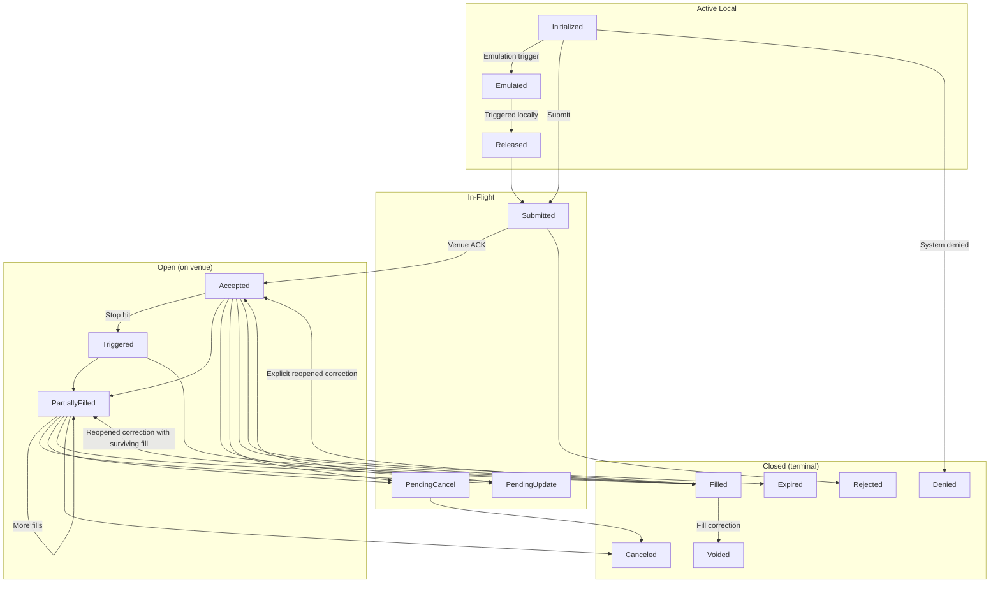

# 订单

NautilusTrader 为跨交易场所的订单类型、执行指令和或有关系提供统一的模型。

## 概述 {#overview}

所有订单类型都源自两种基本类型：*Market*（市价）和 *Limit*（限价）订单。*Market* 订单寻求以当前最优价格立即成交。非立即成交的 *Limit* 订单以指定价格挂在订单簿中等待撮合，而立即成交的 *Limit* 订单可以吃掉流动性。

NautilusTrader 支持九种订单类型（`OrderType` 枚举值），在[订单类型](#order-types)一节汇总列出，每种都有专门指南。

:::info
NautilusTrader 提供统一 API，但订单和指令的支持程度因交易场所和适配器而异。适配器可能在提交前拒绝不支持的请求，交易场所也可能拒单。依赖某个选项前，先确认目标集成的能力。
:::

### 术语 {#terminology}

- **激进（Aggressive）**：类型为 `MARKET` 的订单，或以立即成交方式执行、吃掉流动性的订单。
- **被动（Passive）**：挂单而不吃掉流动性的订单。
- **活动本地（Active local）**：停留在本地系统边界内、处于以下某个非终态状态的订单：
  - `INITIALIZED`
  - `EMULATED`
  - `RELEASED`
- **在途（In-flight）**：处于以下某个状态的订单：
  - `SUBMITTED`
  - `PENDING_UPDATE`
  - `PENDING_CANCEL`
- **活动（Open）**：处于以下某个非终态状态的订单：
  - `ACCEPTED`
  - `TRIGGERED`
  - `PENDING_UPDATE`
  - `PENDING_CANCEL`
  - `PARTIALLY_FILLED`
- **关闭（Closed）**：处于以下某个终态状态的订单：
  - `DENIED`
  - `REJECTED`
  - `CANCELED`
  - `EXPIRED`
  - `FILLED`
  - `VOIDED`

**分组重叠**：open 和 closed 并非互斥对立。

- `PENDING_UPDATE` 和 `PENDING_CANCEL` 既是 open 也是在途：订单仍在交易场所工作，同时有一个修改或取消请求挂起。
- 有四种状态既不是 open 也不是 closed：`INITIALIZED`、`EMULATED` 和 `RELEASED` 属于活动本地，`SUBMITTED` 在交易场所确认订单前属于在途。

:::warning[open 与 closed 不互补]
判断订单是否已结束要用 `is_closed`，绝不能用 `is_open` 取反。处于上述四种状态之一的订单既不是 open，也没有结束。每个订单提交后立即处于 `SUBMITTED`，因此把"非 open"当作完成的代码，会丢弃交易场所仍在处理的订单。等待交易场所的场景请用 `is_inflight`。
:::

### 订单状态流转 {#order-state-flow}

**主要状态转换**：下图展示订单生命周期和主要状态转换。每个状态只出现一次，因此 `PENDING_UPDATE`
和 `PENDING_CANCEL` 画在 In-Flight 分组下，尽管它们也属于 open。

该图展示主要转换，而订单模型会校验面向恢复和交易场所边缘情形的完整状态转换集。订单状态描述的是
本地状态，而非产生该状态的证据。命令结果类别、事件来源、投递限制和对账策略见
[执行策略](./../execution/policies.md)。

**到期后的成交**：成交仍会更新订单和持仓。

- 部分成交使订单停留在 `EXPIRED`。
- 使成交数量达到全部的成交将其改为 `FILLED`。

若成交在最近一次到期之后到达，且订单仍为 `EXPIRED` 或 `FILLED`，Nautilus 会记录下一条
`OrderExpired`。该事件不改变订单的状态和时间戳。事件会保留在订单历史中，执行引擎将其发布给
策略处理器。在下一次成交到达之前，更多的到期事件会被拒绝。

### 订单状态定义 {#order-status-definitions}

| 状态               | 说明                                                                                     |
| ------------------ | ---------------------------------------------------------------------------------------------- |
| `INITIALIZED`      | 订单在 Nautilus 系统内实例化。                                                                 |
| `DENIED`           | 订单因无效、无法处理或超出风险限额被 Nautilus 拒绝。                                           |
| `EMULATED`         | 订单正由 `OrderEmulator` 组件仿真。                                                            |
| `RELEASED`         | 订单已从 `OrderEmulator` 组件释放。                                                            |
| `SUBMITTED`        | 订单已提交到交易场所（等待确认）。                                                             |
| `ACCEPTED`         | 交易场所确认已收到且订单有效（可能已开始工作）。                                               |
| `REJECTED`         | 订单以拒单终态结束。`reconciliation` 和 `reason` 提供可得的来源信息。                          |
| `CANCELED`         | 订单以取消终态结束。仅凭状态无法区分是交易场所、本地还是策略导致的取消。                       |
| `EXPIRED`          | 订单到达 GTD 到期时间（终态）。                                                                |
| `TRIGGERED`        | 止损限价、跟踪止损限价或触价限价订单在交易场所被触发。                                         |
| `PENDING_UPDATE`   | 订单有一个提交到交易场所的修改请求挂起。                                                       |
| `PENDING_CANCEL`   | 订单有一个提交到交易场所的取消请求挂起。                                                       |
| `PARTIALLY_FILLED` | 订单在交易场所已部分成交。                                                                     |
| `FILLED`           | 订单已全部成交（终态）。                                                                       |
| `VOIDED`           | 订单在权威成交更正后进入终态。                                                                 |

## 执行指令 {#execution-instructions}

执行指令规定交易场所处理订单的条件和限制。支持程度因交易场所和适配器而异。

### 有效期 {#time-in-force}

有效期规定订单在多长时间内保持活动，未成交部分随后被取消。

- **`GTC`（Good Till Cancel，撤单前有效）**：订单保持活动，直到交易者或交易场所撤单。
- **`IOC`（Immediate or Cancel / Fill and Kill，立即成交否则取消）**：订单立即执行，未成交部分取消。
- **`FOK`（Fill or Kill，全部成交否则取消）**：订单要么全部立即成交，要么完全不成交。
- **`GTD`（Good Till Date，到指定日期前有效）**：订单保持活动，直到指定的到期日期和时间。
- **`DAY`（Good for session/day，当日有效）**：订单保持活动，直到当前交易时段结束。
- **`AT_THE_OPEN`（OPG）**：订单仅在交易时段开盘时活动。
- **`AT_THE_CLOSE`**：订单仅在交易时段收盘时活动。

### 到期时间 {#expire-time}

配合 `GTD` 使用 `expire_time` 指定订单何时到期，并离开交易场所的订单簿或订单管理系统。

### 只做 Maker {#post-only}

标记为 `post_only` 的订单只能提供流动性，不能吃掉流动性。若订单会立即成交，交易场所通常会拒绝或
取消它。做市商可用此指令来获取 maker 费率。

### 只减仓 {#reduce-only}

标记为 `reduce_only` 的订单只能减少现有持仓，不能在空仓时开仓或增加敞口。具体行为因交易场所而异。

**模拟的只减仓行为**：Nautilus 的 `SimulatedExchange` 应用以下规则。

- 相关持仓变平时取消订单。
- 相关持仓缩小时同步减少订单数量。

### 显示数量 {#display-quantity}

`display_qty` 指定订单在限价订单簿上可见的数量。显示数量小于总数量的订单通常称为冰山订单。
显示数量为 0 时，在交易场所支持的情况下订单隐藏。

### 触发类型 {#trigger-type}

触发类型，也称
[触发方法](https://www.interactivebrokers.com/en/software/tws/usersguidebook/configuretws/Modify%20the%20Stop%20Trigger%20Method.htm)，
规定用于触发条件订单的市场价格。

未设置触发类型用 `None` 表示，它对需要触发类型的订单无效。

- **`DEFAULT`**：使用交易场所的默认触发类型。
- **`LAST_PRICE`**：使用最新成交价。
- **`BID_ASK`**：BUY 订单用卖价，SELL 订单用买价。
- **`DOUBLE_LAST`**：要求连续两次匹配的最新成交价。
- **`DOUBLE_BID_ASK`**：根据订单方向，要求连续两次匹配的买价或卖价。
- **`LAST_OR_BID_ASK`**：使用最新价或方向对应的买价/卖价。
- **`MID_POINT`**：使用买价与卖价的中点。
- **`MARK_PRICE`**：使用交易场所对该工具的标记价格。
- **`INDEX_PRICE`**：使用交易场所对该工具的指数价格。

### 跟踪偏移类型 {#trailing-offset-type}

跟踪偏移类型规定跟踪订单如何根据适用市场价格计算触发偏移。

未设置跟踪偏移类型用 `None` 表示，它对跟踪订单无效。

- **`PRICE`**：使用价差。
- **`BASIS_POINTS`**：以基点计的百分比差，100 个基点等于 1%。
- **`TICKS`**：使用 tick 数。
- **`PRICE_TIER`**：使用交易场所特定的价格档。

### 或有订单 {#contingent-orders}

或有关系可以让子订单在父订单激活或成交前保持挂起、取消关联订单，或减少其数量。可用模型及其约束见
[高级订单](./advanced.md)。

## 订单工厂 {#order-factory}

使用内置的 `OrderFactory` 创建订单。每个 Python `Strategy` 通过 `self.order_factory` 暴露一个工厂，
Rust 策略 API 通过 `self.order()` 暴露它。

工厂会设置交易者和策略 ID，并在需要时生成客户端订单 ID 和初始化 ID。它记录初始时间戳，并为所选
订单类型应用默认值。

本指南中的示例都在 `Strategy` 上下文中创建订单。

更多细节见
[`OrderFactory` API 参考](https://nautilustrader.io/docs/python-api-latest/common.html#nautilus_trader.common.OrderFactory)。

## 订单类型 {#order-types}

NautilusTrader 支持以下订单类型。每种都链接到带代码示例的专门指南。可选参数用注释标出默认值。

| 订单类型                                            | 类别               | 说明                                                                        |
| ------------------------------------------------- | -------------------- | --------------------------------------------------------------------------- |
| [`MARKET`](./market.md)                             | 激进                 | 以当前最优价格立即交易指定数量。                                            |
| [`LIMIT`](./limit.md)                               | 被动                 | 挂在订单簿中，仅以限价或更优价格成交。                                      |
| [`STOP_MARKET`](./stop_market.md)                   | 条件                 | 触发价被击中后，发出 *Market* 订单。                                        |
| [`STOP_LIMIT`](./stop_limit.md)                     | 条件                 | 触发价被击中后，以设定价格发出 *Limit* 订单。                               |
| [`MARKET_TO_LIMIT`](./market_to_limit.md)           | 混合                 | 以 *Market* 提交，剩余部分以成交价作为限价挂出为 *Limit*。                  |
| [`MARKET_IF_TOUCHED`](./market_if_touched.md)       | 条件                 | 触发价被触及后，发出 *Market* 订单。                                        |
| [`LIMIT_IF_TOUCHED`](./limit_if_touched.md)         | 条件                 | 触发价被触及后，以设定价格发出 *Limit* 订单。                               |
| [`TRAILING_STOP_MARKET`](./trailing_stop_market.md) | 条件跟踪           | 按偏移跟踪触发价，随后发出 *Market* 订单。                                  |
| [`TRAILING_STOP_LIMIT`](./trailing_stop_limit.md)   | 条件跟踪           | 按偏移跟踪触发价，随后发出 *Limit* 订单。                                   |

### FIX OrdType 映射 {#fix-ordtype-mapping}

**FIX 映射**：每种类型映射到最接近的 FIX 5.0 SP2
[`OrdType <40>`](https://www.onixs.biz/fix-dictionary/5.0.sp2/tagnum_40.html) 值（协议有定义时）。

| 订单类型             | FIX `OrdType <40>`               |
| -------------------- | ------------------------------------ |
| Market               | `1` (Market)                         |
| Limit                | `2` (Limit)                          |
| Stop-Market          | `3` (Stop)                           |
| Stop-Limit           | `4` (Stop Limit)                     |
| Market-To-Limit      | `K` (Market With Left Over as Limit) |
| Market-If-Touched    | `J` (Market If Touched)              |
| Limit-If-Touched     | 无专用值 †                           |
| Trailing-Stop-Market | `3` (Stop) + 跟踪挂钩                |
| Trailing-Stop-Limit  | `4` (Stop Limit) + 跟踪挂钩          |

† FIX 未为 *Limit-If-Touched* 定义专用 `OrdType`，通常以 `4`（Stop Limit）加有利触发价发送。
跟踪止损同样没有专用值，建模为 `3`/`4` 加跟踪挂钩字段。

## 高级订单 {#advanced-orders}

订单可以分组成列表，并用或有关系（OTO、OCO、OUO）关联；括号订单则在入场订单上挂载止盈和止损子订单。
订单列表、或有类型、校验规则和括号订单见
[高级订单](./advanced.md)指南。

## 仿真订单 {#emulated-orders}

对于交易场所不原生支持的订单类型，NautilusTrader 可以在本地用仅 `MARKET` 和 `LIMIT` 的实际执行来仿真。
仿真生命周期、支持类型、查询方式和最佳实践见[仿真订单](./emulated.md)指南。

## 相关指南 {#related-guides}

- [事件](./../events/index.md) - 订单事件、持仓事件与处理器分发。
- [执行](./../execution/index.md) - 订单执行与成交处理。
- [持仓](./../positions.md) - 由订单成交创建的持仓。
- [策略](./../strategies.md) - 从策略管理订单。
