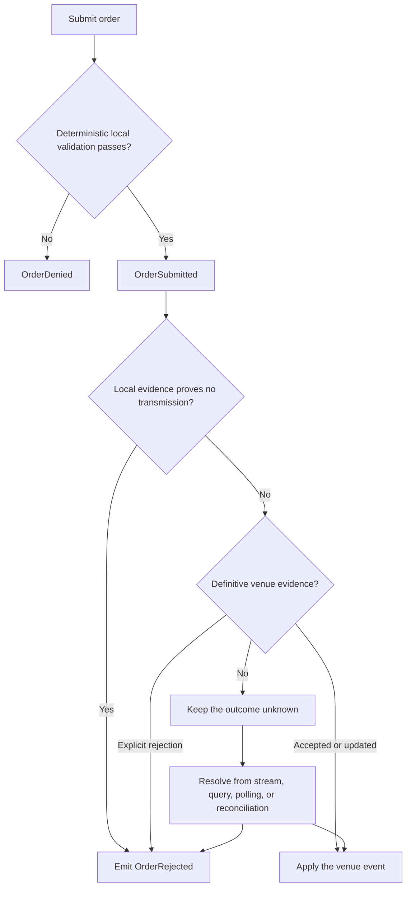
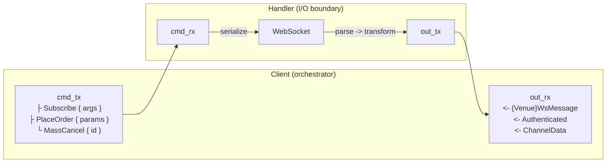

# 适配器

## 简介 {#introduction}

构建或扩展 NautilusTrader 的 Rust 原生适配器时以本指南为准。适配器负责把平台接入交易场所和数据服务商，
保留交易场所语义，产出合法的 Nautilus 领域事件，并把不确定的结果显式呈现。它们用 Rust 实现平台的数据与
执行客户端 trait，再通过 PyO3 向 Python 暴露配置、工厂和部分底层 API。

:::note
用 Python 或独立 Rust/PyO3 包实现的树外（out-of-tree）适配器请使用
[Python 适配器接口](./python_adapters.md)。本指南只覆盖树内 Rust 适配器。
:::

参考适配器要有选择地借鉴。它们的目录结构反映的是各自的交易场所协议、产品线与实现历史。

| 适配器 | 可借鉴之处 |
| ------------------ | ------------------------------------------------------------------------------------------------------ |
| [Bybit][bybit] | 多产品 HTTP 与 WebSocket 客户端、期权数据、执行结果处理。 |
| [OKX][okx] | 公共、私有、业务三类 WebSocket 端点，金融工具覆盖广泛。 |
| [Binance][binance] | 现货与合约的产品拆分、交易 WebSocket、SBE 行情。 |
| [Kraken][kraken] | 现货与合约子模块，各自的 HTTP、WebSocket、数据、执行路径互不相同。 |
| [Lighter][lighter] | Layer-2 签名、规范化基准测试、覆盖率引导的模糊测试、精细的执行状态处理。 |
| [Derive][derive] | JSON-RPC 数据与执行、EIP-712 签名、规范化基准测试、基于不变量的模糊测试。 |

本指南区分四类指导：

- **共享规则**：来自公共 trait、网络抽象、钩子或 CI，必须遵守。
- **常见模式**：多个适配器都这么做，但允许其他设计。
- **示例**：展示一种合理实现，不构成强制。
- **例外**：交易场所语义或协议边界确实需要时才成立。

## 合规 {#conformance}

适配器满足下面每条适用于它的规则，或对例外情况写下说明，即为合规。说明要写清是哪种交易场所行为迫使例外
成立。例外限定在适配器内部，并配一个测试：若交易场所不再需要该例外，测试应失败。
[阶段 7](#phase-7-prove-conformance) 安排了证明合规的各项工作。

### 适配器基础 {#adapter-foundations}

| 规则 | 适用范围 |
| ------------------------------------------------------------------------------------------ | ------------------ |
| [仓库与 Python 接线](#repository-and-python-wiring) | 新适配器 crate |
| [凭证与密钥处理](#credentials-and-secret-handling) | 每个适配器 |
| [配置](#configurations-configrs) | 每个适配器 |
| [符号与金融工具标识](#symbols-and-instrument-identity) | 每个适配器 |
| [交易场所报文建模与精度](#modeling-venue-payloads) | 每个适配器 |
| [客户端 trait 与工厂](#client-traits-and-factories-datars-executionrs-factoriesrs) | 每个适配器 |

### 运行时与客户端生命周期 {#runtime-and-client-lifecycle}

| 规则 | 适用范围 |
| ----------------------------------------------------- | -------------------------- |
| [连接生命周期](#connection-lifecycle-connect) | 数据客户端与执行客户端 |
| [数据事件与请求时效](#data-client) | 数据客户端 |
| [背压](#backpressure) | 每个适配器 |
| [任务管理](#task-management) | 每个适配器 |
| [确定性模拟](#deterministic-simulation) | 受维护的适配器 |

### 执行与对账 {#execution-and-reconciliation}

| 规则 | 适用范围 |
| --------------------------------------------------------------------------------------------- | ----------------- |
| [执行客户端边界](#execution-client) | 执行客户端 |
| [对账报告](#reconciliation-reports) | 执行客户端 |
| [手续费失败处理](#commission-failure-handling) | 执行客户端 |
| [有界的全量状态报告](#bounded-mass-status-reports) | 执行客户端 |
| [对账期间的金融工具解析](#instrument-resolution-during-reconciliation) | 执行客户端 |
| [被跟踪与外部执行更新](#tracked-and-external-execution-updates) | 执行客户端 |
| [事件排序与去重](#event-ordering-and-deduplication) | 执行客户端 |
| [订单命令结果策略](#order-command-outcome-policy) | 执行客户端 |
| [证据类别命名](#naming-the-evidence-classes) | 执行客户端 |
| [诊断信息与面向策略的原因](#separate-diagnostics-from-strategy-facing-reasons) | 执行客户端 |

### 传输与数据流 {#transport-and-streaming}

| 规则 | 适用范围 |
| ------------------------------------------------------------------------------- | -------------------------------- |
| [请求流程](#request-flow) | HTTP 客户端 |
| [请求签名与鉴权](#request-signing-and-authentication) | HTTP 与 WebSocket 请求路径 |
| [错误处理与重试逻辑](#error-handling-and-retry-logic) | HTTP 与 WebSocket 请求路径 |
| [限流](#rate-limiting) | HTTP 与 WebSocket 客户端 |
| [处理器初始化握手](#handler-initialization-handshake-setclient) | WebSocket 客户端 |
| [鉴权](#authentication) | WebSocket 客户端 |
| [订阅管理](#subscription-management) | WebSocket 客户端 |
| [消息路由](#message-routing) | WebSocket 客户端 |
| [重连与关闭](#reconnection-and-shutdown) | WebSocket 客户端 |

[数据测试规范](./spec_data_testing.md)与[执行测试规范](./spec_exec_testing.md)收录了针对真实交易场所证明
上述契约的场景。

### 共享基线 {#shared-baseline}

下列每一项都优先使用共享实现，然后自选满足其契约的状态结构。共享类型自带契约，且让各交易场所的行为可相互
比较；本地结构必须由自己的实现证明同一契约。

基线不适用于这两个执行客户端——它们实现了同一 trait 但并不通过交易场所 API 交易：

- [Sandbox](https://github.com/nautechsystems/nautilus_trader/blob/develop/crates/adapters/sandbox/src/execution.rs) 在本地模拟成交。
- [Blockchain](https://github.com/nautechsystems/nautilus_trader/blob/develop/crates/adapters/blockchain/src/execution/client.rs) 在 `defi` feature 之后执行链上操作。

确定性模拟对受维护的适配器是强制的。每个受维护的适配器必须满足
[适配器 DST 契约](./../concepts/dst.md#adapter-dst-contract)，或携带一份交易场所范围内的迁移记录追踪差距。
OKX 是参考实现。[确定性模拟](#deterministic-simulation) 定义了新适配器要用的接缝、门禁和标准。

| 目标 | 共享件 | 契约 |
| -------------------------- | ------------------------------------------------------------------------------------------------------ | ----------------------------------------------------------------------------- |
| 命令结果证据 | [`CommandFailure`](https://github.com/nautechsystems/nautilus_trader/blob/develop/crates/live/src/execution/failure.rs) | [证据类别命名](#naming-the-evidence-classes) |
| 订单标识与上下文 | [`OrderIdentity` 和 `OrderContext`](https://github.com/nautechsystems/nautilus_trader/blob/develop/crates/live/src/execution/context.rs) | [被跟踪与外部执行更新](#tracked-and-external-execution-updates) |
| 重放去重 | [`FifoCache` 和 `FifoCacheMap`](https://github.com/nautechsystems/nautilus_trader/blob/develop/crates/common/src/cache/fifo.rs) | [事件排序与去重](#event-ordering-and-deduplication) |
| 订单拒绝原因 | [`OrderDeniedReason`](https://github.com/nautechsystems/nautilus_trader/blob/develop/crates/model/src/events/order/denied_reason.rs) | [诊断信息与面向策略的原因](#separate-diagnostics-from-strategy-facing-reasons) |
| 任务生命周期 | [`TaskGroup`](https://github.com/nautechsystems/nautilus_trader/blob/develop/crates/live/src/task.rs) 与 [`TaskHandles`](https://github.com/nautechsystems/nautilus_trader/blob/develop/crates/common/src/live/task.rs) | [任务管理](#task-management) |
| 摄取精度 | [领域数值类型](./rust.md#domain-numeric-types) | [交易场所报文建模](#modeling-venue-payloads) |
| HTTP 传输 | [`HttpClient`](https://github.com/nautechsystems/nautilus_trader/blob/develop/crates/network/src/http/client.rs) | [请求流程](#request-flow) |
| 鉴权状态 | [`AuthTracker`](https://github.com/nautechsystems/nautilus_trader/blob/develop/crates/network/src/websocket/auth.rs) | [鉴权](#authentication) |
| 订阅标识 | [`SubscriptionState`](https://github.com/nautechsystems/nautilus_trader/blob/develop/crates/network/src/websocket/subscription.rs) | [订阅管理](#subscription-management) |
| 重连请求 | [`request_reconnect`](https://github.com/nautechsystems/nautilus_trader/blob/develop/crates/network/src/websocket/client.rs) | [重连与关闭](#reconnection-and-shutdown) |
| 重试机制 | [`RetryManager`](https://github.com/nautechsystems/nautilus_trader/blob/develop/crates/network/src/retry.rs) | [错误处理与重试逻辑](#error-handling-and-retry-logic) |
| 推断成交的手续费 | [`ExecutionClient`](https://github.com/nautechsystems/nautilus_trader/blob/develop/crates/common/src/clients/execution.rs) | [手续费失败处理](#commission-failure-handling) |
| 时间、任务与 runtime | [`nautilus_common::live::dst`](https://github.com/nautechsystems/nautilus_trader/blob/develop/crates/common/src/live/dst.rs) | [确定性模拟](#deterministic-simulation) |
| 挂钟读取 | [`duration_since_unix_epoch`](https://github.com/nautechsystems/nautilus_trader/blob/develop/crates/core/src/time.rs) | [确定性模拟](#deterministic-simulation) |

交易场所可能用 IEEE-754 字段而不是十进制字符串或 JSON 数字传输离散值。遇到这种情况，在解析边界处写明例外，
并把 `f64` 限制在该边界之内。

重试分类是这张表的例外：它归适配器所有，因为各交易场所的状态码和限流语义不同。它外围的共享机制不受此影响。
两半的划分见[错误处理与重试逻辑](#error-handling-and-retry-logic)。

### 确定性模拟 {#deterministic-simulation}

每个受维护的适配器——即 [ADAPTERS.md](https://github.com/nautechsystems/nautilus_trader/blob/develop/ADAPTERS.md#adapter-tiers)
中所指 Official 档的适配器——必须满足[适配器 DST 契约](./../concepts/dst.md#adapter-dst-contract)。
尚未合规的适配器要携带一份交易场所范围的迁移记录追踪差距。未被认领的能力在某个切片证明它之前留在契约之外。

OKX 是参考实现，通过共享接缝、静态门禁和行为门禁证明契约：

- **接缝**：`nautilus_common::live::dst` 门面提供时间、任务、runtime 和信号；`nautilus_core::time` 接缝
  提供挂钟访问；`nautilus-network` 提供模拟的 HTTP 与 WebSocket 传输。上面基线表中列出了共享的订阅、
  重连和重试机制。
- **静态门禁**：`check-dst-conventions` 覆盖每个 DST 路径的生产文件
  （`.pre-commit-hooks/check_dst_conventions.sh` 中的 `ADAPTER_PATHS`）；夜间 `dst-smoke` 门禁运行模拟的
  Clippy 与测试分支。
- **行为门禁**：`crates/adapters/okx/tests/integration/dst.rs` 针对受控本地对端钉死精确的订阅字节和逐操作的
  线路字段。完整的线路到领域的新进程比较放在下游装置中。

[OKX 集成指南的 DST 一节](./../integrations/okx.md#deterministic-simulation-testing)记录了经过审计的切片。

新适配器从第一个传输层开始证明契约：

1. 每新增一个 DST 路径文件，就同时加上对应门禁。
1. 让每个端点都由配置驱动到本地对端。
1. 先钉死线路字节，再扩大切片。

在第二个适配器证明同一边界确实需要之前，不要引入共享抽象。

## 适配器结构 {#structure-of-an-adapter}

Rust crate 是协议行为的唯一事实来源。适配器通常按以下关注点划分：

```text
crates/adapters/<adapter>/
├── Cargo.toml
├── src/
│   ├── common/              # Shared credentials, enums, models, parsing, symbols, and URLs
│   ├── http/                # Typed requests, responses, signing hooks, and transport client
│   │   ├── client.rs
│   │   ├── error.rs
│   │   ├── models.rs
│   │   ├── parse.rs
│   │   └── query.rs
│   ├── websocket/           # Streaming transport, protocol messages, parsing, and routing
│   │   ├── client.rs
│   │   ├── handler.rs
│   │   ├── messages.rs
│   │   ├── parse.rs
│   │   ├── subscription.rs  # When subscription identity or replay needs a boundary
│   │   └── dispatch.rs      # When execution routing needs a boundary
│   ├── config.rs
│   ├── data.rs              # Or data/ when product implementations need a split
│   ├── execution.rs         # Or execution/ when product implementations need a split
│   ├── factories.rs
│   ├── python/              # PyO3 projection
│   ├── signing/             # When authentication or transaction signing is a subsystem
│   └── lib.rs
├── tests/                   # Public Rust boundary tests
├── test_data/               # Canonical venue payloads and protocol vectors
├── benches/                 # When confirmed hot paths warrant benchmarks
│   ├── common/              # Shared benchmark fixtures
│   ├── data.rs
│   ├── exec.rs
│   └── micros.rs
├── fuzz/                    # When untrusted codecs warrant coverage-guided fuzzing
│   ├── fuzz_targets/
│   └── README.md
├── examples/                # Rust tester nodes and focused usage examples
├── bin/                     # Optional protocol inspection or capture tools
└── README.md
```

Python 与文档层位于 crate 之外：

```text
python/nautilus_trader/adapters/<adapter>/  # Public package and generated stubs
examples/live/<adapter>/                    # Python data and execution testers
python/tests/unit/adapters/<adapter>/       # Public Python package tests
docs/integrations/<adapter>.md              # User-facing integration guide
```

crate 内普适的边界只有 `Cargo.toml` 和 `src/lib.rs`。其余模块按需添加：

- symbol、凭证、URL、共享枚举和共享解析放 `common/`。
- 传输模型、类型化请求、签名和 HTTP 客户端放 `http/`。
- 帧、消息、订阅状态、路由和 WebSocket 客户端放 `websocket/`。
- 实时数据与执行 trait 在 `data.rs` 和 `execution.rs` 实现。交易场所各产品协议差异明显时，改用产品子模块。
- PyO3 投影代码留在 `python/`。
- 集成测试按公共边界或产品组织，不要把各适配器硬套成相同的文件名。

产品线协议不同时，按产品拆分是合理的；请求与状态语义相通时，一个共享客户端也可以横跨不同端点。按交易场所
的真实边界组织，共享行为放在拆分之上。

适配器的公共 Python 包位于 `python/nautilus_trader/adapters/<adapter>/`，通常重新导出生成的绑定。要改 Rust
绑定元数据或其他生成器输入，改完后运行 `make py-stubs`，不要手改生成的 `.pyi` 文件。

### 仓库与 Python 接线 {#repository-and-python-wiring}

新适配器 crate 必须让每个负责它的构建面都能发现：

| 构建面 | 需要的改动 | 强制方式或证明 |
| ----------------------------- | ---------------------------------------------------------------------------------------------------------------- | -------------------------------------------------------------------------------------------------------------- |
| Rust 根 workspace | 在 [`Cargo.toml`](https://github.com/nautechsystems/nautilus_trader/blob/develop/Cargo.toml) 的 members 和 workspace 依赖中加入该 crate。 | workspace 元数据和定向 Cargo 检查能发现该 crate。 |
| workspace 测试清单 | 在 [`Makefile`](https://github.com/nautechsystems/nautilus_trader/blob/develop/Makefile) 的 `ADAPTER_CRATES` 中加入该 crate。 | [workspace 覆盖率检查](https://github.com/nautechsystems/nautilus_trader/blob/develop/scripts/ci/check-workspace-test-coverage.sh)要求每个 crate 有一份测试清单。 |
| PyO3 crate | 在 [`crates/pyo3/Cargo.toml`](https://github.com/nautechsystems/nautilus_trader/blob/develop/crates/pyo3/Cargo.toml) 中加入可选依赖并传播 feature。 | 构建对应的 PyO3 feature 会编译适配器投影。 |
| PyO3 根模块 | 在 [`crates/pyo3/src/lib.rs`](https://github.com/nautechsystems/nautilus_trader/blob/develop/crates/pyo3/src/lib.rs) 注册适配器模块。 | 约定钩子把这份模块列表当作公共 API 白名单。 |
| 适配器 PyO3 注册表 | 用 `get_global_pyo3_registry()` 注册每个适用的工厂和配置提取器。 | 工厂边界测试证明 Python 配置对象能到达 Rust 工厂。 |
| Python 包与用户指南 | 只针对适配器实际暴露的能力添加包投影、测试、示例和集成指南。 | import 检查、生成物漂移检查、示例构建和文档检查覆盖这些面。 |

[Nautilus 约定钩子](https://github.com/nautechsystems/nautilus_trader/blob/develop/.pre-commit-hooks/check_nautilus_conventions.sh)把
PyO3 模块列表视为公共 API 白名单。[PyO3 约定钩子](https://github.com/nautechsystems/nautilus_trader/blob/develop/.pre-commit-hooks/check_pyo3_conventions.sh)
还强制：

- stub 元数据使用 `nautilus_trader.adapters.<adapter>`。
- 运行时扩展导入使用 `nautilus_trader._libnautilus.<adapter>`。
- 用 `#[pyo3(name = ...)]` 改名的 Rust 函数，其 Rust 名字带 `py_` 前缀。
- Python 异常使用项目的错误转换函数。

## 适配器实现顺序 {#adapter-implementation-sequence}

用这些阶段组织工作。它们描述依赖关系，不是发布关卡。只做行情的适配器可跳过执行；适配器也可以先完成一个
产品再开始另一个。整个过程中保持能力矩阵（capability matrix）最新，不要等到最后的文档阶段。与适配器无关的
阶段和步骤直接省略。

### 阶段 0：定义范围 {#phase-0-define-scope}

| 步骤 | 组件 | 工作 |
| ---- | ------------------- | --------------------------------------------------------------------------------------------------------- |
| 0.1 | 能力矩阵 | 列出范围内的产品、环境、账户模式、数据类型、订单类型和报告。 |
| 0.2 | 交易场所约束 | 记录交易场所限制、不支持的能力和 testnet 差异。 |
| 0.3 | 协议边界 | 识别独立的产品 API、公共与私有端点、二进制或 JSON 传输。 |
| 0.4 | 初始切片 | 选择能打通端到端路径的最小切片。 |
| 0.5 | 仓库接线 | 把 crate 加入 Rust workspace 和测试清单，然后只添加它暴露的投影面。 |

**出口标准**：集成指南包含初始能力矩阵、已知差距和测试计划。

### 阶段 1：搭建协议核心 {#phase-1-build-the-protocol-core}

| 步骤 | 组件 | 工作 |
| ---- | --------------------- | ------------------------------------------------------------------------------------------------------------------------------- |
| 1.1 | HTTP 错误类型 | 建模传输、HTTP 状态、交易场所、解析和校验失败。可行时标注可重试性。 |
| 1.2 | HTTP 客户端 | 实现端点解析和类型化请求，按需加凭证、签名、限流、重试和分页。 |
| 1.3 | HTTP API 模型 | 定义类型化的请求与响应，通常放 `http/` 或其产品子模块。 |
| 1.4 | HTTP 解析 | 在 `http/parse.rs` 或 `common/parse.rs` 的确定性边界处，把交易场所响应转换为领域类型。 |
| 1.5 | WebSocket 错误类型 | 建模连接、协议和解析失败，适用时加鉴权与命令失败。 |
| 1.6 | WebSocket 客户端 | 实现生命周期与关闭，适用时加鉴权、心跳、订阅状态和重连。 |
| 1.7 | WebSocket 消息 | 在 `websocket/` 或产品子模块定义帧和消息，按需包含确认和交易场所错误。 |
| 1.8 | WebSocket 解析 | 每帧只解码一次，转换领域事件，按类型化标识路由数据或执行消息。 |
| 1.9 | 协议测试 | 用 mock 对端验证 fixture、规范请求、适用的签名向量、生命周期和原始交互。 |

**出口标准**：crate 可编译，协议 fixture 可解析，适用的签名向量通过，且 mock 或受控请求能完成所需的鉴权并
交换原始交易场所报文。

### 阶段 2：实现金融工具 {#phase-2-implement-instruments}

| 步骤 | 组件 | 工作 |
| ---- | ------------------ | -------------------------------------------------------------------------------------------------------- |
| 2.1 | 金融工具解析 | 解析每个受支持的产品族，包含完整的标识、精度、币种和合约字段。 |
| 2.2 | 金融工具加载 | 在每个需要上下文的解析边界处加载、过滤、缓存并发出定义。 |
| 2.3 | 符号映射 | 定义交易场所符号与 `InstrumentId` 的双向转换，不合并不同的金融工具。 |
| 2.4 | 金融工具更新 | 实现新鲜金融工具请求，以及受支持的定义或状态更新。 |

**出口标准**：不同的 fixture 覆盖每个受支持的金融工具族，非法定义清晰失败，数据客户端发出或返回完整的
Nautilus 金融工具。

### 阶段 3：实现行情数据 {#phase-3-implement-market-data}

先做一条公共数据流和一个金融工具，再扩展到多产品或多端点。

| 步骤 | 组件 | 工作 |
| ---- | ------------------------ | ----------------------------------------------------------------------------------------------------------- |
| 3.1 | 公共 WebSocket 数据流 | 订阅和退订每种声明的实时数据类型，同时保留订阅意图。 |
| 3.2 | 历史数据请求 | 按精确的关联和时效规则请求支持的 K 线、成交、报价或订单簿快照。 |
| 3.3 | 数据客户端 | 实现 `DataClient` 的请求、订阅、生命周期和完整的 `DataEvent` 发出。 |
| 3.4 | 订单簿处理 | 保留快照、增量更新、序列号、清空和批次边界。 |
| 3.5 | 数据流恢复 | 处理畸形输入、缺口、退订、断开、重连和订阅重放。 |

**出口标准**：单元测试和 mock 传输测试针对支持的请求与订阅矩阵证明能产出完整的领域事件。

### 阶段 4：实现执行 {#phase-4-implement-execution}

启用订单流之前，先建立账户状态和对账。

| 步骤 | 组件 | 工作 |
| ---- | ---------------------- | ------------------------------------------------------------------------------------------------------------ |
| 4.1 | 账户引导 | 建立账户标识、初始账户状态、私有订阅和就绪状态。 |
| 4.2 | 对账报告 | 在启动时和按需生成适用的订单、成交、持仓和全量状态报告。 |
| 4.3 | 基本订单提交 | 实现受支持的市场单和限价单提交，附带确定性的本地校验。 |
| 4.4 | 订单修改 | 实现受支持的修改和取消命令，含 cancel-replace 的交易场所语义。 |
| 4.5 | 执行客户端 | 实现 `ExecutionClient` 命令、生命周期、被跟踪与外部路由，以及有序的事件发出。 |
| 4.6 | 结果恢复 | 保留未知结果、成交去重，并通过数据流、查询或对账解决状态。 |

**出口标准**：mock 传输测试覆盖每个支持的命令、明确的拒绝、不确定的传输、重复或乱序更新，以及启动对账。

### 阶段 5：添加可选的交易场所能力 {#phase-5-add-optional-venue-capabilities}

基础生命周期稳定后再添加这些。

| 步骤 | 组件 | 工作 |
| ---- | -------------------------- | ------------------------------------------------------------------------------------------------- |
| 5.1 | 高级订单类型 | 按需添加条件单、止损单、止盈单、追踪止损等其他高级订单。 |
| 5.2 | 批量操作 | 添加批量提交、批量取消和全量取消，带逐单结果处理。 |
| 5.3 | 交易场所特有数据 | 把资金费率、希腊值、强平或交易场所扩展作为独立能力切片添加。 |
| 5.4 | 产品或端点拆分 | 只有协议、鉴权、配额或恢复边界确实需要时才拆分所有权。 |
| 5.5 | 能力证明 | 为每项能力添加 fixture、功能测试、验收用例和成文的限制。 |

**出口标准**：每项可选能力可独立测试，且不削弱已确立的基础路径。

### 阶段 6：完成工厂与投影 {#phase-6-complete-factories-and-projection}

| 步骤 | 组件 | 工作 |
| ---- | --------------------- | ------------------------------------------------------------------------------------------------ |
| 6.1 | 配置结构体 | 敲定类型化的数据与执行配置、默认值、环境回退和密钥脱敏。 |
| 6.2 | 客户端工厂 | 用 `CacheView` 输入和数据客户端时钟实现 Rust 工厂。 |
| 6.3 | PyO3 注册 | 向 PyO3 注册表注册适用的工厂和配置提取器。 |
| 6.4 | Python 包 | 为暴露给 Python 的能力添加公共包和 Python 边界测试。 |
| 6.5 | 生成的 stub | 添加 Rust stub 元数据，用 `make py-stubs` 重新生成 `.pyi` 输出。 |

**出口标准**：Rust 工厂测试和 PyO3 边界测试通过，包 import 可解析，生成输出与其 Rust 输入一致。

### 阶段 7：证明合规 {#phase-7-prove-conformance}

| 步骤 | 组件 | 工作 |
| ---- | ---------------------- | ------------------------------------------------------------------------------------------------------ |
| 7.1 | Rust 单元测试 | 验证解析器、序列化器、符号、签名、状态转移和畸形输入。 |
| 7.2 | Rust 集成测试 | 针对确定性 mock 传输运行公共 HTTP、WebSocket、数据和执行边界。 |
| 7.3 | Python 边界测试 | 验证 import、配置提取、工厂、类型转换和有代表性的异步调用。 |
| 7.4 | 验收测试 | 在 testnet 或受控账户上运行每个适用的 `DataTester` 和 `ExecTester` 用例。 |
| 7.5 | 恢复测试 | 运行连接失败、重连、关闭、限流和状态恢复。 |
| 7.6 | 规范缺口 | 记录每个跳过的规范用例，附交易场所或能力原因。 |

**出口标准**：适用的数据和执行测试规范通过，且每项声明的能力都有确定性和交易场所两方面的证据。

### 阶段 8：度量性能与健壮性 {#phase-8-measure-performance-and-robustness}

| 步骤 | 组件 | 工作 |
| ---- | -------------------- | --------------------------------------------------------------------------------------------------------- |
| 8.1 | 规范化基准测试 | 用有代表性的 fixture 度量已确认的端到端数据与执行热点路径。 |
| 8.2 | 微基准测试 | 隔离已确认的签名、哈希、鉴权、编解码、解析或序列化开销。 |
| 8.3 | 模糊测试目标 | 用真实语料对不可信的解析、解码、归一化、签名和编码边界做模糊测试。 |
| 8.4 | 不变量 | 断言比"不 panic"更强的领域和协议属性。 |

**出口标准**：规范化基准和模糊测试套件用有代表性的 fixture 运行，不变量有文档，且没有适配器用不到的强制类别。

### 阶段 9：完成文档与运维 {#phase-9-finish-documentation-and-operations}

| 步骤 | 组件 | 工作 |
| ---- | ------------------- | ---------------------------------------------------------------------------------------------- |
| 9.1 | 能力矩阵 | 把每条支持声明和例外与经过测试的实现核对一致。 |
| 9.2 | 集成指南 | 记录凭证、配置、限额、对账、环境差异和已知缺口。 |
| 9.3 | 测试器入口 | 提供适用的 Rust 和 Python 数据与执行测试器，默认值安全。 |
| 9.4 | 运维 | 记录恢复、故障排查，以及运维人员必须理解的交易场所行为。 |
| 9.5 | 最终校验 | 校验链接、生成输出、示例和聚焦的文档检查。 |

**出口标准**：用户不读源码就能配置、测试、运行和诊断该适配器。

## Rust 适配器模式 {#rust-adapter-patterns}

适配器代码遵守全仓库的导入策略：导入 Nautilus 类型并使用短名，不在调用点写全限定名。
[Nautilus 约定钩子](https://github.com/nautechsystems/nautilus_trader/blob/develop/.pre-commit-hooks/check_nautilus_conventions.sh)
强制这条规则，并说明其带作用域的例外标记。

### 配置（`config.rs`） {#configurations-configrs}

遵循共享的[配置指南](./../concepts/configuration.md)。具体来说，Rust 配置使用类型化字段、严格的 Serde 解码、
单一默认值来源和 `bon::Builder`。适配器配置在此基础上只添加交易场所语义：

- 封闭集合用枚举，如环境、产品族、账户模式或端点。
- 只有"缺失"本身有独立含义时才用 `Option<T>`，包括运行时的凭证回退。
- 数据与执行配置的能力或凭证不同时，保持分离。
- 不得出现在 `Debug` 中的字段用 `SecretString` 存储。每个敏感字段都用了脱敏类型时，直接 derive `Debug`。
  只有满足以下之一时才写自定义实现：

  - 某字段无法使用脱敏类型。
  - 该类型需要更严格的输出。
- Python 配置投影保持精简，只做类型转换并委派给 Rust 配置。

集中解析默认的 HTTP 与 WebSocket 端点，使一次环境选择不会混用生产与测试端点。仅在自定义网关、mock 服务器或
交易场所部署确实需要时保留显式 URL 覆盖。测试每个受支持的环境，以及环境选择与显式覆盖之间的任何优先级。

配置字段按此顺序排列：

| 顺序 | 字段组 | 放置规则 |
| ----- | ------------------------------------------ | ---------------------------------------------------------------------- |
| 1 | 账户标识、凭证、环境 | 交易场所的等价物也算：`network`、`deployment`、`region`。 |
| 2 | URL 覆盖 | 连续一块：先 `base_url_http`，再每个 `base_url_ws*`。 |
| 3 | `proxy_url` | 紧跟 URL 块之后。 |
| 4 | 其余全部 | 超时、重试、交易场所特有行为。 |

在配置方法里把每个 `None` 覆盖解析为环境默认值，把解析后的 URL 传给客户端构造函数。构造函数不直接读 `Option`
字段。

结构体字段、`bon::Builder` 访问器、pyo3 getter 列表和 Python `__init__` 签名之间保持相同的相对顺序。
**已发布的 Python 签名**保持其位置顺序：新增参数追加在末尾，不重排已有参数，因此签名可能滞后于结构体顺序。
有意重排是破坏性变更，需在 `RELEASES.md` 的 Breaking Changes 下注明。

### 凭证与密钥处理 {#credentials-and-secret-handling}

HTTP 与 WebSocket 客户端使用同一套密钥材料时，把凭证处理集中到一个类型里，通常放 `common/credential.rs`。
配置保持为数据传输对象。在构造凭证、工厂或客户端时解析凭证，不要在 Python 包装或各个请求方法里解析。

#### 分类敏感值 {#classify-sensitive-values}

先给值分类，再选择它的类型和诊断输出。当交易场所让一个值承担多重角色时，采用更严格的那条规则。

| 值类别 | 示例 | 诊断输出 |
| ---------------------------- | ------------------------------------------------------------------------------------------------------------- | --------------------------------------------------------------------------------------- |
| 密钥材料 | 密码、私钥、API secret、passphrase、bearer 和 session token、refresh token、签名。 | 一律显示 `<redacted>`。 |
| 凭证标识 | 鉴权过程中使用的 API key、client ID、用户名、账户标识符。 | 默认脱敏。仅当运维关联确有需要时才使用掩码后的 API key。 |
| 含密钥的位置 | 可能包含凭证的代理 URL、RPC URL、请求路径、查询参数。 | 在日志和错误中脱敏整个位置。 |
| 有意公开的标识 | 交易场所公开暴露的钱包地址、vault 地址、公共账户名。 | 仅当类型和适配器契约有意把该值归类为公开时才显示。 |

单独的 API key、用户名或 URL 可能不足以通过鉴权，但不要由此推断它可以打印。配置经常跨越日志、异常和 Python
表示边界，在这些边界上部分的凭证标识仍然敏感。

#### 使用通用密钥类型 {#use-the-common-secret-types}

使用 `nautilus_core::string::secret` 和 `zeroize`，不要在适配器里另立脱敏或清零约定。

| 机制 | 用途 |
| ----------------------------- | ------------------------------------------------------------------------------------------------------------------------------------- |
| `SecretString` | 持有一个必须在 drop 时清零、`Debug` 渲染为 `<redacted>` 的字符串。 |
| `REDACTED` | 在自定义 `Debug` 或 `Display` 实现中替换无条件脱敏的密钥字段。 |
| `redact_option` | 在自定义 `Debug` 中脱敏可选字段，同时保留 `Some` 与 `None` 的区分。 |
| `mask_api_key` | 只通过显式的掩码标识方法来关联 API key。不要用于密钥材料。 |
| `Zeroizing<T>` | 限定持有的明文 `String`、字节缓冲、解码后的密钥、规范化载荷或序列化鉴权消息的生命周期。 |
| `Zeroize` 和 `ZeroizeOnDrop` | 在无法使用 `SecretString` 的结构体里清零含密钥的字段，包括字节数组和签名类型。 |
| `zeroize_json_value` | 序列化含密钥字段后，清掉可变 JSON 值中持有的字符串。 |

#### 安全使用 `SecretString` {#use-secretstring-safely}

- 把序列化当作明文处理。`SecretString` 为兼容线路格式使用底层字符串，因此绝不要为了诊断序列化配置、凭证或
  鉴权模型。
- 不要用普通的 `SecretString` 相等比较来校验攻击者可控的密钥，它不是常数时间的。
- 只在确实需要的签名、编码或传输边界处通过 `expose_secret()` 借用明文。
- 只在转移所有权时用 `into_inner()` 消费。若接收方 API 要求 `String`，在调用边界处创建最终副本，不要在
  适配器代码中保留该副本。
- 函数只读取值时传 `&SecretString`；函数持有或消费值时按值传。
- 把含密钥的字段放进已鉴权的线路模型，而不是仅为了改 `Debug` 再建第二个模型。每个敏感字段都脱敏时，同时
  derive `Serialize` 和 `Debug`。
- 有些凭证使用字节数组、签名密钥或其他无法把密钥字段存为 `SecretString` 的类型。这些凭证要写自定义 `Debug`。
- 除非调用方要求，含密钥的类型避免实现 `Display`。任何实现都必须脱敏密钥材料。

#### 解析与共享凭证 {#resolve-and-share-credentials}

- 环境变量名只定义一次，由类型化的环境和产品值来选择。
- 在适配器的集成指南中记录既定的环境变量名。
- 在 `scripts/strip-adapter-env.bash` 中注册每个适配器环境变量。`make pre-flight` 会在这些变量全部未设置的
  包装下运行；未注册的变量可能让测试在本地借助环境中的凭证通过。
- 把所有字段作为一个凭证集解析。公共客户端可以保持未鉴权，但已鉴权客户端在发出请求前会拒绝不完整或无效的
  凭证集。
- 在凭证边界把配置和环境字符串转换为可清零的持有者。转换后不要在适配器状态中保留不可清零的明文副本。
- Share credential storage across transports only when they use the same key material. Keep HTTP,
  WebSocket, and transaction signing methods separate when their canonical payloads differ.

#### Project credentials into Python

- Convert credential strings accepted by a Python constructor to `SecretString` at the Rust
  boundary.
- Apply the Rust `Debug` and `Display` redaction rules to Python `__repr__` and `__str__`.
- Expose only a presence check for secret material and secret-bearing locations.
- Return credential identity, such as a username, only when an existing public API or another
  explicit caller needs it. Document the choice and keep the value out of diagnostics.
- Never expose passwords, private keys, API secrets, passphrases, tokens, or signatures through
  plaintext getters.

#### Bound plaintext lifetime

- Zeroize each owned plaintext allocation after its final use. This includes normalized and decoded keys,
  secret-bearing signing payloads, serialized authentication messages, encoded form values, and mutable
  request models.
- Prefer borrowed slices and existing zeroizing owners over intermediate `String` and `Vec<u8>`
  copies.
- 保证范围限定在适配器自己持有的分配上。序列化库、传输层、TLS 以及操作系统都可能复制出适配器无法触及的
  副本。
- 明文的生命周期要短。不要承诺进程级或传输级的擦除。

#### 脱敏诊断信息与传输错误 {#redact-diagnostics-and-transport-errors}

- 任何级别的错误和日志中都绝不包含凭证、签名、密钥材料或含密钥的 URL。
- 记录方法、字段数、字节长度等请求元数据，而不是凭证或鉴权载荷。共享传输记录元数据而非载荷内容。
- 把 TRACE 当作面向开发者的诊断输出。入站原始载荷只有在其 schema 不可能包含凭证材料时才允许记录。
- 私有数据流的原始 TRACE 输出属于敏感内容，它可能暴露订单、余额、持仓和账户身份，分享前必须脱敏。
- 元数据或经过清洗的有界摘录足以诊断协议时，优先使用它们。
- 可变源模型在序列化后若仍持有另一份明文副本，将其清零。
- 绝不记录原始鉴权请求或响应，也不记录 schema 可能含密钥材料的任何帧。

| 界面 | 必需的处理 | 清零边界 |
| ---------------------------- | ---------------------------------------------------------------------------------------------------------------- | ---------------------------------------------------------------------- |
| HTTP 密钥 body | 使用 `HttpClient::request_with_secret_body`。 | 客户端保留可清零的持有者，底层可能复制它。 |
| HTTP 路径或 `HashMap` 查询 | 使用 `HttpClient::request_with_url_redacted`。 | 传输错误中省略该 URL。 |
| HTTP 类型化查询 | 使用 `HttpClient::request_with_params_url_redacted`。 | 传输错误中省略该 URL。 |
| HTTP 头与代理 | 在客户端边界创建含凭证的字符串，避免克隆，不在适配器状态中保留。 | 共享客户端或传输可能保留副本。 |
| WebSocket 鉴权 | 字段和序列化帧保持为 `SecretString`，在 `send_text` 前一刻才创建最终 `String`。 | 共享客户端没有保留密钥所有者的发送方法。 |
| 不支持的组合 | 扩展公共客户端，而不是在适配器里自搞 URL 或错误清洗。 | 公共 API 必须随之定义清楚归属与脱敏规则。 |

:::warning 鉴权请求禁用重定向

发送凭证或已签名载荷的客户端必须设置 `HttpRedirectPolicy::Reject`。使用其他 HTTP 传输时采用等价的禁重定向
策略，防止重定向把凭证或已签名载荷转发到其他目的地。

:::

#### 验证凭证处理 {#verify-credential-handling}

测试密钥处理契约，也测试鉴权成功路径：

- 覆盖显式值、环境回退、不完整凭证和无效凭证。
- 断言配置、凭证、请求、响应和客户端的 `Debug` 输出不含输入中的真实密钥。对每个实现 `Display` 的含密钥
  类型单独测试 `Display`。
- 断言 Python 的 `__repr__` 和 `__str__` 不含凭证标识和密钥材料。测试存在性检查和每个有意暴露的标识 getter。
- 在交易场所要求明文之处，断言序列化和传输保持线路值的精确性。
- 对含凭证的 URL 强制制造传输失败，断言 `Display` 和 `Debug` 的错误输出都不含 URL、路径密钥和查询密钥。
- 用编译期 trait 断言检查 `Zeroize` 或 `ZeroizeOnDrop`，并对可变请求/响应模型测试显式清零。
- 保留确定性的签名向量，使脱敏和清零改动无法改变签名字节、字段顺序或编码。

### 符号与金融工具标识 {#symbols-and-instrument-identity}

把交易场所符号与 Nautilus `InstrumentId` 分开。符号模块通常负责：

- 解析和格式化交易场所符号。
- 为 Nautilus 符号唯一性所需的产品或合约后缀。
- 校验交易场所与产品标识。
- 对受支持形式做往返测试，对歧义形式做拒绝测试。

按交易场所的标识方案选择映射：

| 交易场所标识 | Nautilus 表示 | 示例 |
| --------------------------------------------------- | ----------------------------------------------- | --------------------------------------------------- |
| 原生符号可区分产品 | 保留符号并加上交易场所。 | `BTC-USDT-SWAP` -> `BTC-USDT-SWAP.OKX`。 |
| 原始符号跨产品族复用 | 添加并校验稳定的产品后缀。 | Bybit 线性 `BTCUSDT` -> `BTCUSDT-LINEAR.BYBIT`。 |
| Nautilus 与交易场所合约标记不同 | 在一个边界实现双向转换。 | Binance USD-M `BTCUSDT` -> `BTCUSDT-PERP.BINANCE`。 |
| 传输大小写与规范标识不同 | 只在构造传输值时转换。 | Binance 数据流 `BTCUSDT-PERP.BINANCE` -> `btcusdt`。 |

[`BybitSymbol`](https://github.com/nautechsystems/nautilus_trader/blob/develop/crates/adapters/bybit/src/common/symbol.rs)
包装器和
[Binance 符号转换](https://github.com/nautechsystems/nautilus_trader/blob/develop/crates/adapters/binance/src/common/symbol.rs)
展示了后缀与双向转换模式。把它们当示例，不是共享的后缀方案。

不要把不同的交易场所金融工具归一成同一个 `InstrumentId`。测试 fixture 使用互不相同的符号、精度、币种和合约
字段，让交换和遗漏显而易见地失败。

对每个受支持的产品族，测试 交易场所符号 -> `InstrumentId` -> 交易场所符号。大小写归一只在标识边界做一次，
其他位置保留交易场所有意义的size写。映射需要产品标记时，缺失或歧义的标记要在缓存金融工具之前被拒绝。

用当前的交易场所定义构造金融工具。缓存或发出之前校验必需的标识与精度。解析函数保持确定性，尽可能不依赖
在线客户端状态。

### 建模交易场所报文 {#modeling-venue-payloads}

建模真实线路格式，而不是想象中的稳定子集：

- 已知字段用类型化的请求/响应结构体。
- 只有受支持的交易场所报文确实需要时才用 Serde 别名或自定义反序列化器。
- 对含义影响领域行为的封闭集合，未知值直接拒绝。
- 对可能在不改协议版本的情况下扩充的交易场所开放集合，保留未知值或对其显式分类。
- 原始模型与 Nautilus 领域对象保持分离，只在一个可审计的边界处转换。
- 必需的解析上下文显式传入，包括金融工具精度、币种、账户标识和 `ts_init`。在线客户端状态不得进入解析器。
- 按交易场所 schema 处理缺失、null 和空值。含义不同时，不要把它们坍缩成同一个回退。
- 报文自带时间戳时，`ts_event` 使用交易场所时间戳；适配器接收或构造事件时用其时钟赋 `ts_init`。只有交易
  场所没有权威时间戳时才用接收时间充当事件时间，并为该回退写测试。

不要用宽容回退把新的交易场所值悄悄变成已有的语义值。稳定的错误处理是解析器契约的一部分。

#### 数值精度 {#numeric-precision}

价格、数量、金额、手续费等离散值一律反序列化为 `Decimal`。用 `Price::from_decimal`、`Price::from_decimal_dp`、
`Quantity::from_decimal`、`Quantity::from_decimal_dp`、`Money::from_decimal` 或 `Money::zero` 构造领域值。
绝不把线路值经过 `f64`。见[领域数值类型](./rust.md#domain-numeric-types)。

领域精度取自字段契约，而不是报文恰好怎么格式化：

| 字段契约 | `"25.000"` 的结果 | 转换方式 |
| -------------------------------------------------- | ----------------------- | ------------------------------------------------------------------- |
| 交易场所声明的标度有意义 | 精度 3 的 `25.000` | 用 `Price::from_decimal` 或 `Quantity::from_decimal`。 |
| 文档声明尾随零是无意义填充 | 精度 0 的 `25` | 先 `Decimal::normalize`，再用按标度推断的构造函数。 |
| 金融工具或币种精度决定数值 | 精度 2 的 `25.00` | 用 `Price::from_decimal_dp` 或 `Quantity::from_decimal_dp`。 |

有金融工具或币种精度时，事件和报告值就用它。同一数值交易场所可能发成 `"25"`、`"25.0"` 或 `"25.000"`。除非
适配器定义并测试了显式的兼容回退，否则不要按报文逐个推断精度。声明精度的构造函数在数值有多余的非零位时
采用银行家舍入。字段契约要求精确表示时，校验往返相等。对账期间精度元数据缺失时，遵循
[对账期间的金融工具解析](#instrument-resolution-during-reconciliation)。

#### 交易场所枚举回退 {#venue-enum-fallbacks}

交易场所会不打招呼地扩充线路枚举：新的订单状态、订单类型和类别码先出现在生产环境，客户端才更新。给每个可
扩充的交易场所枚举配一个带 `#[serde(other)]` 的前向兼容回退变体。交易场所状态用 `Unknown`，类型、类别等开放
值集用 `Other`。这样一个新值就不会毁掉承载它的消息的反序列化。适配器自己定义的封闭集合保持严格。

回退改变的是严格性的位置，不是取消严格性：

- 遇到未知线路变体绝不 panic。回退保住了连接，也保住了同一载荷里的其他兄弟记录。
- 绝不把未知变体映射到已有领域值。领域映射用可失败的 `TryFrom`，让回退变体在映射边界被显式拒绝。
- 即使兄弟分类无法映射，也要保住与安全相关的载荷数据。订单状态或订单类型未知时，适配器仍须解析并发出成交。
  成交字段自带价格、数量和手续费。
- 只跳过无法映射的分类，并记录带交易场所标识（订单 ID、金融工具）的警告以便排查。消息里没有值得保留的数据时，
  显式判定该记录失败，不要编造状态。订单到达已映射状态后由对账弥合缺口。未映射值在对账路径上同样失败。因此
  把警告当作"该加映射了"的信号。

#### 权威与投影分离 {#separate-authority-from-projections}

一个端点可能同时返回权威证据和供更窄读取的数据。权威证据用于确立权限或授权状态变更。这类端点要用分离的
响应模型。

| 边界 | 目的 | 校验 | 成功的含义 |
| -------------------------- | ------------------------------------------------------------------ | --------------------------------------------------------------------------------------------------- | ---------------------------------------------------------------------------- |
| **权威响应** | 确立权限或授权状态变更。 | 要求全部权威字段。映射前拒绝遗留冲突和语义重复。 | 响应足以支撑它所建模的权威决策。 |
| **窄投影** | 不使用权威地读取余额、健康值或元数据。 | 只解码返回的字段。其类型无法暴露、授予或推断被省略的权威。 | 只有投影值。被省略的权限或账户证据视为未知。 |

权威字段畸形时不应阻塞更窄的读取，此时用投影。权威模型保持严格。

### 客户端 trait 与工厂（`data.rs`、`execution.rs`、`factories.rs`） {#client-traits-and-factories-datars-executionrs-factoriesrs}

共享的 [`DataClient`](https://github.com/nautechsystems/nautilus_trader/blob/develop/crates/common/src/clients/data.rs)、
[`ExecutionClient`](https://github.com/nautechsystems/nautilus_trader/blob/develop/crates/common/src/clients/execution.rs) 和
[客户端工厂](https://github.com/nautechsystems/nautilus_trader/blob/develop/crates/common/src/factories/client.rs) trait 定义了适配器的边界。
实现受支持的方法，把不支持的能力在集成指南中写明。

客户端 trait 使用 `#[async_trait(?Send)]`。客户端对象不打算跨线程移动，也可能持有非 `Send` 的 Python 状态。
异步工作必须活过同步 trait 调用时，把持有的、`Send` 的输入移入显式 runtime 任务。

#### 客户端命名与注册 {#client-naming-and-registration}

客户端家族的命名要对称：

- **数据**：`<Venue>DataClient`、`<Venue>DataClientConfig`、`<Venue>DataClientFactory`。
- **执行**：`<Venue>ExecutionClient`、`<Venue>ExecutionClientConfig`、`<Venue>ExecutionClientFactory`。

每个工厂直接消费对应的客户端配置，不要另加一层工厂配置包装。live node 把它的 `LiveNodeConfig.trader_id`
传给执行工厂，而 `account_id` 等交易场所特有的值放在执行客户端配置上。

在同一个 Python 模块内，客户端家族的 `add_class` 注册按导出类型名做字母序排列，让数据与执行两族保持成组。

普通客户端家族不要加 `Live` 前缀，连接态就是默认。`SandboxExecutionClient`、`DatabentoHistoricalClient`
这类名字标识的是替代行为。只有当 `Live` 用于区分显式的 runtime 或协议兄弟时才保留。`LiveNode`、`LiveClock`
和 `Live*EngineConfig` 这类 runtime 类型保留该限定词。

公共的、项目自有的 PascalCase 类型名中不要把 `Execution` 缩写。内部实现类型可以沿用既有的 `Exec` 名字。
[通用命名约定](./coding_standards.md#naming-conventions)允许的地方也保留 `Exec`，包括 `ExecType` 这类交易
场所协议术语。协议特有的线路模型按交易场所概念命名，如 `HyperliquidExchangeAction`。已有的公共名称保持不变，
本约定适用于新 API。

#### 工厂输入与 cache 所有权 {#factory-inputs-and-cache-ownership}

工厂接收一个向下转型后的 `ClientConfig` 和只读的
[`CacheView`](https://github.com/nautechsystems/nautilus_trader/blob/develop/crates/common/src/cache/mod.rs)。数据工厂还接收共享时钟。
用该视图解析金融工具和已有状态。引擎 cache 的写入留在引擎里：适配器不要改动引擎 cache，而是发出领域事件和
报告。私有
protocol cache is valid when parsing, subscription replay, or response correlation needs it.

### Adapter-owned state

Choose collections from ownership and update behavior:

- Use a plain `AHashMap` or `AHashSet` for state owned by one task.
- Use `AtomicMap` or `AtomicSet` for read-heavy immutable snapshots with infrequent writes. Use `rcu` when
  writers can race. A separate load and store can lose another writer's update.
- Use `DashMap` or `DashSet` for independent keys that receive concurrent entry updates.

Adapters use these patterns in different combinations. Keep the collection behind the component that owns its
invariant instead of sharing it merely to avoid passing a message. Use `Ustr` for repeated protocol strings
when interning reduces allocation or comparison cost. Keep unique request IDs and short-lived payload text in
their natural types.

### Connection lifecycle (`connect`)

Treat each lifecycle method as a contract:

| Method       | Responsibility                                                                                               | Successful postcondition                                                           |
| ------------ | ------------------------------------------------------------------------------------------------------------ | ---------------------------------------------------------------------------------- |
| `start`      | Install local event plumbing and start client-owned background work.                                         | Local event paths exist before any task can publish.                               |
| `connect`    | Establish transports, authenticate, load required definitions or account state, and start stream processing. | Public commands can use the transport, and required bootstrap state is observable. |
| `disconnect` | Stop new network work and close transports.                                                                  | The client no longer sends or receives venue traffic.                              |
| `stop`       | End client-owned work using an idempotent path.                                                              | Repeated teardown is safe.                                                         |
| `reset`      | Clear reconnectable caches, counters, cancellation state, and stale in-flight state.                         | A later start or connection does not inherit invalid session state.                |
| `dispose`    | Release background tasks, threads, and external handles.                                                     | No client-owned resource remains active.                                           |

Do not report connected until public commands can use the transport and required engine-side state
is observable. Reconciliation and strategy startup treat **connected as a readiness signal**:

- An execution client that emits initial account state asynchronously waits until the engine cache
  contains the account before calling `set_connected`.
- Apply the same readiness rule to required instrument or stream bootstrap state.
- When transport connection completes before the socket becomes active, use a bounded
  `wait_until_active` step before subscribing or reporting readiness.

If connection fails after some resources start, clean up those resources. Leave the state consistent for retry
or disposal.

#### Execution event sender setup

For an execution client that uses
[`ExecutionEventEmitter`](https://github.com/nautechsystems/nautilus_trader/blob/develop/crates/live/src/execution/emitter.rs), install the sender at both stages:

1. **Factory creation**: Resolve the sender with `try_get_exec_event_sender`. When it returns `Some`, install
   the sender in `create` before returning the client. `LiveNodeBuilder` binds the runner's senders to
   thread-local storage before it calls a registered factory. Thus, the sender is available in each factory.

   `None` means that the calling thread has no bound senders. This is expected in a factory unit test or a
   host that binds later. It is not a construction failure.
1. **Client start**: Unconditionally install the sender from `get_exec_event_sender` in `start`.
   `LiveNode` rebinds the runner's senders on the calling thread before starting clients, so this
   installation is authoritative. The emitter shares one sender slot across its clones, so it reaches
   every clone taken during construction, including those handed to client-owned tasks.

If a host calls a factory outside `LiveNodeBuilder`, it must bind the runner's senders on the client's thread
before `start`. `get_exec_event_sender` reads only the thread-local slot. It panics if nothing has bound that
slot.

A sender passed through the host's factory or client constructor reaches the emitter's shared slot through
`set_sender`. It does not populate the thread-local slot. Thus, constructor injection alone does not satisfy
the lookup.

Constructor injection stands alone only when the client's `start` accepts an already-installed
sender instead of performing the unconditional lookup. All emitter-backed execution clients in this
repository perform that lookup.

#### Bootstrap ordering

Connection code varies, but its dependencies do not. A data client typically:

1. Resolves the environment and validates any credentials needed during bootstrap.
1. Fetches required instrument definitions and populates parsing context.
1. Publishes definitions that the engine must observe before data arrives.
1. Starts the transport and waits for the command path to become active.
1. Subscribes or replays intent only after handler initialization.
1. Reports connected after the required engine and protocol state is ready.

An execution client typically:

1. Validates credentials, account identity, and required instrument context.
1. Establishes and authenticates the private transport.
1. Starts stream processing and subscriptions in an order that cannot lose acknowledgements or
   account updates.
1. Fetches and emits initial account state, or waits for an authoritative stream snapshot.
1. Waits for required account and instrument state to become observable to the engine.
1. Reports connected only after commands and reconciliation can run.

Treat these as dependency constraints, not required function names. A venue can combine or reorder
steps when tests prove the same postconditions. If any step fails after resources start, tear down
those resources before returning the error.

### Data client

Subscriptions express ongoing intent. Requests ask the provider for current or historical data.
Keep their freshness semantics distinct:

- An explicit instrument request fetches from the provider unless the API contract explicitly
  permits a cache result.
- Private caches can provide parsing context, but must not turn a new request into a stale response.
- Emit a response only for data that satisfies the request identity and filters.
- Preserve the request correlation ID and original parameters in response events.

The shared [`DataEvent`](https://github.com/nautechsystems/nautilus_trader/blob/develop/crates/common/src/messages/mod.rs) envelope determines how data
enters the engine:

| Variant                       | Use                                                                 | Contract to preserve                                                                |
| ----------------------------- | ------------------------------------------------------------------- | ----------------------------------------------------------------------------------- |
| `DataEvent::Instrument`       | Instrument definitions from bootstrap, requests, or updates.        | Preserve complete identity, precision, and venue timestamps when available.         |
| `DataEvent::InstrumentStatus` | Trading or availability status changes.                             | Emit meaningful transitions rather than unchanged polling snapshots.                |
| `DataEvent::Data`             | Trades, quotes, order-book data, bars, and other typed market data. | Complete parsing and event boundary construction before emission.                   |
| `DataEvent::Response`         | Results for current or historical data requests.                    | Preserve request correlation, parameters, filters, and freshness semantics.         |
| `DataEvent::FundingRate`      | Funding rate updates for derivatives.                               | Preserve the venue's effective or event time and instrument identity.               |
| `DataEvent::OptionGreeks`     | Venue-provided option greeks.                                       | Preserve the source instrument and distinguish venue values from local calculation. |
| `DataEvent::DeFi`             | Feature-gated decentralized finance data.                           | Emit only when the adapter and build expose the shared `defi` feature.              |

Add a regression test that changes the upstream instrument response between two requests. The
second response must reflect the new venue state rather than a private cache entry.

Publish typed data through the engine's data event path. Parse and validate before emission, and do not hold
mutable adapter state across downstream dispatch. A closed event receiver normally means that the engine is
stopping. Log the send failure. Let lifecycle teardown own recovery, rather than retrying the same event
indefinitely.

For order-book deltas, follow the
[delta flag and event boundary contract](./../concepts/data/index.md#delta-flags-and-event-boundaries).
Each logical update ends with `F_LAST`. Snapshots use `F_SNAPSHOT` and end with `F_SNAPSHOT | F_LAST`,
including an empty snapshot represented only by `Clear`.

If a venue exposes instrument status only as a polled snapshot, compare it with the previous full snapshot.
Emit only the changes, not all the statuses again. Treat an instrument removed from the snapshot according to
the venue contract. Map removal to `NotAvailableForTrading` only when disappearance means the instrument is
unavailable. Update the full private cache even when emissions are filtered to active subscriptions.

### Order book recovery ownership

[`nautilus_live::book`](https://github.com/nautechsystems/nautilus_trader/blob/develop/crates/live/src/book/mod.rs) provides shared recovery machinery. Keep
venue-specific book synchronization and recovery in each adapter's `src/book/`, with stream handlers
dispatching commands and frames.

#### Per-book sync

`BookSync` holds one book's phase (waiting for its first snapshot, synced at a venue position, or
recovering), its pending snapshot, and its recovery state. It performs no I/O, so the
[L0 property test](./spec_data_testing.md#validation-levels) drives it through arbitrary schedules of
subscribes, snapshots, gaps, rejections, reconnects, and deadlines.

A book out of sync needs an owner: a running recovery or an armed snapshot deadline.
`BookSync::gap` requests recovery only when neither exists, and `BookSync::claim` admits one running
recovery at a time, so repeated gap reports cannot start competing recoveries. Arm a deadline only
where a monitor checks it, or the book keeps an owner that never acts. Stale-feed reports cover
every book that no running recovery owns.

- OKX, Polymarket, Binance, Hyperliquid, Bybit, and AX Exchange keep a `BookSync` per book.
- Derive keeps a `BookSync` per exact wire channel, shared by delta and depth consumers with matching arguments.
- Betfair keeps a `BookSync` per market, since it images whole markets.
- Lighter keeps a `BookRecoveryState` per book inside its handler-owned tracker.

#### Starting recovery

Recovery for a `BookSync` book moves through four steps, and a book can stop between any two:

1. **Mark**: `BookSync::gap` moves the book to `Recovering`, where it emits nothing.
1. **Request**: the same call returns `BookSequenceOutcome::Recover` only when no running recovery
   or armed snapshot deadline owns the book. A request grants no ownership, so later calls return
   `Recover` again until an episode is claimed.
1. **Claim**: `BookSync::claim` admits one episode, which then owns the book and retires any pending
   snapshot wait.
1. **Run**: the adapter spawns `BookRecovery::run` for the claimed episode in its task scope.

Binance claims in the same step that detects the gap: every diff for an unsynced book tries
`claim`, which refuses while an episode runs.

When recovery cannot start, keep the book able to ask again:

- Check what the replacement needs, such as a socket, channel, or token, before claiming. An early
  return then leaves the book unowned.
- Pass every incremental update for an unsynced book through `BookSync::gap`, including updates
  that arrive while it is already recovering. Suppressing an update on phase alone strands a book
  that nothing owns: its output stays dark until a snapshot happens to arrive.
- If the task scope refuses a claimed episode's task, cancel the episode. For example, use a drop guard on the
  episode's cancellation token. The task takes ownership of this guard. A running episode without a task owns
  the book and refuses each later claim.
- Start nothing after unsubscribe or shutdown. Removing the book cancels its episode, and a closed
  task scope refuses the task, so the drop guard cancels a late claim.

#### Recovery state and retry budgets

Keep one `BookRecoveryState` per subscribed book under the adapter's existing state lock or owning task. Store
it directly or inside the shared per-book `BookSync`. It admits one running recovery and cancels obsolete
work. A book never ends in a failed state.

`BookRecovery::run` owns replacement attempts, child cancellation tokens, snapshot waits, backoff, and retry
limits. It makes up to eight attempts in 180 seconds. After that budget, the retry interval doubles from one
minute to fifteen minutes. Retries continue until the book accepts a snapshot or the episode is cancelled. An
error that the classifier rejects moves directly to that interval.

Each attempt after the budget has a `max(snapshot_timeout, 60 seconds)` bound. Thus, a stalled write or a
disabled snapshot deadline cannot stop the retries. The adapter supplies the replacement operation and the
error classifier.

Keep a running invocation alive across reconnects so a reconnect can neither replenish the budget
nor abandon a replacement write. A reconnect never interrupts an attempt or shortens a backoff
inside the budget. It wakes an invocation that is waiting between attempts after its budget, so the
next attempt uses the new connection at once. A reconnect that lands during an attempt, or before
the budget runs out, instead ends the next wait between attempts after the budget.

#### Snapshot acceptance

A confirmed write alone never establishes a usable book. Coordinate replacement and acceptance in
this order:

1. Close `SnapshotGate` before replacement.
1. Open the gate after the intended connection confirms the subscription write.
1. Accept the snapshot under the same ownership boundary that starts recovery, then replace all
   levels, including for an empty snapshot.

`PendingSnapshot` cancels initial waits when the snapshot is accepted or the pending owner is removed.

#### Venue rules and shared decisions

The adapter owns sequencing, channel routing, wire commands, acknowledgement correlation, and
snapshot parsing. The shared types describe the result of validation and monitoring:

- `BookSequenceOutcome`: accept, suppress, or recover. Adapters retain their validation rules and
  gap diagnostics.
- `BookSyncSignal`: a stale feed or missing snapshot for one book.

- **Lighter**: retains subscription generations and control-ack/typed-snapshot correlation.
- **OKX**: retains its documented
  [acknowledgement-correlation limits](./../integrations/okx.md#snapshot-correlation-limitation).
- **Hyperliquid**: accepts every `l2Book` frame as a snapshot. With stale stream recovery enabled,
  its stream health monitor starts recovery for a stale delta book.
- **Betfair**: carries one market subscription per connection, so a replacement re-images every market.
  Recoveries join a pending image request rather than writing competing subscriptions. Reconnects resume
  synced books from the subscription's clocks.
- **AX Exchange**: accepts every L2 and L3 frame as a snapshot and keeps books across client reconnects,
  since its WebSocket client replays subscriptions on connect.
- **Derive**: accepts full snapshots only when their timestamps advance, retaining that floor across
  reconnects. Advancing empty snapshots count as updates. Replacement uses an unsubscribe/subscribe pair on
  the existing socket. See [Derive order book recovery](./../integrations/derive.md#order-book-recovery) for
  timer defaults and the notification correlation limit.

Adapters fall into two recovery families, which determine the oracle a stress harness can use:

- Push (OKX, Polymarket, Lighter, Hyperliquid, Bybit, Betfair, AX Exchange, Derive): a replacement
  resubscribes, and the venue stream delivers the snapshot.
- Pull (Binance): diff streams stay subscribed. A replacement fetches a REST snapshot, and the
  adapter accepts it only when the buffered diffs continue from its `lastUpdateId` without a gap.

#### Task lifetime and cancellation

Run asynchronous work inside the client's task scope or handler-owned futures. The handler must
continue draining commands and frames while writes wait, allowing unsubscribe, shutdown, and
recovery deadlines to cancel obsolete operations.

#### Naming and configuration

Adapters implementing this machinery share names and tuning so operators move between venues
without relearning behavior:

- Keep book sync state in `src/book/sync.rs` behind `BookSyncTracker`.
- Wait for snapshots with `book_snapshot_timeout_secs`, defaulting to the shared
  `DEFAULT_BOOK_SNAPSHOT_TIMEOUT_SECS` (10 seconds) in `nautilus_live::book`. The value stays tunable per
  deployment.
- Treat a zero timeout as disabled snapshot deadlines on all wait paths. This includes adapter-owned sends and
  snapshot waits outside the shared runner. Without a deadline, those waits resolve only on cancellation. The
  shared runner still bounds recovery by its 180-second initial budget and by one-minute attempts after it.
- Keep the live stress harness at `tests/stress/book_stress.rs` as the `<venue>-book-stress` test
  target. The [order book sync conformance](./spec_data_testing.md#order-book-sync-conformance)
  specification defines the contract it checks and the faults it forces.

### Execution client

Execution clients translate commands, preserve order identity, publish account state, and generate
reports for reconciliation. They must support these boundaries consistently:

- Validate deterministic local constraints before submission.
- Emit `OrderSubmitted` only when the command enters the adapter's submission path.
- Correlate venue responses and stream updates to the correct client and venue order IDs.
- Emit balances and margins with the account type and base currency used by the factory.
- Generate order, fill, position, and mass-status reports from venue state for reconciliation.
- Release shared clock, cache, or account borrows before publishing account state because
  subscribers may access the same state synchronously.

Keep deterministic adapter-specific checks in one `validate_order` function that returns
`OrderDeniedReason`. Call it before emitting `OrderSubmitted` from single-order and order-list
submission paths.

Do not infer support from a venue API alone. Implement and test the Nautilus command and event
semantics, then advertise the capability.

#### Reconciliation reports

Reconciliation reads venue state through five
[`ExecutionClient`](https://github.com/nautechsystems/nautilus_trader/blob/develop/crates/common/src/clients/execution.rs) report methods. They return
reports rather than emitting order events, leaving the execution engine to decide what a difference
between cached state and venue state means.

| Method                             | Produces                                                                             | Driven by                                                            |
| ---------------------------------- | ------------------------------------------------------------------------------------ | -------------------------------------------------------------------- |
| `generate_order_status_report`     | One optional [`OrderStatusReport`](https://github.com/nautechsystems/nautilus_trader/blob/develop/crates/model/src/reports/order.rs).         | A targeted probe for one order the open-order check left unresolved. |
| `generate_order_status_reports`    | [`OrderStatusReport`](https://github.com/nautechsystems/nautilus_trader/blob/develop/crates/model/src/reports/order.rs) values.               | Mass status and the periodic open-order check.                       |
| `generate_fill_reports`            | [`FillReport`](https://github.com/nautechsystems/nautilus_trader/blob/develop/crates/model/src/reports/fill.rs) values.                       | Mass status.                                                         |
| `generate_position_status_reports` | [`PositionStatusReport`](https://github.com/nautechsystems/nautilus_trader/blob/develop/crates/model/src/reports/position.rs) values.         | Mass status and the periodic position check.                         |
| `generate_mass_status`             | One optional [`ExecutionMassStatus`](https://github.com/nautechsystems/nautilus_trader/blob/develop/crates/model/src/reports/mass_status.rs). | Startup reconciliation, once per execution client.                   |

[Execution reconciliation](./../concepts/execution/reconciliation.md) documents what the engine does with these
reports, including the startup procedure, the runtime checks that drive the periodic and targeted
requests, and their retry and throttling rules. Cases TC-E84 to TC-E87 and TC-E101 in the
[execution testing specification](./spec_exec_testing.md) exercise startup reconciliation against a
venue. Cases TC-E88 and TC-E89 use deterministic fixtures to exercise REST and private-stream
commission failure.

##### Startup mass status

`generate_mass_status` runs once per execution client before trading starts. Its default
implementation:

- Composes the three bulk methods concurrently from one `ts_init`.
- Derives each command's `start` from `lookback_mins`.
- Requests full order history with `open_only=false`.

Implementing the bulk methods is therefore enough for startup. Override the composition when the
client declares a history bound, as described in
[bounded mass-status reports](#bounded-mass-status-reports), or when it does not use the realtime clock.

Returning `Ok(None)` logs a warning and leaves that client unreconciled. An error fails startup.

##### Mass-status order evidence

Give each fill report order evidence from one of these sources:

- An order report for its venue order ID in the same mass status.
- An order that the cache already holds.

Reconciliation drops a fill group with neither and logs a warning, except when the group's fills carry a
`venue_position_id`. For that exception, reconciliation builds the order when `generate_missing_orders` is
enabled and skips it otherwise.

Thus, a mass status with only open orders loses fills for closed orders that the cache does not contain.
Examples include orders placed outside the node or before a restart without a persisted cache.

If the venue has no queryable order record, build a `FILLED` order report from its fills. Examples include
venues without closed-order history, block-trade fills, and settlement fills. Withhold the fills instead when
applying them would misstate a position, for example when they miss balance changes made without a trade.

##### Position report entry averages

Pass the venue's average entry price through unrounded as `avg_px_open`, and state how
reconciliation may use it:

- Nautilus computes a quantity-weighted average of opening fills. Reductions do not change it, and reversal
  resets it. If the venue average follows those rules, keep the defaults.
- Call `with_avg_px_open_reconciliation(AvgPxReconciliation::OpeningOnly)` when the venue computes
  the average another way, such as over FIFO lots. Reconciliation then uses it only to open a
  position from flat and never compares it with the cached average.
- Call `with_avg_px_open_precision(precision)` when the venue rounds or truncates the average. Comparisons
  then allow one unit at that precision. Quantity matching is unchanged. Drop the marker when the adapter
  replaces the average with an exact value.

[Reported entry averages](./../concepts/execution/reconciliation.md#reported-entry-averages) describes
each effect.

##### Mass-status timestamp contract

`ExecutionMassStatus.ts_init` marks the start of snapshot collection. For every producer,
including reconnect snapshots and custom `generate_mass_status` implementations:

- **Capture before collection**: Read the adapter's local clock before the first request,
  cache read, or concurrent collection task.
- **Use a consistent clock**: Use the same local clock as execution fill and fill-void
  initialization timestamps. Never substitute a venue timestamp or zero.
- **Preserve the boundary**: Keep that value through snapshot construction and publication.
  Neither completion time nor individual report timestamps replace it.

Runtime reconciliation skips an order snapshot when a cached fill or fill void has `ts_init`
at or after this boundary. Companion trades still process normally.

Incorrect timestamps change reconciliation behavior:

- A **completion timestamp** can make an older snapshot appear newer than an overlapping fill,
  causing the engine to void that fill incorrectly.
- A **zero timestamp** can suppress legitimate snapshot corrections indefinitely.

For custom producers, delay a report response. Assert that the mass-status timestamp is captured before
collection starts. Assert that the timestamp stays unchanged when collection finishes.

See [Snapshot freshness and fill corrections](./../concepts/execution/reconciliation.md#snapshot-freshness-and-fill-corrections)
for the startup distinction and limits when venue state is already stale.

##### Bulk report filters

The bulk methods take a filter command carrying `instrument_id`, `start`, and `end`, plus
`open_only` for order reports and `venue_order_id` for fill reports. Apply every filter the venue
endpoint supports and complete the rest locally:

- `open_only` separates the currently open orders a periodic check needs from the history a mass status needs.
  For `open_only`, keep reports whose status is open **or** in-flight, not open alone. A venue reports an
  order as `SUBMITTED` if it holds the order but has not acknowledged it. This status is in-flight, not open.
- Apply `start` and `end` only to closed reports. An order working at the venue is authoritative, regardless
  of how long it has rested without an update.
- Test a report for a terminal status with `is_closed()`, never `!is_open()`, which classifies
  `SUBMITTED` as terminal.

Log report counts at the command's `log_receipt_level` so periodic checks stay at debug while mass
status logs at info.

If a periodic check request fails, the engine marks that client failed for the cycle. It stops inferring
absence for the orders and positions that the client covers. Returning an error is therefore safer than
returning an empty set.

##### Single-order probes

`generate_order_status_report` resolves a single order. The engine issues it after the open-order
check retries without confirming a cached order, which requires that check to run in full-history
mode (`open_check_open_only=false`). The command carries the queried `instrument_id` and
`client_order_id`, plus `venue_order_id` when the order has one, so support a lookup that has no
venue identifier yet. The engine discards a report whose identity does not match the query.

Distinguish absence from failure in that probe, because the engine acts on the difference:

- `Ok(None)` states that the venue answered and has no such order. The engine treats that answer as proof. It
  resolves an accepted, submitted, or partially filled order to a terminal state. Pending cancel and update
  states stay unresolved.
- An error states that the lookup did not answer, so the engine defers the missing-order resolution
  to a later cycle.

A failed lookup returned as `Ok(None)` can therefore reject or cancel an order that is live at the
venue. The trait default returns `Ok(None)` after logging that the handler is not implemented, so
implement this method before an open-order check runs in full-history mode.

##### Shared reconciliation changes

The execution engine and the live `ExecutionManager` apply all adapters' reports through the same code. Thus,
changes to shared execution or reconciliation logic change behavior for all venues at once. Assess such a
change against each adapter with an execution client, not only the venue that motivated it. For each adapter,
check the report fields the change relies on, for example:

- The time `OrderStatusReport.ts_accepted` carries: the venue's acceptance time, its last update
  time, or a local timestamp. A last update or local time can place an order's acceptance after its
  own fills.
- The time that `OrderStatusReport.ts_last` carries for a closed order: its close time or an earlier time,
  such as creation. An earlier time can place a cancellation before the order's own fills.
- Whether fill reports carry the same `venue_order_id` as the order report for the same order.
- Whether one client order can carry more than one venue order ID in a single mass status, for
  example after a price replacement.
- Whether mass status includes closed orders or only open ones.

Classify each adapter as helped, unaffected, or at risk. Cite the code that decides the classification.
Include the result in the pull request description.

#### Commission failure handling

Commission is part of a fill's economic record. Calculate it with exact decimal arithmetic, then
construct the venue currency's [`Money`](https://github.com/nautechsystems/nautilus_trader/blob/develop/crates/model/src/types/money.rs) value. The shared
`ExecutionClient::calculate_commission` hook distinguishes these outcomes:

| Result                 | Meaning                                                                                  |
| ---------------------- | ---------------------------------------------------------------------------------------- |
| `Ok(Some(commission))` | The venue formula applies and produces a representable commission. Use that exact value. |
| `Ok(None)`             | The adapter has no venue override. The caller may use the generic commission formula.    |
| `Err(error)`           | The venue formula applies but cannot produce a representable value. Fail closed.         |

Never replace `Err(error)` with zero commission or the generic formula. That substitution records a
confirmed trade with economics the venue did not report.

##### REST report construction

Commission construction belongs to the REST report request. If commission construction fails for a required
fill, return an error from the affected request:

- The direct fill report request.
- Targeted recovery.
- Complete mass status.

Never drop the fill, return a partial mass status, or mark a bounded report set incomplete for this
failure. Otherwise, an order or position report can cause the engine to infer the same quantity
without its venue commission.

During startup, the error prevents the node from starting and leaves that client's mass status
unapplied. Periodic and targeted reconciliation defer the affected work until a later cycle.

##### Inferred fills

Call the hook for every adapter-backed inferred fill: external and cached orders, continuous
reconciliation, and targeted order recovery. If commission calculation fails, the engine may apply
valid explicit fills, but it leaves the residual inferred quantity and dependent terminal
transition pending.

For an external order, calculate commission before a cache or event transition could prevent a retry. If the
responsible execution client is unavailable, defer the inferred fill. Do not treat that missing client as an
`Ok(None)` response.

Pass the same quantity, price, and liquidity side as the inferred-fill event. A cached order can have prior
fills. For such an order, calculate commission from the unbooked incremental quantity's back-solved price. Do
not use the venue report's cumulative average price for that commission.

A position-only synthetic correction has no underlying trade evidence and may leave commission unspecified. Do
not present an aggregate or generic value as the exact commission for that unknown fill. This case is distinct
from a failed venue calculation.

##### WebSocket trade processing

Process each WebSocket trade atomically. Construct all owned maker and taker fill reports before any of these
actions:

- Emission of a report.
- Mutation of fill trackers.
- Consumption of the trade's deduplication key.

Consume the key only after all reports route successfully.

On failure, log the error and leave the trade unprocessed. Do not confirm or terminalize the affected orders
or mark them permanently unreconcilable. A duplicate or reconnect replay can retry the trade. Scheduled REST
reconciliation stays the authoritative recovery path. The WebSocket handler does not start an immediate REST
request.

#### Bounded mass-status reports

When an execution client applies a lower time bound to historical reconciliation reports, record
the contract with `ExecutionMassStatus::set_report_window(Some(lookback_start),
reports_complete)`. Capture one cutoff for the mass-status request and use it for every historical
order and fill query. A moving cutoff can omit records at different boundaries and produce a report
set that never existed at the venue.

Set `reports_complete=true` only when both conditions hold:

- All sources necessary to interpret the bounded history completed.
- All required records were parsed, mapped, and linked to their orders.

A failed required source, required row that cannot be parsed or mapped, or historical fill without its
required order report makes the set incomplete. Preserve successful legs and authoritative active orders, but
do not represent a failed historical query as a successful empty result.

Commission construction is an exception to partial bounded history. Follow
[commission failure handling](#commission-failure-handling) and fail the report request instead of
returning a set that omits the affected fill.

:::danger[Position report parsing is market exposure]
**Parse position reports exactly. The engine treats each explicit report as the position, then
aligns to it within reconciliation tolerances or fails closed.** A wrong quantity, a wrong side,
a dropped row, or an invented flat becomes exposure a strategy will trade.

By default the engine generates the orders and fills required to reach the report you emit. It
cannot recover a position fact you dropped or invented.

Emit a report only for a fact the venue stated:

- Open quantity and direction, as an open report
- No position, as an explicit flat report, and only after coverage proves that position is flat

Do not emit a report for:

- An omitted instrument without authoritative coverage
- A null quantity
- An unparsed row
- A venue that does not publish positions

Dropping a reported zero or flat, or inventing a zero without authoritative coverage, is an adapter coding
error. A complete venue snapshot can establish flat only when its documented coverage includes the position. A
missing or failed response cannot.
:::

When positions come from a cached stream, absence proves flat only when a complete snapshot from
the current connection epoch positively covers that instrument. Invalidate snapshot coverage on
reconnect, and keep a row uncovered when it could not be parsed or mapped. Emit an explicit flat
report for an absent touched instrument only after that coverage is established.

Preserve stable venue order and trade identities across live dispatch and mass status. Include client order
linkage where the venue supplies it. Include `venue_position_id` where the venue supplies it. These fields let
the execution engine distinguish a coherent lifecycle from ambiguous history. See
[Bounded history safety](./../concepts/execution/reconciliation.md#bounded-history-safety) for the engine's
economic application rules.

#### Instrument resolution during reconciliation

Report generation resolves each record's instrument to parse venue payloads at the correct price and size
precision. Resolve it from the instruments that the adapter loaded during connect. Classify a miss by whether
the record was in scope.

Do not request an instrument from the venue while generating reports:

- Per-record requests multiply the bulk queries that startup reconciliation already issues against
  the venue's rate limits.
- Hidden requests make reconciliation timing and results irreproducible.
- A failed request cannot be distinguished from an instrument the venue does not have.

Load what the adapter needs during connect instead.

An in-scope record whose instrument is missing is never dropped silently. The engine cannot distinguish a
discarded open order report from an order that the venue did not have. Thus, it resolves a live order as
missing at the venue. Scope decides whether a miss is expected, so evaluate it before classifying the record:

| Record                                         | Outcome                                 | Report set                         |
| ---------------------------------------------- | --------------------------------------- | ---------------------------------- |
| Out of scope for `load_ids`                    | Log at debug and drop                   | Unaffected                         |
| In scope, open order or position status report | Return an error from the report request | Not returned                       |
| In scope, closed or historical record          | Log a warning naming the instrument     | Incomplete when history is bounded |

`InstrumentProviderConfig.load_ids` defines that scope. If it names an explicit set, records for instruments
outside that set are expected absences, not errors. Thus, a node scoped to one instrument does not fail or
warn when the venue returns records for other instruments.

Historical queries routinely reach past the loaded instrument set because expiries retire
instruments that earlier fills still reference. Failing a bounded-history query for one expired
instrument would withhold every other record it returned, so record incompleteness through
`set_report_window`.

**Position effects**:

- Incompleteness does not veto an explicit position report.
- A bounded fill for an instrument with no explicit position report does not change a position.
- Emit an explicit flat report only when coverage proves the venue has no position. Do not omit the
  row and expect the engine to infer flat.

`reconciliation_instrument_ids` filters reports after the execution engine receives them, so it
cannot prevent a resolution failure inside an adapter. Keep the adapter's scope in its instrument
provider configuration.

#### Tracked and external execution updates

Route execution updates according to order ownership, independent of the dispatch module layout:

- For an order submitted and tracked by this client, emit typed order events through the normal
  order state machine.
- For an untracked or external order, emit `OrderStatusReport` and `FillReport` values. These reports let the
  execution engine reconcile or create the external order.

Do not invent strategy or client identity for an untracked order. Preserve available venue
identity in the report and let the engine apply
[external order ownership](./../concepts/execution/reconciliation.md#external-order-creation). The adapter may use
any state structure that proves this routing decision.

Model tracked ownership with two conceptual layers:

- **Order identity** contains the stable fields that associate an update with the submitted order:
  client order ID, strategy, instrument, side, and order type.
- **Order context** combines that identity with the submitted order shape. The shape supplies the fields
  necessary to construct later events without access to the engine cache. These fields include quantity, price
  and trigger details, time in force, and execution flags.

Keep venue order bindings, request correlation, cumulative fills, and replace state in adapter-owned
context around that common surface.

[`OrderIdentity` and `OrderContext`](https://github.com/nautechsystems/nautilus_trader/blob/develop/crates/live/src/execution/context.rs) provide that
surface. Start from them, and keep an adapter-local structure only where it proves the same routing
decision.

Register the order context before sending or spawning work that can produce an inbound update.
Restore context for active local orders before processing their live updates, and retain it while
the order can still produce owned updates. Do not evict active context merely to bound replay state.

Make every execution update take one explicit route:

| Route      | Evidence                                               | Result                                                         |
| ---------- | ------------------------------------------------------ | -------------------------------------------------------------- |
| Tracked    | Active or pending context owns the order.              | Emit, deduplicate, or safely defer typed order events.         |
| External   | No tracked, pending, or terminal ownership exists.     | Forward reports for reconciliation or external order creation. |
| Suppressed | The update is proven duplicated, stale, or superseded. | Emit neither an event nor a report.                            |

Missing tracked metadata, a parse failure, or an unresolved venue binding does not prove that an
update is external. A tracked status with no corresponding Nautilus lifecycle event is a tracked
no-op or deferred update unless the adapter documents and tests a report exception.

##### Triggered parent and child orders

Some venues replace a tracked parent venue order with a child after a trigger. Treat both venue IDs
as one order context:

- Keep the client identity stable.
- Bind the child atomically with the trigger transition. The child ID becomes authoritative for
  later events and commands.
- If the child arrives during the binding race, use venue linkage to complete the tracked transition
  or defer the update. Do not route it as external.
- Once the child is authoritative, suppress stale parent acceptance and any superseded parent update
  that would regress child authority.

##### Incomplete and late updates

Keep these cases distinct from normal tracked events:

- An aggregate parent status without the trade identity or other fields required for a typed event
  remains a tracked no-op or deferred update. The authoritative child produces the live event, while
  report-based recovery remains in the reconciliation path.
- A fill with a new trade identity that arrives after the tracked lifecycle reached a terminal state
  remains a `FillReport`. The active order context is no longer available for a typed event, so
  reconciliation applies the late venue evidence.

Suppress terminal status replays and fills whose trade identity was already processed.

#### Event ordering and deduplication

A venue can report the same transition through an order response, private stream, query, and
reconciliation result. Deduplicate by stable venue identity, not by the transport that delivered
the update:

- Use the venue trade or match ID for fills. Include account, instrument, or product identity when
  the venue does not guarantee global uniqueness.
- Share fill identity across live dispatch and reconciliation when those paths can overlap.
- Do not consume a deduplication key before parsing and routing succeeds. If the implementation
  reserves first, release the key after a failure so a replay can recover the event.
- Bound long-lived deduplication state, but retain enough history across reconnects to cover venue
  replay. Reset it only when the protocol proves old identifiers cannot return.
- Reuse the shared [`FifoCache` and `FifoCacheMap`](https://github.com/nautechsystems/nautilus_trader/blob/develop/crates/common/src/cache/fifo.rs) when
  first-in, first-out eviction matches the replay contract. Keep adapter-specific locking where
  several state changes must remain atomic.
- Make repeated acknowledgements and order snapshots idempotent. They must not regress state or
  emit a second lifecycle event.

One state object can own active order context, pending correlation, replay deduplication, and terminal
tombstones. Even then, keep them as separate lifecycle concepts. Bound replay and tombstone state without
letting eviction reclassify an update for an active order as external.

For a tracked order, a definitive fill can arrive before an acknowledgement or open-order update. Emit a
required preceding lifecycle event only when both conditions hold:

- The adapter has complete order identity.
- The venue evidence proves that state.

Record the synthesized transition so a later acknowledgement does not duplicate it. Untracked orders continue
through reports rather than synthesized strategy events.

When parent and child updates can arrive on different streams:

- Serialize the venue order ID binding with the lifecycle events that publish it.
- Emit any required `OrderAccepted`, `OrderUpdated`, and `OrderTriggered` events before routing a
  child fill or cancellation.
- Route commands from the same authoritative binding. Do not infer it from an engine cache that may
  still be processing those events.

When a venue implements modify as cancel-replace, update the venue order ID mapping before routing the
replacement leg. Distinguish a stale cancel for the old leg from cancellation of the active replacement, and
calculate replacement quantity from current cumulative fills. This behavior is venue-specific and needs
focused race tests. It does not imply a shared dispatch state layout.

Focused tests distinguish tracked and external updates, fills that precede acknowledgement,
duplicates from overlapping sources, submission or venue-binding races, and stale post-terminal
updates. Test active-context retention separately from bounded replay eviction.

#### Order command outcome policy

Use [Execution policies](./../concepts/execution/policies.md) as the cross-adapter contract for
command delivery, event application, persistence, and recovery.

Separate three evidence classes:

- **Definitive local failure**: local evidence proves that the command was never transmitted. Deterministic
  validation before a submit is one example. Emit `OrderDenied` before `OrderSubmitted`. During cancel or
  modify preparation, emit the matching rejection only when both conditions hold:

  - The failure is attributable to that command.
  - The failure proves that the command was not sent.

  Otherwise, log the failure without inventing a rejection.
- **Definitive venue result**: a structured venue response or status explicitly accepts, updates,
  or rejects one command. Emit the matching domain event.
- **Unknown outcome**: the request may have reached the venue, but no definitive result is
  available. Keep the command in flight for stream updates, polling, queries, or reconciliation.



If a submit failure occurs after `OrderSubmitted`, emit `OrderRejected` when local evidence proves
that the command was never transmitted. Otherwise, leave the order in flight unless definitive
venue evidence resolves it.

Transport errors, timeouts, disconnects, task cancellation, retry exhaustion, HTTP 5xx responses,
rate limits, missing acknowledgements, and parse failures after transmission usually leave an
unknown outcome. Do not convert them into a venue rejection.

For batch commands, apply evidence per order. A whole-request failure does not prove that each child command
failed. Treat venue messages such as "not found" or "already closed" according to documented venue semantics.
They can describe a race with a fill or cancellation, rather than an unambiguous command rejection.

Keep this policy independent of the HTTP or WebSocket path used to send a command.

#### Naming the evidence classes

Use consistent names so command failure classifications can be compared across adapters and the
same wire condition is classified consistently. Classify every state-changing order command failure as one
[`CommandFailure`](https://github.com/nautechsystems/nautilus_trader/blob/develop/crates/live/src/execution/failure.rs) variant:

| Evidence class             | `CommandFailure` variant | Terminal event from this evidence |
| -------------------------- | ------------------------ | --------------------------------- |
| Definitive local failure   | `NotSent`                | Valid                             |
| Definitive venue rejection | `VenueRejected`          | Valid                             |
| Unknown outcome            | `Ambiguous`              | Never                             |

An `Ambiguous` classification never emits a terminal event by itself. Later definitive evidence
from a stream update, query, poll, or reconciliation still resolves the command either way.

A definitive venue acceptance or update is not a failure and carries no variant. Apply the venue
event directly.

Use the evidence that lower layers preserve to classify one time at the execution boundary. Do not re-branch
on the error enum at each emit site. Apply this to each state-changing order command, submit, modify, and
cancel alike, including their batch and list forms. A classifier scoped to one command type leaves the others
to drift. Queries produce no terminal command event and need no classification.

Keep this axis separate from `is_retryable`. Retryability answers whether to send the request again. Ambiguity
answers whether the venue may already have acted on the first attempt. An error can be both, either, or
neither, and collapsing them is what makes an unknown outcome look like a rejection.

Two conditions are easy to misfile:

- An HTTP 5xx without definitive command evidence is ambiguous. It proves only that the command was not
  confirmed. It does not prove that the venue did not apply the command. A gateway 5xx does not prove that the
  request failed to reach the venue.
- A response parse failure is ambiguous, while a request encoding failure is `NotSent`. Both may
  surface as one serialization error variant, so classify by which side of the write boundary
  the failure occurred on.

#### Separate diagnostics from strategy-facing reasons

Preserve a structured diagnostic error through classification and logging. Derive a
strategy-facing reason only at the execution event boundary, after the outcome and retry decisions.

| Representation         | Consumers                                          | Required content                                                                                         |
| ---------------------- | -------------------------------------------------- | -------------------------------------------------------------------------------------------------------- |
| Diagnostic error       | Classification, retry control, logs, and operators | Typed source plus available status, venue code, endpoint, backoff, transport, and decode context.        |
| Strategy-facing reason | Rejection events consumed by strategies            | Bounded venue meaning without HTTP prefixes, response envelopes, markup, control characters, or secrets. |

Format standardized local denial messages from
[`OrderDeniedReason`](https://github.com/nautechsystems/nautilus_trader/blob/develop/crates/model/src/events/order/denied_reason.rs) with the minimum suffix
needed to identify the diagnostic context:

- Emit `CODE` when the denial needs no diagnostic suffix.
- Use `CODE: value` for one typed value or a free-text diagnostic. The code already identifies a
  single value, so do not repeat its name.
- Use `CODE: key=value, key=value` only when multiple typed values need disambiguation.
- Use `CODE: value; free text` when one typed value precedes a free-text diagnostic.

Only the leading code is canonical. Do not parse the diagnostic suffix to recover classification,
retryability, or command outcome.

Apply these rules at the boundary:

- Classify from typed or structured evidence. Never recover status, retryability, or command
  outcome from formatted display text.
- Extracting a clean reason must not erase the diagnostic error or the evidence used to classify
  it.
- Prefer documented venue error fields and codes. Sanitize and bound raw fallback text before
  logging, interning, or emitting it, and use a stable fallback when no useful text remains.
- Use the same adapter-owned classification and reason functions for equivalent venue evidence from HTTP,
  WebSocket, polling, or reconciliation.

Set `OrderRejected.due_post_only` from a structured venue code or flag when the protocol provides
one. Otherwise, use one narrow adapter-owned, source-backed message classifier across every venue
path. Test exact positive cases and close non-matching messages. Do not introduce a cross-adapter
venue classifier.

## HTTP client patterns

### Client structure

A common design separates three responsibilities:

| Layer            | Accepts                                 | Produces                                      | Owns                                                                           |
| ---------------- | --------------------------------------- | --------------------------------------------- | ------------------------------------------------------------------------------ |
| Raw client       | Venue request and query types.          | Venue response models and transport errors.   | Transport, authentication, rate limits, and exact wire encoding.               |
| Domain client    | Nautilus identifiers and domain values. | Domain objects, reports, or acknowledgements. | Operation semantics, parsing context, caching, and domain mapping.             |
| Execution client | Nautilus execution commands.            | Lifecycle events and execution reports.       | Command lifecycle, failure evidence classification, and terminal event policy. |

The execution client is the shared command outcome boundary. Raw and domain clients preserve enough
adapter-specific evidence to distinguish a failure before transmission from one after the venue may have
received the request. They keep their natural venue and domain return types. Do not make them return
`CommandFailure` only to standardize command handling.

Share the `CommandFailure` evidence classes and terminal event policy across adapters. Keep venue
error codes, response statuses, protocol semantics, and their mapping to evidence classes inside
the adapter. Do not introduce a cross-adapter venue classifier or shared classification trait.

Use one HTTP client layer when the protocol is small and a raw/domain split would only add
forwarding methods. Split by product when endpoints, signatures, or response models change for
different product families. The execution boundary remains the same in either structure.

Name low-level methods after the venue operation when practical, such as `get_instruments` or
`place_order`. Name domain methods after Nautilus semantics, such as `request_instruments`,
`submit_order`, or `cancel_order`.

#### Request flow

Whether one client or two own these responsibilities, keep their boundaries explicit:

1. At a domain boundary, validate Nautilus inputs and build typed venue parameters.
1. At the transport boundary, select the HTTP method and path, then serialize the exact query or
   body.
1. Allocate any required request identity, timestamp, or nonce. Sign the exact wire representation
   when needed, then send it through the shared `nautilus_network::http::HttpClient` with the
   applicable rate-limit keys.
1. Decode the response envelope and preserve transport, HTTP status, venue, and parse failures.
1. At a domain boundary, convert successful payloads to domain types with explicit instrument,
   account, and time context.

Keep typed request construction separate from sending. This makes signatures and canonical query
encoding testable without a server. Put response conversion in pure parser functions when it does
not need live state.

Typed request and query builders preserve the difference between an omitted field, an explicit zero, and an
empty value. Keep required venue parameters required. Omit absent optional parameters from the wire
representation. Test the exact serialized query or body.

Pagination tests cover cursor direction, inclusive boundaries, duplicate boundary records, and a
repeated cursor or empty page so pagination cannot loop forever.

### Request signing and authentication

For each attempt, build the exact canonical bytes required by the venue, then sign that
representation once. Test:

- Field order and delimiters.
- Timestamp and receive-window units.
- Decimal and enum encoding.
- Body or query hashing.
- Environment and account identifiers.
- Known venue vectors when available.

Keep nonce or sequence ownership explicit. If commands can run concurrently, define how the adapter
serializes, allocates, or rejects conflicting nonces. Never retry a signed state-changing request
with a new identity unless venue semantics make that safe.

Treat request identity, timestamp, and nonce as separate protocol fields even when the venue packs
them into one signed payload. The component that allocates a nonce also owns its ordering rule.

For request preparation and recovery:

1. Build and sign from the same reserved value.
1. Handle pre-send failure, uncertain transmission, and venue nonce rejection according to documented
   venue consumption semantics.
1. On a sequence mismatch, resynchronize from an authoritative source before issuing further
   state-changing commands.

Test deterministic vectors, concurrent allocation, monotonicity or uniqueness, and recovery after a
rejected sequence.

### Error handling and retry logic

Map transport, HTTP status, venue error, parse, and validation failures without erasing their source. Retry
only when the failure is classified as transient and the operation is safe to repeat. Compose both decisions
at the client boundary. A predicate on the error alone is not a complete retry policy. This contract applies
to HTTP and WebSocket request paths.

#### Classify transient failures

Keep transient failure classification adapter-owned because venue status codes, error codes, and
rate-limit semantics differ. Give each adapter transport one production classifier entry point.
Define rules shared by HTTP and WebSocket once within the adapter, then call them from those entry
points. Remove superseded classifier paths. Do not introduce a cross-adapter venue classifier or
shared trait.

#### Gate retries by operation safety

At each call site, bypass retry for an unsafe operation or pass a `should_retry` predicate that
combines transient failure classification with operation safety. A `POST` can be safe to retry and
a `DELETE` can be unsafe. This implements the [safety test](./../concepts/execution/policies.md#safety-test).

A repeat is safe only when all these conditions hold:

- It cannot apply a state change twice.
- It cannot change an order that the first attempt did not name.
- It cannot report an earlier success as a rejection.

Apply those conditions to each operation:

- A read or other idempotent operation may retry a classified transient failure. A read-only
  `POST` may retry. A method allowlist, for example `GET` and `DELETE`, does not prove safety.
- A session-token request can retry only under these conditions:

  - A repeat only mints an additional short-lived token.
  - It does not revoke an existing session.
  - It does not create a lasting credential.
- Send submit, submit order list, modify, cancel, batch cancel, and cancel-all commands one time only. Retry
  only if duplicate detection for a stable request identity or idempotent semantics for the same target holds
  throughout the retry window.

That window is not only the time the first order rests open:

- It includes the time after the targeted order fills or cancels.
- It runs until any venue deduplication clock expires. End the retry budget inside that clock.

Betfair keeps a 45-second order retry budget inside a 60-second `customerRef` window.

When that test does not hold, send the command once. Leave the unknown outcome for stream updates,
queries, polling, or reconciliation. See [Preserve identity and ambiguity](#preserve-identity-and-ambiguity).

#### Preserve identity and ambiguity

Allocate the semantic request identity outside the retry closure and keep it stable across
attempts. Regenerate authentication timestamps, signatures, or other transport fields only when
changing them does not alter the venue's request identity or duplicate detection.

Ambiguity is monotonic across attempts for one semantic command. Once any attempt may have reached the venue,
a later failure stays ambiguous. A later venue rejection resolves ambiguity only if documented semantics make
the response authoritative for the same request identity. Those semantics must also prove that no attempt was
applied.

An acceptance resolves ambiguity only when it correlates to the same semantic command. Before you construct a
domain identifier or bind it to a local order, validate the returned venue identifier. Check its syntax and
expected scope. A non-empty string alone is not proof. A malformed or mismatched identifier leaves the outcome
ambiguous unless separate authoritative evidence proves rejection.

A venue duplicate-identity response shows that the venue saw an earlier request with that wire identity. Do
not treat it as a rejection of the original command by default. Use it to resolve the current command only
when the adapter proves the same semantic identity. If the identity may collide or its scope is uncertain,
keep the outcome ambiguous and reconcile it against venue state.

#### Handle backoff and termination

Respect venue backoff and rate-limit signals, and stop retries on cancellation. Use the shared
[`RetryManager`](https://github.com/nautechsystems/nautilus_trader/blob/develop/crates/network/src/retry.rs) when its cancellation and backoff model fits.

`RetryManager` passes a typed [`RetryError`](https://github.com/nautechsystems/nautilus_trader/blob/develop/crates/network/src/retry.rs) to the caller's error
callback: `Canceled`, `OperationTimeout`, `ElapsedBudgetExceeded`, or `InvalidConfiguration`. Match a variant
when the adapter must distinguish its control reason. Never branch on display text. The error returned for
`OperationTimeout` is evaluated by `should_retry`, so map it to the adapter's transient timeout variant when
timeouts should retry. Other synthesized reasons terminate without reclassification.

`InvalidConfiguration` is created before the operation can run, so it is a definitive local
failure. Preserve that evidence instead of mapping it to a transport or ambiguous outcome.

`RetryManager` control errors do not record whether the operation ran. Track possible transmission at the
adapter boundary for state-changing commands, treating entry into the send operation as possible transmission
unless more precise evidence exists. Classify cancellation, per-attempt timeout, and retry exhaustion as
`CommandFailure::NotSent` only when local evidence proves that no attempt was transmitted. If no such proof
exists, classify them as `CommandFailure::Ambiguous`.

Map each elapsed-budget termination path by transmission evidence rather than the returned error shape.
If an error supplies a minimum delay and the effective retry delay cannot fit within the remaining budget,
`RetryManager` returns the original operation error. It does not synthesize a budget error in this case.

#### Test retry behavior

Focused tests distinguish:

- Transient failures from permanent failures.
- HTTP 429 responses with and without a venue backoff hint when the protocol exposes one.
- A read-only or idempotent operation that retries, including a non-`GET` request, and a submit,
  modify, cancel, batch cancel, or cancel-all that is sent once. The mock server receives exactly
  one request for those commands. A transient failure after possible transmission leaves the
  outcome ambiguous and does not emit a rejection.
- A final failure after a possibly transmitted earlier attempt, including a later venue rejection.
- A duplicate-identity response for the same semantic command and a wire-identity collision with a
  different command.
- Stable semantic request identity across attempts, including retries with refreshed authentication
  fields when the protocol permits them.
- Cancellation, per-attempt timeout, and every elapsed-budget termination path before and after
  possible transmission.

#### Retry gate conformance

This table covers HTTP retry gates only. It is not a complete census, and it does not assess
WebSocket or gRPC retry. New adapters must follow the safety test. Do not copy an unsafe gate.

The status column uses these definitions:

- **Conforms**: The adapter decides by operation and sends an order command once unless repetition
  is safe.
- **Over-restricts**: Order commands are sent once, but the gate is the HTTP method, so a safe `POST`
  is not retried.
- **Unsafe**: An order command or another state change can be applied twice.

| Adapter      | Retry gate                                            | Order commands                                                                                                       | Status         | Notes                                                                                                                                 |
| ------------ | ----------------------------------------------------- | -------------------------------------------------------------------------------------------------------------------- | -------------- | ------------------------------------------------------------------------------------------------------------------------------------- |
| Architect AX | Method allowlist: `GET`, `HEAD`, and `OPTIONS`.       | Sent once.                                                                                                           | Over-restricts | `POST /authenticate` is not retried.                                                                                                  |
| Binance      | Method allowlist: `GET`.                              | Sent once.                                                                                                           | Over-restricts |                                                                                                                                       |
| Betfair      | An ambiguous order retry reuses `customerRef`.        | Retried inside a 45-second budget and a 60-second `customerRef` window.                                              | Conforms       |                                                                                                                                       |
| Bybit        | Every method, when the error is retryable.            | Demo submit, submit order list, modify, cancel, and batch cancel retry. Cancel-all retries in every environment.     | Unsafe         |                                                                                                                                       |
| Coinbase     | Method allowlist: `GET` and `DELETE`.                 | Sent once.                                                                                                           | Over-restricts | A read-only preview `POST` is not retried.                                                                                            |
| Derive       | Reads retry. Writes are sent once.                    | Sent once.                                                                                                           | Conforms       | Place, cancel, and replace use `send_private_write`. Cancel-all and cancel-by-label use `send_private_once`.                          |
| Hyperliquid  | `/info` retries. `/exchange` does not.                | Sent once.                                                                                                           | Conforms       |                                                                                                                                       |
| Kraken spot  | `send_request` retries.                               | Single cancel retries. Submit and amend are sent once. Execution cancel-all selects explicit IDs and is sent once.   | Unsafe         | `CancelAll` and `EditOrder` retry, but the execution client does not call them. A non-auth HTTP 4xx is classified as a network error. |
| Lighter      | Order and referral writes are sent once.              | Sent once.                                                                                                           | Conforms       |                                                                                                                                       |
| OKX          | Submit paths are exempt. Other `POST` requests retry. | Regular submit, modify, and cancel use WebSocket. Algo cancel, spread cancel, and spread cancel-all retry over HTTP. | Unsafe         |                                                                                                                                       |

### Rate limiting

The shared [`HttpClient`](https://github.com/nautechsystems/nautilus_trader/blob/develop/crates/network/src/http/client.rs) supports one or more rate
limiters. Scope limiter state to the venue quota, not to a convenient Rust object:

- Share a bucket across clients and operations that consume the same allowance.
- Separate buckets only when the venue publishes independent quotas.
- Acquire all required quota before sending a request.
- Keep pagination and retry loops inside the same policy.

Match the venue's actual meter: window shape, burst behavior, endpoint weights, and shared external
traffic. A token bucket at the headline rate can still exceed a strict rolling window after an idle
burst. Do not assume wire latency creates headroom.

When the venue separately caps concurrent unacknowledged commands, add a closed-loop in-flight gate
beside the send-rate limiter. Release its slot on every terminal acknowledgement, rejection, or
send failure, and reset the gate on reconnect. A rate limiter alone cannot observe acknowledgement
latency.

Do not copy one adapter's bucket names or quotas into another. Document user-visible limits and
configuration in the integration guide.

## WebSocket client patterns

WebSocket dispatch follows the shared ownership and routing contract while module layout and state
containers remain adapter-specific. Keep new code aligned with the shared network abstractions,
bounded cache primitives, and nearest protocol peers. Do not treat one adapter's dispatch modules
or a union of venue state as the target architecture.

### Client structure

A common pattern separates an outer client from a handler task:

- The outer client owns lifecycle, authentication coordination, subscription intent, and the
  stream exposed to data or execution clients.
- The handler owns the `WebSocketClient`, serializes commands, decodes frames, and emits typed
  messages.
- Channels transfer owned commands and messages across the boundary.

Some adapters use stream mode and perform reconnection in the adapter. Others use the network
client's handler mode and automatic reconnection. Both are legitimate. Split market data and
trading handlers only when endpoints, authentication, throughput, or protocol semantics justify
the extra lifecycle.

Choose client boundaries from protocol facts:

| Protocol shape                                      | Structure to consider                                      | Obligation                                                                  |
| --------------------------------------------------- | ---------------------------------------------------------- | --------------------------------------------------------------------------- |
| One endpoint and one multiplexed protocol           | One client and handler                                     | Route by typed channel identity without duplicating lifecycle state.        |
| One protocol across separate product endpoints      | One orchestrator with a client collection                  | Connect, close, and replay intent for every active product client.          |
| Separate public, private, or trading endpoints      | Separate transports with shared models where useful        | Authenticate and recover each endpoint according to its own contract.       |
| Different wire formats, signing, or reconnect rules | Separate protocol modules behind shared data or exec logic | Keep shared instrument and order identity above the protocol-specific code. |

This table is a decision aid, not a target dispatch architecture. Do not split a client only to match another
adapter's filenames. Do not combine endpoints if this hides independent authentication, quotas, or recovery.



The diagram shows the common ownership boundary, not required type or field names.

#### Handler initialization handshake (`SetClient`)

Several adapters move a connected `WebSocketClient` into an already running handler through a
`SetClient` command. Others construct or publish the handler differently. Preserve this invariant
in either design:

> No public subscribe, order, or control command can overtake handler initialization.

Queue initialization before publishing a command sender or connected state, or use another
mechanism that proves the same ordering. Test a command issued at the connection boundary so a
race cannot silently drop it.

### Authentication

Use [`AuthTracker`](https://github.com/nautechsystems/nautilus_trader/blob/develop/crates/network/src/websocket/auth.rs) when authentication state must be
shared across the client, handler, and reconnect path. The adapter still owns protocol details:

- Begin one authentication attempt and correlate the response.
- Mark positive success or failure from a definitive venue frame.
- Invalidate authentication on reconnectable connection loss.
- Fail waiters on terminal shutdown.
- Gate private replay and commands until authentication succeeds.

Refreshable tokens, multiple account sessions, and mixed public/private endpoints need
adapter-specific state. Keep that state close to the credential and subscription paths and cover
rotation or expiry with focused tests.

### Subscription management

Use [`SubscriptionState`](https://github.com/nautechsystems/nautilus_trader/blob/develop/crates/network/src/websocket/subscription.rs) when the venue has
acknowledged subscriptions or reconnect replay. It separates intent from confirmation and includes
reference counts for duplicate subscribers.

| State               | Meaning                                                                      |
| ------------------- | ---------------------------------------------------------------------------- |
| Pending subscribe   | The client intends to subscribe and awaits venue confirmation or first data. |
| Confirmed           | The venue acknowledged the subscription or sent authoritative data for it.   |
| Pending unsubscribe | The client intends to remove the subscription and awaits confirmation.       |

| Trigger                                                | Shared operation                         | Result                                                          |
| ------------------------------------------------------ | ---------------------------------------- | --------------------------------------------------------------- |
| First local subscriber                                 | `try_mark_subscribe` or `mark_subscribe` | Record pending subscribe intent and send when required.         |
| Subscribe acknowledgement or authoritative first frame | `confirm_subscribe`                      | Move pending intent to confirmed.                               |
| Subscribe failure                                      | `mark_failure`                           | Keep subscribe intent pending for recovery.                     |
| Last local subscriber                                  | `mark_unsubscribe`                       | Remove active intent and record pending unsubscribe.            |
| Unsubscribe acknowledgement                            | `confirm_unsubscribe`                    | Remove pending unsubscribe without erasing a later resubscribe. |

Confirm from an explicit venue acknowledgement when the protocol provides one. If acknowledgements
are absent or unreliable, authoritative first data can confirm the topic. Both paths can coexist
because confirmation is idempotent. Never confirm from local send success alone.

On a negative subscribe result, call `mark_failure` so reconnect retains the intent. Correlate
unsubscribe results separately so a late subscribe acknowledgement cannot revive removed intent
and a stale unsubscribe acknowledgement cannot erase a later resubscription.

Derive a stable topic key from the venue subscription arguments. If replay would need lossy parsing of that
key, keep the original arguments. On reconnect:

1. Invalidate connection and authentication state.
1. Re-establish the transport.
1. Authenticate when required.
1. Replay active and pending subscribe intent.
1. Confirm subscriptions from explicit acknowledgements or authoritative data.
1. Notify downstream consumers when they must reset protocol state.

Do not replay pending unsubscriptions. Handle late or stale acknowledgements without reviving removed
subscriptions. `SubscriptionState` provides these state transitions. The adapter provides the wire
correlation.

### Message routing

Keep the routing boundary auditable:

- Decode a raw frame once.
- Handle transport control, authentication, and subscription acknowledgements before domain data.
- Validate the channel and product identity before choosing a parser.
- Convert a venue payload to one typed adapter message or a bounded sequence of messages.
- Dispatch domain events outside mutable protocol state where practical.
- Preserve enough identity to correlate execution responses and deduplicate overlapping sources.

The handler owns transport control, authentication, subscription acknowledgements, frame decoding,
and protocol correlation. The consuming data or execution client owns domain routing and emission.
Parsing may remain in the handler when it depends on handler-owned protocol state, but tracked versus
external execution ownership remains a client decision.

When reporting malformed frames, log the parse error separately from a sanitized, bounded payload excerpt.
Never log a raw authentication frame or a frame whose schema can contain secret material. Log a peer close
code and reason at the transport layer that receives it. The adapter should not duplicate the shared transport
log.

Dispatch module layout, intermediate enum names, context registries, venue bindings, and state containers stay
adapter-specific. Prefer the smallest design that makes protocol ownership and state transitions testable.
Extract another component only when multiple adapters share its semantics and atomicity.

### Reconnection and shutdown

Reconnection must restore protocol state, not only the socket:

- Recreate or replace command paths before reporting the client active.
- Reauthenticate private sessions.
- Restore subscription intent and required instrument context.
- Reset sequence, snapshot, or gap state when the venue requires a fresh bootstrap.
- Preserve in-flight execution state needed to correlate late responses or reconciliation.

Support both WebSocket control frames and venue text heartbeats when applicable. Let the shared client handle
protocol control frames. Keep application heartbeat messages in the venue handler.

#### Reconnect ownership

A handler-mode client requests a reconnect through the shared client rather than a private reconnect loop. Its
`request_reconnect` returns `true` only when the call moves an active client into reconnecting. If the adapter
must distinguish `ReconnectRequestOutcome` variants, use the reconnect handle's `request_reconnect`.
Transports that are already reconnecting, disconnecting, closed, or unsupported each need a different
response. Stream-mode clients own their reconnect loop, and their handles report `Unsupported`.

#### Shutdown

Shutdown signals tasks, asks the transport to close, and then joins or aborts owned work according
to a bounded policy. Make repeated shutdown safe. Do not assume a handler `JoinHandle` has one
owner when client objects can be cloned.

### Backpressure

Shared WebSocket transport and adapter event paths use **unbounded** Tokio channels so receive
loops do not wait for queue capacity. Preserve that convention for live event paths. Introducing a
bounded channel, coalescing, dropping, or disconnect-on-full policy changes platform semantics and
needs an explicit shared design, not an adapter-local change.

An unbounded queue trades backpressure for memory growth. Keep receive-loop work focused, expose
handler failure, and test recovery from a disconnected consumer. Never drop execution events.
Market data can use snapshot and resynchronization only when its protocol contract defines that
recovery.

## Task management

Classify every production task by its owner before choosing its storage and shutdown path.

| Ownership           | Use                                                                                         | Required behavior                                                                                  |
| ------------------- | ------------------------------------------------------------------------------------------- | -------------------------------------------------------------------------------------------------- |
| Session-scoped      | Stream consumers, keepalives, health polls, refresh loops, and reconnect drivers.           | One session group owns the task from successful admission through disconnect or failed startup.    |
| Command-scoped      | Work spawned by synchronous data requests or execution commands.                            | A separate command group owns the task without tying its outcome to the transport session.         |
| Explicitly singular | One task whose handle or typed result must remain in owning state for direct joining.       | Store one named handle and apply the same bounded join, forced abort, and failure reporting rules. |
| Handler-local       | Retry futures, send workers, and child work created and joined inside one handler.          | The handler drains the work before it exits and exposes failure to its owner.                      |
| Protocol exception  | Typed fan-out results, keyed timeouts, or work whose local join preserves protocol meaning. | Keep the exception local, state why a shared group would lose meaning, and test its shutdown path. |

Use separate session and command groups even when both groups have the same timeout policy. A
disconnect ends the session, while an accepted command can still need reconciliation or an
explicit ambiguous outcome. Do not let transport shutdown silently reclassify that command result.

### Task storage and observation

[`TaskHandles`](https://github.com/nautechsystems/nautilus_trader/blob/develop/crates/common/src/live/task.rs) stores unit task handles without setting
spawn, cancellation, generation, or join policy. Use it inside a component that defines those rules.

[`TaskGroup`](https://github.com/nautechsystems/nautilus_trader/blob/develop/crates/live/src/task.rs) supplies the shared live-client policy for unit-output
session and command tasks. Use `TaskGroup::spawn_named` when client state must observe a grouped
task's logical name, instance identity, or terminal state. Its `TaskRef` is read-only: the group
remains the sole owner of cancellation and joining. Read-only observation does not make the task
explicitly singular.

`TaskRef::is_active` and `TaskRef::is_finished` expose the same one-way lifecycle state. Active means the task
was admitted and has not reached a terminal state. A task may finish before `spawn_named` returns. Neither
state proves that the user future received its first poll.

The same task module's `finish_task` function applies the bounded policy to an explicitly singular
handle without erasing a typed result. For another explicit ownership pattern, spawn through
`nautilus_common::live::get_runtime().spawn()` as described in
[Async code](./rust.md#async-code), then retain or locally await the returned handle.

### Spawn through a task group

Synchronous client trait methods must not block an active Tokio runtime. Clone owned inputs, spawn
the asynchronous operation, and return the local validation result. Register client-owned work
through its `TaskGroup`. The group stores the handle before opening the task's start gate, so a
concurrent shutdown either owns the task or rejects its admission.

The [Tokio usage hook](https://github.com/nautechsystems/nautilus_trader/blob/develop/.pre-commit-hooks/check_tokio_usage.sh) rejects `tokio::spawn` in
adapter production code and requires fully qualified Tokio spawn, time, and sync paths.

Keep the synchronous boundary small:

```rust
fn spawn_request<F>(&self, description: &'static str, future: F)
where
    F: Future<Output = anyhow::Result<()>> + Send + 'static,
{
    let future = async move {
        if let Err(e) = future.await {
            log::warn!("{description} failed: {e:?}");
        }
    };

    if let Err(e) = self.command_tasks.spawn(future) {
        log::warn!("Skipping {description} after shutdown began: {e}");
    }
}
```

Validate the command and clone each input before constructing the future. Work that outlives the trait call
must not capture these values:

- A `RefCell` borrow.
- A cache guard.
- A clock borrow.
- A reference to the command.

When a long-lived task creates children, capture a `TaskSpawner` from the owning group. Use
`TaskSpawner::spawn_named` when those child tasks also need identity in shutdown failures. A spawner from an
older generation cannot register work in the replacement generation.

Give each task:

- One owner responsible for joining or aborting it.
- A stable description for failure logs.
- A cancellation path.
- Owned inputs that do not retain `RefCell` or engine borrows.

Keep typed task results local to the component that awaits them. Do not erase a `JoinHandle<T>` to
fit a unit-output group when `T` carries order, transport, or startup evidence.

### Shut down and reopen task generations

Task shutdown has separate synchronous and asynchronous phases:

1. `stop`, `reset`, and `dispose` call `begin_shutdown`. This closes admission and cancels the
   current generation without blocking the runtime.
   Use `abort` instead only when the existing synchronous contract requires immediate task
   cancellation.
1. `disconnect`, or the next asynchronous `connect`, closes the generation's transports in their
   required protocol order and calls `finish_shutdown` with bounded graceful and forced intervals.
1. `finish_shutdown` repeatedly drains tasks registered by an allowed race. It reports unexpected
   cancellations and join failures. After the graceful interval, it aborts unfinished work. It awaits the
   forced abort within its second bound.
1. `start_generation` reopens the group only after the prior generation drains. A timeout retains
   the remaining handles and keeps admission closed.

When `connect` fails after creating a transport or admitting a task, apply the same sequence before returning
the startup error. Close all transports created by that attempt. Drain both session and command work that
cannot survive the failure. Include teardown failures in the returned or logged evidence.

Make repeated `begin_shutdown` and `finish_shutdown` calls safe. A synchronous lifecycle method may
begin teardown more than once before an asynchronous boundary finishes it.

### Never use `block_on` in trait methods

Live runners call synchronous data and execution methods from within Tokio. Calling `block_on`
there can panic because a runtime is already active.

| Boundary                                       | Adapter action                                            | Reason                                                                |
| ---------------------------------------------- | --------------------------------------------------------- | --------------------------------------------------------------------- |
| Synchronous `DataClient` or `ExecutionClient`  | Clone owned inputs, spawn the operation, and return.      | The live runner may already be executing the method inside Tokio.     |
| Async client, handler, or task method          | Await the operation or select it with cancellation.       | The async boundary already participates in the active runtime.        |
| Top-level binary or dedicated non-Tokio thread | Block only when that boundary owns the runtime lifecycle. | No ambient runtime exists when the boundary is constructed correctly. |
| Test                                           | Use `#[tokio::test]` or a test-owned runtime.             | The harness owns runtime setup and avoids nested `block_on` calls.    |

Do not use the top-level and test exceptions to justify blocking inside a live client trait
method. Redesign an ambiguous boundary as async.

### Graceful shutdown with `CancellationToken`

Use `CancellationToken` when several tasks share a lifecycle. Select cancellation alongside
streams, timers, or response channels. For grouped tasks, obtain child tokens from the generation
group or spawner and let `begin_shutdown` cancel their parent. Obtain the replacement token only
after `finish_shutdown` drains every handle and `start_generation` reopens the group. Reusing a
canceled token makes replacement tasks exit immediately, while replacing it before the drain lets
old work cross the reconnect boundary.

## Testing

Tests prove adapter semantics at progressively wider boundaries. Store canonical valid fixtures under
`test_data/` and keep network access out of ordinary unit and integration tests. Source valid payloads from
official venue documentation or captured venue responses. Do not hand-fabricate them. Synthetic malformed or
mutated inputs stay useful for negative, property, and fuzz tests when the test marks them as such.

| Boundary                    | Typical location                                                  | Required proof                                                                                  |
| --------------------------- | ----------------------------------------------------------------- | ----------------------------------------------------------------------------------------------- |
| Pure protocol logic         | `src/**` test modules                                             | Symbols, enums, timestamps, decimals, signatures, codecs, parsers, and malformed input.         |
| Public Rust client boundary | `tests/`                                                          | Typed HTTP and WebSocket behavior through mock servers, event dispatch, lifecycle, and retries. |
| Rust PyO3 boundary          | `tests/integration/python.rs` or another feature-gated crate test | Module registration, conversion, constructors, and representative async calls.                  |
| Public Python package       | `python/tests/unit/adapters/`                                     | Package imports, config, factories, and user-visible behavior not proved by Rust tests.         |
| Live venue acceptance       | Adapter examples or test nodes                                    | Authentication, subscriptions, execution, reports, recovery, and advertised limitations.        |

### Rust testing

Shared repository test policy uses `#[rstest]` for Rust test functions, permits
`#[tokio::test]` for async tests, and rejects arrange/act/assert comments. The
[testing conventions hook](https://github.com/nautechsystems/nautilus_trader/blob/develop/.pre-commit-hooks/check_testing_conventions.sh) enforces these
repository-wide rules.

#### Fixtures and parser assertions

Use exact fixture values and assert every stable output field. Distinct inputs should expose field
swaps, omitted values, wrong precision, and accidental defaults.

Parser and serializer tests should cover:

- One realistic fixture for every supported message or instrument family.
- Boundary values for decimal precision, quantities, timestamps, IDs, and enum codes.
- Unknown, missing, null, and malformed fields according to the venue contract.
- Round trips or canonical bytes where the protocol defines them.
- Stable errors for rejected input.

Keep the complete venue envelope when status fields, pagination cursors, timestamps, or nested result wrappers
affect behavior. Record fixture provenance in the fixture, a nearby README, or a source manifest. Use separate
real payloads for structurally distinct states, such as long, short, flat, empty, and partially filled. Do not
mutate one happy-path fixture into all valid cases.

If HTTP and WebSocket tests share fixture loaders or model builders, place test-only code in a
`common::testing` module. Do not copy that shared test code into production modules. This pattern is optional
when no test code is shared.

#### Client synchronization

Drive public client methods through mock HTTP or WebSocket servers. Assert emitted events,
requests, connection state, subscription state, retry count, and shutdown behavior.

Prefer a notification owned by the test or mock when the operation exposes one. Subscribe before
reading authoritative state, then recheck it after every notification so a transition between the
read and the await cannot be missed. When no suitable signal exists, use
[`wait_until_async`](https://github.com/nautechsystems/nautilus_trader/blob/develop/crates/common/src/testing.rs). A short sleep is valid when the time window
itself is under test, but it should not mask a missing synchronization point.

### Functional and integration testing

Exercise each public boundary with both successful and adverse protocol evidence:

| Surface          | Successful evidence                                                                       | Failure and recovery evidence                                                                           |
| ---------------- | ----------------------------------------------------------------------------------------- | ------------------------------------------------------------------------------------------------------- |
| HTTP client      | Exact method, path, query or body, authentication, and typed response.                    | Missing credentials, venue errors, malformed bodies, retry classification, and pagination termination.  |
| WebSocket client | Connection, authentication, heartbeat, subscription acknowledgement, and typed routing.   | Authentication failure, malformed frames, stale acknowledgements, disconnect, replay, and shutdown.     |
| Data client      | Requests and subscriptions produce complete domain events with correct identity and time. | Freshness, filtering, malformed input, stream gaps, unsubscribe, and reconnect behavior.                |
| Execution client | Commands produce ordered events, account state, and reconciliation reports.               | Local denial, definitive rejection, unknown outcome, duplicates, partial batches, and startup recovery. |

Mock transports should expose enough state to assert requests, connection count, authentication,
subscriptions, and emitted events. Wait for those observable conditions instead of sleeping.
Assert both sides of the boundary: the exact venue request and the resulting Nautilus event or
report.

Data tests cover each advertised request and subscription, plus:

- Instrument identity, precision, and freshness.
- Snapshot and incremental order-book boundaries.
- Multiple symbols or product families sharing a connection.
- Acknowledgement, rejection, unsubscribe, reconnect, and resubscribe behavior.
- Malformed or unknown messages without loss of subsequent valid data.

Execution tests cover each advertised command and report, plus:

- Local denial before submission.
- Definitive venue rejection.
- Diagnostic context and the exact clean strategy-facing reason for each changed rejection path.
- Unknown transport outcomes that remain reconcilable.
- An ambiguous attempt followed by a definitive-looking response.
- Missing, malformed, and mismatched returned venue identifiers.
- Structured error fields and bounded raw-body fallbacks: empty, plain text, malformed structured
  data, markup, invalid UTF-8, and oversized input.
- Equivalent HTTP, WebSocket, polling, and reconciliation evidence producing the same reason and
  classification.
- Structured post-only evidence or an exact text classifier, including close non-matching messages.
- Partial and per-order batch results.
- Duplicate or out-of-order stream updates.
- Account state, open orders, fills, positions, and startup reconciliation.
- One fixed cutoff across bounded order and fill queries, including records on the boundary.
- Complete and incomplete mass statuses for each independently failing report source.
- Position snapshot coverage after reconnect, skipped rows, explicit flats, and absent instruments.
- Exact order recovery without position or portfolio effects when bounded history is incomplete or
  ambiguous.
- Idempotent stop, reset, and disposal.

Keep adapter tests focused on adapter behavior. The
[data testing specification](./spec_data_testing.md) and
[execution testing specification](./spec_exec_testing.md) define the shared scenario catalogs and
skip rules. Link to them instead of copying partial lists into an adapter README.

### Acceptance testing

Run acceptance tests only after deterministic tests pass. Use testnet or a controlled account and
record:

- Venue environment and product.
- Supported and skipped specification cases.
- Order types and flags exercised.
- Reconnect or recovery cases exercised.
- Venue restrictions, rate limits, and known gaps.

Acceptance tests must verify events and venue state, not only the absence of errors. Clean up open
orders and positions according to the test plan, and never infer production support from one happy
path.

Provide the applicable tester entry points:

- Rust: `crates/adapters/<adapter>/examples/node_data_tester.rs` and
  `node_exec_tester.rs`, with product subdirectories when protocols split by product.
- Python: `examples/live/<adapter>/data_tester.py` and `exec_tester.py`, using `LiveNode` and
  the Rust config and factory classes.

Python tester settings live in module-level constants at the top of the file. Running the script
connects and starts immediately without CLI flags.

**Execution testers place real orders by default.** State this in a warning at the top of the module. Set
`dry_run=False` explicitly in `ExecTesterConfig` to advertise the dry-run option. Rust tester controls vary.
Inspect them before running.

### Python boundary testing

For Python-exposed adapters, test the Rust module before testing broad Python workflows. Verify:

- The module imports at the runtime path.
- Stub metadata points to the public adapter package.
- Config conversion preserves optional values and rejects unknown fields.
- Factories downcast config and construct the correct Rust client.
- Representative async client methods convert success and error results.

Use `instrument_any_to_pyobject` and `pyobject_to_instrument_any` at Python instrument boundaries
to preserve the concrete instrument variant in both directions.

Regenerate stubs with `make py-stubs` after changing exported Rust types or signatures. The
[generated drift check](https://github.com/nautechsystems/nautilus_trader/blob/develop/scripts/ci/check-generated-drift.bash) verifies that generator
inputs and committed `.pyi` output agree.

## Performance and robustness

Add these suites late, after functional, integration, and acceptance work establishes correct behavior. They
deepen assurance for confirmed hot paths and untrusted venue input. They do not replace conformance tests.

### Canonical benchmarks

Use Criterion for a deep performance pass on production boundaries that measurements identify as
important. The Lighter and Derive suites provide the reference structure:

| Suite               | Canonical boundary                                                                                                   | Reference                                                                                                                            |
| ------------------- | -------------------------------------------------------------------------------------------------------------------- | ------------------------------------------------------------------------------------------------------------------------------------ |
| `benches/data.rs`   | Raw venue frame or payload through decoding, parsing, cache lookup where required, and Nautilus domain construction. | [Lighter data](https://github.com/nautechsystems/nautilus_trader/blob/develop/crates/adapters/lighter/benches/data.rs), [Derive data](https://github.com/nautechsystems/nautilus_trader/blob/develop/crates/adapters/derive/benches/data.rs)           |
| `benches/exec.rs`   | Order command through serialization and signing. Where applicable, inbound execution payload through event dispatch. | [Lighter execution](https://github.com/nautechsystems/nautilus_trader/blob/develop/crates/adapters/lighter/benches/exec.rs), [Derive execution](https://github.com/nautechsystems/nautilus_trader/blob/develop/crates/adapters/derive/benches/exec.rs) |
| `benches/micros.rs` | Decode-only, parse-only, and focused component costs that localize a regression found at a pipeline boundary.        | [Lighter micros](https://github.com/nautechsystems/nautilus_trader/blob/develop/crates/adapters/lighter/benches/micros.rs), [Derive micros](https://github.com/nautechsystems/nautilus_trader/blob/develop/crates/adapters/derive/benches/micros.rs)   |

Put shared realistic instruments, payloads, signer state, and other fixtures in
`benches/common/`. Construct stable setup, allocation, and state outside the timed region when
production does not pay that cost per operation. Include setup when it is part of the real hot
path.

Measure representative end-to-end pipelines first. Add diagnostic components to explain a
regression, not to inflate the suite. Set throughput when bytes, messages, orders, or another unit
clarifies operational capacity.

Add venue-specific suites for confirmed hot paths such as signing, hashing, binary codecs, or
authentication. Lighter has focused cryptographic suites, and Derive has a signing suite. Do not
require a category that the adapter does not use. Recorded Lighter signing numbers and the official
Go comparison live in the
[Lighter adapter benchmarks](https://github.com/nautechsystems/nautilus_trader/blob/develop/crates/adapters/lighter/benches/BENCHMARKS.md).

Follow the repository [benchmarking guide](https://github.com/nautechsystems/nautilus_trader/blob/develop/BENCHMARKING.md) for tool choice, baselines, noise
control, and result reporting. Use the
[Criterion practitioner guide](./benchmarking.md#writing-criterion-benchmarks) for benchmark
structure and local commands.

### Fuzz testing

Coverage-guided fuzzing adds assurance where arbitrary venue bytes or values cross a trust
boundary. Prioritize:

- Raw WebSocket or binary frame decoding.
- Decimal, timestamp, symbol, and enum normalization.
- Signing payload and canonical encoding.
- Hashes and binary codecs.
- Nonce or sequence allocation.
- Other venue-specific parsers and encoders that accept untrusted input.

Seed parser and decoder corpora with representative payloads from `test_data/` when they improve
coverage. Keep harnesses below live network and runtime layers unless the target specifically
needs one of those boundaries.

Panic freedom is only the baseline. Assert deterministic properties such as:

- Encode/decode round trips.
- Canonical encoding and idempotence.
- Length, precision, range, and allocation bounds.
- Deterministic hashes and signatures.
- Monotonic nonce or sequence models.
- Agreement with an independent implementation.
- Stable rejection for invalid input.

Use differential fuzzing when a sufficiently independent reference exists. Lighter's scalar
multiplication target and Derive's nonce model show how to compare implementations without putting
network state in the harness.

Canonical adapter wiring is:

| Surface                                                    | Required wiring                                                                    | Enforcement or use                                                            |
| ---------------------------------------------------------- | ---------------------------------------------------------------------------------- | ----------------------------------------------------------------------------- |
| Adapter `[features]`                                       | `fuzz = ["nautilus-live/fuzz"]`                                                    | Enables the shared fuzz support without changing normal builds.               |
| Adapter `[package.metadata]`                               | `cargo-fuzz = true`                                                                | Lets `cargo fuzz` treat the adapter manifest as a fuzz package.               |
| Adapter `[[bin]]`                                          | One entry per target with the `fuzz` feature and `test`, `doc`, and `bench` false. | Registers discoverable binaries without adding them to ordinary test runs.    |
| `fuzz/fuzz_targets/`                                       | Focused targets below live network and runtime layers.                             | Keeps arbitrary input at the parser, codec, normalization, or model boundary. |
| [`scripts/fuzz-adapter.sh`](https://github.com/nautechsystems/nautilus_trader/blob/develop/scripts/fuzz-adapter.sh) | Adapter target discovery and repeated time-sliced runs.                            | Uses the registered binaries and preserves corpus and artifact locations.     |

Adapter crates must not depend directly on `libfuzzer-sys`. The
[Cargo conventions hook](https://github.com/nautechsystems/nautilus_trader/blob/develop/.pre-commit-hooks/check_cargo_conventions.sh) enforces the shared
feature path. Use the focused [Lighter fuzz README][lighter-fuzz] and
[Derive fuzz README][derive-fuzz] for setup, corpus, artifact, and target commands instead of
copying every invocation here.

## Documentation

Create or update `docs/integrations/<adapter>.md` with:

- Supported products, environments, data types, order types, and reports.
- Authentication and environment variables.
- Config examples and factory registration.
- Venue limits, reconciliation behavior, and known gaps.
- Testnet or sandbox differences.
- Links to venue protocol documentation used by the implementation.

Keep capability claims testable and name legitimate exceptions. Link to shared
[configuration](./../concepts/configuration.md), [benchmarking](https://github.com/nautechsystems/nautilus_trader/blob/develop/BENCHMARKING.md), and testing
guides instead of copying their policy.

Follow the repository [documentation guide](./docs.md) and
[Markdown style guide](./markdown_style.md). Change generator inputs and regenerate generated output.

## Testing spec references

Use these shared specifications to plan and report adapter conformance:

- [Data client testing specification](./spec_data_testing.md).
- [Execution client testing specification](./spec_exec_testing.md).

[binance]: https://github.com/nautechsystems/nautilus_trader/blob/develop/crates/adapters/binance/src/lib.rs
[bybit]: https://github.com/nautechsystems/nautilus_trader/blob/develop/crates/adapters/bybit/src/lib.rs
[derive]: https://github.com/nautechsystems/nautilus_trader/blob/develop/crates/adapters/derive/src/lib.rs
[derive-fuzz]: https://github.com/nautechsystems/nautilus_trader/blob/develop/crates/adapters/derive/fuzz/README.md
[kraken]: https://github.com/nautechsystems/nautilus_trader/blob/develop/crates/adapters/kraken/src/lib.rs
[lighter]: https://github.com/nautechsystems/nautilus_trader/blob/develop/crates/adapters/lighter/src/lib.rs
[lighter-fuzz]: https://github.com/nautechsystems/nautilus_trader/blob/develop/crates/adapters/lighter/fuzz/README.md
[okx]: https://github.com/nautechsystems/nautilus_trader/blob/develop/crates/adapters/okx/src/lib.rs