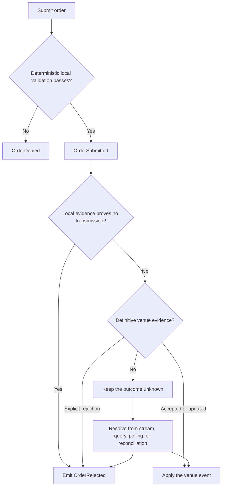
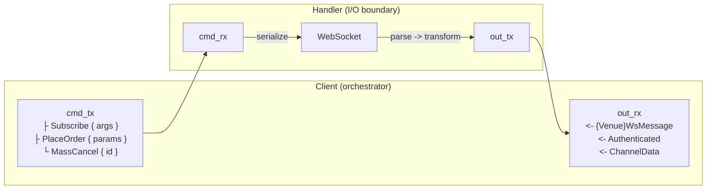

# 适配器 {#adapters}

## 简介 {#introduction}

构建或扩展 NautilusTrader 的 Rust 原生适配器时以本指南为准。适配器负责把平台接入交易场所和数据服务商，
保留交易场所语义，产出合法的 Nautilus 领域事件，并把不确定的结果显式呈现。它们用 Rust 实现平台的数据与
执行客户端 trait，再通过 PyO3 向 Python 暴露配置、工厂和部分底层 API。

:::note
用 Python 或独立 Rust/PyO3 包实现的树外（out-of-tree）适配器请使用
[Python 适配器接口](./python_adapters.md)。本指南只覆盖树内 Rust 适配器。
:::

参考适配器要有选择地借鉴。它们的目录结构反映的是各自的交易场所协议、产品线与实现历史。

| 适配器 | 可借鉴之处 |
| ------------------ | ------------------------------------------------------------------------------------------------------ |
| [Bybit][bybit] | 多产品 HTTP 与 WebSocket 客户端、期权数据、执行结果处理。 |
| [OKX][okx] | 公共、私有、业务三类 WebSocket 端点，金融工具覆盖广泛。 |
| [Binance][binance] | 现货与合约的产品拆分、交易 WebSocket、SBE 行情。 |
| [Kraken][kraken] | 现货与合约子模块，各自的 HTTP、WebSocket、数据、执行路径互不相同。 |
| [Lighter][lighter] | Layer-2 签名、规范化基准测试、覆盖率引导的模糊测试、精细的执行状态处理。 |
| [Derive][derive] | JSON-RPC 数据与执行、EIP-712 签名、规范化基准测试、基于不变量的模糊测试。 |

本指南区分四类指导：

- **共享规则**：来自公共 trait、网络抽象、钩子或 CI，必须遵守。
- **常见模式**：多个适配器都这么做，但允许其他设计。
- **示例**：展示一种合理实现，不构成强制。
- **例外**：交易场所语义或协议边界确实需要时才成立。

## 合规 {#conformance}

适配器满足下面每条适用于它的规则，或对例外情况写下说明，即为合规。说明要写清是哪种交易场所行为迫使例外
成立。例外限定在适配器内部，并配一个测试：若交易场所不再需要该例外，测试应失败。
[阶段 7](#phase-7-prove-conformance) 安排了证明合规的各项工作。

### 适配器基础 {#adapter-foundations}

| 规则 | 适用范围 |
| ------------------------------------------------------------------------------------------ | ------------------ |
| [仓库与 Python 接线](#repository-and-python-wiring) | 新适配器 crate |
| [凭证与密钥处理](#credentials-and-secret-handling) | 每个适配器 |
| [配置](#configurations-configrs) | 每个适配器 |
| [符号与金融工具标识](#symbols-and-instrument-identity) | 每个适配器 |
| [交易场所报文建模与精度](#modeling-venue-payloads) | 每个适配器 |
| [客户端 trait 与工厂](#client-traits-and-factories-datars-executionrs-factoriesrs) | 每个适配器 |

### 运行时与客户端生命周期 {#runtime-and-client-lifecycle}

| 规则 | 适用范围 |
| ----------------------------------------------------- | -------------------------- |
| [连接生命周期](#connection-lifecycle-connect) | 数据客户端与执行客户端 |
| [数据事件与请求时效](#data-client) | 数据客户端 |
| [背压](#backpressure) | 每个适配器 |
| [任务管理](#task-management) | 每个适配器 |
| [确定性模拟](#deterministic-simulation) | 受维护的适配器 |

### 执行与对账 {#execution-and-reconciliation}

| 规则 | 适用范围 |
| --------------------------------------------------------------------------------------------- | ----------------- |
| [执行客户端边界](#execution-client) | 执行客户端 |
| [对账报告](#reconciliation-reports) | 执行客户端 |
| [手续费失败处理](#commission-failure-handling) | 执行客户端 |
| [有界的全量状态报告](#bounded-mass-status-reports) | 执行客户端 |
| [对账期间的金融工具解析](#instrument-resolution-during-reconciliation) | 执行客户端 |
| [被跟踪与外部执行更新](#tracked-and-external-execution-updates) | 执行客户端 |
| [事件排序与去重](#event-ordering-and-deduplication) | 执行客户端 |
| [订单命令结果策略](#order-command-outcome-policy) | 执行客户端 |
| [证据类别命名](#naming-the-evidence-classes) | 执行客户端 |
| [诊断信息与面向策略的原因](#separate-diagnostics-from-strategy-facing-reasons) | 执行客户端 |

### 传输与数据流 {#transport-and-streaming}

| 规则 | 适用范围 |
| ------------------------------------------------------------------------------- | -------------------------------- |
| [请求流程](#request-flow) | HTTP 客户端 |
| [请求签名与鉴权](#request-signing-and-authentication) | HTTP 与 WebSocket 请求路径 |
| [错误处理与重试逻辑](#error-handling-and-retry-logic) | HTTP 与 WebSocket 请求路径 |
| [限流](#rate-limiting) | HTTP 与 WebSocket 客户端 |
| [处理器初始化握手](#handler-initialization-handshake-setclient) | WebSocket 客户端 |
| [鉴权](#authentication) | WebSocket 客户端 |
| [订阅管理](#subscription-management) | WebSocket 客户端 |
| [消息路由](#message-routing) | WebSocket 客户端 |
| [重连与关闭](#reconnection-and-shutdown) | WebSocket 客户端 |

[数据测试规范](./spec_data_testing.md)与[执行测试规范](./spec_exec_testing.md)收录了针对真实交易场所证明
上述契约的场景。

### 共享基线 {#shared-baseline}

下列每一项都优先使用共享实现，然后自选满足其契约的状态结构。共享类型自带契约，且让各交易场所的行为可相互
比较；本地结构必须由自己的实现证明同一契约。

基线不适用于这两个执行客户端——它们实现了同一 trait 但并不通过交易场所 API 交易：

- [Sandbox](https://github.com/nautechsystems/nautilus_trader/blob/develop/crates/adapters/sandbox/src/execution.rs) 在本地模拟成交。
- [Blockchain](https://github.com/nautechsystems/nautilus_trader/blob/develop/crates/adapters/blockchain/src/execution/client.rs) 在 `defi` feature 之后执行链上操作。

确定性模拟对受维护的适配器是强制的。每个受维护的适配器必须满足
[适配器 DST 契约](./../concepts/dst.md#adapter-dst-contract)，或携带一份交易场所范围内的迁移记录追踪差距。
OKX 是参考实现。[确定性模拟](#deterministic-simulation) 定义了新适配器要用的接缝、门禁和标准。

| 目标 | 共享件 | 契约 |
| -------------------------- | ------------------------------------------------------------------------------------------------------ | ----------------------------------------------------------------------------- |
| 命令结果证据 | [`CommandFailure`](https://github.com/nautechsystems/nautilus_trader/blob/develop/crates/live/src/execution/failure.rs) | [证据类别命名](#naming-the-evidence-classes) |
| 订单标识与上下文 | [`OrderIdentity` 和 `OrderContext`](https://github.com/nautechsystems/nautilus_trader/blob/develop/crates/live/src/execution/context.rs) | [被跟踪与外部执行更新](#tracked-and-external-execution-updates) |
| 重放去重 | [`FifoCache` 和 `FifoCacheMap`](https://github.com/nautechsystems/nautilus_trader/blob/develop/crates/common/src/cache/fifo.rs) | [事件排序与去重](#event-ordering-and-deduplication) |
| 订单拒绝原因 | [`OrderDeniedReason`](https://github.com/nautechsystems/nautilus_trader/blob/develop/crates/model/src/events/order/denied_reason.rs) | [诊断信息与面向策略的原因](#separate-diagnostics-from-strategy-facing-reasons) |
| 任务生命周期 | [`TaskGroup`](https://github.com/nautechsystems/nautilus_trader/blob/develop/crates/live/src/task.rs) 与 [`TaskHandles`](https://github.com/nautechsystems/nautilus_trader/blob/develop/crates/common/src/live/task.rs) | [任务管理](#task-management) |
| 摄取精度 | [领域数值类型](./rust.md#domain-numeric-types) | [交易场所报文建模](#modeling-venue-payloads) |
| HTTP 传输 | [`HttpClient`](https://github.com/nautechsystems/nautilus_trader/blob/develop/crates/network/src/http/client.rs) | [请求流程](#request-flow) |
| 鉴权状态 | [`AuthTracker`](https://github.com/nautechsystems/nautilus_trader/blob/develop/crates/network/src/websocket/auth.rs) | [鉴权](#authentication) |
| 订阅标识 | [`SubscriptionState`](https://github.com/nautechsystems/nautilus_trader/blob/develop/crates/network/src/websocket/subscription.rs) | [订阅管理](#subscription-management) |
| 重连请求 | [`request_reconnect`](https://github.com/nautechsystems/nautilus_trader/blob/develop/crates/network/src/websocket/client.rs) | [重连与关闭](#reconnection-and-shutdown) |
| 重试机制 | [`RetryManager`](https://github.com/nautechsystems/nautilus_trader/blob/develop/crates/network/src/retry.rs) | [错误处理与重试逻辑](#error-handling-and-retry-logic) |
| 推断成交的手续费 | [`ExecutionClient`](https://github.com/nautechsystems/nautilus_trader/blob/develop/crates/common/src/clients/execution.rs) | [手续费失败处理](#commission-failure-handling) |
| 时间、任务与 runtime | [`nautilus_common::live::dst`](https://github.com/nautechsystems/nautilus_trader/blob/develop/crates/common/src/live/dst.rs) | [确定性模拟](#deterministic-simulation) |
| 挂钟读取 | [`duration_since_unix_epoch`](https://github.com/nautechsystems/nautilus_trader/blob/develop/crates/core/src/time.rs) | [确定性模拟](#deterministic-simulation) |

交易场所可能用 IEEE-754 字段而不是十进制字符串或 JSON 数字传输离散值。遇到这种情况，在解析边界处写明例外，
并把 `f64` 限制在该边界之内。

重试分类是这张表的例外：它归适配器所有，因为各交易场所的状态码和限流语义不同。它外围的共享机制不受此影响。
两半的划分见[错误处理与重试逻辑](#error-handling-and-retry-logic)。

### 确定性模拟 {#deterministic-simulation}

每个受维护的适配器——即 [ADAPTERS.md](https://github.com/nautechsystems/nautilus_trader/blob/develop/ADAPTERS.md#adapter-tiers)
中所指 Official 档的适配器——必须满足[适配器 DST 契约](./../concepts/dst.md#adapter-dst-contract)。
尚未合规的适配器要携带一份交易场所范围的迁移记录追踪差距。未被认领的能力在某个切片证明它之前留在契约之外。

OKX 是参考实现，通过共享接缝、静态门禁和行为门禁证明契约：

- **接缝**：`nautilus_common::live::dst` 门面提供时间、任务、runtime 和信号；`nautilus_core::time` 接缝
  提供挂钟访问；`nautilus-network` 提供模拟的 HTTP 与 WebSocket 传输。上面基线表中列出了共享的订阅、
  重连和重试机制。
- **静态门禁**：`check-dst-conventions` 覆盖每个 DST 路径的生产文件
  （`.pre-commit-hooks/check_dst_conventions.sh` 中的 `ADAPTER_PATHS`）；夜间 `dst-smoke` 门禁运行模拟的
  Clippy 与测试分支。
- **行为门禁**：`crates/adapters/okx/tests/integration/dst.rs` 针对受控本地对端钉死精确的订阅字节和逐操作的
  线路字段。完整的线路到领域的新进程比较放在下游装置中。

[OKX 集成指南的 DST 一节](./../integrations/okx.md#deterministic-simulation-testing)记录了经过审计的切片。

新适配器从第一个传输层开始证明契约：

1. 每新增一个 DST 路径文件，就同时加上对应门禁。
1. 让每个端点都由配置驱动到本地对端。
1. 先钉死线路字节，再扩大切片。

在第二个适配器证明同一边界确实需要之前，不要引入共享抽象。

## 适配器结构 {#structure-of-an-adapter}

Rust crate 是协议行为的唯一事实来源。适配器通常按以下关注点划分：

```text
crates/adapters/<adapter>/
├── Cargo.toml
├── src/
│   ├── common/              # Shared credentials, enums, models, parsing, symbols, and URLs
│   ├── http/                # Typed requests, responses, signing hooks, and transport client
│   │   ├── client.rs
│   │   ├── error.rs
│   │   ├── models.rs
│   │   ├── parse.rs
│   │   └── query.rs
│   ├── websocket/           # Streaming transport, protocol messages, parsing, and routing
│   │   ├── client.rs
│   │   ├── handler.rs
│   │   ├── messages.rs
│   │   ├── parse.rs
│   │   ├── subscription.rs  # When subscription identity or replay needs a boundary
│   │   └── dispatch.rs      # When execution routing needs a boundary
│   ├── config.rs
│   ├── data.rs              # Or data/ when product implementations need a split
│   ├── execution.rs         # Or execution/ when product implementations need a split
│   ├── factories.rs
│   ├── python/              # PyO3 projection
│   ├── signing/             # When authentication or transaction signing is a subsystem
│   └── lib.rs
├── tests/                   # Public Rust boundary tests
├── test_data/               # Canonical venue payloads and protocol vectors
├── benches/                 # When confirmed hot paths warrant benchmarks
│   ├── common/              # Shared benchmark fixtures
│   ├── data.rs
│   ├── exec.rs
│   └── micros.rs
├── fuzz/                    # When untrusted codecs warrant coverage-guided fuzzing
│   ├── fuzz_targets/
│   └── README.md
├── examples/                # Rust tester nodes and focused usage examples
├── bin/                     # Optional protocol inspection or capture tools
└── README.md
```

Python 与文档层位于 crate 之外：

```text
python/nautilus_trader/adapters/<adapter>/  # Public package and generated stubs
examples/live/<adapter>/                    # Python data and execution testers
python/tests/unit/adapters/<adapter>/       # Public Python package tests
docs/integrations/<adapter>.md              # User-facing integration guide
```

crate 内普适的边界只有 `Cargo.toml` 和 `src/lib.rs`。其余模块按需添加：

- symbol、凭证、URL、共享枚举和共享解析放 `common/`。
- 传输模型、类型化请求、签名和 HTTP 客户端放 `http/`。
- 帧、消息、订阅状态、路由和 WebSocket 客户端放 `websocket/`。
- 实时数据与执行 trait 在 `data.rs` 和 `execution.rs` 实现。交易场所各产品协议差异明显时，改用产品子模块。
- PyO3 投影代码留在 `python/`。
- 集成测试按公共边界或产品组织，不要把各适配器硬套成相同的文件名。

产品线协议不同时，按产品拆分是合理的；请求与状态语义相通时，一个共享客户端也可以横跨不同端点。按交易场所
的真实边界组织，共享行为放在拆分之上。

适配器的公共 Python 包位于 `python/nautilus_trader/adapters/<adapter>/`，通常重新导出生成的绑定。要改 Rust
绑定元数据或其他生成器输入，改完后运行 `make py-stubs`，不要手改生成的 `.pyi` 文件。

### 仓库与 Python 接线 {#repository-and-python-wiring}

新适配器 crate 必须让每个负责它的构建面都能发现：

| 构建面 | 需要的改动 | 强制方式或证明 |
| ----------------------------- | ---------------------------------------------------------------------------------------------------------------- | -------------------------------------------------------------------------------------------------------------- |
| Rust 根 workspace | 在 [`Cargo.toml`](https://github.com/nautechsystems/nautilus_trader/blob/develop/Cargo.toml) 的 members 和 workspace 依赖中加入该 crate。 | workspace 元数据和定向 Cargo 检查能发现该 crate。 |
| workspace 测试清单 | 在 [`Makefile`](https://github.com/nautechsystems/nautilus_trader/blob/develop/Makefile) 的 `ADAPTER_CRATES` 中加入该 crate。 | [workspace 覆盖率检查](https://github.com/nautechsystems/nautilus_trader/blob/develop/scripts/ci/check-workspace-test-coverage.sh)要求每个 crate 有一份测试清单。 |
| PyO3 crate | 在 [`crates/pyo3/Cargo.toml`](https://github.com/nautechsystems/nautilus_trader/blob/develop/crates/pyo3/Cargo.toml) 中加入可选依赖并传播 feature。 | 构建对应的 PyO3 feature 会编译适配器投影。 |
| PyO3 根模块 | 在 [`crates/pyo3/src/lib.rs`](https://github.com/nautechsystems/nautilus_trader/blob/develop/crates/pyo3/src/lib.rs) 注册适配器模块。 | 约定钩子把这份模块列表当作公共 API 白名单。 |
| 适配器 PyO3 注册表 | 用 `get_global_pyo3_registry()` 注册每个适用的工厂和配置提取器。 | 工厂边界测试证明 Python 配置对象能到达 Rust 工厂。 |
| Python 包与用户指南 | 只针对适配器实际暴露的能力添加包投影、测试、示例和集成指南。 | import 检查、生成物漂移检查、示例构建和文档检查覆盖这些面。 |

[Nautilus 约定钩子](https://github.com/nautechsystems/nautilus_trader/blob/develop/.pre-commit-hooks/check_nautilus_conventions.sh)把
PyO3 模块列表视为公共 API 白名单。[PyO3 约定钩子](https://github.com/nautechsystems/nautilus_trader/blob/develop/.pre-commit-hooks/check_pyo3_conventions.sh)
还强制：

- stub 元数据使用 `nautilus_trader.adapters.<adapter>`。
- 运行时扩展导入使用 `nautilus_trader._libnautilus.<adapter>`。
- 用 `#[pyo3(name = ...)]` 改名的 Rust 函数，其 Rust 名字带 `py_` 前缀。
- Python 异常使用项目的错误转换函数。

## 适配器实现顺序 {#adapter-implementation-sequence}

用这些阶段组织工作。它们描述依赖关系，不是发布关卡。只做行情的适配器可跳过执行；适配器也可以先完成一个
产品再开始另一个。整个过程中保持能力矩阵（capability matrix）最新，不要等到最后的文档阶段。与适配器无关的
阶段和步骤直接省略。

### 阶段 0：定义范围 {#phase-0-define-scope}

| 步骤 | 组件 | 工作 |
| ---- | ------------------- | --------------------------------------------------------------------------------------------------------- |
| 0.1 | 能力矩阵 | 列出范围内的产品、环境、账户模式、数据类型、订单类型和报告。 |
| 0.2 | 交易场所约束 | 记录交易场所限制、不支持的能力和 testnet 差异。 |
| 0.3 | 协议边界 | 识别独立的产品 API、公共与私有端点、二进制或 JSON 传输。 |
| 0.4 | 初始切片 | 选择能打通端到端路径的最小切片。 |
| 0.5 | 仓库接线 | 把 crate 加入 Rust workspace 和测试清单，然后只添加它暴露的投影面。 |

**出口标准**：集成指南包含初始能力矩阵、已知差距和测试计划。

### 阶段 1：搭建协议核心 {#phase-1-build-the-protocol-core}

| 步骤 | 组件 | 工作 |
| ---- | --------------------- | ------------------------------------------------------------------------------------------------------------------------------- |
| 1.1 | HTTP 错误类型 | 建模传输、HTTP 状态、交易场所、解析和校验失败。可行时标注可重试性。 |
| 1.2 | HTTP 客户端 | 实现端点解析和类型化请求，按需加凭证、签名、限流、重试和分页。 |
| 1.3 | HTTP API 模型 | 定义类型化的请求与响应，通常放 `http/` 或其产品子模块。 |
| 1.4 | HTTP 解析 | 在 `http/parse.rs` 或 `common/parse.rs` 的确定性边界处，把交易场所响应转换为领域类型。 |
| 1.5 | WebSocket 错误类型 | 建模连接、协议和解析失败，适用时加鉴权与命令失败。 |
| 1.6 | WebSocket 客户端 | 实现生命周期与关闭，适用时加鉴权、心跳、订阅状态和重连。 |
| 1.7 | WebSocket 消息 | 在 `websocket/` 或产品子模块定义帧和消息，按需包含确认和交易场所错误。 |
| 1.8 | WebSocket 解析 | 每帧只解码一次，转换领域事件，按类型化标识路由数据或执行消息。 |
| 1.9 | 协议测试 | 用 mock 对端验证 fixture、规范请求、适用的签名向量、生命周期和原始交互。 |

**出口标准**：crate 可编译，协议 fixture 可解析，适用的签名向量通过，且 mock 或受控请求能完成所需的鉴权并
交换原始交易场所报文。

### 阶段 2：实现金融工具 {#phase-2-implement-instruments}

| 步骤 | 组件 | 工作 |
| ---- | ------------------ | -------------------------------------------------------------------------------------------------------- |
| 2.1 | 金融工具解析 | 解析每个受支持的产品族，包含完整的标识、精度、币种和合约字段。 |
| 2.2 | 金融工具加载 | 在每个需要上下文的解析边界处加载、过滤、缓存并发出定义。 |
| 2.3 | 符号映射 | 定义交易场所符号与 `InstrumentId` 的双向转换，不合并不同的金融工具。 |
| 2.4 | 金融工具更新 | 实现新鲜金融工具请求，以及受支持的定义或状态更新。 |

**出口标准**：不同的 fixture 覆盖每个受支持的金融工具族，非法定义清晰失败，数据客户端发出或返回完整的
Nautilus 金融工具。

### 阶段 3：实现行情数据 {#phase-3-implement-market-data}

先做一条公共数据流和一个金融工具，再扩展到多产品或多端点。

| 步骤 | 组件 | 工作 |
| ---- | ------------------------ | ----------------------------------------------------------------------------------------------------------- |
| 3.1 | 公共 WebSocket 数据流 | 订阅和退订每种声明的实时数据类型，同时保留订阅意图。 |
| 3.2 | 历史数据请求 | 按精确的关联和时效规则请求支持的 K 线、成交、报价或订单簿快照。 |
| 3.3 | 数据客户端 | 实现 `DataClient` 的请求、订阅、生命周期和完整的 `DataEvent` 发出。 |
| 3.4 | 订单簿处理 | 保留快照、增量更新、序列号、清空和批次边界。 |
| 3.5 | 数据流恢复 | 处理畸形输入、缺口、退订、断开、重连和订阅重放。 |

**出口标准**：单元测试和 mock 传输测试针对支持的请求与订阅矩阵证明能产出完整的领域事件。

### 阶段 4：实现执行 {#phase-4-implement-execution}

启用订单流之前，先建立账户状态和对账。

| 步骤 | 组件 | 工作 |
| ---- | ---------------------- | ------------------------------------------------------------------------------------------------------------ |
| 4.1 | 账户引导 | 建立账户标识、初始账户状态、私有订阅和就绪状态。 |
| 4.2 | 对账报告 | 在启动时和按需生成适用的订单、成交、持仓和全量状态报告。 |
| 4.3 | 基本订单提交 | 实现受支持的市场单和限价单提交，附带确定性的本地校验。 |
| 4.4 | 订单修改 | 实现受支持的修改和取消命令，含 cancel-replace 的交易场所语义。 |
| 4.5 | 执行客户端 | 实现 `ExecutionClient` 命令、生命周期、被跟踪与外部路由，以及有序的事件发出。 |
| 4.6 | 结果恢复 | 保留未知结果、成交去重，并通过数据流、查询或对账解决状态。 |

**出口标准**：mock 传输测试覆盖每个支持的命令、明确的拒绝、不确定的传输、重复或乱序更新，以及启动对账。

### 阶段 5：添加可选的交易场所能力 {#phase-5-add-optional-venue-capabilities}

基础生命周期稳定后再添加这些。

| 步骤 | 组件 | 工作 |
| ---- | -------------------------- | ------------------------------------------------------------------------------------------------- |
| 5.1 | 高级订单类型 | 按需添加条件单、止损单、止盈单、追踪止损等其他高级订单。 |
| 5.2 | 批量操作 | 添加批量提交、批量取消和全量取消，带逐单结果处理。 |
| 5.3 | 交易场所特有数据 | 把资金费率、希腊值、强平或交易场所扩展作为独立能力切片添加。 |
| 5.4 | 产品或端点拆分 | 只有协议、鉴权、配额或恢复边界确实需要时才拆分所有权。 |
| 5.5 | 能力证明 | 为每项能力添加 fixture、功能测试、验收用例和成文的限制。 |

**出口标准**：每项可选能力可独立测试，且不削弱已确立的基础路径。

### 阶段 6：完成工厂与投影 {#phase-6-complete-factories-and-projection}

| 步骤 | 组件 | 工作 |
| ---- | --------------------- | ------------------------------------------------------------------------------------------------ |
| 6.1 | 配置结构体 | 敲定类型化的数据与执行配置、默认值、环境回退和密钥脱敏。 |
| 6.2 | 客户端工厂 | 用 `CacheView` 输入和数据客户端时钟实现 Rust 工厂。 |
| 6.3 | PyO3 注册 | 向 PyO3 注册表注册适用的工厂和配置提取器。 |
| 6.4 | Python 包 | 为暴露给 Python 的能力添加公共包和 Python 边界测试。 |
| 6.5 | 生成的 stub | 添加 Rust stub 元数据，用 `make py-stubs` 重新生成 `.pyi` 输出。 |

**出口标准**：Rust 工厂测试和 PyO3 边界测试通过，包 import 可解析，生成输出与其 Rust 输入一致。

### 阶段 7：证明合规 {#phase-7-prove-conformance}

| 步骤 | 组件 | 工作 |
| ---- | ---------------------- | ------------------------------------------------------------------------------------------------------ |
| 7.1 | Rust 单元测试 | 验证解析器、序列化器、符号、签名、状态转移和畸形输入。 |
| 7.2 | Rust 集成测试 | 针对确定性 mock 传输运行公共 HTTP、WebSocket、数据和执行边界。 |
| 7.3 | Python 边界测试 | 验证 import、配置提取、工厂、类型转换和有代表性的异步调用。 |
| 7.4 | 验收测试 | 在 testnet 或受控账户上运行每个适用的 `DataTester` 和 `ExecTester` 用例。 |
| 7.5 | 恢复测试 | 运行连接失败、重连、关闭、限流和状态恢复。 |
| 7.6 | 规范缺口 | 记录每个跳过的规范用例，附交易场所或能力原因。 |

**出口标准**：适用的数据和执行测试规范通过，且每项声明的能力都有确定性和交易场所两方面的证据。

### 阶段 8：度量性能与健壮性 {#phase-8-measure-performance-and-robustness}

| 步骤 | 组件 | 工作 |
| ---- | -------------------- | --------------------------------------------------------------------------------------------------------- |
| 8.1 | 规范化基准测试 | 用有代表性的 fixture 度量已确认的端到端数据与执行热点路径。 |
| 8.2 | 微基准测试 | 隔离已确认的签名、哈希、鉴权、编解码、解析或序列化开销。 |
| 8.3 | 模糊测试目标 | 用真实语料对不可信的解析、解码、归一化、签名和编码边界做模糊测试。 |
| 8.4 | 不变量 | 断言比"不 panic"更强的领域和协议属性。 |

**出口标准**：规范化基准和模糊测试套件用有代表性的 fixture 运行，不变量有文档，且没有适配器用不到的强制类别。

### 阶段 9：完成文档与运维 {#phase-9-finish-documentation-and-operations}

| 步骤 | 组件 | 工作 |
| ---- | ------------------- | ---------------------------------------------------------------------------------------------- |
| 9.1 | 能力矩阵 | 把每条支持声明和例外与经过测试的实现核对一致。 |
| 9.2 | 集成指南 | 记录凭证、配置、限额、对账、环境差异和已知缺口。 |
| 9.3 | 测试器入口 | 提供适用的 Rust 和 Python 数据与执行测试器，默认值安全。 |
| 9.4 | 运维 | 记录恢复、故障排查，以及运维人员必须理解的交易场所行为。 |
| 9.5 | 最终校验 | 校验链接、生成输出、示例和聚焦的文档检查。 |

**出口标准**：用户不读源码就能配置、测试、运行和诊断该适配器。

## Rust 适配器模式 {#rust-adapter-patterns}

适配器代码遵守全仓库的导入策略：导入 Nautilus 类型并使用短名，不在调用点写全限定名。
[Nautilus 约定钩子](https://github.com/nautechsystems/nautilus_trader/blob/develop/.pre-commit-hooks/check_nautilus_conventions.sh)
强制这条规则，并说明其带作用域的例外标记。

### 配置（`config.rs`） {#configurations-configrs}

遵循共享的[配置指南](./../concepts/configuration.md)。具体来说，Rust 配置使用类型化字段、严格的 Serde 解码、
单一默认值来源和 `bon::Builder`。适配器配置在此基础上只添加交易场所语义：

- 封闭集合用枚举，如环境、产品族、账户模式或端点。
- 只有"缺失"本身有独立含义时才用 `Option<T>`，包括运行时的凭证回退。
- 数据与执行配置的能力或凭证不同时，保持分离。
- 不得出现在 `Debug` 中的字段用 `SecretString` 存储。每个敏感字段都用了脱敏类型时，直接 derive `Debug`。
  只有满足以下之一时才写自定义实现：

  - 某字段无法使用脱敏类型。
  - 该类型需要更严格的输出。
- Python 配置投影保持精简，只做类型转换并委派给 Rust 配置。

集中解析默认的 HTTP 与 WebSocket 端点，使一次环境选择不会混用生产与测试端点。仅在自定义网关、mock 服务器或
交易场所部署确实需要时保留显式 URL 覆盖。测试每个受支持的环境，以及环境选择与显式覆盖之间的任何优先级。

配置字段按此顺序排列：

| 顺序 | 字段组 | 放置规则 |
| ----- | ------------------------------------------ | ---------------------------------------------------------------------- |
| 1 | 账户标识、凭证、环境 | 交易场所的等价物也算：`network`、`deployment`、`region`。 |
| 2 | URL 覆盖 | 连续一块：先 `base_url_http`，再每个 `base_url_ws*`。 |
| 3 | `proxy_url` | 紧跟 URL 块之后。 |
| 4 | 其余全部 | 超时、重试、交易场所特有行为。 |

在配置方法里把每个 `None` 覆盖解析为环境默认值，把解析后的 URL 传给客户端构造函数。构造函数不直接读 `Option`
字段。

结构体字段、`bon::Builder` 访问器、pyo3 getter 列表和 Python `__init__` 签名之间保持相同的相对顺序。
**已发布的 Python 签名**保持其位置顺序：新增参数追加在末尾，不重排已有参数，因此签名可能滞后于结构体顺序。
有意重排是破坏性变更，需在 `RELEASES.md` 的 Breaking Changes 下注明。

### 凭证与密钥处理 {#credentials-and-secret-handling}

HTTP 与 WebSocket 客户端使用同一套密钥材料时，把凭证处理集中到一个类型里，通常放 `common/credential.rs`。
配置保持为数据传输对象。在构造凭证、工厂或客户端时解析凭证，不要在 Python 包装或各个请求方法里解析。

#### 分类敏感值 {#classify-sensitive-values}

先给值分类，再选择它的类型和诊断输出。当交易场所让一个值承担多重角色时，采用更严格的那条规则。

| 值类别 | 示例 | 诊断输出 |
| ---------------------------- | ------------------------------------------------------------------------------------------------------------- | --------------------------------------------------------------------------------------- |
| 密钥材料 | 密码、私钥、API secret、passphrase、bearer 和 session token、refresh token、签名。 | 一律显示 `<redacted>`。 |
| 凭证标识 | 鉴权过程中使用的 API key、client ID、用户名、账户标识符。 | 默认脱敏。仅当运维关联确有需要时才使用掩码后的 API key。 |
| 含密钥的位置 | 可能包含凭证的代理 URL、RPC URL、请求路径、查询参数。 | 在日志和错误中脱敏整个位置。 |
| 有意公开的标识 | 交易场所公开暴露的钱包地址、vault 地址、公共账户名。 | 仅当类型和适配器契约有意把该值归类为公开时才显示。 |

单独的 API key、用户名或 URL 可能不足以通过鉴权，但不要由此推断它可以打印。配置经常跨越日志、异常和 Python
表示边界，在这些边界上部分的凭证标识仍然敏感。

#### 使用通用密钥类型 {#use-the-common-secret-types}

使用 `nautilus_core::string::secret` 和 `zeroize`，不要在适配器里另立脱敏或清零约定。

| 机制 | 用途 |
| ----------------------------- | ------------------------------------------------------------------------------------------------------------------------------------- |
| `SecretString` | 持有一个必须在 drop 时清零、`Debug` 渲染为 `<redacted>` 的字符串。 |
| `REDACTED` | 在自定义 `Debug` 或 `Display` 实现中替换无条件脱敏的密钥字段。 |
| `redact_option` | 在自定义 `Debug` 中脱敏可选字段，同时保留 `Some` 与 `None` 的区分。 |
| `mask_api_key` | 只通过显式的掩码标识方法来关联 API key。不要用于密钥材料。 |
| `Zeroizing<T>` | 限定持有的明文 `String`、字节缓冲、解码后的密钥、规范化载荷或序列化鉴权消息的生命周期。 |
| `Zeroize` 和 `ZeroizeOnDrop` | 在无法使用 `SecretString` 的结构体里清零含密钥的字段，包括字节数组和签名类型。 |
| `zeroize_json_value` | 序列化含密钥字段后，清掉可变 JSON 值中持有的字符串。 |

#### 安全使用 `SecretString` {#use-secretstring-safely}

- 把序列化当作明文处理。`SecretString` 为兼容线路格式使用底层字符串，因此绝不要为了诊断序列化配置、凭证或
  鉴权模型。
- 不要用普通的 `SecretString` 相等比较来校验攻击者可控的密钥，它不是常数时间的。
- 只在确实需要的签名、编码或传输边界处通过 `expose_secret()` 借用明文。
- 只在转移所有权时用 `into_inner()` 消费。若接收方 API 要求 `String`，在调用边界处创建最终副本，不要在
  适配器代码中保留该副本。
- 函数只读取值时传 `&SecretString`；函数持有或消费值时按值传。
- 把含密钥的字段放进已鉴权的线路模型，而不是仅为了改 `Debug` 再建第二个模型。每个敏感字段都脱敏时，同时
  derive `Serialize` 和 `Debug`。
- 有些凭证使用字节数组、签名密钥或其他无法把密钥字段存为 `SecretString` 的类型。这些凭证要写自定义 `Debug`。
- 除非调用方要求，含密钥的类型避免实现 `Display`。任何实现都必须脱敏密钥材料。

#### 解析与共享凭证 {#resolve-and-share-credentials}

- 环境变量名只定义一次，由类型化的环境和产品值来选择。
- 在适配器的集成指南中记录既定的环境变量名。
- 在 `scripts/strip-adapter-env.bash` 中注册每个适配器环境变量。`make pre-flight` 会在这些变量全部未设置的
  包装下运行；未注册的变量可能让测试在本地借助环境中的凭证通过。
- 把所有字段作为一个凭证集解析。公共客户端可以保持未鉴权，但已鉴权客户端在发出请求前会拒绝不完整或无效的
  凭证集。
- 在凭证边界把配置和环境字符串转换为可清零的持有者。转换后不要在适配器状态中保留不可清零的明文副本。
- 只有多个传输使用同一套密钥材料时才共享凭证存储。HTTP、WebSocket 和交易签名各自的规范化载荷不同时，
  方法保持分离。

#### 把凭证投影到 Python {#project-credentials-into-python}

- Python 构造函数接受的凭证字符串在 Rust 边界转换为 `SecretString`。
- Rust 的 `Debug` 和 `Display` 脱敏规则同样适用于 Python 的 `__repr__` 和 `__str__`。
- 对密钥材料和含密钥的位置只暴露存在性检查。
- 只有既有公共 API 或其他明确的调用方需要时才返回凭证标识（如用户名）。记录该选择，并让该值远离诊断输出。
- 绝不通过明文 getter 暴露密码、私钥、API secret、passphrase、token 或签名。

#### 限定明文生命周期 {#bound-plaintext-lifetime}

- 每块自有的明文分配在最后一次使用后清零，包括归一化并解码后的密钥、含密钥的签名载荷、序列化的鉴权消息、
  编码后的表单值和可变请求模型。
- 优先用借用的切片和已有的可清零持有者，而不是中间的 `String` 和 `Vec<u8>` 副本。
- 保证范围限定在适配器自己持有的分配上。序列化库、传输层、TLS 以及操作系统都可能复制出适配器无法触及的
  副本。
- 明文的生命周期要短。不要承诺进程级或传输级的擦除。

#### 脱敏诊断信息与传输错误 {#redact-diagnostics-and-transport-errors}

- 任何级别的错误和日志中都绝不包含凭证、签名、密钥材料或含密钥的 URL。
- 记录方法、字段数、字节长度等请求元数据，而不是凭证或鉴权载荷。共享传输记录元数据而非载荷内容。
- 把 TRACE 当作面向开发者的诊断输出。入站原始载荷只有在其 schema 不可能包含凭证材料时才允许记录。
- 私有数据流的原始 TRACE 输出属于敏感内容，它可能暴露订单、余额、持仓和账户身份，分享前必须脱敏。
- 元数据或经过清洗的有界摘录足以诊断协议时，优先使用它们。
- 可变源模型在序列化后若仍持有另一份明文副本，将其清零。
- 绝不记录原始鉴权请求或响应，也不记录 schema 可能含密钥材料的任何帧。

| 界面 | 必需的处理 | 清零边界 |
| ---------------------------- | ---------------------------------------------------------------------------------------------------------------- | ---------------------------------------------------------------------- |
| HTTP 密钥 body | 使用 `HttpClient::request_with_secret_body`。 | 客户端保留可清零的持有者，底层可能复制它。 |
| HTTP 路径或 `HashMap` 查询 | 使用 `HttpClient::request_with_url_redacted`。 | 传输错误中省略该 URL。 |
| HTTP 类型化查询 | 使用 `HttpClient::request_with_params_url_redacted`。 | 传输错误中省略该 URL。 |
| HTTP 头与代理 | 在客户端边界创建含凭证的字符串，避免克隆，不在适配器状态中保留。 | 共享客户端或传输可能保留副本。 |
| WebSocket 鉴权 | 字段和序列化帧保持为 `SecretString`，在 `send_text` 前一刻才创建最终 `String`。 | 共享客户端没有保留密钥所有者的发送方法。 |
| 不支持的组合 | 扩展公共客户端，而不是在适配器里自搞 URL 或错误清洗。 | 公共 API 必须随之定义清楚归属与脱敏规则。 |

:::warning 鉴权请求禁用重定向

发送凭证或已签名载荷的客户端必须设置 `HttpRedirectPolicy::Reject`。使用其他 HTTP 传输时采用等价的禁重定向
策略，防止重定向把凭证或已签名载荷转发到其他目的地。

:::

#### 验证凭证处理 {#verify-credential-handling}

测试密钥处理契约，也测试鉴权成功路径：

- 覆盖显式值、环境回退、不完整凭证和无效凭证。
- 断言配置、凭证、请求、响应和客户端的 `Debug` 输出不含输入中的真实密钥。对每个实现 `Display` 的含密钥
  类型单独测试 `Display`。
- 断言 Python 的 `__repr__` 和 `__str__` 不含凭证标识和密钥材料。测试存在性检查和每个有意暴露的标识 getter。
- 在交易场所要求明文之处，断言序列化和传输保持线路值的精确性。
- 对含凭证的 URL 强制制造传输失败，断言 `Display` 和 `Debug` 的错误输出都不含 URL、路径密钥和查询密钥。
- 用编译期 trait 断言检查 `Zeroize` 或 `ZeroizeOnDrop`，并对可变请求/响应模型测试显式清零。
- 保留确定性的签名向量，使脱敏和清零改动无法改变签名字节、字段顺序或编码。

### 符号与金融工具标识 {#symbols-and-instrument-identity}

把交易场所符号与 Nautilus `InstrumentId` 分开。符号模块通常负责：

- 解析和格式化交易场所符号。
- 为 Nautilus 符号唯一性所需的产品或合约后缀。
- 校验交易场所与产品标识。
- 对受支持形式做往返测试，对歧义形式做拒绝测试。

按交易场所的标识方案选择映射：

| 交易场所标识 | Nautilus 表示 | 示例 |
| --------------------------------------------------- | ----------------------------------------------- | --------------------------------------------------- |
| 原生符号可区分产品 | 保留符号并加上交易场所。 | `BTC-USDT-SWAP` -> `BTC-USDT-SWAP.OKX`。 |
| 原始符号跨产品族复用 | 添加并校验稳定的产品后缀。 | Bybit 线性 `BTCUSDT` -> `BTCUSDT-LINEAR.BYBIT`。 |
| Nautilus 与交易场所合约标记不同 | 在一个边界实现双向转换。 | Binance USD-M `BTCUSDT` -> `BTCUSDT-PERP.BINANCE`。 |
| 传输大小写与规范标识不同 | 只在构造传输值时转换。 | Binance 数据流 `BTCUSDT-PERP.BINANCE` -> `btcusdt`。 |

[`BybitSymbol`](https://github.com/nautechsystems/nautilus_trader/blob/develop/crates/adapters/bybit/src/common/symbol.rs)
包装器和
[Binance 符号转换](https://github.com/nautechsystems/nautilus_trader/blob/develop/crates/adapters/binance/src/common/symbol.rs)
展示了后缀与双向转换模式。把它们当示例，不是共享的后缀方案。

不要把不同的交易场所金融工具归一成同一个 `InstrumentId`。测试 fixture 使用互不相同的符号、精度、币种和合约
字段，让交换和遗漏显而易见地失败。

对每个受支持的产品族，测试 交易场所符号 -> `InstrumentId` -> 交易场所符号。大小写归一只在标识边界做一次，
其他位置保留交易场所有意义的大小写。映射需要产品标记时，缺失或歧义的标记要在缓存金融工具之前被拒绝。

用当前的交易场所定义构造金融工具。缓存或发出之前校验必需的标识与精度。解析函数保持确定性，尽可能不依赖
在线客户端状态。

### 建模交易场所报文 {#modeling-venue-payloads}

建模真实线路格式，而不是想象中的稳定子集：

- 已知字段用类型化的请求/响应结构体。
- 只有受支持的交易场所报文确实需要时才用 Serde 别名或自定义反序列化器。
- 对含义影响领域行为的封闭集合，未知值直接拒绝。
- 对可能在不改协议版本的情况下扩充的交易场所开放集合，保留未知值或对其显式分类。
- 原始模型与 Nautilus 领域对象保持分离，只在一个可审计的边界处转换。
- 必需的解析上下文显式传入，包括金融工具精度、币种、账户标识和 `ts_init`。在线客户端状态不得进入解析器。
- 按交易场所 schema 处理缺失、null 和空值。含义不同时，不要把它们坍缩成同一个回退。
- 报文自带时间戳时，`ts_event` 使用交易场所时间戳；适配器接收或构造事件时用其时钟赋 `ts_init`。只有交易
  场所没有权威时间戳时才用接收时间充当事件时间，并为该回退写测试。

不要用宽容回退把新的交易场所值悄悄变成已有的语义值。稳定的错误处理是解析器契约的一部分。

#### 数值精度 {#numeric-precision}

价格、数量、金额、手续费等离散值一律反序列化为 `Decimal`。用 `Price::from_decimal`、`Price::from_decimal_dp`、
`Quantity::from_decimal`、`Quantity::from_decimal_dp`、`Money::from_decimal` 或 `Money::zero` 构造领域值。
绝不把线路值经过 `f64`。见[领域数值类型](./rust.md#domain-numeric-types)。

领域精度取自字段契约，而不是报文恰好怎么格式化：

| 字段契约 | `"25.000"` 的结果 | 转换方式 |
| -------------------------------------------------- | ----------------------- | ------------------------------------------------------------------- |
| 交易场所声明的标度有意义 | 精度 3 的 `25.000` | 用 `Price::from_decimal` 或 `Quantity::from_decimal`。 |
| 文档声明尾随零是无意义填充 | 精度 0 的 `25` | 先 `Decimal::normalize`，再用按标度推断的构造函数。 |
| 金融工具或币种精度决定数值 | 精度 2 的 `25.00` | 用 `Price::from_decimal_dp` 或 `Quantity::from_decimal_dp`。 |

有金融工具或币种精度时，事件和报告值就用它。同一数值交易场所可能发成 `"25"`、`"25.0"` 或 `"25.000"`。除非
适配器定义并测试了显式的兼容回退，否则不要按报文逐个推断精度。声明精度的构造函数在数值有多余的非零位时
采用银行家舍入。字段契约要求精确表示时，校验往返相等。对账期间精度元数据缺失时，遵循
[对账期间的金融工具解析](#instrument-resolution-during-reconciliation)。

#### 交易场所枚举回退 {#venue-enum-fallbacks}

交易场所会不打招呼地扩充线路枚举：新的订单状态、订单类型和类别码先出现在生产环境，客户端才更新。给每个可
扩充的交易场所枚举配一个带 `#[serde(other)]` 的前向兼容回退变体。交易场所状态用 `Unknown`，类型、类别等开放
值集用 `Other`。这样一个新值就不会毁掉承载它的消息的反序列化。适配器自己定义的封闭集合保持严格。

回退改变的是严格性的位置，不是取消严格性：

- 遇到未知线路变体绝不 panic。回退保住了连接，也保住了同一载荷里的其他兄弟记录。
- 绝不把未知变体映射到已有领域值。领域映射用可失败的 `TryFrom`，让回退变体在映射边界被显式拒绝。
- 即使兄弟分类无法映射，也要保住与安全相关的载荷数据。订单状态或订单类型未知时，适配器仍须解析并发出成交。
  成交字段自带价格、数量和手续费。
- 只跳过无法映射的分类，并记录带交易场所标识（订单 ID、金融工具）的警告以便排查。消息里没有值得保留的数据时，
  显式判定该记录失败，不要编造状态。订单到达已映射状态后由对账弥合缺口。未映射值在对账路径上同样失败。因此
  把警告当作"该加映射了"的信号。

#### 权威与投影分离 {#separate-authority-from-projections}

一个端点可能同时返回权威证据和供更窄读取的数据。权威证据用于确立权限或授权状态变更。这类端点要用分离的
响应模型。

| 边界 | 目的 | 校验 | 成功的含义 |
| -------------------------- | ------------------------------------------------------------------ | --------------------------------------------------------------------------------------------------- | ---------------------------------------------------------------------------- |
| **权威响应** | 确立权限或授权状态变更。 | 要求全部权威字段。映射前拒绝遗留冲突和语义重复。 | 响应足以支撑它所建模的权威决策。 |
| **窄投影** | 不使用权威地读取余额、健康值或元数据。 | 只解码返回的字段。其类型无法暴露、授予或推断被省略的权威。 | 只有投影值。被省略的权限或账户证据视为未知。 |

权威字段畸形时不应阻塞更窄的读取，此时用投影。权威模型保持严格。

### 客户端 trait 与工厂（`data.rs`、`execution.rs`、`factories.rs`） {#client-traits-and-factories-datars-executionrs-factoriesrs}

共享的 [`DataClient`](https://github.com/nautechsystems/nautilus_trader/blob/develop/crates/common/src/clients/data.rs)、
[`ExecutionClient`](https://github.com/nautechsystems/nautilus_trader/blob/develop/crates/common/src/clients/execution.rs) 和
[客户端工厂](https://github.com/nautechsystems/nautilus_trader/blob/develop/crates/common/src/factories/client.rs) trait 定义了适配器的边界。
实现受支持的方法，把不支持的能力在集成指南中写明。

客户端 trait 使用 `#[async_trait(?Send)]`。客户端对象不打算跨线程移动，也可能持有非 `Send` 的 Python 状态。
异步工作必须活过同步 trait 调用时，把持有的、`Send` 的输入移入显式 runtime 任务。

#### 客户端命名与注册 {#client-naming-and-registration}

客户端家族的命名要对称：

- **数据**：`<Venue>DataClient`、`<Venue>DataClientConfig`、`<Venue>DataClientFactory`。
- **执行**：`<Venue>ExecutionClient`、`<Venue>ExecutionClientConfig`、`<Venue>ExecutionClientFactory`。

每个工厂直接消费对应的客户端配置，不要另加一层工厂配置包装。live node 把它的 `LiveNodeConfig.trader_id`
传给执行工厂，而 `account_id` 等交易场所特有的值放在执行客户端配置上。

在同一个 Python 模块内，客户端家族的 `add_class` 注册按导出类型名做字母序排列，让数据与执行两族保持成组。

普通客户端家族不要加 `Live` 前缀，连接态就是默认。`SandboxExecutionClient`、`DatabentoHistoricalClient`
这类名字标识的是替代行为。只有当 `Live` 用于区分显式的 runtime 或协议兄弟时才保留。`LiveNode`、`LiveClock`
和 `Live*EngineConfig` 这类 runtime 类型保留该限定词。

公共的、项目自有的 PascalCase 类型名中不要把 `Execution` 缩写。内部实现类型可以沿用既有的 `Exec` 名字。
[通用命名约定](./coding_standards.md#naming-conventions)允许的地方也保留 `Exec`，包括 `ExecType` 这类交易
场所协议术语。协议特有的线路模型按交易场所概念命名，如 `HyperliquidExchangeAction`。已有的公共名称保持不变，
本约定适用于新 API。

#### 工厂输入与 cache 所有权 {#factory-inputs-and-cache-ownership}

工厂接收一个向下转型后的 `ClientConfig` 和只读的
[`CacheView`](https://github.com/nautechsystems/nautilus_trader/blob/develop/crates/common/src/cache/mod.rs)。数据工厂还接收共享时钟。
用该视图解析金融工具和已有状态。引擎 cache 的写入留在引擎里：适配器不要改动引擎 cache，而是发出领域事件和
报告。解析、订阅重放或响应关联确实需要时，私有协议 cache 是允许的。

### 适配器自有的状态 {#adapter-owned-state}

按所有权和更新行为选择集合类型：

- 单一任务持有的状态用普通的 `AHashMap` 或 `AHashSet`。
- 读多写少、写入不频繁的不可变快照用 `AtomicMap` 或 `AtomicSet`。写入方可能竞争时用 `rcu`——单独的 load
  加 store 可能丢掉另一个写入方的更新。
- 相互独立的键、条目被并发更新时用 `DashMap` 或 `DashSet`。

各适配器对这些模式的组合各不相同。集合放在拥有其不变量的组件后面，不要仅仅为了少传一条消息就共享出去。
反复出现的协议字符串在驻留（interning）能降低分配或比较开销时用 `Ustr`。唯一请求 ID 和短生命周期的载荷文本
保持其自然类型。

### 连接生命周期（`connect`） {#connection-lifecycle-connect}

每个生命周期方法都当作契约对待：

| 方法 | 职责 | 成功后置条件 |
| ------------ | ------------------------------------------------------------------------------------------------------------ | ---------------------------------------------------------------------------------- |
| `start` | 安装本地事件管线，启动客户端自有的后台工作。 | 任何任务能发布之前，本地事件路径已存在。 |
| `connect` | 建立传输、鉴权、加载所需的定义或账户状态、启动数据流处理。 | 公共命令可以使用传输，且必需的引导状态可被观察到。 |
| `disconnect` | 停止新的网络工作并关闭传输。 | 客户端不再收发交易场所流量。 |
| `stop` | 用幂等路径结束客户端自有的工作。 | 重复拆卸是安全的。 |
| `reset` | 清空可重连的缓存、计数器、取消状态和过期的进行中状态。 | 后续 start 或 connect 不会继承无效会话的状态。 |
| `dispose` | 释放后台任务、线程和外部句柄。 | 不再有客户端自有的资源处于活动状态。 |

公共命令能用传输、且引擎侧必需状态可观察之前，不要上报 connected。对账和策略启动把 **connected 当作就绪
信号**：

- 异步发出初始账户状态的执行客户端，要等引擎 cache 中出现账户后才调用 `set_connected`。
- 金融工具或数据流引导等必需状态适用同样的就绪规则。
- 传输"已连接"但 socket 尚未激活时，在订阅或上报就绪之前执行有界的 `wait_until_active`。

连接在部分资源已启动后失败时，清理这些资源，让状态对重试或处置保持一致。

#### 执行事件发送器的装配 {#execution-event-sender-setup}

使用
[`ExecutionEventEmitter`](https://github.com/nautechsystems/nautilus_trader/blob/develop/crates/live/src/execution/emitter.rs)
的执行客户端要在两个阶段安装发送器：

1. **工厂创建**：用 `try_get_exec_event_sender` 获取发送器。返回 `Some` 时，在 `create` 返回客户端之前安装
   发送器。`LiveNodeBuilder` 在调用注册的工厂之前，把 runner 的发送器绑定到线程本地存储，因此工厂内可以拿到
   发送器。

   返回 `None` 表示调用线程没有绑定的发送器。工厂单元测试或稍后才绑定的宿主中这是预期情况，不是构造失败。
1. **客户端启动**：在 `start` 中无条件用 `get_exec_event_sender` 安装发送器。`LiveNode` 在启动客户端前会在
   调用线程重新绑定 runner 的发送器，因此这一次安装是权威的。emitter 的各克隆共享同一个发送器槽位，能触达
   构造期间取出的每个克隆，包括交给客户端自有任务的那些。

宿主在 `LiveNodeBuilder` 之外调用工厂时，必须在 `start` 之前于客户端所在线程绑定 runner 的发送器。
`get_exec_event_sender` 只读线程本地槽位，槽位从未绑定时会 panic。

通过宿主工厂或客户端构造函数传入的发送器经 `set_sender` 进入 emitter 的共享槽位，不会填充线程本地槽位。因此
仅靠构造函数注入不能满足那次查找。

只有当客户端的 `start` 接受已安装的发送器、而不做无条件查找时，构造函数注入才能独立成立。本仓库所有基于
emitter 的执行客户端都执行该查找。

#### 引导顺序 {#bootstrap-ordering}

连接代码各不相同，但依赖关系不变。数据客户端通常：

1. 解析环境并校验引导期需要的凭证。
1. 拉取必需的金融工具定义并填充解析上下文。
1. 发布引擎必须在数据到达前观察到的定义。
1. 启动传输并等待命令路径激活。
1. 处理器初始化完成后才订阅或重放意图。
1. 引擎和协议必需状态就绪后才上报 connected。

执行客户端通常：

1. 校验凭证、账户标识和必需的金融工具上下文。
1. 建立私有传输并完成鉴权。
1. 以不会丢失确认或账户更新的顺序启动数据流处理与订阅。
1. 拉取并发出初始账户状态，或等待权威的流快照。
1. 等待引擎可观察到必需的账户与金融工具状态。
1. 命令与对账都能运行之后才上报 connected。

把这些当依赖约束，不是必需的函数名。测试能证明同样的后置条件时，交易场所可以合并或重排步骤。任何步骤在资源
已启动后失败，返回错误前先拆掉那些资源。

### 数据客户端 {#data-client}

订阅表达持续意图，请求向服务商索取当前或历史数据。两者的时效语义要保持分离：

- 指定金融工具的请求从服务商拉取，除非 API 契约明确允许返回 cache 结果。
- 私有 cache 可以提供解析上下文，但不能把新请求变成过期响应。
- 只对满足请求标识和过滤条件的数据发出响应。
- 响应事件中保留请求关联 ID 和原始参数。

共享的
[`DataEvent`](https://github.com/nautechsystems/nautilus_trader/blob/develop/crates/common/src/messages/mod.rs)
封包决定数据如何进入引擎：

| 变体 | 用途 | 要保留的契约 |
| ----------------------------- | ------------------------------------------------------------------- | ----------------------------------------------------------------------------------- |
| `DataEvent::Instrument` | 来自引导、请求或更新的金融工具定义。 | 保留完整标识、精度，可行时保留交易场所时间戳。 |
| `DataEvent::InstrumentStatus` | 交易或可用状态变化。 | 发出有意义的状态转移，而不是无变化的轮询快照。 |
| `DataEvent::Data` | 成交、报价、订单簿数据、K 线及其他类型化行情数据。 | 发出前完成解析和事件边界构造。 |
| `DataEvent::Response` | 当前或历史数据请求的结果。 | 保留请求关联、参数、过滤和时效语义。 |
| `DataEvent::FundingRate` | 衍生品的资金费率更新。 | 保留交易场所的生效时间或事件时间，以及金融工具标识。 |
| `DataEvent::OptionGreeks` | 交易场所提供的期权希腊值。 | 保留来源金融工具，并区分交易场所数值与本地计算。 |
| `DataEvent::DeFi` | 由 feature 门控的去中心化金融数据。 | 仅当适配器与构建暴露共享 `defi` feature 时发出。 |

加一个回归测试：在两次请求之间改变上游金融工具响应。第二次响应必须反映交易场所的新状态，而不是私有 cache
条目。

类型化数据经引擎的数据事件路径发布。发出前解析并校验，且不要在下游派发期间持有可变的适配器状态。事件接收端
关闭通常意味着引擎正在停止，记录该发送失败即可；恢复交给生命周期拆卸负责，不要无限重试同一事件。

订单簿增量遵循
[增量标志与事件边界契约](./../concepts/data/index.md#delta-flags-and-event-boundaries)。每个逻辑更新以
`F_LAST` 结束。快照使用 `F_SNAPSHOT` 并以 `F_SNAPSHOT | F_LAST` 结束，只由 `Clear` 表示的空快照也不例外。

交易场所若只以轮询快照暴露金融工具状态，与上一份完整快照比较，只发出变化，不要重发全部状态。金融工具从快照
中消失时按交易场所契约处理：只有"消失即不可交易"才映射为 `NotAvailableForTrading`。即使发出内容被过滤到活跃
订阅，完整的私有 cache 仍要更新。

### 订单簿恢复的所有权 {#order-book-recovery-ownership}

[`nautilus_live::book`](https://github.com/nautechsystems/nautilus_trader/blob/develop/crates/live/src/book/mod.rs)
提供共享恢复机制。交易场所特有的订单簿同步与恢复保留在各适配器的 `src/book/`，由流处理器派发命令和帧。

#### 单簿同步 {#per-book-sync}

`BookSync` 持有一个订单簿的阶段（等待首个快照、已在交易场所位置同步、或恢复中）、其挂起快照和恢复状态。它
不做 I/O，因此 [L0 属性测试](./spec_data_testing.md#validation-levels)可以用订阅、快照、缺口、拒绝、重连和
截止时间的任意调度来驱动它。

失步的订单簿需要有一个所有者：一个运行中的恢复，或一个已武装的快照截止时间。`BookSync::gap` 只在两者都不
存在时请求恢复；`BookSync::claim` 一次只准入一个运行中的恢复，因此重复的缺口上报不会启动相互竞争的恢复。
只有在确有监视者检查截止时间的地方才武装它，否则订单簿会挂着一个永不行动的所有者。数据流陈旧的上报覆盖所有
没有被运行中恢复拥有的订单簿。

- OKX、Polymarket、Binance、Hyperliquid、Bybit 和 AX Exchange 每个订单簿持有一个 `BookSync`。
- Derive 每个精确的线路通道持有一个 `BookSync`，由参数匹配的增量与深度消费者共享。
- Betfair 每个市场持有一个 `BookSync`，因为它按整个市场做镜像。
- Lighter 在处理器自有的 tracker 内为每个订单簿持有 `BookRecoveryState`。

#### 启动恢复 {#starting-recovery}

`BookSync` 订单簿的恢复经过四步，任何两步之间订单簿都可能停下：

1. **标记**：`BookSync::gap` 把订单簿置为 `Recovering`，此期间不发出任何内容。
1. **请求**：同一次调用只有在没有运行中的恢复或已武装的快照截止时间拥有该订单簿时才返回
   `BookSequenceOutcome::Recover`。请求不授予所有权，因此在 episode 被认领之前，后续调用会再次返回 `Recover`。
1. **认领**：`BookSync::claim` 准入一个 episode，该 episode 从此拥有订单簿，并撤销任何挂起的快照等待。
1. **运行**：适配器在其任务作用域内为认领的 episode 派生 `BookRecovery::run`。

Binance 在检测到缺口的同一步骤认领：未同步订单簿的每个 diff 都尝试 `claim`，episode 运行期间会被拒绝。

恢复无法启动时，要让订单簿保留再次求助的能力：

- 认领之前先检查替换需要什么，如 socket、通道或 token。提前返回会让订单簿保持无主。
- 未同步订单簿的每个增量更新都要经过 `BookSync::gap`，包括它已在恢复中时到达的更新。只按阶段抑制更新，
  会把无主的订单簿搁死：它的输出会一直暗着，直到恰好有快照到达。
- 任务作用域拒绝已认领 episode 的任务时，取消该 episode。例如给 episode 的 cancellation token 加 drop guard，
  任务取得该 guard 的所有权。没有任务却在运行的 episode 会占着订单簿，并拒绝之后每次认领。
- 退订或关闭之后不启动任何东西。移除订单簿会取消其 episode，关闭的任务作用域会拒绝任务，因此 drop guard 会
  取消迟到的认领。

#### 恢复状态与重试预算 {#recovery-state-and-retry-budgets}

每个已订阅订单簿保留一个 `BookRecoveryState`，挂在适配器既有的状态锁或所属任务下。直接存放，或放在共享的
单簿 `BookSync` 里。它一次准入一个运行中的恢复，并取消过期的工作。订单簿永远不会停留在失败状态。

`BookRecovery::run` 负责替换尝试、子 cancellation token、快照等待、退避和重试上限。它在 180 秒内最多尝试
八次。预算耗尽后，重试间隔从一分钟起翻倍至十五分钟。重试持续到订单簿接受快照或 episode 被取消。被分类器
判定为永久性的错误直接进入该间隔。

预算耗尽后的每次尝试都有 `max(snapshot_timeout, 60 秒)` 的界限，因此停滞的写入或被禁用的快照截止时间都无法
让重试停下来。替换操作和错误分类器由适配器提供。

重连期间要让正在运行的调用保活，这样重连既不能补充预算，也不能抛弃写入中的替换。预算之内，重连从不打断一次
尝试，也不缩短退避。它会唤醒预算耗尽后正处在两次尝试之间等待的调用，让下一次尝试立即用上新连接。落在尝试
期间、或预算尚未耗尽时的重连，则改为提前结束预算耗尽后的下一次尝试间等待。

#### 快照接受 {#snapshot-acceptance}

仅凭一次确认的写入永远不能确立可用的订单簿。按以下顺序协调替换与接受：

1. 替换之前关闭 `SnapshotGate`。
1. 目标连接确认订阅写入之后再打开门。
1. 在启动恢复的同一所有权边界内接受快照，然后替换全部档位，空快照也不例外。

快照被接受或挂起所有者被移除时，`PendingSnapshot` 会取消其初始等待。

#### 交易场所规则与共享决策 {#venue-rules-and-shared-decisions}

适配器负责排序、通道路由、线路命令、确认关联和快照解析。共享类型描述校验与监视的结果：

- `BookSequenceOutcome`：接受、抑制或恢复。适配器保留自己的校验规则和缺口诊断。
- `BookSyncSignal`：单个订单簿的数据流陈旧或快照缺失。

- **Lighter**：保留订阅代际，以及控制确认与类型化快照的关联。
- **OKX**：保留其成文的
  [确认关联限制](./../integrations/okx.md#snapshot-correlation-limitation)。
- **Hyperliquid**：把每个 `l2Book` 帧都当作快照接受。启用陈旧数据流恢复后，其流健康监视器会为陈旧的增量
  订单簿启动恢复。
- **Betfair**：每个连接只承载一个市场订阅，因此替换会重新镜像所有市场。恢复并入一个挂起的镜像请求，而不是
  写出相互竞争的订阅。重连后，已同步的订单簿从订阅自身的时钟继续。
- **AX Exchange**：把每个 L2 和 L3 帧都当作快照接受，并在客户端重连后保留订单簿，因为其 WebSocket 客户端
  在连接时重放订阅。
- **Derive**：只有时间戳前进的完整快照才被接受，且该下限跨重连保留。时间戳前进的空快照计为更新。替换走现有
  socket 上的退订/订阅一对操作。定时器默认值和通知关联限制见
  [Derive order book recovery](./../integrations/derive.md#order-book-recovery)。

适配器分两个恢复家族，决定压力测试装置可用哪种 oracle：

- 推送型（OKX、Polymarket、Lighter、Hyperliquid、Bybit、Betfair、AX Exchange、Derive）：替换时重新订阅，
  由交易场所数据流送达快照。
- 拉取型（Binance）：diff 数据流保持订阅。替换经 REST 拉取快照，且仅当缓冲的 diff 能从其 `lastUpdateId`
  无缺口地接续时，适配器才接受该快照。

#### 任务生命周期与取消 {#task-lifetime-and-cancellation}

异步工作必须在客户端的任务作用域或处理器自有的 future 内运行。写入等待期间处理器要继续排空命令和帧，让退订、
关闭和恢复截止时间能够取消过期的操作。

#### 命名与配置 {#naming-and-configuration}

实现这套机制的适配器共用名称与调参，运维换交易场所时无需重学行为：

- 订单簿同步状态放在 `src/book/sync.rs`，由 `BookSyncTracker` 持有。
- 用 `book_snapshot_timeout_secs` 等待快照，默认取 `nautilus_live::book` 中共享的
  `DEFAULT_BOOK_SNAPSHOT_TIMEOUT_SECS`（10 秒）。该值可按部署调整。
- 超时为零在所有等待路径上表示禁用快照截止时间，包括适配器自有的发送和共享 runner 之外的快照等待。没有
  截止时间时，这些等待只在取消时结束。共享 runner 仍用 180 秒初始预算约束恢复，之后是一分钟起步的尝试。
- 实时压力测试装置保持在 `tests/stress/book_stress.rs`，作为 `<venue>-book-stress` 测试 target。
  [订单簿同步合规](./spec_data_testing.md#order-book-sync-conformance)规范定义了它检查的契约和强制的故障。

### 执行客户端 {#execution-client}

执行客户端翻译命令、保留订单标识、发布账户状态，并为对账生成报告。它们必须一致地支持这些边界：

- 提交之前校验确定性的本地约束。
- 只有命令进入适配器的提交通道时才发出 `OrderSubmitted`。
- 把交易场所响应和数据流更新关联到正确的客户端与交易场所订单 ID。
- 发出余额和保证金时使用工厂所用的账户类型和基础货币。
- 从交易场所状态生成订单、成交、持仓和全量状态报告，供对账使用。
- 发布账户状态之前释放对共享时钟、cache 或账户的借用，因为订阅者可能同步访问同一状态。

确定性的适配器特有校验集中在一个 `validate_order` 函数里，返回 `OrderDeniedReason`。单笔订单和订单列表提交
路径在发出 `OrderSubmitted` 之前调用它。

不要仅凭交易场所 API 就推断支持。先实现并测试 Nautilus 的命令与事件语义，再对外声明该能力。

#### 对账报告 {#reconciliation-reports}

对账通过五个
[`ExecutionClient`](https://github.com/nautechsystems/nautilus_trader/blob/develop/crates/common/src/clients/execution.rs)
报告方法读取交易场所状态。它们返回报告而不是发出订单事件，由执行引擎判断缓存状态与交易场所状态的差异意味着
什么。

| 方法 | 产出 | 由谁驱动 |
| ---------------------------------- | ------------------------------------------------------------------------------------ | -------------------------------------------------------------------- |
| `generate_order_status_report` | 一个可选的 [`OrderStatusReport`](https://github.com/nautechsystems/nautilus_trader/blob/develop/crates/model/src/reports/order.rs)。 | 对未决订单检查仍未解决的一个订单做定向探测。 |
| `generate_order_status_reports` | [`OrderStatusReport`](https://github.com/nautechsystems/nautilus_trader/blob/develop/crates/model/src/reports/order.rs) 值。 | 全量状态与周期性未决订单检查。 |
| `generate_fill_reports` | [`FillReport`](https://github.com/nautechsystems/nautilus_trader/blob/develop/crates/model/src/reports/fill.rs) 值。 | 全量状态。 |
| `generate_position_status_reports` | [`PositionStatusReport`](https://github.com/nautechsystems/nautilus_trader/blob/develop/crates/model/src/reports/position.rs) 值。 | 全量状态与周期性持仓检查。 |
| `generate_mass_status` | 一个可选的 [`ExecutionMassStatus`](https://github.com/nautechsystems/nautilus_trader/blob/develop/crates/model/src/reports/mass_status.rs)。 | 启动对账，每个执行客户端一次。 |

[执行对账](./../concepts/execution/reconciliation.md)记录了引擎如何使用这些报告，包括启动流程、驱动周期性与
定向请求的运行时检查，以及它们的重试和节流规则。
[执行测试规范](./spec_exec_testing.md)中的 TC-E84 至 TC-E87 和 TC-E101 针对真实交易场所运行启动对账；
TC-E88 和 TC-E89 用确定性 fixture 演练 REST 与私有数据流的手续费失败。

##### 启动全量状态 {#startup-mass-status}

`generate_mass_status` 在交易开始前每个执行客户端运行一次。默认实现：

- 用同一个 `ts_init` 并发组合三个批量方法。
- 由 `lookback_mins` 推导每条命令的 `start`。
- 以 `open_only=false` 请求完整订单历史。

因此实现三个批量方法就足以支撑启动。客户端声明了历史上限（见
[有界的全量状态报告](#bounded-mass-status-reports)）或不使用实时时钟时，才需要覆盖这个组合。

返回 `Ok(None)` 会记录警告，该客户端保持未对账。返回错误则启动失败。

##### 全量状态的订单证据 {#mass-status-order-evidence}

每份成交报告的订单证据必须来自以下之一：

- 同一份全量状态中该交易场所订单 ID 的订单报告。
- cache 中已有的订单。

两者都没有时，对账会丢弃该成交组并记录警告；例外是组内成交带 `venue_position_id` 的情况——启用
`generate_missing_orders` 时由对账构造订单，否则跳过。

因此，只含未决订单的全量状态会丢失 cache 中不存在的已终结订单的成交。例如在节点之外下的单，或没有持久化
cache 的重启之前的单。

交易场所没有可查询的订单记录时，用其成交构造 `FILLED` 订单报告。例子：没有已终结订单历史的交易场所、大宗
成交、结算成交。应用这些成交会歪曲持仓时应扣留成交，例如它们遗漏了无交易的余额变动。

##### 持仓报告的开仓均价 {#position-report-entry-averages}

把交易场所的平均开仓价原样（不取整）传入 `avg_px_open`，并说明对账如何使用它：

- Nautilus 按开仓成交的数量加权平均计算。减仓不改变它，反向开仓会重置它。交易场所均值遵循这些规则时，保持
  默认。
- 交易场所用别的方式计算均值（如按 FIFO 批次）时，调用
  `with_avg_px_open_reconciliation(AvgPxReconciliation::OpeningOnly)`。对账随后只用它从空仓建仓，绝不与缓存
  均值比较。
- 交易场所对均值做舍入或截断时，调用 `with_avg_px_open_precision(precision)`。比较随后允许该精度下的一个
  单位误差。数量匹配不变。适配器用精确值替换均值时，去掉该标记。

各处的影响见[报告的开仓均价](./../concepts/execution/reconciliation.md#reported-entry-averages)。

##### 全量状态时间戳契约 {#mass-status-timestamp-contract}

`ExecutionMassStatus.ts_init` 标记快照采集的开始。对每个生产者，包括重连快照和自定义
`generate_mass_status` 实现：

- **采集前获取**：在第一个请求、cache 读取或并发采集任务之前读取适配器本地时钟。
- **使用一致的时钟**：与执行成交及成交作废（fill void）初始化时间戳用同一个本地时钟。绝不用交易场所时间戳
  或零替代。
- **保留边界**：该值贯穿快照构造和发布。完成时间和单个报告的时间戳都不能取代它。

运行时对账在缓存的成交或成交作废的 `ts_init` 不早于该边界时跳过订单快照。伴随的 trade 仍正常处理。

时间戳用错会改变对账行为：

- **完成时间戳**可能让较旧的快照显得比重叠的成交更新，导致引擎错误作废该成交。
- **零时间戳**可能无限期压制合法的快照纠正。

自定义生产者要延迟报告响应，断言全量状态时间戳在采集开始前获取，并断言采集结束时该时间戳未变。

启动时的区分以及交易场所状态本就陈旧时的限制，见
[Snapshot freshness and fill corrections](./../concepts/execution/reconciliation.md#snapshot-freshness-and-fill-corrections)。

##### 批量报告过滤 {#bulk-report-filters}

批量方法接收一个携带 `instrument_id`、`start`、`end` 的过滤命令，订单报告还带 `open_only`，成交报告还带
`venue_order_id`。交易场所端点支持的过滤全部应用，其余在本地补全：

- `open_only` 区分周期性检查需要的当前未决订单与全量状态需要的历史。`open_only` 时，保留状态为未决**或**在途
  的报告，不能只看未决。交易场所持有订单但尚未确认时报告为 `SUBMITTED`，这是在途，不是未决。
- `start` 和 `end` 只作用于已终结报告。仍在交易场所活跃的订单具有权威性，无论它多久没有更新。
- 判断报告是否终态用 `is_closed()`，绝不用 `!is_open()`——后者会把 `SUBMITTED` 判为终态。

按命令的 `log_receipt_level` 记录报告数量，这样周期性检查停在 debug 级别，全量状态记在 info 级别。

周期性检查请求失败时，引擎把该客户端标记为本轮失败，并停止对其覆盖的订单和持仓推断"不存在"。因此返回错误比
返回空集合更安全。

##### 单订单探测 {#single-order-probes}

`generate_order_status_report` 解析单个订单。未决订单检查重试后仍未确认缓存订单时，引擎发出该请求；这要求
检查以完整历史模式运行（`open_check_open_only=false`）。命令携带被查询的 `instrument_id` 和
`client_order_id`，订单若有 `venue_order_id` 也一并携带，因此要支持尚无交易场所标识的查找。身份与查询不匹配
的报告会被引擎丢弃。

探测中要区分"不存在"与"失败"，因为引擎对二者的处理不同：

- `Ok(None)` 表示交易场所应答且没有该订单。引擎把该应答当作证据，把已接受、已提交或部分成交的订单解析为终态；
  待取消和待更新状态保持未解析。
- 错误表示查找没有应答，因此引擎把缺失订单的解析推迟到后续轮次。

因此，把失败的查找返回成 `Ok(None)`，可能拒掉或取消一个在交易场所真实活跃的订单。trait 默认实现在记录"处理
器未实现"后返回 `Ok(None)`，所以在未决订单检查以完整历史模式运行之前必须实现这个方法。

##### 涉及共享对账的改动 {#shared-reconciliation-changes}

执行引擎和 live 的 `ExecutionManager` 用同一份代码应用所有适配器的报告。因此改动共享的执行或对账逻辑会一次性
改变所有交易场所的行为。评估这类改动要针对每个带执行客户端的适配器，而不仅是促使改动的那个交易场所。逐个适配器
检查改动所依赖的报告字段，例如：

- `OrderStatusReport.ts_accepted` 携带的时间：是交易场所的接受时间、最后更新时间，还是本地时间戳。最后更新
  时间或本地时间可能把订单的接受时间排到它自己的成交之后。
- 已终结订单的 `OrderStatusReport.ts_last` 携带的时间：是终结时间还是更早的时间（如创建时间）。更早的时间可能
  把取消排到订单自身成交之前。
- 同一订单的成交报告与订单报告是否携带相同的 `venue_order_id`。
- 单个客户端订单在同一份全量状态中是否可能携带多个交易场所订单 ID，例如价格替换之后。
- 全量状态包含已终结订单还是只含未决订单。

把每个适配器归类为"受益"、"无影响"或"有风险"，并引用决定归类的代码。把结果写进 pull request 描述。

#### 手续费失败处理 {#commission-failure-handling}

手续费是成交经济记录的一部分。用精确的十进制运算计算，然后构造交易场所币种的
[`Money`](https://github.com/nautechsystems/nautilus_trader/blob/develop/crates/model/src/types/money.rs) 值。共享的
`ExecutionClient::calculate_commission` 钩子区分下列结果：

| 结果 | 含义 |
| ---------------------- | ---------------------------------------------------------------------------------------- |
| `Ok(Some(commission))` | 交易场所公式适用且产出可表示的手续费。使用该精确值。 |
| `Ok(None)` | 适配器没有交易场所覆写。调用方可以使用通用手续费公式。 |
| `Err(error)` | 交易场所公式适用但无法产出可表示的值。失败即关闭。 |

绝不用零手续费或通用公式替代 `Err(error)`。那种替换会把一笔已确认的交易记录成交易场所并未报告的经济数据。

##### REST 报告构造 {#rest-report-construction}

手续费构造属于 REST 报告请求的职责。必需成交的手续费构造失败时，从受影响的请求返回错误：

- 直接的成交报告请求。
- 定向恢复。
- 完整的全量状态。

绝不要因此丢弃成交、返回部分全量状态，或把有界的报告集标记为不完整。否则订单或持仓报告可能让引擎推断出相同
数量却没有其交易场所手续费。

启动期间，该错误会阻止节点启动，该客户端的全量状态保持未应用。周期性和定向对账把受影响的工作推迟到后续轮次。

##### 推断成交 {#inferred-fills}

每个由适配器支撑的推断成交都要调用该钩子：外部订单与缓存订单、持续对账、定向订单恢复。手续费计算失败时，引擎
可以应用合法的显式成交，但会保留剩余的推断数量及依赖它的终态转移，保持待处理。

外部订单要在缓存或事件转移导致无法重试之前计算手续费。负责的执行客户端不可用时，推迟该推断成交。不要把缺失的
客户端当作 `Ok(None)` 应答。

传入与推断成交事件相同的数量、价格和流动性方向。缓存订单可能已有成交。这类订单的手续费要用尚未入账的增量数量的
反解价格计算，不要用交易场所报告的累计均价来算这笔手续费。

仅持仓的合成纠正没有底层交易证据，手续费可以留为未指定。不要把聚合值或通用值当作这笔未知成交的精确手续费。
这种情况与交易场所计算失败是两回事。

##### WebSocket 成交处理 {#websocket-trade-processing}

每个 WebSocket trade 原子化处理。在下列任何动作之前，先构造全部属于本方的 maker 和 taker 成交报告：

- 发出报告。
- 修改成交跟踪器。
- 消费该 trade 的去重键。

只有全部报告成功路由后才消费去重键。

失败时记录错误并让该 trade 保持未处理。不要确认或终态化受影响的订单，也不要把它们标记为永久无法对账。重复
消息或重连重放可以重试该 trade。定时的 REST 对账仍是权威的恢复路径。WebSocket 处理器不立即发起 REST 请求。

#### 有界的全量状态报告 {#bounded-mass-status-reports}

执行客户端对历史对账报告施加时间下界时，用
`ExecutionMassStatus::set_report_window(Some(lookback_start), reports_complete)` 记录契约。全量状态请求只取
一个截止时间，并把它用于每个历史订单和成交查询。移动的截止时间会在不同边界漏掉记录，产出一组交易场所从未存在过
的报告。

只有两个条件同时成立才设置 `reports_complete=true`：

- 解读有界历史所需的全部来源都已完成。
- 全部必需记录都已解析、映射并关联到其订单。

必需的来源失败、必需的行无法解析或映射、历史成交缺少其必需的订单报告，都会让该集合不完整。保留成功的腿和权威的
活跃订单，但不要把失败的历史查询表示为成功的空结果。

手续费构造是有界历史不完整的例外。遵循[手续费失败处理](#commission-failure-handling)，让报告请求失败，而不是
返回一个遗漏受影响成交的集合。

:::danger[持仓报告解析就是市场敞口]
**精确解析持仓报告。引擎把每份显式报告当作持仓本身，随后在对账容差内向它对齐，否则失败即关闭。**数量错误、
方向错误、丢一行、凭空造出平仓，都会变成策略会去交易的敞口。

默认情况下，引擎会生成达到你所发报告所需的订单和成交。它无法恢复被你丢掉或凭空造出的持仓事实。

只对交易场所明确陈述的事实发报告：

- 开仓数量与方向，作为开仓报告
- 无持仓，作为显式的平仓报告，且仅在覆盖范围证明该持仓确为平仓之后

下列情况不要发报告：

- 被省略的金融工具，且没有权威覆盖
- 数量为空值
- 未解析的行
- 不发布持仓的交易场所

丢弃已报告的零或平仓，或在没有权威覆盖时凭空造一个零，都是适配器编码错误。完整的交易场所快照只有在其成文的覆盖
范围包含该持仓时才能确立平仓。缺失或失败的响应不能。
:::

持仓来自缓存数据流时，"缺席证明平仓"只在满足以下条件时成立：当前连接世代的一份完整快照正面覆盖了该金融工具。
重连时使快照覆盖失效；某行无法解析或映射时，让它保持未覆盖。只有该覆盖确立之后，才对缺席的被触及金融工具发出
显式的平仓报告。

在实时派发和全量状态中都要保持稳定的交易场所订单与成交标识。交易场所提供客户端订单关联时就带上，提供
`venue_position_id` 时就带上。这些字段让执行引擎区分连贯的生命周期与含糊的历史。引擎的经济应用规则见
[Bounded history safety](./../concepts/execution/reconciliation.md#bounded-history-safety)。

#### 对账期间的金融工具解析 {#instrument-resolution-during-reconciliation}

报告生成会解析每条记录的金融工具，以便用正确的价格和数量精度解析交易场所报文。金融工具从适配器 connect 期间
加载的集合中解析。某条记录解析不到金融工具时，先按它是否在范围内分类。

对账期间不要向交易场所请求金融工具：

- 逐条请求会把启动对账已经发出的批量查询成倍叠加到交易场所的限流上。
- 隐藏请求让对账的时序和结果无法复现。
- 失败的请求无法与"交易场所没有该金融工具"区分开。

改为在 connect 期间加载适配器所需的内容。

范围内的记录缺少金融工具时，绝不静默丢弃。引擎分不清"被丢弃的未决订单报告"和"交易场所没有的订单"，会把
活跃订单解析为在交易场所缺失。范围决定缺失是否预期，因此先评估范围，再给记录分类：

| 记录 | 结果 | 报告集 |
| ---------------------------------------------- | --------------------------------------- | ---------------------------------- |
| 不在 `load_ids` 范围内 | 记 debug 日志并丢弃 | 不受影响 |
| 在范围内，未决订单或持仓状态报告 | 从报告请求返回错误 | 不返回 |
| 在范围内，已终结或历史记录 | 记 warning 并点名金融工具 | 历史有界时标记不完整 |

`InstrumentProviderConfig.load_ids` 定义该范围。它指定显式集合时，集合外金融工具的记录属于预期缺席，不是
错误。因此限定为单个金融工具的节点，在交易场所返回其他金融工具的记录时不会失败或告警。

历史查询经常越过已加载的金融工具集合：到期会退役早期成交仍引用的金融工具。为一个到期金融工具让整个有界历史
查询失败，会扣掉它返回的全部其他记录，所以通过 `set_report_window` 记录不完整。

**对持仓的影响**：

- 不完整不会否决显式的持仓报告。
- 某金融工具的有界成交在其没有显式持仓报告时不改变持仓。
- 只有覆盖证明交易场所没有持仓时才发显式的平仓报告。不要省略该行并指望引擎推断平仓。

`reconciliation_instrument_ids` 在执行引擎收到报告之后才过滤，拦不住适配器内部的解析失败。适配器的范围由其
instrument provider 配置决定。

#### 被跟踪与外部执行更新 {#tracked-and-external-execution-updates}

按订单所有权路由执行更新，与派发模块的布局无关：

- 由本客户端提交并跟踪的订单，经正常的订单状态机发出类型化订单事件。
- 未跟踪或外部订单，发出 `OrderStatusReport` 和 `FillReport` 值。这些报告让执行引擎对账或创建外部订单。

不要为未跟踪的订单编造策略或客户端身份。在报告中保留可得的交易场所标识，由引擎应用
[外部订单所有权](./../concepts/execution/reconciliation.md#external-order-creation)。只要能在本路由决策中得到证明，适配器
可以使用任何状态结构。

被跟踪的所有权用两个概念层建模：

- **订单标识**包含把更新与已提交订单关联起来的稳定字段：客户端订单 ID、策略、金融工具、方向和订单类型。
- **订单上下文**把该标识与提交的订单形态结合。形态提供无需访问引擎 cache 就能构造后续事件的字段，包括数量、
  价格与触发细节、有效期类型和执行标志。

交易场所订单绑定、请求关联、累计成交和替换状态放在这层公共表面之外的适配器自有上下文中。

[`OrderIdentity` 与 `OrderContext`](https://github.com/nautechsystems/nautilus_trader/blob/develop/crates/live/src/execution/context.rs)
就是这层公共表面。以它们为起点，只有能证明同一路由决策时才保留适配器本地结构。

在发送或派生可能产生入站更新的工作之前先登记订单上下文。处理活跃本地订单的实时更新之前先恢复其上下文，并在
订单仍可能产生本方更新期间保留它。不要仅仅为了给重放状态设界就淘汰活跃上下文。

每个执行更新必须走一条显式路由：

| 路由 | 证据 | 结果 |
| ---------- | ------------------------------------------------------ | -------------------------------------------------------------- |
| 被跟踪 | 活跃或挂起上下文拥有该订单。 | 发出、去重或安全推迟类型化订单事件。 |
| 外部 | 不存在被跟踪、挂起或终态所有权。 | 转发报告，供对账或创建外部订单。 |
| 抑制 | 更新被证明重复、陈旧或已被取代。 | 事件和报告都不发出。 |

缺少被跟踪的元数据、解析失败或交易场所绑定未解决，都不能证明更新来自外部。被跟踪的状态若没有对应的 Nautilus
生命周期事件，就是被跟踪的无效操作或推迟更新——除非适配器成文并测试过报告例外。

##### 触发式父子订单 {#triggered-parent-and-child-orders}

有些交易场所会在触发后用子订单替换被跟踪的父交易场所订单。两个交易场所 ID 视作同一个订单上下文：

- 客户端身份保持稳定。
- 子订单与触发转移原子性地绑定。子订单 ID 从此对后续事件和命令具有权威性。
- 子订单恰好在绑定竞态期间到达时，用交易场所关联完成被跟踪的转移，或推迟该更新。不要把它路由为外部。
- 子订单取得权威性后，抑制过期的父订单接受，以及任何会把子订单权威往回退的已被取代的父订单更新。

##### 不完整与迟到的更新 {#incomplete-and-late-updates}

以下情形要与正常的被跟踪事件区分开：

- 缺少 trade 标识或其他类型化事件所需字段的聚合父订单状态，保持为被跟踪的无效操作或推迟更新。权威的子订单
  产生实时事件，基于报告的恢复留在对账路径。
- 被跟踪生命周期已到达终态之后到达的、带新 trade 标识的成交，保持为 `FillReport`。构造类型化事件所需的活跃
  订单上下文已不可得，由对账应用这条迟到的交易场所证据。

抑制终态状态的重放，以及 trade 标识已处理过的成交。

#### 事件排序与去重 {#event-ordering-and-deduplication}

交易场所可能经订单响应、私有数据流、查询和对账结果报告同一个转移。按稳定的交易场所标识去重，不按送达更新的
传输渠道：

- 成交用交易场所的 trade 或 match ID。交易场所不保证全局唯一时，加入账户、金融工具或产品标识。
- 实时派发与对账两条路径可能重叠时，共享同一套成交标识。
- 解析和路由成功之前不要消费去重键。实现上先占位的话，失败后释放该键，让重放能恢复事件。
- 长生命周期的去重状态要有界，但跨重连保留足够历史以覆盖交易场所重放。只有协议证明旧标识不可能再现时才重置。
- 先进先出的逐出符合重放契约时，复用共享的
  [`FifoCache` 与 `FifoCacheMap`](https://github.com/nautechsystems/nautilus_trader/blob/develop/crates/common/src/cache/fifo.rs)。
  多个状态变化必须保持原子时，保留适配器自有的加锁。
- 重复的确认和订单快照必须幂等：不得让状态回退，也不得发出第二个生命周期事件。

一个状态对象可以同时持有活跃订单上下文、挂起关联、重放去重和终态墓碑。即便如此，也要把它们保持为不同的生命周期
概念。给重放和墓碑状态设界时，不能让逐出把活跃订单的更新重新分类为外部。

对被跟踪的订单，确定的成交可能先于确认或未决订单更新到达。只有两个条件同时成立才发出必需的前置生命周期事件：

- 适配器拥有完整的订单标识。
- 交易场所证据证明该状态。

记录合成的那次转移，让后续的确认不会重复它。未跟踪订单继续走报告，而不是合成策略事件。

父订单与子订单的更新可能来自不同数据流时：

- 把交易场所订单 ID 的绑定与其发布的生命周期事件串行化。
- 路由子订单成交或取消之前，先发出所有必需的 `OrderAccepted`、`OrderUpdated` 和 `OrderTriggered` 事件。
- 命令从同一个权威绑定路由。不要从可能仍在处理这些事件的引擎 cache 推断它。

交易场所把 modify 实现为 cancel-replace 时，先更新交易场所订单 ID 映射，再路由替换腿。区分旧腿的过期取消与
对活跃替换的取消，替换数量用当前累计成交计算。这种行为因交易场所而异，需要针对性的竞态测试，但不意味着共享的
派发状态布局。

针对性测试要区分：被跟踪与外部更新、先于确认的成交、来自重叠来源的重复、提交或交易场所绑定的竞态、终态之后的
过期更新。活跃上下文的保留与有界重放逐出要分开测试。

#### 订单命令结果策略 {#order-command-outcome-policy}

跨适配器的命令投递、事件应用、持久化与恢复契约以
[执行策略](./../concepts/execution/policies.md)为准。

区分三类证据：

- **确定的本地失败**：本地证据证明命令从未被发送。提交前的确定性校验是一例。在 `OrderSubmitted` 之前发出
  `OrderDenied`。在取消或修改的准备阶段，只有两个条件同时成立才发出对应的拒绝：

  - 失败可归因于该命令。
  - 失败证明命令没有被发送。

  否则只记录失败，不要编造拒绝。
- **确定的交易场所结果**：结构化的交易场所响应或状态明确接受、更新或拒绝某条命令。发出对应的领域事件。
- **未知结果**：请求可能已到达交易场所，但没有确定的结果。让命令保持在途，等待数据流更新、轮询、查询或对账。



提交在 `OrderSubmitted` 之后失败时，本地证据证明命令从未被发送才发出 `OrderRejected`；否则让订单保持在途，
直到有确定的交易场所证据将其解析。

传输错误、超时、断连、任务取消、重试耗尽、HTTP 5xx、限流、确认缺失，以及发送之后的解析失败，通常都留下未知
结果。不要把其中任何一个转化为交易场所拒绝。

批量命令逐单应用证据。整请求失败不能证明每条子命令都失败。"not found"、"already closed" 这类交易场所消息
按成文的交易场所语义处理：它们可能描述的是与成交或取消的竞态，而非明确的命令拒绝。

本策略与命令走 HTTP 还是 WebSocket 无关。

#### 证据类别命名 {#naming-the-evidence-classes}

命名保持一致，跨适配器才能比较命令失败的分类，同一线路条件也才会被一致归类。每个会改变状态的订单命令失败都要
归入一个
[`CommandFailure`](https://github.com/nautechsystems/nautilus_trader/blob/develop/crates/live/src/execution/failure.rs)
变体：

| 证据类别 | `CommandFailure` 变体 | 该证据可否发出终态事件 |
| -------------------------- | ------------------------ | --------------------------------- |
| 确定的本地失败 | `NotSent` | 可以 |
| 确定的交易场所拒绝 | `VenueRejected` | 可以 |
| 未知结果 | `Ambiguous` | 绝不 |

`Ambiguous` 分类自身绝不发出终态事件。后续来自数据流更新、查询、轮询或对账的确定证据仍能从任一方向解析该
命令。

确定的交易场所接受或更新不是失败，不携带任何变体，直接应用交易场所事件。

分类在边界处做一次，依据底层保留的证据，不要在每个发出点都对着错误枚举重新分支。本规则适用于每个会改变状态的
订单命令——提交、修改、取消都一样，含它们的批量与列表形式。分类器只覆盖一种命令类型，其余类型就会各自漂移。
查询不产生终态命令事件，无需分类。

本轴与 `is_retryable` 保持分离。可重试性回答"要不要重发请求"；歧义性回答"交易场所是否可能已经对第一次尝试
采取了行动"。一个错误可以同时具备、只具备其一或两者皆无；把它们混为一谈，才会让未知结果看起来像拒绝。

两个条件容易被放错位置：

- 没有确定命令证据的 HTTP 5xx 属于歧义。它只证明命令未被确认，不证明交易场所没有应用该命令；网关 5xx 也不能
  证明请求没有到达交易场所。
- 响应解析失败属于歧义，而请求编码失败是 `NotSent`。两者可能都表现为同一个序列化错误变体，因此要按失败发生在
  写边界的哪一侧来分类。

#### 诊断信息与面向策略的原因分离 {#separate-diagnostics-from-strategy-facing-reasons}

结构化的诊断错误要贯穿分类和日志完整保留。只在执行事件边界、结果与重试决策都完成之后，才派生面向策略的原因。

| 表示 | 消费者 | 必需内容 |
| ---------------------- | -------------------------------------------------- | -------------------------------------------------------------------------------------------------------- |
| 诊断错误 | 分类、重试控制、日志和运维人员 | 类型化来源，可用的状态、交易场所码、端点、退避、传输和解码上下文。 |
| 面向策略的原因 | 策略消费的拒绝事件 | 有界的交易场所含义，不含 HTTP 前缀、响应封套、markup、控制字符或密钥。 |

由
[`OrderDeniedReason`](https://github.com/nautechsystems/nautilus_trader/blob/develop/crates/model/src/events/order/denied_reason.rs)
格式化标准化的本地拒绝消息时，只加识别诊断上下文所需的最小后缀：

- 拒绝不需要诊断后缀时，只发 `CODE`。
- 单个类型化值或自由文本诊断用 `CODE: value`。码本身已标识单个值，不要再重复它的名字。
- 只有多个类型化值需要消歧时才用 `CODE: key=value, key=value`。
- 一个类型化值后接自由文本诊断时用 `CODE: value; free text`。

只有开头的码是权威的。不要解析诊断后缀来恢复分类、可重试性或命令结果。

在边界处应用这些规则：

- 从类型化或结构化证据分类。绝不从格式化的显示文本恢复状态、可重试性或命令结果。
- 提取干净的原因不得抹掉诊断错误或分类所依赖的证据。
- 优先使用成文的交易场所错误字段和码。原始回退文本在记录、驻留或发出之前先清洗并限长，没有有用的文本时改用
  稳定的回退。
- HTTP、WebSocket、轮询或对账给出的等价交易场所证据，使用同一套适配器自有的分类与原因函数。

协议提供结构化的交易场所码或标志时，据此设置 `OrderRejected.due_post_only`。否则在所有交易场所路径上使用一个
范围收窄的、有来源支撑的适配器自有消息分类器。测试精确的正例和形似而非的负例。不要引入跨适配器的交易场所
分类器。

## HTTP 客户端模式 {#http-client-patterns}

### 客户端结构 {#client-structure}

常见的设计把三种职责分离：

| 层 | 接受 | 产出 | 负责 |
| ---------------- | --------------------------------------- | --------------------------------------------- | ------------------------------------------------------------------------------ |
| 原始客户端 | 交易场所请求与查询类型。 | 交易场所响应模型与传输错误。 | 传输、鉴权、限流和精确的线路编码。 |
| 领域客户端 | Nautilus 标识符与领域值。 | 领域对象、报告或确认。 | 操作语义、解析上下文、缓存和领域映射。 |
| 执行客户端 | Nautilus 执行命令。 | 生命周期事件与执行报告。 | 命令生命周期、失败证据分类和终态事件策略。 |

执行客户端是共享的命令结果边界。原始客户端和领域客户端要保留足够的适配器特有证据，以区分"发送前失败"与
"交易场所可能已收到请求后失败"。它们保持自己自然的交易场所和领域返回类型，不要仅为了统一命令处理就改成返回
`CommandFailure`。

`CommandFailure` 的证据类别和终态事件策略跨适配器共享。交易场所错误码、响应状态、协议语义以及它们到证据类别的
映射留在适配器内部。不要引入跨适配器的交易场所分类器或共享分类 trait。

协议很小、raw/领域拆分只会增加转发方法时，用一层 HTTP 客户端即可。端点、签名或响应模型随产品族不同而变化时，
按产品拆分。两种结构下执行边界都保持不变。

底层方法尽量按交易场所操作命名，如 `get_instruments`、`place_order`。领域方法按 Nautilus 语义命名，如
`request_instruments`、`submit_order`、`cancel_order`。

#### 请求流程 {#request-flow}

无论这些职责由一个还是两个客户端承担，边界都要清晰：

1. 在领域边界校验 Nautilus 输入并构造类型化的交易场所参数。
1. 在传输边界选择 HTTP 方法和路径，序列化精确的查询或 body。
1. 分配必需的请求标识、时间戳或 nonce；需要时对精确的线路表示签名，然后带上适用的限流键，经共享的
   `nautilus_network::http::HttpClient` 发送。
1. 解码响应封套，保留传输、HTTP 状态、交易场所和解析失败的来源。
1. 在领域边界用显式的金融工具、账户和时间上下文，把成功的载荷转换为领域类型。

类型化请求的构造与发送保持分离。这样签名字节和规范化查询编码不需要服务器就能测试。响应转换不依赖在线状态时，
放入纯解析函数。

类型化的请求与查询构造器要保留"字段省略""显式为零""空值"三者的区别。交易场所的必需参数保持必需。缺席的可选
参数在线路表示中省略。对精确序列化出的查询或 body 做测试。

分页测试覆盖游标方向、边界含闭、边界重复记录，以及游标重复或空页——让分页不可能无限循环。

### 请求签名与鉴权 {#request-signing-and-authentication}

每次尝试都按交易场所要求构造精确的规范化字节，并对该表示只签一次。测试：

- 字段顺序与分隔符。
- 时间戳与接收窗口的单位。
- 十进制与枚举的编码。
- body 或查询的哈希。
- 环境与账户标识符。
- 有已知的交易场所向量时一并测试。

nonce 或序列号的所有权要保持明确。命令可能并发运行时，定义适配器如何串行化、分配或拒绝冲突的 nonce。除非交易
场所语义保证安全，否则绝不用新标识重试一个已签名的改状态请求。

即使交易场所把请求标识、时间戳和 nonce 打包进同一个被签名的载荷，也要把它们当作三个协议字段。分配 nonce 的
组件同时负责其排序规则。

请求准备与恢复：

1. 用同一个已保留的值构造并签名。
1. 发送前失败、传输不确定、交易场所拒绝 nonce 时，按成文的交易场所消费语义处理。
1. 序列号不匹配时，先从权威来源重新同步，再发出后续改状态的命令。

测试确定性向量、并发分配、单调性或唯一性，以及序列被拒后的恢复。

### 错误处理与重试逻辑 {#error-handling-and-retry-logic}

映射传输、HTTP 状态、交易场所错误、解析和校验失败时不得抹掉来源。只有当失败被分类为瞬时、且操作重复是安全的，
才重试。两个决策在客户端边界合成。只看错误的谓词不是完整的重试策略。本契约适用于 HTTP 和 WebSocket 请求路径。

#### 分类瞬时失败 {#classify-transient-failures}

瞬时失败的分类归适配器所有，因为各交易场所的状态码、错误码和限流语义不同。每个适配器传输只留一个生产分类器
入口。HTTP 与 WebSocket 共享的规则在适配器内定义一次，由这些入口调用。删掉被取代的分类路径。不要引入跨适配器
的交易场所分类器或共享 trait。

#### 按操作安全性给重试设门 {#gate-retries-by-operation-safety}

在每个调用点，不安全操作直接绕过重试，或传入把瞬时失败分类与操作安全性结合的 `should_retry` 谓词。`POST` 可能
可以安全重试，`DELETE` 也可能不安全。这实现的是[安全性测试](./../concepts/execution/policies.md#safety-test)。

只有以下条件全部成立，重复发送才安全：

- 不可能把同一次状态改变应用两遍。
- 不可能改动第一次尝试没有指定的订单。
- 不可能把更早的成功报成拒绝。

逐个操作应用这些条件：

- 读取等幂操作可以对分类为瞬时的失败重试。只读的 `POST` 可以重试。方法白名单（例如 `GET` 和 `DELETE`）证明
  不了安全性。
- session token 请求只有在以下条件同时成立时才可重试：

  - 重复只会多铸造一个短期 token。
  - 不会吊销既有会话。
  - 不会创建长期凭证。
- 提交、提交订单列表、修改、取消、批量取消和全量取消命令只发送一次。只有当稳定请求标识的重复检测、或同一目标
  的幂等语义在整个重试窗口内都成立时，才可以重试。

那个窗口不只是首笔订单挂着的时段：

- 它还包括目标订单成交或取消之后的时间。
- 它持续到交易场所的去重时钟到期。重试预算要在那个时钟内结束。

Betfair 在 60 秒的 `customerRef` 窗口内保留 45 秒的订单重试预算。

该测试不成立时，命令只发一次。未知结果留给数据流更新、查询、轮询或对账。见
[保留标识与歧义](#preserve-identity-and-ambiguity)。

#### 保留标识与歧义 {#preserve-identity-and-ambiguity}

语义请求标识在重试闭包之外分配，跨尝试保持稳定。只有更换鉴权时间戳、签名或其他传输字段不会改变交易场所的请求
标识或重复检测时，才重新生成它们。

对同一语义命令，歧义跨尝试是单调的：一旦某次尝试可能到达过交易场所，后续失败就保持歧义。之后的交易场所拒绝
只有在成文语义使该响应对同一请求标识具有权威时，才能消除歧义；该语义还必须证明没有任何一次尝试被应用。

接受只有在与同一语义命令关联时才能消除歧义。构造领域标识符或把它绑定到本地订单之前，先校验返回的交易场所标识：
检查语法和预期范围。非空字符串本身不是证明。标识畸形或不匹配时，结果保持歧义，除非另有权威证据证明被拒绝。

交易场所返回标识重复，说明交易场所见过具有该线路标识的更早请求。默认不要把它当作对原始命令的拒绝。只有适配器
证明是同一语义身份时，才用它来解析当前命令。身份可能碰撞或范围不确定时，让结果保持歧义，并对照交易场所状态
对账。

#### 处理退避与终止 {#handle-backoff-and-termination}

尊重交易场所的退避与限流信号，取消时停止重试。取消与退避模型合适时使用共享的
[`RetryManager`](https://github.com/nautechsystems/nautilus_trader/blob/develop/crates/network/src/retry.rs)。

`RetryManager` 会把类型化的
[`RetryError`](https://github.com/nautechsystems/nautilus_trader/blob/develop/crates/network/src/retry.rs)
传给调用方的错误回调：`Canceled`、`OperationTimeout`、`ElapsedBudgetExceeded` 或 `InvalidConfiguration`。
适配器需要区分控制原因时按变体匹配，绝不按显示文本分支。`OperationTimeout` 返回的错误会交给 `should_retry`
评估，因此超时应重试时，把它映射到适配器的瞬时超时变体。其他合成原因直接终止，不再重新分类。

`InvalidConfiguration` 在操作得以运行之前就已产生，属于确定的本地失败。保留该证据，不要映射成传输结果或歧义
结果。

`RetryManager` 的控制错误不记录操作是否运行过。改状态的命令要在适配器边界追踪"可能已发送"：除非有更精确的
证据，进入发送操作即视为可能已发送。取消、单次尝试超时和重试耗尽只有在本地证据证明没有任何一次尝试被发送时，
才分类为 `CommandFailure::NotSent`；没有这种证明就分类为 `CommandFailure::Ambiguous`。

每条预算耗尽的终止路径按发送证据映射，而不是按返回的错误形态。若错误给出最小延迟、而有效重试延迟放不下剩余预算，`RetryManager` 返回原始操作错误，不合成预算错误。

#### 测试重试行为 {#test-retry-behavior}

针对性测试要区分：

- 瞬时失败与永久失败。
- 协议暴露退避提示时，带与不带交易场所退避提示的 HTTP 429。
- 会重试的只读或幂等操作（含非 `GET` 请求），与只发送一次的提交、修改、取消、批量取消或全量取消——mock 服务器
  对这些命令恰好只收到一个请求。可能已发送之后出现的瞬时失败让结果保持歧义，不发出拒绝。
- 早先尝试可能已发送之后的最终失败，包括随后的交易场所拒绝。
- 同一语义命令的标识重复响应，与不同命令的线路标识碰撞。
- 跨尝试稳定的语义请求标识，包括协议允许时带刷新鉴权字段的重试。
- 取消、单次尝试超时，以及可能已发送前后每条预算耗尽的终止路径。

#### 重试门合规 {#retry-gate-conformance}

下表只覆盖 HTTP 重试门，不是完整普查，也不评估 WebSocket 或 gRPC 的重试。新适配器必须遵循安全性测试，不要
照抄不安全的门。

状态列的定义：

- **合规**：适配器按操作决策；除非重复是安全的，订单命令只发送一次。
- **过度保守**：订单命令只发送一次，但门是 HTTP 方法，因此安全的 `POST` 不会重试。
- **不安全**：订单命令或其他状态改变可能被应用两次。

| 适配器 | 重试门 | 订单命令 | 状态 | 备注 |
| ------------ | ----------------------------------------------------- | -------------------------------------------------------------------------------------------------------------------- | -------------- | ------------------------------------------------------------------------------------------------------------------------------------- |
| Architect AX | 方法白名单：`GET`、`HEAD`、`OPTIONS`。 | 只发送一次。 | 过度保守 | `POST /authenticate` 不重试。 |
| Binance | 方法白名单：`GET`。 | 只发送一次。 | 过度保守 | |
| Betfair | 歧义的订单重试复用 `customerRef`。 | 在 45 秒预算和 60 秒 `customerRef` 窗口内重试。 | 合规 | |
| Bybit | 错误可重试时对所有方法重试。 | demo 环境的提交、提交订单列表、修改、取消、批量取消会重试；全量取消在所有环境都重试。 | 不安全 | |
| Coinbase | 方法白名单：`GET` 和 `DELETE`。 | 只发送一次。 | 过度保守 | 只读预览的 `POST` 不重试。 |
| Derive | 读取重试，写入只发送一次。 | 只发送一次。 | 合规 | 下单、取消、替换用 `send_private_write`；全量取消和按 label 取消用 `send_private_once`。 |
| Hyperliquid | `/info` 重试，`/exchange` 不重试。 | 只发送一次。 | 合规 | |
| Kraken 现货 | `send_request` 会重试。 | 单个取消会重试；提交和改单只发送一次。执行侧的全量取消选取显式 ID 且只发送一次。 | 不安全 | `CancelAll` 和 `EditOrder` 会重试，但执行客户端不调用它们。非鉴权的 HTTP 4xx 被分类为网络错误。 |
| Lighter | 订单与 referral 写入只发送一次。 | 只发送一次。 | 合规 | |
| OKX | 提交路径豁免，其他 `POST` 请求重试。 | 常规提交、修改、取消走 WebSocket。算法取消、价差取消和价差全量取消在 HTTP 上重试。 | 不安全 | |

### 限流 {#rate-limiting}

共享的
[`HttpClient`](https://github.com/nautechsystems/nautilus_trader/blob/develop/crates/network/src/http/client.rs)
支持一个或多个限流器。限流器状态的作用域按交易场所配额划分，不按某个顺手的 Rust 对象：

- 消耗同一额度的客户端和操作共享同一个桶。
- 只有交易场所公布相互独立的配额时才分桶。
- 发出请求前取得全部所需配额。
- 分页和重试循环纳入同一策略。

对齐交易场所真实的计量方式：窗口形状、突发行为、端点权重和共享的外部流量。即便令牌桶的速率等于标称速率，
空闲突发后仍可能超出严格的滚动窗口。不要指望线路延迟会带来余量。

交易场所对未确认的并发命令单独设上限时，在发送速率限流器旁再加一个闭环的在途门。每次终态确认、拒绝或发送
失败都释放其槽位，重连时重置该门。单靠限流器观察不到确认延迟。

不要把某个适配器的桶名或配额照搬到另一个适配器。用户可见的限额和配置写进集成指南。

## WebSocket 客户端模式 {#websocket-client-patterns}

WebSocket 派发遵循共享的所有权与路由契约，模块布局和状态容器保持适配器特有。新代码对齐共享网络抽象、有界缓存
原语和协议上最接近的同侪。不要把某个适配器的派发模块，或各交易场所状态的并集，当作目标架构。

### 客户端结构 {#client-structure-1}

常见模式把外层客户端与处理器任务分离：

- 外层客户端负责生命周期、鉴权协调、订阅意图，以及暴露给数据或执行客户端的数据流。
- 处理器负责 `WebSocketClient`、串行化命令、解码帧并发出类型化消息。
- 通道在边界两侧传递持有的命令和消息。

有些适配器用 stream 模式，在适配器内完成重连；另一些用网络客户端的 handler 模式与自动重连。两种都合理。只有
端点、鉴权、吞吐量或协议语义确实需要额外生命周期时，才把行情与交易处理器分开。

按协议事实选择客户端边界：

| 协议形态 | 可以考虑的结构 | 义务 |
| --------------------------------------------------- | ---------------------------------------------------------- | --------------------------------------------------------------------------- |
| 单个端点、单一复用协议 | 一个客户端加一个处理器 | 按类型化通道标识路由，不重复生命周期状态。 |
| 同一协议横跨独立的产品端点 | 一个编排者加一个客户端集合 | 为每个活跃产品客户端连接、关闭并重放意图。 |
| 公共、私有或交易端点分离 | 分离的传输，可复用处共享模型 | 按各自的契约对每个端点鉴权和恢复。 |
| 线路格式、签名或重连规则不同 | 共享数据或执行逻辑之下的独立协议模块 | 共享的金融工具与订单标识保持在协议特有代码之上。 |

这张表是决策辅助，不是目标派发架构。不要仅仅为了对齐别的适配器的文件名而拆分客户端；拆分若会掩盖独立的鉴权、
配额或恢复，就不要合并端点。



该图展示的是常见的所有权边界，不是必需的类型或字段名。

#### 处理器初始化握手（`SetClient`） {#handler-initialization-handshake-setclient}

多个适配器通过 `SetClient` 命令把已连接的 `WebSocketClient` 移入早已运行的处理器，其他适配器用别的方式构造或
发布处理器。两种设计下都要保持这条不变式：

> 任何公共的订阅、订单或控制命令都不可能越过处理器初始化抢跑。

在发布命令发送器或 connected 状态之前把初始化排入队列，或用其他能证明同一顺序的机制。测试在连接边界发出的命令，
让竞态无法悄悄丢掉它。

### 鉴权 {#authentication}

鉴权状态需要在客户端、处理器和重连路径之间共享时使用
[`AuthTracker`](https://github.com/nautechsystems/nautilus_trader/blob/develop/crates/network/src/websocket/auth.rs)。
协议细节仍归适配器：

- 发起一次鉴权尝试并关联响应。
- 依据确定的交易场所帧标记明确的成功或失败。
- 可重连的连接丢失时使鉴权失效。
- 终止性关闭时让等待者失败。
- 鉴权成功之前挡住私有重放和命令。

可刷新的 token、多账户会话、公私混合端点需要适配器自有的状态。把该状态放在贴近凭证与订阅路径的地方，并用针对性
测试覆盖轮换或过期。

### 订阅管理 {#subscription-management}

交易场所存在需确认的订阅或重连重放时使用
[`SubscriptionState`](https://github.com/nautechsystems/nautilus_trader/blob/develop/crates/network/src/websocket/subscription.rs)。
它把意图与确认分离，并为重复订阅者维护引用计数。

| 状态 | 含义 |
| ------------------- | ---------------------------------------------------------------------------- |
| 待订阅 | 客户端打算订阅，正等待交易场所确认或首批数据。 |
| 已确认 | 交易场所已确认该订阅，或就该订阅发出过权威数据。 |
| 待退订 | 客户端打算移除订阅，正等待确认。 |

| 触发 | 共享操作 | 结果 |
| ------------------------------------------------------ | ---------------------------------------- | --------------------------------------------------------------- |
| 第一个本地订阅者 | `try_mark_subscribe` 或 `mark_subscribe` | 记录待订阅意图，需要时发送。 |
| 订阅确认或权威的起始帧 | `confirm_subscribe` | 把待订阅意图转为已确认。 |
| 订阅失败 | `mark_failure` | 订阅意图保持待处理，以便恢复。 |
| 最后一个本地订阅者 | `mark_unsubscribe` | 移除活跃意图并记录待退订。 |
| 退订确认 | `confirm_unsubscribe` | 移除待退订，且不清除之后的重新订阅。 |

协议提供显式交易场所确认时据此确认。确认缺失或不可靠时，权威的首批数据可以确认该主题。两条路径可以并存，因为
确认是幂等的。绝不仅凭本地发送成功就确认。

订阅得到否定结果时调用 `mark_failure`，让重连保留意图。退订结果的关联要独立处理：迟到的订阅确认不能复活已被
移除的意图，过期的退订确认也不能抹掉之后的重新订阅。

用交易场所的订阅参数派生稳定的主题键。重放需要对该键做有损解析时，保留原始参数。重连时：

1. 使连接与鉴权状态失效。
1. 重建传输。
1. 需要时重新鉴权。
1. 重放活跃与待处理的订阅意图。
1. 由显式确认或权威数据确认订阅。
1. 下游消费者必须重置协议状态时通知它们。

不要重放待处理的退订。迟到或过期的确认要在不复活已移除订阅的前提下处理。`SubscriptionState` 提供这些状态转移，
线路关联由适配器提供。

### 消息路由 {#message-routing}

路由边界要保持可审计：

- 原始帧只解码一次。
- 先处理传输控制、鉴权和订阅确认，再处理领域数据。
- 选择解析器之前先校验通道与产品标识。
- 把一个交易场所载荷转换为一个类型化的适配器消息，或有界的消息序列。
- 尽可能在可变的协议状态之外派发领域事件。
- 保留足够的标识，以便关联执行响应并对重叠来源去重。

处理器负责传输控制、鉴权、订阅确认、帧解码和协议关联。消费侧的数据或执行客户端负责领域路由与发出。解析依赖处理器
自有的协议状态时可以留在处理器里，但"被跟踪还是外部"的执行所有权始终由客户端决策。

上报畸形帧时，解析错误与清洗过的有界载荷摘录分开记录。绝不记录原始鉴权帧，也不记录 schema 可能含密钥材料的帧。
对端关闭的 code 和 reason 在收到它的传输层记录，适配器不必重复共享传输的日志。

派发模块布局、中间枚举名、上下文注册表、交易场所绑定和状态容器保持适配器特有。选择能让协议所有权和状态转移
可测试的最小设计。只有多个适配器共享其语义与原子性时才抽出另一个组件。

### 重连与关闭 {#reconnection-and-shutdown}

重连必须恢复协议状态，而不只是 socket：

- 上报客户端激活之前重建或替换命令路径。
- 私有会话重新鉴权。
- 恢复订阅意图和必需的金融工具上下文。
- 交易场所要求重新引导时重置序列号、快照或缺口状态。
- 保留关联迟到响应或对账所需的在途执行状态。

适用时同时支持 WebSocket 控制帧和交易场所的文本心跳。协议控制帧交给共享客户端处理，应用层心跳消息留在交易场所
处理器。

#### 重连的所有权 {#reconnect-ownership}

handler 模式的客户端经共享客户端请求重连，不用私有的重连循环。其 `request_reconnect` 只有在把活跃客户端移入
重连中时才返回 `true`。适配器需要区分 `ReconnectRequestOutcome` 变体时，使用重连句柄的 `request_reconnect`。
已在重连中、正在断开、已关闭或不支持的传输各自需要不同的响应。stream 模式的客户端自己负责重连循环，其句柄报告
`Unsupported`。

#### 关闭 {#shutdown}

关闭的流程是：向任务发信号、请求关闭传输，再按有界策略 join 或 abort 自有的工作。重复关闭必须是安全的。客户端
对象可克隆时，不要假设处理器的 `JoinHandle` 只有一个所有者。

### 背压 {#backpressure}

共享的 WebSocket 传输和适配器事件路径使用**无界**的 Tokio 通道，让接收循环不必等待队列容量。实时事件路径保持
这一约定。引入有界通道、合并、丢弃或"队满即断"策略会改变平台语义，需要一个显式的共享设计，不能作为适配器本地的
改动。

无界队列是用背压换内存增长。保持接收循环的工作聚焦，暴露处理器失败，并测试消费者断开后的恢复。绝不丢弃执行事件。
行情数据只有在协议契约定义了这种恢复时，才可以用快照与重新同步。

## 任务管理 {#task-management}

选择存储和关闭路径之前，先按所有者给每个生产任务分类。

| 所有权 | 用途 | 必需行为 |
| ------------------- | ------------------------------------------------------------------------------------------- | -------------------------------------------------------------------------------------------------- |
| 会话级 | 数据流消费者、保活、健康轮询、刷新循环、重连驱动。 | 由一个会话组从成功准入起拥有该任务，直到断开或启动失败。 |
| 命令级 | 由同步数据请求或执行命令派生的工作。 | 由独立的命令组拥有该任务，其结果不绑定到传输会话。 |
| 显式单任务 | 其句柄或类型化结果必须留在所有权状态中以便直接 join 的单个任务。 | 存储一个具名句柄，应用同样的有界 join、强制 abort 和失败上报规则。 |
| 处理器本地 | 在一个处理器内创建并 join 的重试 future、发送 worker 和子工作。 | 处理器在退出前排空这些工作，并把失败暴露给其所有者。 |
| 协议例外 | 类型化扇出结果、按键超时，或本地 join 保住协议含义的工作。 | 例外保持局部，说明共享组为何会丢失语义，并测试其关闭路径。 |

即使会话组与命令组的超时策略相同，也要分开。断开结束会话，而已接受的命令可能仍需要对账或显式的歧义结果。不要让
传输关闭悄悄改写该命令的结果分类。

### 任务存储与观察 {#task-storage-and-observation}

[`TaskHandles`](https://github.com/nautechsystems/nautilus_trader/blob/develop/crates/common/src/live/task.rs)
存储无输出（unit）任务句柄，不设定派生、取消、世代或 join 策略，要在定义了这些规则的组件内部使用它。

[`TaskGroup`](https://github.com/nautechsystems/nautilus_trader/blob/develop/crates/live/src/task.rs)
为无输出的会话与命令任务提供共享的 live 客户端策略。客户端状态需要观察某个被分组任务的逻辑名、实例标识或终态时，
用 `TaskGroup::spawn_named`。其 `TaskRef` 是只读的：取消与 join 的唯一所有者仍是该组。只读观察不会把任务变成
"显式单任务"。

同一任务模块的 `TaskRef::is_active` 与 `TaskRef::is_finished` 暴露同样的单向生命周期状态。active 表示任务已
准入且尚未到达终态。任务可能在 `spawn_named` 返回之前就已结束。两种状态都不能证明用户 future 得到过第一次轮询。

同一任务模块的 `finish_task` 函数把有界策略施加到显式单任务的句柄上，且不抹掉其类型化结果。另一种显式所有权
模式，按[异步代码](./rust.md#async-code)所述经 `nautilus_common::live::get_runtime().spawn()` 派生，然后保留
或就地 await 返回的句柄。

### 经任务组派生 {#spawn-through-a-task-group}

同步的客户端 trait 方法不得阻塞活跃的 Tokio runtime。克隆持有的输入，派生异步操作，返回本地校验结果。
客户端自有的工作经其 `TaskGroup` 登记。组在打开任务的启动门之前存好句柄，因此并发的关闭要么已经拥有该任务，
要么拒绝其准入。

[Tokio 使用钩子](https://github.com/nautechsystems/nautilus_trader/blob/develop/.pre-commit-hooks/check_tokio_usage.sh)
拒绝适配器生产代码中的 `tokio::spawn`，并要求 Tokio 的 spawn、time、sync 路径全部写全限定名。

同步边界保持小：

```rust
fn spawn_request<F>(&self, description: &'static str, future: F)
where
    F: Future<Output = anyhow::Result<()>> + Send + 'static,
{
    let future = async move {
        if let Err(e) = future.await {
            log::warn!("{description} failed: {e:?}");
        }
    };

    if let Err(e) = self.command_tasks.spawn(future) {
        log::warn!("Skipping {description} after shutdown began: {e}");
    }
}
```

构造 future 之前先校验命令并克隆每个输入。活过 trait 调用的工作不得捕获这些值：

- `RefCell` 借用。
- cache guard。
- 时钟借用。
- 对命令的引用。

长生命周期任务创建子任务时，从所属组捕获一个 `TaskSpawner`。子任务在关闭失败时也需要身份时，用
`TaskSpawner::spawn_named`。旧世代的 spawner 无法在替换后的世代里登记工作。

每个任务都要有：

- 一个负责 join 或 abort 它的所有者。
- 一个用于失败日志的稳定描述。
- 一条取消路径。
- 不保留 `RefCell` 或引擎借用的自有输入。

类型化的任务结果留在等待它的组件内。`T` 携带订单、传输或启动证据时，不要为了塞进无输出的组把
`JoinHandle<T>` 抹成无输出。

### 关闭并重开任务世代 {#shut-down-and-reopen-task-generations}

任务关闭分为独立的同步与异步阶段：

1. `stop`、`reset` 和 `dispose` 调用 `begin_shutdown`。它关闭准入并取消当前世代，不阻塞 runtime。
   只有既有的同步契约要求立即取消任务时才改用 `abort`。
1. `disconnect`，或下一次异步的 `connect`，按协议要求的顺序关闭该世代的传输，再用有界的优雅与强制间隔调用
   `finish_shutdown`。
1. `finish_shutdown` 反复排空允许的竞态登记的任务，上报意外的取消和 join 失败。优雅间隔结束后 abort 未完成
   的工作，并在第二个界限内等待强制 abort。
1. `start_generation` 只在上一世代排空后重新打开组。超时会保留剩余句柄并让准入保持关闭。

`connect` 在创建传输或准入任务之后失败时，返回启动错误之前执行同一套序列：关闭该次尝试创建的全部传输，排空
无法在失败中存活的会话与命令工作，并把拆卸失败计入返回或记录的证据。

重复调用 `begin_shutdown` 和 `finish_shutdown` 必须是安全的：同步生命周期方法可能在异步边界完成拆卸之前多次
开始拆卸。

### 绝不在 trait 方法里用 `block_on` {#never-use-block_on-in-trait-methods}

live runner 会在 Tokio 内部调用同步的数据与执行方法。在那里调用 `block_on` 可能因为 runtime 已在活跃而 panic。

| 边界 | 适配器动作 | 原因 |
| ---------------------------------------------- | --------------------------------------------------------- | --------------------------------------------------------------------- |
| 同步的 `DataClient` 或 `ExecutionClient` | 克隆自有输入，派生该操作，立即返回。 | live runner 可能已在 Tokio 内执行该方法。 |
| 异步客户端、处理器或任务方法 | await 该操作，或将其与取消一起 select。 | 异步边界本就参与活跃 runtime。 |
| 顶层二进制或专用的非 Tokio 线程 | 只有该边界拥有 runtime 生命周期时才阻塞。 | 边界构造正确时不存在环境 runtime。 |
| 测试 | 用 `#[tokio::test]` 或测试自有的 runtime。 | harness 负责 runtime 设置，避免嵌套 `block_on`。 |

不要用顶层二进制和测试这两条例外来论证"在 live 客户端 trait 方法里阻塞也可以"。含糊的边界改成异步设计。

### 用 `CancellationToken` 优雅关闭 {#graceful-shutdown-with-cancellationtoken}

多个任务共享一个生命周期时使用 `CancellationToken`。把取消与数据流、定时器或响应通道一起 select。被分组的任务
从世代组或 spawner 获取子 token，由 `begin_shutdown` 取消其父 token。只有在 `finish_shutdown` 排空每个句柄、
`start_generation` 重新打开组之后，才获取替换后的 token。复用已取消的 token 会让替换任务立即退出；在排空之前
就替换 token，则会让旧工作越过重连边界。

## 测试 {#testing}

测试在逐步放宽的边界上证明适配器语义。规范的有效 fixture 存于 `test_data/`，常规单元与集成测试不访问网络。
有效载荷取自交易场所官方文档或捕获的真实响应，不要手工编造。合成出的畸形或变异输入在负向、属性和模糊测试中
仍然有用，前提是测试注明其性质。

| 边界 | 典型位置 | 必需的证明 |
| --------------------------- | ----------------------------------------------------------------- | ----------------------------------------------------------------------------------------------- |
| 纯协议逻辑 | `src/**` 测试模块 | 符号、枚举、时间戳、十进制、签名、编解码、解析器和畸形输入。 |
| 公共 Rust 客户端边界 | `tests/` | 经 mock 服务器的类型化 HTTP 与 WebSocket 行为、事件派发、生命周期和重试。 |
| Rust PyO3 边界 | `tests/integration/python.rs` 或其他 feature 门控的 crate 测试 | 模块注册、转换、构造函数和有代表性的异步调用。 |
| 公共 Python 包 | `python/tests/unit/adapters/` | 包 import、配置、工厂，以及 Rust 测试未证明的用户可见行为。 |
| 实时交易场所验收 | 适配器示例或测试节点 | 鉴权、订阅、执行、报告、恢复，以及声明的限制。 |

### Rust 测试 {#rust-testing}

仓库共享的测试策略规定：Rust 测试函数用 `#[rstest]`，异步测试可用 `#[tokio::test]`，不接受 arrange/act/assert
注释。[测试约定钩子](https://github.com/nautechsystems/nautilus_trader/blob/develop/.pre-commit-hooks/check_testing_conventions.sh)
在全仓库强制这些规则。

#### Fixture 与解析器断言 {#fixtures-and-parser-assertions}

使用精确的 fixture 值，断言每个稳定的输出字段。输入彼此相异，才能暴露字段互换、遗漏值、精度错误和意外的默认值。

解析器与序列化器测试应覆盖：

- 每个支持的消息或金融工具族一个真实 fixture。
- 小数精度、数量、时间戳、ID 和枚举码的边界值。
- 按交易场所契约处理未知、缺失、null 和畸形字段。
- 协议有定义处的往返转换或规范字节。
- 被拒绝输入的稳定错误。

状态字段、分页游标、时间戳或嵌套结果封套会影响行为时，保留完整的交易场所封套。fixture 的出处记录在 fixture
本身、旁边的 README 或来源清单里。结构不同的状态（多头、空头、平仓、空、部分成交等）用各自独立的真实载荷，
不要把一个"幸福路径" fixture 改来改去充当全部合法用例。

HTTP 与 WebSocket 测试共享 fixture 加载器或模型构造器时，把仅测试用的代码放进 `common::testing` 模块，不要把
共享测试代码复制进生产模块。没有共享的测试代码时，这个模式不必强求。

#### 客户端同步 {#client-synchronization}

通过 mock 的 HTTP 或 WebSocket 服务器驱动公共客户端方法，断言发出的事件、请求、连接状态、订阅状态、重试次数
和关闭行为。

操作自带通知时，优先用测试或 mock 拥有的通知。先订阅再读取权威状态，并且每次通知后重新检查，让读取与等待之间
的转移不会被漏掉。没有合适的信号时使用
[`wait_until_async`](https://github.com/nautechsystems/nautilus_trader/blob/develop/crates/common/src/testing.rs)。
被测对象本身就是时间窗口时短睡眠是合理的，但它不应掩盖一个缺失的同步点。

### 功能与集成测试 {#functional-and-integration-testing}

用成功与不利两类协议证据检验每个公共边界：

| 界面 | 成功的证据 | 失败与恢复的证据 |
| ---------------- | ----------------------------------------------------------------------------------------- | ------------------------------------------------------------------------------------------------------- |
| HTTP 客户端 | 精确的方法、路径、查询或 body、鉴权、类型化响应。 | 凭证缺失、交易场所错误、畸形 body、重试分类、分页终止。 |
| WebSocket 客户端 | 连接、鉴权、心跳、订阅确认、类型化路由。 | 鉴权失败、畸形帧、过期确认、断开、重放、关闭。 |
| 数据客户端 | 请求与订阅产出身份和时间都正确的完整领域事件。 | 时效、过滤、畸形输入、数据流缺口、退订、重连行为。 |
| 执行客户端 | 命令产出有序事件、账户状态和对账报告。 | 本地拒绝、确定性拒绝、未知结果、重复、部分批次、启动恢复。 |

mock 传输要暴露足够的状态，以便断言请求、连接数、鉴权、订阅和发出的事件。等待这些可观察条件，而不是睡眠。
边界两侧都要断言：精确的交易场所请求，以及产出的 Nautilus 事件或报告。

数据测试覆盖每个声明的请求与订阅，外加：

- 金融工具的标识、精度与时效。
- 快照与增量的订单簿边界。
- 多个符号或产品族共享一条连接。
- 确认、拒绝、退订、重连和重新订阅行为。
- 畸形或未知消息不会丢失其后的有效数据。

执行测试覆盖每个声明的命令与报告，外加：

- 提交前的本地拒绝。
- 确定的交易场所拒绝。
- 每条被改变的拒绝路径的诊断上下文，以及精确的、干净的面向策略原因。
- 保持可对账的未知传输结果。
- 歧义尝试之后跟随一个看似确定的响应。
- 缺失、畸形、与查询不匹配的返回交易场所标识。
- 结构化错误字段与有界的原始 body 回退：空、纯文本、畸形结构化数据、markup、无效 UTF-8、超长输入。
- 等价的 HTTP、WebSocket、轮询和对账证据产出相同的原因与分类。
- 结构化的 post-only 证据或精确的文本分类器，含形似而非的负例。
- 部分成功与逐单批量结果。
- 重复或乱序的数据流更新。
- 账户状态、未决订单、成交、持仓和启动对账。
- 有界订单与成交查询使用同一个固定截止时间，含边界上的记录。
- 每个可独立失败的报告来源下，完整与不完整的全量状态。
- 重连后的持仓快照覆盖、被跳过的行、显式平仓与缺席金融工具。
- 有界历史不完整或有歧义时，精确恢复订单且不影响持仓与组合。
- 幂等的 stop、reset 和处置。

适配器测试聚焦适配器自身行为。共享场景目录和跳过规则由
[数据测试规范](./spec_data_testing.md)与[执行测试规范](./spec_exec_testing.md)定义，链接它们，不要把清单
部分复制进适配器 README。

### 验收测试 {#acceptance-testing}

确定性测试通过后才运行验收测试。使用 testnet 或受控账户，并记录：

- 交易场所环境与产品。
- 支持与跳过的规范用例。
- 演练过的订单类型与标志。
- 演练过的重连或恢复用例。
- 交易场所限制、限流和已知缺口。

验收测试必须验证事件和交易场所状态，不能只看"没报错"。按测试计划清理未决订单和持仓，也不要凭一条幸福路径就
推断生产可用。

提供适用的测试器入口：

- Rust：`crates/adapters/<adapter>/examples/node_data_tester.rs` 和 `node_exec_tester.rs`；协议按产品拆分时
  用产品子目录。
- Python：`examples/live/<adapter>/data_tester.py` 和 `exec_tester.py`，使用 `LiveNode` 与 Rust 的配置和工厂
  类。

Python 测试器的设置放在文件顶部的模块级常量里。运行脚本立即连接并启动，没有 CLI 参数。

**执行测试器默认会下真实订单。** 在模块顶部以警告形式写明这一点。要提供 dry-run 选项，需在 `ExecTesterConfig`
中显式设 `dry_run=False`。Rust 测试器的控制项各不相同，运行前先查看。

### Python 边界测试 {#python-boundary-testing}

对暴露给 Python 的适配器，先测 Rust 模块，再测更宽的 Python 工作流。验证：

- 模块在运行时路径下可 import。
- stub 元数据指向公共适配器包。
- 配置转换保留可选值，并拒绝未知字段。
- 工厂把配置向下转型并构造出正确的 Rust 客户端。
- 有代表性的异步客户端方法能转换成功与错误结果。

在 Python 金融工具边界用 `instrument_any_to_pyobject` 和 `pyobject_to_instrument_any`，两个方向都保留具体的
金融工具变体。

改动导出的 Rust 类型或签名后用 `make py-stubs` 重新生成 stub。
[生成物漂移检查](https://github.com/nautechsystems/nautilus_trader/blob/develop/scripts/ci/check-generated-drift.bash)
校验生成器输入与提交的 `.pyi` 输出一致。

## 性能与健壮性 {#performance-and-robustness}

这些测试套件在功能、集成和验收工作确立正确行为之后，于后期添加。它们加深已确认热点路径和不可信交易场所输入的
保证，不取代合规测试。

### 规范化基准测试 {#canonical-benchmarks}

对度量确认重要的生产边界，用 Criterion 做深入的性能检视。Lighter 和 Derive 的套件提供参考结构：

| 套件 | 规范化边界 | 参考 |
| ------------------- | -------------------------------------------------------------------------------------------------------------------- | ------------------------------------------------------------------------------------------------------------------------------------ |
| `benches/data.rs` | 原始交易场所帧或载荷，经解码、解析、必要的 cache 查找，直到构造 Nautilus 领域对象。 | [Lighter data](https://github.com/nautechsystems/nautilus_trader/blob/develop/crates/adapters/lighter/benches/data.rs)、[Derive data](https://github.com/nautechsystems/nautilus_trader/blob/develop/crates/adapters/derive/benches/data.rs) |
| `benches/exec.rs` | 订单命令经序列化与签名；适用时，入站执行载荷经事件派发。 | [Lighter execution](https://github.com/nautechsystems/nautilus_trader/blob/develop/crates/adapters/lighter/benches/exec.rs)、[Derive execution](https://github.com/nautechsystems/nautilus_trader/blob/develop/crates/adapters/derive/benches/exec.rs) |
| `benches/micros.rs` | 仅解码、仅解析以及聚焦的组件开销，用于定位在流水线边界发现的回退。 | [Lighter micros](https://github.com/nautechsystems/nautilus_trader/blob/develop/crates/adapters/lighter/benches/micros.rs)、[Derive micros](https://github.com/nautechsystems/nautilus_trader/blob/develop/crates/adapters/derive/benches/micros.rs) |

共享的真实金融工具、载荷、签名器状态及其他 fixture 放 `benches/common/`。生产环境不按每次操作付出该开销时，把
稳定的 setup、分配和状态放到计时区域之外；setup 属于真实热点路径时则包含进去。

先度量有代表性的端到端流水线。加诊断组件是为了解释回退，不是为了撑大套件。字节、消息、订单或其他单位能澄清
运维容量时，设置吞吐量。

为签名、哈希、二进制编解码或鉴权等已确认的热点路径添加交易场所特有的套件。Lighter 有聚焦的密码学套件，Derive
有签名套件。不要强制要求适配器用不到的类别。记录在案的 Lighter 签名数字和官方 Go 对比见
[Lighter adapter benchmarks](https://github.com/nautechsystems/nautilus_trader/blob/develop/crates/adapters/lighter/benches/BENCHMARKS.md)。

工具选择、基线、噪声控制和结果报告遵循仓库的
[benchmarking guide](https://github.com/nautechsystems/nautilus_trader/blob/develop/BENCHMARKING.md)。基准
结构与本地命令见 [Criterion 实践指南](./benchmarking.md#writing-criterion-benchmarks)。

### 模糊测试 {#fuzz-testing}

在任意交易场所字节或值跨越信任边界处，覆盖率引导的模糊测试能增加保证。优先：

- 原始 WebSocket 或二进制帧解码。
- 十进制、时间戳、符号和枚举的归一化。
- 签名载荷与规范化编码。
- 哈希与二进制编解码器。
- nonce 或序列号分配。
- 其他接受不可信输入的交易场所解析器和编码器。

`test_data/` 里的代表性载荷能提升覆盖率时，用它给解析器和解码器语料播种。除非目标确实需要那些边界，harness
保持在实时网络与 runtime 层之下。

不 panic 只是基线。断言确定性的属性，例如：

- 编码/解码往返。
- 规范化编码与幂等。
- 长度、精度、范围和分配的上限。
- 确定性的哈希与签名。
- 单调的 nonce 或序列模型。
- 与独立实现结果一致。
- 无效输入的稳定拒绝。

有足够独立的参考实现时用差分模糊测试。Lighter 的标量乘法目标和 Derive 的 nonce 模型展示了如何在不把网络状态
放进 harness 的前提下比较实现。

适配器的规范化接线如下：

| 界面 | 必需接线 | 强制方式或用途 |
| ---------------------------------------------------------- | ---------------------------------------------------------------------------------- | ----------------------------------------------------------------------------- |
| 适配器 `[features]` | `fuzz = ["nautilus-live/fuzz"]` | 启用共享的模糊测试支持，不改变常规构建。 |
| 适配器 `[package.metadata]` | `cargo-fuzz = true` | 让 `cargo fuzz` 把适配器清单当作模糊测试包。 |
| 适配器 `[[bin]]` | 每个目标一个条目，带 `fuzz` feature，且 `test`、`doc`、`bench` 为 false。 | 注册可发现的二进制，不加入常规测试运行。 |
| `fuzz/fuzz_targets/` | 位于实时网络与 runtime 层之下的聚焦目标。 | 把任意输入保持在解析器、编解码、归一化或模型边界。 |
| [`scripts/fuzz-adapter.sh`](https://github.com/nautechsystems/nautilus_trader/blob/develop/scripts/fuzz-adapter.sh) | 适配器目标发现与重复的分片计时运行。 | 使用注册的二进制，保留语料和产物的位置。 |

适配器 crate 不得直接依赖 `libfuzzer-sys`。
[Cargo 约定钩子](https://github.com/nautechsystems/nautilus_trader/blob/develop/.pre-commit-hooks/check_cargo_conventions.sh)
强制共享的 feature 路径。setup、语料、产物和目标命令参见聚焦的 [Lighter fuzz README][lighter-fuzz] 和
[Derive fuzz README][derive-fuzz]，不要把每个调用都抄到这里。

## 文档 {#documentation}

创建或更新 `docs/integrations/<adapter>.md`，包含：

- 支持的产品、环境、数据类型、订单类型和报告。
- 鉴权与环境变量。
- 配置示例与工厂注册。
- 交易场所限额、对账行为和已知缺口。
- testnet 或 sandbox 差异。
- 实现所引用的交易场所协议文档链接。

能力声明要可测试，例外要写明正当理由。链接共享的[配置](./../concepts/configuration.md)、
[基准测试](https://github.com/nautechsystems/nautilus_trader/blob/develop/BENCHMARKING.md)和测试指南，不要
复制其策略。

遵循仓库的[文档指南](./docs.md)和 [Markdown 风格指南](./markdown_style.md)。改动生成器输入并重新生成生成物。

## 测试规范引用 {#testing-spec-references}

用下面两份共享规范来规划并汇报适配器合规：

- [数据客户端测试规范](./spec_data_testing.md)。
- [执行客户端测试规范](./spec_exec_testing.md)。

[binance]: https://github.com/nautechsystems/nautilus_trader/blob/develop/crates/adapters/binance/src/lib.rs
[bybit]: https://github.com/nautechsystems/nautilus_trader/blob/develop/crates/adapters/bybit/src/lib.rs
[derive]: https://github.com/nautechsystems/nautilus_trader/blob/develop/crates/adapters/derive/src/lib.rs
[derive-fuzz]: https://github.com/nautechsystems/nautilus_trader/blob/develop/crates/adapters/derive/fuzz/README.md
[kraken]: https://github.com/nautechsystems/nautilus_trader/blob/develop/crates/adapters/kraken/src/lib.rs
[lighter]: https://github.com/nautechsystems/nautilus_trader/blob/develop/crates/adapters/lighter/src/lib.rs
[lighter-fuzz]: https://github.com/nautechsystems/nautilus_trader/blob/develop/crates/adapters/lighter/fuzz/README.md
[okx]: https://github.com/nautechsystems/nautilus_trader/blob/develop/crates/adapters/okx/src/lib.rs