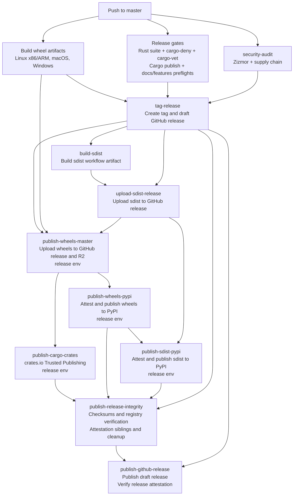

# 发布

本指南介绍发布流程，以及撰写发布说明的标准。

## 总览 {#overview}

NautilusTrader 采用三分支模型：

- **`develop`**：活跃开发。每次 push 向 Cloudflare R2 发布 dev wheel。
- **`nightly`**：预发布测试。发布所有支持的预发布 wheel 与 CLI 二进制。
- **`master`**：稳定版发布。触发完整的发布流水线。

发布提交合并进 `master` 后，流水线自动：

- 依据 `python/pyproject.toml` 打版本标签。
- 创建草稿状态的 GitHub release。
- 上传发布资源。
- 把 Cargo crate 发布到 crates.io。
- 把 wheel 与 sdist 发布到 PyPI。
- 发布 GitHub release。
- 构建 Docker 镜像。
- 触发文档重建。

## 稳定版发布工作流 {#stable-release-workflow}

`build` 工作流把 GitHub release 视为稳定版发布的锚点。它先创建草稿 release，
把 wheel 与 sdist 资源上传到该草稿，然后才把这些包发布到包索引。只有在注册表验证
与最终完整性资源都完成后，工作流才发布 GitHub release。



编辑 `.github/workflows/build.yml` 时保持这些次序规则不变：

- 任何发布资源上传或包注册表发布之前，草稿 GitHub release 必须已存在。
- `tag-release` 必须依赖 `security-audit`，使审计失败后无法继续打稳定版发布标签。
- 包索引发布（`packages.nautechsystems.io`、PyPI、crates.io）开始之前，wheel 与
  sdist 资源必须已挂到 GitHub release 上。
- PyPI 与 crates.io 的 Trusted Publishing 任务必须保留 `environment: release` 与
  `id-token: write`，这些注册依赖 `release` 环境。
- 非 OIDC 的完整性与资源上传任务应避免 `environment: release`，除非它们确实需要
  release 环境的 secret 或批准。
- `publish-release-integrity` 必须在 PyPI 与 crates.io 发布之后运行。它先生成
  发布清单，对照该清单验证注册表，验证通过后附上最终的完整性资源。
- `publish-github-release` 必须是稳定版发布的最后一个任务。GitHub 建议先创建草稿
  release、挂上全部资源，再发布草稿并启用 release 不可变性。若仓库启用了 GitHub
  release 不可变性，已发布的 release 资源与 release 标签都无法更改，只有标题与
  发布说明仍可编辑。该任务在发布前校验最终的草稿资源集合，发布草稿后再校验
  GitHub 的 release 证明。

## 恢复缺失的发布标签 {#recovering-a-missing-release-tag}

`Create git tag` 步骤只在本次运行的提交相对其父提交（`HEAD~1`）改变了版本时
才创建 `v<version>`，且标签已存在时绝不创建。若版本未变而标签缺失，无论重跑
多少次失败任务，`Verify release tag` 都会失败。

重试的发布在版本提升之后，`master` 上通常又有一个或多个提交。于是重跑的运行
与父提交版本相同，不会创建标签。由于 `tag-release` 是草稿 release 与每个下游
发布任务的锚点，标签缺失时运行无法继续。

先检查标签是否存在，以及本次运行的提交是否提升版本：

- 标签缺失且本次运行的提交提升了版本：重跑失败任务即可，无需手工打标签。
  任务通过后 `tag-release` 会创建标签。
- 标签缺失且本次运行的提交与父提交版本相同：任何重跑都不会创建标签，
  按下面的手工标签流程恢复。

手工恢复之所以可行，取决于 `tag-release` 剩余机制：

- 手工推送后重跑时，`Create git tag` 依同一规则跳过创建。
- `Verify release tag` 要求 `v<version>` 解析到本次运行的提交（`GITHUB_SHA`），
  因此在该精确提交上手工推送的标签能通过检查。
- 草稿 release 的创建是幂等的，重跑会更新已存在的草稿。

恢复步骤：维护者手工创建标签，然后重跑失败任务：

1. 从失败运行页记下该运行的提交 SHA。本地检出该提交并确认其携带的版本：

   ```bash
   ./scripts/package-version.sh
   ```

1. 在该运行的精确提交上创建签名的附注标签，沿用既有的标签消息约定，并推送：

   ```bash
   git tag -s v<version> -m "Released version <version>" <run-commit-sha>
   git push origin v<version>
   ```

1. 本地验证标签。签名必须有效，且 `git rev-parse 'v<version>^{commit}'`
   必须等于该运行的提交 SHA：

   ```bash
   git tag -v v<version>
   git rev-parse 'v<version>^{commit}'
   ```

1. 在失败的运行上选择 "Re-run failed jobs"。有了推送的标签，
   `Verify release tag` 会通过，草稿 release 创建与下游发布任务继续执行。

只在发布提交与版本都已定稿时才这样做。标签是永久的发布锚点，一旦 release
不可变性生效，已发布的发布标签就无法更改。若 `v<version>` 指向不同的提交，
不要移动或重推既有标签，要调查这个不一致——`Verify release tag` 在这种情况下
就是设计为失败的。

## 版本管理 {#versioning}

项目维护两个版本号：

| 文件                     | 范围          |
| ------------------------ | -------------- |
| `python/pyproject.toml`  | Python 包 |
| `Cargo.toml`（workspace） | Rust crate    |

两者独立提升。Python 版本决定 `v<python-version>` 发布标签。以 `aN`、`bN` 或
`rcN` 结尾的版本创建 GitHub 预发布；最终版本创建普通发布。

## Crates.io 发布 {#crates-io-publishing}

`build` 工作流通过 `publish-cargo-crates` 任务发布 Cargo crate。该任务经
GitHub Actions OIDC 使用 crates.io Trusted Publishing，不使用持久 cargo 令牌。
每个 crate 在 crates.io 上按如下配置：

| 字段       | 值             |
| ----------- | ----------------- |
| Owner       | `nautechsystems`  |
| Repository  | `nautilus_trader` |
| Workflow    | `build.yml`       |
| Environment | `release`         |

配好 trusted publisher 之后，为 crate 启用 Trusted Publishing Only。从未发布过的
crate 仍需先做一次初始的手工发布，crates.io 才允许配置 trusted publisher。

CI 发布不要用 `cargo publish --workspace`。发布任务运行
`scripts/ci/publish-cargo-crates.sh`，它会：

- 按依赖顺序逐个发布 crate。
- 跳过 crates.io 上已存在的版本。
- 每个新版本发布后，等它出现在 crates.io API 与 sparse index 中，再发布依赖它的 crate。

若某个可发布的 crate 依赖一个不在 crates.io 上的本地 `publish = false` crate，
脚本会在上传前失败。可选的本地依赖同样会阻止发布，因为解析到缺失 crate 的
公开 feature 无法使用。

发布后验证只在 crates.io 显示某版本由本仓库以 trusted-publishing 发布时，
才将其视为 `previously_published`。

**人工恢复**：用户自行发布的版本会验证失败，除非
`CRATES_IO_MANUAL_PUBLISH_EXCEPTIONS` 逐个列出紧急令牌发布恢复的每个
`crate@version`。被接受的条目会以 `release_status: "manual_token_publish"` 出现在
`crates-manifest.json` 中。格式错误或使用不到的例外条目会使任务失败。

trusted-publishing 仓库填错，以及校验和或 sparse-index 不匹配，同样导致验证失败。

## 发布清单 {#release-checklist}

### 发布前（在 `develop` 上） {#pre-release-on-develop}

- [ ] 定稿 `RELEASES.md`：评审所有条目，删除空小节
- [ ] 确认 `python/pyproject.toml` 与 `Cargo.toml` workspace 中版本已设置
- [ ] 确认 CI 发布的每个 crate 都配好了 crates.io Trusted Publishing：
  `bash scripts/ci/check-crates-io-trusted-publishing.sh`
- [ ] 确认 `develop` 上所有 CI 检查通过

### 发布 {#release}

- [ ] 把 `develop` 合入 `nightly`，确认 nightly CI 通过
- [ ] 把 `nightly` 合入 `master`
- [ ] 确认 `build` 工作流完成：
  - Linux x86/ARM、macOS、Windows 的 wheel 均已构建
  - `cargo-deny` 与 `cargo-vet` 通过
  - `security-audit` 的 Zizmor 与供应链检查通过
  - 打标签之前，发布文档/特性与 Cargo 发布预检通过
  - 已创建标签与草稿 GitHub release
  - 包注册表发布之前，wheel 与 sdist 已挂到 GitHub release
  - Cargo crate 已发布到 crates.io，或因版本已存在而跳过
  - wheel 与 sdist 已发布到 PyPI
  - 注册表验证通过之后才附上发布校验和、crates 清单与证明伴生文件
  - 全部发布资源与完整性资源挂载之后才发布 GitHub release
  - 若运行因发布标签缺失而失败，按[恢复缺失的发布标签](#recovering-a-missing-release-tag)
    处理并重跑失败任务
- [ ] 确认 `docker` 工作流完成（镜像已构建并推送）
- [ ] 确认 `build-docs` 工作流完成（已触发文档重建）

### 发布后（在 `develop` 上） {#post-release-on-develop}

- [ ] 在 `RELEASES.md` 中为已发布版本更新发布日期
- [ ] 在已完成的发布下方添加水平分隔线 `---`
- [ ] 在 `RELEASES.md` 顶部添加下一版本的模板（见下文）
- [ ] 把 `python/pyproject.toml` 版本提升到下一个发布号
- [ ] 提升教程与 how-to 中 `Cargo.toml` 片段的 crate 版本
  （`docs/concepts/rust.md`、`docs/how_to/run_rust_backtest.md`、
  `docs/how_to/run_rust_live_trading.md`）

## 发布说明 {#release-notes}

本节定义在 `RELEASES.md` 中撰写发布说明的标准。

### 小节 {#sections}

按以下顺序使用这些小节：

1. Enhancements
2. Breaking Changes
3. Security
4. Fixes
5. Internal Improvements
6. Documentation Updates
7. Deprecations

某次发布没有条目的小节直接省略。

### Enhancements {#enhancements}

新特性与用户可见的改进。

**格式**：

```markdown
- Added `subscribe_order_fills(...)` and `unsubscribe_order_fills(...)` for `Actor`
- Added Bybit conditional orders support
- Added support for `OrderBookDepth10` requests (#2955), thanks @faysou
```

**准则**：

- 以 "Added" 开头。
- 代码元素用反引号。
- 具体写明加了什么，而不是怎么加的。

### Breaking Changes {#breaking-changes}

可能破坏既有代码的变更。

**格式**：

```markdown
- Removed `nautilus_trader.analysis.statistics` subpackage - must import from `nautilus_trader.analysis`
- Renamed `BinanceAccountType.USDT_FUTURE` to `USDT_FUTURES`
- Changed `start` parameter to required for `Actor` data request methods
```

**准则**：

- 以 "Removed"、"Renamed" 或 "Changed" 开头。
- 简要说明迁移路径。

### Security {#security}

防止崩溃、未定义行为或数据损坏的安全加固与修复。包括从 Internal Improvements
提升上来的重要加固改进。

**格式**：

```markdown
- Fixed divide-by-zero and overflow bugs in model crate that could cause crashes
- Fixed core arithmetic operations to reject NaN/Infinity values and improve overflow handling
```

**准则**：

- 收录上溢/下溢修复、内存安全改进、FFI 防护、数据完整性修复。
- 聚焦对用户的影响：本来可能发生什么。
- 排除常规依赖升级、轻微加固或仅涉及测试的修复。
- 本次发布没有安全条目时，整个小节省略。

### Fixes {#fixes}

提升正确性、但不构成安全问题的缺陷修复。

**格式**：

```markdown
- Fixed reduce-only order panic when quantity exceeds position
- Fixed Binance order status parsing for external orders (#3006), thanks for reporting @bmlquant
```

**准则**：

- 以 "Fixed" 开头。

### Internal Improvements {#internal-improvements}

实现细节与基础设施变更。

**格式**：

```markdown
- Added ARM64 support to Docker builds
- Ported `PortfolioAnalyzer` to Rust
- Improved clock and timer thread safety
- Upgraded Rust (MSRV) to 1.90.0
- Upgraded `pyo3` crates to v0.26.0
```

**准则**：

- 使用 "Added"、"Implemented"、"Improved"、"Optimized"、"Upgraded"、"Refined"、
  "Standardized"。
- 依赖升级给出版本号。

### Documentation Updates {#documentation-updates}

指南与示例的变更。

**格式**：

```markdown
- Added rate limit tables with links to official docs
- Improved dark and light themes for readability
- Fixed broken links
```

### Deprecations {#deprecations}

标记为将来移除的特性。

**格式**：

```markdown
- Deprecated `some_config_option`; disable (`False`) to maintain consistent behavior. Will be removed in future version
```

**准则**：

- 说明迁移路径并给出替代方案。

## 署名 {#attribution}

- 给外部贡献者署名：`thanks @username` 或 `thanks for reporting @username`。
- 社区贡献与复杂特性附上 issue/PR 编号：`(#1234)`。

## 风格 {#style}

- 用句子式大写（只大写首词）。
- 结尾不加句号。
- 代码元素用反引号。
- 聚焦**改了什么**，而不是怎么改的。

**要具体**：

```markdown
Bad:  Improved Binance adapter
Good: Improved Binance fill handling when instrument not cached
```

## 安全分类 {#security-classification}

变更涉及以下任一项时归入 Security：

- 内存安全（上溢、下溢、威胁稳定性的除零）。
- 可能损坏状态的未定义行为或崩溃。
- 数据完整性（NaN/Infinity 传播、导致损坏的竞态）。
- 防止注入或利用的输入校验（SQL 注入、命令注入、路径穿越）。
- 构建加固（非执行栈、FFI 防护）。
- 用户应当知晓的重要加固。

否则归入 Fixes（逻辑缺陷与 panic）或 Internal Improvements（轻微加固）。

注意：普通逻辑 panic 归入 Fixes，除非它们威胁系统稳定性或数据损坏。

## 示例 {#examples}

**Security**（可能导致崩溃/损坏）：

```markdown
- Fixed divide-by-zero in margin calculations that could crash the engine
- Fixed integer overflow in model arithmetic that could crash the process
```

**Fixes**（结果错误但安全）：

```markdown
- Fixed Binance order status parsing for external orders
- Fixed position purge logic to prevent purging re-opened position
```

**Enhancements**（面向用户）：

```markdown
- Added Bybit conditional orders support
```

**Internal**（实现层面）：

```markdown
- Implemented Bybit ping/pong handling
```

## 发布说明模板 {#release-notes-template}

```markdown
# NautilusTrader <VERSION> Beta

Released on TBD (UTC).

### Enhancements

### Breaking Changes

### Security

### Fixes

### Internal Improvements

### Documentation Updates

### Deprecations

---
```
