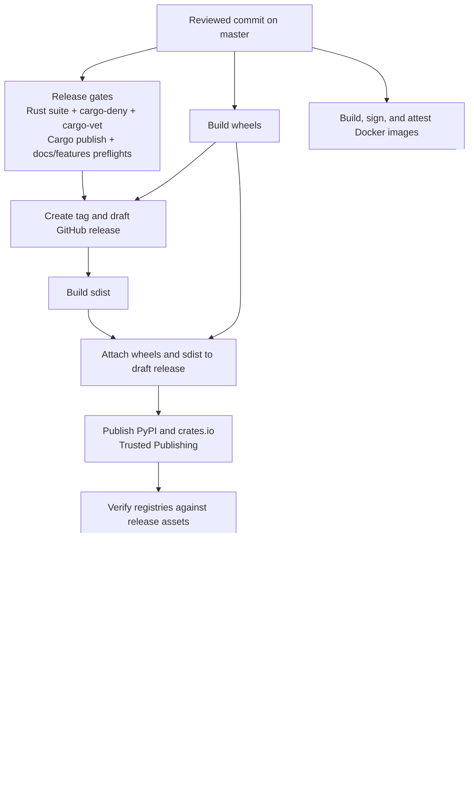

# 安全架构 {#security-architecture}

本页描述 NautilusTrader 发布流水线的安全模型，说明发布产物如何被构建、发布、
证明（attest）与验证。

配合以下文档一起使用：

- [Supply chain policy](https://nautilustrader.io/security/supply-chain/)，列出对外的
  依赖与发布完整性承诺。
- [发布](./releases.md)，记录发布工作流与检查清单。
- [Security Policy](https://github.com/nautechsystems/nautilus_trader/blob/develop/SECURITY.md)，给出面向消费者的验证命令。
- [GitHub Actions overview](https://github.com/nautechsystems/nautilus_trader/blob/develop/.github/OVERVIEW.md#security)，记录 CI/CD 控制。

## 安全目标 {#security-goals}

发布流水线有四个目标：

- 每个官方产物都从经过评审的仓库提交构建。
- 发布 Python 与 Rust 包时不使用长期有效的包注册表令牌。
- 在发布 GitHub release 之前附上校验和、清单与溯源。
- 给用户提供足够的公开数据，让他们验证下载的产物与发布一致。

GitHub release 是包完整性的锚点。稳定版发布会在任何包索引发布开始之前，
把 wheel 与 sdist 资源挂到草稿状态的 GitHub release 上。流水线的顺序是：发布包索引，
用 GitHub release 资源校验这些索引，附上最终的完整性资源，然后发布 GitHub release。

## 威胁模型 {#threat-model}

流水线防范以下威胁：

- 被入侵或可变的第三方 GitHub Actions：把 action 固定到提交 SHA。
- 从错误的工作流、分支或环境误发布：把 OIDC 发布者绑定到
  `nautechsystems/nautilus_trader`、`build.yml` 与 `release` 环境。
- 长期包注册表令牌被盗：使用 PyPI 与 crates.io 的 Trusted Publishing。
- 注册表传播延迟或部分重跑：让发布与校验脚本幂等且可容错重试。
- 注册表替换或上传漂移：把 PyPI 与 crates.io 的产物与发布清单、注册表元数据比对。
- 静默的人工 crate 恢复：要求显式的 `CRATES_IO_MANUAL_PUBLISH_EXCEPTIONS` 条目，
  并在 `crates-manifest.json` 中记录这些例外。

流水线**不**防范以下威胁：

- 有权修改发布工作流并批准发布的恶意维护者。
- 能够伪造用户所依赖信任根的 GitHub、PyPI、crates.io 或 Sigstore 被入侵。
- 验证运行之前终端用户机器已被入侵。
- 交易所、券商、数据提供者或用户交易策略的运行时被入侵。
- wheel 与 sdist 的逐位一致重建漂移。当前的保证是溯源与摘要验证，不是可复现构建。

## 信任根 {#trust-roots}

- GitHub 仓库规则保护经过评审的源码、发布分支与发布标签。受保护的 `master`
  与不可变的 `v*` 发布标签是相关记录。
- GitHub Actions OIDC 签发方从 `https://token.actions.githubusercontent.com`
  提供短时效的工作流身份。
- GitHub `release` 环境把控包发布与发布批准。该环境限制只有 `master` 可部署，
  并要求评审者批准。
- PyPI Trusted Publishing 无需持久令牌即可发布 wheel 与 sdist。它绑定到仓库
  `nautechsystems/nautilus_trader`、工作流 `build.yml` 与环境 `release`。
- crates.io Trusted Publishing 无需持久令牌即可发布 Rust crate。它绑定到所有者
  `nautechsystems`、仓库 `nautilus_trader`、工作流 `build.yml` 与环境 `release`。
- Sigstore 的 Fulcio、Rekor 与 TUF 把产物绑定到 OIDC 身份与透明性日志。
  GitHub 产物证明、PyPI 发布证明与 Docker cosign 签名都依赖这一信任根。
- GitHub release 不可变性防止发布后替换资源与标签。已发布的 release 资源
  与 release 标签都会变为不可变。

## 发布流程 {#release-flow}



Docker 工作流与包发布工作流分开，但使用相同的身份模型。镜像签名与 SBOM 证明
把镜像摘要绑定到预期的 GitHub Actions 工作流身份。

## 产物记录 {#artifact-records}

| 产物              | 发布到                                                                        | 完整性记录                                             | 溯源记录                                                                                      |
| --------------------- | ----------------------------------------------------------------------------------- | ------------------------------------------------------------- | ------------------------------------------------------------------------------------------------------- |
| Python wheels         | GitHub Releases、PyPI 与 Nautech Systems 索引（`packages.nautechsystems.io`） | `SHA256SUMS`、逐资源的 `.sha256` 文件、`dist-manifest.json` | GitHub 产物证明、PyPI 发布证明、`.sigstore` 打包、`.intoto.jsonl` 信封 |
| Python sdists         | GitHub Releases 与 PyPI                                                            | 同 wheel                                                | 同 wheel                                                                                          |
| Rust crates           | crates.io                                                                           | crates.io 校验和、`crates-manifest.json`                    | crates.io 的 `trustpub_data`，除非存在显式的人工例外                               |
| Docker 镜像         | GitHub Container Registry                                                           | 镜像摘要                                                  | Sigstore cosign 签名、SPDX SBOM 证明                                                      |
| GitHub release 记录 | GitHub Releases                                                                     | 已发布的 release 资源、不可变标签                       | GitHub release 证明                                                                              |

Nautech Systems 包索引只发布 wheel，不在那里发布 sdist。

## 消费者验证对照 {#consumer-verification-map}

详细命令见
[Verifying releases](https://github.com/nautechsystems/nautilus_trader/blob/develop/SECURITY.md#verifying-releases)。
下面的检查列出每个消费者应当验证的公开数据。

### Python wheels 与 sdist {#python-wheels-and-sdist}

验证：

- 产物摘要与 `SHA256SUMS`、逐资源的 `.sha256` 文件或 `dist-manifest.json` 匹配。
- GitHub 产物证明的身份匹配
  `nautechsystems/nautilus_trader/.github/workflows/build.yml`，分支为 `master` 或 `nightly`。
- PyPI 发布证明报告的仓库为 `nautechsystems/nautilus_trader`、工作流为 `build.yml`、
  环境为 `release`。

示例：

```bash
: "${VERSION:?Set VERSION to the Python package version}"
: "${ARTIFACT:?Set ARTIFACT to the release asset filename}"
TAG="v$VERSION"
REPO=nautechsystems/nautilus_trader
ISSUER=https://token.actions.githubusercontent.com
IDENTITY='^https://github\.com/nautechsystems/nautilus_trader/\.github/workflows/build\.yml@refs/heads/(master|nightly)$'

gh release download "$TAG" --repo "$REPO" --pattern "$ARTIFACT" --pattern "$ARTIFACT.sha256"
sha256sum -c "$ARTIFACT.sha256"
gh attestation verify "$ARTIFACT" \
  --repo "$REPO" \
  --cert-identity-regex "$IDENTITY" \
  --cert-oidc-issuer "$ISSUER"
```

### PyPI 发布溯源 {#pypi-publish-provenance}

验证：

- PyPI 文件哈希与 `dist-manifest.json` 匹配。
- PyPI 溯源暴露出预期的 GitHub 发布者身份。
- `pypi-attestations verify` 接受下载的文件 URL。

示例：

```bash
: "${VERSION:?Set VERSION to the Python package version}"
: "${ARTIFACT:?Set ARTIFACT to the release asset filename}"
PYPI_URL=$(curl -sS "https://pypi.org/pypi/nautilus_trader/$VERSION/json" | \
  jq -r --arg artifact "$ARTIFACT" '.urls[] | select(.filename == $artifact) | .url')

uv run --no-project --no-build --with pypi-attestations -- \
  pypi-attestations verify pypi \
  --repository https://github.com/nautechsystems/nautilus_trader \
  "$PYPI_URL"
```

### Rust crates {#rust-crates}

验证：

- crates.io 的版本校验和与下载的 `.crate` 文件匹配。
- `trustpub_data.provider` 为 `github`。
- `trustpub_data.repository` 为 `nautechsystems/nautilus_trader`。
- `published_by` 为 `null`，除非 `crates-manifest.json` 记录了显式的
  `manual_token_publish` 例外。

示例：

```bash
CRATE=${CRATE:-nautilus-core}
: "${VERSION:?Set VERSION to the crate version}"
REPO=nautechsystems/nautilus_trader
VERSION_JSON=$(curl -sS "https://crates.io/api/v1/crates/$CRATE/versions" | \
  jq -c --arg version "$VERSION" '.versions[] | select(.num == $version)')
CRATE_SHA256=$(printf '%s\n' "$VERSION_JSON" | jq -r '.checksum')

printf '%s\n' "$VERSION_JSON" | jq -e --arg repo "$REPO" \
  '.trustpub_data.provider == "github" and .trustpub_data.repository == $repo and .published_by == null'
curl -sSL "https://static.crates.io/crates/$CRATE/$CRATE-$VERSION.crate" -o "$CRATE-$VERSION.crate"
test "$(sha256sum "$CRATE-$VERSION.crate" | cut -d ' ' -f 1)" = "$CRATE_SHA256"
```

### Docker 镜像 {#docker-images}

验证：

- 可变的 tag 解析到你打算运行的那个摘要。
- cosign 签名身份匹配 Docker 工作流。
- SPDX SBOM 证明绑定到同一个镜像摘要。

示例：

```bash
export IMAGE_BASE=ghcr.io/nautechsystems/nautilus_trader
export DIGEST=$(crane digest "$IMAGE_BASE:latest")
export IMAGE=$IMAGE_BASE@$DIGEST
export ISSUER=https://token.actions.githubusercontent.com
export IDENTITY='^https://github\.com/nautechsystems/nautilus_trader/\.github/workflows/docker\.yml@refs/heads/(master|nightly)$'

cosign verify "$IMAGE" --certificate-identity-regexp "$IDENTITY" --certificate-oidc-issuer "$ISSUER"
cosign verify-attestation \
  --type https://spdx.dev/Document/v2.3 \
  "$IMAGE" \
  --certificate-identity-regexp "$IDENTITY" \
  --certificate-oidc-issuer "$ISSUER"
```

## 人工恢复姿态 {#manual-recovery-posture}

正常发布只用 Trusted Publishing。人工发布包是部分发布后的最后手段恢复路径。

人工恢复的规则：

- 注册表或 Sigstore 校验器失败时，优先重跑失败的任务或工作流。
- 发布之后不要替换 release 标签或 GitHub release 资源。
- 不要静默接受人工发布的 crate。
- 若某个 crate 必须用令牌恢复，在 `CRATES_IO_MANUAL_PUBLISH_EXCEPTIONS` 中
  逐个列出 `crate@version`。
- 在发布说明与 `crates-manifest.json` 中记录该例外，标为
  `release_status: "manual_token_publish"`。

没有常规发布路径依赖长期的 PyPI 或 crates.io 令牌。

## 事件响应姿态 {#incident-response-posture}

- PyPI 发布者漂移由 PyPI 溯源校验器发现。停止发布，修好 PyPI Trusted Publisher，
  重跑验证。
- crates.io 发布者漂移由可信发布检查或注册表校验器发现。修正 crate 发布者设置
  后重跑。只有部分恢复时才使用人工例外。
- GitHub release 资源不匹配由校验和或清单校验发现。在发布前中止；若资源已经
  放出，则发布安全通告。
- Sigstore、Rekor 或 TUF 延迟由可重试的透明性错误发现。以有界退避重试；
  若延迟持续，暂停发布的封存。
- 当证明验证变得含糊时，说明出现了 Sigstore 信任根问题。暂停发布，对照注册表
  记录验证，并在支持时轮换信任根。
- 工作流身份不匹配由 GitHub、PyPI 或 cosign 身份检查发现。在评审之前，
  按配置漂移或入侵处理。
- crates.io 显示 `published_by` 而非 `trustpub_data` 时，说明存在人工 crate 发布例外。
  记录显式例外、写清受影响的 crate，并保留审计痕迹。

## SLSA 姿态 {#slsa-posture}

Python 发布产物通过 GitHub 产物证明与 PyPI 发布证明携带构建溯源。Docker 镜像
携带 Sigstore 签名与 SPDX SBOM 证明。Rust crate 依赖 crates.io Trusted Publishing
元数据与发布时的 `crates-manifest.json`。

本页不为所有产物类别断言某个具体的 SLSA 等级。将来若声称某个 SLSA 等级，
必须引用本架构、指明它覆盖的产物类别，并包含一项 CI 校验：已发布的溯源能按
所声称的谓词类型解析。
