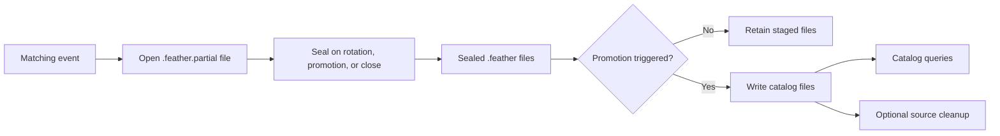

# 向 Parquet 目录流式写入数据

使用 Parquet 流式写入器把实时或回测记录暂存为 Feather 文件，再提升（promote）为可查询的目录
文件。直接调用 `ParquetDataCatalog.write_*` 写入目录数据，不走这套暂存生命周期。

## 配置写入器 {#configure-the-writer}

给 `StreamingConfig` 一个存放 Feather 文件的本地 `writer_path`，以及一个用于提升目标的
`catalog`。没有 `catalog` 时，写入器只保留 Feather 文件供手动转换。

```python
from nautilus_trader.config import BacktestEngineConfig
from nautilus_trader.persistence import DataCatalogConfig
from nautilus_trader.persistence import StreamingConfig

streaming = StreamingConfig(
    writer_path="./stream",
    catalog=DataCatalogConfig(path="./catalog"),
    promotion_interval_ms=5_000,
    promote_on_close=True,
    delete_feather_after_promotion=False,
)
engine_config = BacktestEngineConfig(streaming=streaming)
```

把 `engine_config` 作为 `engine` 参数传给 `BacktestRunConfig`。运行时持有 sink：回测在运行结束时
关闭它，实时节点在停止时 flush、在 dispose 时关闭，因此关闭期间处理的事件仍会被暂存。运行数据
暂存在 `<writer_path>/<backtest|sandbox|live>/<instance_id>` 下，该路径必须是本地路径，因为写入器
会向打开中的文件追加。目录保存提升后的数据供查询使用，可以是本地或远程路径，例如
`DataCatalogConfig(path="bucket/catalog", fs_protocol="s3")`。目录的 `catalog_backend` 决定向它
提升所用的写入器。Parquet 写入器会自动创建缺失的本地目录。

| 设置                             | 默认值  | 含义                                                      |
| -------------------------------- | ------- | --------------------------------------------------------- |
| `promotion_interval_ms`          | 未设置  | 不做按间隔提升；设置时必须为正数。                        |
| `promote_on_close`               | `true`  | sink 关闭时提升已暂存的文件。                             |
| `delete_feather_after_promotion` | `false` | 成功提升后保留源 Feather 文件。                           |
| `use_ts_event_for_ts_init`       | `false` | 提升时保留初始化时间戳。                                  |

运行时在打开写入器前校验配置。没有 `catalog` 时，`promotion_interval_ms` 必须未设置，
`delete_feather_after_promotion` 和 `use_ts_event_for_ts_init` 必须为 false。

要把运行数据暂存在目录内部，把 `writer_path` 和目录 `path` 设为同一个本地目录。
`ParquetDataCatalog.convert_stream_to_data()` 写入它打开时所在的那个目录，因此对其他位置暂存的
运行做手动转换时，数据会写入以 `writer_path` 打开的目录。

### 轮换文件 {#rotate-files}

`rotation_config` 按大小、按间隔或按计划封存某类型的打开文件并开启新文件。默认值
`RotationConfig.no_rotation()` 只在提升和关闭时封存文件。

```python
from nautilus_trader.persistence import RotationConfig

RotationConfig.size(1_073_741_824)
RotationConfig.interval(3_600_000_000_000)
RotationConfig.scheduled_dates(
    86_400_000_000_000,
    1_800_000_000_000,
    timezone="America/New_York",
)
```

`scheduled_dates` 接受以纳秒计的间隔时长，以及在其 IANA `timezone` 中自午夜起以纳秒计的当日
时刻；时区默认为 `UTC`。大小与间隔必须为正数。

轮换和按间隔提升都会封存打开的 Feather 文件，可能把相同 `ts_init` 的行拆分到多个文件。随后
提升后一个文件时会因目录区间重叠而拒绝，并保留该源文件。当共享同一 `ts_init` 的行必须留在
同一文件时，请不启用轮换，并保持 `promotion_interval_ms` 未设置。

## 理解查询可见性 {#understand-query-visibility}

共享的写入核心负责过滤、Feather 文件追加、轮换和提升调度。Parquet 后端转换已封存的文件，并为
已完成的提升记录可重放的身份信息。



每种数据或记录类型在运行目录下暂存一个打开的文件，金融工具则每个工具类一个文件。所有标识符的
行共享其类型的文件，并携带一个 `identifier` 列；提升用它写出每个标识符的目录。提升随后删除该
列，因此提升后的文件与直接写入目录的文件具有相同 schema。

一次 flush 会把自上次 flush 以来缓冲的记录作为一个 Arrow record batch 追加到打开的文件，不会开启
新文件。提升先封存打开的文件，因此每次提升取走的是*截至当时*已写入的记录，并不承诺目录立即可见。
没有提升间隔时，记录一直保持暂存，直到关闭时的提升或手动转换。提升成功后查询才能看到这些记录。

正数间隔会为实时时钟启动一个墙钟提升计时器，安静期也不例外。回测使用传入的测试时钟，在写入或
flush 操作期间检查间隔；仅推进模拟时间不会启动独立的实时计时器。flush 到达间隔时可能触发提升。
关闭会等待待办工作，并默认提升剩余记录。

## 保留与恢复暂存文件 {#retain-and-recover-staged-files}

保持 `delete_feather_after_promotion=False`，在成功提升后保留 Feather 源文件。仅在确实需要清理
源文件时才启用。清理发生在成功提交之后，与目录数据可查询是两回事。提升身份信息可防止已完成的
源文件被重复导入。

显式调用 close 并处理其错误。仅让 writer 被 drop 只提供尽力而为的清理，不能证明提升成功。提升
失败时，保留其暂存文件，查明错误后再重试。`promote_on_close=False` 时，关闭可能有意让已完成的
运行保持暂存，留待之后用 `ParquetDataCatalog.convert_stream_to_data()` 转换。转换默认回测文件夹
之外的运行时，传入该运行的 `environment`，如 `Environment.LIVE`。

写入器在封存前对每个 `.feather.partial` 文件持有独占锁，因此崩溃的进程会把打开的文件留在未锁定
状态。恢复流程会封存每个未锁定的 partial 文件：保留完整的 record batch，丢弃其后的字节并发出
警告，然后把文件改名为 `.feather`。没有任何完整 record batch 的 partial 文件会被删除，空文件则
原地保留。除"写入截断"之外的读取错误会保留文件，留待后续恢复处理。

恢复在这些时机运行：流式写入器在某个运行目录上启动时，以及
`ParquetDataCatalog.read_backtest()`、`read_live_run()` 或 `convert_stream_to_data()` 读取该运行
时。写入器在追加、flush 或封存失败后放弃某个文件时，会立即尝试恢复它，使提升能包含已写入文件的
record batch。该恢复失败时，写入器记录错误，把 partial 文件留给后续恢复处理。

Parquet 提升可能写入多个目标文件。它不提供事务型目录后端的快照事务或历史查询固定（pin）。若
应用要求一次提升的所有文件同时可见，需要自行协调读取方。

### schema 分组区间重叠 {#overlapping-schema-group-intervals}

提升把恢复出的 Feather batch 按标识符、按 schema（含精度元数据）分组。分组依据是 schema 而非
时间，因此同一标识符的两个组可能共享一个 `ts_init` 区间。当一个文件中的记录 schema 不一致时，
该文件会产生这样两个组，例如同一工具的空订单簿深度与有内容的深度并存。目录文件名还携带提升
身份的哈希。

在每个 Feather 文件内，满足"CLEAR-only、无方向、价格为零或未定义、数量为零、订单 ID 为零"的
batch 在分组前会采用同一工具下一个非空订单 batch 的精度。末尾的 CLEAR batch 使用最近一个前置
非空订单 batch 的精度。若文件中某工具只有 CLEAR 行，其零精度保持不变。原始价格与数量值保持
不变；零字段按选定的精度解码，未定义的价格在精度为零时仍未定义。

目录要求每个标识符目录内已关闭的 `ts_init` 区间互不重叠。写入一个 Feather 文件前，提升会合并
那些精度元数据仅相差一个零精度、且零精度组不含小数值（decimal value）的组。提升为合并后的区间
写入一个文件，并保持 `ts_init` 相同的行维持源顺序，包括 schema 相同但不相邻的 batch。
仍然重叠、或合并会改变小数的组，会在该 Feather 源的任何目录文件写出之前导致失败。暂存的
Feather 源被保留，该源不会记录提升身份。自动提升与
`ParquetDataCatalog.convert_stream_to_data()` 对每个 Feather 文件采用相同的规划。该检查之后的
存储错误，或同一运行中后面的 Feather 文件，仍可能留下已写出的文件；提升不是快照事务。对已写出
文件的重复提升会被跳过。

查询与存储行为见[数据目录指南](./../concepts/data/catalog.md)，导入旧目录见
[Parquet 迁移](./migrate_parquet_catalog.md)。
