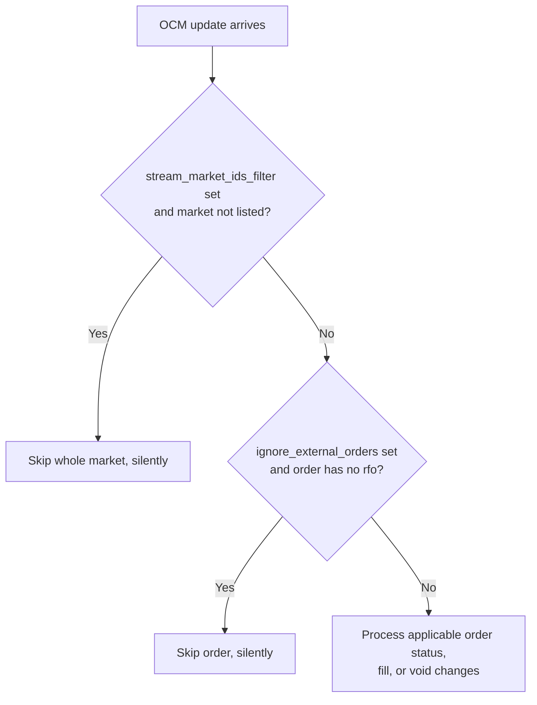

# Betfair

Betfair 成立于 2000 年，运营着全球最大的在线博彩交易所。本集成通过 Betfair Betting、Accounts
和 Exchange Streaming 三套 API 支持工具发现、实时行情、账户状态、订单管理与执行更新。

适配器以 Rust 实现，在 `nautilus_trader.adapters.betfair` 暴露给 Python，因此数据与执行在
两种语言下行为一致。

## 概览 {#overview}

适配器包含若干组件，可单独或组合使用：

- `BetfairHttpClient`：底层 Betting 与 Accounts API 连接。
- `BetfairStreamClient`：底层 Exchange Streaming API 连接，用于市场与订单频道。
- `BetfairRaceStreamClient`：底层赛马与板球数据频道连接。
- `BetfairInstrumentProvider`：加载 Betfair 市场（market）并转换为 Nautilus 金融工具。
- `BetfairDataClient`：行情数据源管理器。
- `BetfairExecutionClient`：账户管理与下注执行网关。
- `BetfairDataClientFactory`：Betfair 数据客户端工厂。
- `BetfairExecutionClientFactory`：Betfair 执行客户端工厂。

:::note
多数用户配置实时交易节点即可，无需直接使用这些底层组件。Python 示例展示了数据与执行客户端
完整的 `LiveNode.builder(...)` 配置。
:::

## 安装 {#installation}

按[安装指南](./../getting_started/installation.md)安装 NautilusTrader。Betfair 适配器已包含在
Python 包中，无需适配器专属的额外依赖。

## 示例 {#examples}

- [Python 示例](https://github.com/nautechsystems/nautilus_trader/tree/develop/examples/live/betfair/)
- [Rust 示例](https://github.com/nautechsystems/nautilus_trader/tree/develop/crates/adapters/betfair/examples/)
- [订单簿失衡回测教程](./../tutorials/backtest_book_imbalance_betfair.md)

## Betfair 文档 {#betfair-documentation}

- [Betfair Developer Program](https://developer.betfair.com/)
- [Exchange API Guide](https://developer.betfair.com/exchange-api/)
- [Application keys](https://betfair-developer-docs.atlassian.net/wiki/spaces/1smk3cen4v3lu3yomq5qye0ni/pages/2687105/Application+Keys)
- [Interactive login](https://betfair-developer-docs.atlassian.net/wiki/spaces/1smk3cen4v3lu3yomq5qye0ni/pages/2687772/Interactive+Login+-+API+Endpoint)

## 凭据 {#credentials}

Betfair 要求用 application key 对 API 请求鉴权。注册并注资账户后，用
[API-NG Developer AppKeys Tool](https://apps.betfair.com/visualisers/api-ng-account-operations/)
获取 key。Betfair 为每个账户分配两个 key：**Live** key 需要一次性激活费，**Delayed** key
用于开发和测试。

通过配置或环境变量提供账户凭据：

```bash
export BETFAIR_USERNAME=<your_username>
export BETFAIR_PASSWORD=<your_password>
export BETFAIR_APP_KEY=<your_app_key>
```

适配器使用 Betfair 的 interactive login 端点，不使用客户端证书。

## 时间戳策略 {#timestamp-policy}

适配器把场所事件时间与本地初始化时间分开：

- `ts_event` 记录 Betfair 声称事件发生的时间。
- `ts_init` 记录实时适配器收到包含该事件的流消息的时间。

每个实时流回调在解码消息之前读取一次实时原子时钟。由该消息解码出的每个输出共享同一个
`ts_init`。

| 输入                 | `ts_event` 来源                                                                                                                                                                                                       | `ts_init` 来源                                                                |
| -------------------- | ----------------------------------------------------------------------------------------------------------------------------------------------------------------------------------------------------- | ----------------------------------------------------------------------------- |
| 市场变化（`mcm`）    | 消息发布时间（`pt`）。                                                                                                                                                                                                  | 本地接收时间。                                                                |
| 赛马变化（`rcm`）    | 赛马（runner）或赛马数据流时间（`ft`），`ft` 缺失时回退到消息发布时间（`pt`）。                                                                                                                                         | 本地接收时间。                                                                |
| 板球变化（`ccm`）    | 消息发布时间（`pt`）。                                                                                                                                                                                                  | 本地接收时间。                                                                |
| 订单变化（`ocm`）    | 相关的订单生命周期时间。接受用 `pd`；成交用 `md`、缺失时回退 `pt`；状态与撤销事件取 `md`、`cd`、`ld` 中最新者、缺失时回退 `pt`。OCM 级自定义数据用 `pt`。                                                              | 本地接收时间。                                                                |
| 历史数据加载器       | 与实时数据相同的 feed 时间规则。                                                                                                                                                                                        | 消息发布时间（`pt`），因为录制数据没有本地接收时间。                          |

OCM 在重连后对账期间到达时，适配器把消息连同其捕获的 `ts_init` 一起缓冲。排空缓冲区时保留
原始接收时间，而不是使用更晚的重放时间。

## 订单簿恢复 {#order-book-recovery}

### 市场快照 {#market-images}

数据客户端在每条连接上用单个市场订阅流式传输所有已订阅市场。订阅另一个市场会用全部已订阅
市场重写订阅，因此 Betfair 会为它们全部重新发送快照（image）。客户端即时排队每次写入，因此
订阅按命令顺序到达 Betfair，最后一次写入携带全部市场。

Betfair 按整个市场发快照。带 `img` 的市场变化会替换该市场所有 runner 的订单簿。因此适配器
按市场跟踪订单簿同步。市场在订阅写入排队之后的快照到达之前不发出任何订单簿 delta。先于快照
到达某市场的市场变化，或适配器无法解析的 runner 变化，会抑制该市场的订单簿输出并请求新的
快照。只有在没有进行中的恢复流程占用该市场时，请求才会启动恢复。

每个快照替换其所带每个 runner 的订单簿。市场定义列出而快照未包含的 runner 会收到空快照，
因为快照携带该市场的全部价格。Betfair 变化消息不带按市场的序号，因此以流连接的到达顺序代替
缺口检测。市场定义报告 `CLOSED` 后停止跟踪，因为 Betfair 不会再为它发送变化或快照。

订单簿订阅持续到客户端断开：退订不会改变市场订阅。

### 快照时限 {#snapshot-deadlines}

初始订阅与恢复订阅在订阅写入排队后，为每个市场的快照最多等待
`book_snapshot_timeout_secs`（默认 **10 秒**）。快照缺失会启动或重试恢复。

把 `book_snapshot_timeout_secs` 设为 `0` 可禁用快照时限。快照之前的市场变化仍会启动恢复。
若其快照始终未到，本次恢复尝试会等到 180 秒重试预算耗尽。之后的每次尝试在重试上限内最多
等待一分钟。

### 重试上限与重连 {#retry-limits-and-reconnects}

恢复会以新 ID 重发不带时钟的市场订阅。每次订阅都替换上一次，因此 Betfair 用全部已订阅市场的
新鲜快照响应。若某次订阅在快照时限内刚写入、其快照尚未开始，新的恢复会并入它而不是再写一次，
因此同时需要恢复的市场共享一个快照。禁用快照时限时，每次尝试都会写入。

每个恢复事件**在 180 秒内最多尝试八次**，采用指数退避加抖动。之后它会持续重试直到接受一个
快照。重试间隔从一分钟翻倍到十五分钟。恢复绝不会以失败状态结束。断开与关闭会取消它。
场所拒绝重新订阅会记入日志，本次尝试在其快照时限过后重试。

重连会用最新的 `clk` 和 `initialClk` 重放市场订阅。因此 Betfair 用 `RESUB_DELTA` 变化就地
修补已同步的订单簿，对无法修补的市场发送快照。已同步的订单簿跨重连保持同步。不带时钟的
重放订阅——例如快照未到的恢复订阅，或在 `INVALID_CLOCK` 后被清除的订阅——会收到完整快照。
进行中的恢复保留其剩余预算；处于尝试间等待的恢复在新连接上立即重试。

共享的恢复机制与适配器职责见
[订单簿恢复归属](./../developer_guide/adapters.md#order-book-recovery-ownership)。

### 实时恢复验证 {#live-recovery-validation}

`betfair-book-stress` 测试台是用于订单簿同步与恢复改动的开发工具。它用账户凭据连接 Betfair
主网行情数据，不提交任何订单。它订阅在过去一小时到未来十二小时之间开赛的四个成交最活跃
胜平负赔率（match odds）市场的所有 runner。它对照订单簿流约定、以及从原始流行独立重建的
最优 10 档，校验每个 runner 的订单簿。测试台代理以 CRLF 分隔的行中继数据流：到适配器走
明文 TCP，到 Betfair 走 TLS。

在仓库根目录，为 live application key 设置好 `BETFAIR_USERNAME`、`BETFAIR_PASSWORD` 和
`BETFAIR_APP_KEY` 后运行：

```bash
CARGO_BUILD_JOBS=16 cargo test -p nautilus-betfair --features examples \
  --test betfair-book-stress -- --timeout 10 --rounds 10
```

Delayed application key 会把数据流合并成三分钟一次的更新，超过测试台的恢复时限。

`--scenario` 选择运行内容：

- `churn`（默认）：轮换不可解析的 runner 变化、被拒的重新订阅、恢复的重连、恢复期间的重连，
  以及 25 秒流量冻结或断线之一。
- `boundaries`：探测重试预算耗尽进入重试上限，以及重连期间关闭。

`--timeout` 以秒设置快照超时，`0` 表示禁用快照时限和被拒重新订阅阶段。`--rounds` 设置
`churn` 轮数（默认 10）。`boundaries` 其序列只跑一次。`--markets` 接受逗号分隔的未结市场
ID 作为替代测试对象。

测试台需要 Exchange Stream API 以及 Identity、Navigation 和 Betting API，它们负责登录、加载
市场的金融工具并挑选市场。共享标志与输出格式见
[压力测试台](./../developer_guide/spec_data_testing.md#stress-harnesses)。

## 订单能力 {#orders-capability}

Betfair 是博彩交易所，传统金融场所的若干概念在此并不适用。

### 订单类型 {#order-types}

| 订单类型                 | 支持 | 说明                                                              |
| ------------------------ | ---- | ----------------------------------------------------------------- |
| `MARKET`                 | ✓*   | 支持 `AT_THE_CLOSE`，映射为 Betfair `MARKET_ON_CLOSE`。           |
| `LIMIT`                  | ✓    | 支持普通限价订单与 BSP 收盘限价订单。                             |
| `STOP_MARKET`            | -    | 不支持。                                                          |
| `STOP_LIMIT`             | -    | 不支持。                                                          |
| `MARKET_IF_TOUCHED`      | -    | 不支持。                                                          |
| `LIMIT_IF_TOUCHED`       | -    | 不支持。                                                          |
| `TRAILING_STOP_MARKET`   | -    | 不支持。                                                          |

提交任何非 `AT_THE_CLOSE` 有效期的 `MARKET` 订单都会被拒绝，因为 Betfair 没有即时市价单。

:::warning
BSP 收盘指示携带的是**责任额（liability）**，不是本金（stake）。`MARKET_ON_CLOSE` 和
`LIMIT_ON_CLOSE` 订单，适配器把订单数量作为 Betfair 责任额发送。给 BSP 订单定量请按你准备
损失的金额，而不是期望成交的本金。
:::

BSP 投注不可撤回：一旦下单，场所会拒绝其撤销请求。BSP 投注挂单期间，数据流和
`listCurrentOrders` 都报告它为 `EXECUTION_COMPLETE`，成交、剩余、已撤、失效与作废数量全为
零，责任额单独携带。适配器让这样的投注保持 `ACCEPTED` 直到 BSP 对账：成交的投注落定为
`FILLED`，失效的投注落定为 `CANCELED`。对 BSP 投注显式发出 `CancelOrder` 或
`BatchCancelOrders` 会发出 `OrderCancelRejected`，携带场所的 `BET_TAKEN_OR_LAPSED` 原因，而
不会关闭订单。`CancelAllOrders` 不发出逐单事件，见[撤销全部订单](#cancel-all-orders)。

### 有效期 {#time-in-force}

| 有效期         | 支持 | 说明                                                         |
| -------------- | ---- | ------------------------------------------------------------ |
| `GTC`          | ✓    | 映射为 Betfair `PERSIST`。                                   |
| `DAY`          | ✓    | 映射为 Betfair `LAPSE`。                                     |
| `FOK`          | ✓    | 映射为 Betfair `FILL_OR_KILL`。                              |
| `IOC`          | ✓    | 映射为 `FILL_OR_KILL` 且 `min_fill_size=0`。                 |
| `AT_THE_CLOSE` | ✓    | 用于 Betfair BSP 的 `LIMIT_ON_CLOSE` 与 `MARKET_ON_CLOSE`。  |
| `GTD`          | -    | 不支持；到期时间被忽略并映射为 `LAPSE`。                     |

`AT_THE_OPEN` 模式的 `LIMIT` 订单也路由到 `LIMIT_ON_CLOSE`，因为 Betfair 没有开盘指示。

### 执行指示 {#execution-instructions}

| 指示          | 支持 | 说明                                 |
| ------------- | ---- | ------------------------------------ |
| `post_only`   | -    | 不适用于博彩交易所。                 |
| `reduce_only` | -    | 不适用于博彩交易所。                 |

### 高级订单特性 {#advanced-order-features}

| 特性             | 支持 | 说明                              |
| ---------------- | ---- | --------------------------------- |
| 订单修改         | ✓    | 价格与数量分别修改。              |
| 括号/OCO 订单    | -    | 不支持。                          |
| 冰山订单         | -    | 不支持。                          |

### 批量操作 {#batch-operations}

| 操作     | 支持 | 说明                                     |
| -------- | ---- | ---------------------------------------- |
| 批量下单 | ✓    | 通过 `SubmitOrderList` 实现。            |
| 批量改单 | -    | 不支持。                                 |
| 批量撤单 | ✓    | 通过 `BatchCancelOrders` 实现。          |

### 撤销全部订单 {#cancel-all-orders}

不带订单方向时，`CancelAllOrders` 发送一个市场级请求，撤销该市场每个选项（selection）的
订单。

带订单方向时，命令按精确的工具与方向选出缓存中的未结订单，不论策略。这些订单必须属于当前
执行客户端与账户，包括分配给该客户端的对账外部订单，不含未分配客户端的订单。命令使用缓存中
已有的场所订单 ID，不会先刷新订单状态。若任何本应符合条件的订单缺少缓存的场所订单 ID，
命令不发送任何请求。否则按每批至多 60 笔发送逐注撤销指示。

`CancelAllOrders` 不创建逐单撤销命令，因此请求与指示失败不会发出订单事件。OCM 与批量状态
对账提供最终订单状态。

### 持仓管理 {#position-management}

| 特性         | 支持 | 说明                                           |
| ------------ | ---- | ---------------------------------------------- |
| 查询持仓     | -    | 敞口按投注跟踪，不按持仓。                     |
| 持仓模式     | -    | 不适用于博彩交易所。                           |
| 杠杆控制     | -    | 博彩交易所没有杠杆。                           |
| 保证金模式   | -    | 博彩交易所没有保证金。                         |

在 `LiveExecutionEngineConfig` 上设置 `position_check_interval_secs=None`，因为 Betfair 不
报告可供核对的场所侧持仓。

### 订单查询 {#order-querying}

| 特性             | 支持 | 说明                                               |
| ---------------- | ---- | -------------------------------------------------- |
| 查询未结订单     | ✓    | 由 `listCurrentOrders` 构建。                      |
| 订单状态更新     | ✓    | 订单频道上的实时投注状态变化。                     |
| 成交报告         | ✓    | 来自 `listCurrentOrders` 的成交数量与价格。        |
| 已结算订单历史   | -    | 适配器不请求结算历史。                             |

`LiveNode` 在 worker 上通过 HTTP 获取批量订单与成交报告，然后在主线程于对账前用当前 OCM
状态解析身份与增量成交。启动与重连后的批量状态查询绕过这些钩子。

- 单笔订单报告返回 unsupported 错误，无法确认批量检查中缺失的缓存未结订单确实不存在。
  缺失订单的厘清被推迟。OCM 更新与批量状态仍可用。`QueryOrder` 仍支持在途检查。
- 持仓报告返回 unsupported 错误。请[禁用持仓检查](#position-management)。

## 执行控制流 {#execution-control-flow}

启动：

1. 连接 HTTP 客户端并获取初始账户资金。
2. 用缓存订单为 OCM 状态预置数据。
3. 连接 Betfair 执行流并订阅订单更新。
4. 从同一批 `listCurrentOrders` 观测生成订单与成交报告。
5. 把订单与成交报告对账进执行引擎。

带场所有关身份的缓存未结订单会按已接受状态恢复。适配器还会为至多 10,000 笔近期已关闭的
缓存订单恢复其保留的身份。两条路径都不会再发出 `OrderAccepted`。

每次流重连时，适配器会在最近的时间窗口上重复订单与成交的批量状态获取。在传输丢失或服务端
`connectionClosed` 状态之后，它会暂停新订单提交，直到最新一代恢复流程发出其批量状态。

完整转换序列见[重连后对账](#post-reconnect-reconciliation)。

对账行为：

- `stream_market_ids_filter` 过滤实时 OCM 更新。
- 仅当 `reconcile_market_ids_only=True` 且设置了 `reconcile_market_ids` 时，对账才使用
  `reconcile_market_ids`。
- 其他所有情况——包括 `reconcile_market_ids_only=True` 但没有 `reconcile_market_ids`——
  对账范围都回退到 `stream_market_ids_filter`。
- `ignore_external_orders=True` 跳过不带 `rfo` 的 OCM 更新。

## 会话管理与重连 {#session-management-and-reconnection}

Betfair 的会话令牌会过期，适配器主动续期而不坐等失败。它通过四种机制处理续期与恢复：

| 机制               | 触发条件                                      | 动作                                                                                                 |
| ------------------ | --------------------------------------------- | ---------------------------------------------------------------------------------------------------- |
| 周期性 keep-alive  | 每 10 小时（36,000 秒）。                     | 续期会话令牌，并更新保留的流鉴权，无需重连。                                                         |
| keep-alive 回退    | keep-alive 返回 `LoginFailed`。               | 重新登录，更新全部活动流的鉴权，然后请求替换流传输。                                                 |
| 流重连             | 传输恢复后的当前订单快照。                    | 先试 keep-alive。`LoginFailed` 触发完全重新登录；其他失败保留现有会话。                              |
| HTTP 报告恢复      | 报告查询返回会话错误。                        | 先试 keep-alive 并重试一次；任何 keep-alive 失败都在该重试前回退为完全重新登录。                     |

周期性 keep-alive 任务与数据流重连处理器会对瞬时 keep-alive 错误（如网络超时和 5xx 响应）
记日志并跳过。执行重连处理器同样保留现有会话令牌，但继续报告对账。在周期性或处理器级的
keep-alive 步骤上，只有 `LoginFailed` 触发完全重新登录。HTTP 报告恢复不同：会话错误之后，
任何 keep-alive 失败都会在报告级重试之前回退为完全重新登录。

数据与执行客户端使用同一会话续期策略，各自派生：

- 一个 **keep-alive 任务**，周期性地尝试续期。普通成功的 keep-alive 只更新保留的鉴权，
  不替换传输。
- 一个**重连处理器**，等待替换订单订阅成为当前状态，然后尝试刷新会话。

完全重新登录后，适配器先更新所有受影响的活动流的鉴权，再请求任何重连。每个替换连接在发送
保留的订阅或重连期间缓冲的流量之前，先发送最新鉴权。市场与订单流保留其订阅 ID 和
`clk`/`initialClk` 恢复值。相关的状态响应会区分：socket 可用性、鉴权、待处理订阅、当前
订阅、被拒请求与降级流。

数据客户端对活动的市场、赛马和板球流应用同样的更新。周期性 keep-alive 回退会在更新鉴权后
立即请求替换传输。HTTP 报告恢复会在查询结束后请求执行流的替换。

若完全重新登录发生在执行流重连处理器内部，该处理器先获取并分派批量状态，再请求替换执行流。
替换流的 `Connection` 消息会启动处理器的下一轮迭代。成功的 keep-alive 只更新保留鉴权，不再
请求新的替换。这个顺序避免了重连循环。

## 重连后对账 {#post-reconnect-reconciliation}

初始握手之后，Betfair 执行传输一旦丢失就立即暂停新订单提交。这既适用于自动网络重连，也
适用于完全重新登录后请求的替换。适配器假设缓存在前一传输不可用期间可能已经出现偏差。尤其
是，成交可能在重连后流快照到达之前完成并滑出未匹配簿。因此适配器在允许新提交之前，会围绕
最近的时间窗口获取并分派一次批量状态。

| 步骤 | 触发条件                                              | 动作                                                                                                                 |
| ---- | ----------------------------------------------------- | -------------------------------------------------------------------------------------------------------------------- |
| 1    | 传输丢失或服务端 `connectionClosed` 状态。            | 推进对账代号，并立即暂停新提交。                                                                                     |
| 2    | 替换的 `Connection` 消息。                            | 把鉴权与保留订阅标记为待定，并升起 `pending_resync`。                                                                |
| 3    | 完整的 `SUB_IMAGE` 或 `RESUB_DELTA`。                 | 为当前代号排队一次。OCM 保持缓冲直到恢复完成。                                                                       |
| 4    | 重连任务收到该代号。                                  | 刷新会话，请求 `getAccountFunds`，然后以至多四次有界尝试获取一份订单快照。                                           |
| 5    | 快照全部分页成功。                                    | 在单次代号检查下发出完整批量状态、提交成交去重，并重新开放提交。                                                     |

账户状态刷新是尽力而为：请求或解析失败会记日志，但不会阻止批量状态分派或重新开放闸门。
非 `LoginFailed` 的 keep-alive 失败会沿用保留的会话继续，因为报告查询自带重试与会话恢复
逻辑。只读的批量状态恢复以指数退避重试四次。重试耗尽、完全重新登录失败或报告分派失败，
都会让闸门保持暂停，直到某次后续重连成功或客户端断开。更新的传输丢失、重连、断开或关闭
会取消过期的恢复工作。这一 fail-closed 行为同样覆盖鉴权或订单订阅非当前状态的活跃 socket。

批量状态分派与成交去重提交构成所处理代号的完成边界。失败或过期的恢复不会推进成交去重。
闸门不等待执行引擎已把报告应用到缓存的单独确认。

执行流不可用或对账进行期间：

- `submit_order` 与 `submit_order_list` 发出 `OrderDenied`，原因为
  `STREAM_RECONCILING: execution stream unavailable or recovering, retry after recovery`。
- `cancel_order`、`batch_cancel_orders` 与 `modify_order` 原样通过。
- `pending_resync` 缓冲替换 `Connection` 消息之后收到的 OCM。连通性轮询以及命令或报告入口
  会在引擎线程上调用 `process_pending_resync`，它从缓存同步 OCM 状态并排空缓冲。

若对账仍在途时客户端断开，`clear_resync_state` 会清除当前的暂停状态，让随后的
连接/提交周期干净地开始。

批量状态获取的回看窗口是 `stream_gap_recovery_lookback_mins`（默认 `10`）。订单与成交报告
使用同一次分页 `listCurrentOrders` 遍历的 `OrderProjection::All` 观测。带市场过滤时，请求
按每批至多 250 个市场 ID。若分页中重复出现某个 Bet ID，两份报告都使用其最后一次观测。

成交恢复在本地按 `matchedDate`（含两端）选择订单，并按成交时间排序。缺口期间成交过的
更早下单的订单仍在候选之列，包括 `listCurrentOrders` 仍返回的执行完成与已结算订单。成交
窗口之外的订单仍会贡献状态与替换历史，但不推进成交去重。

常规批量状态生成用调用方可选的 `lookback_mins` 作为下界，不设上界。未提供回看时长时，
任何带 `matchedDate` 的订单都在候选之列。常规生成只有在完整报告准备好返回时才提交去重。

## 仅未结订单发现 {#open-only-order-discovery}

仅未结对账用于发现可执行的投注，以及所有开启 BSP 的市场中的订单。

### 替换历史 {#replacement-history}

适配器就发现到的订单与未决修改查询已知的替换 Bet ID。这些额外查询找回累计成交与已确认
数量：

- 若额外查询之后仍缺少必需的替换或待定修改 Bet ID，扫描以失败告终，而不是把它们的成交
  当作零。
- 缓存中某笔未结订单未出现在场所发现结果中，本身不会触发该失败。

### 市场范围 {#market-scope}

发现查询使用[配置的对账市场范围](#execution-control-flow)。针对特定工具的命令会把发现
范围收窄到该工具所在的市场；市场不在配置范围内时不返回任何报告。

按 Bet ID 与 `customerOrderRef` 的额外查询不受市场过滤。它们还会为发现范围之外的已跟踪
订单查询未决修改。这些行会被排除在报告之外，但缺失的必需历史仍会使扫描失败。

### 挂起的 BSP 投注 {#resting-bsp-bets}

为找回挂起的 [BSP 投注](#order-types)（包括适配器未跟踪的投注），适配器还会发现含有
执行完成账户订单的 BSP 开启市场，用 `ALL` 对这些市场执行 `listCurrentOrders` 查询，并把
挂起的 BSP 投注报告为 `ACCEPTED`。

BSP 市场发现依赖查询范围：

- **账户级**：`listEvents` 找到事件，然后 `listMarketCatalogue` 以 `maxResults=1000` 查询
  每个事件。若某事件返回 1,000 个市场，扫描以失败告终，而不是冒险拿到不完整的未结订单集。
- **市场级**：每个 catalog 请求至多包含 250 个市场 ID。

不带 BSP 的市场不会被扫描无关的订单历史。已发现 BSP 开启市场内的历史订单（包括普通限价
投注）仍可能增加必需的替换历史，加大扫描工作量。

## tick 方案与定价 {#tick-scheme-and-pricing}

Betfair 使用分层 tick 方案，不同价格区间采用不同递增步长：

| 价格区间         | tick 大小 |
| ---------------- | --------- |
| 1.01 - 2.00      | 0.01      |
| 2.00 - 3.00      | 0.02      |
| 3.00 - 4.00      | 0.05      |
| 4.00 - 6.00      | 0.10      |
| 6.00 - 10.00     | 0.20      |
| 10.00 - 20.00    | 0.50      |
| 20.00 - 30.00    | 1.00      |
| 30.00 - 50.00    | 2.00      |
| 50.00 - 100.00   | 5.00      |
| 100.00 - 1000.00 | 10.00     |

最低价格 1.01，最高 1000.00。

## 订单修改 {#order-modification}

- 价格与数量不能原子地同时修改，需要分开操作。
- 价格修改使用 `ReplaceOrders`（撤销旧单 + 以新价下新单）。
- 数量减少使用带 `size_reduction` 参数的 `CancelOrders`。
- 不支持增加数量，请改为提交新订单。

成功的价格替换在逻辑上仍是同一个 Nautilus 订单。适配器把新旧 Bet ID 映射到同一个
`client_order_id`，抑制旧注的撤销，并恰好发出一个携带新 Bet ID 的 `OrderUpdated`。无论 REST
响应还是订单变化消息（OCM）先到都成立。若替换的 OCM 已包含成交，`OrderUpdated` 先于
`OrderFilled`。

当 replace 操作撤销了旧注但未能挂出其替换单时，Betfair 会返回 `CANCELLED_NOT_PLACED`。
适配器此时为逻辑订单发出 `OrderCanceled`，而不是 `OrderModifyRejected`。被撤销 Bet ID 的
迟到成交仍会被应用一次，之后订单保持 `CANCELED`。当旧注撤销的 OCM 在替换待定期间到达、
REST 调用随后返回任何确定性 replace 失败时，得到同样的终态结果。

### 厘清有歧义的修改 {#recovering-an-ambiguous-modification}

REST 响应丢失或有歧义时，适配器从 OCM 流或确证的 `listCurrentOrders` 结果厘清该修改。只有
完整分页的对账才能证明原订单保持不变，或无替换地关闭：

- 以同一 `customerOrderRef`、不同 Bet ID 列出的投注会提升待定的 replace。活动与已关闭的
  列出都会发出携带新 Bet ID、其价格与原始数量的 `OrderUpdated`。活动的列出随后被从厘清
  报告集中剔除；已关闭的列出则通过其终态订单状态报告跟随该更新。
- 活动数量已降至不低于请求数量但低于原始数量的投注，确认这次减少。活动数量等于成交加
  剩余加作废（`sizeVoided`，流上为 `sv`），并计入被替换投注的成交与作废数量，因此作废
  不会使其降低。活动的列出发出携带减少后数量的 `OrderUpdated`；已关闭的列出在终态报告中
  携带确认后的数量而没有 `OrderUpdated`。更小的活动数量意味着失效而非所请求的减少，未变
  的数量意味着 Betfair 尚未应用该减少——两者都让命令保持在途。

哪个通道先厘清修改哪个就生效，其余变为无操作。因此流确认的数量减少不会在其 REST 响应
返回时重复执行。

REST 请求可能仍在运行时，只列出原始注的结果证明不了任何事，订单因此保持 `PENDING_UPDATE`。
REST 结果变为有歧义之后，若完整分页对账显示原 Bet ID 仍可执行，则发出
`OrderModifyRejected`、保留其活动报告并清除待定替换。若 `customerOrderRef` 唯一解析到待定
订单，同样的对账中原 Bet ID 已关闭且无替换时，会清除待定状态并让终态报告携带撤销。若
`customerOrderRef` 无法唯一解析，适配器无法确定可能的新 Bet ID，替换保持待定。确定性的
修改失败同样会清除待定状态，使之后的失效不会被误认为所请求的减少。

对账会剔除会重复或抵触已厘清状态的订单状态报告：

- 厘清那一趟上被取代的 replace 支路——无论替换处于活动还是终态——因为它的 `CANCELED`
  报告否则会把逻辑订单撤掉。
- 产生 `OrderUpdated` 的那条活动报告，因为对账进行时订单在本地仍属待定。

与 `OrderModifyRejected` 一起保留的报告和终态报告走正常报告路径。终态的替换报告在其
`OrderUpdated` 之后进入保留的终态生命周期。终态的减少在没有 `OrderUpdated` 的情况下厘清；
该报告及其后的报告携带确认后的数量，而不是 Betfair 的原始本金。

厘清那一趟会如上所述抑制历史 Bet ID。逻辑替换订单进入终态后，后续的显式查询与批量状态
查询会为其历史 Bet ID 保留订单状态报告。

## 订单命令失败与重试 {#order-command-failures-and-retries}

### 请求关联 {#request-correlation}

Betfair 为逻辑订单关联与请求去重提供两个独立的值：

| 字段               | 作用范围          | 适配器行为                                                                                                                 |
| ------------------ | ----------------- | -------------------------------------------------------------------------------------------------------------------------- |
| `customerOrderRef` | 一个逻辑订单      | 由 `client_order_id` 派生，作为 OCM 的 `rfo` 返回，并跨替换 Bet ID 保留。                                                  |
| `customerRef`      | 一条 REST 命令    | 每个 place、replace 或 cancel 请求各生成一个，每次重试原样复用，包括批量与数量减少。                                       |

:::warning
超过 32 个字符的客户端订单 ID 取其后 32 个字符作为 `customerOrderRef`。请保持被跟踪订单
的这些后缀互不相同。新提交若其引用与另一笔被跟踪订单相同，会在 `OrderSubmitted` 或 HTTP
派发之前发出 `OrderDenied`，原因为
`VALIDATION_FAILED: customerOrderRef <ref> collides with another tracked order`。订单列表中
只拒绝发生冲突的那条腿。
:::

从缓存订单同步 OCM 状态时，适配器也识别旧式取前 32 个字符的格式。若任一截断能对应多笔
被跟踪订单，OCM 与对账的订单状态、成交报告会省略 `client_order_id` 并保留 Bet ID，让对账
按场所身份匹配。

### 重试与歧义 {#retry-and-ambiguity}

改变状态的订单调用默认在 45 秒总预算内至多重试三次。这个耗时上限保证每次重试都落在
Betfair 60 秒的 `customerRef` 去重窗口内。适配器按如下方式处理失败：

| 失败或响应                                                                        | 订单命令处理                                                                             |
| --------------------------------------------------------------------------------- | ------------------------------------------------------------------------------------------ |
| 传输失败、客户端超时、畸形的成功响应或 HTTP 5xx                                   | 将本次尝试标记为有歧义，用同一 `customerRef` 重试。                                      |
| HTTP 429、`TOO_MANY_REQUESTS` 或 `SERVICE_BUSY`                                   | 用同一 `customerRef` 重试。                                                              |
| `UNEXPECTED_ERROR`                                                                | 将本次尝试标记为有歧义，用同一 `customerRef` 重试。                                      |
| `TIMEOUT_ERROR` 或适配器主动取消                                                  | 让命令保持有歧义，不再重试。                                                             |
| `TIMEOUT` 报告或 `BET_IN_PROGRESS`                                                | 让命令保持有歧义，交给 OCM 或对账。                                                      |
| 不完整或自相矛盾的报告                                                            | 让命令保持有歧义，除非确定性的顶层错误能证明被拒。                                       |
| 已知的校验、鉴权、权限或其他确定性场所错误                                        | 拒绝受影响的命令，不再重试。                                                             |
| 服务端错误下缺失、畸形或未知的嵌套 API 错误                                       | 让命令保持有歧义且不重试，直到其含义被显式支持。                                         |

有歧义的下单保持 `SUBMITTED`，有歧义的替换保持 `PENDING_UPDATE`，有歧义的撤销保持
`PENDING_CANCEL`，直到 OCM 或对账厘清。适配器不发出拒绝，因为 Betfair 可能已经应用了请求。
已派发的尝试一旦结果未知，后续失败的尝试也无法让整体结果变为确定。

确定性的下单、撤销与修改失败通常分别发出 `OrderRejected`、`OrderCancelRejected` 和
`OrderModifyRejected`。旧注撤销已到达后的确定性价格替换失败改发 `OrderCanceled`，因为那张
注已不可执行。`BET_TAKEN_OR_LAPSED` 以同样的终态原因完成撤销，BSP 投注除外——场所并没有
应用该撤销：那里发出 `OrderCancelRejected`，投注保持未结直到 BSP 对账。

### JSON-RPC 错误 {#json-rpc-errors}

Betfair 的 JSON-RPC 错误包含外层的数字 `code` 与 `message`，还可能包含嵌套的 API
`errorCode` 与 `errorDetails`。外层值描述 JSON-RPC 信封。Betfair 常用 `-32099`，把可操作的
API 错误存放在 `data.exceptionname` 所指名的对象里，如 `APINGException` 或
`APINGException`/`AccountAPINGException`。适配器保留外层与嵌套字段，可用时采用嵌套 API
错误。未知、缺失或畸形的嵌套数据通过外层 code 与 message 仍然可见，并接受上述保守的订单
处理。只读调用保留其更宽松的重试策略，可以重试 `TIMEOUT_ERROR` 或可重试的泛型外层错误。

## 订单流成交处理 {#order-stream-fill-handling}

执行客户端处理来自 Betfair Exchange Streaming API 的订单更新。两个配置项控制更新的过滤
方式：

- `stream_market_ids_filter`：在市场层过滤（提前退出、静默跳过）。
- `ignore_external_orders`：在订单层过滤（跳过无 `rfo` 的 OCM 更新）。



两道过滤都通过后，适配器只发出适用于该更新的输出。市场级过滤在任何逐 runner 工作之前
退出，两道过滤都不记警告。

:::warning
如果设置了 `stream_market_ids_filter`，请确保它包含你交易的每一个市场。被过滤排除的市场
上的订单会错过流上的实时成交与撤销更新。
:::

### 成交处理 {#fill-handling}

适配器在处理流上的成交时会处理若干边缘情况：

- **增量成交**：Betfair 按 Bet ID 报告累计成交数量。适配器为每个当前或历史 Bet ID 维护
  独立的成交游标，并在对账期间从缓存事件恢复这些游标。
- **超成交保护**：会使成交量超过订单数量的成交会被拒绝。
- **竞态**：流上的成交先于 HTTP 订单响应到达时，适配器立即缓存场所订单 ID，保证正确
  匹配订单。
- **替换成交**：报告在旧 Bet ID 上的成交只更新同一逻辑订单一次，不替换其当前 Bet ID。
  订单处于 `PENDING_UPDATE` 或 `PENDING_CANCEL` 时收到的部分成交会更新其已成交量，同时
  保留待定的命令状态。
- **价格重述**：Rule 4  withdrawals 会以更低的平均成交价、不变的成交数量重新发布已成交的
  注。适配器把新价格作为携带该注交易 ID 的成交发出，重述订单与未平仓位的均价，数量不变。
  只有恰好一个成交批次在该注上存活时重述才适用。存活批次多于一批的更新，或作废与新均价
  一起到达时，什么都不发。

  重述平仓成交只纠正订单均价。持仓平仓核算保持原值。部分平仓之后重述开仓成交只更新未平
  均价。已平仓数量的已实现盈亏保持原值。被撤销注上的重述不再发出第二次撤销。
- **Late terminal corrections**: the adapter retains correlation and per-Bet fill and void state for
  the 10,000 most recent terminal identities, including identities restored from closed cached
  orders. Locally owned identities and external terminal Bet IDs share this bound. Delayed fills and
  void corrections for an unambiguous retained order emit direct order events. After applying a
  delayed fill to a canceled order, the adapter emits `OrderCanceled` again to preserve the terminal
  state. If the same update carries void corrections, the cancel precedes those corrections.
  Correlation and deduplication state expire together, so an older replay can return through the
  report path.
- **Gap-window fills**: a fill that completes and rolls off the unmatched book during a stream disconnect is
  recovered by the post-reconnect mass-status reconciliation. See
  [Post-reconnect reconciliation](#post-reconnect-reconciliation).

### Voided fills

Betfair can void matched bets after reporting them, for example after an integrity ruling or a VAR
decision. The order stream carries the running total in `sv` (size voided). Voids caused by runner
removal settle instead of streaming, so they do not reach this path.

The adapter allocates each `sv` increase to locally applied fill lots newest-first and emits one
cumulative [`OrderFillVoided`](./../concepts/events/order_fill_voided.md) per affected `trade_id`. A
first-seen snapshot seeds its cumulative void state without reversing exposure Nautilus never
applied, so a reconnect does not double-correct. Any `sv` increase also triggers an account refresh.

An `EXECUTION_COMPLETE` update with no locally applied fill lots takes the terminal path instead: one
correction under a synthetic `VOID-{bet_id}` trade ID that carries the order to `VOIDED`. That status
resolves only when `sv` is positive and both cancelled and lapsed quantities are zero, so a mixed
update carrying `sc` or `sl` alongside `sv` emits no correction. Betfair voids never set
`is_reopened`, so `VOIDED` is final.

The adapter also publishes the [`BetfairOrderVoided`](#custom-data-types) custom data type carrying
the venue's raw void detail.

## Rate limiting

The adapter uses separate rate limit buckets so that account state polling and
reconciliation do not throttle order placement:

| Bucket  | Default | Endpoints                                       | Configurable                     |
| ------- | ------- | ----------------------------------------------- | -------------------------------- |
| General | 5/s     | Account state, reconciliation, keep-alive.      | `request_rate_per_second`.       |
| Orders  | 20/s    | `placeOrders`, `replaceOrders`, `cancelOrders`. | `order_request_rate_per_second`. |

Read-only Betting API calls use the general HTTP retry budget, with up to three retries by default.
State-changing calls use the policy in [Order command failures and retries](#order-command-failures-and-retries).

After a report query returns a session or rate-limit error, the order status and fill report paths
make one additional report-level attempt. A session error first tries keep-alive and falls back to
full re-login after any keep-alive failure. Full re-login updates execution stream authentication
and requests a replacement after the query finishes. A `TOO_MANY_REQUESTS` error waits 5 seconds
before the report-level retry.

Betfair's own API limits are more nuanced than a single request rate:

| Category                 | Limit                | Notes                                                                                      |
| ------------------------ | -------------------- | ------------------------------------------------------------------------------------------ |
| Order operations         | 1,000 transactions/s | Total instructions across `placeOrders`, `cancelOrders`, `replaceOrders`.                  |
| Order projection queries | 3 concurrent         | `listMarketBook` (with `OrderProjection`), `listCurrentOrders`, `listMarketProfitAndLoss`. |
| Best practice            | 5 requests/s         | Recommended for `listMarketBook` per market.                                               |

See [Why am I receiving the TOO_MANY_REQUESTS error?](https://support.developer.betfair.com/hc/en-us/articles/360000406111)
for how Betfair applies these limits.

## Market version price protection

Betfair carries a `version` on the market definition. It changes when the market itself is
redefined, for example when a runner is removed or the market status changes. It does not track
ordinary price updates or matched volume. Attaching that version to an order asks Betfair to lapse
the bet rather than match it into a market that has since been redefined.

:::warning
`use_market_version` provides no protection today. The adapter reads the market version from the instrument's
`info` dictionary. But it constructs every Betfair instrument with `info` unset. Thus, no version is ever
attached to a `placeOrders` or `replaceOrders` request. `use_market_version=True` changes nothing. Do not rely
on it for price protection.
:::

## Custom data types

The adapter emits custom data through the market, order, race, and cricket streams. Market custom
data flows automatically when subscribed to markets.

| Type                       | Stream  | Metadata key    | Description                                        |
| -------------------------- | ------- | --------------- | -------------------------------------------------- |
| `BetfairTicker`            | Market  | `instrument_id` | Last traded price, traded volume, BSP indicators.  |
| `BetfairStartingPrice`     | Market  | `instrument_id` | Realized BSP after market close.                   |
| `BetfairBspBookDelta`      | Market  | `instrument_id` | BSP projected book updates.                        |
| `BetfairSequenceCompleted` | Market  |                 | Marks end of a market change sequence.             |
| `BetfairOrderVoided`       | Order   | `instrument_id` | Voided order details (size voided, price, side).   |
| `BetfairRaceRunnerData`    | Race    | `selection_id`  | Live GPS tracking per runner (TPD).                |
| `BetfairRaceProgress`      | Race    | `race_id`       | Sectional times, running order, jump data.         |
| `BetfairCricketMatch`      | Cricket | `event_id`      | Fixture, team, match statistic, and incident data. |

Subscribe by type name from an actor or strategy. Every type in the table above carries its metadata key on
the published topic. Thus, the subscription must supply that key and its scoped value.
`BetfairSequenceCompleted` is the exception: it publishes without metadata, so it is subscribed by type name
alone. For segmented updates, the adapter emits this marker on `SEG_END`, after that segment's updates have
been published. It does not emit the marker on `SEG_START` or `SEG`.

```python
from nautilus_trader.model import DataType

# One runner's GPS data
self.subscribe_data(DataType("BetfairRaceRunnerData", metadata={"selection_id": 49411491}))

# One race's progress
self.subscribe_data(DataType("BetfairRaceProgress", metadata={"race_id": "35278018.1617"}))

# Sequence markers carry no metadata
self.subscribe_data(DataType("BetfairSequenceCompleted"))
```

Race data requires Total Performance Data (TPD) coverage and a Betfair API key with TPD
access. Enable with `subscribe_race_data=True`. Not every race has GPS tracking. Cricket data
requires `subscribe_cricket_data=True`.

## Historical data

`BetfairDataLoader` converts recorded Betfair stream files into these types:

- Instruments, order book deltas, and trade ticks.
- Instrument status and close events.
- The market, race, and cricket custom data types above.

Files hold newline-delimited JSON, either plain or compressed with gzip (`.gz`) or bzip2 (`.bz2`). The loader
parses `mcm`, `rcm`, and `ccm` messages and skips the rest, so it produces no `BetfairOrderVoided` because
that type comes from the order stream. Use `load_instruments` when only the instrument definitions are needed,
because it skips all other parsing.

Trade ticks are derived from cumulative traded volumes, so the loader keeps that state across lines
within a file. Call `reset` before loading an unrelated file to clear cached volumes and instruments.
See the
[Rust examples](https://github.com/nautechsystems/nautilus_trader/tree/develop/crates/adapters/betfair/examples/)
for loading a file and running it through a backtest.

## Multi-node deployment

When multiple trading nodes share a single Betfair account across different markets:

1. Set `stream_market_ids_filter` to include only that node's markets.
2. Set `reconcile_market_ids_only=True` with `reconcile_market_ids` to limit reconciliation scope.
3. Set `ignore_external_orders=True` to drop bets placed outside NautilusTrader.

Market isolation between nodes comes from `stream_market_ids_filter` and the reconciliation scope, not from
`ignore_external_orders`. Every bet this adapter submits carries a customer order reference, so another node's
bets pass that filter. Only bets with no reference, such as those placed on the Betfair site, are dropped.
Without the market filters, each node reconciles and reports the whole account.

## Configuration

The adapter configures stream liveness and message size as follows:

- Market and order subscriptions set `heartbeatMs` to `5,000`, so Betfair sends at least one message
  every 5 seconds. When no update is available, Betfair sends an empty heartbeat change message.
  These subscriptions also enable segmentation. Race and cricket subscriptions do not support
  these fields.
- `stream_heartbeat_secs` controls separate client-initiated heartbeat requests on all stream
  connections. It defaults to `None`, which sends none. Betfair recommends leaving these requests
  off unless a firewall or proxy needs traffic to keep the connection open because the heartbeat
  response blocks the connection while it is served. See Betfair's
  [Exchange Stream API heartbeat guidance](https://betfair-developer-docs.atlassian.net/wiki/spaces/1smk3cen4v3lu3yomq5qye0ni/pages/2687396/Exchange+Stream+API#ExchangeStreamAPI-Heartbeat/HeartbeatMessage).
  Outbound heartbeats do not set the server subscription interval or determine market and order
  stream readiness. For race and cricket streams, an unset timeout uses two outbound heartbeat
  intervals for dead-peer detection.
- `stream_heartbeat_timeout_secs` overrides dead-peer detection. When unset, the adapter uses two
  effective server heartbeat intervals, rounded up to a whole second, and follows a valid interval
  reported by Betfair. An explicit override must cover at least two requested intervals. Dead-peer
  detection starts after the first market or order subscription, which avoids reconnect loops before
  a data client subscribes. Race and cricket streams do not support subscription heartbeats.
- A change message with status 503 marks its subscription degraded without replacing the socket. A
  later current message restores data readiness after a valid initial image has been received. A
  degraded initial image still requires a later valid `SUB_IMAGE`. For execution,
  the recovery message queues mass-status reconciliation, and submissions reopen only after the
  report publishes. Execution submissions remain closed whenever the order stream is pending,
  rejected, degraded, disconnected, or reconciling.

### Data client configuration

| Option                              | Default  | Notes                                                      |
| ----------------------------------- | -------- | ---------------------------------------------------------- |
| `account_currency`                  | `GBP`    | Betfair account currency.                                  |
| `username`                          | `None`   | Falls back to `BETFAIR_USERNAME`.                          |
| `password`                          | `None`   | Falls back to `BETFAIR_PASSWORD`.                          |
| `app_key`                           | `None`   | Falls back to `BETFAIR_APP_KEY`.                           |
| `proxy_url`                         | `None`   | Optional proxy URL for HTTP requests.                      |
| `request_rate_per_second`           | `5`      | General HTTP rate limit.                                   |
| `default_min_notional`              | `None`   | Optional minimum notional override.                        |
| `event_type_ids`                    | `None`   | Optional navigation filter.                                |
| `event_type_names`                  | `None`   | Optional navigation filter.                                |
| `event_ids`                         | `None`   | Optional navigation filter.                                |
| `country_codes`                     | `None`   | Optional navigation filter.                                |
| `market_types`                      | `None`   | Optional navigation filter.                                |
| `market_ids`                        | `None`   | Optional navigation filter.                                |
| `min_market_start_time`             | `None`   | Optional navigation filter.                                |
| `max_market_start_time`             | `None`   | Optional navigation filter.                                |
| `stream_host`                       | `None`   | Optional stream host override.                             |
| `stream_port`                       | `None`   | Optional stream port override.                             |
| `stream_heartbeat_secs`             | `None`   | Outbound heartbeat interval in seconds; `None` sends none. |
| `stream_heartbeat_timeout_secs`     | `None`   | Dead-peer override; `None` uses two server intervals.      |
| `stream_reconnect_delay_initial_ms` | `2,000`  | Initial reconnect delay.                                   |
| `stream_reconnect_delay_max_ms`     | `30,000` | Maximum reconnect delay.                                   |
| `stream_use_tls`                    | `True`   | Use TLS for the stream connection.                         |
| `stream_conflate_ms`                | `None`   | Explicit conflation setting.                               |
| `subscription_delay_secs`           | `3`      | Delay before the first market subscription.                |
| `subscribe_race_data`               | `False`  | Subscribe to RCM updates.                                  |
| `subscribe_cricket_data`            | `False`  | Subscribe to cricket CCM updates.                          |
| `book_snapshot_timeout_secs`        | `10`     | Initial and recovery market image wait; `0` disables it.   |

:::warning
When `stream_conflate_ms` is `None`, the adapter omits `conflateMs` from the subscription and leaves
the conflation rate to Betfair. Set `stream_conflate_ms=0` to request no conflation explicitly and
receive every price update.
:::

### Execution client configuration

| Option                              | Default       | Notes                                                              |
| ----------------------------------- | ------------- | ------------------------------------------------------------------ |
| `account_id`                        | `BETFAIR-001` | Account ID for the client core.                                    |
| `account_currency`                  | `GBP`         | Betfair account currency.                                          |
| `username`                          | `None`        | Falls back to `BETFAIR_USERNAME`.                                  |
| `password`                          | `None`        | Falls back to `BETFAIR_PASSWORD`.                                  |
| `app_key`                           | `None`        | Falls back to `BETFAIR_APP_KEY`.                                   |
| `proxy_url`                         | `None`        | Optional proxy URL for HTTP requests.                              |
| `request_rate_per_second`           | `5`           | General HTTP rate limit.                                           |
| `order_request_rate_per_second`     | `20`          | Order endpoint rate limit.                                         |
| `stream_host`                       | `None`        | Optional stream host override.                                     |
| `stream_port`                       | `None`        | Optional stream port override.                                     |
| `stream_heartbeat_secs`             | `None`        | Outbound heartbeat interval in seconds; `None` sends none.         |
| `stream_heartbeat_timeout_secs`     | `None`        | Dead-peer override; `None` uses two server intervals.              |
| `stream_reconnect_delay_initial_ms` | `2,000`       | Initial reconnect delay.                                           |
| `stream_reconnect_delay_max_ms`     | `30,000`      | Maximum reconnect delay.                                           |
| `stream_use_tls`                    | `True`        | Use TLS for the stream connection.                                 |
| `stream_market_ids_filter`          | `None`        | Optional live OCM market filter.                                   |
| `ignore_external_orders`            | `False`       | Only skips OCM updates with no `rfo`.                              |
| `calculate_account_state`           | `True`        | Enables periodic account state polling.                            |
| `request_account_state_secs`        | `300`         | Poll interval for account funds (`0` disables).                    |
| `reconcile_market_ids_only`         | `False`       | When `True`, use `reconcile_market_ids`.                           |
| `reconcile_market_ids`              | `None`        | Explicit startup reconciliation market IDs.                        |
| `use_market_version`                | `False`       | Attach market version to orders; currently has no effect.          |
| `stream_gap_recovery_lookback_mins` | `10`          | Lookback window for the post-reconnect mass-status reconciliation. |

## Contributing

:::info
For additional features or to contribute to the Betfair adapter, please see our
[contributing guide](https://github.com/nautechsystems/nautilus_trader/blob/develop/CONTRIBUTING.md).
:::
