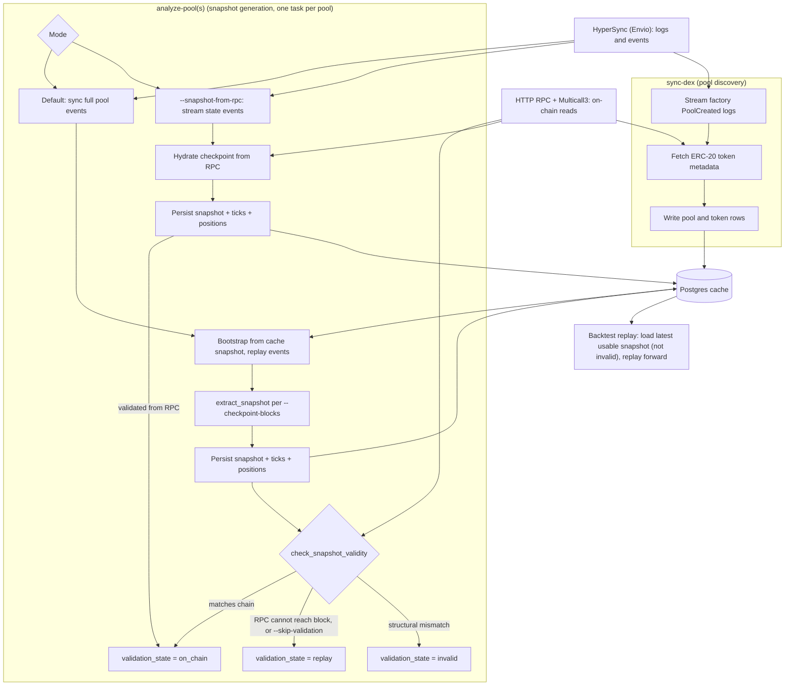

# 区块链 {#blockchain}

## 概览 {#overview}

区块链适配器从 EVM 链摄取 DeFi 数据，并通过 NautilusTrader 数据模型暴露。它还包含
一个执行客户端，用于本地签名的 Uniswap V3 市价兑换。该执行客户端尚未达到生产可用。
适配器使用三种后端：

- HyperSync：高吞吐的历史区块与合约日志。查询形态、分页与调优见
  [Envio HyperSync 文档](https://docs.envio.dev/docs/HyperSync/hypersync-usage)。
- HTTP RPC：合约调用、Multicall 读取，以及最终的链上状态水合。
- Postgres：可选的持久缓存状态、池元数据、解码事件与快照。

## 能力状态 {#capability-status}

| 能力             | 范围                                                                         | 成熟度                                                            |
| ---------------- | ---------------------------------------------------------------------------- | ----------------------------------------------------------------- |
| 历史区块         | 任何配置了可达 HyperSync 端点的 `Chain`。                                    | 经 Rust 服务与 `sync-blocks` 提供。                               |
| 实时区块         | HyperSync，或具备 RPC 客户端的链用 WSS RPC。                                 | 经 Rust 与 Python 数据客户端接口提供。                            |
| DEX 池发现       | 注册了池创建解析器的链与 DEX 组合。                                          | 经数据客户端与 `sync-dex` 提供。                                  |
| 池快照与重放     | 具备完整快照解析器集的集中流动性集成。                                       | 需 Postgres，并满足下文的提供商约束。                             |
| 实时池事件       | 已注册的 swap、liquidity、collect、flash 与 fee-protocol 解析器。            | 经 Rust 与 Python 数据客户端接口提供。                            |
| 交易执行         | 本地签名的 Uniswap V3 BUY 与 SELL 市价兑换。                                 | 实验性；未达生产可用，且不向 Python 暴露。                        |

Ethereum、Polygon、Base、Arbitrum 和 BSC 有直接的 WSS RPC 客户端。其他配置的链取值
在端点可达时可以使用 HyperSync 区块历史，但不支持 WSS 实时模式。

### 链与 DEX 命令支持 {#chain-and-dex-command-support}

命令支持由每条链、每个 DEX 注册的解析器推导而来。`sync-dex` 与
`analyze-pool(s)` 的 CLI 帮助会打印相同的能力边界。

| 层级            | 含义                                                       | DEX                                                  | 链                                          |
| --------------- | ------------------------------------------------------------ | --------------------------------------------------- | ------------------------------------------- |
| 可重放          | 发现、快照与 fee-protocol 重放解析器。                     | Uniswap V3 与 PancakeSwap V3。                      | Ethereum、Base、Arbitrum 和 BSC。           |
| 仅分析          | 有快照解析器，但 CLI 无池发现。                            | Aerodrome Slipstream。                              | Base。                                      |
| 仅发现          | 有池发现，但快照解析器集不完整。                           | Uniswap V2 与 Uniswap V4。                          | Ethereum、Base 和 Arbitrum。                |
| 仅发现          | 有池发现，但快照解析器集不完整。                           | Camelot V3 与 Fluid DEX。                           | Arbitrum。                                  |
| 仅注册          | 只注册元数据，事件解析器不支持命令。                       | Curve Finance 与 Fluid DEX。                        | Ethereum。                                  |
| 仅注册          | 只注册元数据，事件解析器不支持命令。                       | Aerodrome V1、BaseSwap V2、BaseX 与 SushiSwap V3。  | Base。                                      |
| 仅注册          | 只注册元数据，事件解析器不支持命令。                       | Curve Finance、SushiSwap V2 与 SushiSwap V3。       | Arbitrum。                                  |
| 仅区块          | 无 DEX 注册；`sync-blocks` 仍可用。                        | -                                                   | 其他配置链，包括 Polygon。                  |

`sync-dex` 需要池创建解析器。`analyze-pool(s)` 需要 Initialize、Swap、Mint、Burn 和
Collect 解析器。可重放的集成还解析 `SetFeeProtocol`；带 `CollectProtocol` 解析器的
集成可以重放协议费提取。

Aerodrome Slipstream 没有池创建解析器，CLI 也没有单独的池注册命令。只有当其池与
代币元数据已经通过其他集成路径进入缓存时，分析才能工作。其重放派生的快照无法对照
链上状态验证。仅注册的 DEX 会出现在命令帮助之外，并会在相应能力检查中失败。

### 接口可用性 {#interface-availability}

| 接口                                  | Rust                                      | Python                     | CLI                                      |
| ------------------------------------- | ----------------------------------------- | -------------------------- | ---------------------------------------- |
| 数据配置与工厂                        | 公开的配置与工厂。                        | 公开的配置与工厂。         | -                                        |
| 实时数据订阅                          | 数据客户端订阅 API。                      | LiveNode 数据客户端 API。  | -                                        |
| 区块同步、发现与分析                  | 适配器服务。                              | -                          | `sync-blocks`、`sync-dex` 与分析命令。   |
| 已存快照加载                          | 缓存 API。                                | `load_pool_snapshot`。     | -                                        |
| 执行配置                              | 公开配置。                                | 仅配置类型。               | -                                        |
| 执行工厂与订单路由                    | 公开的工厂与客户端。                      | -                          | -                                        |
| 预检、包装、授权与存储                | 直接调用 `BlockchainExecutionClient`。    | -                          | -                                        |

Python 模块不注册也不导出 `BlockchainExecutionClientFactory`，因此 Python 的
LiveNode 配置无法实例化执行客户端。

### 示例 {#examples}

两个公开语言接口都有可运行的数据客户端示例：

- [Rust LiveNode 数据测试器](https://github.com/nautechsystems/nautilus_trader/blob/develop/crates/adapters/blockchain/examples/node_data_tester.rs)。
- [Python 数据测试器](https://github.com/nautechsystems/nautilus_trader/blob/develop/examples/live/blockchain/data_tester.py)。
- [Python LiveNode 示例](https://github.com/nautechsystems/nautilus_trader/blob/develop/examples/live/blockchain/node_test.py)。

仓库不提供维护中的可运行执行配置示例。执行集成请用 Rust 构建，并遵守
[执行](#execution)中的约束。

## 核心原语 {#core-primitives}

DeFi 领域模型位于 `nautilus_model::defi`。

### 链 {#chain}

`Chain` 定义目标区块链及其默认服务端点。

| 字段                       | 类型             | 说明                                                               |
| -------------------------- | ---------------- | ------------------------------------------------------------------ |
| `name`                     | `Blockchain`     | 链枚举值，如 `Ethereum` 或 `Arbitrum`。                            |
| `chain_id`                 | `u32`            | EVM 链 ID，如 Ethereum 为 `1`。                                    |
| `hypersync_url`            | `String`         | HyperSync 端点，默认 `https://{chain_id}.hypersync.xyz`。          |
| `rpc_url`                  | `Option<String>` | 存放在链模型上的可选直接 RPC 端点。                                |
| `native_currency_decimals` | `u8`             | 原生 gas 代币的小数位精度，通常为 `18`。                           |

链可按数字 ID 用 `Chain::from_chain_id` 加载，或按名称用
`Chain::from_chain_name` 加载。

| 链系             | 代码 | 名称         | 小数位 |
| ---------------- | ---- | ------------ | ------ |
| Ethereum 与 L2   | ETH  | Ethereum     | 18     |
| Polygon          | POL  | Polygon      | 18     |
| Avalanche        | AVAX | Avalanche    | 18     |
| BSC              | BNB  | Binance Coin | 18     |

### DEX 与池 {#dex-and-pools}

DEX 集成注册：

- 工厂地址。
- 事件签名与解析函数。
- AMM 类型。

池定义把链和 DEX 绑定到池合约地址或协议池 ID，形成稳定的 Nautilus 金融工具 ID。
代币对、费率层级、tick 间距和创建区块保留为池元数据。

数据引擎处理池定义时，会在同一池金融工具 ID 下缓存并发布一个 `CurrencyPair`。
金融工具的 base 与 quote 取自 `Pool::get_base_token` 和
`Pool::get_quote_token`。swap 成交信息与执行都使用同一代币优先级方向。金融工具的
价格与数量精度由代币小数位推导，上限为 `FIXED_PRECISION`。不同的池标识让相同
代币对的池可以在缓存和消息总线中共存。

Uniswap V3 及兼容的集中流动性池还使用：

- `Initialize(uint160,int24)` 获取初始价格状态。
- `Mint` 与 `Burn` 事件重放仓位与 tick 状态。
- `Swap` 事件跟踪实时池价移动。
- HTTP RPC 读取终态的 `slot0`、流动性、活跃 tick 与仓位数据。

## 数据客户端配置 {#data-client-configuration}

| 选项                              | 默认值                        | 说明                                                 |
| --------------------------------- | ----------------------------- | ---------------------------------------------------- |
| `chain`                           | 必填                          | 目标 `Chain`，如 Ethereum 或 Arbitrum。              |
| `dex_ids`                         | `[]`                          | 要注册与同步的 DEX 集成。                            |
| `http_rpc_url`                    | 必填                          | 合约读取与 Multicall 的 HTTP RPC 端点。              |
| `wss_rpc_url`                     | `None`                        | WSS 端点；RPC 实时流必需。                           |
| `rpc_requests_per_second`         | `None`                        | 可选的 RPC 请求限流。                                |
| `multicall_calls_per_rpc_request` | `200`                         | 单次 RPC 请求请求的 Multicall 目标数上限。           |
| `use_hypersync_for_live_data`     | Rust: `false`；Python: `true` | 为 true 时，实时区块与事件流使用 HyperSync。         |
| `from_block`                      | `None`                        | 历史同步的可选起始区块。                             |
| `pool_filters`                    | `DexPoolFilters()`            | 池范围过滤规则。                                     |
| `postgres_cache_database_config`  | `None`                        | 可选的 Postgres 缓存配置。                           |
| `proxy_url`                       | `None`                        | 可选的 HTTP 与 WebSocket 代理 URL。                  |
| `transport_backend`               | `Sockudo`                     | WebSocket 传输后端。                                 |

:::note
池快照请求需要 Postgres 缓存数据库。内存缓存可以存放代币与池，但
最新的池剖析器引导会通过缓存数据库路径读取快照与事件状态。
:::

## 环境 {#environment}

在仓库之外设置凭据：

```bash
export ENVIO_API_TOKEN="<envio-token>"
export RPC_HTTP_URL="https://your-rpc.example"
export RPC_WSS_URL="wss://your-rpc.example"
```

本地使用 `.env` 时，确保该文件不进入版本控制：

```dotenv
ENVIO_API_TOKEN=<envio-token>
RPC_HTTP_URL=https://your-rpc.example
RPC_WSS_URL=wss://your-rpc.example
```

- Rust 的 HyperSync 客户端要求 `ENVIO_API_TOKEN`。缺失或格式错误的 token 会在
  发出任何查询前导致客户端构造失败。
- 合约读取与快照水合需要 `RPC_HTTP_URL` 或 `--rpc-url`。
- `use_hypersync_for_live_data = false` 时必须有 `RPC_WSS_URL`，该模式使用
  WSS RPC 实时流。

执行还需要更多变量（见[执行](#execution)）：

- 签名私钥从 `signer_private_key_env`
  配置字段所指的变量读取，绝不直接写在配置里。
- 签名载荷保护从 `payload_key_env` 和
  `payload_key_retired_env` 所指变量读取生效与已退役的 32 字节密钥。这些配置字段
  只包含变量名，绝不包含密钥值。

token 设置与配额细节见 Envio 的
[HyperSync API token 文档](https://docs.envio.dev/docs/HyperSync/api-tokens)。

### RPC 提供商要求 {#rpc-provider-requirements}

`RPC_HTTP_URL` 或 `--rpc-url` 必须指向目标链的 EVM JSON-RPC 端点。数据客户端用它
做合约读取，首次池同步也通过它读取链上状态。客户端从 `Chain::hypersync_url`
读取 HyperSync 端点，内置链默认 `https://{chain_id}.hypersync.xyz`。

选择支持目标历史区块与 Multicall 工作量的 RPC 提供商。提供商的宣传标签不足以证明
archive 访问权限：要用工作流将使用的历史区块验证一次 `eth_getCode` 或
`eth_call`。只返回区块头并不能证明历史合约状态可用。大型池还可能要求更高的
载荷、gas、超时与请求速率上限。

archive 支持影响的是验证，不是事件同步能否运行：

- 在 archive 节点上，历史区块快照会对照链上状态验证，并以
  `validation_state = on_chain` 存储。
- 在非 archive 节点上，历史读取失败，快照保持 `validation_state = replay`，
  仍可作为重放起点使用。
- 非 archive 节点首次同步时使用较新的 `--to-block`。引导过程在目标区块读取链上
  状态，非 archive 节点只提供近期状态。

## 本地服务 {#local-services}

开发用 Docker Compose 文件启动 Postgres、Redis 和 pgAdmin。要创建容器、等待
Postgres 就绪并初始化数据库模式，运行：

```bash
make init-services
```

`make start-services` 启动已初始化的技术栈。`make init-db`
初始化或重新应用 Postgres 模式。

本地 Postgres 默认值：

| 字段     | 值               |
| -------- | ---------------- |
| 主机     | `127.0.0.1:5432` |
| 数据库   | `nautilus`       |
| 用户     | `nautilus`       |
| 密码     | `pass`           |

检查模式是否存在：

```bash
docker exec nautilus-database psql -U nautilus -d nautilus -Atc \
    "select count(*) from information_schema.tables where table_schema='public'"
```

池快照生成与快照请求需要已初始化模式的 Postgres 缓存。池发现与快照生成会写入
`token`、`pool`、`pool_*_event`、`pool_snapshot`、
`pool_position` 和 `pool_tick` 行。可重复或有破坏性的数据工作负载请使用专用数据库
或可重置的 Docker 卷。

## 数据流 {#data-flow}

### 架构 {#architecture}

`sync-dex` 发现并存储池与代币，`analyze-pool(s)` 随后生成 `pool_snapshot`
行。下图展示默认重放路径与 `--snapshot-from-rpc` 路径。



`analyze-pools` 每个池运行一个任务，并发量由 `--concurrency` 限制，每个任务拥有
自己的数据客户端。除非 `validation_state` 为 `invalid`，快照都可用作重放起点。

### 数据客户端接口 {#data-client-surface}

公开数据客户端支持这些 DeFi 订阅与请求：

| 接口       | 命令                                                               | 行为                                                                                                 |
| ---------- | ------------------------------------------------------------------ | ---------------------------------------------------------------------------------------------------- |
| 区块       | `SubscribeBlocks`、`UnsubscribeBlocks`                             | 启动或停止共享的 HyperSync 或 WSS RPC 区块流。                                                       |
| 完整池     | `SubscribePool`、`UnsubscribePool`                                 | 选择 swap、mint、burn、collect、flash 与两种 fee-protocol 事件类型。                                 |
| 池 swap    | `SubscribePoolSwaps`、`UnsubscribePoolSwaps`                       | 选择单个池金融工具的 swap 事件。                                                                     |
| 流动性更新 | `SubscribePoolLiquidityUpdates`、`UnsubscribePoolLiquidityUpdates` | 选择单个池金融工具的 mint 与 burn 事件。                                                             |
| 费用收取   | `SubscribePoolFeeCollects`、`UnsubscribePoolFeeCollects`           | 选择单个池金融工具的 collect 事件。                                                                  |
| Flash 事件 | `SubscribePoolFlashEvents`、`UnsubscribePoolFlashEvents`           | 选择单个池金融工具的 flash 事件。                                                                    |
| 池快照     | `RequestPoolSnapshot`                                              | 先发布池定义，缓存引导与验证成功后再发布可用快照。                                                   |

订阅共享底层区块与 DEX 事件流。客户端为每个池地址和事件类型统计持有者数量，
因此取消一个订阅不会中断其他订阅仍在使用的数据流。完整池订阅与更窄的订阅重叠时
同样成立：`UnsubscribePool` 后更窄的事件类型保持激活，反之亦然。数据引擎会保留
池的剖析器更新器，直到没有任何数据客户端还持有该池的订阅。

池快照响应携带其请求的 ID。若引导被最终退订、重置或断连取消，数据引擎会丢弃
对应响应。池快照请求需要 Postgres，因为引导通过缓存数据库读取已存储的池与事件
状态。

:::warning
DeFi 池定义与账户状态更新通过带类型的消息总线路由发布，
`subscribe_any` 处理器永远收不到它们。请使用
`subscribe_defi_pools` 和 `subscribe_account_state`，
或对应的 actor 订阅 API。
:::

### 池发现 {#pool-discovery}

池发现过程：

- 从 HyperSync 流式读取 DEX 工厂事件。
- 通过 RPC 获取 ERC-20 元数据。
- 把有效的代币与池存入缓存。
- 跳过无效的代币元数据。`DexPoolFilters` 还可排除空代币元数据。

### 实时数据 {#live-data}

- `use_hypersync_for_live_data = true`：通过 HyperSync 订阅区块获取实时时间戳，
  并为每个订阅的 DEX 过滤器保持一条开放的 HyperSync DEX 事件流。
- `use_hypersync_for_live_data = false`：使用 WSS RPC 的区块与池日志订阅，获取
  实时 swap、流动性更新、费用收取、flash 事件与 fee-protocol 事件。

### 快照引导 {#snapshot-bootstrap}

对 Uniswap V3 兼容快照，默认引导重放已存储的池事件，重建价格、流动性、tick、
仓位、费用与计数器。验证随后通过 HTTP RPC 与 Multicall 读取链上状态。

引导模式：

- 默认：把截至目标区块的完整池事件历史存入数据库，再从数据库引导。
- `--snapshot-from-rpc`：跳过完整 swap 存储，从 HyperSync 流式读取 Initialize、
  Mint、Burn、SetFeeProtocol 与 CollectProtocol 事件以枚举 tick 与仓位，再从
  RPC 水合精确的检查点区块。

对历史悠久、活动量大的池，若只需要最终快照而不是存储 swap 历史，用
`--snapshot-from-rpc`。它不能与 `--from-block`、`--reset` 或
`--require-existing-snapshot` 组合使用。

`--snapshot-from-rpc` 模式下，最终 RPC 水合是检查点状态的权威来源。水合失败时
命令直接失败，而不是输出带着过期价格状态的重放快照。

### 快照验证 {#snapshot-validation}

对重放派生的快照，引导在标记有效前把剖析器与链上状态比对。

| 类别     | 字段                                                       | 不一致结果                       |
| -------- | ---------------------------------------------------------- | -------------------------------- |
| 结构性   | 当前 tick、活跃流动性、逐 tick 流动性与仓位流动性。        | 存为 `invalid`；默认加载时排除。 |
| 非结构性 | sqrt 价格、fee protocol 与协议费余额。                     | 告警并接受快照为 `on_chain`。    |

非结构性差异可能来自：

- 事件重放按交易范围作用，而 RPC 快照按区块范围作用。
- 分叉或重放区间遗漏了一次 fee-protocol 更新。
- 重放舍入与链上费用累加器不同。

接受这些字段与回测重放的行为一致。

### 快照引导守卫 {#snapshot-bootstrap-guard}

只允许从本地快照缓存运行分析时，使用 `--require-existing-snapshot`：

- 检查目标区块或之前最新的可用 `pool_snapshot`。
- 没有可用快照时返回 `needs_bootstrap`。
- 创建区块的快照若既无仓位也无 tick，视为不可用。
- 跳过该池从创建到目标的引导。

#### 分析输出 {#analysis-output}

`analyze-pool(s)` 打印：

- 每个 `--checkpoint-blocks` 条目一条 JSON 结果。
- 未给检查点时，在 `--to-block` 处输出一条 JSON 结果。

需要首次引导的池形如：

```json
{
  "chain": "Ethereum",
  "dex": "UniswapV3",
  "pool_address": "0x1111111111111111111111111111111111111111",
  "target_block": 25218797,
  "status": "needs_bootstrap"
}
```

成功的结果包含 `validation_state`：

- `on_chain`：已水合并与链上比对一致。
- `replay`：重放派生或未检查，仍可用作重放起点。
- `invalid`：已水合但不一致，不可用。

```json
{
  "chain": "Ethereum",
  "dex": "UniswapV3",
  "pool_address": "0x1111111111111111111111111111111111111111",
  "target_block": 25218797,
  "status": "success",
  "snapshot_block": 25218790,
  "positions": 2,
  "ticks": 7,
  "validation_state": "replay",
  "already_valid": false,
  "liquidity_utilization_rate": 0.25
}
```

### 检查点与并发 {#checkpoints-and-concurrency}

- `--checkpoint-blocks b1,b2,...`：一趟引导产出多个快照。区块会排序、去重并
  截断到 `--to-block`。
- `--concurrency`：控制 `analyze-pools` 的并行度。默认 `4`。
- `--skip-validation`：跳过链上比对，重放派生快照保持为 `replay`。
- `--snapshot-from-rpc`：在检查点区块从链上水合，快照记录为
  `on_chain`。

快照键：

- 默认模式：以检查点或之前最后一条池事件为键。两次检查点之间没有事件时可以
  共用同一存储行。
- `--snapshot-from-rpc`：以请求的检查点区块为键，附带区块范围的哨兵
  交易/日志索引。

### 回测重放 {#backtest-replay}

回测重放需要输入数据里带快照。适配器在回测期间不处理实时快照请求。

`load_pool_snapshot` 从 Postgres 读取包含仓位与 tick 的完整快照：

```python
from nautilus_trader.adapters.blockchain import load_pool_snapshot

snapshot = load_pool_snapshot(
    pg_config=postgres_config,
    chain_id=chain_id,
    pool_address=pool_address,
    before_block=replay_start_block,  # latest snapshot at or before this block
)
```

重放规则：

- 默认排除标记为 `invalid` 的快照，`on_chain` 与 `replay` 都可能返回。
  只有当调用方也接受 `invalid` 快照时才传 `require_valid=False`。
- `None` 视为环境准备失败，不要在没有剖析器状态时重放。
- 把结果包装为 `DefiData.PoolSnapshot(snapshot)`，连同池事件一起传给
  `BacktestEngine.add_defi_data`。
- 从快照区块开始重放每条池事件。晚于快照区块开始会让剖析器状态过期。

缓存的区块时间戳加载为 Nautilus 数据对象时是 UNIX 纳秒。以秒级精度写入的缓存行
在加载快照与池事件时归一化为纳秒，纳秒行保持其存储精度。

### 池分析约束 {#pool-analysis-constraints}

`analyze-pool(s)` 校验前置条件并逐池独立报告。直接调用底层 Rust 分析服务时同样
适用这些边界。

| 条件                  | 行为                                                                                     | 约束                                                                                                                 |
| --------------------- | ------------------------------------------------------------------------------------------ | ---------------------------------------------------------------------------------------------------------------------- |
| 缺少池元数据          | 以 `Pool <address> is not registered` 失败。                                             | 先发现池；分析不能推断或注册元数据。                                                                                 |
| 缺少解析器能力        | 同步前失败。                                                                             | 使用[链与 DEX 命令支持](#chain-and-dex-command-support)中支持快照的组合。                                            |
| 地址未用校验和        | 以 `Blockchain address '<address>' has incorrect checksum` 失败。                        | 提供 EIP-55 地址；工厂 `getPool` 的结果可能需要转换校验和。                                                          |
| 提供商 Multicall 上限 | `out of gas`、载荷或超时错误会中止最终状态水合。                                       | 调低 `multicall_calls_per_rpc_request`，或换限额更高的提供商。                                                       |
| 缺少历史状态          | 首次引导无法在过旧的 `--to-block` 读取最终状态。                                         | 用较新的目标或支持 archive 的提供商；见 [RPC 提供商要求](#rpc-provider-requirements)。                               |
| HyperSync 配额受限    | 高活跃池会退避，完整首次同步可能需要数千次请求。                                       | 调低 `--concurrency`；不需要存储 swap 历史时用 `--snapshot-from-rpc`。                                               |
| 中途 `--from-block`   | 遗漏 `Initialize` 会让剖析器缺少初始价格。                                               | 生成首个快照时从池创建开始同步。                                                                                     |
| 无流动性事件          | `analyze-pool` 报错；`analyze-pools` 输出失败结果并继续其他池。                         | 选择在目标区块或之前有 Mint 或 Burn 的池。                                                                           |
| 任一单池失败          | 输出 `"status": "failure"`，`analyze-pool(s)` 以非零退出。                              | 整体结果看退出码，单池结果看各自 JSON 状态。                                                                         |

`--snapshot-from-rpc` 模式的最终 RPC 水合是检查点状态的权威。水合失败会中止分析，
而不是存储带过期价格状态的快照。

## 池分析操作 {#pool-analysis-operations}

### 分析前先发现池 {#discover-pools-before-analysis}

`analyze-pool(s)` 从 Postgres 缓存读取池元数据，池未被发现时以
`Pool <address> is not registered` 失败。分析前先对相应链与 DEX 运行
`sync-dex`，填充 `pool` 与 `token` 表。

### 检查命令支持 {#check-command-support}

开始同步前，参照[链与 DEX 命令支持](#chain-and-dex-command-support)或命令帮助。
`sync-dex` 与 `analyze-pool(s)` 会在查询事件前拒绝不支持的链与 DEX 组合，
而不是返回空结果。

```bash
./target/debug/nautilus blockchain sync-dex --help
./target/debug/nautilus blockchain analyze-pools --help
```

### 使用校验和格式的池地址 {#use-checksummed-pool-addresses}

池地址必须使用 EIP-55 校验和。小写地址会以
`Blockchain address '<address>' has incorrect checksum` 失败。把发现的地址转换为
校验和形式后再传 `--address` 或写入地址文件。

### 缩小 Multicall 请求规模 {#reduce-the-multicall-request-size}

RPC 提供商可能以 out-of-gas、载荷或超时错误拒绝过大的最终状态 Multicall。把
`--multicall-calls-per-rpc-request` 从默认 `200` 调低，使单次请求保持在提供商
限额内。

### 选择提供商能提供服务的目标区块 {#choose-a-target-block-the-rpc-provider-can-serve}

首次同步在 `--to-block` 读取链上状态。非 archive 的 RPC 提供商要用较新的目标
区块，或者改用能在请求的历史区块提供合约状态的提供商。见
[RPC 提供商要求](#rpc-provider-requirements)。

### 控制 HyperSync 请求量 {#control-hypersync-request-volume}

大型或历史悠久的池首次完整同步可能需要数千次请求。配置的 token 配额受限时调低
`--concurrency`。精确检查点快照已够用、不需要存储 swap 历史时用
`--snapshot-from-rpc`。

### 初始重放从池创建开始 {#start-an-initial-replay-at-pool-creation}

`--from-block` 设在池历史中间可能遗漏其 `Initialize` 事件。没有初始价格时，
快照引导会以
`Pool is not initialized and it doesn't contain initial price, cannot bootstrap profiler`
失败。生成首个快照时从池创建开始同步。

### 解读池失败 {#interpret-pool-failures}

目标区块或之前没有已处理 Mint 或 Burn 事件的池，可能缺少生成快照所需的状态。
`analyze-pool` 返回错误。`analyze-pools` 输出一行
`"status": "failure"` 的 JSON，继续处理其他池，并在任何单池失败后以非零退出。
整体结果看进程退出码，单个结果看各自的 JSON 状态。

## 运行手册：验证实时池同步 {#runbook-validate-a-live-pool-sync}

用这套流程检查单个链上单个 DEX 的池发现、事件解析与快照生成。示例用 Arbitrum
上的 PancakeSwap V3。它只执行只读的链上查询，且只写入配置的 Postgres 缓存。

### 前置条件 {#prerequisites}

- Docker 可用，用于本地 Postgres 服务。
- `ENVIO_API_TOKEN` 是有效的 HyperSync token。
- `RPC_HTTP_URL` 指向能提供目标区块的 Arbitrum RPC 提供商。
- `POOL_ADDRESS` 是 EIP-55 校验和格式的 PancakeSwap V3 池地址。

### 启动本地服务并构建 CLI {#start-the-local-services-and-build-the-cli}

```bash
make init-services
cargo build -p nautilus-cli --features defi --bin nautilus
```

### 发现池 {#discover-pools}

本地数据库被重置过的话，在分析前先立即运行一次发现：

```bash
./target/debug/nautilus blockchain sync-dex \
    --chain arbitrum \
    --dex PancakeSwapV3 \
    --rpc-url "$RPC_HTTP_URL" \
    --host 127.0.0.1 \
    --port 5432 \
    --username nautilus \
    --password pass \
    --database nautilus
```

### 分析池 {#analyze-the-pool}

这次验证运行把并发保持为 1：

```bash
./target/debug/nautilus blockchain analyze-pools \
    --chain arbitrum \
    --dex PancakeSwapV3 \
    --address "$POOL_ADDRESS" \
    --rpc-url "$RPC_HTTP_URL" \
    --host 127.0.0.1 \
    --port 5432 \
    --username nautilus \
    --password pass \
    --database nautilus \
    --concurrency 1
```

### 检查存储的数据 {#check-the-stored-data}

统计为该池写入下列表的行数：

- `pool_swap_event`
- `pool_liquidity_event`
- `pool_collect_event`
- `pool_flash_event`
- `pool_fee_protocol_update_event`
- `pool_fee_protocol_collect_event`
- `pool_snapshot`
- `pool_position`
- `pool_tick`

同步范围内没有 `SetFeeProtocol` 或 `CollectProtocol` 事件时，fee-protocol
相关表保持为空。本地数据库重置后，先重跑发现再分析，池行才会存在。地址、提供商、
重放区间与请求量相关的失败见[池分析操作](#pool-analysis-operations)。

## 合约 {#contracts}

### 基础合约与 Multicall3 {#base-contract-and-multicall3}

`BaseContract` 通过 Multicall3
（`0xcA11bde05977b3631167028862bE2a173976CA11`）批量执行合约调用：

- Multicall 使用 `tryAggregate(requireSuccess: false)`，每个结果各自报告成败，
  由合约包装器决定是否拒绝。
- 读取在单一区块上下文中执行。
- 传输与提供商失败以 RPC 错误浮出。

### ERC-20 元数据 {#erc-20-metadata}

`Erc20Contract` 通过 Multicall 读取 `name`、`symbol` 与
`decimals`。适配器可以跳过代币元数据畸形、原始字节或为空的池。

### Uniswap V3 池 {#uniswap-v3-pools}

`UniswapV3PoolContract` 读取池全局状态、活跃 tick 与仓位。

- 大型池可能超出提供商的载荷、gas 或超时限制。
- RPC 快照水合在最终状态读取失败时按失败关闭。
- 超大型池可能需要更低的 `multicall_calls_per_rpc_request` 或更强的提供商。

PancakeSwap V3 复用 Uniswap V3 的读取合约，因为 `slot0`、`ticks`、
`positions`、`liquidity` 与费用增长读取共享同一 ABI。fee-protocol 编码不同：

- Uniswap V3 把两个 4 位费用分母打包进一个 `uint8`。
- PancakeSwap V3 在 `slot0.feeProtocol` 中存两个 16 位基点份额，并发出
  `SetFeeProtocol(uint32,uint32,uint32,uint32)`。
- PancakeSwap V3 快照存 `fee_protocol0_basis_points` 与
  `fee_protocol1_basis_points`，重放按 `fee * basis_points / 10000`
  计算协议费。

## 执行 {#execution}

:::warning
执行客户端尚未达到生产可用。`BlockchainExecutionClient` 实现了预检、
显式 WETH 包装与 ERC-20 授权、本地 EIP-1559 签名、持久对账，以及一条 Uniswap V3
swap 流程。其他订单操作一律按失败关闭，不产生链上或持久化副作用。
:::

本节统一使用下列术语：

| 术语         | 含义                                                                                                       |
| ------------ | ------------------------------------------------------------------------------------------------------------ |
| 决策高度     | 同一组授权读取集下，三个 RPC 源共同接受的最小新区块高度。                                                  |
| 验证源       | 一个权威端点，或分属不同配置故障域的两个只读验证器之一。                                                   |
| 部署清单     | 经审查的合约、代码哈希、代理绑定、身份、池、代币与允许的调用边。                                           |
| 意图         | 一次持久的包装、授权或 swap 逻辑操作，与其交易哈希历史无关。                                               |
| 签名器所有权 | 对钱包签名器的独占控制，以及分配后对其活跃 nonce 的控制。                                                  |
| 最终性边界   | 所有源在该交易的包含区块及其之前的最终化祖先链上达成一致的界点。                                           |

### 连接与账户状态 {#connection-and-account-state}

构造客户端需要一个权威 RPC 端点与恰好两个只读验证提供商。每个源需要不同的端点、
提供商 ID、运营方 ID，以及两两不相交的故障域 ID 集合。

#### 强制运行条件 {#enforced-operating-conditions}

- 权威执行端点与两个验证端点必须使用 HTTPS。明文 HTTP 只接受
  `127.0.0.0/8` 内的规范 IPv4 回环字面量或恰为 `[::1]` 的地址。
  主机名、IPv4 映射的 IPv6、私有与链路本地地址、非规范数字形式都不合格。
- HyperSync 使用同样的 HTTPS 规则。该校验在加载 HyperSync token 或创建其
  客户端之前执行。
- 区块链 HTTP 客户端拒绝重定向。规范回环 RPC 连接同时绕过配置的与环境代理。
  远程 HTTPS 执行 RPC 客户端继续遵循环境代理变量。
- 使用 Postgres 的执行连接要求有效的活动载荷密钥、稳定的部署 ID、就绪的受保护
  存储，以及存储信封引用的每个密钥都可用。在加载签名器或发起执行 RPC 调用前，
  对每个保留的载荷完成认证。
- 挂载的 Postgres 数据库只有在客户端断开以做检查、保护或回滚工作时才允许未受保护。
  重新封装要求受保护存储。未受保护的数据库不能提供执行能力。

#### 运营方假设 {#operator-assumptions}

故障域代表任何共享的上游、经销商、网关、代理、账户、网络路径或托管控制平面。
不同的 URL 与不同的配置身份并不能证明运营独立。运营方必须核实三个提供商不共享
控制或故障域。

运营方还必须识别并监控所有能够改变清单固定部署的代码、或改变清单固定代理的实现
的一方或治理机制。一旦此类部署变更或代理升级被公告或被怀疑，立即停止执行，并撤销
支出方是受影响部署中路由地址的全部未回收授权。在签名所用决策区块上出现变更后代码
或实现之前完成全部撤销；一旦出现，签名前的部署检查会对所有客户端交易按失败关闭，
包括撤销本身。

运营方必须保证签名密钥只被一个在线客户端独占，并控制对主机环境、数据库、副本、
备份与导出通道的访问。

Connect 在加载签名器前完成这些检查：

1. 打开持久执行存储。配置了 Postgres 时，要求受保护存储就绪，并在加载任何已有
   验证台账前认证全部保留载荷。
1. 要求三个源都与本地链 ID 和经审查的最终化检查点一致。
1. 以每次至多 4,096 个区块的窗口扩展或复查持久的最终化区块头祖先链。
1. 要求三个源给出完全一致的最新区块高度签名器 nonce。
1. 在最终化高度验证经审查的部署清单，包括运行时代码、代理槽位、实现、路由与
   工厂关系、池身份、代币小数位与固定的报价合约。
1. 对每个源探测 archive、finalized 标签、显式高度状态与调用、gas、存储、报价与
   调用跟踪能力。
1. 原子地安装验证台账，或连同授权各项分类的证据迁移保留的执行历史。
1. 从 `signer_private_key_env` 加载私钥，要求其地址等于
   `wallet_address`，并对任何活跃意图做对账。
1. 读取原生余额与配置的 ERC-20 余额，安装完整钱包快照，并在配置的账户 ID 下
   发布一个 `AccountState`。

没有 Postgres 时，客户端可以连接并发布余额，但所有交易操作都会被拒绝。验证、
迁移、对账、余额或精确金额换算失败会让客户端保持断开：移除已加载的签名器，保留
之前的完整快照，不发布任何部分钱包状态。重复的代币符号也会导致快照被拒，因为
符号定义货币身份。

验证提供商从不接收已签名的交易字节，也没有广播方法。只有权威端点接收
`eth_sendRawTransaction`。用于授权签名、重广播或持久迁移的安全关键未签名读取
发给全部三个源。诊断性预检与连接时的余额发布只走权威端点，且不能授权执行。
这保护的是完整性，不是订单机密性。需要路由或金额机密性的运营方需要另一套执行
设计。

发布的余额取 `total = free`、`locked = 0`。钱包账户在推导有效可用与锁定余额时
应用本地预留，见[钱包账户](./../concepts/accounting.md#wallet-accounts)。

客户端启动后，`QueryAccount` 直接重发已安装的快照，不再做 RPC 读取。以下情况
会失败：

- 请求的账户 ID 与客户端账户 ID 不一致。
- 客户端尚未启动。
- 不存在完整快照。

Disconnect 移除签名器并中止在途的提交任务。交易操作在任何执行 RPC 调用前
拒绝已断开的客户端。

### 支持的订单范围 {#supported-order-slice}

客户端只接受一种市价单形态：

| 维度     | 接受                                                                                      | 拒绝                                                                    |
| -------- | ------------------------------------------------------------------------------------------- | --------------------------------------------------------------------------- |
| 链       | 执行客户端配置的链。                                                                      | 金融工具场所属于其他链。                                                  |
| DEX      | Uniswap V3。                                                                              | 其他一切 DEX，包括 PancakeSwap V3。                                       |
| 池       | `Cache::pool` 中带费率层级的地址型池。                                                    | 未知的池、V4 池 ID 与无费率层级的池。                                     |
| 订单     | 单笔方向为 `BUY` 或 `SELL` 的 `MarketOrder`。                                             | 经 `SubmitOrder` 提交的非市价订单。                                       |
| 数量     | 以 base 计价的规模，且在 `max_order_amount` 内；BUY 还需匹配的 quote 支出上限。           | 以 quote 计价的输入，或超过任一适用上限的金额。                           |
| 方向     | 模型优先级互不相同的代币。                                                                | 代币优先级相同、方向有歧义的交易对。                                      |

`InstrumentId` 选定池，例如
`0xC6962004f452bE9203591991D15f6b388e09E8D0.Arbitrum:UniswapV3`。其场所必须能解析为 `<Chain>:<DexType>`，
其代码必须能解析为地址型 `PoolIdentifier`。`Pool::get_base_token` 与 `Pool::get_quote_token`
应用模型的代币优先级约定：

- 稳定币是 quote 资产。
- 包装原生资产次之。
- 其他代币相对它们成为 base 资产。

`Token::get_token_priority` 取值相等即为有歧义，订单被拒绝。

场所路由接受任何场所匹配的配置链上的 Uniswap V3。swap 准备还要求该链注册了
Uniswap V3 部署与工厂。

订单列表对每个未结订单一律 `OrderDenied`。修改、撤单与批量撤单命令对被引用的
每个缓存订单一律 `OrderModifyRejected` 或 `OrderCancelRejected`。全部撤单命令与
订单查询只记录警告、不发事件。批量状态返回 `Ok(None)`，使启动对账记录日志并
继续。订单、成交与持仓报告探测返回错误，避免 LiveNode 把空答复当作不存在。
这些路径从不签名、广播或持久化意图。

swap 在达到最终性前保持 `Submitted`，场所状态查询无法解析它。客户端要求提交
保留（submission retention）。在途检查耗尽重试时，LiveNode 记录警告并让 swap
保持 `Submitted` 而不是拒绝。因此最终化的成交或拒绝之后仍会作用于该订单。
若节点在最终性之前停止，关闭流程会为本轮提交的每笔 swap 报告未完成的提交恢复，
持久化的意图在下次 connect 时对账。请保持未结订单检查关闭。

执行路由遵循 Nautilus 的多场所经纪模式。客户端代表一条链上的一个钱包与 RPC
连接。每个金融工具场所同时标识其链与 DEX。

策略可以通过 `client_id` 显式选择客户端。节点配置也可以通过
`RoutingConfig.venues` 为金融工具场所注册客户端，或把它用作默认执行客户端。
选定客户端后，`ExecutionClient::handles_order_venue`
只接受解析链与客户端配置匹配、且 DEX 受客户端支持的场所。金融工具保留其
`<Chain>:<DexType>` 场所，不会被改写成 `BLOCKCHAIN`。

订单映射为原始 Uniswap SwapRouter（签名带 deadline 的那个部署）上的一次
`exactInputSingle` 调用。`allowed_token_pairs` 是有向的
`(token_in, token_out)`：SELL 需要 base→quote 对，BUY 需要
quote→base 对。只列一个方向不会放行另一个方向。

| 参数                | 来源                                                                                       |
| ------------------- | ------------------------------------------------------------------------------------------ |
| `tokenIn`           | SELL：池 base 代币。BUY：池 quote 代币。                                                   |
| `tokenOut`          | SELL：池 quote 代币。BUY：池 base 代币。                                                   |
| `fee`               | 池费率层级。                                                                               |
| `recipient`         | 执行钱包地址。                                                                             |
| `deadline`          | 验证过的决策区块头时间戳加配置的 `deadline_seconds`。                                      |
| `amountIn`          | SELL：`Quantity` 的原始 base 单位。BUY：来自验证过的 exact-output 报价的 quote 输入。      |
| `amountOutMinimum`  | 由决策高度验证过的报价推导（见下文）。                                                     |
| `sqrtPriceLimitX96` | `0`（滑点由 `amountOutMinimum` 限定）。                                                    |

### BUY 的 quote 支出上限 {#buy-quote-spend-limits}

每笔 BUY 都需要一条指向该 quote→base 交易对的 `quote_spend_limits`
条目。条目在 `max_amount` 旁重复给出 quote 代币地址与小数位，`max_amount`
是用币原始单位表示的 base-10 字符串。客户端构造会拒绝下列条目：

- 同一有向交易对的第二条条目。
- `spend_token` 与 `token_in` 不同。
- `max_amount` 不是 `U256` 范围内的 base-10 无符号整数。
- 交易对不在 `allowed_token_pairs` 中。

订单准备还会把配置的代币与小数位同选定的池核对（示例条目见
[执行配置](#execution-configuration)）。

客户端在签名前把三个源独立验证过的 exact-output 报价的 `amountIn` 与该上限
比较。相等可接受，超出一个原始单位即被拒绝。`max_order_amount` 仍是提交的
base 数量的独立上限，SELL 订单不使用 `quote_spend_limits`。

### 滑点保护 {#slippage-protection}

`amountOutMinimum` 一律推导得出，绝不由调用方提供：

1. 要求共享引擎缓存（`Cache::pool_profiler`）中存在已初始化的
   `PoolProfiler`，且带已处理事件水位线。其本地模拟必须能吃满 SELL 的输入
   或产出非零的 BUY 输入，但其金额不设置任何签名字段。该状态通常由实时的
   数据侧订阅维护。
1. 从三个源报告的最小新区块高度中选取决策高度。新区块高度的偏斜必须保持在
   `verification.chain_anchor.max_head_skew_blocks` 之内。
1. 要求剖析器水位线包含摄取时观察到的区块哈希。三个源必须都返回该确切的
   显式高度区块头。按区块取快照时，快照还必须把该区块头哈希作为快照标识。
1. 对事件水位线，要求存在一条规范回执，其交易、区块与索引元数据与剖析器位置
   匹配。选中的日志必须来自预期池，并使用受支持的池事件签名。
1. 验证一条从剖析器高度到决策高度、由父哈希链接、三个源完全一致的祖先链。
   距离不得超过 `max_quote_age_blocks`，该值必须在 `1..=4095` 内。
1. 通过三个源在决策高度调用清单固定的 `IQuoterV2` 合约。SELL 用
   `quoteExactInputSingle`，BUY 用
   `quoteExactOutputSingle`。完整解码结果必须一致，包括金额、结果平方根价格、
   跨越的已初始化 tick 与 gas 估计。
1. 签名前立即重读检查点、剖析器区块头、决策区块头、祖先链与报价。结果不可得
   或发生变化都会阻止签名。
1. SELL 从验证过的 exact-input 输出计算 `amountOutMinimum`。BUY
   把验证过的 exact-output 输入用作 `amountIn`，并从请求的 base 输出推导
   `amountOutMinimum`。整数运算拒绝为零的最小值。

剖析器出现分歧时可以请求数据刷新，但不能覆盖已验证的报价或削弱签名限额。

`slippage_bps` 配置字段设定滑点。提交命令 `params` 中的
`slippage_bps` 条目会覆盖它、仅作用于该订单。超过 `max_slippage_bps`
上限的覆盖在签名前被拒绝。

升级前写入的事件行可能没有摄取区块哈希，因为模式迁移不回填该字段。这类行不能
授权执行。下单前先通过正常实时数据订阅刷新交易池，或重同步其事件并重建快照。

### 预检、包装与授权 {#preflight-wrapping-and-approval}

预检、WETH 包装与路由授权是客户端上的显式操作，与 `submit_order` 分离：

| 操作 | 状态变化                               | 广播前检查                                                                                                                | 完成检查                                     |
| ---- | ---------------------------------------- | --------------------------------------------------------------------------------------------------------------------------- | ------------------------------------------------ |
| 预检 | 无。                                     | 权威链、已部署代码、余额、授权与当前费用的诊断。                                                                            | 返回结构化、脱敏后的报告。                       |
| 包装 | 带 value 调用 WETH `deposit()`。       | 验证过的决策祖先链、部署、WETH 余额、原生余额、gas、费用、nonce 与显式高度模拟。                                            | WETH 余额恰好增加所包装的数量。                  |
| 授权 | 调用 `approve(router, amount)`。       | 包装的全部检查，另加路由策略、工厂与 WETH 身份、输入代币资格、零授权与授权模拟。                                            | 包含区块处的授权额等于目标值。                   |

预检从 `Cache::pool` 解析池。报告不含 RPC URL、私钥或原始签名交易。它报告
下列数值并做检查：

- 预期与观察到的链 ID。
- 池、路由与代币的代码检查。
- 代币余额与授权额，以及原生余额。
- base fee 与 priority fee、推导出的最大费用，以及该费用是否在上限内。
- 整体就绪状态与每项失败的检查。

Approve 拒绝标准的 `false` 返回值，接受不返回数据的代币。非零授权仅限配置的
输入代币，且要求现有授权为零。开启 `unlimited_approval` 时，所有非零请求都以
`U256::MAX` 为目标。最终授权必须精确等于目标值。零请求即使路由部署元数据不可用
也能撤销白名单路由的授权，因此路由检查损坏并不能阻止撤销。

调用不被打断时，包装与授权共用 EIP-1559 路径。它们在广播前持久化意图与签名
哈希，在稳定最终性与操作后置条件成立后返回。Wrap 比较广播前一刻与包含区块处的
WETH 余额，避免使用过期的广播前基线。后置条件失败时，错误在最终性之后返回，
因此交易可能已改变链上状态。

签名 swap 前，订单提交要求三个源就下列内容完全一致：

- 决策区块头，以及来自持久最终化台账的父哈希祖先链。
- 决策高度的部署清单，包括每个配置的代码哈希、代理绑定与角色探测。
- 路由报告注册的工厂与配置的 WETH，且工厂能按输入代币、输出代币与费率层级
  解析出确切的池。
- 两个代币报告审查后清单中存储的小数位。
- 清单固定的报价合约返回唯一确切的报价。
- 路由授权额与输入代币余额足以覆盖原始输入数量。
- 原生余额足以覆盖交易 value 加最大 gas 成本。
- 与持久 nonce 台账一致的规范与 pending nonce 观察。
- 最大 gas 估计、priority fee 中位数，以及本地 gas 与费用上限。

决策区块头提供 deadline、报价时效边界、持久 `created_block` 与 EIP-1559
base fee。状态、调用、代码、存储、gas、余额与授权读取都使用其显式区块号。

本地签名前一刻，客户端重复链、区块头、祖先链、部署、报价、规范 nonce 与
pending nonce 检查，并把这份证据与 nonce 分配原子地持久化。签名前失败产生
`OrderDenied` 且无广播。只有在持久的可恢复状态迁移成功后，客户端才释放准备
槽位。迁移失败则保留所有权等待对账。

SELL 的输入代币是 base 代币，BUY 的是 quote 代币。预检就绪报告仍显示 SELL
设置所用的 base 代币授权。BUY 需要单独的 quote 代币授权；该授权或余额不足时，
提交拒绝订单。

提交从不执行包装或授权。授权或余额不足会发出 `OrderDenied`。

### 交易签名与广播 {#transaction-signing-and-broadcast}

#### 本地签名 {#local-signing}

客户端用 Alloy 在本地构建并签名 EIP-1559 交易：

- 构建 `alloy::consensus::TxEip1559`，含链 ID、nonce、gas、费用、目标地址、
  value 与 calldata。
- 用 `alloy::signers::local::PrivateKeySigner` 对
  `SignableTransaction::signature_hash()` 签名，得到
  `Signed<TxEip1559>`。
- 用 `alloy::eips::eip2718::Encodable2718::encoded_2718()`
  编码 EIP-2718 封装，并通过 `eth_sendRawTransaction` 发送原始字节。

私钥来自 `signer_private_key_env` 所指的环境变量，绝不写入日志、序列化或存入
配置。构造签名器期间由 zeroizing 缓冲区持有临时密钥文本与解码字节。客户端只
支持一个签名器，其推导地址必须在 connect 时等于 `wallet_address`。

#### 签名器与 nonce 所有权 {#signer-and-nonce-ownership}

包装、授权与 swap 全部合计，同时在途的交易至多一笔：

- 客户端在第一次准备 RPC 调用前抢占本地槽位。
- 持久规范 nonce 来自三个源一致的显式最终化高度读取。pending nonce 只是一条
  额外的内存池观察，永远不能证明规范消耗。
- 新签名要求规范 nonce `N`、无无法解释的 pending 使用，且意图能连同其验证
  证据原子地持有 `N`。
- 只有在尚不存在签名时，准备失败才释放槽位。
- 签名之后，槽位保持被占用，直至持久化、广播、最终性与必需的订单事件持久化
  全部完成。
- 持久化错误保持槽位被占用，因为 Postgres 可能已提交而客户端丢失了确认。
- 在持久化或广播期间取消操作不会释放槽位，也不会放行新交易。

费用与 gas 策略同样在签名前执行：

- 所有路径使用一致决策区块头的 base fee。三个 priority fee 值先取中位数，
  再应用 `base_fee_buffer_bps`。推导费用超过
  `max_fee_per_gas_wei` 会被拒绝。
- 三个源都在决策高度对确切的未签名交易做估计。客户端选取最大估计值，应用
  `gas_buffer_bps`，超过 `gas_limit` 即拒绝。客户端不会钳制估计值。

#### 广播前持久化 {#persist-before-broadcast}

客户端在分配 nonce 或签名前保留一个持久意图，随后在广播前存储 nonce、一个
经过认证的签名载荷信封与本地哈希。没有就绪且受保护的持久存储，交易无法提交。

发送前一刻，客户端记录 `broadcast` 迁移。该写入之后的任何结果——包括节点
拒绝——都按不确定处理，直到规范 nonce 与回执观察将其解决。

没有持久 `broadcast` 迁移的签名意图保持活跃，并在等待显式恢复期间阻塞
connect。适配器对该状态没有自动恢复命令或客户端方法。运营方必须检查持久的
`execution_intent` 与 `execution_transaction_hash`
记录，做出明确、经审查的恢复决定。适配器不会自动释放签名器槽位或重发交易。

持久的 `broadcast` 意图在恢复观察之前，只能重发其精确的已持久字节。

广播与回执处理遵循这些规则：

- 每个执行 JSON-RPC 请求超时 10 秒。错误信息省略端点 URL、请求载荷与签名
  字节。
- `already known` 计为接受。
- 超时、连接重置、节点拒绝、无法读取的响应，或返回哈希与签名哈希不一致，都
  进入持久意图下的对账。
- 三个源回执均为 null 可重试；部分传播可重试；彼此冲突的非空回执属于分歧，
  不能授权状态变化。
- 回执观察在配置的最终性轮询窗口内对瞬时 RPC 错误重试。
- 轮询耗尽记录 `dropped`，签名器槽位保持占用。
- 精确字节重广播只使用认证过的保留信封。再次发送前，三个源必须验证链、
  祖先链、部署、规范与 pending nonce、回执不存在，以及按用途的显式高度模拟。
  字节只发给权威源。

### 风险与验证边界 {#risk-and-validation-boundaries}

通用盘前风控留在引擎中。交易场所专属的闸门在适配器内，以配置驱动的限流器
实现：

| 检查               | 边界           | 强制执行                                                                                                       |
| ------------------ | -------------- | ---------------------------------------------------------------------------------------------------------------- |
| 链身份             | 适配器         | 经审查的检查点、三源链 ID、新区块头与父哈希祖先链                                                                |
| 部署身份           | 适配器 + 风控  | 经审查的代码哈希、代理绑定、角色探测、池身份与包含调用图                                                         |
| 代币对白名单       | 风控（适配器） | swap 的有向交易对；非零授权的输入代币资格                                                                        |
| 订单金额           | 风控（适配器） | 提交 base 数量的 `max_order_amount`；验证过的 BUY quote 输入上按对设置的 `quote_spend_limits`                    |
| 报价出处           | 适配器         | 规范剖析器水位线、有界祖先链、固定 QuoterV2 结果与签名前最终复核                                                 |
| gas 与费用         | 风控（适配器） | 三源 gas 估计最大值、priority fee 中位数，以及本地 `gas_limit` 与 `max_fee_per_gas_wei` 上限                     |
| 余额充足性         | 适配器 + 风控  | 显式高度的三源输入代币与原生余额检查                                                                             |
| 授权充足性         | 适配器         | 显式高度的三源路由授权检查                                                                                       |
| 滑点               | 风控（适配器） | `max_slippage_bps` 上限与验证过的报价推导最小产出                                                                |
| 在途限制           | 适配器 + DB    | 本地槽位加持久规范 nonce 与签名器所有权                                                                          |

限流器的每次拒绝都在签名前拒绝订单，并报告结构化的原因。

### 订单事件 {#order-events}

订单提交只发出有已知交易状态支撑的事件：

| 观察结果                                                   | 事件              | 结果                                                                                                                                                                                                                             |
| ---------------------------------------------------------- | ----------------- | -------------------------------------------------------------------------------------------------------------------------------------------------------------------------------------------------------------------------------- |
| 持久 `broadcast` 迁移之前的失败。                          | `OrderDenied`     | 没有任何交易离开客户端。                                                                                                                                                                                                         |
| 已持久化的广播尝试，含含义不明的回复。                     | `OrderSubmitted`  | 签名意图仍是观察权威。                                                                                                                                                                                                           |
| 验证过的最终化 revert。                                    | `OrderRejected`   | 稳定的事件 ID 与终止标记允许释放签名器。                                                                                                                                                                                         |
| 最终化交易、跟踪或部署不一致。                             | 无终止事件        | 客户端拒绝推导成交，签名器所有权保持隔离。                                                                                                                                                                                       |
| 交易与日志精确匹配的最终化成功。                           | `OrderFilled`     | 随后刷新钱包并持久化标记以完成意图。执行量低于订单数量的 BUY 还会为剩余部分发出 `OrderCanceled`。执行量高于订单数量的 BUY 报告全部产出。                                                                                         |
| 超时、分歧、读取不可得或重组。                             | 无终止事件        | 订单保持已提交，签名器所有权保持占用。                                                                                                                                                                                           |

首次包含时的成功回执不会发出成交。客户端等待下文描述的稳定最终化边界。

### 持久化与对账 {#persistence-and-reconciliation}

#### 持久记录模型 {#durable-record-model}

执行 schema 版本 2 把逻辑钱包操作与其物理交易哈希分离。验证 schema 版本 2 增加
规范 nonce、最终化区块头、决策证据与替换扫描台账：

| 记录           | 代表                                                  | 恢复用途                                                              |
| -------------- | ------------------------------------------------------- | --------------------------------------------------------------------- |
| 意图           | 一次逻辑上的 `wrap`、`approve` 或 `swap` 操作。        | 持有签名器、nonce、调用字段、订单标识与标记。                         |
| 哈希历史       | 经过认证的签名信封及其哈希。                          | 选取当前哈希并存储回执观察。                                          |
| 状态迁移       | 意图与哈希的只追加状态历史。                          | 记录观察；恢复读取当前意图与哈希状态。                                |
| 规范 nonce     | 在最终化高度被证明的下一个签名器 nonce。              | 防止 pending 内存池状态释放或跳过 nonce。                             |
| 最终化区块头   | 从审查后检查点出发的父哈希链接区块头。                | 续接祖先链与有界替换扫描。                                            |
| 决策证据       | 每次授权验证的脱敏结果。                              | 证明哪一类读取授权了一次持久迁移。                                    |
| 游标           | 最近一次完整扫描的最终化替换搜索高度。                | 续接多窗口扫描并重扫未最终化尾部。                                    |

`purpose` 是适配器本地的执行字段，取值为 `wrap`、`approve`
与 `swap`。它告诉对账该意图是否同时持有 Nautilus 订单生命周期。它不是通用
Nautilus 订单或 `SubmitOrder` 规格中的字段。

schema 保留旧版执行交易表。其 connect 时的迁移：

- 对旧版表加独占锁。
- 拒绝无法安全映射的未解决旧行。
- schema 版本 2 生效后封锁旧版写入。
- 保留现有数据。

启用独立验证后的首次连接还会为每个保留的执行意图分类。它在远程重建之前认证每个
保留的载荷。未签名的活跃 `prepared` 意图变为非活跃 `recoverable`。
位于规范 nonce 上的已签名活跃意图保持活跃以供对账。已消耗的 nonce 需要 archive
证据，证明其回执、最终化祖先链、完整交易身份、调用跟踪、部署身份与终止状态。

已释放的历史必须已有一致的标记，且不得保留签名所有权。重复的 nonce 所有权、缺失
archive 状态、载荷不匹配或历史被改动，都会在签名器加载之前阻止迁移。

部分唯一索引强制：每个签名器一个活跃意图、每个签名器与 nonce 一个活跃持有者、
每个客户端订单一个意图。意图还分别存储确认、成交与终止事件标记。最终化或 revert
的意图在其成交或终止标记持久化之前保持活跃。

#### 状态 {#states}

| 状态          | 检测或迁移                                                          | 所有权与事件影响                                                    |
| ------------- | ------------------------------------------------------------------- | ------------------------------------------------------------------- |
| `prepared`    | nonce 分配前保留的意图。                                            | 持有签名器；尚不存在交易。                                          |
| `signed`      | 已分配 nonce；任何完成的签名在广播前存储。                          | 持有签名器与 nonce。                                                |
| `broadcast`   | 发送前持久化的广播尝试。                                            | swap 可记录其 `OrderSubmitted` 标记。                               |
| `included`    | 回执区块哈希与规范编号区块匹配。                                    | 非终止；无成交。                                                    |
| `replaced`    | 另一条规范哈希消耗了签名器 nonce。                                  | 替换交易并入原意图。                                                |
| `reorged`     | 回执消失或其区块哈希不再匹配。                                      | 恢复观察；无终止事件。                                              |
| `dropped`     | 轮询窗口内没有稳定的最终化回执。                                    | 保持活跃并阻止新签名。                                              |
| `finalized`   | 成功回执达到稳定最终化边界。                                        | 保持活跃直至成交或终止标记。                                        |
| `reverted`    | 失败回执达到稳定最终化边界。                                        | 终止标记释放所有权；swap 发出 `OrderRejected`。                     |
| `recoverable` | 准备失败，或重启发现未签名的 `prepared` 意图。                      | 因不存在签名而变为非活跃。                                          |

#### 重启与替换 {#restart-and-replacement}

connect 时，客户端在允许新签名之前重新加载活跃签名器意图：

- 未签名的 `prepared` 意图变为 `recoverable` 且非活跃。
- `signed` 意图保持活跃并保留其 nonce。在明确的恢复决定可用之前
  connect 失败。
- 持久的 `broadcast` 意图只能重发精确的、经过认证的已存储字节，且仅在通过
  三源重广播检查之后。更晚的状态恢复本地在途槽位并观察当前哈希，不再另发。
- 仍带签名字节的旧版 `recoverable` 意图同样使 connect 失败，而不是释放
  其 nonce。
- 恢复的 wrap 或 approve 会重新验证目标、calldata 与 value（含同 nonce
  替换），再重跑其活体后置条件后才报告成功。
- swap 还要求其订单、金融工具与池已在引擎缓存中恢复。状态缺失或不一致会导致
  connect 失败。

没有回执且验证过的规范签名器 nonce 已推进时，客户端从意图的创建高度开始扫描一致的
规范完整区块。每次尝试至多覆盖 4,096 个区块。最终化游标连同其验证证据一并提交。
下一次尝试从该处续接并重扫未最终化尾部。

同 nonce 交易只有在其哈希与完整解码身份匹配该意图某个经过认证的保留信封时才能挂入。
未知或不匹配的替换保持隔离，不发出订单拒绝，也不释放签名器所有权。消失的回执或
变化的规范区块记录 `reorged` 并恢复观察。轮询超时记录
`dropped`，并为下一次 connect 保留签名器槽位占用。

:::warning
意图活跃期间，签名密钥必须为本客户端独占。重启时，恢复的 wrap 或 approve
必须匹配持久化的目标、calldata 与 value，包括同 nonce 替换。随后
wrap 在包含区块与前一块重读 WETH 余额，approve 在包含区块重读路由授权。
调用身份不匹配或后置条件失败会让意图保持活跃、占用在途签名器槽位，并使
connect 失败——包括在后续进程中。不匹配的 swap 不发出终止事件并保持活跃。
:::

#### 最终性与成交 {#finality-and-fills}

最终性使用每个源的 `finalized` 区块标签（经
`eth_getBlockByNumber`），而非确认数。客户端：

1. 要求三条完全一致的非空标准化回执。
1. 把回执区块哈希匹配到一个一致的显式包含区块头。
1. 等待验证过的最低最终化高度达到包含高度。
1. 扩展一致的父哈希最终化祖先链。
1. 要求完整交易匹配经过认证的签名信封。
1. 要求三棵完全一致的 `debug_traceTransaction` 调用树，且每个内部
   调用只有在其用途、调用方、目标与调用类型精确匹配某条清单边时才被放行。合约创建
   与自毁一律拒绝。
1. 在包含处重新检查部署清单，然后在单个数据库事务中提交最终性证据、回执状态、
   区块头祖先链与规范 nonce 推进。

链上执行之后，最后包含检查发现的部署或调用跟踪漂移会让签名器所有权保持隔离。这些
检查无法撤销最终预签名检查所用决策区块之后的合约升级造成的链上效果，包括该检查完成
之后、交易执行之前的升级。

三个 RPC 源都必须支持 `finalized` 标签。不支持该标签会让对账按失败关闭。

对成功的 swap，完整最终化交易必须匹配持久化的签名器、nonce、目标、
calldata 与 value。回执必须恰含一条来自选定池的 `Swap`
日志。SELL 要求日志的正 base 输入等于持久化的金额。BUY 要求日志的正 quote 输入
等于持久化的金额，且有一个负的 base 输出。现有的 Uniswap V3 解析推导执行金额。
BUY 的成交价是花费的 quote 除以发出的最后一项数量。

成交包含：

- SELL 用原始订单数量。BUY 用按 `FIXED_PRECISION` 转换的执行 base 产出。
  池价改善时 BUY 的成交可能超过提交数量。需在实时执行引擎上设
  `allow_overfills = true` 才能应用这份成交。
- 平均成交价。BUY 为花费的 quote 除以发出的最后一项数量。
- 交易哈希作为场所订单 ID。
- 由交易哈希与日志索引推导的确定性成交 ID。
- `effectiveGasPrice * gasUsed` 作为原生货币佣金。

发出成交前，客户端通过三个源在最终化包含高度验证原生与受跟踪代币状态，然后发布
稳定 ID 的订单事件与钱包账户状态、存储成交标记并释放签名器所有权。钱包刷新或事件
分发失败会让最终化意图保持活跃以供对账。

#### 重启间的事件投递 {#event-delivery-across-restarts}

对账在发出重复的订单事件之前，检查持久化的事件标记与恢复的订单状态。终止事件 ID
由交易哈希与事件类型确定性推导，成交 ID 由交易哈希与日志索引确定性推导。一旦对应
状态持久，这些标识就抑制重复；崩溃后下游消费者也能据此对重试去重。

事件发布与标记持久化是分开两个操作。二者之间的进程崩溃可能导致事件在重启后再次
投递。消费者必须幂等地处理订单事件。本适配器不提供原子的 exactly-once 投递保证。

### 签名交易存储 {#signed-transaction-storage}

Postgres 支撑的执行要求受保护的签名交易存储。保护机制用 AES-256-GCM
密封每笔已签名的 EIP-2718 交易，并清空其实明文字段。经过认证的上下文把精确的签名
字节绑定到部署、链、签名器、意图、签名器 nonce 与交易哈希。

存储维护使用断开连接的 `BlockchainExecutionClient`
上的直接 Rust 方法。Python 与 CLI 不暴露它们。connect 从不隐式激活、恢复或修复
保护。每次 Postgres 支撑的 connect 都要求就绪的受保护状态，并在加载签名器前认证
每个保留的载荷。

受保护存储有以下密钥与部署约束：

- 每个载荷密封密钥都以恰好 32 个原始字节的十六进制编码提供，可带可选的
  `0x` 前缀。运营方必须用密码学安全的伪随机数生成器（CSPRNG）生成这些字节，
  并为每个独立密封的数据库使用唯一的原始密钥。密钥值不得出现在配置、日志、shell
  历史与进程参数中。
- `payload_deployment_id` 在受保护数据库的整个生命周期内保持稳定。
  部署 ID 变化会按设计使现有信封不可读。
- 在没有任何存储信封引用某个旧密钥之前，把它列在
  `payload_key_retired_env` 中。已退役密钥可打开现有信封，但绝不再密封新信封。
- 每次 connect 都保持完整密钥集可用。缺失活动或退役密钥、信封畸形、认证标签
  失败、持久上下文不匹配或意外的明文字段，都按失败关闭。受保护存储绝不回退到
  `raw_transaction`。
- 把 `2^32` 次密封视为一个原始密钥的终身预算，而不是每数据库重置的限制。在
  累计使用逼近该上限前轮换活动密钥。在客户端断开时，把替代密钥配置为活动、旧密钥
  保留为退役，并在下一次 connect 前运行 Rust 的 rewrap 方法。

  恢复的副本若以原始密钥变为可写活跃，则共享同一预算。每个数据库预留并计数自己的
  密封次数，包括迁移与 rewrap 工作。其计数器耗尽数值上限时拒绝进一步的本地使用。
  但副本分叉后，数据库本地计数器无法强制执行累计预算。运营方必须把共享的恢复前
  历史计一次，并把此后每个副本的每次密封各计一次。

| 方法                                   | 要求                                                          | 结果                                                                                                      |
| -------------------------------------- | ------------------------------------------------------------- | --------------------------------------------------------------------------------------------------------- |
| `protect_payload_storage()`            | 活动密钥、稳定的部署 ID，以及断开的客户端。                   | 先记录标记，再有界、可续地分批密封明文字段。                                                              |
| `check_payload_storage(batch_size)`    | 断开的客户端与每个被引用的密钥。                              | 认证一份稳定快照、不返回载荷字节，报告行数、密钥 ID 与角色计数。                                          |
| `rewrap_payload_storage(batch_size)`   | 受保护存储、新活动密钥，且全部旧密钥保留。                    | 有界、可续地分批重新封装；旧密钥移除前必须通过完整检查。                                                  |
| `rollback_payload_storage(batch_size)` | 事故恢复、断开的客户端与全部密钥。                          | 恢复并验证精确明文字段，清空信封，最后移除保护标记。                                                    |

保护、恢复、rewrap 或回滚之后运行完整检查。其角色报告包含直接的表所有者与带
`SELECT` 权限的角色。完整报告还含有受保护状态、部署 ID、明文、原始、替代与已认证
行数，以及被引用的密钥 ID。超级用户与继承的权限仍需服务器级审查。

rewrap 只改变一个数据库副本，无法撤销 rewrap 前被复制的交易或信封。回滚让执行保持
不可用，直到存储重新受保护并通过完整的受保护检查。它不会从 WAL、副本、备份、快照
或更早的导出中移除签名字节。

:::warning
签名字节在其签名器 nonce 被消耗之前一直是持有者凭据。受保护存储覆盖的是活跃数据库
载荷，不覆盖：

- 持久化之前或进程内存中的字节。
- 死元组、WAL 或时间点恢复归档。
- 副本、备份、快照、恢复或运营导出。

PostgreSQL 的语句或绑定参数日志在默认模式与回滚期间也可能捕获明文。调试输出、
运营检查与执行 RPC 错误不会暴露这些字节。

恢复的受保护数据库需要其原始 `payload_deployment_id` 与完整的密钥清单。
每个数据库独立强制执行签名器与 nonce 所有权，因此绝不要把恢复的副本用于另一个在线
部署正在使用的签名器。也不要把两个具有相同部署 ID 的副本指向同一个签名器。
:::

### 执行配置 {#execution-configuration}

`BlockchainExecutionClientConfig` 沿用
`BlockchainDataClientConfig` 的模式，并向 Python 暴露这些字段：

| 字段                             | 默认值    | 说明                                                                     |
| -------------------------------- | --------- | -------------------------------------------------------------------------- |
| `client_id`                      | 必填      | 客户端的账户 ID。                                                          |
| `chain`                          | 必填      | 区块链链配置。                                                             |
| `wallet_address`                 | 必填      | 执行客户端的钱包地址。                                                     |
| `http_rpc_url`                   | 必填      | 唯一的权威 RPC 端点与广播目标。                                            |
| `verification`                   | 必填      | 两个只读提供商、本地链锚点与部署清单。                                     |
| `signer_private_key_env`         | 必填      | 存放签名器密钥的环境变量。                                                 |
| `payload_key_env`                | `None`    | 活动 32 字节密钥变量；配合 Postgres 执行时必填。                           |
| `payload_key_retired_env`        | `[]`      | 只能打开信封的旧密钥的环境变量。                                           |
| `payload_deployment_id`          | `None`    | 稳定的数据库身份；配合 Postgres 执行时必填。                               |
| `router_addresses`               | 必填      | SwapRouter 白名单；至少需要一个地址。                                      |
| `max_fee_per_gas_wei`            | 必填      | 每 gas 的最大推导费用（wei）。                                             |
| `base_fee_buffer_bps`            | 必填      | 在一致决策区块头 base fee 之上的缓冲。                                     |
| `gas_limit`                      | 必填      | gas 上限；带缓冲的更高估计会被拒绝。                                       |
| `gas_buffer_bps`                 | 必填      | 在 `eth_estimateGas` 之上应用的缓冲。                                      |
| `unlimited_approval`             | `false`   | 请求无限授权而不是精确金额。                                               |
| `weth_address`                   | 必填      | `wrap` 使用的包装原生代币。                                                |
| `allowed_token_pairs`            | 必填      | 有向输入/输出对；BUY 需要反向对。                                          |
| `quote_spend_limits`             | `None`    | 有向 quote 代币上限；无匹配条目的 BUY 被拒绝。                             |
| `slippage_bps`                   | 必填      | 推导最小产出所用的默认滑点。                                               |
| `max_slippage_bps`               | 必填      | 单订单滑点覆盖的上限。                                                     |
| `max_order_amount`               | 必填      | 提交 base 数量的 `u64` 上限，以 base 代币原始单位计。                      |
| `deadline_seconds`               | 必填      | swap 相对验证过的决策区块头时间戳的 deadline 偏移。                        |
| `max_quote_age_blocks`           | 必填      | 剖析器到决策的最大祖先距离（区块）。                                       |
| `receipt_timeout_secs`           | 必填      | 回执与最终性轮询循环的 deadline。                                          |
| `tokens`                         | `None`    | 客户端连接时读取并发布的 ERC-20 地址。                                     |
| `rpc_requests_per_second`        | `None`    | 三个源共用的每客户端 HTTP RPC 限速。                                       |
| `postgres_cache_database_config` | `None`    | 持久执行存储；交易提交需要它。                                             |
| `transport_backend`              | `Sockudo` | 兼容性字段；执行客户端不使用。                                             |

适配器在配置校验、客户端搭建、连接或交易授权期间强制执行这些约束：

| 约束         | 规则                                                                                                                                                        |
| ------------ | ------------------------------------------------------------------------------------------------------------------------------------------------------------- |
| 交易限额     | `allowed_token_pairs`、两个滑点字段、`max_order_amount`、`deadline_seconds`、`max_quote_age_blocks` 与 `receipt_timeout_secs` 都必须设置。  |
| 滑点         | `slippage_bps` 不得超过 `max_slippage_bps`，且 `max_slippage_bps` 必须低于 10,000。                                                           |
| 报价时效     | `max_quote_age_blocks` 必须在 `1..=4095`。                                                                                                                   |
| 路由         | `router_addresses` 必须至少含一个有效地址。                                                                                                                  |
| 验证拓扑     | 配置必须恰含两个验证器，三个源之间的提供商、运营方、端点与故障域身份两两不同。                                                                               |
| 远程传输     | 远程执行、验证器与 HyperSync 端点必须用 HTTPS；只有规范回环字面量可用 HTTP。                                                                                 |
| 持久执行     | 交易操作需要 Postgres、活动载荷密钥、稳定部署 ID 与就绪的受保护存储。                                                                                        |

白名单中的第一个路由负责执行 swap，因此预检就绪要求在该路由上有授权。
`receipt_timeout_secs` 控制 swap、wrap 与授权的轮询 deadline。它不是
整个调用的严格上界，因为最终的 RPC 与持久化操作会额外耗时。

`BlockchainVerificationConfig` 包含：

| 字段                  | 要求                                                                                          |
| --------------------- | ----------------------------------------------------------------------------------------------- |
| `authoritative`       | `http_rpc_url` 的稳定身份；该对象中不含第二个 URL。                                             |
| `verifiers`           | 恰好两个 `BlockchainVerificationProviderConfig`，带只读 HTTP URL。                              |
| `chain_anchor`        | 链 ID 与名称、最终化检查点高度/哈希/时间戳，以及非零的新区块新鲜度限制。                        |
| `manifest_version`    | 经审查的部署版本，等于 `deployment_manifest.version`。                                          |
| `manifest_digest`     | `deployment_manifest` 规范化 JSON 序列化的 Keccak-256 摘要。                                    |
| `deployment_manifest` | 经审查的合约、代币、池、代理绑定、身份探测与精确调用边。                                        |

每个 `BlockchainProviderIdentity` 有稳定的
`provider_id`、`operator_id` 与一个或多个不透明的
`failure_domain_ids`。所有 provider ID 与 operator ID 必须互不相同，任意两个
故障域集合必须不相交，三个规范化端点 URI 必须不同。清单或保留的证据中不要放 RPC
URL、凭据或提供商响应体。

Python 用 `deployment_manifest_json` 构造
`BlockchainVerificationConfig`。清单在本地解析，创建客户端前检查其配置的摘要。
RPC 源不能创建、更新或批准清单。合约升级、新代币、新池或变化的调用边，都需要
独立审查的清单与检查点更新，之后才能恢复执行。代理绑定支持 EIP-1967
实现槽，以及 Circle FiatToken 部署使用的 Zeppelinos 非结构化实现槽。每个绑定固定
确切的存储值、实现地址与实现运行时代码哈希。

下面这条条目只有在推导的 USDC 输入不超过 1,000 USDC 时才放行 USDC→WETH 的 BUY。
构造 `BlockchainExecutionClientConfig` 时把该列表作为
`quote_spend_limits` 传入：

```python
from nautilus_trader.adapters.blockchain import QuoteSpendLimit

quote_spend_limits = [
    QuoteSpendLimit(
        token_in="0xaf88d065e77c8cC2239327C5EDb3A432268e5831",
        token_out="0x82aF49447D8a07e3bd95BD0d56f35241523fBab1",
        spend_token="0xaf88d065e77c8cC2239327C5EDb3A432268e5831",
        spend_token_decimals=6,
        max_amount="1000000000",
    ),
]
```

### 验证覆盖 {#validation-coverage}

执行测试分两层：

| 层            | 外部状态                                  | 主要覆盖                                                             |
| ------------- | ------------------------------------------- | ---------------------------------------------------------------------- |
| 单元/模拟 RPC | 编排好的三源 JSON-RPC 响应。              | 类型化结果、敌意分歧、签名与对账。                                    |
| Postgres      | Postgres 活跃时的临时模式。               | 证据顺序、迁移、nonce 所有权与崩溃恢复。                              |

默认测试不连接实时链。它们覆盖：

- 交易原语覆盖这些情形：

  - `deposit`、`approve`、`allowance` 与
    `exactInputSingle` calldata。
  - 针对固定密钥向量的 EIP-1559 签名。
  - 带 pending-nonce 校验的规范 nonce 选择。
  - 费用与 gas 推导，以及上限拒绝。
- RPC 验证覆盖这些情形：

  - 错误的链或检查点、新区块偏斜与新鲜度、断链的祖先链。
  - 部署与代理变更，以及报价分歧。
  - pending 与 revert 回执、部分回执传播与消失的回执。
  - 分歧的跟踪与未授权的内部调用。
  - 精确意图的同 nonce 替换、`already known`、节点拒绝与发送后超时。
- 安全检查覆盖这些情形：

  - 无效的提供商独立性、签名器撤销，以及持久化与分发前后的取消。
  - 路由/工厂/WETH/池身份、授权迁移与返回值，以及预检就绪。
  - wrap 与授权后置条件、精确钱包快照、connect 与重复账户查询。
  - 订单校验、限流器拒绝、规范报价出处、滑点、代币方向与精确的 quote
    支出边界。
  - 稳定事件 ID、最终成交字段与佣金。
- 持久性：提交顺序、单笔在途交易、广播前签名隔离、授权的精确字节重广播、认证的
  替换扫描、持久祖先链续接、保留历史迁移、事件重试标识、钱包刷新所有权，以及与
  授权状态迁移的原子证据。Postgres 不可用时数据库测试跳过。

JSON-RPC 夹具位于 `crates/adapters/blockchain/test_data/execution/`。
共享的网络 HTTP 单元套件覆盖重定向拒绝。

公共网络上的执行验证必须保持只读，不得加载签名器或调用
`eth_sendRawTransaction`。会改变状态的验证需要隔离的本地环境。

## 限制 {#limitations}

- 订单提交仅支持客户端链上已注册 Uniswap V3 部署的 BUY 与 SELL 市价单。订单列表
  被拒绝，修改与撤单被拒绝。场所报告探测返回错误，批量状态除外——它返回
  `Ok(None)`。这些不支持的路径一律按失败关闭，不产生链上或持久化副作用。LiveNode
  必须保持未结订单检查关闭。

  以 quote 计价与多跳订单不受支持。见[执行](#execution)。
- Postgres 支撑的执行需要经过认证的签名交易信封。断开连接的回滚可为事故工作恢复
  明文，但适配器会拒绝执行，直到数据库受保护并再次通过完整检查。无论哪种表示，都
  要把数据库存储、副本、备份与导出当作可广播的凭据材料对待。见
  [签名交易存储](#signed-transaction-storage)。
- 恢复未完全自动化。没有持久 `broadcast` 迁移的签名意图会阻塞
  connect，跨越 4,096 个区块的同 nonce 替换搜索需要明确的恢复决定。见
  [持久化与对账](#persistence-and-reconciliation)。
- 订单事件发布与其持久标记是分开的两次写入，因此适配器不保证跨进程崩溃的原子
  exactly-once 事件投递。
- 超大型 Uniswap V3 池在最终状态 Multicall 水合期间仍可能触及提供商的载荷、超时
  或速率限制。
- 链上快照验证通过共享的 V3 池读取 ABI 支持 Uniswap V3 与 PancakeSwap V3。ABI
  不同的池可以同步事件并产出重放快照，但无法达到
  `validation_state = on_chain`。
