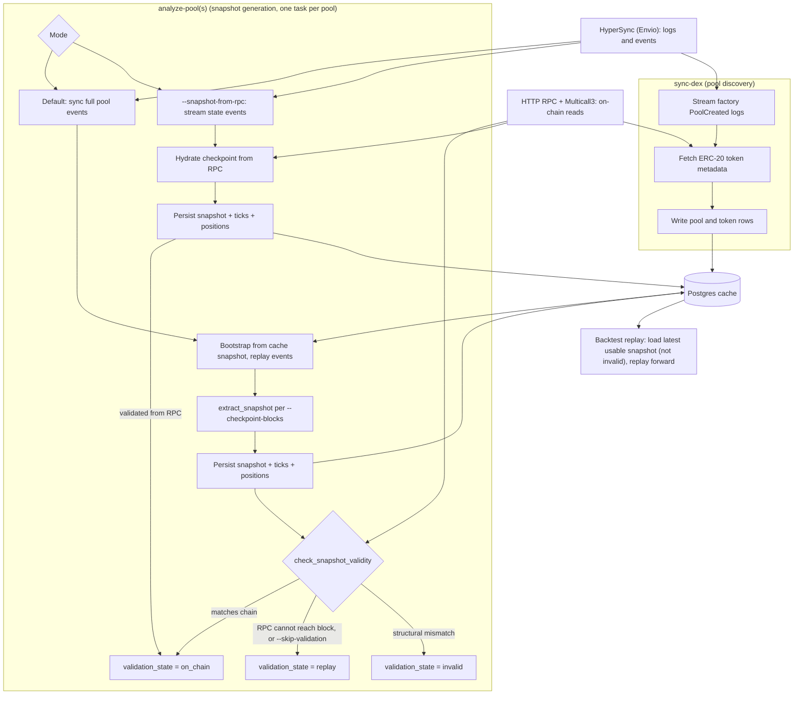

# 区块链 {#blockchain}

## 概览 {#overview}

区块链适配器从 EVM 链摄取 DeFi 数据，并通过 NautilusTrader 数据模型暴露。它还包含
一个执行客户端，用于本地签名的 Uniswap V3 市价兑换。该执行客户端尚未达到生产可用。
适配器使用三种后端：

- HyperSync：高吞吐的历史区块与合约日志。查询形态、分页与调优见
  [Envio HyperSync 文档](https://docs.envio.dev/docs/HyperSync/hypersync-usage)。
- HTTP RPC：合约调用、Multicall 读取，以及最终的链上状态水合。
- Postgres：可选的持久缓存状态、池元数据、解码事件与快照。

## 能力状态 {#capability-status}

| 能力             | 范围                                                                         | 成熟度                                                            |
| ---------------- | ---------------------------------------------------------------------------- | ----------------------------------------------------------------- |
| 历史区块         | 任何配置了可达 HyperSync 端点的 `Chain`。                                    | 经 Rust 服务与 `sync-blocks` 提供。                               |
| 实时区块         | HyperSync，或具备 RPC 客户端的链用 WSS RPC。                                 | 经 Rust 与 Python 数据客户端接口提供。                            |
| DEX 池发现       | 注册了池创建解析器的链与 DEX 组合。                                          | 经数据客户端与 `sync-dex` 提供。                                  |
| 池快照与重放     | 具备完整快照解析器集的集中流动性集成。                                       | 需 Postgres，并满足下文的提供商约束。                             |
| 实时池事件       | 已注册的 swap、liquidity、collect、flash 与 fee-protocol 解析器。            | 经 Rust 与 Python 数据客户端接口提供。                            |
| 交易执行         | 本地签名的 Uniswap V3 BUY 与 SELL 市价兑换。                                 | 实验性；未达生产可用，且不向 Python 暴露。                        |

Ethereum、Polygon、Base、Arbitrum 和 BSC 有直接的 WSS RPC 客户端。其他配置的链取值
在端点可达时可以使用 HyperSync 区块历史，但不支持 WSS 实时模式。

### 链与 DEX 命令支持 {#chain-and-dex-command-support}

命令支持由每条链、每个 DEX 注册的解析器推导而来。`sync-dex` 与
`analyze-pool(s)` 的 CLI 帮助会打印相同的能力边界。

| 层级            | 含义                                                       | DEX                                                  | 链                                          |
| --------------- | ------------------------------------------------------------ | --------------------------------------------------- | ------------------------------------------- |
| 可重放          | 发现、快照与 fee-protocol 重放解析器。                     | Uniswap V3 与 PancakeSwap V3。                      | Ethereum、Base、Arbitrum 和 BSC。           |
| 仅分析          | 有快照解析器，但 CLI 无池发现。                            | Aerodrome Slipstream。                              | Base。                                      |
| 仅发现          | 有池发现，但快照解析器集不完整。                           | Uniswap V2 与 Uniswap V4。                          | Ethereum、Base 和 Arbitrum。                |
| 仅发现          | 有池发现，但快照解析器集不完整。                           | Camelot V3 与 Fluid DEX。                           | Arbitrum。                                  |
| 仅注册          | 只注册元数据，事件解析器不支持命令。                       | Curve Finance 与 Fluid DEX。                        | Ethereum。                                  |
| 仅注册          | 只注册元数据，事件解析器不支持命令。                       | Aerodrome V1、BaseSwap V2、BaseX 与 SushiSwap V3。  | Base。                                      |
| 仅注册          | 只注册元数据，事件解析器不支持命令。                       | Curve Finance、SushiSwap V2 与 SushiSwap V3。       | Arbitrum。                                  |
| 仅区块          | 无 DEX 注册；`sync-blocks` 仍可用。                        | -                                                   | 其他配置链，包括 Polygon。                  |

`sync-dex` 需要池创建解析器。`analyze-pool(s)` 需要 Initialize、Swap、Mint、Burn 和
Collect 解析器。可重放的集成还解析 `SetFeeProtocol`；带 `CollectProtocol` 解析器的
集成可以重放协议费提取。

Aerodrome Slipstream 没有池创建解析器，CLI 也没有单独的池注册命令。只有当其池与
代币元数据已经通过其他集成路径进入缓存时，分析才能工作。其重放派生的快照无法对照
链上状态验证。仅注册的 DEX 会出现在命令帮助之外，并会在相应能力检查中失败。

### 接口可用性 {#interface-availability}

| 接口                                  | Rust                                      | Python                     | CLI                                      |
| ------------------------------------- | ----------------------------------------- | -------------------------- | ---------------------------------------- |
| 数据配置与工厂                        | 公开的配置与工厂。                        | 公开的配置与工厂。         | -                                        |
| 实时数据订阅                          | 数据客户端订阅 API。                      | LiveNode 数据客户端 API。  | -                                        |
| 区块同步、发现与分析                  | 适配器服务。                              | -                          | `sync-blocks`、`sync-dex` 与分析命令。   |
| 已存快照加载                          | 缓存 API。                                | `load_pool_snapshot`。     | -                                        |
| 执行配置                              | 公开配置。                                | 仅配置类型。               | -                                        |
| 执行工厂与订单路由                    | 公开的工厂与客户端。                      | -                          | -                                        |
| 预检、包装、授权与存储                | 直接调用 `BlockchainExecutionClient`。    | -                          | -                                        |

Python 模块不注册也不导出 `BlockchainExecutionClientFactory`，因此 Python 的
LiveNode 配置无法实例化执行客户端。

### 示例 {#examples}

两个公开语言接口都有可运行的数据客户端示例：

- [Rust LiveNode 数据测试器](https://github.com/nautechsystems/nautilus_trader/blob/develop/crates/adapters/blockchain/examples/node_data_tester.rs)。
- [Python 数据测试器](https://github.com/nautechsystems/nautilus_trader/blob/develop/examples/live/blockchain/data_tester.py)。
- [Python LiveNode 示例](https://github.com/nautechsystems/nautilus_trader/blob/develop/examples/live/blockchain/node_test.py)。

仓库不提供维护中的可运行执行配置示例。执行集成请用 Rust 构建，并遵守
[执行](#execution)中的约束。

## 核心原语 {#core-primitives}

DeFi 领域模型位于 `nautilus_model::defi`。

### 链 {#chain}

`Chain` 定义目标区块链及其默认服务端点。

| 字段                       | 类型             | 说明                                                               |
| -------------------------- | ---------------- | ------------------------------------------------------------------ |
| `name`                     | `Blockchain`     | 链枚举值，如 `Ethereum` 或 `Arbitrum`。                            |
| `chain_id`                 | `u32`            | EVM 链 ID，如 Ethereum 为 `1`。                                    |
| `hypersync_url`            | `String`         | HyperSync 端点，默认 `https://{chain_id}.hypersync.xyz`。          |
| `rpc_url`                  | `Option<String>` | 存放在链模型上的可选直接 RPC 端点。                                |
| `native_currency_decimals` | `u8`             | 原生 gas 代币的小数位精度，通常为 `18`。                           |

链可按数字 ID 用 `Chain::from_chain_id` 加载，或按名称用
`Chain::from_chain_name` 加载。

| 链系             | 代码 | 名称         | 小数位 |
| ---------------- | ---- | ------------ | ------ |
| Ethereum 与 L2   | ETH  | Ethereum     | 18     |
| Polygon          | POL  | Polygon      | 18     |
| Avalanche        | AVAX | Avalanche    | 18     |
| BSC              | BNB  | Binance Coin | 18     |

### DEX 与池 {#dex-and-pools}

DEX 集成注册：

- 工厂地址。
- 事件签名与解析函数。
- AMM 类型。

池定义把链和 DEX 绑定到池合约地址或协议池 ID，形成稳定的 Nautilus 金融工具 ID。
代币对、费率层级、tick 间距和创建区块保留为池元数据。

数据引擎处理池定义时，会在同一池金融工具 ID 下缓存并发布一个 `CurrencyPair`。
金融工具的 base 与 quote 取自 `Pool::get_base_token` 和
`Pool::get_quote_token`。swap 成交信息与执行都使用同一代币优先级方向。金融工具的
价格与数量精度由代币小数位推导，上限为 `FIXED_PRECISION`。不同的池标识让相同
代币对的池可以在缓存和消息总线中共存。

Uniswap V3 及兼容的集中流动性池还使用：

- `Initialize(uint160,int24)` 获取初始价格状态。
- `Mint` 与 `Burn` 事件重放仓位与 tick 状态。
- `Swap` 事件跟踪实时池价移动。
- HTTP RPC 读取终态的 `slot0`、流动性、活跃 tick 与仓位数据。

## 数据客户端配置 {#data-client-configuration}

| 选项                              | 默认值                        | 说明                                                 |
| --------------------------------- | ----------------------------- | ---------------------------------------------------- |
| `chain`                           | 必填                          | 目标 `Chain`，如 Ethereum 或 Arbitrum。              |
| `dex_ids`                         | `[]`                          | 要注册与同步的 DEX 集成。                            |
| `http_rpc_url`                    | 必填                          | 合约读取与 Multicall 的 HTTP RPC 端点。              |
| `wss_rpc_url`                     | `None`                        | WSS 端点；RPC 实时流必需。                           |
| `rpc_requests_per_second`         | `None`                        | 可选的 RPC 请求限流。                                |
| `multicall_calls_per_rpc_request` | `200`                         | 单次 RPC 请求请求的 Multicall 目标数上限。           |
| `use_hypersync_for_live_data`     | Rust: `false`；Python: `true` | 为 true 时，实时区块与事件流使用 HyperSync。         |
| `from_block`                      | `None`                        | 历史同步的可选起始区块。                             |
| `pool_filters`                    | `DexPoolFilters()`            | 池范围过滤规则。                                     |
| `postgres_cache_database_config`  | `None`                        | 可选的 Postgres 缓存配置。                           |
| `proxy_url`                       | `None`                        | 可选的 HTTP 与 WebSocket 代理 URL。                  |
| `transport_backend`               | `Sockudo`                     | WebSocket 传输后端。                                 |

:::note
池快照请求需要 Postgres 缓存数据库。内存缓存可以存放代币与池，但
最新的池剖析器引导会通过缓存数据库路径读取快照与事件状态。
:::

## 环境 {#environment}

在仓库之外设置凭据：

```bash
export ENVIO_API_TOKEN="<envio-token>"
export RPC_HTTP_URL="https://your-rpc.example"
export RPC_WSS_URL="wss://your-rpc.example"
```

本地使用 `.env` 时，确保该文件不进入版本控制：

```dotenv
ENVIO_API_TOKEN=<envio-token>
RPC_HTTP_URL=https://your-rpc.example
RPC_WSS_URL=wss://your-rpc.example
```

- Rust 的 HyperSync 客户端要求 `ENVIO_API_TOKEN`。缺失或格式错误的 token 会在
  发出任何查询前导致客户端构造失败。
- 合约读取与快照水合需要 `RPC_HTTP_URL` 或 `--rpc-url`。
- `use_hypersync_for_live_data = false` 时必须有 `RPC_WSS_URL`，该模式使用
  WSS RPC 实时流。

执行还需要更多变量（见[执行](#execution)）：

- 签名私钥从 `signer_private_key_env`
  配置字段所指的变量读取，绝不直接写在配置里。
- 签名载荷保护从 `payload_key_env` 和
  `payload_key_retired_env` 所指变量读取生效与已退役的 32 字节密钥。这些配置字段
  只包含变量名，绝不包含密钥值。

token 设置与配额细节见 Envio 的
[HyperSync API token 文档](https://docs.envio.dev/docs/HyperSync/api-tokens)。

### RPC 提供商要求 {#rpc-provider-requirements}

`RPC_HTTP_URL` 或 `--rpc-url` 必须指向目标链的 EVM JSON-RPC 端点。数据客户端用它
做合约读取，首次池同步也通过它读取链上状态。客户端从 `Chain::hypersync_url`
读取 HyperSync 端点，内置链默认 `https://{chain_id}.hypersync.xyz`。

选择支持目标历史区块与 Multicall 工作量的 RPC 提供商。提供商的宣传标签不足以证明
archive 访问权限：要用工作流将使用的历史区块验证一次 `eth_getCode` 或
`eth_call`。只返回区块头并不能证明历史合约状态可用。大型池还可能要求更高的
载荷、gas、超时与请求速率上限。

archive 支持影响的是验证，不是事件同步能否运行：

- 在 archive 节点上，历史区块快照会对照链上状态验证，并以
  `validation_state = on_chain` 存储。
- 在非 archive 节点上，历史读取失败，快照保持 `validation_state = replay`，
  仍可作为重放起点使用。
- 非 archive 节点首次同步时使用较新的 `--to-block`。引导过程在目标区块读取链上
  状态，非 archive 节点只提供近期状态。

## 本地服务 {#local-services}

开发用 Docker Compose 文件启动 Postgres、Redis 和 pgAdmin。要创建容器、等待
Postgres 就绪并初始化数据库模式，运行：

```bash
make init-services
```

`make start-services` 启动已初始化的技术栈。`make init-db`
初始化或重新应用 Postgres 模式。

本地 Postgres 默认值：

| 字段     | 值               |
| -------- | ---------------- |
| 主机     | `127.0.0.1:5432` |
| 数据库   | `nautilus`       |
| 用户     | `nautilus`       |
| 密码     | `pass`           |

检查模式是否存在：

```bash
docker exec nautilus-database psql -U nautilus -d nautilus -Atc \
    "select count(*) from information_schema.tables where table_schema='public'"
```

池快照生成与快照请求需要已初始化模式的 Postgres 缓存。池发现与快照生成会写入
`token`、`pool`、`pool_*_event`、`pool_snapshot`、
`pool_position` 和 `pool_tick` 行。可重复或有破坏性的数据工作负载请使用专用数据库
或可重置的 Docker 卷。

## 数据流 {#data-flow}

### 架构 {#architecture}

`sync-dex` 发现并存储池与代币，`analyze-pool(s)` 随后生成 `pool_snapshot`
行。下图展示默认重放路径与 `--snapshot-from-rpc` 路径。



`analyze-pools` 每个池运行一个任务，并发量由 `--concurrency` 限制，每个任务拥有
自己的数据客户端。除非 `validation_state` 为 `invalid`，快照都可用作重放起点。

### 数据客户端接口 {#data-client-surface}

公开数据客户端支持这些 DeFi 订阅与请求：

| 接口       | 命令                                                               | 行为                                                                                                 |
| ---------- | ------------------------------------------------------------------ | ---------------------------------------------------------------------------------------------------- |
| 区块       | `SubscribeBlocks`、`UnsubscribeBlocks`                             | 启动或停止共享的 HyperSync 或 WSS RPC 区块流。                                                       |
| 完整池     | `SubscribePool`、`UnsubscribePool`                                 | 选择 swap、mint、burn、collect、flash 与两种 fee-protocol 事件类型。                                 |
| 池 swap    | `SubscribePoolSwaps`、`UnsubscribePoolSwaps`                       | 选择单个池金融工具的 swap 事件。                                                                     |
| 流动性更新 | `SubscribePoolLiquidityUpdates`、`UnsubscribePoolLiquidityUpdates` | 选择单个池金融工具的 mint 与 burn 事件。                                                             |
| 费用收取   | `SubscribePoolFeeCollects`、`UnsubscribePoolFeeCollects`           | 选择单个池金融工具的 collect 事件。                                                                  |
| Flash 事件 | `SubscribePoolFlashEvents`、`UnsubscribePoolFlashEvents`           | 选择单个池金融工具的 flash 事件。                                                                    |
| 池快照     | `RequestPoolSnapshot`                                              | 先发布池定义，缓存引导与验证成功后再发布可用快照。                                                   |

订阅共享底层区块与 DEX 事件流。客户端为每个池地址和事件类型统计持有者数量，
因此取消一个订阅不会中断其他订阅仍在使用的数据流。完整池订阅与更窄的订阅重叠时
同样成立：`UnsubscribePool` 后更窄的事件类型保持激活，反之亦然。数据引擎会保留
池的剖析器更新器，直到没有任何数据客户端还持有该池的订阅。

池快照响应携带其请求的 ID。若引导被最终退订、重置或断连取消，数据引擎会丢弃
对应响应。池快照请求需要 Postgres，因为引导通过缓存数据库读取已存储的池与事件
状态。

:::warning
DeFi 池定义与账户状态更新通过带类型的消息总线路由发布，
`subscribe_any` 处理器永远收不到它们。请使用
`subscribe_defi_pools` 和 `subscribe_account_state`，
或对应的 actor 订阅 API。
:::

### 池发现 {#pool-discovery}

池发现过程：

- 从 HyperSync 流式读取 DEX 工厂事件。
- 通过 RPC 获取 ERC-20 元数据。
- 把有效的代币与池存入缓存。
- 跳过无效的代币元数据。`DexPoolFilters` 还可排除空代币元数据。

### 实时数据 {#live-data}

- `use_hypersync_for_live_data = true`：通过 HyperSync 订阅区块获取实时时间戳，
  并为每个订阅的 DEX 过滤器保持一条开放的 HyperSync DEX 事件流。
- `use_hypersync_for_live_data = false`：使用 WSS RPC 的区块与池日志订阅，获取
  实时 swap、流动性更新、费用收取、flash 事件与 fee-protocol 事件。

### 快照引导 {#snapshot-bootstrap}

对 Uniswap V3 兼容快照，默认引导重放已存储的池事件，重建价格、流动性、tick、
仓位、费用与计数器。验证随后通过 HTTP RPC 与 Multicall 读取链上状态。

引导模式：

- 默认：把截至目标区块的完整池事件历史存入数据库，再从数据库引导。
- `--snapshot-from-rpc`：跳过完整 swap 存储，从 HyperSync 流式读取 Initialize、
  Mint、Burn、SetFeeProtocol 与 CollectProtocol 事件以枚举 tick 与仓位，再从
  RPC 水合精确的检查点区块。

对历史悠久、活动量大的池，若只需要最终快照而不是存储 swap 历史，用
`--snapshot-from-rpc`。它不能与 `--from-block`、`--reset` 或
`--require-existing-snapshot` 组合使用。

`--snapshot-from-rpc` 模式下，最终 RPC 水合是检查点状态的权威来源。水合失败时
命令直接失败，而不是输出带着过期价格状态的重放快照。

### 快照验证 {#snapshot-validation}

对重放派生的快照，引导在标记有效前把剖析器与链上状态比对。

| 类别     | 字段                                                       | 不一致结果                       |
| -------- | ---------------------------------------------------------- | -------------------------------- |
| 结构性   | 当前 tick、活跃流动性、逐 tick 流动性与仓位流动性。        | 存为 `invalid`；默认加载时排除。 |
| 非结构性 | sqrt 价格、fee protocol 与协议费余额。                     | 告警并接受快照为 `on_chain`。    |

非结构性差异可能来自：

- 事件重放按交易范围作用，而 RPC 快照按区块范围作用。
- 分叉或重放区间遗漏了一次 fee-protocol 更新。
- 重放舍入与链上费用累加器不同。

接受这些字段与回测重放的行为一致。

### 快照引导守卫 {#snapshot-bootstrap-guard}

只允许从本地快照缓存运行分析时，使用 `--require-existing-snapshot`：

- 检查目标区块或之前最新的可用 `pool_snapshot`。
- 没有可用快照时返回 `needs_bootstrap`。
- 创建区块的快照若既无仓位也无 tick，视为不可用。
- 跳过该池从创建到目标的引导。

#### 分析输出 {#analysis-output}

`analyze-pool(s)` 打印：

- 每个 `--checkpoint-blocks` 条目一条 JSON 结果。
- 未给检查点时，在 `--to-block` 处输出一条 JSON 结果。

需要首次引导的池形如：

```json
{
  "chain": "Ethereum",
  "dex": "UniswapV3",
  "pool_address": "0x1111111111111111111111111111111111111111",
  "target_block": 25218797,
  "status": "needs_bootstrap"
}
```

成功的结果包含 `validation_state`：

- `on_chain`：已水合并与链上比对一致。
- `replay`：重放派生或未检查，仍可用作重放起点。
- `invalid`：已水合但不一致，不可用。

```json
{
  "chain": "Ethereum",
  "dex": "UniswapV3",
  "pool_address": "0x1111111111111111111111111111111111111111",
  "target_block": 25218797,
  "status": "success",
  "snapshot_block": 25218790,
  "positions": 2,
  "ticks": 7,
  "validation_state": "replay",
  "already_valid": false,
  "liquidity_utilization_rate": 0.25
}
```

### 检查点与并发 {#checkpoints-and-concurrency}

- `--checkpoint-blocks b1,b2,...`：一趟引导产出多个快照。区块会排序、去重并
  截断到 `--to-block`。
- `--concurrency`：控制 `analyze-pools` 的并行度。默认 `4`。
- `--skip-validation`：跳过链上比对，重放派生快照保持为 `replay`。
- `--snapshot-from-rpc`：在检查点区块从链上水合，快照记录为
  `on_chain`。

快照键：

- 默认模式：以检查点或之前最后一条池事件为键。两次检查点之间没有事件时可以
  共用同一存储行。
- `--snapshot-from-rpc`：以请求的检查点区块为键，附带区块范围的哨兵
  交易/日志索引。

### 回测重放 {#backtest-replay}

回测重放需要输入数据里带快照。适配器在回测期间不处理实时快照请求。

`load_pool_snapshot` 从 Postgres 读取包含仓位与 tick 的完整快照：

```python
from nautilus_trader.adapters.blockchain import load_pool_snapshot

snapshot = load_pool_snapshot(
    pg_config=postgres_config,
    chain_id=chain_id,
    pool_address=pool_address,
    before_block=replay_start_block,  # latest snapshot at or before this block
)
```

重放规则：

- 默认排除标记为 `invalid` 的快照，`on_chain` 与 `replay` 都可能返回。
  只有当调用方也接受 `invalid` 快照时才传 `require_valid=False`。
- `None` 视为环境准备失败，不要在没有剖析器状态时重放。
- 把结果包装为 `DefiData.PoolSnapshot(snapshot)`，连同池事件一起传给
  `BacktestEngine.add_defi_data`。
- 从快照区块开始重放每条池事件。晚于快照区块开始会让剖析器状态过期。

缓存的区块时间戳加载为 Nautilus 数据对象时是 UNIX 纳秒。以秒级精度写入的缓存行
在加载快照与池事件时归一化为纳秒，纳秒行保持其存储精度。

### 池分析约束 {#pool-analysis-constraints}

`analyze-pool(s)` 校验前置条件并逐池独立报告。直接调用底层 Rust 分析服务时同样
适用这些边界。

| 条件                  | 行为                                                                                     | 约束                                                                                                                 |
| --------------------- | ------------------------------------------------------------------------------------------ | ---------------------------------------------------------------------------------------------------------------------- |
| 缺少池元数据          | 以 `Pool <address> is not registered` 失败。                                             | 先发现池；分析不能推断或注册元数据。                                                                                 |
| 缺少解析器能力        | 同步前失败。                                                                             | 使用[链与 DEX 命令支持](#chain-and-dex-command-support)中支持快照的组合。                                            |
| 地址未用校验和        | 以 `Blockchain address '<address>' has incorrect checksum` 失败。                        | 提供 EIP-55 地址；工厂 `getPool` 的结果可能需要转换校验和。                                                          |
| 提供商 Multicall 上限 | `out of gas`、载荷或超时错误会中止最终状态水合。                                       | 调低 `multicall_calls_per_rpc_request`，或换限额更高的提供商。                                                       |
| 缺少历史状态          | 首次引导无法在过旧的 `--to-block` 读取最终状态。                                         | 用较新的目标或支持 archive 的提供商；见 [RPC 提供商要求](#rpc-provider-requirements)。                               |
| HyperSync 配额受限    | 高活跃池会退避，完整首次同步可能需要数千次请求。                                       | 调低 `--concurrency`；不需要存储 swap 历史时用 `--snapshot-from-rpc`。                                               |
| 中途 `--from-block`   | 遗漏 `Initialize` 会让剖析器缺少初始价格。                                               | 生成首个快照时从池创建开始同步。                                                                                     |
| 无流动性事件          | `analyze-pool` 报错；`analyze-pools` 输出失败结果并继续其他池。                         | 选择在目标区块或之前有 Mint 或 Burn 的池。                                                                           |
| 任一单池失败          | 输出 `"status": "failure"`，`analyze-pool(s)` 以非零退出。                              | 整体结果看退出码，单池结果看各自 JSON 状态。                                                                         |

`--snapshot-from-rpc` 模式的最终 RPC 水合是检查点状态的权威。水合失败会中止分析，
而不是存储带过期价格状态的快照。

## 池分析操作 {#pool-analysis-operations}

### 分析前先发现池 {#discover-pools-before-analysis}

`analyze-pool(s)` 从 Postgres 缓存读取池元数据，池未被发现时以
`Pool <address> is not registered` 失败。分析前先对相应链与 DEX 运行
`sync-dex`，填充 `pool` 与 `token` 表。

### 检查命令支持 {#check-command-support}

开始同步前，参照[链与 DEX 命令支持](#chain-and-dex-command-support)或命令帮助。
`sync-dex` 与 `analyze-pool(s)` 会在查询事件前拒绝不支持的链与 DEX 组合，
而不是返回空结果。

```bash
./target/debug/nautilus blockchain sync-dex --help
./target/debug/nautilus blockchain analyze-pools --help
```

### 使用校验和格式的池地址 {#use-checksummed-pool-addresses}

池地址必须使用 EIP-55 校验和。小写地址会以
`Blockchain address '<address>' has incorrect checksum` 失败。把发现的地址转换为
校验和形式后再传 `--address` 或写入地址文件。

### 缩小 Multicall 请求规模 {#reduce-the-multicall-request-size}

RPC 提供商可能以 out-of-gas、载荷或超时错误拒绝过大的最终状态 Multicall。把
`--multicall-calls-per-rpc-request` 从默认 `200` 调低，使单次请求保持在提供商
限额内。

### 选择提供商能提供服务的目标区块 {#choose-a-target-block-the-rpc-provider-can-serve}

首次同步在 `--to-block` 读取链上状态。非 archive 的 RPC 提供商要用较新的目标
区块，或者改用能在请求的历史区块提供合约状态的提供商。见
[RPC 提供商要求](#rpc-provider-requirements)。

### 控制 HyperSync 请求量 {#control-hypersync-request-volume}

大型或历史悠久的池首次完整同步可能需要数千次请求。配置的 token 配额受限时调低
`--concurrency`。精确检查点快照已够用、不需要存储 swap 历史时用
`--snapshot-from-rpc`。

### 初始重放从池创建开始 {#start-an-initial-replay-at-pool-creation}

`--from-block` 设在池历史中间可能遗漏其 `Initialize` 事件。没有初始价格时，
快照引导会以
`Pool is not initialized and it doesn't contain initial price, cannot bootstrap profiler`
失败。生成首个快照时从池创建开始同步。

### 解读池失败 {#interpret-pool-failures}

目标区块或之前没有已处理 Mint 或 Burn 事件的池，可能缺少生成快照所需的状态。
`analyze-pool` 返回错误。`analyze-pools` 输出一行
`"status": "failure"` 的 JSON，继续处理其他池，并在任何单池失败后以非零退出。
整体结果看进程退出码，单个结果看各自的 JSON 状态。

## 运行手册：验证实时池同步 {#runbook-validate-a-live-pool-sync}

用这套流程检查单个链上单个 DEX 的池发现、事件解析与快照生成。示例用 Arbitrum
上的 PancakeSwap V3。它只执行只读的链上查询，且只写入配置的 Postgres 缓存。

### 前置条件 {#prerequisites}

- Docker 可用，用于本地 Postgres 服务。
- `ENVIO_API_TOKEN` 是有效的 HyperSync token。
- `RPC_HTTP_URL` 指向能提供目标区块的 Arbitrum RPC 提供商。
- `POOL_ADDRESS` 是 EIP-55 校验和格式的 PancakeSwap V3 池地址。

### 启动本地服务并构建 CLI {#start-the-local-services-and-build-the-cli}

```bash
make init-services
cargo build -p nautilus-cli --features defi --bin nautilus
```

### 发现池 {#discover-pools}

本地数据库被重置过的话，在分析前先立即运行一次发现：

```bash
./target/debug/nautilus blockchain sync-dex \
    --chain arbitrum \
    --dex PancakeSwapV3 \
    --rpc-url "$RPC_HTTP_URL" \
    --host 127.0.0.1 \
    --port 5432 \
    --username nautilus \
    --password pass \
    --database nautilus
```

### 分析池 {#analyze-the-pool}

这次验证运行把并发保持为 1：

```bash
./target/debug/nautilus blockchain analyze-pools \
    --chain arbitrum \
    --dex PancakeSwapV3 \
    --address "$POOL_ADDRESS" \
    --rpc-url "$RPC_HTTP_URL" \
    --host 127.0.0.1 \
    --port 5432 \
    --username nautilus \
    --password pass \
    --database nautilus \
    --concurrency 1
```

### 检查存储的数据 {#check-the-stored-data}

统计为该池写入下列表的行数：

- `pool_swap_event`
- `pool_liquidity_event`
- `pool_collect_event`
- `pool_flash_event`
- `pool_fee_protocol_update_event`
- `pool_fee_protocol_collect_event`
- `pool_snapshot`
- `pool_position`
- `pool_tick`

同步范围内没有 `SetFeeProtocol` 或 `CollectProtocol` 事件时，fee-protocol
相关表保持为空。本地数据库重置后，先重跑发现再分析，池行才会存在。地址、提供商、
重放区间与请求量相关的失败见[池分析操作](#pool-analysis-operations)。

## 合约 {#contracts}

### 基础合约与 Multicall3 {#base-contract-and-multicall3}

`BaseContract` 通过 Multicall3
（`0xcA11bde05977b3631167028862bE2a173976CA11`）批量执行合约调用：

- Multicall 使用 `tryAggregate(requireSuccess: false)`，每个结果各自报告成败，
  由合约包装器决定是否拒绝。
- 读取在单一区块上下文中执行。
- 传输与提供商失败以 RPC 错误浮出。

### ERC-20 元数据 {#erc-20-metadata}

`Erc20Contract` 通过 Multicall 读取 `name`、`symbol` 与
`decimals`。适配器可以跳过代币元数据畸形、原始字节或为空的池。

### Uniswap V3 池 {#uniswap-v3-pools}

`UniswapV3PoolContract` 读取池全局状态、活跃 tick 与仓位。

- 大型池可能超出提供商的载荷、gas 或超时限制。
- RPC 快照水合在最终状态读取失败时按失败关闭。
- 超大型池可能需要更低的 `multicall_calls_per_rpc_request` 或更强的提供商。

PancakeSwap V3 复用 Uniswap V3 的读取合约，因为 `slot0`、`ticks`、
`positions`、`liquidity` 与费用增长读取共享同一 ABI。fee-protocol 编码不同：

- Uniswap V3 把两个 4 位费用分母打包进一个 `uint8`。
- PancakeSwap V3 在 `slot0.feeProtocol` 中存两个 16 位基点份额，并发出
  `SetFeeProtocol(uint32,uint32,uint32,uint32)`。
- PancakeSwap V3 快照存 `fee_protocol0_basis_points` 与
  `fee_protocol1_basis_points`，重放按 `fee * basis_points / 10000`
  计算协议费。

## 执行 {#execution}

:::warning
执行客户端尚未达到生产可用。`BlockchainExecutionClient` 实现了预检、
显式 WETH 包装与 ERC-20 授权、本地 EIP-1559 签名、持久对账，以及一条 Uniswap V3
swap 流程。其他订单操作一律按失败关闭，不产生链上或持久化副作用。
:::

本节统一使用下列术语：

| 术语         | 含义                                                                                                       |
| ------------ | ------------------------------------------------------------------------------------------------------------ |
| 决策高度     | 同一组授权读取集下，三个 RPC 源共同接受的最小新区块高度。                                                  |
| 验证源       | 一个权威端点，或分属不同配置故障域的两个只读验证器之一。                                                   |
| 部署清单     | 经审查的合约、代码哈希、代理绑定、身份、池、代币与允许的调用边。                                           |
| 意图         | 一次持久的包装、授权或 swap 逻辑操作，与其交易哈希历史无关。                                               |
| 签名器所有权 | 对钱包签名器的独占控制，以及分配后对其活跃 nonce 的控制。                                                  |
| 最终性边界   | 所有源在该交易的包含区块及其之前的最终化祖先链上达成一致的界点。                                           |

### 连接与账户状态 {#connection-and-account-state}

构造客户端需要一个权威 RPC 端点与恰好两个只读验证提供商。每个源需要不同的端点、
提供商 ID、运营方 ID，以及两两不相交的故障域 ID 集合。

#### 强制运行条件 {#enforced-operating-conditions}

- 权威执行端点与两个验证端点必须使用 HTTPS。明文 HTTP 只接受
  `127.0.0.0/8` 内的规范 IPv4 回环字面量或恰为 `[::1]` 的地址。
  主机名、IPv4 映射的 IPv6、私有与链路本地地址、非规范数字形式都不合格。
- HyperSync 使用同样的 HTTPS 规则。该校验在加载 HyperSync token 或创建其
  客户端之前执行。
- 区块链 HTTP 客户端拒绝重定向。规范回环 RPC 连接同时绕过配置的与环境代理。
  远程 HTTPS 执行 RPC 客户端继续遵循环境代理变量。
- 使用 Postgres 的执行连接要求有效的活动载荷密钥、稳定的部署 ID、就绪的受保护
  存储，以及存储信封引用的每个密钥都可用。在加载签名器或发起执行 RPC 调用前，
  对每个保留的载荷完成认证。
- 挂载的 Postgres 数据库只有在客户端断开以做检查、保护或回滚工作时才允许未受保护。
  重新封装要求受保护存储。未受保护的数据库不能提供执行能力。

#### 运营方假设 {#operator-assumptions}

故障域代表任何共享的上游、经销商、网关、代理、账户、网络路径或托管控制平面。
不同的 URL 与不同的配置身份并不能证明运营独立。运营方必须核实三个提供商不共享
控制或故障域。

运营方还必须识别并监控所有能够改变清单固定部署的代码、或改变清单固定代理的实现
的一方或治理机制。一旦此类部署变更或代理升级被公告或被怀疑，立即停止执行，并撤销
支出方是受影响部署中路由地址的全部未回收授权。在签名所用决策区块上出现变更后代码
或实现之前完成全部撤销；一旦出现，签名前的部署检查会对所有客户端交易按失败关闭，
包括撤销本身。

运营方必须保证签名密钥只被一个在线客户端独占，并控制对主机环境、数据库、副本、
备份与导出通道的访问。

Connect 在加载签名器前完成这些检查：

1. 打开持久执行存储。配置了 Postgres 时，要求受保护存储就绪，并在加载任何已有
   验证台账前认证全部保留载荷。
1. 要求三个源都与本地链 ID 和经审查的最终化检查点一致。
1. 以每次至多 4,096 个区块的窗口扩展或复查持久的最终化区块头祖先链。
1. 要求三个源给出完全一致的最新区块高度签名器 nonce。
1. 在最终化高度验证经审查的部署清单，包括运行时代码、代理槽位、实现、路由与
   工厂关系、池身份、代币小数位与固定的报价合约。
1. 对每个源探测 archive、finalized 标签、显式高度状态与调用、gas、存储、报价与
   调用跟踪能力。
1. 原子地安装验证台账，或连同授权各项分类的证据迁移保留的执行历史。
1. 从 `signer_private_key_env` 加载私钥，要求其地址等于
   `wallet_address`，并对任何活跃意图做对账。
1. 读取原生余额与配置的 ERC-20 余额，安装完整钱包快照，并在配置的账户 ID 下
   发布一个 `AccountState`。

没有 Postgres 时，客户端可以连接并发布余额，但所有交易操作都会被拒绝。验证、
迁移、对账、余额或精确金额换算失败会让客户端保持断开：移除已加载的签名器，保留
之前的完整快照，不发布任何部分钱包状态。重复的代币符号也会导致快照被拒，因为
符号定义货币身份。

验证提供商从不接收已签名的交易字节，也没有广播方法。只有权威端点接收
`eth_sendRawTransaction`。用于授权签名、重广播或持久迁移的安全关键未签名读取
发给全部三个源。诊断性预检与连接时的余额发布只走权威端点，且不能授权执行。
这保护的是完整性，不是订单机密性。需要路由或金额机密性的运营方需要另一套执行
设计。

发布的余额取 `total = free`、`locked = 0`。钱包账户在推导有效可用与锁定余额时
应用本地预留，见[钱包账户](./../concepts/accounting.md#wallet-accounts)。

客户端启动后，`QueryAccount` 直接重发已安装的快照，不再做 RPC 读取。以下情况
会失败：

- 请求的账户 ID 与客户端账户 ID 不一致。
- 客户端尚未启动。
- 不存在完整快照。

Disconnect 移除签名器并中止在途的提交任务。交易操作在任何执行 RPC 调用前
拒绝已断开的客户端。

### 支持的订单范围 {#supported-order-slice}

客户端只接受一种市价单形态：

| 维度     | 接受                                                                                      | 拒绝                                                                    |
| -------- | ------------------------------------------------------------------------------------------- | --------------------------------------------------------------------------- |
| 链       | 执行客户端配置的链。                                                                      | 金融工具场所属于其他链。                                                  |
| DEX      | Uniswap V3。                                                                              | 其他一切 DEX，包括 PancakeSwap V3。                                       |
| 池       | `Cache::pool` 中带费率层级的地址型池。                                                    | 未知的池、V4 池 ID 与无费率层级的池。                                     |
| 订单     | 单笔方向为 `BUY` 或 `SELL` 的 `MarketOrder`。                                             | 经 `SubmitOrder` 提交的非市价订单。                                       |
| 数量     | 以 base 计价的规模，且在 `max_order_amount` 内；BUY 还需匹配的 quote 支出上限。           | 以 quote 计价的输入，或超过任一适用上限的金额。                           |
| 方向     | 模型优先级互不相同的代币。                                                                | 代币优先级相同、方向有歧义的交易对。                                      |

`InstrumentId` 选定池，例如
`0xC6962004f452bE9203591991D15f6b388e09E8D0.Arbitrum:UniswapV3`。其场所必须能解析为 `<Chain>:<DexType>`，
其代码必须能解析为地址型 `PoolIdentifier`。`Pool::get_base_token` 与 `Pool::get_quote_token`
应用模型的代币优先级约定：

- 稳定币是 quote 资产。
- 包装原生资产次之。
- 其他代币相对它们成为 base 资产。

`Token::get_token_priority` 取值相等即为有歧义，订单被拒绝。

场所路由接受任何场所匹配的配置链上的 Uniswap V3。swap 准备还要求该链注册了
Uniswap V3 部署与工厂。

订单列表对每个未结订单一律 `OrderDenied`。修改、撤单与批量撤单命令对被引用的
每个缓存订单一律 `OrderModifyRejected` 或 `OrderCancelRejected`。全部撤单命令与
订单查询只记录警告、不发事件。批量状态返回 `Ok(None)`，使启动对账记录日志并
继续。订单、成交与持仓报告探测返回错误，避免 LiveNode 把空答复当作不存在。
这些路径从不签名、广播或持久化意图。

swap 在达到最终性前保持 `Submitted`，场所状态查询无法解析它。客户端要求提交
保留（submission retention）。在途检查耗尽重试时，LiveNode 记录警告并让 swap
保持 `Submitted` 而不是拒绝。因此最终化的成交或拒绝之后仍会作用于该订单。
若节点在最终性之前停止，关闭流程会为本轮提交的每笔 swap 报告未完成的提交恢复，
持久化的意图在下次 connect 时对账。请保持未结订单检查关闭。

Execution routing follows Nautilus's multi-venue broker pattern. The client represents a wallet and RPC
connection for one chain. Each instrument venue identifies both its chain and DEX.

A strategy may select the client explicitly through `client_id`. Node configuration may instead register the
client for instrument venues through `RoutingConfig.venues` or use it as the default execution client. After
client selection, `ExecutionClient::handles_order_venue` accepts only a venue whose parsed chain matches the
client configuration and whose DEX is supported by the client. The instrument retains its `<Chain>:<DexType>`
venue rather than being rewritten to `BLOCKCHAIN`.

The order maps to a single `exactInputSingle` call on the original Uniswap SwapRouter (the
deployment whose signature carries a deadline). `allowed_token_pairs` is directional
`(token_in, token_out)`: a SELL requires the base-to-quote pair, and a BUY requires the
quote-to-base pair. Listing only one direction does not admit the other.

| Parameter           | Source                                                                                     |
| ------------------- | ------------------------------------------------------------------------------------------ |
| `tokenIn`           | SELL: pool base token. BUY: pool quote token.                                              |
| `tokenOut`          | SELL: pool quote token. BUY: pool base token.                                              |
| `fee`               | Pool fee tier.                                                                             |
| `recipient`         | Execution wallet address.                                                                  |
| `deadline`          | Verified decision-header timestamp plus configured `deadline_seconds`.                     |
| `amountIn`          | SELL: `Quantity` as raw base units. BUY: quote input from the verified exact-output quote. |
| `amountOutMinimum`  | Derived from the verified quote at the decision height (see below).                        |
| `sqrtPriceLimitX96` | `0` (slippage is bounded by `amountOutMinimum`).                                           |

### BUY quote-spend limits

Every BUY needs one `quote_spend_limits` entry for its directed quote-to-base pair. The entry repeats the
quote-token address and decimals beside `max_amount`, a base-10 string in the token's raw units. Client
construction rejects these entries:

- A second entry for the same directed pair.
- A `spend_token` that differs from `token_in`.
- A `max_amount` that is not a base-10 unsigned integer within the `U256` range.
- A pair outside `allowed_token_pairs`.

Order preparation also checks the configured token and decimals against the selected pool (see
[Execution configuration](#execution-configuration) for an example entry).

The client compares the independently verified exact-output quote's `amountIn` with this limit before signing.
Equality is accepted. A quote one raw unit above the limit is denied. `max_order_amount` remains a separate
ceiling on the submitted base quantity, and SELL orders do not use `quote_spend_limits`.

### Slippage protection

`amountOutMinimum` is always derived, never caller-supplied:

1. Require an initialized `PoolProfiler` with a processed event watermark in the shared engine cache
   (`Cache::pool_profiler`). Its local simulation must consume the full SELL input or produce a
   nonzero BUY input, but its amount does not set a signed field. A live data-side subscription
   normally maintains this state.
1. Choose a decision height from the minimum fresh head reported by the three sources. The head
   skew must remain within `verification.chain_anchor.max_head_skew_blocks`.
1. Require the profiler watermark to include the block hash observed during ingestion. All three
   sources must return that exact explicit-height header. A block-scoped snapshot must also carry
   the header hash as its snapshot identifier.
1. For an event watermark, require a successful canonical receipt whose transaction, block, and
   index metadata match the profiler position. The selected log must come from the expected pool
   and use a supported pool-event signature.
1. Verify one unanimous parent-linked ancestry from the profiler height through the decision
   height. The distance must not exceed `max_quote_age_blocks`, which must be in `1..=4095`.
1. Call the manifest-pinned `IQuoterV2` contract at the decision height through all three sources. SELL uses
   `quoteExactInputSingle`. BUY uses `quoteExactOutputSingle`. The full decoded result must agree, including
   amount, resulting square-root price, initialized ticks crossed, and gas estimate.
1. Immediately before signing, reread the checkpoint, profiler header, decision header, ancestry,
   and quote. An unavailable or changed result blocks signing.
1. For SELL, compute `amountOutMinimum` from the verified exact-input output. For BUY, use the
   verified exact-output input as `amountIn` and derive `amountOutMinimum` from the requested base
   output. Integer arithmetic rejects a zero minimum.

Profiler divergence can request a data refresh, but it cannot override a verified quote or weaken
the signed limits.

The `slippage_bps` configuration field sets the slippage. A `slippage_bps` entry in the submit command's
`params` overrides it for that order. An override above the `max_slippage_bps` ceiling is rejected before
signing.

Pre-upgrade event rows can lack an ingestion block hash because the schema migration does not
backfill one. Such rows cannot authorize execution. Refresh the traded pool through the normal live
data subscription, or resync its events and rebuild its snapshot, before submitting an order.

### Preflight, wrapping, and approval

Preflight, WETH wrapping, and router approval are explicit operations on the client, separate from
`submit_order`:

| Operation | State change                       | Pre-broadcast checks                                                                                                        | Completion check                                    |
| --------- | ---------------------------------- | --------------------------------------------------------------------------------------------------------------------------- | --------------------------------------------------- |
| Preflight | None.                              | Authoritative chain, deployed-code, balance, allowance, and current-fee diagnostics.                                        | Returns a structured, sanitized report.             |
| Wrap      | Calls WETH `deposit()` with value. | Verified decision ancestry, deployment, WETH balance, native balance, gas, fee, nonce, and explicit-height simulation.      | WETH balance increased by the exact wrapped amount. |
| Approve   | Calls `approve(router, amount)`.   | Wrap checks plus router policy, factory and WETH identity, input-token membership, zero allowance, and approval simulation. | Allowance at the inclusion block equals the target. |

Preflight resolves the pool from `Cache::pool`. Its report contains no RPC URL, private key, or raw signed
transaction. It reports these values and checks:

- Expected and observed chain IDs.
- Pool, router, and token code checks.
- Token balances and allowances, and native balance.
- Base and priority fees, the derived maximum fee, and whether that fee stays within its ceiling.
- Overall readiness and every failed check.

Approve rejects a standard `false` return and accepts tokens that return no data. A nonzero
approval is limited to configured input tokens and requires the existing allowance to be zero.
With `unlimited_approval`, every nonzero request targets `U256::MAX`. The final allowance must equal
the target exactly. A zero request revokes an allowlisted router even when router deployment
metadata is unavailable, so a broken router check cannot prevent revocation.

During an uninterrupted call, wrap and approve use the shared EIP-1559 path. They persist the intent and
signed hash before broadcast. They return after stable finality and the operation's postcondition. Wrap
compares the WETH balance immediately before and at the inclusion block, which avoids a stale pre-broadcast
baseline. A failed postcondition returns an error after finality, so the transaction may still have changed
on-chain state.

Before signing a swap, order submission requires exact agreement from all three sources for:

- The decision header and parent-linked ancestry from the durable finalized ledger.
- The deployment manifest at the decision height, including every configured code hash, proxy
  binding, and role probe.
- The router reports the registered factory and configured WETH, and the factory resolves the
  exact pool for the input token, output token, and fee tier.
- Both tokens report the decimals stored in the reviewed manifest.
- The manifest-pinned quote contract returns one exact quote.
- Router allowance and input-token balance sufficient for the raw input amount.
- Native balance sufficient for transaction value plus the maximum gas cost.
- Canonical and pending nonce observations that agree with the durable nonce ledger.
- The maximum gas estimate, median priority fee, and local gas and fee ceilings.

The decision header supplies the deadline, quote-age boundary, durable `created_block`, and EIP-1559 base fee.
State, call, code, storage, gas, balance, and allowance reads use its explicit block number.

Immediately before local signing, the client repeats the chain, header, ancestry, deployment, quote, canonical
nonce, and pending nonce checks. It persists this evidence atomically with nonce assignment. A failure before
signing produces `OrderDenied` and no broadcast. The client releases its preparation slot only after the
durable recoverable transition succeeds. A failed transition keeps ownership for reconciliation.

The input token is the base token for a SELL and the quote token for a BUY. Preflight readiness still reports
the base-token allowance used by SELL setup. A BUY needs a separate quote-token approval. Submission denies
the order if that allowance or balance is short.

Submission never wraps or approves. An insufficient allowance or balance emits `OrderDenied`.

### Transaction signing and broadcast

#### Local signing

The client builds and signs EIP-1559 typed transactions locally with Alloy:

- It builds `alloy::consensus::TxEip1559` with the chain ID, nonce, gas, fees, destination, value,
  and calldata.
- It signs `SignableTransaction::signature_hash()` with
  `alloy::signers::local::PrivateKeySigner`, producing `Signed<TxEip1559>`.
- It encodes the EIP-2718 envelope with
  `alloy::eips::eip2718::Encodable2718::encoded_2718()` and sends the raw bytes through
  `eth_sendRawTransaction`.

The private key comes from the environment variable named by `signer_private_key_env`. It is never
logged, serialized, or stored in configuration. Zeroizing buffers hold the temporary key text and
decoded bytes while the signer is constructed. The client supports one signer, whose derived
address must match `wallet_address` at connect.

#### Signer and nonce ownership

At most one transaction can be in flight across wraps, approvals, and swaps:

- The client claims the local slot before the first preparation RPC call.
- The durable canonical nonce comes from unanimous explicit finalized-height reads. Pending nonce
  is an additional mempool observation and never proves canonical consumption.
- A new signature requires canonical nonce `N`, no unexplained pending use, and an intent that can
  atomically own `N` with its verification evidence.
- A preparation failure releases the slot only when no signature exists.
- After signing, the slot stays claimed through persistence, broadcast, finality, and required
  order-event persistence.
- A persistence error keeps the slot claimed because Postgres may have committed before the client
  lost the acknowledgement.
- Cancelling an operation during persistence or broadcast does not release the slot and admit a new
  transaction.

Fee and gas policy also runs before signing:

- All paths use the unanimous decision header's base fee. Three priority-fee values select the
  median before `base_fee_buffer_bps` is applied. The client rejects a derived fee above
  `max_fee_per_gas_wei`.
- All three sources estimate the exact unsigned transaction at the decision height. The client selects the
  maximum estimate, applies `gas_buffer_bps`, and rejects a result above `gas_limit`. It does not clamp the
  estimate.

#### Persist before broadcast

The client reserves a durable intent before it assigns a nonce or signs. It then stores the nonce,
an authenticated signed-payload envelope, and the local hash before broadcast. A transaction
cannot be submitted without a ready protected durable store.

Immediately before sending, the client records the `broadcast` transition. Any outcome after that write,
including a node rejection, is treated as uncertain until canonical nonce and receipt observation resolves it.

A signed intent without a durable broadcast transition remains active and blocks connect pending explicit
recovery. The adapter has no automated recovery command or client method for that state. An operator must
inspect the durable `execution_intent` and `execution_transaction_hash` records. The operator must make an
explicit, reviewed recovery decision. The adapter does not release the signer slot or resend the transaction
automatically.

A durable `broadcast` intent may resend only its exact persisted bytes before observation resumes.

Broadcast and receipt handling follow these rules:

- Each execution JSON-RPC request has a 10-second timeout. Errors omit the endpoint URL, request
  payload, and signed bytes.
- `already known` counts as acceptance.
- A timeout, reset, node rejection, unreadable response, or returned hash that differs from the
  signed hash enters reconciliation under the persisted intent.
- Three null receipts are retryable. Partial propagation is retryable. Conflicting present
  receipts are disagreement and cannot authorize a state change.
- Receipt observation retries transient RPC errors within the configured finality poll window.
- Poll exhaustion records `dropped` and leaves the signer slot occupied.
- Exact-byte rebroadcast uses only the authenticated retained envelope. Before sending it again,
  all three sources must verify the chain, ancestry, deployment, canonical and pending nonce,
  receipt absence, and purpose-specific explicit-height simulation. Only the authoritative source
  receives the bytes.

### Risk and validation boundaries

Generic pre-trade risk stays in the engine. Venue-specific gates live in the adapter as a
configuration-driven limiter:

| Check                 | Boundary       | Enforcement                                                                                                      |
| --------------------- | -------------- | ---------------------------------------------------------------------------------------------------------------- |
| Chain identity        | Adapter        | Reviewed checkpoint, three-source chain ID, fresh headers, and parent-linked ancestry                            |
| Deployment identity   | Adapter + risk | Reviewed code hashes, proxy bindings, role probes, pool identity, and inclusion call graph                       |
| Token-pair allowlist  | Risk (adapter) | Directional pairs for swaps; input-token membership for nonzero approvals                                        |
| Order amount          | Risk (adapter) | `max_order_amount` on submitted base quantity; pair-specific `quote_spend_limits` on verified BUY quote input    |
| Quote provenance      | Adapter        | Canonical profiler watermark, bounded ancestry, pinned QuoterV2 result, and final pre-signature recheck          |
| Gas and fee           | Risk (adapter) | Maximum three-source gas estimate, median priority fee, and local `gas_limit` and `max_fee_per_gas_wei` ceilings |
| Balance sufficiency   | Adapter + risk | Explicit-height three-source input-token and native balance checks                                               |
| Allowance sufficiency | Adapter        | Explicit-height three-source router allowance checks                                                             |
| Slippage              | Risk (adapter) | `max_slippage_bps` ceiling and verified quote-derived minimum output                                             |
| In-flight limit       | Adapter + DB   | Local slot plus durable canonical nonce and signer ownership                                                     |

Every limiter rejection refuses the order before signing and reports a structured reason.

### Order events

Order submission emits only events justified by known transaction state:

| Observation                                                | Event             | Result                                                                                                                                                                                                                           |
| ---------------------------------------------------------- | ----------------- | -------------------------------------------------------------------------------------------------------------------------------------------------------------------------------------------------------------------------------- |
| Failure before the persisted broadcast transition.         | `OrderDenied`     | No transaction left the client.                                                                                                                                                                                                  |
| Persisted broadcast attempt, including an ambiguous reply. | `OrderSubmitted`  | The signed intent remains the observation authority.                                                                                                                                                                             |
| Verified finalized revert.                                 | `OrderRejected`   | The stable event ID and terminal marker permit signer release.                                                                                                                                                                   |
| Finalized transaction, trace, or deployment mismatch.      | No terminal event | The client refuses to derive a fill and keeps signer ownership quarantined.                                                                                                                                                      |
| Verified finalized success with exact transaction and log. | `OrderFilled`     | Wallet refresh and marker persistence then complete the intent. A BUY that executes below the order quantity also emits `OrderCanceled` for the remainder. A BUY that executes above the order quantity reports the full output. |
| Timeout, disagreement, unavailable read, or reorg.         | No terminal event | The order stays submitted and signer ownership remains occupied.                                                                                                                                                                 |

A successful receipt at first inclusion does not emit a fill. The client waits for the stable
finalized boundary described below.

### Persistence and reconciliation

#### Durable record model

Execution schema version 2 separates the logical wallet operation from its physical transaction
hashes. Verification schema version 2 adds the canonical nonce, finalized header, decision
evidence, and replacement-scan ledgers:

| Record            | Represents                                              | Recovery use                                                        |
| ----------------- | ------------------------------------------------------- | ------------------------------------------------------------------- |
| Intent            | One logical `wrap`, `approve`, or `swap` operation.     | Owns signer, nonce, call fields, order identity, and markers.       |
| Hash history      | Authenticated signed envelopes and their hashes.        | Selects the current hash and stores receipt observations.           |
| Transition        | Append-only status history for an intent and hash.      | Records observations; recovery reads current intent and hash state. |
| Canonical nonce   | Next signer nonce proven at a finalized height.         | Prevents pending mempool state from releasing or skipping a nonce.  |
| Finalized headers | Parent-linked headers from the reviewed checkpoint.     | Resumes ancestry and bounded replacement scans.                     |
| Decision evidence | Sanitized results for each authorizing verification.    | Proves which read class authorized a durable transition.            |
| Scan cursor       | Last fully scanned finalized replacement-search height. | Resumes multi-window scans and rescans the unfinalized tail.        |

`purpose` is an adapter-local execution field with the values `wrap`, `approve`, and `swap`. It
tells reconciliation whether the intent also owns a Nautilus order lifecycle. It is not a field in
the generic Nautilus order or `SubmitOrder` specification.

The schema keeps the legacy execution transaction table. Its connect-time migration:

- Takes an exclusive lock on the legacy table.
- Refuses unresolved legacy rows that cannot be mapped safely.
- Fences legacy writes after schema version 2 activates.
- Preserves existing data.

The first connection after enabling independent verification also classifies every retained execution intent.
It authenticates every retained payload before remote reconstruction. An unsigned active `prepared` intent
becomes inactive `recoverable`. A signed active intent at the canonical nonce remains active for
reconciliation. A consumed nonce requires archive proof of its receipt, finalized ancestry, full transaction
identity, call trace, deployment identity, and terminal status.

Released history must already have a consistent marker and must not retain signed ownership. Duplicate nonce
ownership, missing archive state, a payload mismatch, or changed history blocks migration before the signer
loads.

Partial unique indexes enforce one active intent per signer, one active owner per signer and nonce,
and one intent per client order. An intent also stores separate acknowledgement, fill, and terminal
event markers. A finalized or reverted intent remains active until its fill or terminal marker is
durable.

#### States

| State         | Detection or transition                                             | Ownership and event effect                                      |
| ------------- | ------------------------------------------------------------------- | --------------------------------------------------------------- |
| `prepared`    | Intent reserved before nonce assignment.                            | Owns the signer; no transaction exists.                         |
| `signed`      | Nonce assigned; any completed signature is stored before broadcast. | Owns the signer and nonce.                                      |
| `broadcast`   | Broadcast attempt persisted before send.                            | A swap can record its `OrderSubmitted` marker.                  |
| `included`    | Receipt block hash matches the canonical numbered block.            | Nonterminal; no fill.                                           |
| `replaced`    | Another canonical hash consumed the signer nonce.                   | The replacement joins the original intent.                      |
| `reorged`     | Receipt disappears or its block hash stops matching.                | Observation resumes; no terminal event.                         |
| `dropped`     | No stable finalized receipt within the poll window.                 | Remains active and blocks new signing.                          |
| `finalized`   | Successful receipt reaches a stable finalized boundary.             | Stays active until a fill or terminal marker.                   |
| `reverted`    | Failed receipt reaches a stable finalized boundary.                 | Terminal marker releases ownership; swap emits `OrderRejected`. |
| `recoverable` | Preparation fails, or restart finds an unsigned `prepared` intent.  | Becomes inactive because no signature exists.                   |

#### Restart and replacement

On connect, the client reloads the active signer intent before enabling new signing:

- An unsigned `prepared` intent becomes `recoverable` and inactive.
- A `signed` intent remains active and keeps its nonce reserved. Connect fails until an explicit
  recovery decision is available.
- A durable `broadcast` intent may resend only the exact authenticated stored bytes, and only after
  the three-source rebroadcast checks pass. Later states restore the local in-flight slot and
  observe the current hash without another send.
- A legacy `recoverable` intent that still has signed bytes also fails connect rather than releasing
  its nonce.
- A restored wrap or approve revalidates destination, calldata, and value, including a same-nonce
  replacement, then reruns its live postcondition before reporting success.
- A swap also requires its order, instrument, and pool to be restored in the engine cache. Missing
  or inconsistent state fails connect.

When no receipt exists and the verified canonical signer nonce has advanced, the client scans unanimous
canonical full blocks from the intent's creation height. Each attempt covers at most 4,096 blocks. A finalized
cursor commits with its verification evidence. The next attempt resumes there and rescans the unfinalized
tail.

A same-nonce transaction can attach only when its hash and full decoded identity match an authenticated
retained envelope for that intent. An unknown or mismatched replacement remains quarantined, emits no order
rejection, and does not release signer ownership. A disappearing receipt or changed canonical block records
`reorged` and resumes observation. Poll timeout records `dropped` and keeps the signer slot occupied for the
next connect attempt.

:::warning
Keep the signing key exclusive to this client while an intent is active. On restart, a restored wrap or
approve must match the persisted destination, calldata, and value, including a same-nonce replacement. The
wrap then rereads WETH balances at the inclusion block and the previous block. The approve rereads router
allowance at the inclusion block. A call-identity mismatch or a failed postcondition keeps the intent active,
occupies the in-flight signer slot, and fails connect, including on a later process. A mismatched swap emits
no terminal event and remains active.
:::

#### Finality and fills

Finality uses each source's `finalized` block tag through `eth_getBlockByNumber`, not a confirmation
count. The client:

1. Requires three identical non-null normalized receipts.
1. Matches the receipt block hash to one unanimous explicit inclusion header.
1. Waits until the minimum verified finalized height reaches the inclusion height.
1. Extends the unanimous parent-linked finalized ancestry.
1. Requires the full transaction to match the authenticated signed envelope.
1. Requires three identical `debug_traceTransaction` call trees and admits each internal call only
   when its purpose, caller, target, and call type match one manifest edge exactly. Contract
   creation and self-destruction are denied.
1. Rechecks the deployment manifest at inclusion, then commits finality evidence, receipt state,
   header ancestry, and canonical nonce advancement in one database transaction.

After on-chain execution, deployment or call-trace drift detected by the final-inclusion checks leaves signer
ownership quarantined. Those checks cannot reverse on-chain effects from a contract upgrade after the decision
block used by the final pre-sign check. This includes an upgrade after that check completes and before
transaction execution.

All three RPC sources must support the `finalized` tag. An unsupported tag fails reconciliation
closed.

For a successful swap, the full finalized transaction must match the persisted signer, nonce,
destination, calldata, and value. The receipt must contain exactly one `Swap` log from the selected
pool. A SELL requires the log's positive base input to equal the persisted amount. A BUY requires
the log's positive quote input to equal the persisted amount and a negative base output. Existing
Uniswap V3 parsing derives the executed amount. A BUY fill price is the quote spent divided by
the emitted last quantity.

The fill contains:

- The original order quantity for a SELL. For a BUY, the executed base output converted at `FIXED_PRECISION`.
  A BUY can fill more than the submitted quantity when the pool price improves. Set `allow_overfills = true`
  on the live execution engine so that fill is applied.
- The average fill price. For a BUY, quote spent divided by the emitted last quantity.
- The transaction hash as venue order ID.
- A deterministic trade ID derived from the transaction hash and log index.
- `effectiveGasPrice * gasUsed` as native-currency commission.

Before emitting the fill, the client verifies native and tracked-token state at the finalized
inclusion height through all three sources. It then publishes the stable-ID order event and wallet
account state, stores the fill marker, and releases signer ownership. A wallet refresh or event
dispatch failure keeps the finalized intent active for reconciliation.

#### Event delivery across restarts

Reconciliation checks persisted event markers and restored order state before it emits a repeated
order event. Terminal event IDs are deterministic from the transaction hash and event kind, and
trade IDs are deterministic from the transaction hash and log index. These identities suppress
duplicates once the corresponding state is durable and let downstream consumers deduplicate a
retry after a crash.

Event publication and marker persistence are separate operations. A process crash between them can therefore
cause an event to be delivered again after restart. Consumers must handle order events idempotently. This
adapter does not provide an atomic exactly-once delivery guarantee.

### Signed transaction storage

Postgres-backed execution requires protected signed-transaction storage. Protection seals every
signed EIP-2718 transaction with AES-256-GCM and clears its live plaintext column. The authenticated
context binds the exact signed bytes to the deployment, chain, signer, intent, signer nonce, and
transaction hash.

Storage maintenance uses direct Rust methods on a disconnected `BlockchainExecutionClient`. Python and the CLI
do not expose them. Connect never activates, resumes, or repairs protection implicitly. Every Postgres-backed
connect requires ready protected state and authenticates every retained payload before loading the signer.

Protected storage has these key and deployment constraints:

- Supply every payload sealing key as the hexadecimal encoding of exactly 32 raw bytes, with an
  optional `0x` prefix. The operator must generate those bytes with a cryptographically secure
  pseudorandom number generator (CSPRNG) and use a unique raw key for each independently sealing
  database. Keep key values out of configuration, logs, shell history, and process arguments.
- Keep `payload_deployment_id` stable for the life of the protected database. A changed deployment
  ID makes existing envelopes unreadable by design.
- List every old key variable in `payload_key_retired_env` until no stored envelope references it.
  Retired keys can open existing envelopes but never seal new ones.
- Keep the complete key set available on every connect. A missing active or retired key, malformed
  envelope, failed authentication tag, durable-context mismatch, or unexpected plaintext row fails
  closed. Protected storage never falls back to `raw_transaction`.
- Treat `2^32` seals as one lifetime budget for a raw key, not a limit that resets per database. Rotate the
  active key before aggregate use reaches that ceiling. With the client disconnected, configure the
  replacement as active, retain the old key as retired, and run the Rust rewrap method before the next
  connect.

  A restored copy that becomes write-active with the original raw key shares the same budget. Each database
  reserves and counts its own seals, including migration and rewrap work. It rejects further local use when
  its counter exhausts the numeric ceiling. But database-local counters cannot enforce the aggregate after
  copies diverge. The operator must count shared pre-restore history once and every later seal from each copy
  once.

| Method                                 | Requirement                                                   | Result                                                                                                    |
| -------------------------------------- | ------------------------------------------------------------- | --------------------------------------------------------------------------------------------------------- |
| `protect_payload_storage()`            | Active key, stable deployment ID, and disconnected clients.   | Records the marker first, then seals plaintext rows in bounded, resumable batches.                        |
| `check_payload_storage(batch_size)`    | Disconnected client and every referenced key.                 | Authenticates a stable snapshot without returning payload bytes and reports row, key-ID, and role counts. |
| `rewrap_payload_storage(batch_size)`   | Protected storage, new active key, and all old keys retained. | Rewraps in bounded, resumable batches; a full check must pass before an old key is removed.               |
| `rollback_payload_storage(batch_size)` | Incident recovery, disconnected clients, and every key.       | Restores and verifies exact plaintext, clears envelopes, and removes the protection marker last.          |

Run the full check after protection, restore, rewrap, or rollback. Its role report includes direct table
owners and roles with `SELECT` grants. The full report also contains protected status, deployment ID,
plaintext, original, replacement, and authenticated row counts, and referenced key IDs. Superuser and
inherited privileges still require a server-level review.

Rewrap changes one database copy but cannot revoke a transaction or envelope copied before rewrap. Rollback
leaves execution unavailable until storage is protected and passes a full protected check again. It does not
remove signed bytes from WAL, replicas, backups, snapshots, or earlier exports.

:::warning
Signed transaction bytes remain bearer capabilities until their signer nonce is consumed. Protected storage
covers live database payloads. It does not cover:

- Bytes before persistence or in process memory.
- Dead tuples, WAL, or point-in-time recovery archives.
- Replicas, backups, snapshots, restores, or operational exports.

PostgreSQL statement or bind-parameter logging can also capture plaintext in the default mode and during
rollback. Debug output, operational checks, and execution RPC errors do not expose the bytes.

A restored protected database requires its original `payload_deployment_id` and complete key
inventory. Each database enforces signer and nonce ownership independently, so never run a restored
copy against a signer used by another live deployment. Do not point two copies with the same
deployment ID at the same signer.
:::

### Execution configuration

`BlockchainExecutionClientConfig` follows the `BlockchainDataClientConfig` pattern and exposes
these fields to Python:

| Field                            | Default   | Description                                                              |
| -------------------------------- | --------- | ------------------------------------------------------------------------ |
| `client_id`                      | Required  | Account ID for the client.                                               |
| `chain`                          | Required  | Blockchain chain configuration.                                          |
| `wallet_address`                 | Required  | Wallet address for the execution client.                                 |
| `http_rpc_url`                   | Required  | Sole authoritative RPC endpoint and broadcast destination.               |
| `verification`                   | Required  | Two read-only providers, local chain anchor, and deployment manifest.    |
| `signer_private_key_env`         | Required  | Environment variable that holds the signer key.                          |
| `payload_key_env`                | `None`    | Active 32-byte key variable; required with Postgres execution.           |
| `payload_key_retired_env`        | `[]`      | Environment variables for old keys that may only open envelopes.         |
| `payload_deployment_id`          | `None`    | Stable database identity; required with Postgres execution.              |
| `router_addresses`               | Required  | SwapRouter allowlist; at least one address is required.                  |
| `max_fee_per_gas_wei`            | Required  | Maximum derived fee per gas in wei.                                      |
| `base_fee_buffer_bps`            | Required  | Buffer over the unanimous decision-header base fee.                      |
| `gas_limit`                      | Required  | Gas ceiling; a higher buffered estimate is rejected.                     |
| `gas_buffer_bps`                 | Required  | Buffer applied over `eth_estimateGas`.                                   |
| `unlimited_approval`             | `false`   | Request unlimited approval instead of the exact amount.                  |
| `weth_address`                   | Required  | Wrapped native token used by `wrap`.                                     |
| `allowed_token_pairs`            | Required  | Directional input/output pairs; BUY needs the reverse pair.              |
| `quote_spend_limits`             | `None`    | Directed quote-token ceilings; a BUY without a matching entry is denied. |
| `slippage_bps`                   | Required  | Default slippage used to derive the minimum output.                      |
| `max_slippage_bps`               | Required  | Ceiling for a per-order slippage override.                               |
| `max_order_amount`               | Required  | `u64` ceiling on submitted base quantity, in raw base-token units.       |
| `deadline_seconds`               | Required  | Swap deadline offset from the verified decision-header timestamp.        |
| `max_quote_age_blocks`           | Required  | Maximum profiler-to-decision ancestry distance, in blocks.               |
| `receipt_timeout_secs`           | Required  | Deadline for the receipt and finality polling loop.                      |
| `tokens`                         | `None`    | ERC-20 addresses read and published when the client connects.            |
| `rpc_requests_per_second`        | `None`    | Per-client HTTP RPC rate limit used by all three sources.                |
| `postgres_cache_database_config` | `None`    | Durable execution store; transaction submission requires it.             |
| `transport_backend`              | `Sockudo` | Compatibility field; unused by the execution client.                     |

The adapter enforces these constraints during configuration validation, client setup, connection,
or transaction authorization:

| Constraint            | Rule                                                                                                                                                      |
| --------------------- | --------------------------------------------------------------------------------------------------------------------------------------------------------- |
| Transaction limits    | `allowed_token_pairs`, both slippage fields, `max_order_amount`, `deadline_seconds`, `max_quote_age_blocks`, and `receipt_timeout_secs` must all be set.  |
| Slippage              | `slippage_bps` must not exceed `max_slippage_bps`, and `max_slippage_bps` must be below 10,000.                                                           |
| Quote age             | `max_quote_age_blocks` must be in `1..=4095`.                                                                                                             |
| Routers               | `router_addresses` must contain at least one valid address.                                                                                               |
| Verification topology | The configuration must contain exactly two verifiers, with distinct provider, operator, endpoint, and failure-domain identities across all three sources. |
| Remote transport      | Remote execution, verifier, and HyperSync endpoints must use HTTPS; only canonical loopback literals may use HTTP.                                        |
| Durable execution     | Transaction operations require Postgres, an active payload key, a stable deployment ID, and ready protected storage.                                      |

The first allowlisted router executes swaps, so preflight readiness requires allowance on that
router. `receipt_timeout_secs` controls the polling deadline for swaps, wraps, and approvals. It is
not a strict upper bound on the full call because final RPC and persistence operations can add time.

`BlockchainVerificationConfig` contains:

| Field                 | Requirement                                                                                       |
| --------------------- | ------------------------------------------------------------------------------------------------- |
| `authoritative`       | Stable identity for `http_rpc_url`; it has no second URL in this object.                          |
| `verifiers`           | Exactly two `BlockchainVerificationProviderConfig` values with read-only HTTP URLs.               |
| `chain_anchor`        | Chain ID and name, finalized checkpoint height/hash/timestamp, and nonzero head freshness limits. |
| `manifest_version`    | Reviewed deployment version, equal to `deployment_manifest.version`.                              |
| `manifest_digest`     | Keccak-256 digest of the canonical JSON serialization of `deployment_manifest`.                   |
| `deployment_manifest` | Reviewed contracts, tokens, pools, proxy bindings, identity probes, and exact call edges.         |

Each `BlockchainProviderIdentity` has a stable `provider_id`, `operator_id`, and one or more opaque
`failure_domain_ids`. All provider IDs and operator IDs must be distinct. Every pair of failure domain sets
must be disjoint. The three normalized endpoint URIs must differ. Do not place RPC URLs, credentials, or
provider response bodies in the manifest or retained evidence.

Python constructs `BlockchainVerificationConfig` with `deployment_manifest_json`. The manifest is
parsed locally and its configured digest is checked before the client is created. The RPC sources
cannot create, update, or approve a manifest. A contract upgrade, new token, new pool, or changed
call edge needs an independently reviewed manifest and checkpoint update before execution resumes.
Proxy bindings support the EIP-1967 implementation slot and the Zeppelinos unstructured
implementation slot used by Circle FiatToken deployments. Each binding pins the exact storage
value, implementation address, and implementation runtime code hash.

The following entry admits a USDC-to-WETH BUY only when the derived USDC input is at most 1,000 USDC.
Pass the list as `quote_spend_limits` when constructing `BlockchainExecutionClientConfig`:

```python
from nautilus_trader.adapters.blockchain import QuoteSpendLimit

quote_spend_limits = [
    QuoteSpendLimit(
        token_in="0xaf88d065e77c8cC2239327C5EDb3A432268e5831",
        token_out="0x82aF49447D8a07e3bd95BD0d56f35241523fBab1",
        spend_token="0xaf88d065e77c8cC2239327C5EDb3A432268e5831",
        spend_token_decimals=6,
        max_amount="1000000000",
    ),
]
```

### Validation coverage

The execution tests have two layers:

| Layer           | External state                            | Main coverage                                                      |
| --------------- | ----------------------------------------- | ------------------------------------------------------------------ |
| Unit/mocked RPC | Scripted three-source JSON-RPC responses. | Typed outcomes, hostile disagreement, signing, and reconciliation. |
| Postgres        | Temporary schema when Postgres is active. | Evidence ordering, migration, nonce ownership, and crash recovery. |

Default tests do not connect to a live chain. They cover:

- Transaction primitives cover these cases:

  - `deposit`, `approve`, `allowance`, and `exactInputSingle` calldata.
  - EIP-1559 signing against a fixed-key vector.
  - Canonical nonce selection with pending-nonce validation.
  - Fee and gas derivation, and ceiling rejection.
- RPC verification covers these cases:

  - Wrong chain or checkpoint, head skew and freshness, and broken ancestry.
  - Deployment and proxy changes, and quote disagreement.
  - Pending and reverted receipts, partial receipt propagation, and disappearing receipts.
  - Divergent traces and unauthorized internal calls.
  - Exact-intent same-nonce replacements, `already known`, node rejection, and timeout after send.
- Safety checks cover these cases:

  - Invalid provider independence, signer revocation, and cancellation around persistence and dispatch.
  - Router/factory/WETH/pool identity, approval transitions and return values, and preflight readiness.
  - Wrap and approval postconditions, exact wallet snapshots, connect, and repeated account queries.
  - Order validation, limiter denials, canonical quote provenance, slippage, token orientation, and exact
    quote-spend boundaries.
  - Stable event IDs, final fill fields, and commission.
- Durability: submission ordering, one in-flight transaction, pre-broadcast signature quarantine,
  authorized exact-byte rebroadcast, authenticated replacement scans, durable ancestry resume,
  retained-history migration, event retry identity, wallet refresh ownership, and atomic evidence
  with authorizing transitions. Database tests skip when Postgres is unavailable.

JSON-RPC fixtures live under `crates/adapters/blockchain/test_data/execution/`. The shared network
HTTP unit suite covers redirect rejection.

Execution validation on public networks must remain read-only and must not load a signer or call
`eth_sendRawTransaction`. State-changing validation requires an isolated local environment.

## Limitations

- Order submission supports BUY and SELL market orders through a registered Uniswap V3 deployment on the
  client's chain. Order lists are denied, and modify and cancel operations are rejected. Venue report probes
  return an error, except mass status, which returns `Ok(None)`. All these unsupported paths fail closed with
  no on-chain or durable side effects. LiveNode must leave open-order checks off.

  Quote-denominated and multi-hop orders are not supported. See [Execution](#execution).
- Postgres-backed execution requires authenticated signed-transaction envelopes. Disconnected
  rollback can restore plaintext for incident work, but the adapter rejects execution until the
  database is protected and passes a full check again. Treat database storage, replicas, backups,
  and exports as broadcast-capable material in either representation. See
  [Signed transaction storage](#signed-transaction-storage).
- Recovery is not fully automated. A signed intent without a durable `broadcast` transition blocks
  connect, and a same-nonce replacement search over 4,096 blocks requires an explicit recovery
  decision. See [Persistence and reconciliation](#persistence-and-reconciliation).
- Order event publication and its durable marker are separate writes, so the adapter does not
  guarantee atomic exactly-once event delivery across a process crash.
- Very large Uniswap V3 pools can still hit provider payload, timeout, or rate limits during
  final-state Multicall hydration.
- On-chain snapshot validation supports Uniswap V3 and PancakeSwap V3 through their shared V3 pool
  read ABI. Pools with a different ABI can sync events and produce replay snapshots, but cannot
  reach `validation_state = on_chain`.
