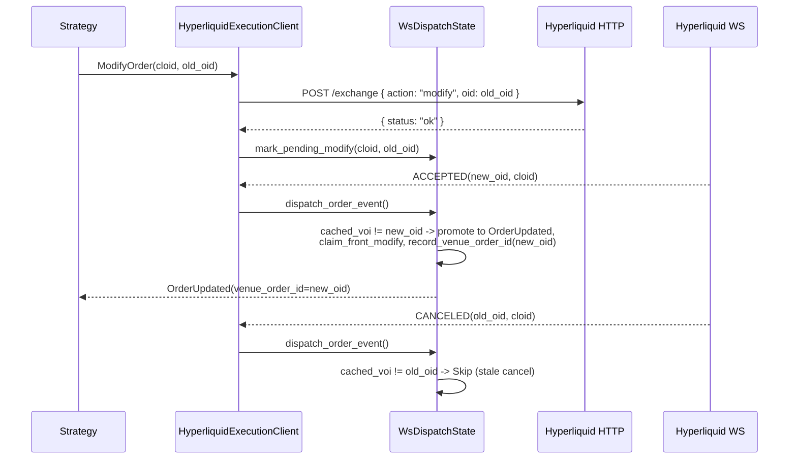

# Hyperliquid

[Hyperliquid](https://hyperliquid.gitbook.io/hyperliquid-docs) 是构建在 Hyperliquid L1 上的
去中心化永续合约与现货交易所，这条专为交易优化的自建区块链由 HyperCore 提供完全链上的
订单簿与撮合引擎。本集成支持 Hyperliquid 的实时行情摄取与订单执行。

## 概览 {#overview}

该适配器以 Rust 实现并提供 Python 绑定。它直接对接 Hyperliquid 的 REST 与 WebSocket
API，不需要外部客户端库。

Hyperliquid 适配器包含多个组件：

- `HyperliquidHttpClient`：HTTP API 连接、金融工具加载与解析、对账报告。
- `HyperliquidWebSocketClient`：供 Rust 调用方使用的 WebSocket API 连接。
- `HyperliquidDataClient`：行情数据流管理器。
- `HyperliquidExecutionClient`：账户管理与交易执行网关。
- `HyperliquidDataClientFactory`：Hyperliquid 数据客户端工厂（由 live node builder 使用）。
- `HyperliquidExecutionClientFactory`：Hyperliquid 执行客户端工厂（由 live node builder 使用）。

:::note
多数用户只配置实时交易节点（见[实时节点配置](#live-node-configuration)），
不会直接操作这些底层组件。
:::

## 示例 {#examples}

- [Python 示例](https://github.com/nautechsystems/nautilus_trader/tree/develop/examples/live/hyperliquid/)
- [Rust 示例](https://github.com/nautechsystems/nautilus_trader/tree/develop/crates/adapters/hyperliquid/examples/)

## Builder 代码归属 {#builder-code-attribution}

主网提交的订单携带 NautilusTrader 的 builder code，且**费率为零**，因此归属不增加
任何交易成本。这帮助我们了解集成的真实用量，并据此安排后续维护的优先级。为订单流
添加归属的用户，在大规模交易时还可能通过
[Institutional](https://nautilustrader.io/institutional/) 层级获得直接支持。

可以用序列化配置中的 `include_builder_attribution: false`，
或 Python 中的 `include_builder_attribution=False` 退出归属。

三种情况下订单会省略 builder 地址：

- **Testnet**：Hyperliquid testnet 会拒绝携带未经钱包明确批准的 builder 地址的订单
  （用 faucet 充值的 testnet 钱包通常没有批准），因此 testnet 订单从不携带 builder。
- **Vault 交易**（配置了 `vault_address`）：Hyperliquid 不允许 vault 批准 builder
  费用，携带 builder 地址会导致交易所拒单。
- **归属已关闭**（`include_builder_attribution=False`）：不想为订单流做归属的用户
  可以显式关闭 builder 归属。

```python
from nautilus_trader.adapters.hyperliquid import HyperliquidExecutionClientConfig

config = HyperliquidExecutionClientConfig(
    include_builder_attribution=False,
)
```

### Builder 费用批准 {#builder-fee-approval}

Hyperliquid 要求先做一次性的 `ApproveBuilderFee` 批准，订单才能携带 builder
地址：

- 从未批准过 builder 费用的钱包，其订单会被拒绝，原因为
  `Builder fee has not been approved`（任何先前的批准都满足检查，包括 0% 费率）。
- 批准需要主钱包的私钥。agent（API）钱包配置下适配器不持有该密钥，因此批准以
  一次性脚本运行，而不是在执行客户端启动时进行。
- 0% 的最高费率只允许归属：永远不会收取 builder 费用，提高费率则需要一份由你
  签署的新批准。

每个钱包运行一次批准脚本（读取 `HYPERLIQUID_PK`，
`HYPERLIQUID_TESTNET=true` 时读取 `HYPERLIQUID_TESTNET_PK`）：

```bash
cargo run -p nautilus-hyperliquid --bin hyperliquid-builder-fee-approve
```

或在 Python 中：

```python
from nautilus_trader.adapters.hyperliquid import builder_fee_approve

builder_fee_approve()
```

### 撤销批准 {#revoking-the-approval}

用撤销把此前批准的 builder 费用上限压回 0%（比如某个会收 builder 费用的旧版本
留下的批准）。撤销只设定费用上限，不删除批准记录，因此除非关闭
`include_builder_attribution`，归属仍会持续。

```bash
cargo run -p nautilus-hyperliquid --bin hyperliquid-builder-fee-revoke
```

或在 Python 中：

```python
from nautilus_trader.adapters.hyperliquid import builder_fee_revoke

builder_fee_revoke()
```

Rust 脚本会打印动作摘要，并在签名前等待按下 Enter 键。摘要中有任何不对的地方，
用 `Ctrl+C` 中止。要跳过提示，在 `cargo run` 命令后追加 `-- --yes`。
Python 绑定不提示，调用前务必确认当前的环境变量。

## Testnet 设置 {#testnet-setup}

Hyperliquid 提供 testnet 环境，可用模拟资金测试策略。

:::info
**需要主网账户。** Hyperliquid 的 testnet faucet 只对曾在主网存款过的钱包生效。
必须先为主网账户注资，才能领取 testnet USDC。
:::

### 获取 testnet 资金 {#getting-testnet-funds}

要领取 testnet USDC，必须先用同一钱包地址在**主网**存款过：

1. 访问 [Hyperliquid 主网门户](https://app.hyperliquid.xyz/)，用钱包完成一笔存款。
2. 用同一钱包访问 [testnet faucet](https://app.hyperliquid-testnet.xyz/drip)。
3. 从 faucet 领取 1,000 模拟 USDC。

:::note
**邮箱登录用户**：邮箱登录在主网和 testnet 会生成不同地址。要用 faucet，需要从
主网导出邮箱钱包，导入 MetaMask 或 Rabby，再把该扩展连到 testnet。
:::

### 创建 testnet 账户 {#creating-a-testnet-account}

1. 访问 [Hyperliquid testnet 门户](https://app.hyperliquid-testnet.xyz/)。
2. 连接钱包（MetaMask、WalletConnect 或邮箱）。
3. testnet 会为钱包地址自动创建账户。

### 导出私钥 {#exporting-your-private-key}

要在 NautilusTrader 中使用 testnet 账户，需要导出钱包私钥：

**MetaMask**：

1. 点击账户旁的三点菜单。
2. 选择 "Account details"。
3. 点击 "Show private key"。
4. 输入密码并复制私钥。

:::warning
**绝不要泄露私钥。** 私钥要安全存放在环境变量中，绝不提交到版本控制。
:::

### 设置环境变量 {#setting-environment-variables}

把 testnet 凭据设为环境变量：

```bash
export HYPERLIQUID_TESTNET_PK="your_private_key_here"
# Optional: for vault trading
export HYPERLIQUID_TESTNET_VAULT="vault_address_here"
```

配置为 `environment=HyperliquidEnvironment.TESTNET` 时，适配器会自动加载这些
变量。

:::warning
**Agent / API 钱包**：如果 `HYPERLIQUID_TESTNET_PK` 是在主账户下批准的
[agent 钱包](#agent-wallets)（在 Hyperliquid UI 上创建 API 钱包时通常就是这种
配置），还必须把 `HYPERLIQUID_ACCOUNT_ADDRESS` 设为主账户地址。不设置的话，
即使订单已在交易场所生效，`OrderStatusReport` 请求与 WebSocket 用户流也会返回
空结果。见 [GH-4010](https://github.com/nautechsystems/nautilus_trader/issues/4010)。
:::

## 产品支持 {#product-support}

Hyperliquid 提供线性永续合约、HIP-3 builder 部署的永续合约、原生现货市场与
HIP-4 二元结果市场。

| 产品类型        | 数据流    | 交易    | 说明                                             |
| --------------- | --------- | ------- | ------------------------------------------------ |
| 现货            | ✓         | ✓       | 原生现货市场。                                   |
| 永续合约        | ✓         | ✓       | USDC 结算的线性永续（验证节点运营）。            |
| HIP-3 永续合约  | ✓         | ✓       | builder 部署的永续，按 dex 独立抵押品。          |
| HIP-4 结果市场  | ✓         | ✓       | 全额抵押的二元结果 side token。                  |

四种产品类型在 connect 时全部自动加载，不需要逐个产品手工开启。

:::note
标准 Hyperliquid 永续以 USDC 结算。HIP-3 dex 可能用自有抵押代币结算，例如
USDH、USDE 或 USDT0，而 Nautilus 代码仍报价为 `USD`。现货市场是标准货币对。
各自细节见 [HIP-3 builder 部署的永续合约](#hip-3-builder-deployed-perpetuals)
与 [HIP-4 结果市场](#hip-4-outcome-markets)。
:::

## 代码体系 {#symbology}

Hyperliquid 为金融工具使用特定的代码格式：

### 现货市场 {#spot-markets}

格式：`{Base}-{Quote}-SPOT`

示例：

- `PURR-USDC-SPOT` - PURR/USDC 现货对
- `HYPE-USDC-SPOT` - HYPE/USDC 现货对

在策略中订阅：

```python
InstrumentId.from_str("PURR-USDC-SPOT.HYPERLIQUID")
```

从 `spotMeta` 加载的现货金融工具会把交易场所元数据保留在 `CurrencyPair.info`：

| 字段          | 值                                             |
| ------------- | ----------------------------------------------- |
| `name`        | 交易场所原始交易对标签                          |
| `tokens`      | base 与 quote 在 `spotMeta.tokens` 中的索引     |
| `index`       | 加 `10000` 现货偏移之前的交易对索引             |
| `isCanonical` | 交易场所的 canonical 分类                       |

用 Python 的 `info.get("isCanonical")` 或 Rust 的
`Params.get_bool("isCanonical")` 读取交易场所的 canonical 分类。

:::note
现货金融工具可能包含 vault 代币（前缀 `vntls:`）。Hyperliquid 不在 `spotMeta`
中列出它们，因此 HTTP 客户端在首次遇到时会合成一个 `{coin}-USDC-SPOT` 金融工具，
保证余额与成交可解析。这类合成金融工具不携带交易场所元数据：Rust 中 `info` 为
`None`，Python 中为空 dict。
:::

### 永续期货 {#perpetual-futures}

格式：`{Base}-USD-PERP`

示例：

- `BTC-USD-PERP` - 比特币永续期货
- `ETH-USD-PERP` - 以太坊永续期货
- `SOL-USD-PERP` - Solana 永续期货

在策略中订阅：

```python
InstrumentId.from_str("BTC-USD-PERP.HYPERLIQUID")
InstrumentId.from_str("ETH-USD-PERP.HYPERLIQUID")
```

### HIP-3 永续合约 {#hip-3-perpetuals}

格式：`{dex}:{Asset}-USD-PERP`

[HIP-3](https://hyperliquid.gitbook.io/hyperliquid-docs/hyperliquid-improvement-proposals-hips/hip-3-builder-deployed-perpetuals)
市场用冒号分隔的 dex 前缀。dex 名称标识市场属于哪个 builder 部署的 perp dex。

示例：

- `xyz:TSLA-USD-PERP` - trade.xyz 上的特斯拉永续
- `xyz:GOLD-USD-PERP` - trade.xyz 上的黄金永续
- `flx:NVDA-USD-PERP` - Felix 上的英伟达永续
- `vntl:SPACEX-USD-PERP` - Ventuals 上的 SpaceX 永续

在策略中订阅：

```python
InstrumentId.from_str("xyz:TSLA-USD-PERP.HYPERLIQUID")
```

### HIP-4 结果 side token {#hip-4-outcome-side-tokens}

格式：`{outcome_index}-{YES|NO}-OUTCOME.HYPERLIQUID`，其中
`outcome_index` 是 `outcomeMeta` 的 `outcome` 字段，中间段标识二元方向。
`-OUTCOME` 后缀与 `-PERP` / `-SPOT` 对称。

[HIP-4](https://hyperliquid.gitbook.io/hyperliquid-docs/hyperliquid-improvement-proposals-hips/hip-4-outcome-markets)
side token 是二元合约，按市场 quote 代币在 `0`（败方）或 `1`（胜方）结算。
Nautilus 代码使用上面的人类可读形式。线上 `raw_symbol` 使用交易场所的代币形式
`#{encoding}`（`encoding = 10 * outcome_index + side`，
Yes 的 `side` 为 `0` / No 为 `1`），`l2Book` 与 `allMids` 接受的就是它。

示例（outcome 25）：

- `25-YES-OUTCOME.HYPERLIQUID`：Yes 方向。编码 `250`，线上市值代币
  `#250`，代币名 `+250`，动作资产 ID `100_000_250`。
- `25-NO-OUTCOME.HYPERLIQUID`：No 方向。编码 `251`，线上市值代币
  `#251`，代币名 `+251`，动作资产 ID `100_000_251`。

在策略中订阅：

```python
InstrumentId.from_str("25-YES-OUTCOME.HYPERLIQUID")
```

:::note
结果池是循环轮换的。每次结算都会把已结算的结果移出 `outcomeMeta`，交易场所的
下一个挂牌会推进索引。已结算结果上的成交与历史订单仍能对账：适配器从
`#{encoding}` 代币推导 side token 的金融工具，但没有 `outcomeMeta` 携带的市场
名称、描述、到期时间与 quote 代币。货币回退见[结算货币](#settlement-currency)。
用下面的命令查看当前结果池：

```bash
curl -s -X POST https://api.hyperliquid.xyz/info \
    -H 'Content-Type: application/json' \
    -d '{"type":"outcomeMeta"}'
```

:::

交易流程、结算与当前限制见 [HIP-4 结果市场](#hip-4-outcome-markets)。

## HIP-3 builder 部署的永续合约 {#hip-3-builder-deployed-perpetuals}

[HIP-3](https://hyperliquid.gitbook.io/hyperliquid-docs/hyperliquid-improvement-proposals-hips/hip-3-builder-deployed-perpetuals)
允许合格部署者（deployer）在 Hyperliquid 上无需许可地启动 perp dex。这些市场包含
股票（TSLA、NVDA、AAPL）、大宗商品（黄金、原油）、指数（S&P 500）与 pre-IPO
代币（SpaceX、OpenAI）。

In a `LiveNode`, HIP-3 perpetuals load automatically alongside standard perpetuals at connect: the adapter
fetches every perp dex (standard and builder-deployed) from `allPerpMetas`, so no additional client
configuration is required. The data client exposes no per-dex filter. Strategies select the markets they trade
by `instrument_id`.

直接使用 `HyperliquidHttpClient` 时，除非通过
`load_instrument_definitions` 显式开启，否则不加载 HIP-3 perp dex：

```python
from nautilus_trader.adapters.hyperliquid import HyperliquidEnvironment
from nautilus_trader.adapters.hyperliquid import HyperliquidHttpClient

client = HyperliquidHttpClient.from_env(HyperliquidEnvironment.MAINNET)
instruments = await client.load_instrument_definitions(
    include_spot=True,
    include_perps=True,
    include_perps_hip3=True,
    include_outcomes=False,
)
```

### 未结订单与持仓对账 {#open-order-and-position-reconciliation}

#### 启动时的 mass status {#startup-mass-status}

`LiveNode` 启动时，未过滤的未结订单与持仓对账会查询默认 perp dex，以及钱包近期
历史订单或成交所涉及的每个不同 HIP-3 dex：

- 无钱包活动的已缓存 dex 不产生启动请求。
- 任一历史响应触及 2,000 条记录上限时，对账改为查询交易场所当前 perp dex 列表
  返回的每个 dex，避免有界历史掩盖更早的未结订单或持仓。
- 持仓对账也包含现货持有量。

返回的 mass status 按
[mass-status 历史契约](./../concepts/execution/reconciliation.md#mass-status-history-contract)
记录其覆盖范围。配置了回看窗口时，`lookback_start` 携带其下界；未配置时，
快照是无界的。以下任一条件都会使 `reports_complete` 为 `false`：

- 历史响应触及记录上限，可能被截断。
- 某个必需的交易场所行无法解码、无法解析为金融工具，或无法转换为报告。

有效的行仍保留在报告集合中。在记录上限内干净解码完所有场所响应的快照具有权威
性，空快照也一样。

#### Reduce-only 成交数量 {#reduce-only-fill-quantity}

当 reduce-only 订单平掉了小于订单数量的持仓时，Hyperliquid 可能把它报告为
`filled` 且没有剩余。启动 mass status 或按场所订单 ID 单查时，适配器会把此类
订单钳制到其成交总量，从而以小于提交数量的数量收尾为 `Filled`。只有
`userFills` 历史完整且未触及 2,000 条上限时才应用该钳制，否则适配器保留场所
数量，对账可以推断缺失的成交。

用于该钳制时，单查只对被报告为 `Filled` 的 reduce-only 订单拉取
`userFills`。`QueryOrder` 也会为[符合条件的普通已成交订单](#order-fill-recovery)
读取成交历史。

#### 命令与直接请求 {#command-and-direct-requests}

启动 mass status 之外，未过滤的 `LiveNode` 未结订单与持仓报告命令，以及直接的
`HyperliquidHttpClient` 请求，会查询默认 perp dex 与已缓存永续金融工具所代表的
每个 builder dex：

- 过滤到某个 HIP-3 金融工具的请求，从代码的 dex 前缀推导 builder dex，只查询
  该 dex。
- 标准永续过滤器只查询默认 dex。
- 现货与结果持仓过滤器保持既有的仅现货路由。
- 某个必需请求失败时，请求返回错误而不是部分快照。交易场所行无法解码、无法
  解析为金融工具或无法转换为报告时同样如此。成交与历史订单报告请求的失败处理
  一致。
- 定向 HTTP 订单状态查询命中不可用的场所行时，返回错误而不是把订单报告为缺失。
  在不再存在场所订单 ID 回退后，`GenerateOrderStatusReport` 命令行为相同。

#### 推断成交的佣金 {#inferred-fill-commissions}

对账期间推断出的成交不带佣金：适配器不为推断成交计算费用，因此生成的
`OrderFilled` 事件中 `commission` 为 `None`。数量与价格仍可对账，只是这些
成交的已实现盈亏不含交易费用。

### 与标准永续合约的差异 {#differences-from-standard-perpetuals}

HIP-3 市场在同一 HyperCore 撮合引擎上交易，使用相同的订单 API。主要差异：

- **更高费用**：每个 dex 自设 deployer 费率倍数——低于 `1` 的费率乘以
  `scale + 1`，不低于 `1` 的乘以 `scale * 2`，deployer 至多抽取一半。要查某个
  dex 的实时费率，不要套用标准永续费率表。
- **隔离保证金**：HIP-3 市场默认仅支持隔离保证金。
- **按 dex 的抵押品**：每个 HIP-3 dex 通过 `allPerpMetas` 中的
  `collateralToken` 条目声明结算代币。Nautilus 通过 `spotMeta` 解析该代币，
  代码的 quote 腿仍保持 `USD`。非 USDC 抵押代币无法从 `spotMeta` 解析时，
  金融工具加载返回错误，而不是回退到 USDC。
- **Deployer 管理的预言机**：预言机喂价由 deployer 运营，而非验证节点。
- **增长模式**：市场与验证节点运营的永续不相交的 dex 可以加入增长模式，
  Hyperliquid 将其描述为在全额费用中至少让利 90%。

完整协议细节见 Hyperliquid 文档：

- [HIP-3 提案](https://hyperliquid.gitbook.io/hyperliquid-docs/hyperliquid-improvement-proposals-hips/hip-3-builder-deployed-perpetuals)
- [HIP-3 deployer 动作](https://hyperliquid.gitbook.io/hyperliquid-docs/for-developers/api/hip-3-deployer-actions)
- [资产 ID](https://hyperliquid.gitbook.io/hyperliquid-docs/for-developers/api/asset-ids)
- [费用](https://hyperliquid.gitbook.io/hyperliquid-docs/trading/fees)

### 通配符字符净化 {#wildcard-character-sanitization}

一些 HIP-3 dex 部署的资产，其场所名称包含 `*` 或 `?` 字节（例如
`dex:STREAMABCD****-USD-PERP`）。这些字节与 Nautilus 消息总线的模式语法冲突
（`*` = 任意多个，`?` = 单个字符），原样嵌入主题字符串会破坏订阅路由。

构造 `InstrumentId.symbol` 时，Hyperliquid 适配器把这两类字节替换为 `x`，
因此名为 `dex:STREAMABCD****` 的 HIP-3 资产在策略侧呈现为：

```python
InstrumentId.from_str("dex:STREAMABCDxxxx-USD-PERP.HYPERLIQUID")
```

替换只作用于主题、缓存、日志与配置中 Nautilus 内部使用的代码。金融工具的
`raw_symbol` 保留场所官方名称供 HTTP 与 WebSocket 调用。订单提交引用数字资产
索引，因此与 Hyperliquid 的往返不受影响。

订阅场所名称含通配符字节的 HIP-3 金融工具时，使用净化后的形式。不含 `*` 或
`?` 的代码原样通过。

替换是有损的：`dex:FOO*` 与 `dex:FOO?` 这样两个不同的场所名称会归一到同一个
Nautilus 代码。此类冲突采用[金融工具加载](#instrument-loading)所述的首次写入
优先行为。

## HIP-4 结果市场 {#hip-4-outcome-markets}

[HIP-4](https://hyperliquid.gitbook.io/hyperliquid-docs/for-developers/api/asset-ids#outcomes)
市场是全额抵押的二元合约。每个市场有两个 side token（Yes / No），在结算日按
市场的 quote 代币结算为 `1`（胜方）或 `0`（败方）。交易场所通过
`outcomeMeta` 信息端点发布结果元数据，适配器对该载荷采取尽力而为的态度：场所
不返回它时，适配器跳过 HIP-4 金融工具。因此端点被移除或改名时，永续与现货仍然
可用，而不是让整个金融工具加载失败。

### 加载结果金融工具 {#loading-outcome-instruments}

在 `LiveNode` 中，交易场所暴露 `outcomeMeta` 时，结果金融工具会自动（尽力而为）
加载，不需要客户端配置。

直接使用 `HyperliquidHttpClient` 时，通过 `load_instrument_definitions` 开启：

```python
from nautilus_trader.adapters.hyperliquid import HyperliquidEnvironment
from nautilus_trader.adapters.hyperliquid import HyperliquidHttpClient

client = HyperliquidHttpClient.from_env(HyperliquidEnvironment.MAINNET)
instruments = await client.load_instrument_definitions(
    include_spot=True,
    include_perps=True,
    include_perps_hip3=False,
    include_outcomes=True,
)
```

加载时为每个结果发出两个 `BinaryOption` 金融工具（每个方向一个）。代码使用
`{outcome_index}-{YES|NO}-OUTCOME.HYPERLIQUID` 形式。`expiration_ns`
从场所描述解析（`expiry:YYYYMMDD-HHMM`，UTC）。独立二元合约自带到期时间，
命名结果与回退结果继承父问题的到期时间。价格以 `0.00001` 为最小变动单位，
数量为整数代币，与交易场所一致。

每个金融工具的 `BinaryOption.info` 以键/值映射携带解析后的场所元数据（Python
用 `info["key"]`，Rust 用 `Params.get_str(...)` 读取）。派生标识始终填充，
描述派生字段在场所提供时才会出现。

| 字段               | 来源                           | 说明                                              |
| ------------------ | ------------------------------ | ------------------------------------------------- |
| `outcome_index`    | 派生                           | `outcomeMeta` 的 `outcome`                        |
| `outcome_side`     | 派生                           | `0` = Yes，`1` = No                               |
| `side_name`        | `outcomeMeta` `sideSpecs`      | 场所方向标签，缺失时为 `"Yes"` / `"No"`           |
| `encoding`         | 派生                           | `10 * outcome_index + side`                       |
| `asset_id`         | 派生                           | `100_000_000 + encoding`                          |
| `market_name`      | `outcomeMeta.outcomes[*].name` | 场所市场标签                                      |
| `class`            | 描述                           | `priceBinary` 或 `priceBucket`                    |
| `underlying`       | 描述                           | 标的资产代码                                      |
| `expiry`           | 描述                           | `YYYYMMDD-HHMM` UTC                               |
| `target_price`     | 描述                           | 二元结算阈值                                      |
| `period`           | 描述                           | 重复周期（如 `1d`、`3m`）                         |
| `price_thresholds` | 描述                           | 逗号分隔的阈值（bucket 市场）                     |
| `named_index`      | 命名结果描述                   | 在父 `named_outcomes` 数组中的位置                |
| `is_fallback`      | 回退结果描述                   | 问题的 `other` 结果为 `true`                      |
| `question`         | 父问题                         | 问题 ID                                           |
| `question_name`    | 父问题                         | 问题标签                                          |
| `question_*`       | 父问题描述                     | 每个解析出的问题字段，带 `question_` 前缀         |

描述键从场所的 camelCase 降为 snake_case（`targetPrice` ->
`target_price`，`priceThresholds` -> `price_thresholds`）。值保留为字符串以
维持线上保真度。数字标识（`outcome_index`、`outcome_side`、`encoding`、
`asset_id`、`question`、`named_index`）以 JSON 数字存储。

### 结算货币 {#settlement-currency}

适配器用每个结果的 `outcomeMeta` `quoteToken` 作为
`BinaryOption.currency`、`quote_currency` 与结算货币。把 side token 报告为
`feeToken` 的零费成交，其佣金使用该金融工具的 quote 货币。元数据选定 USDH 时，
适配器显式按 8 位小数注册它，不让货币自动注册机制决定其精度。

`quoteToken` 缺失时，适配器默认使用 USDC。已结算、从 `outcomeMeta`
消失的结果，在金融工具仍留在适配器内存缓存期间保留其货币。重启后，除非该金融
工具重新进入缓存，否则适配器使用 USDC。USDC 只是适配器的兼容默认值：2026 年
10 月观察到的主网与 testnet 结果均以 USDC 报价。结果资产编码不标识其 quote
代币，因此没有缓存的金融工具时，适配器无法恢复其他历史货币。

重建的金融工具同样以 USDC 进入缓存，并保留该货币直到被 supplied 金融工具替换，
即使后续元数据指定了别的 quote 代币。

USDH 现货余额与永续清算所视图合并，因此 `AccountState` 在 USDC 之外还携带
USDH 及其他非零现货持有量。

### 交易流程 {#trading-flow}

结果 side token（`{outcome_index}-{YES|NO}-OUTCOME.HYPERLIQUID`）走标准订单
路径交易。像对待任何永续或现货金融工具一样提交 `SubmitOrder`。执行客户端把它
路由为对场所 `#{encoding}` 订单簿（`encoding = 10 * outcome_index +
outcome_side`）的同一个 `Order` 动作，不需要 HIP-4 专用调用。

结算由交易场所驱动，见[结算分发](#settlement-dispatch)。

#### 高级工作流 {#advanced-workflows}

需要在场外管理 side token 库存的策略，可以直接在
`HyperliquidHttpClient`（Rust 与 PyO3）上使用完整的 `userOutcome` 动作集：

```python
from decimal import Decimal
from nautilus_trader.adapters.hyperliquid import HyperliquidEnvironment
from nautilus_trader.adapters.hyperliquid import HyperliquidHttpClient

client = HyperliquidHttpClient.from_env(HyperliquidEnvironment.MAINNET)

# Mint matched Yes + No side tokens from the outcome's quote token
await client.submit_split_outcome(50, Decimal("1.0"))

# Burn a matched Yes + No pair back to quote tokens (amount=None merges the max)
await client.submit_merge_outcome(50, None)

# Multi-outcome priceBucket operations
await client.submit_merge_question(9, None)
await client.submit_negate_outcome(9, 52, Decimal("1.0"))
```

| 动作                    | 用途                                                                               |
| ----------------------- | ------------------------------------------------------------------------------------ |
| `submit_split_outcome`  | 用 quote 铸造配对的 Yes + No 代币（初始做市、双边对冲）                          |
| `submit_merge_outcome`  | 把配对的 Yes + No 销毁回 quote，不跨越价差                                             |
| `submit_merge_question` | 把完整的多结果篮子原子地关闭回 quote                                                 |
| `submit_negate_outcome` | 把一个结果的 No 份额转换为同一问题内所有其他结果的 Yes 份额                          |

方向性押注用普通 `SubmitOrder` 路径就够了。只有需要在场外创建或销毁 side token
库存时才用上面的方法。

### 订单约束 {#order-constraints}

结果 side token 的表现类似现货代币（无保证金、无资金费率、无清算）。执行客户端
拒绝不适用的功能：

- `reduce_only` 订单。
- 触发类订单（`StopMarket`、`StopLimit`、`MarketIfTouched`、
  `LimitIfTouched`、追踪止损）。

支持 `GTC`、`IOC`、`ALO` 有效期的 `Limit` 与 `Market` 订单。交易场所最低名义
价值为 10 个 quote 代币。把 `order_qty` 设为整数代币，保证
`order_qty * limit_price >= 10`。

### 结算分发 {#settlement-dispatch}

到期时交易场所平掉持有的 side token 余额，为每个方向发出一条 `Settlement`
成交。适配器通过标准用户成交流（HTTP 轮询与 WebSocket）消费它们，保留场所报告的
佣金。

每笔结算成交：

- `order_side = SELL`。
- 胜方价格为 `1` 个 quote 代币，败方为 `0`。
- 以 `FillReport` 呈现。
- 当 WebSocket 分发把持仓关联到被跟踪的订单时，场所成交还会发出
  `OrderFilled`。

场所的 `Settlement` 成交统一覆盖独立 `priceBinary` 结果与多结果
`priceBucket` 问题。

仅 Rust 侧的 `outcome_settlement_poll_secs` 选项为多结果问题开启合成结算轮询，
默认关闭。

:::warning

保持合成轮询关闭，消费交易场所的结算成交。该推断假设非空的
`settledNamedOutcomes` 列表在 `namedOutcomes` 内标识获胜结果、其余命名结果与
回退结果均告失败。而 2026 年 10 月观察到的 testnet 元数据把已移除的结果列进
`settledNamedOutcomes`，其他命名结果仍在列表中。在这种形态下，轮询可能为仍在
交易的市场中的持仓发出平仓成交。

:::

合成成交携带零佣金，货币为缓存金融工具的 quote 货币，无缓存金融工具时用元数据
quote 代币，再回退到 USDC。它们没有 `client_order_id`，以
`FillReport` 分发。

### 持仓对账 {#position-reconciliation}

HIP-4 side token 出现在 `spotClearinghouseState` 中，`coin`
为 `+E` 代币形式且没有 `token` 字段。适配器：

- 反序列化时把 `SpotBalance.token` 视为可选。
- 生成 `PositionStatusReport` 时把 `+E` / `#E` 代币解析到对应的
  `BinaryOption` 金融工具。
- 持仓状态过滤器是结果金融工具时，跳过 perp clearinghouse 拉取（结果永不出现在
  `assetPositions` 中）。

### 多结果（priceBucket）市场 {#multi-outcome-pricebucket-markets}

交易场所通过 `outcomeMeta` 顶层的 `questions` 数组暴露多结果市场。每个问题
引用一个回退结果，以及一串命名结果，其各自的描述通过 `index:N`
指回该问题。每个 side token 建模为独立的 `BinaryOption` 金融工具。
`HyperliquidHttpClient` 上的 `submit_merge_question` 与
`submit_negate_outcome` 动作在问题层级执行篮子平仓与跨结果轮换。

## 金融工具加载 {#instrument-loading}

数据客户端在 connect 时加载完整的 Hyperliquid 资产池：一趟覆盖现货市场、标准
永续、每个 HIP-3 builder 部署的 perp dex 以及 HIP-4 结果 side token。客户端配置
不提供按产品或按代码的过滤器。策略通过自己的 `instrument_id` 配置选择要交易的
金融工具。

加载器包含 `spotMeta.universe` 中的每个交易对，包括非 canonical 交易对。多个
交易对共享同一 base 代币时，加载器先缓存 canonical 交易对，因此按 base 代币识别
的余额与成交会解析到 canonical 的 Nautilus 金融工具。任何后续定义若其 Nautilus
代码与更早的定义冲突，会被丢弃并记录警告，且无法交易。

之后数据客户端每 `update_instruments_interval_mins` 分钟重新拉取一次资产池：

- 发布新增或实质变化的定义，未变化的定义不重复发布。
- 执行客户端接收这些更新并注册每个金融工具的资产索引，启动后新挂牌的市场无需
  重启进程即可交易。
- `RequestInstrument` 或 `RequestInstruments` 同样会重新拉取整个资产池，
  并以相同方式发布新增或变化的定义。
- 把 `update_instruments_interval_mins` 设为 `0` 可关闭周期刷新。请求
  与数据客户端重连仍会按需重新拉取资产池。

向执行客户端从未加载过的代码提交订单，会以 `INSTRUMENT_NOT_FOUND` 拒绝。

失败按产品降级，而不是中止整个加载：

- 缺少现货或永续元数据时记录警告并跳过该产品。
- `outcomeMeta` 载荷缺失时按 debug 级别跳过。
- 唯一的硬失败是某个 perp dex 的非 USDC 抵押代币无法通过 `spotMeta`
  解析，因为猜测结算货币会让市场定价错误。

要在 `LiveNode` 之外拉取更窄的集合，直接调用
`HyperliquidHttpClient` 的 `load_instrument_definitions` 并带上所需的产品开关：

```python
from nautilus_trader.adapters.hyperliquid import HyperliquidEnvironment
from nautilus_trader.adapters.hyperliquid import HyperliquidHttpClient

client = HyperliquidHttpClient.from_env(HyperliquidEnvironment.MAINNET)
instruments = await client.load_instrument_definitions(
    include_spot=False,
    include_perps=True,
    include_perps_hip3=False,
    include_outcomes=False,
)
```

## 数据订阅 {#data-subscriptions}

适配器支持下列数据订阅。所有永续数据类型（标记价格、指数价格、资金费率）对标准
永续与 HIP-3 永续同样适用。

| 数据类型       | 订阅 | 快照 | 历史 | Nautilus 类型                   | 说明                                             |
| -------------- | ---- | ---- | ---- | ------------------------------- | ------------------------------------------------ |
| 成交明细       | ✓    | -    | ✓    | `TradeTick`                     | WebSocket 成交；`recentTrades`。                 |
| 公共成交       | ✓    | -    | ✓    | `HyperliquidPublicTrade`        | 需显式开启的自定义数据，含对手方与哈希。         |
| 报价明细       | ✓    | -    | -    | `QuoteTick`                     | 最优买卖价。                                     |
| 订单簿增量     | ✓    | ✓    | -    | `OrderBookDelta`                | L2 快照。                                        |
| 订单簿深度     | ✓    | -    | -    | `OrderBookDepth`                | 前 10 档 L2 快照。                               |
| K 线           | ✓    | -    | ✓    | `Bar`                           | 支持区间见下文。                                 |
| 标记价格       | ✓    | -    | -    | `MarkPriceUpdate`               | 永续标记价格推送。                               |
| 指数价格       | ✓    | -    | -    | `IndexPriceUpdate`              | 标的参考价。                                     |
| 资金费率       | ✓    | -    | ✓    | `FundingRateUpdate`             | `fundingHistory` 端点。                          |
| 未平仓合约量   | ✓    | -    | -    | `HyperliquidOpenInterest`       | 来自 `activeAssetCtx` 的自定义数据。             |
| 全部中间价     | ✓    | -    | -    | `HyperliquidAllMids`            | 来自 `allMids` 的自定义数据。                    |
| 全部 dex 上下文 | ✓   | -    | -    | `HyperliquidAllDexsAssetCtxs`   | 来自 `allDexsAssetCtxs` 的自定义数据。           |
| TWAP 历史      | ✓    | -    | -    | `HyperliquidTwapHistory`        | 需显式开启，来自 `userTwapHistory`。             |
| TWAP 切片成交  | ✓    | -    | -    | `HyperliquidTwapSliceFill`      | 需显式开启，来自 `userTwapSliceFills`。          |

:::note
不支持历史报价请求。历史成交请求使用 `recentTrades` 信息端点，它返回公共成交的
近期快照（最新在前），没有时间范围。`request_trades` 把该快照过滤到请求的
`[start, end]` 窗口，并用保留最新成交的方式应用 `limit`。当请求下探到快照最早
成交之下时，适配器记录警告并提供可用子集（或空响应）。该端点依赖 Hyperliquid
索引器：自建 `/info` 节点返回 HTTP 422，适配器视为无覆盖并答复空响应。实时成交
仍可通过 WebSocket 的 `trades` 频道获得。
:::

### 订单簿精度控制 {#order-book-precision-controls}

`l2Book` 订阅接受可选的 `nSigFigs` 与 `mantissa` 参数，用于稀释场所侧的
订单簿聚合。在 `subscribe_book_deltas` 或 `subscribe_book_depth` 的
`params` 中以 `n_sig_figs` 和 `mantissa` 传入，适配器会转发给交易场所。

Hyperliquid 接受 `nSigFigs` 取值 `2`、`3`、`4`、`5`，或省略以获得全精度。
`mantissa` 仅在 `nSigFigs=5` 时有效，取值 `1`、`2` 或 `5`。

```python
from nautilus_trader.model import BookType

self.subscribe_book_deltas(
    instrument_id=instrument_id,
    book_type=BookType.L2_MBP,
    params={"n_sig_figs": 5, "mantissa": 2},
)
```

两个参数都省略时按完整价格精度订阅。

同一金融工具的订单簿增量与深度快照共用一条场所 `l2Book` 流：

- 第一个订阅打开该流并设定其精度选项。
- 流活跃期间请求不同选项会记录警告并保留当前生效的选项。
- 两种用途的最后一个订阅退订时，流才关闭。
- 重连按原精度选项恢复该流。

### Hyperliquid 专属数据 {#hyperliquid-specific-data}

适配器发出 Hyperliquid 专属的自定义数据类型：

- `HyperliquidAllMids`，来自 WebSocket `allMids` 流。每次更新在一个载荷中
  携带当前报告的全部中间价。
- `HyperliquidAllDexsAssetCtxs`，来自 WebSocket `allDexsAssetCtxs` 流。
  每次更新携带默认 perp dex 与各 HIP-3 builder dex 上按金融工具归一化的资产
  上下文条目。
- `HyperliquidOpenInterest`，来自标记价格、指数价格与资金费率共用的
  `activeAssetCtx` 流。
- `HyperliquidPublicTrade`，来自 `trades` 与 `recentTrades`。每个事件
  自包含，含买方、卖方与场所哈希。
- `HyperliquidTwapHistory`，来自 WebSocket `userTwapHistory` 流。每个事件
  是用户地址的一行历史/生命周期记录。
- `HyperliquidTwapSliceFill`，来自 WebSocket `userTwapSliceFills` 流。每个
  事件是一条 TWAP 子切片成交。

| 字段       | 类型                        | 说明                                                                       |
| ---------- | --------------------------- | -------------------------------------------------------------------------- |
| `mids`     | `dict[InstrumentId, Price]` | 规范 Nautilus 金融工具 ID 到中间价的映射。                                 |
| `ts_event` | `int`                       | 更新发生时的 UNIX 纳秒时间戳，与 `ts_init` 相同。                          |
| `ts_init`  | `int`                       | 对象构建时的 UNIX 纳秒时间戳。                                             |

在 actor 或策略中用 `DataType(HyperliquidAllMids.__name__)` 订阅，覆盖默认
perp dex。要改跟某个 HIP-3 builder dex，在 `metadata["dex"]` 传入其场所标识：

```python
from nautilus_trader.adapters.hyperliquid import HYPERLIQUID_CLIENT_ID
from nautilus_trader.adapters.hyperliquid import HyperliquidAllMids
from nautilus_trader.model import DataType

self.subscribe_data(
    data_type=DataType(HyperliquidAllMids.__name__, metadata={"dex": "xyz"}),
    client_id=HYPERLIQUID_CLIENT_ID,
)
```

`dex` 取值是 `perpDexs` 中场所定义的 builder dex 标识，如 `xyz`、`flx`、
`vntl`。默认 perp dex 省略该键（或传空字符串）。

`HyperliquidOpenInterest` 携带单个永续金融工具的最新未平仓合约量。订阅时在
`metadata["instrument_id"]` 传入规范 Nautilus `instrument_id`：

| 字段            | 类型           | 说明                                                                       |
| --------------- | -------------- | -------------------------------------------------------------------------- |
| `instrument_id` | `InstrumentId` | 规范 Nautilus 金融工具 ID。                                                |
| `open_interest` | `Decimal`      | 解析出的未平仓合约量，可直接参与运算。                                     |
| `ts_event`      | `int`          | 更新发生时的 UNIX 纳秒时间戳，与 `ts_init` 相同。                          |
| `ts_init`       | `int`          | 对象构建时的 UNIX 纳秒时间戳。                                             |

```python
from nautilus_trader.adapters.hyperliquid import HYPERLIQUID_CLIENT_ID
from nautilus_trader.adapters.hyperliquid import HyperliquidOpenInterest
from nautilus_trader.model import DataType

self.subscribe_data(
    data_type=DataType(
        HyperliquidOpenInterest.__name__,
        metadata={"instrument_id": str(self.instrument_id)},
    ),
    client_id=HYPERLIQUID_CLIENT_ID,
)
```

`HyperliquidOpenInterest` reuses the same single underlying
`activeAssetCtx` venue subscription that already backs mark prices, index
prices, and funding rates for the same coin. Adding OI does not open a second
parallel `activeAssetCtx` subscription.

`HyperliquidPublicTrade` is an opt-in alternative to generic `TradeTick` for
公共订单流研究。它带 `instrument_id`、`price`、`size`、
`aggressor_side`、`trade_id`、`buyer`、`seller`、`hash`、`ts_event` 与
`ts_init`。用相同的规范金融工具元数据订阅：

```python
from nautilus_trader.adapters.hyperliquid import HYPERLIQUID_CLIENT_ID
from nautilus_trader.adapters.hyperliquid import HyperliquidPublicTrade
from nautilus_trader.model import DataType

self.subscribe_data(
    data_type=DataType(
        HyperliquidPublicTrade.__name__,
        metadata={"instrument_id": str(self.instrument_id)},
    ),
    client_id=HYPERLIQUID_CLIENT_ID,
)
```

两者同时请求时，它与 `TradeTick` 共用同一条场所 `trades` 订阅。与 sidecar
`users` 事件不同，每条 `HyperliquidPublicTrade` 都可独立做 Arrow 序列化，无需
join 即可写入并查询 Nautilus 目录。对该类型的
`RequestCustomData` 使用与历史成交请求相同的、仅近期的 `recentTrades` 快照。

`HyperliquidTwapHistory` 与 `HyperliquidTwapSliceFill` 是需显式开启、按用户
键定的自定义数据，**不**包含在执行账户的 `subscribe_all_user_channels`
路径中。订阅时在 `metadata["user"]` 传入目标钱包地址（该地址不必是适配器的交易
账户）。

`HyperliquidTwapHistory` 字段：

| 字段                 | 类型                    | 说明                                                          |
| -------------------- | ----------------------- | --------------------------------------------------------------- |
| `user`               | `str`                   | 订阅信封中的用户地址。                                        |
| `twap_id`            | `int \| None`           | 历史行上存在时的场所 `twapId`。                               |
| `coin`               | `str`                   | 原始 Hyperliquid 代码符号。                                   |
| `instrument_id`      | `InstrumentId \| None`  | 代币已知时解析出的 Nautilus 金融工具 ID。                     |
| `side`               | `OrderSide`             | TWAP 订单方向。                                               |
| `size`               | `Decimal`               | TWAP 总量。                                                   |
| `executed_size`      | `Decimal`               | 迄今已执行数量。                                              |
| `executed_notional`  | `Decimal`               | 迄今已执行名义价值。                                          |
| `minutes`            | `int`                   | TWAP 时长（分钟）。                                           |
| `reduce_only`        | `bool`                  | 该 TWAP 是否 reduce-only。                                    |
| `randomize`          | `bool`                  | 切片时点是否随机化。                                          |
| `status`             | `HyperliquidTwapStatus` | 场所状态（`activated`/`terminated`/`finished`/`error`/…）。    |
| `status_description` | `str`                   | 场所状态描述（状态为 `error` 时通常有值）。                   |
| `state_timestamp`    | `int`                   | `state.timestamp`，UNIX 纳秒。                                |
| `is_snapshot`        | `bool`                  | 该行是否属于场所快照批次。                                    |
| `ts_event`           | `int`                   | 历史行时间（`history.time`），UNIX 纳秒。                     |
| `ts_init`            | `int`                   | 对象构建时的 UNIX 纳秒时间戳。                                |

`HyperliquidTwapSliceFill` 字段：

| 字段            | 类型                   | 说明                                                     |
| --------------- | ---------------------- | ---------------------------------------------------------- |
| `user`          | `str`                  | 订阅信封中的用户地址。                                     |
| `twap_id`       | `int`                  | 场所 TWAP 订单标识。                                       |
| `coin`          | `str`                  | 原始 Hyperliquid 代码符号。                                |
| `instrument_id` | `InstrumentId \| None` | 代币已知时解析出的 Nautilus 金融工具 ID。                  |
| `price`         | `Decimal`              | 成交价。                                                   |
| `size`          | `Decimal`              | 成交量。                                                   |
| `side`          | `OrderSide`            | 成交方向。                                                 |
| `hash`          | `str`                  | L1 交易哈希。                                              |
| `oid`           | `int`                  | 该切片的场所订单 ID。                                      |
| `tid`           | `int`                  | 场所成交 ID。                                              |
| `crossed`       | `bool`                 | 该成交是否跨越价差（taker）。                              |
| `fee`           | `Decimal`              | 费用金额（负数表示返佣）。                                 |
| `fee_token`     | `str`                  | 支付费用所用代币。                                         |
| `dir`           | `str`                  | 场所前端的方向字符串。                                     |
| `closed_pnl`    | `Decimal`              | 该成交的已平仓盈亏。                                       |
| `is_snapshot`   | `bool`                 | 该成交是否属于场所快照批次。                               |
| `ts_event`      | `int`                  | 成交时间，UNIX 纳秒。                                      |
| `ts_init`       | `int`                  | 对象构建时的 UNIX 纳秒时间戳。                             |

```python
from nautilus_trader.adapters.hyperliquid import HYPERLIQUID_CLIENT_ID
from nautilus_trader.adapters.hyperliquid import HyperliquidTwapHistory
from nautilus_trader.adapters.hyperliquid import HyperliquidTwapSliceFill
from nautilus_trader.model import DataType

self.subscribe_data(
    data_type=DataType(
        HyperliquidTwapHistory.__name__,
        metadata={"user": "0x..."},
    ),
    client_id=HYPERLIQUID_CLIENT_ID,
)
self.subscribe_data(
    data_type=DataType(
        HyperliquidTwapSliceFill.__name__,
        metadata={"user": "0x..."},
    ),
    client_id=HYPERLIQUID_CLIENT_ID,
)
```

场所快照批次会把该批次内每一行/每笔成交的 `is_snapshot` 置为 `True`，消费者
据此清空并重建本地 TWAP 状态。

在 `LiveNode` 内运行的 Python 策略中，`on_data` 收到的载荷包裹在
`CustomData` 里。从 `CustomData.data` 读取，并用 `isinstance` 判断类型：

```python
from decimal import Decimal

from nautilus_trader.adapters.hyperliquid import HyperliquidOpenInterest
from nautilus_trader.model import CustomData


def on_data(self, data: CustomData) -> None:
    payload = data.data
    if isinstance(payload, HyperliquidOpenInterest):
        if payload.open_interest > Decimal("1000"):
            self.log.info(f"OI {payload.instrument_id} -> {payload.open_interest}")
```

`HyperliquidAllDexsAssetCtxs` 暴露的是整条流的聚合，而不是每个金融工具一个
主题，策略订阅一次再筛选需要的归一化条目即可。下表描述 Rust 类型：

| 字段              | 类型                              | 说明                                                                       |
| ----------------- | --------------------------------- | ---------------------------------------------------------------------------- |
| `dex`             | `str`                             | Hyperliquid `perpDexs` 中的 perp dex 标识。`""` 为默认 dex。                |
| `instrument_id`   | `InstrumentId`                    | 该条目的规范 Nautilus 金融工具 ID。                                          |
| `mark_price`      | `Price`                           | 当前标记价格。                                                               |
| `oracle_price`    | `Price`                           | 当前预言机/指数参考价。                                                      |
| `prev_day_price`  | `Price`                           | 场所载荷中的前一日参考价。                                                   |
| `mid_price`       | `Price \| None`                   | 场所载荷中存在时的中间价。                                                   |
| `impact_prices`   | `HyperliquidImpactPrices \| None` | 存在时的最优买/卖冲击价格。                                                  |
| `funding_rate`    | `Decimal`                         | 解析出的资金费率，可直接参与运算。                                           |
| `open_interest`   | `Decimal`                         | 解析出的未平仓合约量，可直接参与运算。                                       |
| `premium`         | `Decimal \| None`                 | 场所载荷中存在时的溢价。                                                     |
| `day_ntl_volume`  | `Decimal`                         | 24 小时名义成交量。                                                          |
| `day_base_volume` | `Decimal`                         | 24 小时 base 成交量。                                                        |
| `ts_event`        | `int`                             | 更新发生时的 UNIX 纳秒时间戳，与 `ts_init` 相同。                            |
| `ts_init`         | `int`                             | 对象构建时的 UNIX 纳秒时间戳。                                               |

在 Python 中，`entries` 是以条目字段为键的 `dict` 列表。价格、小数与金融工具
ID 以字符串到达，`impact_prices` 是带 `bid` 与 `ask` 字符串的
`dict`，缺失的可选字段为 `None`。使用前先转换值，例如
`Decimal(entry["open_interest"])`。`ts_event` 与 `ts_init`
属于聚合体本身，以 `int` 到达。

底层 Hyperliquid 线上载荷形如 `ctxs: [[dex, ctxs[]], ...]`。适配器解码这一
场所实时格式，在策略看到数据之前归一化为上文所示的逐条目输出。该聚合体仅限实时
使用、以 JSON 为后端而非 Arrow，因此与另外三个类型不同，它不会写入 Parquet 目录。

适配器不会凭空编造 `dex` 值。它从 Hyperliquid `meta` / `allPerpMetas`
引导有序 dex 资产池，并从实时 `perpDexs` 信息端点解析 builder dex 标识。空字符串
`""` 代表 Hyperliquid 的默认 perp dex；`xyz`、`flx`、`vntl`
等非空值是场所定义的 builder dex 标识。

该映射在 connect 时、每次金融工具刷新与每次金融工具请求时，都从缓存的金融工具重建。
该数据流按位置对应（条目不带代币名），因此后挂牌的永续要等下一次重建才会出现。
`allPerpMetas` 不可得时，重建只覆盖默认 dex，并为每个 builder dex 保留现有映射。
某个 dex 的上下文数量不匹配时记录警告，直到下一次重建。条目按位置保持对齐，对
追加挂牌是正确的。

```python
from decimal import Decimal

from nautilus_trader.adapters.hyperliquid import HYPERLIQUID_CLIENT_ID
from nautilus_trader.adapters.hyperliquid import HyperliquidAllDexsAssetCtxs
from nautilus_trader.model import CustomData
from nautilus_trader.model import DataType

self.subscribe_data(
    data_type=DataType(HyperliquidAllDexsAssetCtxs.__name__),
    client_id=HYPERLIQUID_CLIENT_ID,
)


def on_data(self, data: CustomData) -> None:
    payload = data.data
    if isinstance(payload, HyperliquidAllDexsAssetCtxs):
        for entry in payload.entries:
            if entry["dex"] == "xyz":
                open_interest = Decimal(entry["open_interest"])
                self.log.info(f"{entry['instrument_id']} OI={open_interest}")
```

### 支持的 K 线区间 {#supported-bar-intervals}

| 分辨率     | Hyperliquid K 线 |
| ---------- | ---------------- |
| 1-MINUTE   | `1m`             |
| 3-MINUTE   | `3m`             |
| 5-MINUTE   | `5m`             |
| 15-MINUTE  | `15m`            |
| 30-MINUTE  | `30m`            |
| 1-HOUR     | `1h`             |
| 2-HOUR     | `2h`             |
| 4-HOUR     | `4h`             |
| 8-HOUR     | `8h`             |
| 12-HOUR    | `12h`            |
| 1-DAY      | `1d`             |
| 3-DAY      | `3d`               |
| 1-WEEK     | `1w`               |
| 1-MONTH    | `1M`               |

## 订单能力 {#orders-capability}

Hyperliquid 支持完整的订单类型与执行选项。下表中的"永续"同时涵盖验证节点运营的
标准永续与 HIP-3 builder 部署的永续：两者适用相同的订单类型、有效期选项与执行
指令。

### 订单类型 {#order-types}

| 订单类型            | 永续       | 现货   | 说明                                                |
| ------------------- | ---------- | ---- | ----------------------------------------------------- |
| `MARKET`            | ✓          | ✓    | IOC 限价，按最优 BBO 加减可配置滑点。                 |
| `LIMIT`             | ✓          | ✓    |                                                       |
| `STOP_MARKET`       | ✓          | ✓    | 止损订单。                                            |
| `STOP_LIMIT`        | ✓          | ✓    | 以限价执行的止损。                                    |
| `MARKET_IF_TOUCHED` | ✓          | ✓    | 以市价止盈。                                          |
| `LIMIT_IF_TOUCHED`  | ✓          | ✓    | 以限价止盈。                                          |

条件单（止损与触价单）用 Hyperliquid 原生触发订单功能实现，并自动检测 TP/SL
模式。所有触发订单都按[标记价格](https://hyperliquid.gitbook.io/hyperliquid-docs/trading/robust-price-indices)
判定。独立触发订单在触发前挂在交易场所，与 reduce-only 标志无关。成组（bracket）
的 TP/SL 子单由适配器一律以 reduce-only 提交。

### 市价单定价 {#market-order-pricing}

市价单以 IOC 限价单提交，价格取自最优卖一（买入）或最优买一（卖出），外加可配置的
滑点缓冲（默认 50 bps）。提交前价格按 Hyperliquid 的价格约束取整。滑点缓冲由
`HyperliquidExecutionClientConfig` 的 `market_order_slippage_bps`
控制，并可通过 `SubmitOrder.params` 中的
`market_order_slippage_bps` 键逐单覆盖。

`STOP_MARKET` 与 `MARKET_IF_TOUCHED` 订单不携带限价。适配器用同样的可配置
滑点缓冲（默认 50 bps）从触发价推导一个，取整到 5 位有效数字，再钳制到场所小数位
上限（买入向上取、卖出向下取）。这保证了 Hyperliquid 的
`limit_px >= trigger_px`（买入）/ `limit_px <= trigger_px`（卖出）约束。

:::info
**市价单需要缓存的报价数据。** 没有缓存报价时，适配器发出
`OrderDenied` 而不是猜测价格。凡要用市价单交易的金融工具，请先订阅其报价。
:::

### 以 quote 计价的委托量 {#quote-denominated-quantities}

Hyperliquid 没有原生的 quote 数量订单：交易所端点对每笔订单都接受 base
数量 `s`。提交时，适配器把以 quote 计价的数量（订单工厂的
`quote_quantity=True`）换算为 base 数量，参考价用缓存报价的最优卖一（买入）或
最优买一（卖出），base 数量按金融工具的数量增量取整。换算带来以下后果：

- 换算后的数量是参考价下的估计：交易场所按收到的 base 数量执行，成交名义价值
  可能与请求的 quote 金额略有出入。
- 场所成交以 base 单位到达，而订单的本地数量仍是 quote 计价，因此这类订单靠场所
  状态报告对账，而不是本地数量比较。
- 修改 quote 计价的订单会在本地被拒绝，因为场所的 modify 替换的是无法与 quote
  目标对账的 base 数量。请改为撤单并用新数量重新提交。
- 原始 HTTP 与 WebSocket 客户端方法（`submit_order`、
  `modify_order`）接受显式 base 数量；基于 OrderAny 的原始提交
  （`submit_orders`、`submit_order_from_order_any`）
  会拒绝 quote 计价的订单。

:::info
**换算需要缓存的报价。** 没有缓存报价，或取整后的 base 数量为零时，适配器发出
`OrderDenied` 而不是猜测数量。凡要用 quote 计价数量交易的金融工具，请先订阅报价。
:::

### 价格归一化 {#price-normalization}

:::warning
**价格归一化默认开启。** Hyperliquid 对订单价格强制最多 5 位有效数字，另按
`szDecimals` 施加逐资产小数位上限（永续为 `6 - szDecimals`，现货为
`8 - szDecimals`）。例如 ETH 在 $2,600（4 位整数）成交时，尽管金融工具的
`price_precision=2`，也只允许 1 位小数。

默认情况下，适配器把所有外发的限价与触发价归一化到 5 位有效数字，并钳制到金融工具
的价格精度，以避免订单被拒。这意味着你提交的价格可能发生轻微偏移。要关闭归一化、
完全自行控制价格格式，在 `HyperliquidExecutionClientConfig` 中设
`normalize_prices=False`。

关闭归一化后，可以在策略里做同样的取整：

```python
from decimal import Decimal


def round_to_sig_figs(price: Decimal, sig_figs: int = 5) -> Decimal:
    if price == 0:
        return Decimal(0)
    shift = sig_figs - int(price.adjusted()) - 1
    if shift <= 0:
        factor = Decimal(10) ** (-shift)
        return (price / factor).to_integral_value() * factor
    return round(price, shift)
```

归一化关闭时，适配器按金融工具的小数位上限校验每个外发限价与触发价，价格小数位超出
即在本地拒绝订单。交易场所先按规范形式解析价格，再校验请求签名，因此精度过高的
价格会导致签名校验失败，而场所返回的是误导性的 "user or API wallet does not
exist" 错误，而不是订单校验错误。

:::

### 有效期 {#time-in-force}

| 有效期      | 永续       | 现货   | 说明                 |
| ----------- | ---------- | ---- | -------------------- |
| `GTC`       | ✓          | ✓    | Good Till Canceled。 |
| `IOC`       | ✓          | ✓    | Immediate or Cancel。 |
| `FOK`       | -          | -    | *不支持*。           |
| `GTD`       | -          | -    | *不支持*。           |

场所 `orderStatus` 与 `historicalOrders` 载荷可能报告
`FrontendMarket` 或 `LiquidationMarket` 而不是 `IOC`。适配器把两者都映射为
`IOC`，且从不提交这些标签。

:::note
IOC 订单无法撮合任何挂单流动性时，Hyperliquid 报告
`iocCancelRejected`，原因为 `Order could not immediately match against any
resting orders`。适配器把这一场所拒绝保留为 `OrderRejected`，不会伪造
`OrderAccepted` 后接 `OrderCanceled`。部分成交的 IOC 仍保留其成交，只取消未成交
的剩余部分。

对被跟踪的订单，部分成交之后的终局拒绝会以 `OrderCanceled` 收尾未成交部分。若
状态报告中还有尚未到达的成交，适配器会等这些成交到齐再收尾订单。收尾后到达的唯一
成交仍会按其场所数量与佣金对账。
:::

### 执行指令 {#execution-instructions}

| 指令             | 永续       | 现货   | 说明                                                         |
| ---------------- | ---------- | ---- | -------------------------------------------------------------- |
| `post_only`      | ✓          | ✓    | 等价于 ALO 有效期。                                            |
| `reduce_only`    | ✓          | ✓    | 仅平仓订单。                                                   |
| `quote_quantity` | ✓          | ✓    | quote 金额按缓存报价换算为 base 数量。                         |

:::info
会立即撮合的 post-only 订单会被 Hyperliquid 拒绝。适配器会检测到并生成
`OrderRejected` 事件。Post-only 订单走 Hyperliquid 的 ALO
（Add-Liquidity-Only）通道。
:::

### 订单操作 {#order-operations}

| 操作           | 永续       | 现货   | 说明                                           |
| -------------- | ---------- | ---- | ------------------------------------------------ |
| 提交订单       | ✓          | ✓    | 单笔订单提交。                                   |
| 提交订单列表   | ✓          | ✓    | 批量订单提交（单次 API 调用）。                  |
| 修改订单       | ✓          | ✓    | 需要场所订单 ID。                                |
| 取消订单       | ✓          | ✓    | 按客户订单 ID 取消。                             |
| 取消全部订单   | ✓          | ✓    | 对未结订单批量 `cancelByCloid`。                 |
| 批量取消       | ✓          | ✓    | 对给定列表批量 `cancelByCloid`。                 |

:::info
撤单优先使用 `cancelByCloid`，没有缓存 CLOID 时回退为按数字 OID
`cancel`。快速撤单与标准撤单作为独立的批量动作分发，因此一次撤单请求可能产生
多于一次的场所调用。

确定的本地撤单失败与权威的场所拒绝会为每个受影响订单发出
`OrderCancelRejected`。批量响应中的逐单错误不影响其余撤单；整请求的显式拒绝
作用于该分发动作中的每一个撤单。拒绝事件保留场所的错误消息。分发之后，传输失败
与无法确定场所结果的响应会让订单保留在对账可用状态。
:::

:::info
在 NautilusTrader 之外下的单（例如通过 Hyperliquid 网页 UI 或其他客户端）会被
检测并作为外部订单跟踪，出现在订单状态报告与持仓对账中。
:::

### 修改即 cancel-replace {#modify-as-cancel-replace}

Hyperliquid 把订单修改实现为 **cancel-replace**。
[交易所端点](https://hyperliquid.gitbook.io/hyperliquid-docs/for-developers/api/exchange-endpoint#modify-an-order)
的 `modify` 动作撤掉原订单（旧 `oid`）并挂出一个带新
`oid` 的替换单。两条腿共享同一客户订单 ID（`cloid`）。

Nautilus 省略动作级的
[`always_place` 标志](https://hyperliquid.gitbook.io/hyperliquid-docs/for-developers/api/exchange-endpoint#modify-an-order)
（`a`）。该标志缺位时，已撤销或已全部成交的目标不会产生替换单。把它设为 true
会在撤单失败时仍挂出替换单，可能造出计划外的额外订单。

替换规则取决于原订单。可立即成交的限价替换会被定价为立即匹配。

| 原订单                 | 替换单                      | 场所结果                                            |
| ---------------------- | --------------------------- | ----------------------------------------------------- |
| 限价单                 | 不可成交的 ALO 限价单       | 接受；保持 post-only。                                |
| 限价单                 | 不可成交的 GTC 限价单       | 接受；有效期变为 ALO。                                |
| 限价单                 | 可成交的 ALO 或 GTC 限价单  | 原单撤销；替换单按 post-only 被拒。                   |
| 限价单                 | IOC 限价单                  | 拒绝，且不撤销原单。                                  |
| 限价单                 | 触发市价或触发限价          | 拒绝，且不撤销原单。                                  |
| 未触发的止损或止盈     | 同类触发订单                | 接受。                                                |

链接的 API 文档只允许在 `always_place` 为 false 时使用非触发类替换。对已存在的
触发订单，场所同样接受 `a` 缺位的同类替换。Nautilus 策略侧的修改会保留缓存订单
的类型与有效期。

执行客户端对每个 `ModifyOrder` 只发送一个 `modify` 动作。直接调用
`batchModify` 时，交易场所逐条处理每项修改：无效的替换不会回滚同批中已成功的
修改，请检查每个条目的结果。

:::warning
可成交的 ALO 或 GTC 替换可能在 Hyperliquid 拒绝替换之前就撤销原限价单。修改
被拒不证明原订单仍然挂著。若场所撤掉了原单，`OrderModifyRejected`
之后可能跟着 `OrderCanceled`。在决定是否再下一单之前，先核对该订单的场所状态。
:::

The modify HTTP response only confirms success. The
[`orderUpdates` WebSocket subscription](https://hyperliquid.gitbook.io/hyperliquid-docs/for-developers/api/websocket/subscriptions)
then delivers an `ACCEPTED(new_oid)` status report, followed by a `CANCELED(old_oid)` for the
original leg.

`HyperliquidExecutionClient` runs detection, deduplication, and event promotion through the
[`WsDispatchState`](https://github.com/nautechsystems/nautilus_trader/tree/develop/crates/adapters/hyperliquid/src/websocket/dispatch.rs)
it owns, so strategies never see the replacement as a new order. On submission the client registers an
`OrderContext` keyed by `client_order_id`, using its strategy, instrument, side, type, quantity, and
last-known price. Each inbound status report or fill is routed through the dispatch: tracked orders emit typed
`OrderEventAny::*` events via `ExecutionEventEmitter::send_order_event`. External orders fall back to the raw
`OrderStatusReport` / `FillReport` so the engine can reconcile. The dispatch compares the report's
`venue_order_id` against the last cached value for the `cloid`. When they differ it promotes the `ACCEPTED` to
`OrderUpdated` and suppresses the paired stale cancel:



Modify happy path: the strategy sees one `OrderUpdated` carrying the new `oid`, and the venue's
paired cancel of the old leg never reaches it.

#### Early cancel before the replacement

If `CANCELED(old_oid)` precedes `ACCEPTED(new_oid)` for an in-flight modify, the pending-modify intent lets
the dispatch hold the old leg's cancel. It still routes the subsequent `ACCEPTED` through the `OrderUpdated`
path. That path discards the held cancel. The intent is queued before the HTTP call, so an early cancel is
held even while the request is still in flight.

If the request fails before dispatch, or the venue rejects it, the adapter emits `OrderModifyRejected` and
clears its own intent. A failure after dispatch with an unknown venue outcome keeps the intent. Thus, a modify
that reaches the venue despite a client-side timeout still holds the early `CANCELED(old_oid)`. It promotes
the eventual `ACCEPTED(new_oid)` to `OrderUpdated`. Otherwise, detection falls back to the cached
`venue_order_id`, which the late `ACCEPTED` no longer matches. See
[GH-3827](https://github.com/nautechsystems/nautilus_trader/issues/3827).

A cancel from elsewhere, such as a user cancel or a reduce-only cancel by the venue, arrives the
same way while a modify of that leg is in flight, and it makes the modify fail. Once no modify or
corrective reduce still targets the leg, the adapter applies the held cancel as `OrderCanceled`
through the stream path, so bracket handling runs as for any other cancel. A cancel held behind a
request whose outcome is unknown waits until the in-flight check settles the order.

#### Chained modifies

Rapid repeated modifies under the same `cloid` queue as a chain of in-flight intents rather than
a single marker. A later modify does not overwrite an earlier intent's old-leg suppression, and a
failed modify clears only its own attempt, leaving newer queued modifies intact. Each replacement
`ACCEPTED` promotes the oldest queued intent and advances the next intent's old leg to the promoted
replacement, so every leg's stale cancel is suppressed and each `OrderUpdated` carries its own
target quantity. Hyperliquid assigns venue order IDs in increasing order, so an `ACCEPTED` or fill
for a leg older than the bound one, such as a replay after a reconnect, never moves the binding
back.

The same chain guards the inflight query and single-order reconcile paths. While a modify is in
flight, `query_order` drops a `Canceled` for the superseded leg. `generate_order_status_report`
returns an error for that report so reconciliation defers resolution rather than treating it as
proof of absence. A modify whose venue outcome is unknown keeps its intent, so the old-leg cancel
stays deferred until that intent clears. These cancel guards prevent a status probe for the old
leg from terminating the live order.

`generate_order_status_report` also defers `Accepted` and `Triggered` reports whenever their `oid`
is older than the bound one, including when no modify is pending. These checks keep single-order
reconciliation from applying an older leg's state or promoting the binding back to that leg.
After promotion, `Canceled` reports for historical legs reach shared reconciliation, which
suppresses the old cancellation while recovering missing fills. Late `Filled` reports also remain
available for recovery.

#### Dropped replacement acceptance

The inflight query and single-order reconcile paths also promote the replacement. Hyperliquid lists the
replacement under the same `cloid` with a new `oid` in `frontendOpenOrders`. If the WebSocket dropped
`ACCEPTED(new_oid)` and no fill has arrived, the query resolves the replacement by `cloid`. It promotes it
directly to `OrderUpdated` (rebinding the `cloid` to `new_oid` and advancing the modify chain). The order is
therefore not left bound to the canceled leg, and subsequent modifies and cancels target the live replacement.
See [GH-4270](https://github.com/nautechsystems/nautilus_trader/issues/4270).

#### Fills racing the replacement

A `FillReport` for the replacement leg can also race ahead of `ACCEPTED(new_oid)`. When the
pending-modify marker is set and the report's `oid` does not match the cached value, the dispatch
promotes the binding directly from the fill (`OrderUpdated` then `OrderFilled`) using the modify
target price. If no price is available to promote with, it buffers the fill instead and drains it
on the matching `ACCEPTED`, so `OrderFilled` always follows the promoting `OrderUpdated` against
up-to-date state. See [GH-3972](https://github.com/nautechsystems/nautilus_trader/issues/3972).

:::note
A chained-modify edge case is deferred: if a delayed fill from a *prior* leg arrives during a
*new* in-flight modify and that new modify then fails, the buffered fill is stranded until
terminal cleanup. Reconciliation (`request_fill_reports`) recovers it. Fully closing this
requires additional design work (retired-VOI tracking or drain on modify-failure paths).
:::

## Order books

Order books are maintained via L2 WebSocket subscription. Each message delivers a snapshot of up to
20 price levels per side (clear + rebuild), not incremental deltas. The adapter emits each snapshot
as one event group: a `Clear` followed by `Add` deltas, all flagged `F_SNAPSHOT`, with `F_LAST` on
the final delta.

:::note
A trader instance maintains one order book per instrument, so all subscribers to an instrument
share the same book and the same venue-side precision options.
:::

### Order book recovery

The data client tracks each order book delta subscription with the
[shared book recovery machinery](./../developer_guide/adapters.md#order-book-recovery-ownership).
`l2Book` messages carry no sequence numbers, so the client accepts every message as a snapshot. It
suppresses book output while a subscription write is in flight and resumes on the next snapshot.

Recovery replaces the `l2Book` subscription with an unsubscribe and a subscribe on the same
connection, echoing the stream's precision options. It starts when:

- An initial subscription write fails.
- No snapshot arrives within `book_snapshot_timeout_secs` (default 10 seconds) after the initial
  subscription write completes or the connection reconnects.
- A decoded `l2Book` frame is invalid because its prices, sizes, or timestamp cannot be converted.
  The book stops emitting until a replacement snapshot arrives, and a running recovery's current
  attempt fails without waiting for its snapshot deadline. A message that fails JSON decoding names
  no book, so the client logs and drops it.
- The stream health monitor reports the book stale while `stale_stream_recovery_enabled` is set.
  See [Stream health and recovery](#stream-health-and-recovery).

A rejected subscription delivers no snapshot, so its snapshot deadline starts recovery. A
subscription the client rejects before sending, such as one beyond the 1,000-subscription limit,
starts no recovery, and its book emits nothing.

Each recovery makes up to eight attempts within 180 seconds, with exponential backoff. It then retries until
it accepts a snapshot. The retry interval doubles from one minute to fifteen minutes. A running recovery
continues across reconnects with its remaining budget, and unsubscribe or shutdown cancels it. A recovery
waiting between attempts after its budget retries at once on the new connection. Recovery never ends in a
failed state.

Deltas and depth for an instrument share one `l2Book` stream, so recovering the delta book also
refreshes depth snapshots. Subscribing to deltas while depth already holds the stream replaces the
stream, so the book starts from a fresh snapshot. A depth-only stream emits no deltas.

The client does not correlate subscription acknowledgements with recovery attempts. A snapshot
queued before a replacement can complete recovery once the replacement write finishes.

Setting `book_snapshot_timeout_secs` to `0` disables snapshot deadlines. Recovery then starts only from a
failed initial write, an invalid frame, or a stale-stream report. Within the retry budget, a replacement that
delivers no snapshot waits until one of these events:

- The client accepts a snapshot.
- An invalid frame fails the attempt.
- Recovery is cancelled.
- The 180-second initial budget ends.

### Live recovery validation

The `hyperliquid-book-stress` harness is a development tool for changes to book synchronization and recovery.
It uses Hyperliquid mainnet public market data and submits no orders. It checks six perpetual books against
the book stream contract. It also compares the best 20 levels per side with each relayed raw `l2Book` frame.

From the repository root, run:

```bash
CARGO_BUILD_JOBS=16 bash scripts/strip-adapter-env.bash \
  cargo test -p nautilus-hyperliquid --features examples --test hyperliquid-book-stress -- --timeout 10 --rounds 12
```

`--scenario` selects the run:

- `churn` (default): checks recovery from invalid frames without reconnects, then rotates dead
  streams that the stale monitor recovers, dropped and delayed snapshots, rejected replacements,
  reconnects, and a restart during recovery.
- `initial`: drops each book's first snapshot and silences its stream, in a fresh session per
  round.
- `boundaries`: rejects every attempt in the retry budget, then checks the retry ceiling, a
  reconnect that ends the ceiling wait, unsubscribe during recovery, and shutdown during a
  reconnect. It requires a nonzero `--timeout`, since snapshot deadlines end each rejected attempt.

`--timeout` sets the snapshot timeout in seconds, where `0` disables snapshot deadlines, and
`--rounds` sets the number of rounds (12 by default). The harness enables stale stream recovery
with a 20-second threshold, since the venue pushes `l2Book` about every five seconds.

The harness requires the mainnet WebSocket stream and the public info API. See
[Stress harnesses](./../developer_guide/spec_data_testing.md#stress-harnesses) for the shared flags
and output format.

## Account and position management

`AccountState` merges perp margin and spot balances. The adapter reads the account mode
from the `userAbstraction` info request, and the mode decides where balances and margin
come from.

Unified and portfolio margin accounts report every balance and hold in
`spotClearinghouseState`, so balances come from spot alone and spot USDC `hold` is the
account-wide margin.

In the other modes, perp margin and cross-margin usage come from `clearinghouseState`, and non-zero spot
tokens (USDC, USDH, HYPE, vault tokens, HIP-4 outcome side tokens, etc.) come from `spotClearinghouseState`.
USDC comes from the perp summary when it reflects non-zero collateral, margin, or withdrawable balance. When
the perp summary is absent or zeroed, spot USDC is used instead. A mode the adapter does not recognize is
logged as a warning and handled the same way.

Spot tokens that `spotClearinghouseState` lists at zero are reported at zero, so a sold-out or withdrawn token
clears its previous balance. USDC is reported at zero when the account has no USDC balance. Outside unified
and portfolio margin both need a perp summary in the response. Without one the previous balances are kept.

If the account mode cannot be fetched or read, the account state request fails, and so
does connect.

Standard perps default to cross margin. HIP-3 perps default to isolated. On connect, the execution client
reconciles orders, fills, and positions against Hyperliquid's clearinghouse state. Spot positions are
reconstructed from held balances (long-only). HIP-4 side tokens reconcile against their matching
`BinaryOption` instruments. See [HIP-3 reconciliation](#open-order-and-position-reconciliation) for per-dex
open-order and position fan-out.

:::note
Leverage is managed directly through the Hyperliquid web UI or API, not through the adapter.
Set your desired leverage per instrument on Hyperliquid before trading.
:::

## Liquidation and ADL handling

Hyperliquid signals venue-initiated closures through three surfaces on the
`userEvents` subscription:

- **`liquidation` event**: emitted when an account is liquidated. Carries a
  `liquidation ID`, liquidator address, liquidated user, liquidated notional
  position, and liquidated account value. The adapter logs these at warning
  level for operator visibility.
- **Fill-level `liquidation` metadata**: each entry in the `fills` array can
  carry an optional `liquidation` object with `method`, `markPx`, and
  `liquidatedUser`. The `method` value is either `market` (liquidated into
  the book) or `backstop` (closed against the backstop vault, the equivalent
  of an ADL close when the insurance mechanism steps in).
- **`Auto-Deleveraging` fill direction**: a fill whose `dir` is
  `Auto-Deleveraging` is an ADL closure taken against a counterparty position.
  It carries no `liquidation` object, so the adapter recognizes it from the
  direction alone and logs it at warning level with the instrument, order ID,
  price, and size.

The adapter emits the standard `FillReport` for each of these fills. The liquidation or deleveraging detail is
logged alongside the fill so you can correlate closures to venue-side events. No strategy-side changes are
required. Existing risk and reconciliation logic runs over these fills as for any other TAKER fill.

Upstream references:

- [WebSocket `userEvents` (`liquidation` and `FillLiquidation`)](https://hyperliquid.gitbook.io/hyperliquid-docs/for-developers/api/websocket/subscriptions)
- [Liquidation mechanics](https://hyperliquid.gitbook.io/hyperliquid-docs/trading/liquidations)

## Order fill recovery

`QueryOrder` recovers missed venue fills before forwarding a fully filled order's status report.

### Eligible orders

Recovery requires all of these conditions:

- The order is a cached ordinary limit order sized in base currency and tracked by this client
  since submission, without reduce-only behavior or contingent relationships.
- At query start, it has one venue order ID, no modification history or pending modify, and no
  applied fills.
- The venue reports the same order as `Filled`, with quantity and filled quantity equal to its
  cached quantity.

### Recovery and fallback

After the status lookup, the adapter reads `userFills` once with `aggregateByTime=false`. It validates fill
identities and complete unique trade coverage, rejecting matching fills whose quantity, price, or fee loses
precision in its domain type. Identical records count once. Conflicting records for a trade ID reject
recovery. Complete coverage allows recovery even at the 2,000-fill response cap.

The adapter emits validated fills in chronological order, then the ordinary status report. It discards them
if the binding or order terms change during the history read, or a modify is pending afterward.
Engine deduplication handles live fills arriving during the request.

Unavailable history, incomplete coverage, or any row that cannot be decoded, resolved to an instrument, or
converted into a report yields no recovery fills. This validation includes other orders' fills. Ordinary
status reconciliation continues. Any inferred fill has no commission (see
[Inferred-fill commissions](#inferred-fill-commissions)).

### Fees

Recovery preserves zero fees, negative rebates, and supported fee currencies. `fee` includes `builderFee`.
Zero fees in unregistered or outcome side tokens use the instrument's quote currency. Nonzero fees in either
reject recovery.

### Limits

`GenerateOrderStatusReport` and mass-status collection do not trigger this recovery. It does not
cover partial or canceled orders, replacement chains, unknown external orders, or orders reloaded
after a restart.

Status and history reads are separate venue requests. Recovery cannot replace an execution inferred by another
reconciliation before recovered fills apply, or repair its commission. It adds no pagination or retry loop.
Existing HTTP timeouts, retries, and rate-limit waits apply.

## Connection management

The adapter automatically reconnects on WebSocket disconnection using exponential backoff
(starting at 250ms, up to 5s). On reconnect, all active subscriptions are resubscribed
automatically, order book snapshots are rebuilt, and a `Reconnected` event is forwarded after
those resubscription commands are queued. Each order book then waits up to
`book_snapshot_timeout_secs` for its snapshot before [recovery](#order-book-recovery) starts. No
manual intervention is required.

A heartbeat ping is sent every 30 seconds to keep the connection alive (Hyperliquid closes
idle connections after 60 seconds). The shared transport treats 90 seconds without any inbound
frame as a dead peer and starts the same reconnect path.

Live data and execution clients publish `SocketStateChanged` on `hyperliquid-data-streams` and
`hyperliquid-user-streams`. Both endpoints register a reconnect handle, so `reconnect_socket` can
target them without cycling the containing client.

### Execution recovery after reconnect

Hyperliquid sends no snapshot when the execution client resubscribes to `orderUpdates` and `userEvents`. Thus,
fills and order updates from the outage never arrive on the stream. After a reconnect, the execution client
waits for the venue to confirm both subscriptions, then reads the account's `historicalOrders` and then its
`userFills` over REST.

The recovery window starts at the venue time of the last report delivered by the stream, less a 30-second
margin. Before any report, it uses the stream start with the same margin. It processes fills and the latest
status of each venue order oldest first, through the same path as stream updates. Stream updates that arrive
after the reconnect wait until this recovery finishes, so recovered events apply before any newer update.

The history endpoints can lag the venue's live state by several seconds, so an event shortly before the
reconnect can be missing from that first read. Five seconds after the first read, the client reads the same
history window again and processes it the same way. It applies events missed by the first read and skips
events already applied. Stream updates do not wait for this second read, so it can apply an event after a
newer stream update for the same order. A fill it finds for an order that a newer update has already closed
reaches reconciliation as an external fill report.

- The client skips fills it already emitted and status-only `filled` updates, whose state the
  recovered fills carry. The engine deduplicates any other fill it already applied by trade ID.
- Updates for orders this client submitted resolve to their client order IDs through the venue
  CLOID. Updates for other orders reach reconciliation as external reports, as they do on the
  stream.
- A modify gives the order a new venue order ID, so an order modified while disconnected spans
  several venue orders. Recovery opens each one the client has not seen in placement order, so the
  order rebinds to each in turn with `OrderUpdated` and each one's fills apply after it. Recovery
  drops the cancels of the replaced venue orders and applies only the newest one's status.
- A modify or corrective reduce still pending against the newest venue order holds back that
  venue order's close until the venue resolves the request, as described in
  [Early cancel before the replacement](#early-cancel-before-the-replacement). A read that shows
  the close before the replacement appears therefore cannot end an order the modify replaced.
- If the venue does not confirm the subscriptions within 10 seconds, the client logs a warning
  and reads the history anyway.
- If a history request fails, the client logs an error and resumes the stream without the missed
  events until the second read retries it. If that read fails too, a later reconnect recovers only
  from the last report the stream has delivered by then, so in-flight checks and, when configured,
  open-order checks (`open_check_interval_secs`) are the fallback.

Each history endpoint returns only the account's 2,000 most recent records, so recovery cannot
reach events older than those.

### Stream health and recovery

The data client tracks receive freshness for order book deltas, depth-10 snapshots, and BBO
quotes:

- `stale_stream_receive_timeout_secs` sets the stale threshold.
- `stale_stream_warning_cooldown_secs` controls repeat warnings.
- A fresh BBO stream for the same instrument changes stale book warnings to relative-staleness
  warnings. BBO quotes are only a freshness reference, not order book input.

Recovery is off by default. When `stale_stream_recovery_enabled` is set:

- The first stale check always warns.
- A still-stale stream is acted on once per `stale_stream_recovery_cooldown_secs`.
- A stale order book delta stream, or a depth stream that shares one, starts
  [order book recovery](#order-book-recovery), which resubscribes until a fresh snapshot arrives
  and never requests a reconnect.
- A stale depth-only or BBO stream receives a targeted resubscribe. `l2Book` resubscribes preserve
  the original precision options.
- After `stale_stream_max_targeted_resubscribes` targeted resubscribes of a depth-only or BBO
  stream, the client requests a full WebSocket reconnect.
- Fresh data resets the stream's recovery ladder.

## API credentials

There are two options for supplying your credentials to the Hyperliquid clients.
Either pass the corresponding values to the configuration objects, or
set the following environment variables:

| Environment                     | Variables                                                                       |
| ------------------------------- | ------------------------------------------------------------------------------- |
| Mainnet                         | `HYPERLIQUID_PK`; `HYPERLIQUID_VAULT` (optional, for vault trading)             |
| Testnet                         | `HYPERLIQUID_TESTNET_PK`; `HYPERLIQUID_TESTNET_VAULT` (optional, vault trading) |
| Either, for agent (API) wallets | `HYPERLIQUID_ACCOUNT_ADDRESS` (master account address; shared by both)          |

:::tip
We recommend using environment variables to manage your credentials.
:::

## Agent wallets

Hyperliquid lets a master account approve an
[agent wallet](https://hyperliquid.gitbook.io/hyperliquid-docs/for-developers/api/nonces-and-api-wallets)
(also called an API wallet or sub-key) that signs orders on the master's behalf.
Orders signed by the agent belong to the master account, not to the agent's address.

If your `HYPERLIQUID_PK` (or `HYPERLIQUID_TESTNET_PK`) is an agent wallet, you
must also set `account_address` (or the `HYPERLIQUID_ACCOUNT_ADDRESS`
environment variable) to the master account address. Otherwise the adapter
queries the agent's address for balances, orders, and WebSocket events, which
owns nothing, and submitted orders will never reconcile (no
`OrderStatusReport`, no fills surfaced).

The execution factory resolves one account address and passes that same value
to REST account queries and WebSocket user subscriptions. Signing still uses
the configured private key, and vault trading still sends `vaultAddress` in the
signed exchange payload when `vault_address` is set.

Explicit config values take precedence over environment variables. Environment
variables fill only omitted config values.

Resolution order for the execution account address used by info queries and
WebSocket subscriptions:

1. `account_address` (master account when using an agent wallet).
2. `vault_address` (vault sub-account).
3. `HYPERLIQUID_ACCOUNT_ADDRESS`.
4. `HYPERLIQUID_VAULT` or `HYPERLIQUID_TESTNET_VAULT`.
5. The address derived from the private key (the wallet itself).

:::note
`HYPERLIQUID_ACCOUNT_ADDRESS` is a single env var shared by both mainnet and
testnet (unlike `HYPERLIQUID_PK` / `HYPERLIQUID_TESTNET_PK`). If your agent
wallet is approved under the same master address on both environments, one
value covers both.
:::

:::tip
Email-login wallets generate different addresses for mainnet and testnet, so
the master address may differ. In that case, prefer setting `account_address`
explicitly in `HyperliquidExecutionClientConfig` per environment rather than
relying on the shared environment variable.
:::

## Vault trading

Hyperliquid supports
[vault trading](https://hyperliquid.gitbook.io/hyperliquid-docs/trading/vaults), where a wallet
operates on behalf of a vault (sub-account). Orders are signed with the wallet's private key
but include the vault address in the signature payload.

To trade via a vault, set the `vault_address` in your execution client config (or set the
`HYPERLIQUID_VAULT` / `HYPERLIQUID_TESTNET_VAULT` environment variable).

:::warning
For normal vault trading, leave `account_address` unset so `vault_address`
becomes the account address used for REST queries and WebSocket user
subscriptions. If both `account_address` and `vault_address` are set,
`account_address` wins for queries and subscriptions, while `vault_address`
still goes into the signed exchange payload.
:::

## Funding rates

Hyperliquid perpetual futures use a fixed 1-hour funding interval. The adapter sets
`interval` to `60` (minutes) on all `FundingRateUpdate` objects.

## Rate limiting

Hyperliquid applies limits by IP address and user address. The adapter uses the fixed venue limits
from the [Hyperliquid rate limits documentation](https://hyperliquid.gitbook.io/hyperliquid-docs/for-developers/api/rate-limits-and-user-limits).
It does not expose higher overrides.

### REST limits

#### Sharing scope

The adapter shares one 1,200-weight-per-minute token bucket among clients in the same process when
their environment, HTTP endpoint origin, and proxy route match. The `/info` and `/exchange` paths
on one origin consume the same bucket.

Separate processes, programs, proxy routes, and HTTP clients outside this adapter do not coordinate
through the in-memory bucket. Deployments that share an egress IP must leave capacity for that
traffic.

#### Request weights

| Endpoint    | Request                  | Base weight                    |
| ----------- | ------------------------ | -----------------------------: |
| `/exchange` | All actions              | `1 + floor(batch length / 40)` |
| `/info`     | `l2Book`                 |                              2 |
| `/info`     | `allMids`                |                              2 |
| `/info`     | `clearinghouseState`     |                              2 |
| `/info`     | `orderStatus`            |                              2 |
| `/info`     | `spotClearinghouseState` |                              2 |
| `/info`     | `exchangeStatus`         |                              2 |
| `/info`     | `userRole`               |                             60 |
| `/info`     | All other requests       |                             20 |

An order or cancel batch counts as one IP request. Some `/info` responses add weight based on the
number of returned items:

| Data                      | Requests                                                        | Added weight             |
| ------------------------- | --------------------------------------------------------------- | -----------------------: |
| Candles                   | `candleSnapshot`                                                | +1 per 60 returned items |
| Trades and orders         | `recentTrades`, `historicalOrders`                              | +1 per 20 returned items |
| Fills                     | `userFills`, `userFillsByTime`                                  | +1 per 20 returned items |
| Funding                   | `fundingHistory`, `userFunding`, `nonUserFundingUpdates`        | +1 per 20 returned items |
| TWAP                      | `twapHistory`, `userTwapSliceFills`, `userTwapSliceFillsByTime` | +1 per 20 returned items |
| Delegators and validators | `delegatorHistory`, `delegatorRewards`, `validatorStats`        | +1 per 20 returned items |

#### Retries

Each HTTP attempt consumes its full request weight.

| Request or response                         | Behavior                                |
| ------------------------------------------- | --------------------------------------- |
| HTTP 408, 429, or 5xx from `/info`          | Retry up to three times.                |
| HTTP 429 with integer-seconds `Retry-After` | Use the header value as the delay.      |
| Retryable response without a valid delay    | Use capped full-jitter backoff.         |
| Response failure from `/exchange`           | No retry; venue outcome may be unknown. |

### WebSocket limits

#### Sharing scope

Clients in the same process share WebSocket limits when their environment, WebSocket endpoint
origin, and proxy route match.

#### Enforced limits

| Limit             | Maximum      | Applies to                                                       |
| ----------------- | -----------: | ---------------------------------------------------------------- |
| Outbound messages | 2,000/minute | Subscriptions, unsubscriptions, posts, heartbeats, and pongs.    |
| In-flight posts   |          100 | Simultaneous post requests.                                      |
| Connections       |           10 | Simultaneous connections.                                        |
| New connections   |    30/minute | Initial connections and reconnect attempts.                      |
| Subscriptions     |        1,000 | Active and pending subscriptions.                                |
| Unique users      |           10 | User-specific subscriptions; addresses match case-insensitively. |

#### Reconnects and releases

Automatic reconnects retain the logical connection slot and active subscription reservations.
They still consume the new-connection rate. A confirmed unsubscribe, explicit client disconnect,
or terminal handler exit releases the corresponding subscription reservations.

#### Post deadlines and retries

WebSocket post requests use one caller deadline while waiting for an in-flight slot, the command
channel, the outbound-message quota, the active connection, and the response. The client retries a
post send only when the network layer proves that writing did not start. A write timeout or broken
connection after writing starts has an unknown venue outcome, so the adapter returns the error and
does not resend the action.

### Address and exchange limits

Hyperliquid also enforces server-side limits that one adapter process cannot calculate reliably.

#### Action limits

Each address starts with 10,000 action requests and accrues one request per cumulative USDC traded.
Once limited, the address may send one request every 10 seconds. Subaccounts have independent
limits.

#### Cancel allowance

Cancels receive `min(action limit + 100,000, action limit * 2)` requests. A batch of `n` actions
consumes one IP request but `n` address requests.

#### Open-order limits

Each address starts with 1,000 open orders, gains one additional order per $5 million of cumulative
volume, and is capped at 5,000. Hyperliquid rejects a new reduce-only or trigger order when the
address already has at least 1,000 other open orders.

#### Congestion

During congestion, an address's prior UTC-day maker share and the asset's fee tier determine its
block-space allowance. Do not resend a cancel after Hyperliquid returns a response.

#### Enforcement boundary

Hyperliquid remains authoritative for these limits because volume, open orders, and requests can
come from other processes and clients. Venue rejections are returned to the caller.

The adapter does not use Hyperliquid's explorer API or the official EVM JSON-RPC endpoint. Their
separate weights and request limits therefore remain outside this adapter's limiter.

## Configuration

### Data client configuration options

| Option                                   | Default   | Description                                                                                                                                     |
| ---------------------------------------- | --------- | ----------------------------------------------------------------------------------------------------------------------------------------------- |
| `private_key`                            | `None`    | Optional EVM private key for authenticated endpoints.                                                                                           |
| `base_url_ws`                            | `None`    | Override for the WebSocket base URL.                                                                                                            |
| `base_url_http`                          | `None`    | Override for the HTTP info URL.                                                                                                                 |
| `proxy_url`                              | `None`    | Optional proxy URL for HTTP and WebSocket transports.                                                                                           |
| `environment`                            | `None`    | Environment enum (`MAINNET` or `TESTNET`); resolves to `MAINNET` when unset.                                                                    |
| `http_timeout_secs`                      | `60`      | Timeout (seconds) applied to REST calls.                                                                                                        |
| `ws_timeout_secs`                        | `30`      | Timeout (seconds) applied to WebSocket connections.                                                                                             |
| `stale_stream_receive_timeout_secs`      | `120`     | Receive age threshold (seconds) for stale market data stream warnings. Set to `0` to disable the stream health monitor.                         |
| `stream_health_check_interval_secs`      | `15`      | Interval (seconds) between market data stream health checks. Set to `0` to disable the stream health monitor.                                   |
| `stale_stream_warning_cooldown_secs`     | `60`      | Cooldown (seconds) between stale warnings for the same market data stream.                                                                      |
| `stale_stream_recovery_enabled`          | `False`   | Enable automated recovery of stale market data streams (book recovery for deltas; targeted resubscribe, then reconnect for depth-only and BBO). |
| `stale_stream_recovery_cooldown_secs`    | `120`     | Cooldown (seconds) between recovery actions for the same market data stream. Must be positive for recovery to run.                              |
| `stale_stream_max_targeted_resubscribes` | `3`       | Targeted resubscribe attempts for a stale depth-only or BBO stream before escalating to a full WebSocket reconnect.                             |
| `book_snapshot_timeout_secs`             | `10`      | Initial, reconnect, and recovery order book snapshot wait (seconds). Set to `0` to disable snapshot deadlines.                                  |
| `update_instruments_interval_mins`       | `60`      | Interval (minutes) between instrument catalog refreshes. Set to `0` to disable the refresh.                                                     |
| `transport_backend`                      | `Sockudo` | WebSocket transport backend.                                                                                                                    |

### Execution client configuration options

| Option                         | Default   | Description                                                                                                                                      |
| ------------------------------ | --------- | ------------------------------------------------------------------------------------------------------------------------------------------------ |
| `account_id`                   | `Venue`   | Nautilus account identifier; defaults to `HYPERLIQUID-001`.                                                                                      |
| `private_key`                  | `None`    | EVM private key; loaded from `HYPERLIQUID_PK` or `HYPERLIQUID_TESTNET_PK` when omitted.                                                          |
| `vault_address`                | `None`    | Vault address; loaded from `HYPERLIQUID_VAULT` or `HYPERLIQUID_TESTNET_VAULT` if omitted.                                                        |
| `account_address`              | `None`    | Main account address for agent wallet trading; loaded from `HYPERLIQUID_ACCOUNT_ADDRESS`.                                                        |
| `environment`                  | `None`    | Environment enum (`MAINNET` or `TESTNET`); resolves to `MAINNET` when unset.                                                                     |
| `base_url_ws`                  | `None`    | Override for the WebSocket base URL.                                                                                                             |
| `base_url_http`                | `None`    | Override for the HTTP info base URL.                                                                                                             |
| `base_url_exchange`            | `None`    | Override for the exchange API base URL.                                                                                                          |
| `max_retries`                  | `3`       | Maximum retry attempts for submit, cancel, or modify order requests.                                                                             |
| `retry_delay_initial_ms`       | `100`     | Initial delay (milliseconds) between retries.                                                                                                    |
| `retry_delay_max_ms`           | `5,000`   | Maximum delay (milliseconds) between retries.                                                                                                    |
| `http_timeout_secs`            | `60`      | Timeout (seconds) applied to REST calls.                                                                                                         |
| `ws_post_timeout_secs`         | `10`      | Timeout (seconds) applied to WebSocket post trading requests.                                                                                    |
| `normalize_prices`             | `True`    | Normalize order prices to 5 significant figures before submission.                                                                               |
| `include_builder_attribution`  | `True`    | Include zero-fee Nautilus builder attribution on eligible mainnet orders.                                                                        |
| `market_order_slippage_bps`    | `50`      | Slippage buffer (bps) applied to MARKET and stop trigger derivations. Overridable per-order via `SubmitOrder.params`.                            |
| `outcome_settlement_poll_secs` | `0`       | HIP-4 `outcomeMeta` settlement poll interval (seconds). Rust-only; venue `Settlement` fills cover settlement, so polling is disabled by default. |
| `proxy_url`                    | `None`    | Optional proxy URL for HTTP and WebSocket transports.                                                                                            |
| `transport_backend`            | `Sockudo` | WebSocket transport backend.                                                                                                                     |

:::note
`outcome_settlement_poll_secs` is the only Rust-only option: it is not exposed on the
`HyperliquidExecutionClientConfig` Python constructor and always uses its default. The
`max_retries`, `retry_delay_initial_ms`, and `retry_delay_max_ms` fields are accepted on
both the Rust and Python config but are not yet consumed by the execution client (its HTTP
client is constructed with only the request timeout and proxy). These fields do not change the
bounded read-only REST retries or the pre-write-only WebSocket post retries described in
[Rate limiting](#rate-limiting).
:::

### Live node configuration

Register `HyperliquidDataClientConfig` with `HyperliquidDataClientFactory` on the node builder.
Register `HyperliquidExecutionClientConfig` directly with `HyperliquidExecutionClientFactory`.
The node supplies the `TraderId`, while the execution client config supplies the `AccountId`. The
[Python examples](https://github.com/nautechsystems/nautilus_trader/tree/develop/examples/live/hyperliquid/)
show the complete `LiveNode.builder(...)` wiring for both clients.

When `environment=HyperliquidEnvironment.TESTNET`, the adapter uses
`HYPERLIQUID_TESTNET_PK` and `HYPERLIQUID_TESTNET_VAULT` instead of the mainnet environment
variables.

## Contributing

:::info
For additional features or to contribute to the Hyperliquid adapter, please see our
[contributing guide](https://github.com/nautechsystems/nautilus_trader/blob/develop/CONTRIBUTING.md).
:::
