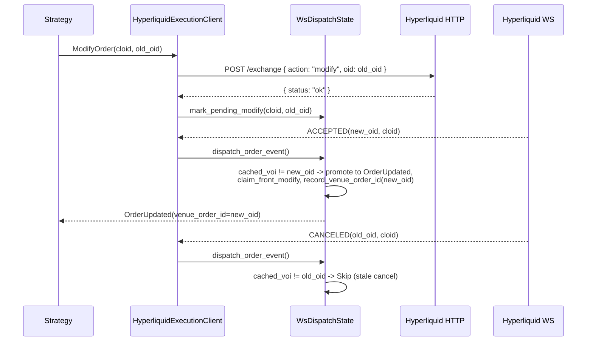

# Hyperliquid

[Hyperliquid](https://hyperliquid.gitbook.io/hyperliquid-docs) 是构建在 Hyperliquid L1 上的
去中心化永续合约与现货交易所，这条专为交易优化的自建区块链由 HyperCore 提供完全链上的
订单簿与撮合引擎。本集成支持 Hyperliquid 的实时行情摄取与订单执行。

## 概览 {#overview}

该适配器以 Rust 实现并提供 Python 绑定。它直接对接 Hyperliquid 的 REST 与 WebSocket
API，不需要外部客户端库。

Hyperliquid 适配器包含多个组件：

- `HyperliquidHttpClient`：HTTP API 连接、金融工具加载与解析、对账报告。
- `HyperliquidWebSocketClient`：供 Rust 调用方使用的 WebSocket API 连接。
- `HyperliquidDataClient`：行情数据流管理器。
- `HyperliquidExecutionClient`：账户管理与交易执行网关。
- `HyperliquidDataClientFactory`：Hyperliquid 数据客户端工厂（由 live node builder 使用）。
- `HyperliquidExecutionClientFactory`：Hyperliquid 执行客户端工厂（由 live node builder 使用）。

:::note
多数用户只配置实时交易节点（见[实时节点配置](#live-node-configuration)），
不会直接操作这些底层组件。
:::

## 示例 {#examples}

- [Python 示例](https://github.com/nautechsystems/nautilus_trader/tree/develop/examples/live/hyperliquid/)
- [Rust 示例](https://github.com/nautechsystems/nautilus_trader/tree/develop/crates/adapters/hyperliquid/examples/)

## Builder 代码归属 {#builder-code-attribution}

主网提交的订单携带 NautilusTrader 的 builder code，且**费率为零**，因此归属不增加
任何交易成本。这帮助我们了解集成的真实用量，并据此安排后续维护的优先级。为订单流
添加归属的用户，在大规模交易时还可能通过
[Institutional](https://nautilustrader.io/institutional/) 层级获得直接支持。

可以用序列化配置中的 `include_builder_attribution: false`，
或 Python 中的 `include_builder_attribution=False` 退出归属。

三种情况下订单会省略 builder 地址：

- **Testnet**：Hyperliquid testnet 会拒绝携带未经钱包明确批准的 builder 地址的订单
  （用 faucet 充值的 testnet 钱包通常没有批准），因此 testnet 订单从不携带 builder。
- **Vault 交易**（配置了 `vault_address`）：Hyperliquid 不允许 vault 批准 builder
  费用，携带 builder 地址会导致交易所拒单。
- **归属已关闭**（`include_builder_attribution=False`）：不想为订单流做归属的用户
  可以显式关闭 builder 归属。

```python
from nautilus_trader.adapters.hyperliquid import HyperliquidExecutionClientConfig

config = HyperliquidExecutionClientConfig(
    include_builder_attribution=False,
)
```

### Builder 费用批准 {#builder-fee-approval}

Hyperliquid 要求先做一次性的 `ApproveBuilderFee` 批准，订单才能携带 builder
地址：

- 从未批准过 builder 费用的钱包，其订单会被拒绝，原因为
  `Builder fee has not been approved`（任何先前的批准都满足检查，包括 0% 费率）。
- 批准需要主钱包的私钥。agent（API）钱包配置下适配器不持有该密钥，因此批准以
  一次性脚本运行，而不是在执行客户端启动时进行。
- 0% 的最高费率只允许归属：永远不会收取 builder 费用，提高费率则需要一份由你
  签署的新批准。

每个钱包运行一次批准脚本（读取 `HYPERLIQUID_PK`，
`HYPERLIQUID_TESTNET=true` 时读取 `HYPERLIQUID_TESTNET_PK`）：

```bash
cargo run -p nautilus-hyperliquid --bin hyperliquid-builder-fee-approve
```

或在 Python 中：

```python
from nautilus_trader.adapters.hyperliquid import builder_fee_approve

builder_fee_approve()
```

### 撤销批准 {#revoking-the-approval}

用撤销把此前批准的 builder 费用上限压回 0%（比如某个会收 builder 费用的旧版本
留下的批准）。撤销只设定费用上限，不删除批准记录，因此除非关闭
`include_builder_attribution`，归属仍会持续。

```bash
cargo run -p nautilus-hyperliquid --bin hyperliquid-builder-fee-revoke
```

或在 Python 中：

```python
from nautilus_trader.adapters.hyperliquid import builder_fee_revoke

builder_fee_revoke()
```

Rust 脚本会打印动作摘要，并在签名前等待按下 Enter 键。摘要中有任何不对的地方，
用 `Ctrl+C` 中止。要跳过提示，在 `cargo run` 命令后追加 `-- --yes`。
Python 绑定不提示，调用前务必确认当前的环境变量。

## Testnet 设置 {#testnet-setup}

Hyperliquid 提供 testnet 环境，可用模拟资金测试策略。

:::info
**需要主网账户。** Hyperliquid 的 testnet faucet 只对曾在主网存款过的钱包生效。
必须先为主网账户注资，才能领取 testnet USDC。
:::

### 获取 testnet 资金 {#getting-testnet-funds}

要领取 testnet USDC，必须先用同一钱包地址在**主网**存款过：

1. 访问 [Hyperliquid 主网门户](https://app.hyperliquid.xyz/)，用钱包完成一笔存款。
2. 用同一钱包访问 [testnet faucet](https://app.hyperliquid-testnet.xyz/drip)。
3. 从 faucet 领取 1,000 模拟 USDC。

:::note
**邮箱登录用户**：邮箱登录在主网和 testnet 会生成不同地址。要用 faucet，需要从
主网导出邮箱钱包，导入 MetaMask 或 Rabby，再把该扩展连到 testnet。
:::

### 创建 testnet 账户 {#creating-a-testnet-account}

1. 访问 [Hyperliquid testnet 门户](https://app.hyperliquid-testnet.xyz/)。
2. 连接钱包（MetaMask、WalletConnect 或邮箱）。
3. testnet 会为钱包地址自动创建账户。

### 导出私钥 {#exporting-your-private-key}

要在 NautilusTrader 中使用 testnet 账户，需要导出钱包私钥：

**MetaMask**：

1. 点击账户旁的三点菜单。
2. 选择 "Account details"。
3. 点击 "Show private key"。
4. 输入密码并复制私钥。

:::warning
**绝不要泄露私钥。** 私钥要安全存放在环境变量中，绝不提交到版本控制。
:::

### 设置环境变量 {#setting-environment-variables}

把 testnet 凭据设为环境变量：

```bash
export HYPERLIQUID_TESTNET_PK="your_private_key_here"
# Optional: for vault trading
export HYPERLIQUID_TESTNET_VAULT="vault_address_here"
```

配置为 `environment=HyperliquidEnvironment.TESTNET` 时，适配器会自动加载这些
变量。

:::warning
**Agent / API 钱包**：如果 `HYPERLIQUID_TESTNET_PK` 是在主账户下批准的
[agent 钱包](#agent-wallets)（在 Hyperliquid UI 上创建 API 钱包时通常就是这种
配置），还必须把 `HYPERLIQUID_ACCOUNT_ADDRESS` 设为主账户地址。不设置的话，
即使订单已在交易场所生效，`OrderStatusReport` 请求与 WebSocket 用户流也会返回
空结果。见 [GH-4010](https://github.com/nautechsystems/nautilus_trader/issues/4010)。
:::

## 产品支持 {#product-support}

Hyperliquid 提供线性永续合约、HIP-3 builder 部署的永续合约、原生现货市场与
HIP-4 二元结果市场。

| 产品类型        | 数据流    | 交易    | 说明                                             |
| --------------- | --------- | ------- | ------------------------------------------------ |
| 现货            | ✓         | ✓       | 原生现货市场。                                   |
| 永续合约        | ✓         | ✓       | USDC 结算的线性永续（验证节点运营）。            |
| HIP-3 永续合约  | ✓         | ✓       | builder 部署的永续，按 dex 独立抵押品。          |
| HIP-4 结果市场  | ✓         | ✓       | 全额抵押的二元结果 side token。                  |

四种产品类型在 connect 时全部自动加载，不需要逐个产品手工开启。

:::note
标准 Hyperliquid 永续以 USDC 结算。HIP-3 dex 可能用自有抵押代币结算，例如
USDH、USDE 或 USDT0，而 Nautilus 代码仍报价为 `USD`。现货市场是标准货币对。
各自细节见 [HIP-3 builder 部署的永续合约](#hip-3-builder-deployed-perpetuals)
与 [HIP-4 结果市场](#hip-4-outcome-markets)。
:::

## 代码体系 {#symbology}

Hyperliquid 为金融工具使用特定的代码格式：

### 现货市场 {#spot-markets}

格式：`{Base}-{Quote}-SPOT`

示例：

- `PURR-USDC-SPOT` - PURR/USDC 现货对
- `HYPE-USDC-SPOT` - HYPE/USDC 现货对

在策略中订阅：

```python
InstrumentId.from_str("PURR-USDC-SPOT.HYPERLIQUID")
```

从 `spotMeta` 加载的现货金融工具会把交易场所元数据保留在 `CurrencyPair.info`：

| 字段          | 值                                             |
| ------------- | ----------------------------------------------- |
| `name`        | 交易场所原始交易对标签                          |
| `tokens`      | base 与 quote 在 `spotMeta.tokens` 中的索引     |
| `index`       | 加 `10000` 现货偏移之前的交易对索引             |
| `isCanonical` | 交易场所的 canonical 分类                       |

用 Python 的 `info.get("isCanonical")` 或 Rust 的
`Params.get_bool("isCanonical")` 读取交易场所的 canonical 分类。

:::note
现货金融工具可能包含 vault 代币（前缀 `vntls:`）。Hyperliquid 不在 `spotMeta`
中列出它们，因此 HTTP 客户端在首次遇到时会合成一个 `{coin}-USDC-SPOT` 金融工具，
保证余额与成交可解析。这类合成金融工具不携带交易场所元数据：Rust 中 `info` 为
`None`，Python 中为空 dict。
:::

### 永续期货 {#perpetual-futures}

格式：`{Base}-USD-PERP`

示例：

- `BTC-USD-PERP` - 比特币永续期货
- `ETH-USD-PERP` - 以太坊永续期货
- `SOL-USD-PERP` - Solana 永续期货

在策略中订阅：

```python
InstrumentId.from_str("BTC-USD-PERP.HYPERLIQUID")
InstrumentId.from_str("ETH-USD-PERP.HYPERLIQUID")
```

### HIP-3 永续合约 {#hip-3-perpetuals}

格式：`{dex}:{Asset}-USD-PERP`

[HIP-3](https://hyperliquid.gitbook.io/hyperliquid-docs/hyperliquid-improvement-proposals-hips/hip-3-builder-deployed-perpetuals)
市场用冒号分隔的 dex 前缀。dex 名称标识市场属于哪个 builder 部署的 perp dex。

示例：

- `xyz:TSLA-USD-PERP` - trade.xyz 上的特斯拉永续
- `xyz:GOLD-USD-PERP` - trade.xyz 上的黄金永续
- `flx:NVDA-USD-PERP` - Felix 上的英伟达永续
- `vntl:SPACEX-USD-PERP` - Ventuals 上的 SpaceX 永续

在策略中订阅：

```python
InstrumentId.from_str("xyz:TSLA-USD-PERP.HYPERLIQUID")
```

### HIP-4 结果 side token {#hip-4-outcome-side-tokens}

格式：`{outcome_index}-{YES|NO}-OUTCOME.HYPERLIQUID`，其中
`outcome_index` 是 `outcomeMeta` 的 `outcome` 字段，中间段标识二元方向。
`-OUTCOME` 后缀与 `-PERP` / `-SPOT` 对称。

[HIP-4](https://hyperliquid.gitbook.io/hyperliquid-docs/hyperliquid-improvement-proposals-hips/hip-4-outcome-markets)
side token 是二元合约，按市场 quote 代币在 `0`（败方）或 `1`（胜方）结算。
Nautilus 代码使用上面的人类可读形式。线上 `raw_symbol` 使用交易场所的代币形式
`#{encoding}`（`encoding = 10 * outcome_index + side`，
Yes 的 `side` 为 `0` / No 为 `1`），`l2Book` 与 `allMids` 接受的就是它。

示例（outcome 25）：

- `25-YES-OUTCOME.HYPERLIQUID`：Yes 方向。编码 `250`，线上市值代币
  `#250`，代币名 `+250`，动作资产 ID `100_000_250`。
- `25-NO-OUTCOME.HYPERLIQUID`：No 方向。编码 `251`，线上市值代币
  `#251`，代币名 `+251`，动作资产 ID `100_000_251`。

在策略中订阅：

```python
InstrumentId.from_str("25-YES-OUTCOME.HYPERLIQUID")
```

:::note
结果池是循环轮换的。每次结算都会把已结算的结果移出 `outcomeMeta`，交易场所的
下一个挂牌会推进索引。已结算结果上的成交与历史订单仍能对账：适配器从
`#{encoding}` 代币推导 side token 的金融工具，但没有 `outcomeMeta` 携带的市场
名称、描述、到期时间与 quote 代币。货币回退见[结算货币](#settlement-currency)。
用下面的命令查看当前结果池：

```bash
curl -s -X POST https://api.hyperliquid.xyz/info \
    -H 'Content-Type: application/json' \
    -d '{"type":"outcomeMeta"}'
```

:::

交易流程、结算与当前限制见 [HIP-4 结果市场](#hip-4-outcome-markets)。

## HIP-3 builder 部署的永续合约 {#hip-3-builder-deployed-perpetuals}

[HIP-3](https://hyperliquid.gitbook.io/hyperliquid-docs/hyperliquid-improvement-proposals-hips/hip-3-builder-deployed-perpetuals)
允许合格部署者（deployer）在 Hyperliquid 上无需许可地启动 perp dex。这些市场包含
股票（TSLA、NVDA、AAPL）、大宗商品（黄金、原油）、指数（S&P 500）与 pre-IPO
代币（SpaceX、OpenAI）。

在 `LiveNode` 中，HIP-3 永续在 connect 时与标准永续一起自动加载：适配器从
`allPerpMetas` 拉取每个 perp dex（标准的与 builder 部署的），因此不需要额外
客户端配置。数据客户端不提供按 dex 的过滤器，策略按
`instrument_id` 选择要交易的市场。

直接使用 `HyperliquidHttpClient` 时，除非通过
`load_instrument_definitions` 显式开启，否则不加载 HIP-3 perp dex：

```python
from nautilus_trader.adapters.hyperliquid import HyperliquidEnvironment
from nautilus_trader.adapters.hyperliquid import HyperliquidHttpClient

client = HyperliquidHttpClient.from_env(HyperliquidEnvironment.MAINNET)
instruments = await client.load_instrument_definitions(
    include_spot=True,
    include_perps=True,
    include_perps_hip3=True,
    include_outcomes=False,
)
```

### 未结订单与持仓对账 {#open-order-and-position-reconciliation}

#### 启动时的 mass status {#startup-mass-status}

`LiveNode` 启动时，未过滤的未结订单与持仓对账会查询默认 perp dex，以及钱包近期
历史订单或成交所涉及的每个不同 HIP-3 dex：

- 无钱包活动的已缓存 dex 不产生启动请求。
- 任一历史响应触及 2,000 条记录上限时，对账改为查询交易场所当前 perp dex 列表
  返回的每个 dex，避免有界历史掩盖更早的未结订单或持仓。
- 持仓对账也包含现货持有量。

返回的 mass status 按
[mass-status 历史契约](./../concepts/execution/reconciliation.md#mass-status-history-contract)
记录其覆盖范围。配置了回看窗口时，`lookback_start` 携带其下界；未配置时，
快照是无界的。以下任一条件都会使 `reports_complete` 为 `false`：

- 历史响应触及记录上限，可能被截断。
- 某个必需的交易场所行无法解码、无法解析为金融工具，或无法转换为报告。

有效的行仍保留在报告集合中。在记录上限内干净解码完所有场所响应的快照具有权威
性，空快照也一样。

#### Reduce-only 成交数量 {#reduce-only-fill-quantity}

当 reduce-only 订单平掉了小于订单数量的持仓时，Hyperliquid 可能把它报告为
`filled` 且没有剩余。启动 mass status 或按场所订单 ID 单查时，适配器会把此类
订单钳制到其成交总量，从而以小于提交数量的数量收尾为 `Filled`。只有
`userFills` 历史完整且未触及 2,000 条上限时才应用该钳制，否则适配器保留场所
数量，对账可以推断缺失的成交。

用于该钳制时，单查只对被报告为 `Filled` 的 reduce-only 订单拉取
`userFills`。`QueryOrder` 也会为[符合条件的普通已成交订单](#order-fill-recovery)
读取成交历史。

#### 命令与直接请求 {#command-and-direct-requests}

启动 mass status 之外，未过滤的 `LiveNode` 未结订单与持仓报告命令，以及直接的
`HyperliquidHttpClient` 请求，会查询默认 perp dex 与已缓存永续金融工具所代表的
每个 builder dex：

- 过滤到某个 HIP-3 金融工具的请求，从代码的 dex 前缀推导 builder dex，只查询
  该 dex。
- 标准永续过滤器只查询默认 dex。
- 现货与结果持仓过滤器保持既有的仅现货路由。
- 某个必需请求失败时，请求返回错误而不是部分快照。交易场所行无法解码、无法
  解析为金融工具或无法转换为报告时同样如此。成交与历史订单报告请求的失败处理
  一致。
- 定向 HTTP 订单状态查询命中不可用的场所行时，返回错误而不是把订单报告为缺失。
  在不再存在场所订单 ID 回退后，`GenerateOrderStatusReport` 命令行为相同。

#### 推断成交的佣金 {#inferred-fill-commissions}

对账期间推断出的成交不带佣金：适配器不为推断成交计算费用，因此生成的
`OrderFilled` 事件中 `commission` 为 `None`。数量与价格仍可对账，只是这些
成交的已实现盈亏不含交易费用。

### 与标准永续合约的差异 {#differences-from-standard-perpetuals}

HIP-3 市场在同一 HyperCore 撮合引擎上交易，使用相同的订单 API。主要差异：

- **更高费用**：每个 dex 自设 deployer 费率倍数——低于 `1` 的费率乘以
  `scale + 1`，不低于 `1` 的乘以 `scale * 2`，deployer 至多抽取一半。要查某个
  dex 的实时费率，不要套用标准永续费率表。
- **隔离保证金**：HIP-3 市场默认仅支持隔离保证金。
- **按 dex 的抵押品**：每个 HIP-3 dex 通过 `allPerpMetas` 中的
  `collateralToken` 条目声明结算代币。Nautilus 通过 `spotMeta` 解析该代币，
  代码的 quote 腿仍保持 `USD`。非 USDC 抵押代币无法从 `spotMeta` 解析时，
  金融工具加载返回错误，而不是回退到 USDC。
- **Deployer 管理的预言机**：预言机喂价由 deployer 运营，而非验证节点。
- **增长模式**：市场与验证节点运营的永续不相交的 dex 可以加入增长模式，
  Hyperliquid 将其描述为在全额费用中至少让利 90%。

完整协议细节见 Hyperliquid 文档：

- [HIP-3 提案](https://hyperliquid.gitbook.io/hyperliquid-docs/hyperliquid-improvement-proposals-hips/hip-3-builder-deployed-perpetuals)
- [HIP-3 deployer 动作](https://hyperliquid.gitbook.io/hyperliquid-docs/for-developers/api/hip-3-deployer-actions)
- [资产 ID](https://hyperliquid.gitbook.io/hyperliquid-docs/for-developers/api/asset-ids)
- [费用](https://hyperliquid.gitbook.io/hyperliquid-docs/trading/fees)

### 通配符字符净化 {#wildcard-character-sanitization}

一些 HIP-3 dex 部署的资产，其场所名称包含 `*` 或 `?` 字节（例如
`dex:STREAMABCD****-USD-PERP`）。这些字节与 Nautilus 消息总线的模式语法冲突
（`*` = 任意多个，`?` = 单个字符），原样嵌入主题字符串会破坏订阅路由。

构造 `InstrumentId.symbol` 时，Hyperliquid 适配器把这两类字节替换为 `x`，
因此名为 `dex:STREAMABCD****` 的 HIP-3 资产在策略侧呈现为：

```python
InstrumentId.from_str("dex:STREAMABCDxxxx-USD-PERP.HYPERLIQUID")
```

替换只作用于主题、缓存、日志与配置中 Nautilus 内部使用的代码。金融工具的
`raw_symbol` 保留场所官方名称供 HTTP 与 WebSocket 调用。订单提交引用数字资产
索引，因此与 Hyperliquid 的往返不受影响。

订阅场所名称含通配符字节的 HIP-3 金融工具时，使用净化后的形式。不含 `*` 或
`?` 的代码原样通过。

替换是有损的：`dex:FOO*` 与 `dex:FOO?` 这样两个不同的场所名称会归一到同一个
Nautilus 代码。此类冲突采用[金融工具加载](#instrument-loading)所述的首次写入
优先行为。

## HIP-4 结果市场 {#hip-4-outcome-markets}

[HIP-4](https://hyperliquid.gitbook.io/hyperliquid-docs/for-developers/api/asset-ids#outcomes)
市场是全额抵押的二元合约。每个市场有两个 side token（Yes / No），在结算日按
市场的 quote 代币结算为 `1`（胜方）或 `0`（败方）。交易场所通过
`outcomeMeta` 信息端点发布结果元数据，适配器对该载荷采取尽力而为的态度：场所
不返回它时，适配器跳过 HIP-4 金融工具。因此端点被移除或改名时，永续与现货仍然
可用，而不是让整个金融工具加载失败。

### 加载结果金融工具 {#loading-outcome-instruments}

在 `LiveNode` 中，交易场所暴露 `outcomeMeta` 时，结果金融工具会自动（尽力而为）
加载，不需要客户端配置。

直接使用 `HyperliquidHttpClient` 时，通过 `load_instrument_definitions` 开启：

```python
from nautilus_trader.adapters.hyperliquid import HyperliquidEnvironment
from nautilus_trader.adapters.hyperliquid import HyperliquidHttpClient

client = HyperliquidHttpClient.from_env(HyperliquidEnvironment.MAINNET)
instruments = await client.load_instrument_definitions(
    include_spot=True,
    include_perps=True,
    include_perps_hip3=False,
    include_outcomes=True,
)
```

加载时为每个结果发出两个 `BinaryOption` 金融工具（每个方向一个）。代码使用
`{outcome_index}-{YES|NO}-OUTCOME.HYPERLIQUID` 形式。`expiration_ns`
从场所描述解析（`expiry:YYYYMMDD-HHMM`，UTC）。独立二元合约自带到期时间，
命名结果与回退结果继承父问题的到期时间。价格以 `0.00001` 为最小变动单位，
数量为整数代币，与交易场所一致。

每个金融工具的 `BinaryOption.info` 以键/值映射携带解析后的场所元数据（Python
用 `info["key"]`，Rust 用 `Params.get_str(...)` 读取）。派生标识始终填充，
描述派生字段在场所提供时才会出现。

| 字段               | 来源                           | 说明                                              |
| ------------------ | ------------------------------ | ------------------------------------------------- |
| `outcome_index`    | 派生                           | `outcomeMeta` 的 `outcome`                        |
| `outcome_side`     | 派生                           | `0` = Yes，`1` = No                               |
| `side_name`        | `outcomeMeta` `sideSpecs`      | 场所方向标签，缺失时为 `"Yes"` / `"No"`           |
| `encoding`         | 派生                           | `10 * outcome_index + side`                       |
| `asset_id`         | 派生                           | `100_000_000 + encoding`                          |
| `market_name`      | `outcomeMeta.outcomes[*].name` | 场所市场标签                                      |
| `class`            | 描述                           | `priceBinary` 或 `priceBucket`                    |
| `underlying`       | 描述                           | 标的资产代码                                      |
| `expiry`           | 描述                           | `YYYYMMDD-HHMM` UTC                               |
| `target_price`     | 描述                           | 二元结算阈值                                      |
| `period`           | 描述                           | 重复周期（如 `1d`、`3m`）                         |
| `price_thresholds` | 描述                           | 逗号分隔的阈值（bucket 市场）                     |
| `named_index`      | 命名结果描述                   | 在父 `named_outcomes` 数组中的位置                |
| `is_fallback`      | 回退结果描述                   | 问题的 `other` 结果为 `true`                      |
| `question`         | 父问题                         | 问题 ID                                           |
| `question_name`    | 父问题                         | 问题标签                                          |
| `question_*`       | 父问题描述                     | 每个解析出的问题字段，带 `question_` 前缀         |

描述键从场所的 camelCase 降为 snake_case（`targetPrice` ->
`target_price`，`priceThresholds` -> `price_thresholds`）。值保留为字符串以
维持线上保真度。数字标识（`outcome_index`、`outcome_side`、`encoding`、
`asset_id`、`question`、`named_index`）以 JSON 数字存储。

### 结算货币 {#settlement-currency}

适配器用每个结果的 `outcomeMeta` `quoteToken` 作为
`BinaryOption.currency`、`quote_currency` 与结算货币。把 side token 报告为
`feeToken` 的零费成交，其佣金使用该金融工具的 quote 货币。元数据选定 USDH 时，
适配器显式按 8 位小数注册它，不让货币自动注册机制决定其精度。

`quoteToken` 缺失时，适配器默认使用 USDC。已结算、从 `outcomeMeta`
消失的结果，在金融工具仍留在适配器内存缓存期间保留其货币。重启后，除非该金融
工具重新进入缓存，否则适配器使用 USDC。USDC 只是适配器的兼容默认值：2026 年
10 月观察到的主网与 testnet 结果均以 USDC 报价。结果资产编码不标识其 quote
代币，因此没有缓存的金融工具时，适配器无法恢复其他历史货币。

重建的金融工具同样以 USDC 进入缓存，并保留该货币直到被 supplied 金融工具替换，
即使后续元数据指定了别的 quote 代币。

USDH 现货余额与永续清算所视图合并，因此 `AccountState` 在 USDC 之外还携带
USDH 及其他非零现货持有量。

### 交易流程 {#trading-flow}

结果 side token（`{outcome_index}-{YES|NO}-OUTCOME.HYPERLIQUID`）走标准订单
路径交易。像对待任何永续或现货金融工具一样提交 `SubmitOrder`。执行客户端把它
路由为对场所 `#{encoding}` 订单簿（`encoding = 10 * outcome_index +
outcome_side`）的同一个 `Order` 动作，不需要 HIP-4 专用调用。

结算由交易场所驱动，见[结算分发](#settlement-dispatch)。

#### 高级工作流 {#advanced-workflows}

需要在场外管理 side token 库存的策略，可以直接在
`HyperliquidHttpClient`（Rust 与 PyO3）上使用完整的 `userOutcome` 动作集：

```python
from decimal import Decimal
from nautilus_trader.adapters.hyperliquid import HyperliquidEnvironment
from nautilus_trader.adapters.hyperliquid import HyperliquidHttpClient

client = HyperliquidHttpClient.from_env(HyperliquidEnvironment.MAINNET)

# Mint matched Yes + No side tokens from the outcome's quote token
await client.submit_split_outcome(50, Decimal("1.0"))

# Burn a matched Yes + No pair back to quote tokens (amount=None merges the max)
await client.submit_merge_outcome(50, None)

# Multi-outcome priceBucket operations
await client.submit_merge_question(9, None)
await client.submit_negate_outcome(9, 52, Decimal("1.0"))
```

| 动作                    | 用途                                                                               |
| ----------------------- | ------------------------------------------------------------------------------------ |
| `submit_split_outcome`  | 用 quote 铸造配对的 Yes + No 代币（初始做市、双边对冲）                          |
| `submit_merge_outcome`  | 把配对的 Yes + No 销毁回 quote，不跨越价差                                             |
| `submit_merge_question` | 把完整的多结果篮子原子地关闭回 quote                                                 |
| `submit_negate_outcome` | 把一个结果的 No 份额转换为同一问题内所有其他结果的 Yes 份额                          |

方向性押注用普通 `SubmitOrder` 路径就够了。只有需要在场外创建或销毁 side token
库存时才用上面的方法。

### 订单约束 {#order-constraints}

结果 side token 的表现类似现货代币（无保证金、无资金费率、无清算）。执行客户端
拒绝不适用的功能：

- `reduce_only` 订单。
- 触发类订单（`StopMarket`、`StopLimit`、`MarketIfTouched`、
  `LimitIfTouched`、追踪止损）。

支持 `GTC`、`IOC`、`ALO` 有效期的 `Limit` 与 `Market` 订单。交易场所最低名义
价值为 10 个 quote 代币。把 `order_qty` 设为整数代币，保证
`order_qty * limit_price >= 10`。

### 结算分发 {#settlement-dispatch}

到期时交易场所平掉持有的 side token 余额，为每个方向发出一条 `Settlement`
成交。适配器通过标准用户成交流（HTTP 轮询与 WebSocket）消费它们，保留场所报告的
佣金。

每笔结算成交：

- `order_side = SELL`。
- 胜方价格为 `1` 个 quote 代币，败方为 `0`。
- 以 `FillReport` 呈现。
- 当 WebSocket 分发把持仓关联到被跟踪的订单时，场所成交还会发出
  `OrderFilled`。

场所的 `Settlement` 成交统一覆盖独立 `priceBinary` 结果与多结果
`priceBucket` 问题。

仅 Rust 侧的 `outcome_settlement_poll_secs` 选项为多结果问题开启合成结算轮询，
默认关闭。

:::warning

保持合成轮询关闭，消费交易场所的结算成交。该推断假设非空的
`settledNamedOutcomes` 列表在 `namedOutcomes` 内标识获胜结果、其余命名结果与
回退结果均告失败。而 2026 年 10 月观察到的 testnet 元数据把已移除的结果列进
`settledNamedOutcomes`，其他命名结果仍在列表中。在这种形态下，轮询可能为仍在
交易的市场中的持仓发出平仓成交。

:::

合成成交携带零佣金，货币为缓存金融工具的 quote 货币，无缓存金融工具时用元数据
quote 代币，再回退到 USDC。它们没有 `client_order_id`，以
`FillReport` 分发。

### 持仓对账 {#position-reconciliation}

HIP-4 side token 出现在 `spotClearinghouseState` 中，`coin`
为 `+E` 代币形式且没有 `token` 字段。适配器：

- 反序列化时把 `SpotBalance.token` 视为可选。
- 生成 `PositionStatusReport` 时把 `+E` / `#E` 代币解析到对应的
  `BinaryOption` 金融工具。
- 持仓状态过滤器是结果金融工具时，跳过 perp clearinghouse 拉取（结果永不出现在
  `assetPositions` 中）。

### 多结果（priceBucket）市场 {#multi-outcome-pricebucket-markets}

交易场所通过 `outcomeMeta` 顶层的 `questions` 数组暴露多结果市场。每个问题
引用一个回退结果，以及一串命名结果，其各自的描述通过 `index:N`
指回该问题。每个 side token 建模为独立的 `BinaryOption` 金融工具。
`HyperliquidHttpClient` 上的 `submit_merge_question` 与
`submit_negate_outcome` 动作在问题层级执行篮子平仓与跨结果轮换。

## 金融工具加载 {#instrument-loading}

数据客户端在 connect 时加载完整的 Hyperliquid 资产池：一趟覆盖现货市场、标准
永续、每个 HIP-3 builder 部署的 perp dex 以及 HIP-4 结果 side token。客户端配置
不提供按产品或按代码的过滤器。策略通过自己的 `instrument_id` 配置选择要交易的
金融工具。

加载器包含 `spotMeta.universe` 中的每个交易对，包括非 canonical 交易对。多个
交易对共享同一 base 代币时，加载器先缓存 canonical 交易对，因此按 base 代币识别
的余额与成交会解析到 canonical 的 Nautilus 金融工具。任何后续定义若其 Nautilus
代码与更早的定义冲突，会被丢弃并记录警告，且无法交易。

之后数据客户端每 `update_instruments_interval_mins` 分钟重新拉取一次资产池：

- 发布新增或实质变化的定义，未变化的定义不重复发布。
- 执行客户端接收这些更新并注册每个金融工具的资产索引，启动后新挂牌的市场无需
  重启进程即可交易。
- `RequestInstrument` 或 `RequestInstruments` 同样会重新拉取整个资产池，
  并以相同方式发布新增或变化的定义。
- 把 `update_instruments_interval_mins` 设为 `0` 可关闭周期刷新。请求
  与数据客户端重连仍会按需重新拉取资产池。

向执行客户端从未加载过的代码提交订单，会以 `INSTRUMENT_NOT_FOUND` 拒绝。

失败按产品降级，而不是中止整个加载：

- 缺少现货或永续元数据时记录警告并跳过该产品。
- `outcomeMeta` 载荷缺失时按 debug 级别跳过。
- 唯一的硬失败是某个 perp dex 的非 USDC 抵押代币无法通过 `spotMeta`
  解析，因为猜测结算货币会让市场定价错误。

要在 `LiveNode` 之外拉取更窄的集合，直接调用
`HyperliquidHttpClient` 的 `load_instrument_definitions` 并带上所需的产品开关：

```python
from nautilus_trader.adapters.hyperliquid import HyperliquidEnvironment
from nautilus_trader.adapters.hyperliquid import HyperliquidHttpClient

client = HyperliquidHttpClient.from_env(HyperliquidEnvironment.MAINNET)
instruments = await client.load_instrument_definitions(
    include_spot=False,
    include_perps=True,
    include_perps_hip3=False,
    include_outcomes=False,
)
```

## 数据订阅 {#data-subscriptions}

适配器支持下列数据订阅。所有永续数据类型（标记价格、指数价格、资金费率）对标准
永续与 HIP-3 永续同样适用。

| 数据类型       | 订阅 | 快照 | 历史 | Nautilus 类型                   | 说明                                             |
| -------------- | ---- | ---- | ---- | ------------------------------- | ------------------------------------------------ |
| 成交明细       | ✓    | -    | ✓    | `TradeTick`                     | WebSocket 成交；`recentTrades`。                 |
| 公共成交       | ✓    | -    | ✓    | `HyperliquidPublicTrade`        | 需显式开启的自定义数据，含对手方与哈希。         |
| 报价明细       | ✓    | -    | -    | `QuoteTick`                     | 最优买卖价。                                     |
| 订单簿增量     | ✓    | ✓    | -    | `OrderBookDelta`                | L2 快照。                                        |
| 订单簿深度     | ✓    | -    | -    | `OrderBookDepth`                | 前 10 档 L2 快照。                               |
| K 线           | ✓    | -    | ✓    | `Bar`                           | 支持区间见下文。                                 |
| 标记价格       | ✓    | -    | -    | `MarkPriceUpdate`               | 永续标记价格推送。                               |
| 指数价格       | ✓    | -    | -    | `IndexPriceUpdate`              | 标的参考价。                                     |
| 资金费率       | ✓    | -    | ✓    | `FundingRateUpdate`             | `fundingHistory` 端点。                          |
| 未平仓合约量   | ✓    | -    | -    | `HyperliquidOpenInterest`       | 来自 `activeAssetCtx` 的自定义数据。             |
| 全部中间价     | ✓    | -    | -    | `HyperliquidAllMids`            | 来自 `allMids` 的自定义数据。                    |
| 全部 dex 上下文 | ✓   | -    | -    | `HyperliquidAllDexsAssetCtxs`   | 来自 `allDexsAssetCtxs` 的自定义数据。           |
| TWAP 历史      | ✓    | -    | -    | `HyperliquidTwapHistory`        | 需显式开启，来自 `userTwapHistory`。             |
| TWAP 切片成交  | ✓    | -    | -    | `HyperliquidTwapSliceFill`      | 需显式开启，来自 `userTwapSliceFills`。          |

:::note
不支持历史报价请求。历史成交请求使用 `recentTrades` 信息端点，它返回公共成交的
近期快照（最新在前），没有时间范围。`request_trades` 把该快照过滤到请求的
`[start, end]` 窗口，并用保留最新成交的方式应用 `limit`。当请求下探到快照最早
成交之下时，适配器记录警告并提供可用子集（或空响应）。该端点依赖 Hyperliquid
索引器：自建 `/info` 节点返回 HTTP 422，适配器视为无覆盖并答复空响应。实时成交
仍可通过 WebSocket 的 `trades` 频道获得。
:::

### 订单簿精度控制 {#order-book-precision-controls}

`l2Book` 订阅接受可选的 `nSigFigs` 与 `mantissa` 参数，用于稀释场所侧的
订单簿聚合。在 `subscribe_book_deltas` 或 `subscribe_book_depth` 的
`params` 中以 `n_sig_figs` 和 `mantissa` 传入，适配器会转发给交易场所。

Hyperliquid 接受 `nSigFigs` 取值 `2`、`3`、`4`、`5`，或省略以获得全精度。
`mantissa` 仅在 `nSigFigs=5` 时有效，取值 `1`、`2` 或 `5`。

```python
from nautilus_trader.model import BookType

self.subscribe_book_deltas(
    instrument_id=instrument_id,
    book_type=BookType.L2_MBP,
    params={"n_sig_figs": 5, "mantissa": 2},
)
```

两个参数都省略时按完整价格精度订阅。

同一金融工具的订单簿增量与深度快照共用一条场所 `l2Book` 流：

- 第一个订阅打开该流并设定其精度选项。
- 流活跃期间请求不同选项会记录警告并保留当前生效的选项。
- 两种用途的最后一个订阅退订时，流才关闭。
- 重连按原精度选项恢复该流。

### Hyperliquid 专属数据 {#hyperliquid-specific-data}

适配器发出 Hyperliquid 专属的自定义数据类型：

- `HyperliquidAllMids`，来自 WebSocket `allMids` 流。每次更新在一个载荷中
  携带当前报告的全部中间价。
- `HyperliquidAllDexsAssetCtxs`，来自 WebSocket `allDexsAssetCtxs` 流。
  每次更新携带默认 perp dex 与各 HIP-3 builder dex 上按金融工具归一化的资产
  上下文条目。
- `HyperliquidOpenInterest`，来自标记价格、指数价格与资金费率共用的
  `activeAssetCtx` 流。
- `HyperliquidPublicTrade`，来自 `trades` 与 `recentTrades`。每个事件
  自包含，含买方、卖方与场所哈希。
- `HyperliquidTwapHistory`，来自 WebSocket `userTwapHistory` 流。每个事件
  是用户地址的一行历史/生命周期记录。
- `HyperliquidTwapSliceFill`，来自 WebSocket `userTwapSliceFills` 流。每个
  事件是一条 TWAP 子切片成交。

| 字段       | 类型                        | 说明                                                                       |
| ---------- | --------------------------- | -------------------------------------------------------------------------- |
| `mids`     | `dict[InstrumentId, Price]` | 规范 Nautilus 金融工具 ID 到中间价的映射。                                 |
| `ts_event` | `int`                       | 更新发生时的 UNIX 纳秒时间戳，与 `ts_init` 相同。                          |
| `ts_init`  | `int`                       | 对象构建时的 UNIX 纳秒时间戳。                                             |

在 actor 或策略中用 `DataType(HyperliquidAllMids.__name__)` 订阅，覆盖默认
perp dex。要改跟某个 HIP-3 builder dex，在 `metadata["dex"]` 传入其场所标识：

```python
from nautilus_trader.adapters.hyperliquid import HYPERLIQUID_CLIENT_ID
from nautilus_trader.adapters.hyperliquid import HyperliquidAllMids
from nautilus_trader.model import DataType

self.subscribe_data(
    data_type=DataType(HyperliquidAllMids.__name__, metadata={"dex": "xyz"}),
    client_id=HYPERLIQUID_CLIENT_ID,
)
```

`dex` 取值是 `perpDexs` 中场所定义的 builder dex 标识，如 `xyz`、`flx`、
`vntl`。默认 perp dex 省略该键（或传空字符串）。

`HyperliquidOpenInterest` 携带单个永续金融工具的最新未平仓合约量。订阅时在
`metadata["instrument_id"]` 传入规范 Nautilus `instrument_id`：

| 字段            | 类型           | 说明                                                                       |
| --------------- | -------------- | -------------------------------------------------------------------------- |
| `instrument_id` | `InstrumentId` | 规范 Nautilus 金融工具 ID。                                                |
| `open_interest` | `Decimal`      | 解析出的未平仓合约量，可直接参与运算。                                     |
| `ts_event`      | `int`          | 更新发生时的 UNIX 纳秒时间戳，与 `ts_init` 相同。                          |
| `ts_init`       | `int`          | 对象构建时的 UNIX 纳秒时间戳。                                             |

```python
from nautilus_trader.adapters.hyperliquid import HYPERLIQUID_CLIENT_ID
from nautilus_trader.adapters.hyperliquid import HyperliquidOpenInterest
from nautilus_trader.model import DataType

self.subscribe_data(
    data_type=DataType(
        HyperliquidOpenInterest.__name__,
        metadata={"instrument_id": str(self.instrument_id)},
    ),
    client_id=HYPERLIQUID_CLIENT_ID,
)
```

`HyperliquidOpenInterest` 复用同一条底层的
`activeAssetCtx` 场所订阅——它已经为同一代币支撑着标记价格、指数价格与资金费
率。增加 OI 不会另开一条平行的 `activeAssetCtx` 订阅。

`HyperliquidPublicTrade`
是通用 `TradeTick` 之外需显式开启的替代，用于公共订单流研究。它带
`instrument_id`、`price`、`size`、`aggressor_side`、
`trade_id`、`buyer`、`seller`、`hash`、`ts_event` 与
`ts_init`。用相同的规范金融工具元数据订阅：

```python
from nautilus_trader.adapters.hyperliquid import HYPERLIQUID_CLIENT_ID
from nautilus_trader.adapters.hyperliquid import HyperliquidPublicTrade
from nautilus_trader.model import DataType

self.subscribe_data(
    data_type=DataType(
        HyperliquidPublicTrade.__name__,
        metadata={"instrument_id": str(self.instrument_id)},
    ),
    client_id=HYPERLIQUID_CLIENT_ID,
)
```

两者同时请求时，它与 `TradeTick` 共用同一条场所 `trades` 订阅。与 sidecar
`users` 事件不同，每条 `HyperliquidPublicTrade` 都可独立做 Arrow 序列化，无需
join 即可写入并查询 Nautilus 目录。对该类型的
`RequestCustomData` 使用与历史成交请求相同的、仅近期的 `recentTrades` 快照。

`HyperliquidTwapHistory` 与 `HyperliquidTwapSliceFill` 是需显式开启、按用户
键定的自定义数据，**不**包含在执行账户的 `subscribe_all_user_channels`
路径中。订阅时在 `metadata["user"]` 传入目标钱包地址（该地址不必是适配器的交易
账户）。

`HyperliquidTwapHistory` 字段：

| 字段                 | 类型                    | 说明                                                          |
| -------------------- | ----------------------- | --------------------------------------------------------------- |
| `user`               | `str`                   | 订阅信封中的用户地址。                                        |
| `twap_id`            | `int \| None`           | 历史行上存在时的场所 `twapId`。                               |
| `coin`               | `str`                   | 原始 Hyperliquid 代码符号。                                   |
| `instrument_id`      | `InstrumentId \| None`  | 代币已知时解析出的 Nautilus 金融工具 ID。                     |
| `side`               | `OrderSide`             | TWAP 订单方向。                                               |
| `size`               | `Decimal`               | TWAP 总量。                                                   |
| `executed_size`      | `Decimal`               | 迄今已执行数量。                                              |
| `executed_notional`  | `Decimal`               | 迄今已执行名义价值。                                          |
| `minutes`            | `int`                   | TWAP 时长（分钟）。                                           |
| `reduce_only`        | `bool`                  | 该 TWAP 是否 reduce-only。                                    |
| `randomize`          | `bool`                  | 切片时点是否随机化。                                          |
| `status`             | `HyperliquidTwapStatus` | 场所状态（`activated`/`terminated`/`finished`/`error`/…）。    |
| `status_description` | `str`                   | 场所状态描述（状态为 `error` 时通常有值）。                   |
| `state_timestamp`    | `int`                   | `state.timestamp`，UNIX 纳秒。                                |
| `is_snapshot`        | `bool`                  | 该行是否属于场所快照批次。                                    |
| `ts_event`           | `int`                   | 历史行时间（`history.time`），UNIX 纳秒。                     |
| `ts_init`            | `int`                   | 对象构建时的 UNIX 纳秒时间戳。                                |

`HyperliquidTwapSliceFill` 字段：

| 字段            | 类型                   | 说明                                                     |
| --------------- | ---------------------- | ---------------------------------------------------------- |
| `user`          | `str`                  | 订阅信封中的用户地址。                                     |
| `twap_id`       | `int`                  | 场所 TWAP 订单标识。                                       |
| `coin`          | `str`                  | 原始 Hyperliquid 代码符号。                                |
| `instrument_id` | `InstrumentId \| None` | 代币已知时解析出的 Nautilus 金融工具 ID。                  |
| `price`         | `Decimal`              | 成交价。                                                   |
| `size`          | `Decimal`              | 成交量。                                                   |
| `side`          | `OrderSide`            | 成交方向。                                                 |
| `hash`          | `str`                  | L1 交易哈希。                                              |
| `oid`           | `int`                  | 该切片的场所订单 ID。                                      |
| `tid`           | `int`                  | 场所成交 ID。                                              |
| `crossed`       | `bool`                 | 该成交是否跨越价差（taker）。                              |
| `fee`           | `Decimal`              | 费用金额（负数表示返佣）。                                 |
| `fee_token`     | `str`                  | 支付费用所用代币。                                         |
| `dir`           | `str`                  | 场所前端的方向字符串。                                     |
| `closed_pnl`    | `Decimal`              | 该成交的已平仓盈亏。                                       |
| `is_snapshot`   | `bool`                 | 该成交是否属于场所快照批次。                               |
| `ts_event`      | `int`                  | 成交时间，UNIX 纳秒。                                      |
| `ts_init`       | `int`                  | 对象构建时的 UNIX 纳秒时间戳。                             |

```python
from nautilus_trader.adapters.hyperliquid import HYPERLIQUID_CLIENT_ID
from nautilus_trader.adapters.hyperliquid import HyperliquidTwapHistory
from nautilus_trader.adapters.hyperliquid import HyperliquidTwapSliceFill
from nautilus_trader.model import DataType

self.subscribe_data(
    data_type=DataType(
        HyperliquidTwapHistory.__name__,
        metadata={"user": "0x..."},
    ),
    client_id=HYPERLIQUID_CLIENT_ID,
)
self.subscribe_data(
    data_type=DataType(
        HyperliquidTwapSliceFill.__name__,
        metadata={"user": "0x..."},
    ),
    client_id=HYPERLIQUID_CLIENT_ID,
)
```

场所快照批次会把该批次内每一行/每笔成交的 `is_snapshot` 置为 `True`，消费者
据此清空并重建本地 TWAP 状态。

在 `LiveNode` 内运行的 Python 策略中，`on_data` 收到的载荷包裹在
`CustomData` 里。从 `CustomData.data` 读取，并用 `isinstance` 判断类型：

```python
from decimal import Decimal

from nautilus_trader.adapters.hyperliquid import HyperliquidOpenInterest
from nautilus_trader.model import CustomData


def on_data(self, data: CustomData) -> None:
    payload = data.data
    if isinstance(payload, HyperliquidOpenInterest):
        if payload.open_interest > Decimal("1000"):
            self.log.info(f"OI {payload.instrument_id} -> {payload.open_interest}")
```

`HyperliquidAllDexsAssetCtxs` 暴露的是整条流的聚合，而不是每个金融工具一个
主题，策略订阅一次再筛选需要的归一化条目即可。下表描述 Rust 类型：

| 字段              | 类型                              | 说明                                                                       |
| ----------------- | --------------------------------- | ---------------------------------------------------------------------------- |
| `dex`             | `str`                             | Hyperliquid `perpDexs` 中的 perp dex 标识。`""` 为默认 dex。                |
| `instrument_id`   | `InstrumentId`                    | 该条目的规范 Nautilus 金融工具 ID。                                          |
| `mark_price`      | `Price`                           | 当前标记价格。                                                               |
| `oracle_price`    | `Price`                           | 当前预言机/指数参考价。                                                      |
| `prev_day_price`  | `Price`                           | 场所载荷中的前一日参考价。                                                   |
| `mid_price`       | `Price \| None`                   | 场所载荷中存在时的中间价。                                                   |
| `impact_prices`   | `HyperliquidImpactPrices \| None` | 存在时的最优买/卖冲击价格。                                                  |
| `funding_rate`    | `Decimal`                         | 解析出的资金费率，可直接参与运算。                                           |
| `open_interest`   | `Decimal`                         | 解析出的未平仓合约量，可直接参与运算。                                       |
| `premium`         | `Decimal \| None`                 | 场所载荷中存在时的溢价。                                                     |
| `day_ntl_volume`  | `Decimal`                         | 24 小时名义成交量。                                                          |
| `day_base_volume` | `Decimal`                         | 24 小时 base 成交量。                                                        |
| `ts_event`        | `int`                             | 更新发生时的 UNIX 纳秒时间戳，与 `ts_init` 相同。                            |
| `ts_init`         | `int`                             | 对象构建时的 UNIX 纳秒时间戳。                                               |

在 Python 中，`entries` 是以条目字段为键的 `dict` 列表。价格、小数与金融工具
ID 以字符串到达，`impact_prices` 是带 `bid` 与 `ask` 字符串的
`dict`，缺失的可选字段为 `None`。使用前先转换值，例如
`Decimal(entry["open_interest"])`。`ts_event` 与 `ts_init`
属于聚合体本身，以 `int` 到达。

底层 Hyperliquid 线上载荷形如 `ctxs: [[dex, ctxs[]], ...]`。适配器解码这一
场所实时格式，在策略看到数据之前归一化为上文所示的逐条目输出。该聚合体仅限实时
使用、以 JSON 为后端而非 Arrow，因此与另外三个类型不同，它不会写入 Parquet 目录。

适配器不会凭空编造 `dex` 值。它从 Hyperliquid `meta` / `allPerpMetas`
引导有序 dex 资产池，并从实时 `perpDexs` 信息端点解析 builder dex 标识。空字符串
`""` 代表 Hyperliquid 的默认 perp dex；`xyz`、`flx`、`vntl`
等非空值是场所定义的 builder dex 标识。

该映射在 connect 时、每次金融工具刷新与每次金融工具请求时，都从缓存的金融工具重建。
该数据流按位置对应（条目不带代币名），因此后挂牌的永续要等下一次重建才会出现。
`allPerpMetas` 不可得时，重建只覆盖默认 dex，并为每个 builder dex 保留现有映射。
某个 dex 的上下文数量不匹配时记录警告，直到下一次重建。条目按位置保持对齐，对
追加挂牌是正确的。

```python
from decimal import Decimal

from nautilus_trader.adapters.hyperliquid import HYPERLIQUID_CLIENT_ID
from nautilus_trader.adapters.hyperliquid import HyperliquidAllDexsAssetCtxs
from nautilus_trader.model import CustomData
from nautilus_trader.model import DataType

self.subscribe_data(
    data_type=DataType(HyperliquidAllDexsAssetCtxs.__name__),
    client_id=HYPERLIQUID_CLIENT_ID,
)


def on_data(self, data: CustomData) -> None:
    payload = data.data
    if isinstance(payload, HyperliquidAllDexsAssetCtxs):
        for entry in payload.entries:
            if entry["dex"] == "xyz":
                open_interest = Decimal(entry["open_interest"])
                self.log.info(f"{entry['instrument_id']} OI={open_interest}")
```

### 支持的 K 线区间 {#supported-bar-intervals}

| 分辨率     | Hyperliquid K 线 |
| ---------- | ---------------- |
| 1-MINUTE   | `1m`             |
| 3-MINUTE   | `3m`             |
| 5-MINUTE   | `5m`             |
| 15-MINUTE  | `15m`            |
| 30-MINUTE  | `30m`            |
| 1-HOUR     | `1h`             |
| 2-HOUR     | `2h`             |
| 4-HOUR     | `4h`             |
| 8-HOUR     | `8h`             |
| 12-HOUR    | `12h`            |
| 1-DAY      | `1d`             |
| 3-DAY      | `3d`               |
| 1-WEEK     | `1w`               |
| 1-MONTH    | `1M`               |

## 订单能力 {#orders-capability}

Hyperliquid 支持完整的订单类型与执行选项。下表中的"永续"同时涵盖验证节点运营的
标准永续与 HIP-3 builder 部署的永续：两者适用相同的订单类型、有效期选项与执行
指令。

### 订单类型 {#order-types}

| 订单类型            | 永续       | 现货   | 说明                                                |
| ------------------- | ---------- | ---- | ----------------------------------------------------- |
| `MARKET`            | ✓          | ✓    | IOC 限价，按最优 BBO 加减可配置滑点。                 |
| `LIMIT`             | ✓          | ✓    |                                                       |
| `STOP_MARKET`       | ✓          | ✓    | 止损订单。                                            |
| `STOP_LIMIT`        | ✓          | ✓    | 以限价执行的止损。                                    |
| `MARKET_IF_TOUCHED` | ✓          | ✓    | 以市价止盈。                                          |
| `LIMIT_IF_TOUCHED`  | ✓          | ✓    | 以限价止盈。                                          |

条件单（止损与触价单）用 Hyperliquid 原生触发订单功能实现，并自动检测 TP/SL
模式。所有触发订单都按[标记价格](https://hyperliquid.gitbook.io/hyperliquid-docs/trading/robust-price-indices)
判定。独立触发订单在触发前挂在交易场所，与 reduce-only 标志无关。成组（bracket）
的 TP/SL 子单由适配器一律以 reduce-only 提交。

### 市价单定价 {#market-order-pricing}

市价单以 IOC 限价单提交，价格取自最优卖一（买入）或最优买一（卖出），外加可配置的
滑点缓冲（默认 50 bps）。提交前价格按 Hyperliquid 的价格约束取整。滑点缓冲由
`HyperliquidExecutionClientConfig` 的 `market_order_slippage_bps`
控制，并可通过 `SubmitOrder.params` 中的
`market_order_slippage_bps` 键逐单覆盖。

`STOP_MARKET` 与 `MARKET_IF_TOUCHED` 订单不携带限价。适配器用同样的可配置
滑点缓冲（默认 50 bps）从触发价推导一个，取整到 5 位有效数字，再钳制到场所小数位
上限（买入向上取、卖出向下取）。这保证了 Hyperliquid 的
`limit_px >= trigger_px`（买入）/ `limit_px <= trigger_px`（卖出）约束。

:::info
**市价单需要缓存的报价数据。** 没有缓存报价时，适配器发出
`OrderDenied` 而不是猜测价格。凡要用市价单交易的金融工具，请先订阅其报价。
:::

### 以 quote 计价的委托量 {#quote-denominated-quantities}

Hyperliquid 没有原生的 quote 数量订单：交易所端点对每笔订单都接受 base
数量 `s`。提交时，适配器把以 quote 计价的数量（订单工厂的
`quote_quantity=True`）换算为 base 数量，参考价用缓存报价的最优卖一（买入）或
最优买一（卖出），base 数量按金融工具的数量增量取整。换算带来以下后果：

- 换算后的数量是参考价下的估计：交易场所按收到的 base 数量执行，成交名义价值
  可能与请求的 quote 金额略有出入。
- 场所成交以 base 单位到达，而订单的本地数量仍是 quote 计价，因此这类订单靠场所
  状态报告对账，而不是本地数量比较。
- 修改 quote 计价的订单会在本地被拒绝，因为场所的 modify 替换的是无法与 quote
  目标对账的 base 数量。请改为撤单并用新数量重新提交。
- 原始 HTTP 与 WebSocket 客户端方法（`submit_order`、
  `modify_order`）接受显式 base 数量；基于 OrderAny 的原始提交
  （`submit_orders`、`submit_order_from_order_any`）
  会拒绝 quote 计价的订单。

:::info
**换算需要缓存的报价。** 没有缓存报价，或取整后的 base 数量为零时，适配器发出
`OrderDenied` 而不是猜测数量。凡要用 quote 计价数量交易的金融工具，请先订阅报价。
:::

### 价格归一化 {#price-normalization}

:::warning
**价格归一化默认开启。** Hyperliquid 对订单价格强制最多 5 位有效数字，另按
`szDecimals` 施加逐资产小数位上限（永续为 `6 - szDecimals`，现货为
`8 - szDecimals`）。例如 ETH 在 $2,600（4 位整数）成交时，尽管金融工具的
`price_precision=2`，也只允许 1 位小数。

默认情况下，适配器把所有外发的限价与触发价归一化到 5 位有效数字，并钳制到金融工具
的价格精度，以避免订单被拒。这意味着你提交的价格可能发生轻微偏移。要关闭归一化、
完全自行控制价格格式，在 `HyperliquidExecutionClientConfig` 中设
`normalize_prices=False`。

关闭归一化后，可以在策略里做同样的取整：

```python
from decimal import Decimal


def round_to_sig_figs(price: Decimal, sig_figs: int = 5) -> Decimal:
    if price == 0:
        return Decimal(0)
    shift = sig_figs - int(price.adjusted()) - 1
    if shift <= 0:
        factor = Decimal(10) ** (-shift)
        return (price / factor).to_integral_value() * factor
    return round(price, shift)
```

归一化关闭时，适配器按金融工具的小数位上限校验每个外发限价与触发价，价格小数位超出
即在本地拒绝订单。交易场所先按规范形式解析价格，再校验请求签名，因此精度过高的
价格会导致签名校验失败，而场所返回的是误导性的 "user or API wallet does not
exist" 错误，而不是订单校验错误。

:::

### 有效期 {#time-in-force}

| 有效期      | 永续       | 现货   | 说明                 |
| ----------- | ---------- | ---- | -------------------- |
| `GTC`       | ✓          | ✓    | Good Till Canceled。 |
| `IOC`       | ✓          | ✓    | Immediate or Cancel。 |
| `FOK`       | -          | -    | *不支持*。           |
| `GTD`       | -          | -    | *不支持*。           |

场所 `orderStatus` 与 `historicalOrders` 载荷可能报告
`FrontendMarket` 或 `LiquidationMarket` 而不是 `IOC`。适配器把两者都映射为
`IOC`，且从不提交这些标签。

:::note
IOC 订单无法撮合任何挂单流动性时，Hyperliquid 报告
`iocCancelRejected`，原因为 `Order could not immediately match against any
resting orders`。适配器把这一场所拒绝保留为 `OrderRejected`，不会伪造
`OrderAccepted` 后接 `OrderCanceled`。部分成交的 IOC 仍保留其成交，只取消未成交
的剩余部分。

对被跟踪的订单，部分成交之后的终局拒绝会以 `OrderCanceled` 收尾未成交部分。若
状态报告中还有尚未到达的成交，适配器会等这些成交到齐再收尾订单。收尾后到达的唯一
成交仍会按其场所数量与佣金对账。
:::

### 执行指令 {#execution-instructions}

| 指令             | 永续       | 现货   | 说明                                                         |
| ---------------- | ---------- | ---- | -------------------------------------------------------------- |
| `post_only`      | ✓          | ✓    | 等价于 ALO 有效期。                                            |
| `reduce_only`    | ✓          | ✓    | 仅平仓订单。                                                   |
| `quote_quantity` | ✓          | ✓    | quote 金额按缓存报价换算为 base 数量。                         |

:::info
会立即撮合的 post-only 订单会被 Hyperliquid 拒绝。适配器会检测到并生成
`OrderRejected` 事件。Post-only 订单走 Hyperliquid 的 ALO
（Add-Liquidity-Only）通道。
:::

### 订单操作 {#order-operations}

| 操作           | 永续       | 现货   | 说明                                           |
| -------------- | ---------- | ---- | ------------------------------------------------ |
| 提交订单       | ✓          | ✓    | 单笔订单提交。                                   |
| 提交订单列表   | ✓          | ✓    | 批量订单提交（单次 API 调用）。                  |
| 修改订单       | ✓          | ✓    | 需要场所订单 ID。                                |
| 取消订单       | ✓          | ✓    | 按客户订单 ID 取消。                             |
| 取消全部订单   | ✓          | ✓    | 对未结订单批量 `cancelByCloid`。                 |
| 批量取消       | ✓          | ✓    | 对给定列表批量 `cancelByCloid`。                 |

:::info
撤单优先使用 `cancelByCloid`，没有缓存 CLOID 时回退为按数字 OID
`cancel`。快速撤单与标准撤单作为独立的批量动作分发，因此一次撤单请求可能产生
多于一次的场所调用。

确定的本地撤单失败与权威的场所拒绝会为每个受影响订单发出
`OrderCancelRejected`。批量响应中的逐单错误不影响其余撤单；整请求的显式拒绝
作用于该分发动作中的每一个撤单。拒绝事件保留场所的错误消息。分发之后，传输失败
与无法确定场所结果的响应会让订单保留在对账可用状态。
:::

:::info
在 NautilusTrader 之外下的单（例如通过 Hyperliquid 网页 UI 或其他客户端）会被
检测并作为外部订单跟踪，出现在订单状态报告与持仓对账中。
:::

### 修改即 cancel-replace {#modify-as-cancel-replace}

Hyperliquid 把订单修改实现为 **cancel-replace**。
[交易所端点](https://hyperliquid.gitbook.io/hyperliquid-docs/for-developers/api/exchange-endpoint#modify-an-order)
的 `modify` 动作撤掉原订单（旧 `oid`）并挂出一个带新
`oid` 的替换单。两条腿共享同一客户订单 ID（`cloid`）。

Nautilus 省略动作级的
[`always_place` 标志](https://hyperliquid.gitbook.io/hyperliquid-docs/for-developers/api/exchange-endpoint#modify-an-order)
（`a`）。该标志缺位时，已撤销或已全部成交的目标不会产生替换单。把它设为 true
会在撤单失败时仍挂出替换单，可能造出计划外的额外订单。

替换规则取决于原订单。可立即成交的限价替换会被定价为立即匹配。

| 原订单                 | 替换单                      | 场所结果                                            |
| ---------------------- | --------------------------- | ----------------------------------------------------- |
| 限价单                 | 不可成交的 ALO 限价单       | 接受；保持 post-only。                                |
| 限价单                 | 不可成交的 GTC 限价单       | 接受；有效期变为 ALO。                                |
| 限价单                 | 可成交的 ALO 或 GTC 限价单  | 原单撤销；替换单按 post-only 被拒。                   |
| 限价单                 | IOC 限价单                  | 拒绝，且不撤销原单。                                  |
| 限价单                 | 触发市价或触发限价          | 拒绝，且不撤销原单。                                  |
| 未触发的止损或止盈     | 同类触发订单                | 接受。                                                |

链接的 API 文档只允许在 `always_place` 为 false 时使用非触发类替换。对已存在的
触发订单，场所同样接受 `a` 缺位的同类替换。Nautilus 策略侧的修改会保留缓存订单
的类型与有效期。

执行客户端对每个 `ModifyOrder` 只发送一个 `modify` 动作。直接调用
`batchModify` 时，交易场所逐条处理每项修改：无效的替换不会回滚同批中已成功的
修改，请检查每个条目的结果。

:::warning
可成交的 ALO 或 GTC 替换可能在 Hyperliquid 拒绝替换之前就撤销原限价单。修改
被拒不证明原订单仍然挂著。若场所撤掉了原单，`OrderModifyRejected`
之后可能跟着 `OrderCanceled`。在决定是否再下一单之前，先核对该订单的场所状态。
:::

modify 的 HTTP 响应只确认成功。随后
[`orderUpdates` WebSocket 订阅](https://hyperliquid.gitbook.io/hyperliquid-docs/for-developers/api/websocket/subscriptions)
送达 `ACCEPTED(new_oid)` 状态报告，接着是原腿的 `CANCELED(old_oid)`。

`HyperliquidExecutionClient` 通过它自有的
[`WsDispatchState`](https://github.com/nautechsystems/nautilus_trader/tree/develop/crates/adapters/hyperliquid/src/websocket/dispatch.rs)
完成检测、去重与事件升级，策略永远不会把替换单看成新订单。提交时，客户端以
`client_order_id` 为键注册 `OrderContext`，记录其策略、金融工具、方向、类型、
数量与最近已知价格。每条入站状态报告或成交都经过分发层：被跟踪的订单经
`ExecutionEventEmitter::send_order_event` 发出类型化的
`OrderEventAny::*` 事件；外部订单回退为原始
`OrderStatusReport` / `FillReport`，供引擎对账。分发层把报告的
`venue_order_id` 与该 `cloid` 的最后缓存值比较，不一致时把
`ACCEPTED` 升级为 `OrderUpdated` 并抑制配对的过期撤单：



modify 的正常路径：策略只看到一条携带新 `oid` 的
`OrderUpdated`，场所对旧腿的配对撤单永远不会到达策略。

#### 替换单到达前的提前撤单 {#early-cancel-before-the-replacement}

若进行中的 modify 出现 `CANCELED(old_oid)`
先于 `ACCEPTED(new_oid)`，挂起的 modify 意图让分发层扣住旧腿的撤单，随后仍把
`ACCEPTED` 走 `OrderUpdated` 路径处理，该路径会丢弃扣住的撤单。意图在
HTTP 调用前就已排队，因此请求仍在途时提前到达的撤单同样会被扣住。

请求在分发前失败或被场所拒绝时，适配器发出
`OrderModifyRejected` 并清除自己的意图。分发后失败且场所结果未知时保留意图。
因此，即使客户端超时、modify 仍到达了场所，提前的
`CANCELED(old_oid)` 依然被扣住，最终把
`ACCEPTED(new_oid)` 升级为 `OrderUpdated`。否则检测只能回退到缓存的
`venue_order_id`，而迟到的 `ACCEPTED` 已与之不符。见
[GH-3827](https://github.com/nautechsystems/nautilus_trader/issues/3827)。

来自别处的撤单——例如用户撤单或场所的 reduce-only 撤单——在该腿有 modify
在途时以相同方式到达，并会使该 modify 失败。一旦不再有针对该腿的 modify
或纠正性 reduce，适配器就通过流路径把扣住的撤单以
`OrderCanceled` 应用，bracket 处理与任何普通撤单一致地运行。扣在结果未知
请求之后的撤单，会等在途检查为订单定案之后。

#### 链式修改 {#chained-modifies}

同一 `cloid` 下快速连续的 modify 排成一串在途意图，而不是单个标记。后一次
modify 不会覆盖先前意图对旧腿的撤单抑制；失败的 modify 只清除自己那次尝试，
队列中更新的 modify 保持原样。每个替换的
`ACCEPTED` 升级队首最旧的意图，并把下一个意图的旧腿推进到刚升级的替换单，
于是每条腿的过期撤单都被抑制，每条 `OrderUpdated` 携带各自的目标数量。
Hyperliquid 按递增顺序分配场所订单 ID，因此比绑定腿更旧的腿（如重连后的重放）
的 `ACCEPTED` 或成交，永远不会把绑定回退。

同一条链也守护在途查询与单订单对账路径。modify 在途期间，`query_order`
会丢弃已被取代腿的 `Canceled`。`generate_order_status_report`
为该报告返回错误，让对账延后定案，而不是把它当作不存在的证明。场所结果未知的
modify 保留其意图，旧腿撤单因此持续延后，直到该意图清除。这些撤单防护避免了对
旧腿的状态探测终止活跃订单。

`generate_order_status_report` 还会在其 `oid`
比绑定腿更旧时推迟 `Accepted` 与
`Triggered` 报告，包括没有 modify 挂起的情况。这些检查避免单订单对账
套用更旧腿的状态，或把绑定升级回该腿。升级之后，历史腿的
`Canceled` 报告会到达共享对账层，后者在找回缺失成交的同时抑制旧取消。迟到的
`Filled` 报告同样保持可被恢复。

#### 替换单接受通知丢失 {#dropped-replacement-acceptance}

在途查询与单订单对账路径同样会升级替换单。Hyperliquid 在
`frontendOpenOrders` 中以同一 `cloid`、新
`oid` 列出替换单。若 WebSocket 丢失了
`ACCEPTED(new_oid)` 且尚无成交到达，查询会按
`cloid` 解析出替换单，直接升级为 `OrderUpdated`
（把 `cloid` 重绑到 `new_oid` 并推进 modify
链）。订单因此不会停留在已撤销的腿上，后续 modify 与撤单都指向活跃替换单。见
[GH-4270](https://github.com/nautechsystems/nautilus_trader/issues/4270)。

#### 与替换单赛跑的成交 {#fills-racing-the-replacement}

替换腿的 `FillReport` 也可能抢在
`ACCEPTED(new_oid)` 之前。挂起 modify
标记已置位且报告的 `oid` 与缓存值不符时，分发层用 modify
目标价格直接从该成交升级绑定（先 `OrderUpdated` 再
`OrderFilled`）。没有可用来升级的价格时，改为缓冲该成交，在匹配的
`ACCEPTED`
到达时释放，从而保证 `OrderFilled`
总是在升级用的 `OrderUpdated` 之后、针对最新状态派发。见
[GH-3972](https://github.com/nautechsystems/nautilus_trader/issues/3972)。

:::note
链式修改有一个边界情形被搁置：若来自*先前*腿的迟到成交在*新的*在途
modify 期间到达、且该新 modify 随后失败，缓冲的成交会滞留到终局清理。对账
（`request_fill_reports`）能找回它。彻底闭合需要额外设计（退役
VOI 跟踪，或在 modify 失败路径上释放缓冲）。
:::

## 订单簿 {#order-books}

订单簿通过 L2 WebSocket 订阅维护。每条消息送达每侧至多 20 个价位的全量快照
（清空 + 重建），而非增量。适配器把每个快照作为一个事件组发出：一条
`Clear` 后接 `Add` 增量，全部标记 `F_SNAPSHOT`，最后一条增量带
`F_LAST`。

:::note
一个 trader 实例为每个金融工具只维护一个订单簿，因此同一金融工具的所有订阅者
共用同一个订单簿和同一套场所侧精度选项。
:::

### 订单簿恢复 {#order-book-recovery}

数据客户端用[共享的订单簿恢复机制](./../developer_guide/adapters.md#order-book-recovery-ownership)
跟踪每个订单簿增量订阅。`l2Book`
消息不带序列号，因此客户端把每条消息都当作快照接受。订阅写入在途期间客户端
暂停订单簿输出，下一份快照到达后恢复。

恢复在同一条连接上以"退订 + 重订阅"替换
`l2Book` 订阅，并回显该流的精度选项。以下情形触发恢复：

- 初始订阅写入失败。
- 初始订阅写入完成或连接重连后，`book_snapshot_timeout_secs`（默认
  10 秒）内没有快照到达。
- 解码出的 `l2Book`
  帧无效——价格、数量或时间戳无法转换。订单簿停止发出任何内容，直到替换快照
  到达；进行中的恢复的当前尝试直接失败，不再等它的快照期限。JSON
  解码失败的消息指不出是哪个订单簿，客户端记录后丢弃。
- `stale_stream_recovery_enabled`
  置位时流健康监测报告订单簿已过期。见[流健康监测与恢复](#stream-health-and-recovery)。

被拒绝的订阅不会有快照送达，其快照期限会启动恢复。客户端在发送前就拒绝的订阅
——例如超出 1,000 订阅上限的——不启动恢复，其订单簿也不发出任何内容。

每次恢复在 180 秒内至多尝试 8 次，指数退避；此后一直重试直到接受到一份快照，
重试间隔从 1 分钟翻倍到 15 分钟。进行中的恢复带着剩余预算跨重连继续，退订或
关停会取消它。在尝试间隔中等待的恢复，一旦新连接建立就立即重试。恢复永远不会
以失败状态结束。

同一金融工具的增量与深度共用一条 `l2Book` 流，因此恢复增量订单簿也会刷新深度
快照。深度已占用该流时再订阅增量会替换该流，订单簿从新快照重新开始。仅深度的
流不发出增量。

客户端不把订阅确认与恢复尝试做关联。在替换写入完成之前就已排队的快照，一旦替换
写入完成即可让恢复收尾。

把 `book_snapshot_timeout_secs` 设为 `0`
会禁用快照期限。恢复此后只由失败的首次写入、无效帧或过期流报告启动。在重试预算
内，未送达快照的替换要等下列事件之一：

- 客户端接受到一份快照。
- 无效帧使该次尝试失败。
- 恢复被取消。
- 180 秒的初始预算耗尽。

### 实时恢复验证 {#live-recovery-validation}

`hyperliquid-book-stress`
测试台是面向订单簿同步与恢复改动的开发工具。它使用 Hyperliquid
主网公共行情，不提交任何订单。它按订单簿流契约检查六个永续订单簿，并把每侧前
20 档与每个转发的原始 `l2Book` 帧做比对。

在仓库根目录运行：

```bash
CARGO_BUILD_JOBS=16 bash scripts/strip-adapter-env.bash \
  cargo test -p nautilus-hyperliquid --features examples --test hyperliquid-book-stress -- --timeout 10 --rounds 12
```

`--scenario` 选择运行内容：

- `churn`（默认）：检查无重连下由无效帧触发的恢复，然后轮换由过期监测恢复的
  死流、丢失与延迟的快照、被拒的替换、重连，以及恢复期间的重启。
- `initial`：每轮全新会话中丢弃每个订单簿的首个快照并使其流静默。
- `boundaries`：让重试预算内的每次尝试都被拒绝，然后检查重试上限、结束上限
  等待的重连、恢复期间退订、重连期间关停。它要求非零
  `--timeout`，因为快照期限会终结每次被拒的尝试。

`--timeout` 以秒设定快照超时，`0` 禁用快照期限；
`--rounds` 设定轮数（默认 12）。交易场所约每五秒推送一次
`l2Book`，因此测试台以 20 秒阈值开启过期流恢复。

测试台需要主网 WebSocket 流与公共 info API。共享参数与输出格式见
[压力测试台](./../developer_guide/spec_data_testing.md#stress-harnesses)。

## 账户与持仓管理 {#account-and-position-management}

`AccountState` 合并永续保证金与现货余额。适配器从
`userAbstraction` 信息请求读取账户模式，模式决定余额与保证金的来源。

统一模式与组合保证金账户在 `spotClearinghouseState`
中报告全部余额与持有，因此余额只来自现货，现货 USDC 的
`hold` 即全账户保证金。

其余模式下，永续保证金与全仓保证金占用来自
`clearinghouseState`，非零现货代币（USDC、USDH、HYPE、vault
代币、HIP-4 结果 side token 等）来自
`spotClearinghouseState`。当永续汇总反映出非零抵押品、保证金或可提取余额时，
USDC 取自永续汇总；永续汇总缺失或为零时改用现货 USDC。适配器无法识别的模式会
记录警告并按同样方式处理。

`spotClearinghouseState` 中列为零的现货代币按零报告，因此已卖光或已提取的代币
会清掉其先前余额。账户没有 USDC 余额时 USDC 也按零报告。统一与组合保证金之外的
模式都需要响应中包含永续汇总，缺失时保留先前余额。

账户模式无法获取或读取时，账户状态请求失败，connect 也随之失败。

标准永续默认全仓保证金，HIP-3 永续默认隔离。connect
时，执行客户端对照 Hyperliquid 清算所状态对账订单、成交与持仓。现货持仓由持有
余额重建（仅多头）。HIP-4 side token 对照其匹配的
`BinaryOption` 金融工具对账。按 dex 的未结订单与持仓扇出见
[HIP-3 对账](#open-order-and-position-reconciliation)。

:::note
杠杆直接通过 Hyperliquid 网页 UI 或 API 管理，不经适配器。交易前请先在
Hyperliquid 上为每个金融工具设好目标杠杆。
:::

## 清算与 ADL 处理 {#liquidation-and-adl-handling}

Hyperliquid 通过 `userEvents` 订阅上的三个面发出场所发起平仓的信号：

- **`liquidation` 事件**：账户被清算时发出。携带
  `liquidation ID`、清算执行方地址、被清算用户、被清算的名义持仓与被清算的
  账户价值。适配器按 warning 级别记录，便于运营方查看。
- **成交级 `liquidation` 元数据**：`fills`
  数组中的每个条目可携带可选的 `liquidation`
  对象，含 `method`、`markPx` 与
  `liquidatedUser`。`method` 取值为
  `market`（清算进订单簿）或 `backstop`（与 backstop vault
  对平，即保险机制介入时相当于 ADL 平仓）。
- **`Auto-Deleveraging` 成交方向**：`dir` 为
  `Auto-Deleveraging` 的成交是针对对手方持仓执行的 ADL
  平仓。它不带 `liquidation` 对象，适配器仅凭方向识别，并按 warning
  级别记录金融工具、订单 ID、价格与数量。

适配器为上述每笔成交发出标准 `FillReport`。清算或递延减仓的细节与成交一并
记录，便于你把平仓与场所侧事件对应起来。策略侧无需改动，既有的风控与对账逻辑
会像处理任何 TAKER 成交一样处理它们。

上游参考：

- [WebSocket `userEvents`（`liquidation` 与 `FillLiquidation`）](https://hyperliquid.gitbook.io/hyperliquid-docs/for-developers/api/websocket/subscriptions)
- [清算机制](https://hyperliquid.gitbook.io/hyperliquid-docs/trading/liquidations)

## 订单成交恢复 {#order-fill-recovery}

`QueryOrder` 在转发已全部成交订单的状态报告之前，先找回错过的场所成交。

### 符合条件的订单 {#eligible-orders}

恢复要求同时满足以下条件：

- 订单是缓存的、以 base 货币计量的普通限价单，自提交起由本客户端跟踪，没有
  reduce-only 行为或条件关联。
- 查询开始时，它只有一个场所订单 ID，无修改历史与挂起 modify，也没有已应用
  成交。
- 交易场所把同一订单报告为 `Filled`，且数量与已成交数量都等于其缓存数量。

### 恢复与回退 {#recovery-and-fallback}

状态查询之后，适配器以
`aggregateByTime=false` 读取一次 `userFills`。它校验成交身份与完整的唯一
成交覆盖，拒绝数量、价格或费用在其域类型中丢失精度的匹配成交。完全相同的记录
只计一次；同一成交 ID 的冲突记录会拒绝恢复。覆盖完整时，即使到达 2,000
笔成交的响应上限也允许恢复。

适配器按时间顺序发出校验通过的成交，然后再发普通状态报告。若历史读取期间绑定或
订单条款发生变化，或之后有 modify 挂起，则丢弃这些成交。请求期间到达的实时
成交由引擎去重处理。

历史不可得、覆盖不完整，或任何无法解码、无法解析为金融工具、无法转换为报告的
行，都会导致恢复不产出成交。该校验也覆盖其他订单的成交。普通状态对账继续运行。
任何推断成交都不带佣金（见[推断成交的佣金](#inferred-fill-commissions)）。

### 费用 {#fees}

恢复保留零费用、负返佣与受支持的费用货币。`fee` 包含
`builderFee`。未注册代币或结果 side token
上的零费用使用金融工具的 quote 货币；两者中出现非零费用都会拒绝恢复。

### 限制 {#limits}

`GenerateOrderStatusReport` 与 mass status
收集不触发该恢复。恢复不覆盖部分成交或已取消的订单、替换链、身份未知的外部
订单，或重启后重新加载的订单。

状态读取与历史读取是两次独立的场所请求。恢复不能替代另一轮对账在恢复成交应用
之前已推断出的执行，也不能修复其佣金。恢复不新增分页或重试循环，沿用现有的
HTTP 超时、重试与限速等待。

## 连接管理 {#connection-management}

WebSocket 断开时，适配器以指数退避自动重连（从 250ms 起，上限
5s）。重连后，所有活跃订阅自动重新订阅，订单簿快照重建，并且这些重订阅命令
排队后会转发一个 `Reconnected` 事件。随后每个订单簿至多等待
`book_snapshot_timeout_secs` 获取快照，超时即启动[恢复](#order-book-recovery)。
无需人工干预。

每 30 秒发送一次心跳 ping 以保活连接（Hyperliquid 会在 60 秒空闲后关闭连接）。
共享传输层把 90 秒没有任何入站帧视为对端失联，并走同一条重连路径。

实时数据与执行客户端在 `hyperliquid-data-streams` 与
`hyperliquid-user-streams` 上发布 `SocketStateChanged`。两个端点都注册了
重连句柄，因此 `reconnect_socket` 可以直接作用于它们，而不必重启所在的
客户端。

### 重连后的执行恢复 {#execution-recovery-after-reconnect}

执行客户端重新订阅 `orderUpdates` 与
`userEvents` 时，Hyperliquid 不发送快照。因此断线期间的成交与订单更新永远不会
经流送达。重连后，执行客户端等交易场所确认两个订阅，然后经 REST
读取账户的 `historicalOrders`，再读
`userFills`。

恢复窗口从流送达的最后一份报告的场所时间减去 30
秒裕量开始；尚无任何报告时，用流启动时刻同样减裕量。它按从旧到新处理成交与每个
场所订单的最新状态，走与流更新相同的路径。重连等待期间到达的流更新会推迟到恢复
完成之后，保证恢复出的事件先于任何更新的更新应用。

历史端点可能滞后场所实时状态数秒，重连前不久的一个事件可能不在首次读取中。首次
读取 5 秒后，客户端再次读取同一历史窗口并按同样方式处理：补上首次读取漏掉的事件，
跳过已应用的事件。流更新不等这第二次读取，因此它可能把某个事件应用在针对同一
订单的更晚流更新之后。若为已被更晚更新关闭的订单找到成交，该成交以外部成交报告
进入对账。

- 客户端跳过已发出的成交与纯状态型的
  `filled` 更新——恢复出的成交已携带其状态。引擎按成交 ID
  去重其他已应用的成交。
- 本客户端提交的订单的更新，经场所 CLOID 解析到其客户订单
  ID。其他订单的更新与流上一样，以外部报告进入对账。
- modify 会给订单新的场所订单 ID，因此断线期间被修改的订单横跨多个场所
  订单。恢复按下单顺序打开客户端尚未见过的每一个，订单以
  `OrderUpdated` 依次重绑到每一个，各自的成交在其后应用。恢复丢弃被替换场所
  订单的撤单，只应用最新一个的状态。
- 针对最新场所订单仍有挂起的 modify 或纠正性
  reduce 时，该场所订单的收尾会推迟到场所解决该请求，机制见[替换单到达前的
  提前撤单](#early-cancel-before-the-replacement)。因此，在替换出现之前就看到
  收尾的那次读取，无法终止被 modify 替换掉的订单。
- 场所 10 秒内不确认订阅时，客户端记录警告并照常读取历史。
- 历史请求失败时，客户端记录错误并在没有缺失事件的情况下恢复流，等第二次读取
  重试。若第二次读取也失败，之后的重连只能从流当时送达的最后一份报告恢复，
  此时在途检查与（配置了的）未结订单检查（`open_check_interval_secs`）
  是兜底。

每个历史端点只返回账户最近 2,000 条记录，恢复无法触达更早的事件。

### 流健康监测与恢复 {#stream-health-and-recovery}

数据客户端跟踪订单簿增量、深度 10 快照与 BBO 报价的接收新鲜度：

- `stale_stream_receive_timeout_secs` 设定过期阈值。
- `stale_stream_warning_cooldown_secs` 控制重复警告。
- 同一金融工具有新鲜 BBO 流时，订单簿的过期警告改为相对过期警告。BBO
  报价只是新鲜度参照，不是订单簿输入。

恢复默认关闭。设置 `stale_stream_recovery_enabled` 后：

- 首次过期检查必定告警。
- 仍然过期的流每 `stale_stream_recovery_cooldown_secs` 才被处置一次。
- 过期的订单簿增量流，或与其共用一条流的深度流，启动[订单簿恢复](#order-book-recovery)：
  持续重订阅直到新快照到达，从不请求重连。
- 仅深度或 BBO 的过期流获得一次定向重订阅。`l2Book`
  重订阅保留原精度选项。
- 仅深度或 BBO 流的定向重订阅达到
  `stale_stream_max_targeted_resubscribes` 次后，客户端请求完整的
  WebSocket 重连。
- 新鲜数据会重置该流的恢复阶梯。

## API 凭据 {#api-credentials}

向 Hyperliquid 客户端提供凭据有两种方式：把对应的值传入配置对象，或设置下列
环境变量：

| 环境                     | 变量                                                                            |
| ------------------------ | ------------------------------------------------------------------------------- |
| 主网                     | `HYPERLIQUID_PK`；`HYPERLIQUID_VAULT`（可选，vault 交易）                       |
| Testnet                  | `HYPERLIQUID_TESTNET_PK`；`HYPERLIQUID_TESTNET_VAULT`（可选，vault 交易）       |
| 任一环境，agent（API）钱包 | `HYPERLIQUID_ACCOUNT_ADDRESS`（主账户地址；两个环境共用）                       |

:::tip
建议用环境变量管理凭据。
:::

## Agent 钱包 {#agent-wallets}

Hyperliquid 允许主账户批准一个
[agent 钱包](https://hyperliquid.gitbook.io/hyperliquid-docs/for-developers/api/nonces-and-api-wallets)
（也称 API 钱包或子密钥）代表主账户为订单签名。agent 签名的订单归属主账户，
不属于 agent 地址。

若你的 `HYPERLIQUID_PK`（或
`HYPERLIQUID_TESTNET_PK`）是 agent 钱包，还必须把
`account_address`（或环境变量
`HYPERLIQUID_ACCOUNT_ADDRESS`）设为主账户地址。否则适配器会去查询 agent
自己的余额、订单与 WebSocket 事件——那里什么都没有，提交的订单永远无法对账
（没有 `OrderStatusReport`，也没有成交浮出）。

执行工厂解析出一个账户地址，并把同一个值同时传给 REST
账户查询与 WebSocket 用户订阅。签名仍使用配置的私钥；设置了
`vault_address` 时，vault 交易仍会在签名的交易所载荷中携带
`vaultAddress`。

显式配置值优先于环境变量，环境变量只填补未设置的配置值。

info 查询与 WebSocket 订阅所用执行账户地址的解析顺序：

1. `account_address`（使用 agent 钱包时的主账户）。
2. `vault_address`（vault 子账户）。
3. `HYPERLIQUID_ACCOUNT_ADDRESS`。
4. `HYPERLIQUID_VAULT` 或 `HYPERLIQUID_TESTNET_VAULT`。
5. 由私钥推导的地址（钱包本身）。

:::note
`HYPERLIQUID_ACCOUNT_ADDRESS`
是主网与 testnet 共用的单个环境变量（不像
`HYPERLIQUID_PK` / `HYPERLIQUID_TESTNET_PK`）。若你的 agent
钱包在两个环境都批准在同一主账户下，一个值即可覆盖两边。
:::

:::tip
邮箱登录钱包在主网与 testnet 生成不同地址，主账户地址可能不同。这种情况下，
建议在 `HyperliquidExecutionClientConfig` 中按环境显式设置
`account_address`，不要依赖共享的环境变量。
:::

## Vault 交易 {#vault-trading}

Hyperliquid 支持
[vault 交易](https://hyperliquid.gitbook.io/hyperliquid-docs/trading/vaults)：钱包代表
vault（子账户）操作。订单用钱包私钥签名，但签名载荷中包含 vault 地址。

要通过 vault 交易，在执行客户端配置中设置
`vault_address`（或设置
`HYPERLIQUID_VAULT` / `HYPERLIQUID_TESTNET_VAULT` 环境变量）。

:::warning
常规 vault 交易请让 `account_address`
保持未设置，这样 `vault_address`
就成为 REST 查询与 WebSocket 用户订阅使用的账户地址。两者都设置时，查询与订阅
以 `account_address` 为准，而 `vault_address`
仍进入签名的交易所载荷。
:::

## 资金费率 {#funding-rates}

Hyperliquid 永续期货使用固定的 1 小时资金费周期。适配器在所有
`FundingRateUpdate` 对象上把 `interval` 设为
`60`（分钟）。

## 速率限制 {#rate-limiting}

Hyperliquid 按 IP 地址与用户地址施加限制。适配器使用
[Hyperliquid 速率限制文档](https://hyperliquid.gitbook.io/hyperliquid-docs/for-developers/api/rate-limits-and-user-limits)
中的固定场所限额，不暴露更高的覆盖值。

### REST 限制 {#rest-limits}

#### 共享范围 {#sharing-scope}

环境、HTTP 端点来源与代理路由都匹配的客户端，在同一进程内共享一个每分钟
1,200 权重的令牌桶。同一来源上的 `/info` 与
`/exchange` 路径消耗同一个桶。

独立进程、其他程序、代理路由，以及本适配器之外的 HTTP 客户端不通过这个内存桶
协调。共用同一出口 IP 的部署必须为该流量留足容量。

#### 请求权重 {#request-weights}

| Endpoint    | Request                  | Base weight                    |
| ----------- | ------------------------ | -----------------------------: |
| `/exchange` | All actions              | `1 + floor(batch length / 40)` |
| `/info`     | `l2Book`                 |                              2 |
| `/info`     | `allMids`                |                              2 |
| `/info`     | `clearinghouseState`     |                              2 |
| `/info`     | `orderStatus`            |                              2 |
| `/info`     | `spotClearinghouseState` |                              2 |
| `/info`     | `exchangeStatus`         |                              2 |
| `/info`     | `userRole`               |                             60 |
| `/info`     | All other requests       |                             20 |

一个订单或撤单批次计为一次 IP 请求。部分 `/info`
响应会按返回条目数追加权重：

| 数据                      | 请求                                                            | 追加权重               |
| ------------------------- | --------------------------------------------------------------- | ---------------------: |
| K 线                      | `candleSnapshot`                                                | 每 60 个返回条目 +1    |
| 成交与订单                | `recentTrades`、`historicalOrders`                              | 每 20 个返回条目 +1    |
| 成交记录                  | `userFills`、`userFillsByTime`                                  | 每 20 个返回条目 +1    |
| 资金费                    | `fundingHistory`、`userFunding`、`nonUserFundingUpdates`        | 每 20 个返回条目 +1    |
| TWAP                      | `twapHistory`、`userTwapSliceFills`、`userTwapSliceFillsByTime` | 每 20 个返回条目 +1    |
| 委托者与验证节点          | `delegatorHistory`、`delegatorRewards`、`validatorStats`        | 每 20 个返回条目 +1    |

#### 重试 {#retries}

每次 HTTP 尝试都消耗其完整请求权重。

| 请求或响应                              | 行为                                    |
| --------------------------------------- | --------------------------------------- |
| `/info` 返回 HTTP 408、429 或 5xx       | 至多重试三次。                          |
| HTTP 429 且 `Retry-After` 为整数秒      | 用该头的值作延迟。                      |
| 可重试响应没有有效延迟                  | 使用带上限的全抖动退避。                |
| `/exchange` 响应失败                    | 不重试；场所结果可能未知。              |

### WebSocket 限制 {#websocket-limits}

#### 共享范围 {#sharing-scope-1}

环境、WebSocket 端点来源与代理路由匹配的客户端，在同一进程内共享 WebSocket
限额。

#### 强制限额 {#enforced-limits}

| 限额           |   上限 | 适用于                                                          |
| -------------- | -----: | ---------------------------------------------------------------- |
| 外发消息       | 2,000/分钟 | 订阅、退订、post、心跳与 pong。                              |
| 在途 post      |    100 | 并发 post 请求。                                                 |
| 连接数         |     10 | 并发连接。                                                       |
| 新建连接       | 30/分钟 | 初次连接与重连尝试。                                             |
| 订阅数         |  1,000 | 活跃与挂起订阅。                                                 |
| 独立用户数     |     10 | 用户级订阅；地址按大小写不敏感匹配。                             |

#### 重连与释放 {#reconnects-and-releases}

自动重连保留逻辑连接槽位与活跃订阅预留，但仍消耗新建连接速率。确认的退订、显式
客户端断开或终局处理函数退出，会释放相应的订阅预留。

#### Post 期限与重试 {#post-deadlines-and-retries}

WebSocket post 请求共用一个调用方期限，覆盖等待在途槽位、命令通道、外发消息
配额、活跃连接与响应的全过程。只有网络层确证写入尚未开始时，客户端才重试 post
发送。写入已开始后的写超时或断连属于场所结果未知，适配器返回错误且不重发动作。

### 地址与交易所限制 {#address-and-exchange-limits}

Hyperliquid 还在服务端施加单个适配器进程无法可靠计算的限额。

#### 动作限额 {#action-limits}

每个地址从 10,000 个动作请求起步，累计每交易 1 USDC 追加一个请求。受限后，
该地址每 10 秒可发送一个请求。子账户有独立的限额。

#### 撤单配额 {#cancel-allowance}

撤单配额为 `min(action limit + 100,000, action limit * 2)` 个请求。`n`
个动作的批次消耗一次 IP 请求、`n` 个地址请求。

#### 未结订单限额 {#open-order-limits}

每个地址从 1,000 笔未结订单起步，累计每 500 万美元成交量追加一笔，上限
5,000。地址已有至少 1,000 笔其他未结订单时，Hyperliquid
会拒绝新的 reduce-only 或触发订单。

#### 拥堵 {#congestion}

拥堵期间，地址当日（UTC）的 maker
份额与资产的费率层级决定其区块空间配额。Hyperliquid
已返回响应后，不要重发该撤单。

#### 强制执行边界 {#enforcement-boundary}

成交量、未结订单与请求可能来自其他进程与客户端，因此这些限额仍以
Hyperliquid 为权威，场所拒绝会返回给调用方。

适配器不使用 Hyperliquid 的 explorer API 或官方 EVM JSON-RPC
端点，它们各自的权重与请求限额因此不在本适配器限流器范围内。

## 配置 {#configuration}

### 数据客户端配置选项 {#data-client-configuration-options}

| 选项                                     | 默认值    | 说明                                                                                                                                            |
| ---------------------------------------- | --------- | ------------------------------------------------------------------------------------------------------------------------------------------------- |
| `private_key`                            | `None`    | 可选的 EVM 私钥，用于需鉴权的端点。                                                                                                             |
| `base_url_ws`                            | `None`    | WebSocket 基础 URL 覆盖。                                                                                                                       |
| `base_url_http`                          | `None`    | HTTP info URL 覆盖。                                                                                                                            |
| `proxy_url`                              | `None`    | HTTP 与 WebSocket 传输的可选代理 URL。                                                                                                          |
| `environment`                            | `None`    | 环境枚举（`MAINNET` 或 `TESTNET`）；未设置时解析为 `MAINNET`。                                                                                  |
| `http_timeout_secs`                      | `60`      | REST 调用超时（秒）。                                                                                                                           |
| `ws_timeout_secs`                        | `30`      | WebSocket 连接超时（秒）。                                                                                                                      |
| `stale_stream_receive_timeout_secs`      | `120`     | 行情流过期警告的接收年龄阈值（秒）。设为 `0` 禁用流健康监测。                                                                                   |
| `stream_health_check_interval_secs`      | `15`      | 行情流健康检查间隔（秒）。设为 `0` 禁用流健康监测。                                                                                             |
| `stale_stream_warning_cooldown_secs`     | `60`      | 同一行情流过期警告之间的冷却（秒）。                                                                                                            |
| `stale_stream_recovery_enabled`          | `False`   | 开启过期行情流自动恢复（增量流走订单簿恢复；仅深度与 BBO 先定向重订阅，再重连）。                                                               |
| `stale_stream_recovery_cooldown_secs`    | `120`     | 同一行情流恢复动作之间的冷却（秒）。必须为正，恢复才会运行。                                                                                    |
| `stale_stream_max_targeted_resubscribes` | `3`       | 仅深度或 BBO 过期流升级到完整 WebSocket 重连之前的定向重订阅次数。                                                                              |
| `book_snapshot_timeout_secs`             | `10`      | 初始、重连与恢复时的订单簿快照等待（秒）。设为 `0` 禁用快照期限。                                                                               |
| `update_instruments_interval_mins`       | `60`      | 金融工具目录刷新间隔（分钟）。设为 `0` 禁用刷新。                                                                                               |
| `transport_backend`                      | `Sockudo` | WebSocket 传输后端。                                                                                                                            |

### 执行客户端配置选项 {#execution-client-configuration-options}

| 选项                           | 默认值    | 说明                                                                                                                                             |
| ------------------------------ | --------- | -------------------------------------------------------------------------------------------------------------------------------------------------- |
| `account_id`                   | `Venue`   | Nautilus 账户标识；默认 `HYPERLIQUID-001`。                                                                                                       |
| `private_key`                  | `None`    | EVM 私钥；省略时从 `HYPERLIQUID_PK` 或 `HYPERLIQUID_TESTNET_PK` 加载。                                                                            |
| `vault_address`                | `None`    | Vault 地址；省略时从 `HYPERLIQUID_VAULT` 或 `HYPERLIQUID_TESTNET_VAULT` 加载。                                                                    |
| `account_address`              | `None`    | agent 钱包交易用的主账户地址；从 `HYPERLIQUID_ACCOUNT_ADDRESS` 加载。                                                                             |
| `environment`                  | `None`    | 环境枚举（`MAINNET` 或 `TESTNET`）；未设置时解析为 `MAINNET`。                                                                                    |
| `base_url_ws`                  | `None`    | WebSocket 基础 URL 覆盖。                                                                                                                         |
| `base_url_http`                | `None`    | HTTP info 基础 URL 覆盖。                                                                                                                         |
| `base_url_exchange`            | `None`    | 交易所 API 基础 URL 覆盖。                                                                                                                        |
| `max_retries`                  | `3`       | 提交、撤单或修改订单请求的最大重试次数。                                                                                                          |
| `retry_delay_initial_ms`       | `100`     | 重试之间的初始延迟（毫秒）。                                                                                                                      |
| `retry_delay_max_ms`           | `5,000`   | 重试之间的最大延迟（毫秒）。                                                                                                                      |
| `http_timeout_secs`            | `60`      | REST 调用超时（秒）。                                                                                                                             |
| `ws_post_timeout_secs`         | `10`      | WebSocket post 交易请求超时（秒）。                                                                                                               |
| `normalize_prices`             | `True`    | 提交前把订单价格归一化到 5 位有效数字。                                                                                                           |
| `include_builder_attribution`  | `True`    | 在符合条件的主网订单上携带零费 Nautilus builder 归属。                                                                                            |
| `market_order_slippage_bps`    | `50`      | 应用于 MARKET 与止损触发推导的滑点缓冲（bps）。可经 `SubmitOrder.params` 逐单覆盖。                                                              |
| `outcome_settlement_poll_secs` | `0`       | HIP-4 `outcomeMeta` 结算轮询间隔（秒）。仅 Rust；场所 `Settlement` 成交已覆盖结算，因此轮询默认关闭。                                            |
| `proxy_url`                    | `None`    | HTTP 与 WebSocket 传输的可选代理 URL。                                                                                                            |
| `transport_backend`            | `Sockudo` | WebSocket 传输后端。                                                                                                                              |

:::note
`outcome_settlement_poll_secs`
是唯一的仅 Rust 选项：它不在
`HyperliquidExecutionClientConfig` 的 Python 构造函数上暴露，始终使用默认值。
`max_retries`、`retry_delay_initial_ms` 与
`retry_delay_max_ms` 在 Rust 与 Python 配置上都被接受，但尚未被执行客户端
消费（其 HTTP 客户端构造时只带请求超时与代理）。这些字段不改变[速率限制](#rate-limiting)
所述有界只读 REST 重试，也不改变仅限写入前重发的 WebSocket post 重试。
:::

### 实时节点配置 {#live-node-configuration}

在节点构建器上为 `HyperliquidDataClientConfig`
注册 `HyperliquidDataClientFactory`，为
`HyperliquidExecutionClientConfig` 直接注册
`HyperliquidExecutionClientFactory`。节点提供
`TraderId`，执行客户端配置提供
`AccountId`。两个客户端完整的
`LiveNode.builder(...)` 接线见
[Python 示例](https://github.com/nautechsystems/nautilus_trader/tree/develop/examples/live/hyperliquid/)。

`environment=HyperliquidEnvironment.TESTNET`
时，适配器使用 `HYPERLIQUID_TESTNET_PK` 与
`HYPERLIQUID_TESTNET_VAULT`，取代对应的主网环境变量。

## 贡献 {#contributing}

:::info
要添加更多功能或为 Hyperliquid 适配器做贡献，请参考我们的
[贡献指南](https://github.com/nautechsystems/nautilus_trader/blob/develop/CONTRIBUTING.md)。
:::
