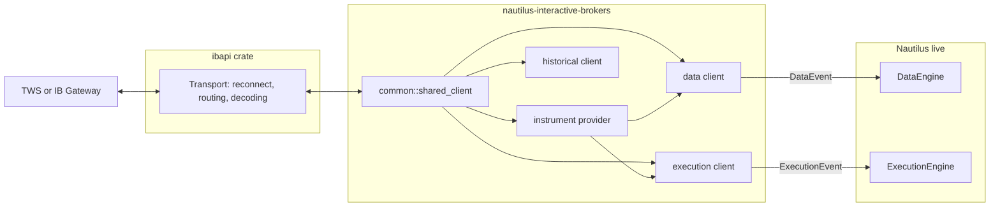
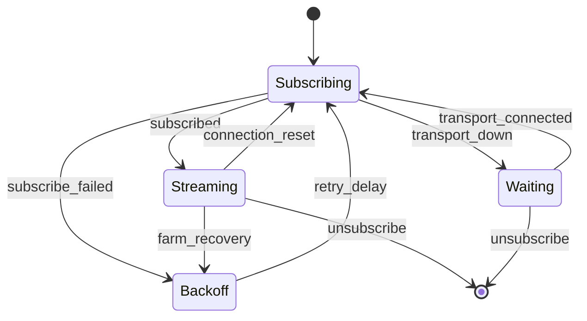
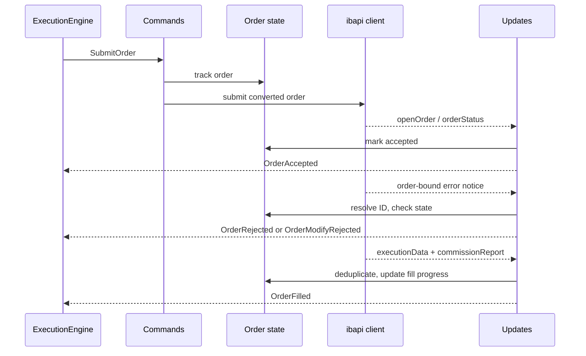
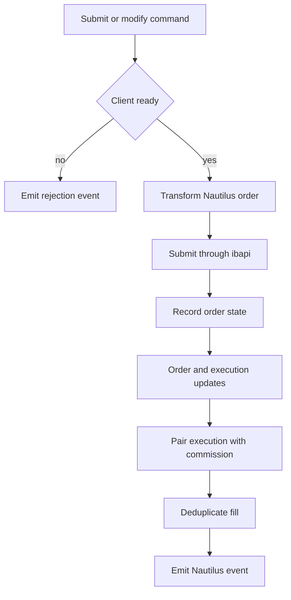
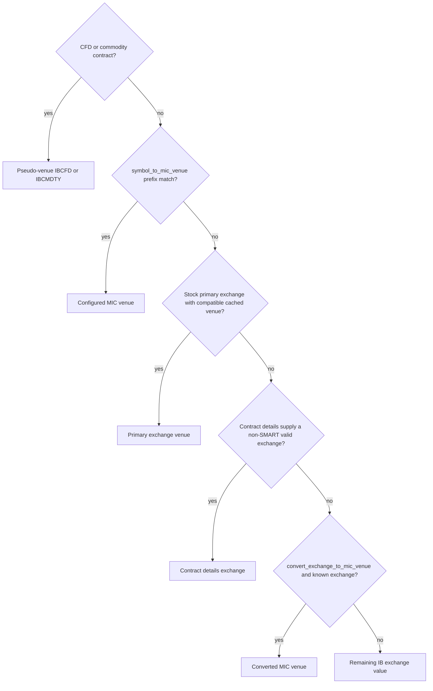

# Interactive Brokers

Interactive Brokers 适配器通过 [TWS API](https://ibkrcampus.com/campus/ibkr-api-page/twsapi-doc/)
把 NautilusTrader 连接到 Trader Workstation（TWS）或 IB Gateway。它提供实时行情、执行、
工具发现、历史请求，以及可选的 Docker 化 IB Gateway 管理。

Python 包已包含该适配器。按[安装指南](./../getting_started/installation.md)安装后，使用
[`examples/live/interactive_brokers`](https://github.com/nautechsystems/nautilus_trader/tree/develop/examples/live/interactive_brokers/)
下的示例。

## 连接 TWS 或 IB Gateway {#connect-to-tws-or-ib-gateway}

启动客户端前，先在 TWS 或 IB Gateway 中启用 socket API 访问。IB 使用以下默认端口：

| 应用        | 模拟交易 | 实盘交易 |
| ----------- | ------------- | ------------ |
| TWS         | `7497`        | `7496`       |
| IB Gateway  | `4002`        | `4001`       |

锁定的 `ibapi 4.0.1` 传输要求 TWS 或 IB Gateway 服务端协议版本**213 或更高**。这里指 API
协议版本，不是应用的发布号。更旧的服务端不受支持，即使其 TCP 端口能接受连接。
[Issue #4796](https://github.com/nautechsystems/nautilus_trader/issues/4796) 记录了 Gateway
10.41 上协议 187 的这一失败。请先升级 TWS 或 IB Gateway 再连接。

服务端完成初始握手后，传输会在发送 `StartApi` 之前拒绝过旧的版本。若旧服务端不回应该握手，
连接超时同样生效。调大超时并不能增加协议支持。

适配器默认 `127.0.0.1:4002`。每个连接到同一 TWS 或 Gateway 会话的进程需要互不相同的 IB API
`client_id`。执行客户端 ID 不能是 `1000` 的整数倍，因为适配器用 `client_id % 1000` 划分订单
ID 分区。

IB 会拒绝小于等于同一 `client_id` 已用过的订单 ID，且跨会话生效（错误 103）。连接时，执行
客户端从 IB 的未结与已完成订单中找出其 `client_id` 用过的最高订单 ID，并从其上开始。只有当
IB 的下一个有效 ID 落在本客户端的分区内时才会采用它；若 IB 的下一个有效 ID 高于整个分区，
IB 会拒绝分区内每个 ID，连接随之失败，此时请换用其他 `client_id`。若已完成订单未在
`request_timeout` 内完整送达，连接同样失败。

IB 只在有限时间内列出已完成订单，因此没有留下任何未结订单的客户端，仍可能从早于该时间窗口
之前用过的 ID 之下启动。

数据客户端与执行客户端可以共用一份 provider 配置：

```python
from nautilus_trader.adapters import interactive_brokers as ib
from nautilus_trader.model import AccountId
from nautilus_trader.model import InstrumentId
from nautilus_trader.model import TraderId


trader_id = TraderId.from_str("TRADER-001")
account_id = AccountId.from_str("IB-DU123456")
provider_config = ib.InteractiveBrokersInstrumentProviderConfig(
    symbology_method=ib.SymbologyMethod.SIMPLIFIED,
    load_ids={InstrumentId.from_str("AAPL.XNAS")},
)

data_config = ib.InteractiveBrokersDataClientConfig(
    host="127.0.0.1",
    port=7497,
    client_id=101,
    market_data_type=ib.MarketDataType.DELAYED_FROZEN,
    instrument_provider=provider_config,
)

exec_config = ib.InteractiveBrokersExecutionClientConfig(
    host="127.0.0.1",
    port=7497,
    client_id=102,
    account_id="DU123456",
    instrument_provider=provider_config,
)

data_factory = ib.InteractiveBrokersDataClientFactory()
exec_factory = ib.InteractiveBrokersExecutionClientFactory()
```

把这些工厂与配置传给 `LiveNode.builder`。
[`connect_with_tws.py`](https://github.com/nautechsystems/nautilus_trader/blob/develop/examples/live/interactive_brokers/connect_with_tws.py)
示例展示了完整的节点搭建。其默认调用离线构建节点；设置 `IB_V2_RUN_NODE=1` 才会连接。

### 行情数据模式 {#market-data-modes}

| 枚举值                          | IB 模式                                      |
| ------------------------------- | -------------------------------------------- |
| `MarketDataType.REALTIME`       | 实时订阅数据。                               |
| `MarketDataType.FROZEN`         | 收盘后最后可用的实时数据。                   |
| `MarketDataType.DELAYED`        | 延迟数据。                                   |
| `MarketDataType.DELAYED_FROZEN` | 最后可用的延迟数据。                         |

哪些模式和工具能返回数据仍由 IB 权限决定。延迟或延迟冻结数据可以支持盘后模拟账户检查，
但不能证明实时 tick 通路可用。

### Docker 化 IB Gateway {#dockerized-ib-gateway}

`DockerizedIBGateway` 管理
[gnzsnz IB Gateway 容器](https://github.com/gnzsnz/ib-gateway-docker)。凭据写在配置里，或
设置 `TWS_USERNAME` 和 `TWS_PASSWORD`：

```python
from nautilus_trader.adapters import interactive_brokers as ib


gateway = ib.DockerizedIBGateway(
    ib.DockerizedIBGatewayConfig(
        trading_mode=ib.TradingMode.PAPER,
        read_only_api=True,
        timeout=300,
    ),
)
gateway.safe_start_blocking()

data_config = ib.InteractiveBrokersDataClientConfig(
    host=gateway.host,
    port=gateway.port,
    client_id=101,
)
```

先启动 gateway，再构造会连接的客户端。容器生命周期由 Python 侧的 `DockerizedIBGateway` 掌管。
客户端配置只接受 `host` 和 `port`。仅当 gateway 必须接受订单时才设置 `read_only_api=False`。
就绪判断使用当前容器会话的登录消息，因此早前会话的残留日志不会误报就绪状态。

## 架构 {#architecture}

适配器只有一份 Rust 实现，通过原生 Rust API 和 PyO3 绑定对外暴露。它在 IB 的 TWS API 与
Nautilus 实时引擎之间做翻译。它不拥有传输层：`ibapi` 负责 TWS socket 协议并重连。适配器
拥有领域映射、订阅生命周期和策略（命令、事件、工具转换、频道重订阅、执行对账）。这条边界
解释了 crate 的布局，也解释了其他适配器常见的 `http` 和 `websocket` 模块为何在这里不存在。



相同 `(host, port, client_id)` 的数据、执行与历史客户端共享一个引用计数的 `ibapi` 连接。
对同一 key 的并发获取会收敛到一个连接，最后一个客户端释放句柄后注册表将其移除。

| 模块         | 职责                                                                          |
| ------------ | --------------------------------------------------------------------------------- |
| `common`     | 约定、枚举、通用价差 ID、符号体系与共享连接。                                     |
| `providers`  | 合约资格确认、链条发现、场所解析与工具缓存。                                      |
| `data`       | 实时订阅、历史请求路由、转换与频道恢复。                                          |
| `execution`  | 命令、订单状态、更新、报告、条件单、价差与对账。                                  |
| `historical` | 独立的工具、K 线与 tick 请求。                                                    |
| `gateway`    | Docker 容器配置、生命周期与就绪检查。                                             |
| `python`     | PyO3 类、枚举、工厂与转换边界。                                                   |
| `config`     | 类型化的数据、执行、provider 与 gateway 配置。                                    |
| `factories`  | `DataClientFactory` 与 `ExecutionClientFactory` 的实现。                          |

与 Nautilus 其余部分的集成面刻意保持很薄。节点 builder 把类型化配置交给每个工厂；工厂构建
客户端，并从引擎缓存（适配器从不写入）为工具 provider 预置数据。

数据客户端向引擎发送类型化数据事件（tick、K 线、金融工具，以及相关的请求-响应），执行
客户端发送类型化执行事件（订单事件、成交与账户状态），二者都经各自的事件通道进入引擎。
这些通道是进入引擎的唯一路径。适配器把工厂与配置抽取器注册进全局 PyO3 注册表，Python 的
`TradingNode` 配置借此到达 Rust 工厂。对账是由执行引擎驱动的拉取接口
（见[对账](#reconciliation)）。

### 重连与重新订阅 {#reconnect-and-resubscribe}

`ibapi` 传输用斐波那契退避重连 socket，尝试次数有上限，达到上限后建立完整会话。TCP 连上
之后出现的瞬时握手或启动错误会消耗一次尝试并重试，而不是终止恢复。重连成功后，通过向每个
未结订阅频道投递连接重置错误来重置它们。尝试耗尽后传输关闭，适配器报告断开连接。

随后每条数据频道等待传输、重新订阅，并带延迟重试失败的重新订阅。一个通用频道驱动器为所有
频道类型掌管这套生命周期策略，因此报价、成交、深度、K 线、Greeks 与指数价之间的恢复行为
不会漂移。行情数据农场（market-data farm）通告走同一频道策略，不把农场故障当作 socket
故障处理。重连后 TWS 会把会话的行情数据类型重置为 realtime。通告监视器在放行恢复的订阅之前，
先恢复配置的冻结或延迟模式。

与订单相关的错误帧作为通告在订单更新频道上到达，携带发起订单或请求的 ID。传输的路由层
投递这些通告而不是解码后的消息变体，因此更新频道跨错误帧保持存活。



报价、成交、深度、K 线、期权 Greeks 与指数价都遵循这一生命周期。深度频道在应用替换订阅的
数据之前会先清空现有订单簿，防止过期档位残留。若订单更新或全局通告频道终止，执行客户端
报告断开连接，而不是带着死频道假装健康。

### 订单标识与撤销 {#order-identity-and-cancellation}

不同 broker 永久 ID 共享同一个客户端订单引用时，它们仍是相互独立的物理订单。适配器把每个
额外订单在自己的客户端订单 ID 下报告：
`DUP-<account length>:<account ID>:PERM-<permanent ID>`。执行引擎因此将其作为外部订单创建。
先应用该工具的外部订单认领，否则归 `EXTERNAL` 策略。未厘清的重复组会阻止修改。

当成交属于适配器未跟踪的订单（包括这类重复订单）时，适配器先扣留成交，再查询该订单的详情
与成交记录，然后把订单连同其真实成交一起上报，使引擎按完整数量创建订单。查询受
`request_timeout` 和至多 3 秒的双重约束，低于实时节点默认的 `position_check_threshold_ms`
（5 秒）。查询失败、返回为空或超时，适配器记录警告并原样转发扣留的成交。

`strategy_only=True`（默认）时，策略为自己的订单逐个发撤销。`strategy_only=False` 时，
cancel-all 在选定账户与方向内按工具全量撤销。带方向过滤的 cancel-all 会跳过 broker 方向
仍未知的重复订单。撤销原始订单时也会考虑其已知在途的重复订单。

适配器只撤销配置 API 客户端拥有的、唯一绑定的路由。有歧义或未绑定的订单保持显式未解决状态，
需要 TWS 绑定或运维介入。单条撤销确认不足以证明整组已完成。

风控检查与执行使用同一账户路由。账户未解析时，风控引擎拒绝订单，而不是跳过账户检查。

### 执行订单流 {#execution-order-flow}

执行客户端按消息方向拆分：出站命令（提交、修改、撤销）、入站场所更新、组合成交组装与账户
频道是共享同一订单状态所有者的独立模块。该所有者在一把锁后面持有客户端-场所 ID 映射、
活动订单和有界的终态订单缓存。终态缓存吸收重连后 IB 的成交重放，因此已完成订单被重发的
成交会被去重而不是重复计入。客户端对每个 Nautilus 订单只做一次转换，应用可选的 IB 标签，
然后通过 `ibapi` 提交。





每个引擎可见的订单事件都源自更新频道上的场所证据：`OrderAccepted` 必须有订单状态或
open-order 消息，绝不基于本地发送成功。与订单绑定的 IB 错误通告针对已跟踪订单解析，并由
订单状态处理。

接受之前，`[200, 399]` 区间的拒绝码发出终态 `OrderRejected`。其他错误码触发一次场所查询：
只有 IB 既不在未结也不在已完成中列出该订单时才拒绝。IB 也会对在途订单发送这类码（10349 会
按订单预设设置有效期）。存在性查询失败、超时或提前结束都会让订单保持在途。

接受之后，通告在有待定修改时发出 `OrderModifyRejected`，有待定撤销时发出
`OrderCancelRejected`；否则触发一次场所存在性查询，而不是终态事件。IB 用相同的错误码报告
修改被拒而原订单继续在途，查询因此可以避免误发终态事件。

警告码 `[2100, 2169]`、警告形式的订单消息（代码 399 且带 `Warning:` 行）以及撤销确认（202）
永远不会使订单终态化。无法路由到单个请求或订单的错误帧由全局通告频道处理。

有歧义的命令结果通过场所查询厘清。它先从成交历史找回错过的成交，再推断任何终态，因此
成交绝不会被误报为撤销。cancel-all 优先使用已跟踪的 TWS 订单 ID 而不是永久 ID，让发起的
客户端无需跨客户端查找即可撤销自己的实盘订单。

## 数据能力 {#data-capabilities}

| Nautilus 数据类型  | 实时订阅 | 历史请求 | 说明                                      |
| ------------------ | -------------- | ------------------ | ----------------------------------------- |
| 金融工具           | 否             | 是                 | 启动加载与显式请求。                      |
| 报价 tick          | 是             | 是                 | 逐笔或批量 `reqMktData`。                 |
| 成交 tick          | 是             | 是                 | 逐笔实时与历史成交。                      |
| K 线               | 是             | 是                 | 外部时间 K 线。                           |
| 订单簿 delta       | 是             | 否                 | 市场深度，恢复时清空订单簿。              |
| 指数价             | 是             | 否                 | 指数价事件。                              |
| 期权 Greeks        | 是             | 否                 | Greeks 加期权未平仓合约量。               |

设置 `batch_quotes=False` 可优先使用逐笔买卖价订阅。逐笔报价不可用时客户端回退到
`reqMktData`；BAG 价差报价始终使用 `reqMktData`。`ignore_quote_tick_size_updates=True`
过滤仅有数量变化的报价事件。

报价缓存把买价、卖价更新组装成完整报价 tick。IB 的无报价哨兵值（价格 `-1` 且无数量，或价格
为零且数量为零）在构建 tick 之前被过滤，并清空受影响的一侧，因此单边行情不会发出过期值，
而是什么都不发。真实的零价与负价照常通过，包括带数量的 `-1` 价格——日历价差经常产生它。

历史数据方面，`HistoricalInteractiveBrokersClient` 接受一个工具 provider 和数据客户端配置。
在 Python 中构造该客户端会立即连接，因此要把它放在与请求相同的显式运行开关之后：

```python
from nautilus_trader.adapters import interactive_brokers as ib


provider_config = ib.InteractiveBrokersInstrumentProviderConfig()
provider = ib.InteractiveBrokersInstrumentProvider(provider_config)
config = ib.InteractiveBrokersDataClientConfig(
    host="127.0.0.1",
    port=7497,
    client_id=180,
    market_data_type=ib.MarketDataType.DELAYED,
    instrument_provider=provider_config,
)

# This constructor connects to TWS or IB Gateway.
client = ib.HistoricalInteractiveBrokersClient(provider, config)
```

| 方法                  | 选择器与控制项                                                                                                                                                 |
| --------------------- | ------------------------------------------------------------------------------------------------------------------------------------------------------------ |
| `request_instruments` | 接受 Nautilus 金融工具 ID、IB 合约字典，或两者兼有。                                                                                                           |
| `request_bars`        | 接受 K 线规格字符串、结束时间，以及开始时间或 IB 时长字符串二选一；用合约或工具 ID 选择工具。                                                                  |
| `request_ticks`       | 接受 `IbHistoricalTickType.TRADES` 或 `BID_ASK`、有界时间区间、合约或工具 ID、常规时段过滤、超时与结果数量上限。                                              |

历史 tick 请求必须同时给出开始和结束时间。它们从结束时间向回翻页，未给上限时默认封顶 10,000
条。它们只发送结束边界，因为 IB 会错误解读带双端的请求。它们对 IB 秒级结束编码重复投递的
边界那一秒做去重。当一秒装下整页、窗口又无法回退时，请求带着警告停止，而不是循环。

某一段失败的历史 K 线请求返回错误，而不是返回中间有无声空洞的序列。IB 数量为零的历史成交
tick 在构建要求数量为正的 Nautilus 类型之前被跳过；其他无效转换仍会使请求失败。

节流、可用历史深度、支持的 K 线大小与常规交易时段过滤都由 IB 控制。对连续期货，IB 会拒绝
显式的 K 线结束时间；适配器省略它并按请求时间请求一个时长分段，因此结果可能落在请求的
起止范围之外。

## 执行能力 {#execution-capabilities}

### 订单类型 {#order-types}

| Nautilus 订单类型      | IB 订单类型           | 价格输入                                |
| ---------------------- | ------------------- | ------------------------------------- |
| `MARKET`               | Market              | 无。                                  |
| `LIMIT`                | Limit               | 限价。                                |
| `MARKET_TO_LIMIT`      | Market to limit     | 无。                                  |
| `STOP_MARKET`          | Stop                | 触发价。                              |
| `STOP_LIMIT`           | Stop limit          | 限价与触发价。                        |
| `MARKET_IF_TOUCHED`    | Market if touched   | 触发价。                              |
| `LIMIT_IF_TOUCHED`     | Limit if touched    | 限价与触发价。                        |
| `TRAILING_STOP_MARKET` | Trailing stop       | 跟踪偏移与可选触发价。                |
| `TRAILING_STOP_LIMIT`  | Trailing stop limit | 限价与跟踪偏移。                      |

适配器映射 `DAY`、`GTC`、`IOC`、`FOK`、`GTD` 和 `AT_THE_OPEN` 有效期。带 `AT_THE_CLOSE` 的
市价或限价订单转换为对应的收盘市价（market-on-close）或收盘限价（limit-on-close）IB 订单。
GTD 订单在 IB 订单中包含其 Nautilus 到期时间。

适配器拒绝 post-only 订单。报价数量仅对反向工具且仅限 BUY 的 `MARKET` 订单有效，IB 按
`cashQty` 为其定数量（其他任何订单类型带现金数量都会被 IB 以错误 10244 拒绝）。跟踪订单支持
价格偏移和基点偏移，IB 收到的是 trailing percent。这些检查，以及适配器无法为 IB 解析或转换
的任何订单，都会在适配器向 IB 发出订单之前以带编码原因的 `OrderDenied` 发出。

### 命令与订单属性 {#commands-and-order-attributes}

| 能力           | 支持    | 说明                                                         |
| -------------- | ------- | ------------------------------------------------------------ |
| 提交订单       | 是      | 单笔订单与通用价差。                                         |
| 提交订单列表   | 是      | 包含括号订单与关联订单。                                     |
| 修改订单       | 是      | 数量、价格、触发价与 IB 参数更新。                           |
| Cancel order      | Yes     | Uses tracked venue order state.                              |
| Cancel all orders | Yes     | Scoped through the execution client.                         |
| Query order       | Yes     | Checks open orders, then executions before inferring cancel. |
| Mass status       | Yes     | Orders, fills, and positions.                                |

Pass `params={"exchange": "IEX"}` to submit, submit-list, or modify commands to override the
cached contract exchange for that command. An omitted or empty value retains the cached exchange.

IB accepts a new trailing stop price only together with a new trailing amount (error 10067). A
modify that sets a trailing stop's trigger must pass `params={"trailing_offset": <offset>}` in the
order's offset units: a price amount for `PRICE` offsets, or basis points for `BASIS_POINTS`
offsets. An offset equal to the current one is rejected by IB, and a trigger modify without the
parameter is rejected before it is sent.

IB-specific order fields use a tag prefixed with `IBOrderTags:` followed by a JSON object. Keys use
the `ibapi` order field names in snake case or lower camel case. Unknown fields fail the order
conversion. The adapter normalizes `order_type`, `tif` or `timeInForce`, `action`, `oca_type`,
`trigger_method`, `origin`, `short_sale_slot`, `volatility_type`,
`reference_price_type`, `rule_80_a`, `open_close`, and `NonGuaranteed`. Active, stop, cancel, manual,
and good-till timestamps use `%Y%m%d %H:%M:%S UTC`.

The adapter tracks each order by its IB order ID and reference, and checks each execution against the order
side. Thus, tags cannot set `orderId`, `clientId`, `permId`, `orderRef`, `totalQuantity`, `cashQty`,
`parentId`, or `transmit`. A tagged `action` must keep the order side: a SELL order may use `SSHORT` or
`SLONG`, but not `BUY`. Such a tag fails the order conversion.

The optional `conditions` array accepts these shapes:

| Condition        | Required fields | Optional fields and defaults                                                |
| ---------------- | --------------- | --------------------------------------------------------------------------- |
| `price`          | None            | `conId=0`, `exchange="SMART"`, `price=0`, `isMore=True`, `triggerMethod=0`. |
| `time`           | None            | `time=""`, `isMore=True`.                                                   |
| `margin`         | None            | `percent=0`, `isMore=True`.                                                 |
| `execution`      | `symbol`        | `secType="STK"`, `exchange="SMART"`.                                        |
| `volume`         | None            | `conId=0`, `exchange="SMART"`, `volume=0`, `isMore=True`.                   |
| `percent_change` | None            | `conId=0`, `exchange="SMART"`, `changePercent=0`, `isMore=True`.            |

Every condition accepts `conjunction="and"` or `"or"`. The default is `"and"`.

### Account state

On connect and on each account query, the execution client reads one `reqAccountSummary`
snapshot for the configured account and maps its tags to typed balances and margins. It then
reads one `reqAccountUpdates` snapshot for the same account and cancels that stream once IB
signals the download end. Every raw tag and key from both snapshots lands in `AccountState.info`
under its IB name, so values IB publishes only on `updateAccountValue` (for example
`PostExpirationExcess` and `PostExpirationMargin`) are readable from Python alongside the summary
tags such as `TotalCashValue`. A key reported once per currency keeps the last value IB sends.

## Reconciliation

Mass status requests query three independent IB sources:

- Open and completed orders produce order status reports.
- Executions paired with commission reports produce fill reports.
- Account positions produce position status reports.

Position updates do not create synthetic order status reports. If IB returns a position without
matching order or fill history, the execution engine can adopt the position from the position report
alone by creating its internal reconciliation fill. This preserves the report boundary: the adapter
reports venue state, while the engine owns inferred state needed to reconcile its cache.

IB's position average cost includes commissions, while a position rebuilt from fills averages their prices.
The adapter replays an instrument's fills, including the leg executions of combo orders, from the quantity
held before the fill window. When the replay passes through flat or flips, the position report carries the
average price of the fills after the last crossing, so a position held across a restart reconciles.

Fills that share a timestamp have no known execution order. If such a group mixes sides or flips, the entry
price stays unknown until a later fill opens from flat or flips.

The replay infers the quantity held before the window, so a missing execution would change the result. The
report carries the replayed entry price only when both conditions hold:

- Every execution of the instrument was parsed.
- The price reproduces IB's average cost.

For this check, the expected average cost is the entry price plus opening commissions per unit for a long. For
a short, it is the entry price minus those commissions. A lot opened by a flip carries no commission.

Otherwise the report keeps IB's average cost, which the engine's reconciliation fill uses.

On connect, the execution client resolves the instrument of every open position in the account. It publishes
any instrument absent from the cache. Thus, a position in a contract outside the provider's `load_ids` still
recovers at startup instead of aborting the node.

For a pending-cancel order missing from the open-orders snapshot, the adapter checks execution
history before emitting a canceled event. Replayed executions are deduplicated after terminal order
state is evicted, including generated spread-leg fills.

Set `track_option_exercise_from_position_update=True` only when position changes should drive option
exercise tracking. This setting does not restore synthetic position-derived order reports.

After a restart, orders a previous session left working return as open external orders. IB's `PreSubmitted`
status, used for example while an order waits for its `goodAfterTime`, maps to `ACCEPTED`. The execution
client resolves each restored order's IB order ID from its `PERM-` venue order ID and tracks it, so later IB
status updates, fills, and cancels reach the owning strategy. Filled orders from the previous session
reconcile from their real executions. The adapter reports no price for market-type orders, so reconciliation
never infers a fill at price 0.

Replies to execution queries (`reqExecutions`) also arrive on IB's order update stream. The adapter
treats only unsolicited execution details there as live fills, so startup and periodic execution
queries do not apply the same fills again.

## Symbology and instruments

`InteractiveBrokersInstrumentProviderConfig.symbology_method` selects one of two public methods:

| Method                       | Use                                                       |
| ---------------------------- | --------------------------------------------------------- |
| `SymbologyMethod.SIMPLIFIED` | Readable IDs for normal instrument lookup and examples.   |
| `SymbologyMethod.RAW`        | IDs that retain the IB security type for explicit lookup. |

One symbology value built from this setting drives every mapping site in the adapter, so data,
execution, and provider paths always resolve identical IDs. Raw symbology
(`AAPL=STK.SMART`) is the lossless escape hatch: it preserves the IB local symbol and security
type for instruments the simplified format rules cannot express, such as complex international
listings.

Futures and futures-option IDs carry the local symbol reported by IB, such as `YMM6.XCBT` and
`YMM6 C45000.XCBT`. The adapter does not rewrite the contract year, so identifiers stay stable
across catalogs and caches.

The symbology method controls symbol conversion. Venue selection is a separate step with this
precedence:

1. CFD and commodity contracts use the adapter pseudo-venues `IBCFD` and `IBCMDTY`.
1. A matching `symbol_to_mic_venue` prefix wins for other security types.
1. Stock primary exchange and a compatible cached venue take precedence over SMART routing.
1. Contract details can supply a non-SMART valid exchange.
1. `convert_exchange_to_mic_venue=True` converts a known exchange to its MIC.
1. The remaining IB exchange value becomes the venue.



The pseudo-venues are part of the adapter namespace under both symbology methods. For example, simplified
symbology can produce `IBDE30.IBCFD` or `XAUUSD.IBCMDTY`, while raw symbology adds the security type to the
symbol. These venues take precedence over `symbol_to_mic_venue` and `convert_exchange_to_mic_venue`. They do
not describe a separate IB routing mechanism.

Use the same provider config for data and execution clients so both resolve identical IDs. Startup
`load_ids` and `load_contracts` are required entries: client initialization fails if a configured
instrument cannot be resolved.

### Provider configuration

| Option                          | Default      | Purpose                                                 |
| ------------------------------- | ------------ | ------------------------------------------------------- |
| `symbology_method`              | `SIMPLIFIED` | Select simplified or raw symbol conversion.             |
| `load_ids`                      | Empty        | Load Nautilus instrument IDs at startup.                |
| `load_contracts`                | Empty        | Load IB contract dictionaries at startup.               |
| `min_expiry_days`               | `None`       | Minimum relative expiry for chain loading.              |
| `max_expiry_days`               | `None`       | Maximum relative expiry for chain loading.              |
| `build_options_chain`           | `None`       | Override option chain construction.                     |
| `build_futures_chain`           | `None`       | Override futures chain construction.                    |
| `cache_validity_days`           | `None`       | Lifetime of persisted instrument data.                  |
| `convert_exchange_to_mic_venue` | `False`      | Convert known IB exchanges to MIC venues.               |
| `symbol_to_mic_venue`           | Empty        | Override venues for matching symbol prefixes.           |
| `filter_sec_types`              | Empty        | Exclude selected IB security types.                     |
| `filter_callable`               | `None`       | Apply a Python callable by fully qualified import path. |
| `cache_path`                    | `None`       | Persist the instrument cache at the selected path.      |

Contract dictionaries use IB field names. Chain bounds are days from the request date:

```python
from nautilus_trader.adapters import interactive_brokers as ib


provider_config = ib.InteractiveBrokersInstrumentProviderConfig(
    load_contracts=[
        {
            "secType": ib.IbSecurityType.STOCK.as_str(),
            "symbol": "SPY",
            "exchange": "SMART",
            "primaryExchange": "ARCA",
            "build_options_chain": True,
            "min_expiry_days": 7,
            "max_expiry_days": 45,
        },
        {
            "secType": ib.IbSecurityType.CONTINUOUS_FUTURE.as_str(),
            "symbol": "ES",
            "exchange": "CME",
            "build_futures_chain": True,
            "min_expiry_days": 30,
            "max_expiry_days": 180,
        },
    ],
)
```

Without a chain flag, `CONTFUT` represents IB's continuous future. IB limits continuous futures to historical
data. They do not support live subscriptions or orders.

### Generic spreads

Build spread IDs with `new_generic_spread_id`. Do not format their leg grammar by hand. All legs must use the
same venue, and the ratio sign selects the IB leg action:

```python
from nautilus_trader.model import new_generic_spread_id


spread_id = new_generic_spread_id(
    [
        (long_leg.id, 1),
        (short_leg.id, -1),
    ],
)
```

Load the leg instruments before requesting the spread. The provider qualifies each leg, constructs
the IB BAG contract, and caches the resulting spread instrument before data subscription or order
submission.

Spread executions come back from IB as a combo-level fill for the spread order and one execution per leg. Each
leg execution becomes an `OrderFilled` event on the leg instrument under the spread order's strategy. It has a
`-LEG-` client order ID. The execution engine applies it to the leg position without an order of its own. IB
sends commission reports for the leg executions only, so the combo-level fill carries zero commission.

On connect, the execution client loads and publishes the spread and leg instruments of every open or completed
combo order, so startup reconciliation restores those orders even when the node does not load the spread
itself. Startup fill reports hold each combo order's combo-level fills. Its leg executions are left out, and
the leg positions reconcile from IB's position reports.

## Configuration reference

### Data client

| Option                           | Default                   | Purpose                                                                     |
| -------------------------------- | ------------------------- | --------------------------------------------------------------------------- |
| `host`                           | `127.0.0.1`               | TWS or IB Gateway host.                                                     |
| `port`                           | `4002`                    | TWS or IB Gateway socket port.                                              |
| `client_id`                      | `1`                       | IB API client ID.                                                           |
| `use_regular_trading_hours`      | `True`                    | Restrict requests to regular trading hours.                                 |
| `market_data_type`               | `MarketDataType.REALTIME` | Select real-time, frozen, delayed, or delayed-frozen data.                  |
| `ignore_quote_tick_size_updates` | `False`                   | Filter quote changes that update only size.                                 |
| `connection_timeout`             | `300` seconds             | Set the socket connection timeout.                                          |
| `request_timeout`                | `60` seconds              | Set the IB request timeout.                                                 |
| `handle_revised_bars`            | `False`                   | Publish every revision of an open bar instead of each completed bar once.   |
| `batch_quotes`                   | `True`                    | Prefer `reqMktData` for quote subscriptions.                                |
| `all_last_trades`                | `True`                    | Include AllLast trades; set `False` to request Last trades only.            |
| `subscription_idle_timeout_secs` | `None`                    | Emit a custom-data event after this many seconds without subscription data. |
| `instrument_provider`            | Default provider config   | Configure contract and instrument loading.                                  |
| `dockerized_gateway`             | `None`                    | Reserved and rejected; start the gateway separately.                        |

With `handle_revised_bars=False`, a bar IB keeps up to date is published once it completes. IB
revises the open bar every 5 seconds and sends its final values about half a second after the bar
closes, so the bar is published when that update arrives. If none arrives, because the last 5
seconds had no trades, the bar is published 2 seconds after its close or on the next bar's first
update, whichever comes first.

When `subscription_idle_timeout_secs` is set, each live subscription emits
`InteractiveBrokersSubscriptionIdle` once per interval of inactivity. A new market-data update rearms the
notification. Subscribe to `DataType("InteractiveBrokersSubscriptionIdle")` through the message bus to receive
these events in `on_data`. Each event identifies the data client, instrument, subscription, timeout, and last
local data receipt time. A quiet instrument or closed market can also trigger an event. Inactivity alone does
not restart a subscription.

### Execution client

| Option                                       | Default                 | Purpose                                              |
| -------------------------------------------- | ----------------------- | ---------------------------------------------------- |
| `host`                                       | `127.0.0.1`             | TWS or IB Gateway host.                              |
| `port`                                       | `4002`                  | TWS or IB Gateway socket port.                       |
| `client_id`                                  | `1`                     | IB API client ID.                                    |
| `account_id`                                 | `None`                  | Raw IB account code such as `DU123456`.              |
| `connection_timeout`                         | `300` seconds           | Set the socket connection timeout.                   |
| `request_timeout`                            | `60` seconds            | Set the IB request timeout.                          |
| `fetch_all_open_orders`                      | `False`                 | Request all open orders visible to the session.      |
| `track_option_exercise_from_position_update` | `False`                 | Track option exercise through position updates.      |
| `instrument_provider`                        | Default provider config | Configure contract and instrument loading.           |
| `dockerized_gateway`                         | `None`                  | Reserved and rejected; start the gateway separately. |

### Dockerized gateway

| Option            | Default                            | Purpose                                                              |
| ----------------- | ---------------------------------- | -------------------------------------------------------------------- |
| `username`        | `TWS_USERNAME`                     | Set the IB login username.                                           |
| `password`        | `TWS_PASSWORD`                     | Set the IB login password; debug output and serialization redact it. |
| `trading_mode`    | `TradingMode.PAPER`                | Select paper or live login and port mapping.                         |
| `read_only_api`   | `True`                             | Disable order entry through the Gateway API.                         |
| `timeout`         | `300` seconds                      | Bound startup readiness; valid values are `1` through `3600`.        |
| `container_image` | `ghcr.io/gnzsnz/ib-gateway:stable` | Select the container image reference.                                |
| `vnc_port`        | `None`                             | Expose VNC on a port from `5900` through `5999`; `None` disables it. |

`DockerizedIBGateway` exposes asynchronous and blocking `start`, `safe_start`, and `stop` methods,
plus `container_status`. The safe start variants reuse a ready container and replace an unhealthy
one.

## Python enum reference

All public Python enum names use `SCREAMING_SNAKE_CASE`. IB conversion enums expose `as_str()` or
`as_i32()` when callers need the corresponding wire value.

### Connection, contracts, and instruments

| Enum                                | Purpose and key members                                                                                                                                |
| ----------------------------------- | ------------------------------------------------------------------------------------------------------------------------------------------------------ |
| `ContainerStatus`                   | Gateway lifecycle: `NO_CONTAINER`, `CONTAINER_CREATED`, `CONTAINER_STARTING`, `CONTAINER_STOPPED`, `NOT_LOGGED_IN`, `READY`, or `UNKNOWN`.             |
| `MarketDataType`                    | Subscription mode: `REALTIME`, `FROZEN`, `DELAYED`, or `DELAYED_FROZEN`.                                                                               |
| `SymbologyMethod`                   | Instrument ID mapping: `SIMPLIFIED` or `RAW`.                                                                                                          |
| `TradingMode`                       | Gateway login mode: `PAPER` or `LIVE`.                                                                                                                 |
| `IbSecurityType`                    | IB contract types: stock, option, future, continuous future, index, futures option, FX, spread, warrant, bond, commodity, news, fund, crypto, and CFD. |
| `IbOptionRight`                     | Option side: `CALL` or `PUT`.                                                                                                                          |
| `IbBondIdentifierKind`              | Bond identifier: `CUSIP` or `ISIN`.                                                                                                                    |
| `IbFundAssetType`                   | Fund asset classification: none, other, money market, fixed income, multi-asset, equity, sector, guaranteed, or alternative.                           |
| `IbFundDistributionPolicyIndicator` | Fund distribution policy: `NONE`, `ACCUMULATION_FUND`, or `INCOME_FUND`.                                                                               |

### Market and historical data

| Enum                     | Purpose and key members                                                                                                 |
| ------------------------ | ----------------------------------------------------------------------------------------------------------------------- |
| `IbHistoricalBarSize`    | Historical bar intervals from one second through one month.                                                             |
| `IbHistoricalTickType`   | Historical ticks: `TRADES` or `BID_ASK`.                                                                                |
| `IbHistoricalWhatToShow` | Historical source such as trades, midpoint, bid, ask, volatility, fee rate, schedule, or adjusted last.                 |
| `IbRealtimeBarSize`      | IB real-time bar size; IB supports `SEC5`.                                                                              |
| `IbRealtimeWhatToShow`   | Real-time bar source: `TRADES`, `MIDPOINT`, `BID`, or `ASK`.                                                            |
| `IbTradingHours`         | Regular or extended trading hours.                                                                                      |
| `IbTickType`             | The full IB numeric tick-field set, including live and delayed prices, sizes, option values, yields, NAVs, and volumes. |

### Orders and conditions

| Enum                     | Purpose and key members                                                                                                  |
| ------------------------ | ------------------------------------------------------------------------------------------------------------------------ |
| `IbAction`               | Order action and execution side: buy, sell, bought, sold, sell short, or sell long.                                      |
| `IbOrderType`            | Native IB order types used by conversion and `IBOrderTags`; direct Nautilus support is limited to the order table above. |
| `IbOrderStatus`          | Native lifecycle status from API pending through submitted, pending cancel, canceled, filled, or inactive.               |
| `IbTimeInForce`          | IB time in force values used for order conversion.                                                                       |
| `IbBuilderTimeInForce`   | Time in force values accepted by IB order builders, including good-till-crossing and opening auction.                    |
| `IbOrderOpenClose`       | Open or close designation.                                                                                               |
| `IbOrderOrigin`          | Customer or firm origin.                                                                                                 |
| `IbShortSaleSlot`        | No short-sale slot, broker, or third party.                                                                              |
| `IbAuctionStrategy`      | Match, improvement, or transparent auction strategy.                                                                     |
| `IbAuctionType`          | Opening, closing, or volatility auction.                                                                                 |
| `IbReferencePriceType`   | Average of NBBO or NBBO.                                                                                                 |
| `IbVolatilityType`       | Daily or annual volatility.                                                                                              |
| `IbRule80A`              | IB Rule 80A account and agency classifications.                                                                          |
| `IbOcaType`              | No OCA, cancel with block, reduce with block, or reduce without block.                                                   |
| `IbTriggerMethod`        | Default, double bid/ask, last, double last, bid/ask, last or bid/ask, or midpoint.                                       |
| `IbLiquidity`            | None, added, removed, routed out, or explicitly unknown liquidity.                                                       |
| `IbComboLegOpenClose`    | Same, open, close, or unknown combo-leg designation.                                                                     |
| `IbLegAction`            | Buy or sell combo-leg action.                                                                                            |
| `IbConditionKind`        | Price, time, margin, execution, volume, or percent-change condition.                                                     |
| `IbConditionConjunction` | `AND` or `OR`.                                                                                                           |
| `IbExerciseAction`       | Exercise or lapse an option.                                                                                             |
| `IbTwapStrategyType`     | Marketable, matching midpoint, matching same side, or matching last.                                                     |
| `IbRiskAversion`         | Get done, aggressive, neutral, or passive.                                                                               |
| `IbArticleType`          | Text or binary news article.                                                                                             |

## Test the adapter

For market data, `examples/live/interactive_brokers/data_tester.py` streams the configured
instrument with the built-in `DataTester` actor, and the Rust equivalent runs with
`cargo run --example ib-data-tester --package nautilus-interactive-brokers --features examples`.
Both connect to a locally running TWS or IB Gateway and place no orders.

The Python examples construct offline by default. Their run flags separate connection from order
submission. The Rust execution tester uses the same boundary:

```bash
# Construct the tester without connecting.
cargo run --example ib-exec-tester \
  --package nautilus-interactive-brokers \
  --features examples

# Connect in dry-run mode. This can subscribe but cannot submit tester orders.
NAUTILUS_IB_ACCOUNT_ID=DU123456 \
NAUTILUS_IB_RUN=1 \
cargo run --example ib-exec-tester \
  --package nautilus-interactive-brokers \
  --features examples

# Submit paper-account stop orders only after the second opt-in.
NAUTILUS_IB_ACCOUNT_ID=DU123456 \
NAUTILUS_IB_RUN=1 \
NAUTILUS_IB_LIVE_ORDERS=1 \
NAUTILUS_IB_EXEC_PROFILE=stop \
cargo run --example ib-exec-tester \
  --package nautilus-interactive-brokers \
  --features examples
```

Available execution profiles are `lifecycle`, `cancel-modify`, `rejection`, `options`, `stop`,
`stop-limit`, `trailing`, `bracket`, and `unsupported-flags`. Run live tests only against an account
and instruments intended for the selected profile.

## Troubleshooting

- Confirm TWS or IB Gateway is running, logged in, and configured for socket API access.
- Confirm the port matches the application and trading mode.
- Confirm no other process uses the same IB API client ID.
- Confirm the account has permission for the requested market data type and instrument.
- Run the ignored connection smoke explicitly when a paper session is available:
  `cargo test -p nautilus-interactive-brokers --test connection -- --ignored`.

For IB error codes, pacing, and connection settings, see the
[official TWS API reference](https://ibkrcampus.com/campus/ibkr-api-page/twsapi-doc/).
