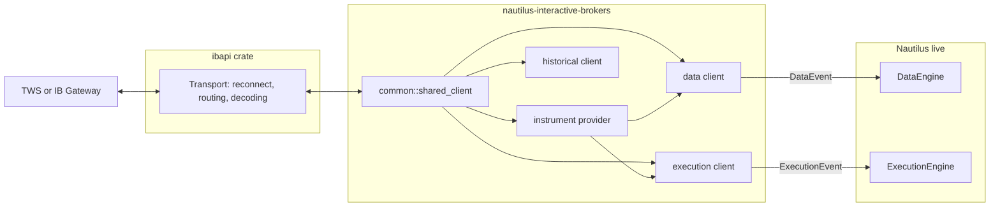
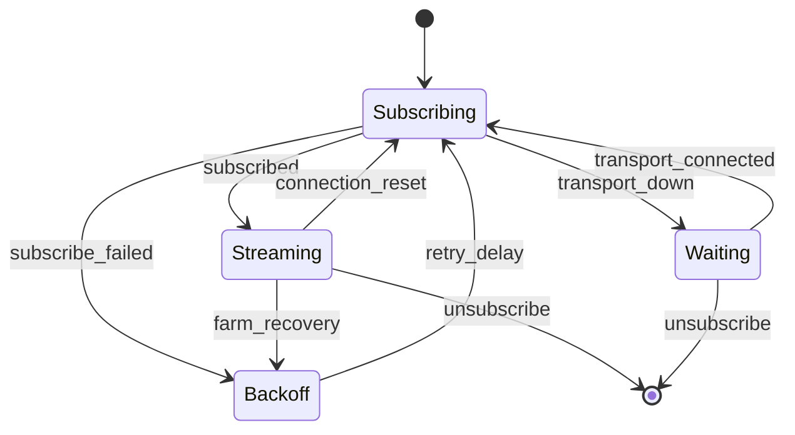
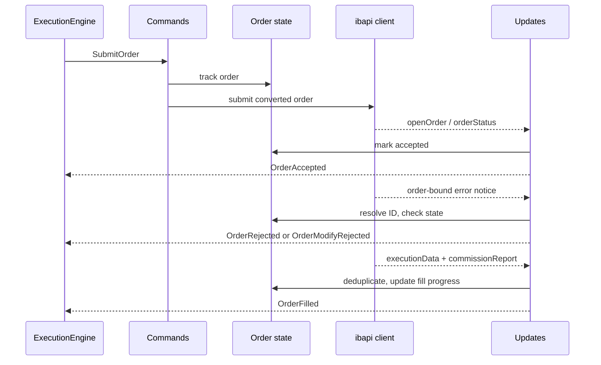
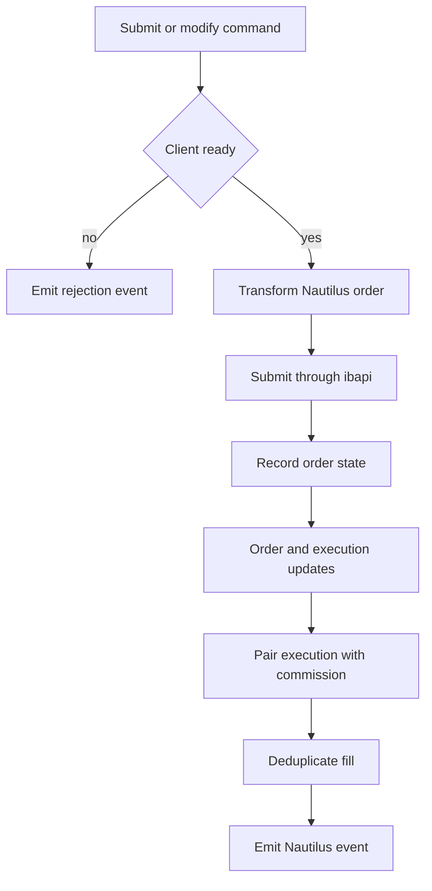
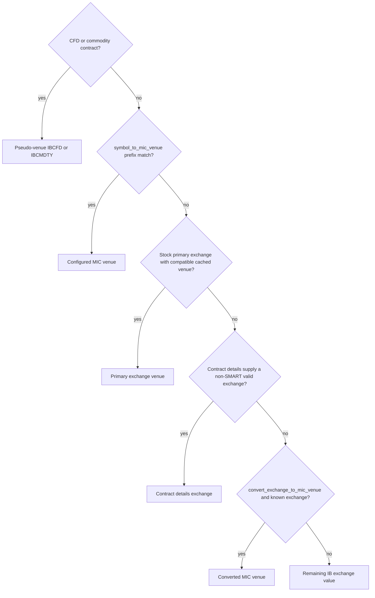

# Interactive Brokers

Interactive Brokers 适配器通过 [TWS API](https://ibkrcampus.com/campus/ibkr-api-page/twsapi-doc/)
把 NautilusTrader 连接到 Trader Workstation（TWS）或 IB Gateway。它提供实时行情、执行、
工具发现、历史请求，以及可选的 Docker 化 IB Gateway 管理。

Python 包已包含该适配器。按[安装指南](./../getting_started/installation.md)安装后，使用
[`examples/live/interactive_brokers`](https://github.com/nautechsystems/nautilus_trader/tree/develop/examples/live/interactive_brokers/)
下的示例。

## 连接 TWS 或 IB Gateway {#connect-to-tws-or-ib-gateway}

启动客户端前，先在 TWS 或 IB Gateway 中启用 socket API 访问。IB 使用以下默认端口：

| 应用        | 模拟交易 | 实盘交易 |
| ----------- | ------------- | ------------ |
| TWS         | `7497`        | `7496`       |
| IB Gateway  | `4002`        | `4001`       |

锁定的 `ibapi 4.0.1` 传输要求 TWS 或 IB Gateway 服务端协议版本**213 或更高**。这里指 API
协议版本，不是应用的发布号。更旧的服务端不受支持，即使其 TCP 端口能接受连接。
[Issue #4796](https://github.com/nautechsystems/nautilus_trader/issues/4796) 记录了 Gateway
10.41 上协议 187 的这一失败。请先升级 TWS 或 IB Gateway 再连接。

服务端完成初始握手后，传输会在发送 `StartApi` 之前拒绝过旧的版本。若旧服务端不回应该握手，
连接超时同样生效。调大超时并不能增加协议支持。

适配器默认 `127.0.0.1:4002`。每个连接到同一 TWS 或 Gateway 会话的进程需要互不相同的 IB API
`client_id`。执行客户端 ID 不能是 `1000` 的整数倍，因为适配器用 `client_id % 1000` 划分订单
ID 分区。

IB 会拒绝小于等于同一 `client_id` 已用过的订单 ID，且跨会话生效（错误 103）。连接时，执行
客户端从 IB 的未结与已完成订单中找出其 `client_id` 用过的最高订单 ID，并从其上开始。只有当
IB 的下一个有效 ID 落在本客户端的分区内时才会采用它；若 IB 的下一个有效 ID 高于整个分区，
IB 会拒绝分区内每个 ID，连接随之失败，此时请换用其他 `client_id`。若已完成订单未在
`request_timeout` 内完整送达，连接同样失败。

IB 只在有限时间内列出已完成订单，因此没有留下任何未结订单的客户端，仍可能从早于该时间窗口
之前用过的 ID 之下启动。

数据客户端与执行客户端可以共用一份 provider 配置：

```python
from nautilus_trader.adapters import interactive_brokers as ib
from nautilus_trader.model import AccountId
from nautilus_trader.model import InstrumentId
from nautilus_trader.model import TraderId


trader_id = TraderId.from_str("TRADER-001")
account_id = AccountId.from_str("IB-DU123456")
provider_config = ib.InteractiveBrokersInstrumentProviderConfig(
    symbology_method=ib.SymbologyMethod.SIMPLIFIED,
    load_ids={InstrumentId.from_str("AAPL.XNAS")},
)

data_config = ib.InteractiveBrokersDataClientConfig(
    host="127.0.0.1",
    port=7497,
    client_id=101,
    market_data_type=ib.MarketDataType.DELAYED_FROZEN,
    instrument_provider=provider_config,
)

exec_config = ib.InteractiveBrokersExecutionClientConfig(
    host="127.0.0.1",
    port=7497,
    client_id=102,
    account_id="DU123456",
    instrument_provider=provider_config,
)

data_factory = ib.InteractiveBrokersDataClientFactory()
exec_factory = ib.InteractiveBrokersExecutionClientFactory()
```

把这些工厂与配置传给 `LiveNode.builder`。
[`connect_with_tws.py`](https://github.com/nautechsystems/nautilus_trader/blob/develop/examples/live/interactive_brokers/connect_with_tws.py)
示例展示了完整的节点搭建。其默认调用离线构建节点；设置 `IB_V2_RUN_NODE=1` 才会连接。

### 行情数据模式 {#market-data-modes}

| 枚举值                          | IB 模式                                      |
| ------------------------------- | -------------------------------------------- |
| `MarketDataType.REALTIME`       | 实时订阅数据。                               |
| `MarketDataType.FROZEN`         | 收盘后最后可用的实时数据。                   |
| `MarketDataType.DELAYED`        | 延迟数据。                                   |
| `MarketDataType.DELAYED_FROZEN` | 最后可用的延迟数据。                         |

哪些模式和工具能返回数据仍由 IB 权限决定。延迟或延迟冻结数据可以支持盘后模拟账户检查，
但不能证明实时 tick 通路可用。

### Docker 化 IB Gateway {#dockerized-ib-gateway}

`DockerizedIBGateway` 管理
[gnzsnz IB Gateway 容器](https://github.com/gnzsnz/ib-gateway-docker)。凭据写在配置里，或
设置 `TWS_USERNAME` 和 `TWS_PASSWORD`：

```python
from nautilus_trader.adapters import interactive_brokers as ib


gateway = ib.DockerizedIBGateway(
    ib.DockerizedIBGatewayConfig(
        trading_mode=ib.TradingMode.PAPER,
        read_only_api=True,
        timeout=300,
    ),
)
gateway.safe_start_blocking()

data_config = ib.InteractiveBrokersDataClientConfig(
    host=gateway.host,
    port=gateway.port,
    client_id=101,
)
```

先启动 gateway，再构造会连接的客户端。容器生命周期由 Python 侧的 `DockerizedIBGateway` 掌管。
客户端配置只接受 `host` 和 `port`。仅当 gateway 必须接受订单时才设置 `read_only_api=False`。
就绪判断使用当前容器会话的登录消息，因此早前会话的残留日志不会误报就绪状态。

## 架构 {#architecture}

适配器只有一份 Rust 实现，通过原生 Rust API 和 PyO3 绑定对外暴露。它在 IB 的 TWS API 与
Nautilus 实时引擎之间做翻译。它不拥有传输层：`ibapi` 负责 TWS socket 协议并重连。适配器
拥有领域映射、订阅生命周期和策略（命令、事件、工具转换、频道重订阅、执行对账）。这条边界
解释了 crate 的布局，也解释了其他适配器常见的 `http` 和 `websocket` 模块为何在这里不存在。



相同 `(host, port, client_id)` 的数据、执行与历史客户端共享一个引用计数的 `ibapi` 连接。
对同一 key 的并发获取会收敛到一个连接，最后一个客户端释放句柄后注册表将其移除。

| 模块         | 职责                                                                          |
| ------------ | --------------------------------------------------------------------------------- |
| `common`     | 约定、枚举、通用价差 ID、符号体系与共享连接。                                     |
| `providers`  | 合约资格确认、链条发现、场所解析与工具缓存。                                      |
| `data`       | 实时订阅、历史请求路由、转换与频道恢复。                                          |
| `execution`  | 命令、订单状态、更新、报告、条件单、价差与对账。                                  |
| `historical` | 独立的工具、K 线与 tick 请求。                                                    |
| `gateway`    | Docker 容器配置、生命周期与就绪检查。                                             |
| `python`     | PyO3 类、枚举、工厂与转换边界。                                                   |
| `config`     | 类型化的数据、执行、provider 与 gateway 配置。                                    |
| `factories`  | `DataClientFactory` 与 `ExecutionClientFactory` 的实现。                          |

与 Nautilus 其余部分的集成面刻意保持很薄。节点 builder 把类型化配置交给每个工厂；工厂构建
客户端，并从引擎缓存（适配器从不写入）为工具 provider 预置数据。

数据客户端向引擎发送类型化数据事件（tick、K 线、金融工具，以及相关的请求-响应），执行
客户端发送类型化执行事件（订单事件、成交与账户状态），二者都经各自的事件通道进入引擎。
这些通道是进入引擎的唯一路径。适配器把工厂与配置抽取器注册进全局 PyO3 注册表，Python 的
`TradingNode` 配置借此到达 Rust 工厂。对账是由执行引擎驱动的拉取接口
（见[对账](#reconciliation)）。

### 重连与重新订阅 {#reconnect-and-resubscribe}

`ibapi` 传输用斐波那契退避重连 socket，尝试次数有上限，达到上限后建立完整会话。TCP 连上
之后出现的瞬时握手或启动错误会消耗一次尝试并重试，而不是终止恢复。重连成功后，通过向每个
未结订阅频道投递连接重置错误来重置它们。尝试耗尽后传输关闭，适配器报告断开连接。

随后每条数据频道等待传输、重新订阅，并带延迟重试失败的重新订阅。一个通用频道驱动器为所有
频道类型掌管这套生命周期策略，因此报价、成交、深度、K 线、Greeks 与指数价之间的恢复行为
不会漂移。行情数据农场（market-data farm）通告走同一频道策略，不把农场故障当作 socket
故障处理。重连后 TWS 会把会话的行情数据类型重置为 realtime。通告监视器在放行恢复的订阅之前，
先恢复配置的冻结或延迟模式。

与订单相关的错误帧作为通告在订单更新频道上到达，携带发起订单或请求的 ID。传输的路由层
投递这些通告而不是解码后的消息变体，因此更新频道跨错误帧保持存活。



报价、成交、深度、K 线、期权 Greeks 与指数价都遵循这一生命周期。深度频道在应用替换订阅的
数据之前会先清空现有订单簿，防止过期档位残留。若订单更新或全局通告频道终止，执行客户端
报告断开连接，而不是带着死频道假装健康。

### 订单标识与撤销 {#order-identity-and-cancellation}

不同 broker 永久 ID 共享同一个客户端订单引用时，它们仍是相互独立的物理订单。适配器把每个
额外订单在自己的客户端订单 ID 下报告：
`DUP-<account length>:<account ID>:PERM-<permanent ID>`。执行引擎因此将其作为外部订单创建。
先应用该工具的外部订单认领，否则归 `EXTERNAL` 策略。未厘清的重复组会阻止修改。

当成交属于适配器未跟踪的订单（包括这类重复订单）时，适配器先扣留成交，再查询该订单的详情
与成交记录，然后把订单连同其真实成交一起上报，使引擎按完整数量创建订单。查询受
`request_timeout` 和至多 3 秒的双重约束，低于实时节点默认的 `position_check_threshold_ms`
（5 秒）。查询失败、返回为空或超时，适配器记录警告并原样转发扣留的成交。

`strategy_only=True`（默认）时，策略为自己的订单逐个发撤销。`strategy_only=False` 时，
cancel-all 在选定账户与方向内按工具全量撤销。带方向过滤的 cancel-all 会跳过 broker 方向
仍未知的重复订单。撤销原始订单时也会考虑其已知在途的重复订单。

适配器只撤销配置 API 客户端拥有的、唯一绑定的路由。有歧义或未绑定的订单保持显式未解决状态，
需要 TWS 绑定或运维介入。单条撤销确认不足以证明整组已完成。

风控检查与执行使用同一账户路由。账户未解析时，风控引擎拒绝订单，而不是跳过账户检查。

### 执行订单流 {#execution-order-flow}

执行客户端按消息方向拆分：出站命令（提交、修改、撤销）、入站场所更新、组合成交组装与账户
频道是共享同一订单状态所有者的独立模块。该所有者在一把锁后面持有客户端-场所 ID 映射、
活动订单和有界的终态订单缓存。终态缓存吸收重连后 IB 的成交重放，因此已完成订单被重发的
成交会被去重而不是重复计入。客户端对每个 Nautilus 订单只做一次转换，应用可选的 IB 标签，
然后通过 `ibapi` 提交。





每个引擎可见的订单事件都源自更新频道上的场所证据：`OrderAccepted` 必须有订单状态或
open-order 消息，绝不基于本地发送成功。与订单绑定的 IB 错误通告针对已跟踪订单解析，并由
订单状态处理。

接受之前，`[200, 399]` 区间的拒绝码发出终态 `OrderRejected`。其他错误码触发一次场所查询：
只有 IB 既不在未结也不在已完成中列出该订单时才拒绝。IB 也会对在途订单发送这类码（10349 会
按订单预设设置有效期）。存在性查询失败、超时或提前结束都会让订单保持在途。

接受之后，通告在有待定修改时发出 `OrderModifyRejected`，有待定撤销时发出
`OrderCancelRejected`；否则触发一次场所存在性查询，而不是终态事件。IB 用相同的错误码报告
修改被拒而原订单继续在途，查询因此可以避免误发终态事件。

警告码 `[2100, 2169]`、警告形式的订单消息（代码 399 且带 `Warning:` 行）以及撤销确认（202）
永远不会使订单终态化。无法路由到单个请求或订单的错误帧由全局通告频道处理。

有歧义的命令结果通过场所查询厘清。它先从成交历史找回错过的成交，再推断任何终态，因此
成交绝不会被误报为撤销。cancel-all 优先使用已跟踪的 TWS 订单 ID 而不是永久 ID，让发起的
客户端无需跨客户端查找即可撤销自己的实盘订单。

## 数据能力 {#data-capabilities}

| Nautilus 数据类型  | 实时订阅 | 历史请求 | 说明                                      |
| ------------------ | -------------- | ------------------ | ----------------------------------------- |
| 金融工具           | 否             | 是                 | 启动加载与显式请求。                      |
| 报价 tick          | 是             | 是                 | 逐笔或批量 `reqMktData`。                 |
| 成交 tick          | 是             | 是                 | 逐笔实时与历史成交。                      |
| K 线               | 是             | 是                 | 外部时间 K 线。                           |
| 订单簿 delta       | 是             | 否                 | 市场深度，恢复时清空订单簿。              |
| 指数价             | 是             | 否                 | 指数价事件。                              |
| 期权 Greeks        | 是             | 否                 | Greeks 加期权未平仓合约量。               |

设置 `batch_quotes=False` 可优先使用逐笔买卖价订阅。逐笔报价不可用时客户端回退到
`reqMktData`；BAG 价差报价始终使用 `reqMktData`。`ignore_quote_tick_size_updates=True`
过滤仅有数量变化的报价事件。

报价缓存把买价、卖价更新组装成完整报价 tick。IB 的无报价哨兵值（价格 `-1` 且无数量，或价格
为零且数量为零）在构建 tick 之前被过滤，并清空受影响的一侧，因此单边行情不会发出过期值，
而是什么都不发。真实的零价与负价照常通过，包括带数量的 `-1` 价格——日历价差经常产生它。

历史数据方面，`HistoricalInteractiveBrokersClient` 接受一个工具 provider 和数据客户端配置。
在 Python 中构造该客户端会立即连接，因此要把它放在与请求相同的显式运行开关之后：

```python
from nautilus_trader.adapters import interactive_brokers as ib


provider_config = ib.InteractiveBrokersInstrumentProviderConfig()
provider = ib.InteractiveBrokersInstrumentProvider(provider_config)
config = ib.InteractiveBrokersDataClientConfig(
    host="127.0.0.1",
    port=7497,
    client_id=180,
    market_data_type=ib.MarketDataType.DELAYED,
    instrument_provider=provider_config,
)

# This constructor connects to TWS or IB Gateway.
client = ib.HistoricalInteractiveBrokersClient(provider, config)
```

| 方法                  | 选择器与控制项                                                                                                                                                 |
| --------------------- | ------------------------------------------------------------------------------------------------------------------------------------------------------------ |
| `request_instruments` | 接受 Nautilus 金融工具 ID、IB 合约字典，或两者兼有。                                                                                                           |
| `request_bars`        | 接受 K 线规格字符串、结束时间，以及开始时间或 IB 时长字符串二选一；用合约或工具 ID 选择工具。                                                                  |
| `request_ticks`       | 接受 `IbHistoricalTickType.TRADES` 或 `BID_ASK`、有界时间区间、合约或工具 ID、常规时段过滤、超时与结果数量上限。                                              |

历史 tick 请求必须同时给出开始和结束时间。它们从结束时间向回翻页，未给上限时默认封顶 10,000
条。它们只发送结束边界，因为 IB 会错误解读带双端的请求。它们对 IB 秒级结束编码重复投递的
边界那一秒做去重。当一秒装下整页、窗口又无法回退时，请求带着警告停止，而不是循环。

某一段失败的历史 K 线请求返回错误，而不是返回中间有无声空洞的序列。IB 数量为零的历史成交
tick 在构建要求数量为正的 Nautilus 类型之前被跳过；其他无效转换仍会使请求失败。

节流、可用历史深度、支持的 K 线大小与常规交易时段过滤都由 IB 控制。对连续期货，IB 会拒绝
显式的 K 线结束时间；适配器省略它并按请求时间请求一个时长分段，因此结果可能落在请求的
起止范围之外。

## 执行能力 {#execution-capabilities}

### 订单类型 {#order-types}

| Nautilus 订单类型      | IB 订单类型           | 价格输入                                |
| ---------------------- | ------------------- | ------------------------------------- |
| `MARKET`               | Market              | 无。                                  |
| `LIMIT`                | Limit               | 限价。                                |
| `MARKET_TO_LIMIT`      | Market to limit     | 无。                                  |
| `STOP_MARKET`          | Stop                | 触发价。                              |
| `STOP_LIMIT`           | Stop limit          | 限价与触发价。                        |
| `MARKET_IF_TOUCHED`    | Market if touched   | 触发价。                              |
| `LIMIT_IF_TOUCHED`     | Limit if touched    | 限价与触发价。                        |
| `TRAILING_STOP_MARKET` | Trailing stop       | 跟踪偏移与可选触发价。                |
| `TRAILING_STOP_LIMIT`  | Trailing stop limit | 限价与跟踪偏移。                      |

适配器映射 `DAY`、`GTC`、`IOC`、`FOK`、`GTD` 和 `AT_THE_OPEN` 有效期。带 `AT_THE_CLOSE` 的
市价或限价订单转换为对应的收盘市价（market-on-close）或收盘限价（limit-on-close）IB 订单。
GTD 订单在 IB 订单中包含其 Nautilus 到期时间。

适配器拒绝 post-only 订单。报价数量仅对反向工具且仅限 BUY 的 `MARKET` 订单有效，IB 按
`cashQty` 为其定数量（其他任何订单类型带现金数量都会被 IB 以错误 10244 拒绝）。跟踪订单支持
价格偏移和基点偏移，IB 收到的是 trailing percent。这些检查，以及适配器无法为 IB 解析或转换
的任何订单，都会在适配器向 IB 发出订单之前以带编码原因的 `OrderDenied` 发出。

### 命令与订单属性 {#commands-and-order-attributes}

| 能力           | 支持    | 说明                                                         |
| -------------- | ------- | ------------------------------------------------------------ |
| 提交订单       | 是      | 单笔订单与通用价差。                                         |
| 提交订单列表   | 是      | 包含括号订单与关联订单。                                     |
| 修改订单       | 是      | 数量、价格、触发价与 IB 参数更新。                           |
| 撤销订单       | 是      | 使用已跟踪的场所订单状态。                                   |
| 撤销全部订单   | 是      | 通过执行客户端限定范围。                                     |
| 查询订单       | 是      | 先查未结订单，再查成交，然后才推断撤销。                     |
| 批量状态       | 是      | 订单、成交与持仓。                                           |

给 submit、submit-list 或 modify 命令传 `params={"exchange": "IEX"}` 可针对该命令覆盖缓存的
合约交易所。省略或传空值则保留缓存的交易所。

IB 只接受连同新的跟踪金额一起提交的新跟踪止损价（错误 10067）。要给跟踪止损设置触发价的
修改必须传 `params={"trailing_offset": <offset>}`，单位为该订单的偏移单位：`PRICE` 偏移用价格
金额，`BASIS_POINTS` 偏移用基点。与当前值相等的偏移会被 IB 拒绝，不带该参数的触发价修改在
发出之前就被拒绝。

IB 专属的订单字段使用以 `IBOrderTags:` 为前缀、后跟一个 JSON 对象的标签。键使用 `ibapi` 订单
字段名的 snake case 或 lower camel case。未知字段会导致订单转换失败。适配器会规范化
`order_type`、`tif` 或 `timeInForce`、`action`、`oca_type`、
`trigger_method`、`origin`、`short_sale_slot`、`volatility_type`、
`reference_price_type`、`rule_80_a`、`open_close` 和 `NonGuaranteed`。Active、stop、cancel、
manual 和 good-till 时间戳使用 `%Y%m%d %H:%M:%S UTC`。

适配器按 IB 订单 ID 与引用跟踪每个订单，并把每笔成交与订单方向核对。因此标签不能设置
`orderId`、`clientId`、`permId`、`orderRef`、`totalQuantity`、`cashQty`、`parentId` 或
`transmit`。带标签的 `action` 必须保持订单方向：SELL 订单可以用 `SSHORT` 或 `SLONG`，但不能
用 `BUY`。这样的标签会使订单转换失败。

可选的 `conditions` 数组接受以下形态：

| 条件             | 必填字段      | 可选字段与默认值                                                          |
| ---------------- | --------------- | --------------------------------------------------------------------------- |
| `price`          | 无              | `conId=0`、`exchange="SMART"`、`price=0`、`isMore=True`、`triggerMethod=0`。 |
| `time`           | 无              | `time=""`、`isMore=True`。                                                  |
| `margin`         | 无              | `percent=0`、`isMore=True`。                                                |
| `execution`      | `symbol`        | `secType="STK"`、`exchange="SMART"`。                                       |
| `volume`         | 无              | `conId=0`、`exchange="SMART"`、`volume=0`、`isMore=True`。                  |
| `percent_change` | 无              | `conId=0`、`exchange="SMART"`、`changePercent=0`、`isMore=True`。           |

每个条件都接受 `conjunction="and"` 或 `"or"`，默认为 `"and"`。

### 账户状态 {#account-state}

连接时以及每次账户查询时，执行客户端为配置的账户读取一份 `reqAccountSummary` 快照，把它的
标签映射为类型化的余额与保证金。随后为同一账户读取一份 `reqAccountUpdates` 快照，并在 IB
发出下载结束信号后取消该频道。两份快照的每个原始标签与键都以其 IB 名称落在
`AccountState.info` 下，因此 IB 只在 `updateAccountValue` 上发布的值（例如
`PostExpirationExcess` 和 `PostExpirationMargin`）能与 `TotalCashValue` 这类汇总标签一起在
Python 中读取。每种货币只上报一次的键，保留 IB 最后发送的值。

## 对账 {#reconciliation}

批量状态请求查询三个相互独立的 IB 来源：

- 未结与已完成订单产生订单状态报告。
- 成交与手续费报告配对后产生成交报告。
- 账户持仓产生持仓状态报告。

持仓更新不会创建合成的订单状态报告。若 IB 返回一个没有匹配订单或成交历史的持仓，执行引擎
可以仅凭持仓报告采用该持仓，方法是创建其内部的对账成交。这守住了报告的边界：适配器报告
场所状态，而引擎掌管厘清其缓存所需的推断状态。

IB 的持仓均价包含手续费，而依据成交重建的持仓对成交价取平均。适配器从成交窗口之前持有的
数量开始，重放某工具的成交，包括组合订单各腿的成交。当重放经过平仓或换向时，持仓报告携带
最后一次换向之后成交的均价，因此跨重启持有的持仓能够对账。

共享同一时间戳的成交没有已知的执行顺序。若这样一组混合方向或发生换向，入场价将保持未知，
直到之后某笔成交从平仓开仓或换向。

重放推断窗口之前持有的数量，因此一笔缺失的成交会改变结果。只有当两个条件同时成立时，报告
才携带重放出的入场价：

- 该工具的每笔成交都被解析。
- 该价格能复现 IB 的均价。

对此检查，预期均价对多头而言是入场价加上每单位开仓手续费；对空头则是入场价减去这些手续费。
由换向开的批次不带手续费。

否则报告保留 IB 的均价，供引擎的对账成交使用。

连接时，执行客户端解析账户中每个未结持仓的金融工具，并发布缓存中缺失的任何工具。因此，
即便持仓位于 provider `load_ids` 之外的合约上，启动时也能恢复，而不会中断节点。

对于待撤销订单，若它不在未结订单快照中，适配器在发出已撤销事件之前先检查成交历史。终态
订单状态被逐出后，重放的成交会被去重，包括生成的价差腿成交。

仅当持仓变化应当驱动期权行权跟踪时，才设置
`track_option_exercise_from_position_update=True`。该设置不会恢复合成的持仓派生订单报告。

重启后，上一会话留在途的订单会作为未结外部订单返回。IB 的 `PreSubmitted` 状态（例如订单
等待其 `goodAfterTime` 时所用）映射为 `ACCEPTED`。执行客户端从每个恢复订单的 `PERM-` 场所
订单 ID 解析出其 IB 订单 ID 并跟踪它，因此后续的 IB 状态更新、成交与撤销都能到达所属策略。
上一会话已成交的订单从其真实成交对账。适配器对市场类订单不报告价格，因此对账绝不会推断出
价格为 0 的成交。

执行查询（`reqExecutions`）的响应也到达 IB 的订单更新频道。适配器在那里只把非主动推送的
成交详情当作实时成交，因此启动与周期性的执行查询不会重复应用同一批成交。

## 符号体系与金融工具 {#symbology-and-instruments}

`InteractiveBrokersInstrumentProviderConfig.symbology_method` 从两种公开方法中选一种：

| 方法                         | 用途                                                    |
| ---------------------------- | --------------------------------------------------------- |
| `SymbologyMethod.SIMPLIFIED` | 面向常规工具查找与示例的可读 ID。                       |
| `SymbologyMethod.RAW`        | 保留 IB 证券类型、供显式查找的 ID。                     |

由此设置构建的单个符号值驱动适配器里每一处映射站点，因此数据、执行与 provider 路径总是
解析出完全一致的 ID。原始符号（`AAPL=STK.SMART`）是无损的逃生舱：它保留 IB 本地符号与证券
类型，用于简化格式规则无法表达的工具，例如复杂的国际上市品种。

期货与期货期权的 ID 携带 IB 报告的本地符号，如 `YMM6.XCBT` 和 `YMM6 C45000.XCBT`。适配器
不重写合约年份，因此标识符跨目录与缓存保持稳定。

符号方法控制符号转换。场所选择是独立的一步，按以下优先级：

1. CFD 与商品合约使用适配器伪场所 `IBCFD` 和 `IBCMDTY`。
1. 其他证券类型中，匹配的 `symbol_to_mic_venue` 前缀胜出。
1. 股票的主要交易所与兼容的缓存场所优先于 SMART 路由。
1. 合约详情可以提供一个非 SMART 的有效交易所。
1. `convert_exchange_to_mic_venue=True` 把已知交易所转换为其 MIC。
1. 剩余的 IB 交易所值成为场所。



两种符号方法下，伪场所都属于适配器的命名空间。例如简化符号可以产生 `IBDE30.IBCFD` 或
`XAUUSD.IBCMDTY`，而原始符号会把证券类型加进符号。这些场所优先于 `symbol_to_mic_venue` 和
`convert_exchange_to_mic_venue`。它们并不描述一个单独的 IB 路由机制。

数据与执行客户端使用同一份 provider 配置，使两者解析出完全一致的 ID。启动时的 `load_ids`
和 `load_contracts` 是必填项：若配置的工具无法解析，客户端初始化会失败。

### Provider 配置 {#provider-configuration}

| 选项                            | 默认值       | 用途                                                    |
| ------------------------------- | ------------ | ------------------------------------------------------- |
| `symbology_method`              | `SIMPLIFIED` | 选择简化或原始符号转换。                                |
| `load_ids`                      | 空           | 启动时加载 Nautilus 金融工具 ID。                       |
| `load_contracts`                | 空           | 启动时加载 IB 合约字典。                                |
| `min_expiry_days`               | `None`       | 链条加载的最小相对到期。                                |
| `max_expiry_days`               | `None`       | 链条加载的最大相对到期。                                |
| `build_options_chain`           | `None`       | 覆盖期权链构建。                                        |
| `build_futures_chain`           | `None`       | 覆盖期货链构建。                                        |
| `cache_validity_days`           | `None`       | 持久化工具数据的有效期。                                |
| `convert_exchange_to_mic_venue` | `False`      | 把已知 IB 交易所转换为 MIC 场所。                       |
| `symbol_to_mic_venue`           | 空           | 为匹配符号前缀覆盖场所。                                |
| `filter_sec_types`              | 空           | 排除选定的 IB 证券类型。                                |
| `filter_callable`               | `None`       | 按完全限定的导入路径应用一个 Python 可调用对象。        |
| `cache_path`                    | `None`       | 在选定路径持久化工具缓存。                              |

合约字典使用 IB 字段名。链条边界是距请求日的天数：

```python
from nautilus_trader.adapters import interactive_brokers as ib


provider_config = ib.InteractiveBrokersInstrumentProviderConfig(
    load_contracts=[
        {
            "secType": ib.IbSecurityType.STOCK.as_str(),
            "symbol": "SPY",
            "exchange": "SMART",
            "primaryExchange": "ARCA",
            "build_options_chain": True,
            "min_expiry_days": 7,
            "max_expiry_days": 45,
        },
        {
            "secType": ib.IbSecurityType.CONTINUOUS_FUTURE.as_str(),
            "symbol": "ES",
            "exchange": "CME",
            "build_futures_chain": True,
            "min_expiry_days": 30,
            "max_expiry_days": 180,
        },
    ],
)
```

不带链条标志时，`CONTFUT` 表示 IB 的连续期货。IB 把连续期货限制为历史数据，它们不支持
实时订阅或订单。

### 通用价差 {#generic-spreads}

用 `new_generic_spread_id` 构建价差 ID，不要手工拼写其腿语法。所有腿必须使用同一场所，
比例符号决定 IB 的腿动作：

```python
from nautilus_trader.model import new_generic_spread_id


spread_id = new_generic_spread_id(
    [
        (long_leg.id, 1),
        (short_leg.id, -1),
    ],
)
```

在请求价差之前先加载各腿工具。provider 对每条腿做资格确认，构建 IB 的 BAG 合约，并在数据
订阅或订单提交之前缓存所得的价差工具。

价差成交从 IB 返回时，是价差订单的一个组合级成交加每条腿一笔成交。每条腿成交成为腿工具上
归属价差订单策略的一个 `OrderFilled` 事件，带 `-LEG-` 客户端订单 ID。执行引擎把它作用于腿
持仓，而无需一条自己的订单。IB 只为各腿成交发送手续费报告，因此组合级成交的手续费为零。

连接时，执行客户端加载并发布每个未结或已完成组合订单的价差与腿工具，因此即使节点本身不
加载该价差，启动对账也能恢复这些订单。启动时的成交报告持有每个组合订单的组合级成交，
其腿成交被排除在外，腿持仓从 IB 的持仓报告对账。

## 配置参考 {#configuration-reference}

### 数据客户端 {#data-client}

| 选项                             | 默认值                    | 用途                                                                        |
| -------------------------------- | ------------------------- | --------------------------------------------------------------------------- |
| `host`                           | `127.0.0.1`               | TWS 或 IB Gateway 主机。                                                    |
| `port`                           | `4002`                    | TWS 或 IB Gateway socket 端口。                                             |
| `client_id`                      | `1`                       | IB API 客户端 ID。                                                          |
| `use_regular_trading_hours`      | `True`                    | 把请求限制在常规交易时段。                                                  |
| `market_data_type`               | `MarketDataType.REALTIME` | 选择实时、冻结、延迟或延迟冻结数据。                                        |
| `ignore_quote_tick_size_updates` | `False`                   | 过滤只更新数量的报价变化。                                                  |
| `connection_timeout`             | `300` 秒                  | 设置 socket 连接超时。                                                      |
| `request_timeout`                | `60` 秒                   | 设置 IB 请求超时。                                                          |
| `handle_revised_bars`            | `False`                   | 发布未完成 K 线的每次修订，而不是每根完成 K 线发布一次。                    |
| `batch_quotes`                   | `True`                    | 报价订阅优先使用 `reqMktData`。                                             |
| `all_last_trades`                | `True`                    | 包含 AllLast 成交；设为 `False` 则只请求 Last 成交。                        |
| `subscription_idle_timeout_secs` | `None`                    | 订阅无数据达这么多秒后发出一个自定义数据事件。                              |
| `instrument_provider`            | 默认 provider 配置        | 配置合约与工具加载。                                                        |
| `dockerized_gateway`             | `None`                    | 保留且会被拒绝；请单独启动 gateway。                                        |

`handle_revised_bars=False` 时，IB 持续更新的 K 线在完成时才发布一次。IB 每 5 秒修订一次
未完成的 K 线，并在 K 线收盘后约半秒发送其最终值，K 线在该更新到达时发布。若没有更新到达
（因为最后 5 秒没有成交），K 线在收盘 2 秒后、或下一根 K 线首次更新时发布，以先到者为准。

设置 `subscription_idle_timeout_secs` 后，每个实时订阅每经过一段不活跃时间发出一次
`InteractiveBrokersSubscriptionIdle`。新的行情数据更新会重新武装该通知。通过消息总线订阅
`DataType("InteractiveBrokersSubscriptionIdle")` 即可在 `on_data` 中收到这些事件。每个事件
标识数据客户端、工具、订阅、超时和最近一次本地数据接收时间。安静的工具或休市的市场也可能
触发事件。仅有不活跃不会重启订阅。

### 执行客户端 {#execution-client}

| 选项                                         | 默认值                  | 用途                                                 |
| -------------------------------------------- | ----------------------- | ---------------------------------------------------- |
| `host`                                       | `127.0.0.1`             | TWS 或 IB Gateway 主机。                             |
| `port`                                       | `4002`                  | TWS 或 IB Gateway socket 端口。                      |
| `client_id`                                  | `1`                     | IB API 客户端 ID。                                   |
| `account_id`                                 | `None`                  | 原始 IB 账户代码，如 `DU123456`。                    |
| `connection_timeout`                         | `300` 秒                | 设置 socket 连接超时。                               |
| `request_timeout`                            | `60` 秒                 | 设置 IB 请求超时。                                   |
| `fetch_all_open_orders`                      | `False`                 | 请求会话可见的全部未结订单。                         |
| `track_option_exercise_from_position_update` | `False`                 | 通过持仓更新跟踪期权行权。                           |
| `instrument_provider`                        | 默认 provider 配置      | 配置合约与工具加载。                                 |
| `dockerized_gateway`                         | `None`                  | 保留且会被拒绝；请单独启动 gateway。                 |

### Docker 化 gateway {#dockerized-gateway}

| 选项            | 默认值                             | 用途                                                                 |
| --------------- | ---------------------------------- | -------------------------------------------------------------------- |
| `username`      | `TWS_USERNAME`                     | 设置 IB 登录用户名。                                                 |
| `password`      | `TWS_PASSWORD`                     | 设置 IB 登录密码；调试输出与序列化会隐去它。                         |
| `trading_mode`  | `TradingMode.PAPER`                | 选择模拟或实盘登录与端口映射。                                       |
| `read_only_api` | `True`                             | 禁用通过 Gateway API 录入订单。                                      |
| `timeout`       | `300` 秒                           | 限定启动就绪时间；有效值 `1` 到 `3600`。                             |
| `container_image` | `ghcr.io/gnzsnz/ib-gateway:stable` | 选择容器镜像引用。                                                 |
| `vnc_port`      | `None`                             | 在 `5900` 到 `5999` 之间的端口暴露 VNC；`None` 表示禁用。            |

`DockerizedIBGateway` 暴露异步与阻塞的 `start`、`safe_start` 和 `stop` 方法，以及
`container_status`。safe start 变体会复用就绪的容器，并替换不健康的容器。

## Python 枚举参考 {#python-enum-reference}

所有公开的 Python 枚举名使用 `SCREAMING_SNAKE_CASE`。IB 转换枚举在调用方需要对应线值时暴露
`as_str()` 或 `as_i32()`。

### 连接、合约与金融工具 {#connection-contracts-and-instruments}

| 枚举                                | 用途与主要成员                                                                                                                                     |
| ----------------------------------- | ------------------------------------------------------------------------------------------------------------------------------------------------------ |
| `ContainerStatus`                   | Gateway 生命周期：`NO_CONTAINER`、`CONTAINER_CREATED`、`CONTAINER_STARTING`、`CONTAINER_STOPPED`、`NOT_LOGGED_IN`、`READY` 或 `UNKNOWN`。             |
| `MarketDataType`                    | 订阅模式：`REALTIME`、`FROZEN`、`DELAYED` 或 `DELAYED_FROZEN`。                                                                                       |
| `SymbologyMethod`                   | 工具 ID 映射：`SIMPLIFIED` 或 `RAW`。                                                                                                                |
| `TradingMode`                       | Gateway 登录模式：`PAPER` 或 `LIVE`。                                                                                                                |
| `IbSecurityType`                    | IB 合约类型：股票、期权、期货、连续期货、指数、期货期权、外汇、价差、认股权证、债券、商品、新闻、基金、加密货币和 CFD。                             |
| `IbOptionRight`                     | 期权方向：`CALL` 或 `PUT`。                                                                                                                          |
| `IbBondIdentifierKind`              | 债券标识符：`CUSIP` 或 `ISIN`。                                                                                                                      |
| `IbFundAssetType`                   | 基金资产分类：无、其他、货币市场、固定收益、多资产、股票、行业、保证型或另类。                                                                       |
| `IbFundDistributionPolicyIndicator` | 基金分配策略：`NONE`、`ACCUMULATION_FUND` 或 `INCOME_FUND`。                                                                                         |

### 行情与历史数据 {#market-and-historical-data}

| 枚举                     | 用途与主要成员                                                                                                            |
| ------------------------ | ----------------------------------------------------------------------------------------------------------------------- |
| `IbHistoricalBarSize`    | 从一秒到一月的历史 K 线间隔。                                                                                           |
| `IbHistoricalTickType`   | 历史 tick：`TRADES` 或 `BID_ASK`。                                                                                      |
| `IbHistoricalWhatToShow` | 历史数据源，如成交、中间价、买价、卖价、波动率、费率、时间表或调整后最新价。                                             |
| `IbRealtimeBarSize`      | IB 实时 K 线大小；IB 支持 `SEC5`。                                                                                      |
| `IbRealtimeWhatToShow`   | 实时 K 线来源：`TRADES`、`MIDPOINT`、`BID` 或 `ASK`。                                                                   |
| `IbTradingHours`         | 常规或延长交易时段。                                                                                                    |
| `IbTickType`             | 完整的 IB 数值 tick 字段集，包括实时与延迟价格、数量、期权值、收益率、净值和成交量。                                     |

### 订单与条件 {#orders-and-conditions}

| 枚举                     | 用途与主要成员                                                                                                              |
| ------------------------ | ------------------------------------------------------------------------------------------------------------------------ |
| `IbAction`               | 订单动作与成交方向：买入、卖出、已买、已卖、卖空或卖多。                                                                 |
| `IbOrderType`            | 转换与 `IBOrderTags` 使用的原生 IB 订单类型；Nautilus 直接支持仅限上面的订单表。                                          |
| `IbOrderStatus`          | 从 API pending 到 submitted、pending cancel、canceled、filled 或 inactive 的原生生命周期状态。                             |
| `IbTimeInForce`          | 订单转换使用的 IB 有效期值。                                                                                              |
| `IbBuilderTimeInForce`   | IB 订单构建器接受的有效期值，包括 good-till-crossing 和开盘集合竞价。                                                     |
| `IbOrderOpenClose`       | 开仓或平仓标记。                                                                                                          |
| `IbOrderOrigin`          | 客户或自营来源。                                                                                                          |
| `IbShortSaleSlot`        | 无卖空槽位、券商或第三方。                                                                                                |
| `IbAuctionStrategy`      | Match、improvement 或 transparent 集合竞价策略。                                                                          |
| `IbAuctionType`          | 开盘、收盘或波动率集合竞价。                                                                                              |
| `IbReferencePriceType`   | NBBO 均值或 NBBO。                                                                                                        |
| `IbVolatilityType`       | 日波动率或年波动率。                                                                                                      |
| `IbRule80A`              | IB Rule 80A 账户与代理分类。                                                                                              |
| `IbOcaType`              | 无 OCA、连带撤销、连带减仓或不连带减仓。                                                                                  |
| `IbTriggerMethod`        | 默认、双买卖价、最新价、双最新价、买卖价或最新价、或中间价。                                                              |
| `IbLiquidity`            | 无、增加、移除、路由出或显式未知的流动性。                                                                                |
| `IbComboLegOpenClose`    | 相同、开仓、平仓或未知的组合腿标记。                                                                                      |
| `IbLegAction`            | 买入或卖出的组合腿动作。                                                                                                  |
| `IbConditionKind`        | 价格、时间、保证金、执行、成交量或百分比变化条件。                                                                        |
| `IbConditionConjunction` | `AND` 或 `OR`。                                                                                                           |
| `IbExerciseAction`       | 行权或放弃期权。                                                                                                          |
| `IbTwapStrategyType`     | 可成交、匹配中间价、匹配同方向或匹配最新价。                                                                              |
| `IbRiskAversion`         | 务必成交、激进、中性或被动。                                                                                              |
| `IbArticleType`          | 文本或二进制新闻文章。                                                                                                    |

## 测试适配器 {#test-the-adapter}

行情方面，`examples/live/interactive_brokers/data_tester.py` 用内置的 `DataTester` Actor 接收
配置工具的实时数据，Rust 版通过
`cargo run --example ib-data-tester --package nautilus-interactive-brokers --features examples`
运行。两者都连接本地运行的 TWS 或 IB Gateway，不下任何订单。

Python 示例默认离线构建。它们的运行标志把连接与下单分开。Rust 执行测试器使用同样的边界：

```bash
# Construct the tester without connecting.
cargo run --example ib-exec-tester \
  --package nautilus-interactive-brokers \
  --features examples

# Connect in dry-run mode. This can subscribe but cannot submit tester orders.
NAUTILUS_IB_ACCOUNT_ID=DU123456 \
NAUTILUS_IB_RUN=1 \
cargo run --example ib-exec-tester \
  --package nautilus-interactive-brokers \
  --features examples

# Submit paper-account stop orders only after the second opt-in.
NAUTILUS_IB_ACCOUNT_ID=DU123456 \
NAUTILUS_IB_RUN=1 \
NAUTILUS_IB_LIVE_ORDERS=1 \
NAUTILUS_IB_EXEC_PROFILE=stop \
cargo run --example ib-exec-tester \
  --package nautilus-interactive-brokers \
  --features examples
```

可用的执行配置文件有 `lifecycle`、`cancel-modify`、`rejection`、`options`、`stop`、
`stop-limit`、`trailing`、`bracket` 和 `unsupported-flags`。只在为所选配置文件准备的账户和
工具上运行实盘测试。

## 故障排查 {#troubleshooting}

- 确认 TWS 或 IB Gateway 正在运行、已登录并配置了 socket API 访问。
- 确认端口与应用及交易模式匹配。
- 确认没有其他进程使用相同的 IB API 客户端 ID。
- 确认账户对所请求的行情数据类型和工具有权限。
- 有可用的模拟会话时，显式运行被忽略的连接冒烟测试：
  `cargo test -p nautilus-interactive-brokers --test connection -- --ignored`。

IB 错误码、节流与连接设置见
[官方 TWS API 参考](https://ibkrcampus.com/campus/ibkr-api-page/twsapi-doc/)。
