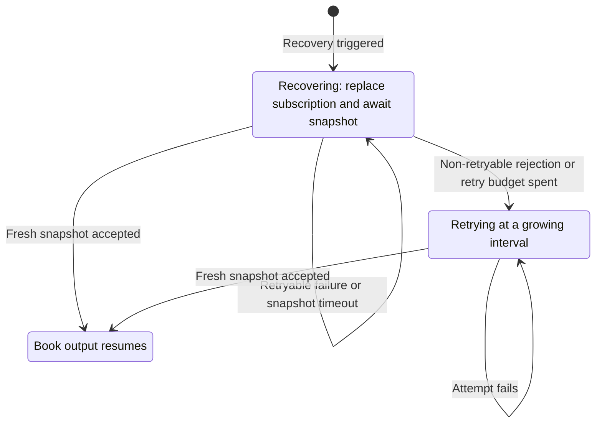

# OKX

OKX 创立于 2017 年，是一家提供现货、保证金、永续互换、期货、期权、价差与事件合约交易的加密货币
交易所。本集成支持在 OKX 上接入实时行情数据与订单执行。

## 概览 {#overview}

该适配器（adapter）以 Rust 实现，通过 PyO3 绑定暴露给 Python，不依赖外部 OKX 客户端库。

OKX 适配器包含多个组件，可单独或组合使用：

- `OKXHttpClient`：底层 HTTP API 连接。
- `OKXWebSocketClient`：面向 Rust 调用方的底层 WebSocket API 连接。
- `OKXDataClient`：行情数据订阅管理器。
- `OKXExecutionClient`：账户管理与交易执行网关。
- `OKXDataClientFactory`：OKX 数据客户端工厂。
- `OKXExecutionClientFactory`：OKX 执行客户端工厂。

:::note
多数用户按下面的方式配置实时交易节点即可，无需直接使用这些底层组件。
:::

## 示例 {#examples}

- [Python 示例](https://github.com/nautechsystems/nautilus_trader/tree/develop/examples/live/okx/)
- [Rust 示例](https://github.com/nautechsystems/nautilus_trader/tree/develop/crates/adapters/okx/examples/)

## 产品支持 {#product-support}

| 产品        | 金融工具来源                 | 数据 | 执行 | 备注                                        |
| --------------- | ---------------------------- | ---- | ---- | -------------------------------------------- |
| 现货            | `public/instruments`         | 是   | 是   | 现货交易对。                                  |
| 保证金          | `public/instruments`         | 是   | 是   | 带保证金或杠杆的现货金融工具。                |
| 永续互换        | `public/instruments`         | 是   | 是   | 线性与反向合约。                              |
| 期货            | `public/instruments`         | 是   | 是   | 到期期货合约。                                |
| 期权            | `public/instruments`         | 是   | 是   | 限价类订单；需要 family 过滤器。               |
| 价差            | `sprd/spreads`               | 是   | 是   | 业务 WS 上的快照、盘口与成交。                |
| 事件合约        | `event-contract/*` endpoints | 是   | 是   | 解析为 Nautilus `BinaryOption`。              |

相关 OKX 文档：

- [Get instruments](https://www.okx.com/docs-v5/en/#public-data-rest-api-get-instruments)。
- [Get limit price](https://www.okx.com/docs-v5/en/#public-data-rest-api-get-limit-price)。
- [Get Spreads (Public)](https://www.okx.com/docs-v5/en/#spread-trading-rest-api-get-spreads-public)。
- [Spread trading place order](https://www.okx.com/docs-v5/en/#spread-trading-rest-api-place-order)。
- [Event contract series](https://www.okx.com/docs-v5/en/#public-data-rest-api-get-series)。

:::note
**期权支持**：适配器支持期权行情数据、场所提供的 Greeks（`subscribe_option_greeks`），以及
期权金融工具的订单执行。细节见下文[期权交易](#options-trading)一节，订阅模式见
[Options](./../concepts/options.md) 指南。
:::

:::info
**金融工具乘数**：衍生品（`SWAP`、`FUTURES`、`OPTION`）的金融工具乘数按 OKX 的 `ctMult` 与
`ctVal` 字段相乘计算，使持仓规模与 OKX 的合约大小和价值保持一致。
:::

:::info
**价格限制**：OKX 在 `public/instruments` 上为现货、保证金、互换与期货金融工具暴露
`initPxLmtPct`、`floatPxLmtPct` 与 `maxPxLmtPct`。适配器把非空值保留在金融工具 `info`
字段中，键为 `okx_init_px_lmt_pct`、`okx_float_px_lmt_pct` 和 `okx_max_px_lmt_pct`。这些字段
描述的是交易所的价格带百分比，不会被解析为 Nautilus 静态的 `min_price` 或 `max_price`。

需要 OKX `GET /api/v5/public/price-limit` 端点计算出的当前买卖限价时，调用
`OKXHttpClient.request_price_limit(instrument_id)`。OKX 文档说明期权与事件合约的百分比字段
为空，适配器对它们的金融工具 `info` 不做改动。
:::

:::note
`/api/v5/finance/okusd/*` 等 OKX 金融产品端点不在 OKX 交易适配器的范围内。
:::

## 金融工具更新 {#instrument-updates}

数据客户端在连接时通过 REST 加载金融工具缓存，并为每个配置的金融工具类型订阅 OKX 的 instruments
WebSocket 频道。所有更新路径都遵循配置的金融工具类型、family 与合约类型，未变化的定义不会重复发布。

| 来源              | 触发                                          | 向下游发布                                             |
| ------------------- | ----------------------------------------------- | ------------------------------------------------------ |
| 连接加载            | 连接时的 REST                                   | 完整缓存，一次                                         |
| Instruments 频道    | 场所推送（增量）                                | 新增或变化的定义，每条附带 `InstrumentStatus`          |
| REST 对账           | `update_instruments_interval_mins`（默认 60）   | 仅新增或变化的定义                                     |

每次更新先写入数据客户端、HTTP 与 WebSocket 缓存，然后把新增或变化的定义作为
`DataEvent::Instrument` 发布，因此消费者不会观察到缓存中缺失的定义。除 `ts_event` 与 `ts_init`
之外的任何序列化字段变化都算实质变化。

- Instruments 频道是增量流而非快照流。订阅或重连可能没有初始负载，因此仅靠重连回放无法让金融工具
  缓存保持一致。
- 把间隔设为 `0` 可禁用周期性对账。Instruments 频道更新始终会应用。每条连接生命周期内运行一个刷新
  任务，在断开、连接失败清理、停止与释放时取消。设置 `load_spreads` 时会一并包含价差金融工具。
- 从 REST 响应中消失的金融工具保留在缓存中，它们可能仍支撑着打开的订阅。停牌、到期与退市通过
  instruments 频道以 `InstrumentStatus` 事件到达。

## 订单簿订阅 {#order-book-subscriptions}

Rust 与 Python v2 对 L2 market-by-price（`L2_MBP`）订单簿支持以下订阅：

| 订阅                         | 交付方式                            | 深度                                           |
| ---------------------------- | ----------------------------------- | ---------------------------------------------- |
| `subscribe_book_deltas`      | 场所更新时发出 `OrderBookDeltas`。   | 每侧 50 或 400 档；价差为五档。                 |
| `subscribe_book_depth`       | 原生 `OrderBookDepth` 快照。         | 每侧最多五档。                                  |
| `subscribe_book_at_interval` | 按间隔发出缓存的 `OrderBook`。       | 保留所选频道的全部档位。                        |

`subscribe_book_depth` 使用 OKX 原生 `books5` 快照，变化时按 100 ms 节奏发布。`depth=None`
默认五档。`[1, 5]` 内的请求从每个快照中选取最优的若干档。更大的请求和 `rpi=True` 会被拒绝。
价格、数量与场所订单数直接取自每个快照，适配器不用增量数据重建深度快照。

增量与间隔订阅沿用现有的频道选择逻辑：`[1, 50]` 内的请求在配置的 VIP 等级允许时选 50 档频道，
否则选公共 400 档 `books` 频道；其他深度选 400 档频道。`rpi` 参数为 true 时选 `books-rpi`。
频道访问仍受 OKX 账户权限约束。

在同一客户端内，原生深度消费者按金融工具共用一个请求上限，包括非托管订阅。请求深度冲突会被拒绝。

原生深度使用与增量和间隔簿相互独立的馈送。退订其中一路，另一路保持活动。价差金融工具沿用现有的
共享五档 `sprd-books5` 快照馈送，在增量与深度消费者都退订之前保持活动。

托管簿只有一个更新来源：增量或深度。兼容的托管订阅共享该来源，但同一金融工具的托管深度不能与
托管增量或间隔订阅共存。数据引擎在改动托管簿之前拒绝冲突请求。同一来源的各消费者必须在客户端、
簿类型、深度与订阅参数上保持一致。只有当该来源的全部消费者都是非托管时，不同客户端才能使用
不同配置。

要同时接收增量与深度，在增量订阅上设 `managed=True`，在深度订阅上设 `managed=False`。非托管
深度回调随后不会改动由增量托管的簿。两者同时启用时 DataTester 采用这一安排。

间隔交付使用数据引擎现有的增量订阅与定时器。它发布全部保留的档位，不受非托管深度消费者请求上限
的影响。连接中断或簿恢复期间，定时器可以继续发布最后缓存的簿。原生深度交付在重连后以新的完整
快照恢复，不依赖增量恢复。恢复限制见[订单簿恢复](#order-book-recovery)。

## 订单簿恢复 {#order-book-recovery}

数据客户端对每个增量簿独立恢复。恢复期间抑制增量更新，并替换订阅以请求新快照。只有客户端接受
快照后输出才恢复，而这要求替换用的退订与订阅请求已经发出。被接受的快照替换全部现有价位。
空快照清空订单簿。

### 恢复触发条件 {#recovery-triggers}

以下情形启动恢复：

- 出现序列缺口。
- 初始订阅发送失败。
- 初始或重连后的快照超时。
- 场所拒绝簿订阅。

出现序列缺口时，客户端丢弃不匹配的批次并抑制后续增量更新。`book_snapshot_timeout_secs` 设定
快照期限。初始订阅的期限从订阅发出后开始计时，不含等待发送的时间。

重连会重置受影响套接字上的簿同步。价差簿在业务套接字上接收完整快照，其恢复只由初始发送失败、
初始或重连后快照缺失、订阅被拒触发。

陈旧馈送检查只记录 warning，并跳过正在运行的恢复所持有的簿。它不会启动恢复，因为清淡市场
合法地可能长时间没有簿变化。

### 重试循环与限制 {#retry-loop-and-limits}

适配器使用[共享簿恢复机制](./../developer_guide/adapters.md#order-book-recovery-ownership)。
每个金融工具一个恢复循环，直到新快照被接受，或退订与关闭将其取消。恢复不会以失败状态结束。



订阅请求发出后，簿保持恢复状态，直到新快照被接受。

- **尝试次数**：初始预算内最多八次。
- **初始预算**：180 秒，包含发送、等待快照与重试延迟。
- **延迟**：第一次重试立即执行。之后按一秒起步的指数退避，抖动最多一秒，上限十秒。
- **预算耗尽后**：按从 1 分钟翻倍到 15 分钟的间隔继续尝试，抖动最多五秒。每次尝试受一分钟约束，
  快照超时更长时受快照超时约束。不可重试的拒绝直接进入该间隔。

进行中的恢复跨重连沿用现有预算，避免在替换的退订与订阅请求之间被取消。预算耗尽后处于尝试间隔
等待的恢复，会在新连接上立即重试。替换订阅会保留其重连意图。退订与关闭会取消恢复。

### 持续失败 {#persistent-failures}

重试预算耗尽后，客户端记录一条 error，此后每次失败尝试记一条 warning。按十五分钟的间隔，
持续失败的簿每小时约发八次订阅请求。场所已不再服务的金融工具可能出现这种情况。该速率远低于
OKX 每条连接每小时 480 次的上限。迟到快照在任何时刻都能完成恢复。要停止恢复就退订。

### 快照关联限制 {#snapshot-correlation-limitation}

增量簿频道只在建立或恢复同步期间接受快照。同步完成后，客户端丢弃主动发来的快照，不替换簿也不
重置其序列号。周期性发布完整快照的频道则持续接受。

簿订阅发送会等待目标连接上传输写操作完成。替换操作中的两次发送使用同一连接。连接发生变化时
该次尝试判为失败。

快照接受不会把订阅确认与恢复尝试做关联。较早订阅产生的延迟快照可能在替换发出时仍在队列中，
并在闸门打开时完成当前恢复。写确认并不能消除这种歧义。当场所响应只标识簿频道与金融工具时，
恢复也无法可靠区分退订错误与订阅错误。

### 禁用快照期限 {#disabling-snapshot-deadlines}

`book_snapshot_timeout_secs` 设为 `0` 会禁用快照期限，包括初始与重连后检查。序列缺口和订阅
拒绝仍会启动恢复。

重试预算内，快照缺失会让当前尝试一直等待，直到以下事件之一发生：

- 客户端接受了一个快照。
- 收到拒绝。
- 恢复被取消。
- 180 秒初始预算结束。

预算之后的尝试仍按上文所述的边界受控。

### 实时恢复验证 {#live-recovery-validation}

`okx-book-stress` 压力测试工具用于验证簿同步与恢复的改动。它连接 OKX 主网公共行情，不提交任何
订单。它按簿流契约校验输出的现货、RPI 互换与价差簿，并与场所馈送最优 20 档的独立重建结果比对。

该工具在无重连的情况下验证恢复，包括启用期限时丢弃替换快照。随后注入序列缺口、丢弃和延迟快照、
强制重连，并在恢复期间执行退订与关闭。

在仓库根目录运行：

```bash
CARGO_BUILD_JOBS=16 bash scripts/strip-adapter-env.bash \
  cargo test -p nautilus-okx --features examples --test okx-book-stress -- --timeout 10 --rounds 18
```

`--scenario` 选择运行方式：

- `churn`（默认）：上文描述的故障轮。
- `initial`：在全新会话中每轮丢弃每个簿的首个快照。
- `turnover`：在恢复期间退订并重新订阅簿。
- `boundaries`：探测替换截断、重试耗尽进入重试上限，以及重连期间关闭。

`--timeout` 设置快照超时秒数，`0` 表示禁用快照期限；`--rounds` 设置轮数（默认 18）。

该工具需要访问公共与业务 WebSocket 端点，以及公共金融工具和价差 API。簿生命周期的自动化测试使用
本地 mock 服务器。共享参数与输出格式见[压力测试工具](./../developer_guide/spec_data_testing.md#stress-harnesses)。

## 符号体系 {#symbology}

OKX 为不同金融工具类型使用特定的符号约定。在 Nautilus 中引用金融工具时加上 `.OKX` 后缀，
例如 `BTC-USDT.OKX`。

### 各金融工具类型的符号格式 {#symbol-format-by-instrument-type}

#### SPOT {#spot}

格式：`{BaseCurrency}-{QuoteCurrency}`

示例：

- `BTC-USDT` - 比特币对 USDT（Tether）
- `BTC-USDC` - 比特币对 USDC
- `ETH-USDT` - 以太坊对 USDT
- `SOL-USDT` - Solana 对 USDT

在策略中订阅现货比特币 USD：

```python
InstrumentId.from_str("BTC-USDT.OKX")  # For USDT-quoted spot
InstrumentId.from_str("BTC-USDC.OKX")  # For USDC-quoted spot
```

#### SWAP（永续互换） {#swap-perpetual-swaps}

格式：`{BaseCurrency}-{QuoteCurrency}-SWAP`

示例：

- `BTC-USDT-SWAP` - 比特币永续互换（线性，USDT 本位）
- `BTC-USD-SWAP` - 比特币永续互换（反向，币本位）
- `ETH-USDT-SWAP` - 以太坊永续互换（线性）
- `ETH-USD-SWAP` - 以太坊永续互换（反向）

线性与反向合约：

- **线性**（USDT 本位）：用 USDT 等稳定币作保证金。
- **反向**（币本位）：用基础加密货币作保证金。

#### FUTURES（到期期货） {#futures-dated-futures}

格式：`{BaseCurrency}-{QuoteCurrency}-{YYMMDD}`

示例：

- `BTC-USD-261225` - 2026 年 12 月 25 日到期的比特币期货
- `ETH-USD-261225` - 2026 年 12 月 25 日到期的以太坊期货
- `BTC-USD-270326` - 2027 年 3 月 26 日到期的比特币期货

期货可以是线性或反向。适配器依据 OKX 的 `ctType` 字段推导。

#### SPREADS（价差） {#spreads}

格式：`{Leg1InstrumentId}_{Leg2InstrumentId}`

示例：

- `BTC-USDT_BTC-USDT-SWAP` - BTC-USDT 现货与 BTC-USDT 永续互换之间的价差
- `ETH-USD-SWAP_ETH-USD-261225` - ETH-USD 永续互换与到期期货之间的价差

在数据客户端上设置 `load_spreads=True`，即可从 OKX 的
[Get Spreads (Public)](https://www.okx.com/docs-v5/en/#spread-trading-rest-api-get-spreads-public)
端点加载实时 OKX 价差金融工具。适配器把每个 OKX `sprdId` 映射为带 `.OKX` 场所后缀的
Nautilus 价差金融工具 ID。

价差金融工具说明：

- 价差行情流经 OKX 业务 WebSocket：盘口（`sprd-bbo-tbt`）、成交（`sprd-public-trades`）与
  五档簿快照（`sprd-books5`）。价差没有增量簿频道。每条 `sprd-books5` 更新以 `OrderBookDepth`
  发给深度订阅者，以带快照标志的 `OrderBookDeltas` 发给增量订阅者。
- 解析器支持现货、互换、期货腿的组合，也支持 OKX 通过同一价差端点返回的含期权腿的价差定义。
- OKX 的期权 RFQ 与大宗交易流程独立于 Nitro 价差订单簿 API，不走这条价差路径。

#### OPTIONS（期权） {#options}

格式：`{BaseCurrency}-{QuoteCurrency}-{YYMMDD}-{Strike}-{Type}`

示例：

- `BTC-USD-261225-100000-C` - 比特币看涨期权，行权价 $100,000，2026 年 12 月 25 日到期
- `BTC-USD-261225-100000-P` - 比特币看跌期权，行权价 $100,000，2026 年 12 月 25 日到期
- `ETH-USD-261225-4000-C` - 以太坊看涨期权，行权价 $4,000，2026 年 12 月 25 日到期

其中：

- `C` = 看涨期权
- `P` = 看跌期权

#### EVENTS（事件合约） {#events}

OKX 事件合约的金融工具 ID 使用 OKX instruments API 返回的市场 ID。适配器把这些市场表示为
Nautilus `BinaryOption` 金融工具。

示例：

- `BTC-ABOVE-DAILY-261224-1600-65000` - `BTC-ABOVE-DAILY` 系列中的事件合约市场。

### 常见问题 {#common-questions}

**问：如何知道该用哪种合约类型？**
答：线性与反向金融工具的符号不同。公共 Python 配置不暴露合约类型过滤器，因此所选衍生品类型下
适配器会把两者都加载。

**问：如何加载事件合约？**
答：使用 `OKXInstrumentType.EVENTS`。公共 Python 配置会加载全部可发现的事件合约系列，
不提供系列过滤器。

## 零售价格改进（RPI） {#retail-price-improvement-rpi}

零售价格改进（RPI）适用于这些任务：

- 消费 OKX 合并后的自然与 RPI 深度。
- 挂出 RPI maker 订单。
- 让标准订单吃掉 RPI 流动性。

适配器把这些特性映射到 Nautilus 现有的订单簿、订单与生命周期类型上。RPI 路由是选择加入的，
标准订阅与订单保持原样。

### RPI 行情数据 {#rpi-market-data}

给 `subscribe_book_deltas` 或 `request_book_snapshot` 传入 `params={"rpi": True}`，即可使用
公共 `books-rpi` 频道或 `GET /api/v5/market/books-rpi`。该馈送把自然数量与可用于执行的 RPI
数量合并。

每个原始深度档位的线上形态为 `[price, totalQty, nonRpiQty, count]`：

| 线上字段    | Rust 类型   | 含义                                         |
| ----------- | --------- | -------------------------------------------- |
| `price`     | `Decimal` | 价位。                                       |
| `totalQty`  | `Decimal` | 自然数量加可用的 RPI 数量。                   |
| `nonRpiQty` | `Decimal` | 无 RPI taker 权限时可见的数量。               |
| `count`     | `u64`     | 该价位聚合的订单数。                          |

Nautilus 的 `OrderBookDeltas` 与 `OrderBook` 用 `totalQty` 作为档位数量。类型化原始模型保留
`nonRpiQty`。两者之差即可用的 RPI 流动性。

WebSocket 快照与更新保留 `seqId` 与 `prevSeqId`。发出的 delta 以 `seqId` 作为序列号。数据
客户端将每条更新的 `prevSeqId` 与最后接受的 `seqId` 比对，两者不要求递增一。不匹配即启动
[订单簿恢复](#order-book-recovery)。发出在 `prevSeqId: -1` 的快照被接受后恢复。

标准 OKX 增量簿频道带 `prevSeqId` 时，适配器应用同样的衔接规则。`books-rpi` 没有校验和。

WebSocket 订阅中 `rpi=True` 直接选择 `books-rpi`，跳过深度或 VIP 频道选择。REST 快照中请求
深度作为 `sz` 传入。OKX 默认每侧一档，最多接受 400 档。

底层 Rust 客户端暴露：

- WebSocket：`OKXWebSocketClient.subscribe_book_rpi` 与 `unsubscribe_book_rpi`。
- REST：`OKXRawHttpClient.get_rpi_order_book` 与 `OKXHttpClient.request_rpi_book_snapshot`。

公共金融工具响应暴露场所的 RPI 间距阈值：

| 线上字段       | Rust 类型         | 金融工具 `info` 键      |
| -------------- | ----------------- | --------------------- |
| `rpiMinLevel`  | `Option<u64>`     | `okx_rpi_min_level`   |
| `rpiMinPxBand` | `Option<Decimal>` | `okx_rpi_min_px_band` |

`rpiMinLevel` 统计自然价位数量，`rpiMinPxBand` 以基点度量与对手侧自然最优价的距离。`info`
映射以精确小数字符串存储价格带。适配器不会依据这些值拒绝或取整订单，因为 OKX 才是金融工具
与账户规则的权威执行方。使用 `rpi_px_round` 或处理场所的拒绝。

### RPI 执行 {#rpi-execution}

通过 `submit_order`、`submit_order_list` 或 `modify_order` 命令的 `params` 传入 RPI 控制项。
这些控制项在 HTTP 与私有 WebSocket 执行路径上都有效：

| 参数               | 类型   | 操作                          | 行为                                                          |
| ------------------ | ------ | ----------------------------- | --------------------------------------------------------------- |
| `rpi`              | `bool` | 下单与批量下单                | 发送 `ordType: rpi`；Nautilus 订单必须是 `LIMIT`。              |
| `rpi_taker_access` | `bool` | 下单与改单，单笔/批量         | 让标准订单可以吃掉 RPI 流动性。                                 |
| `rpi_px_round`     | `bool` | 下单与改单，单笔/批量         | 允许 OKX 把 RPI maker 价格向外取整到合资格档位。                |

```python
order = strategy.order_factory.limit(
    instrument_id=instrument_id,
    order_side=OrderSide.SELL,
    quantity=instrument.make_qty("250000"),
    price=instrument.make_price("0.0001600"),
)
strategy.submit_order(
    order,
    params={
        "rpi": True,
        "rpi_px_round": True,
    },
)
```

`rpi_taker_access` 只能与常规限价、市价、FOK 或 IOC 订单同用。启用后，OKX 会对合资格订单
（含 post-only 订单）施加 taker 速度缓冲。`rpi_px_round` 只用于 RPI maker 订单。不适用的
控制项直接省略，不要传 `False`，因为 OKX 可能拒绝不支持的组合。两个控制项默认都是 `false`，
且改单时不继承 `rpi_taker_access`。每次改单若要保持该权限，都要重新带上
`rpi_taker_access=True`。

底层 Rust 客户端暴露相同的单笔与批量矩阵：

| 操作     | REST 方法        | WebSocket 方法          |
| ----------- | -------------- | --------------------- |
| 下单        | `place_order`  | `submit_order`        |
| 批量下单    | `place_orders` | `batch_submit_orders` |
| 改单        | `amend_order`  | `modify_order`        |
| 批量改单    | `amend_orders` | `batch_modify_orders` |

WebSocket 批量改单元组接受可选请求 ID 并按 `reqId` 序列化，不会替换订单的 client ID。

### RPI 最小名义价值 {#rpi-minimum-notional}

RPI maker 订单必须同时满足金融工具的 `minSz` 和
[RPI 最小名义价值](https://www.okx.com/docs-v5/log_en/#2026-08-18-rpi-maker-minimum-notional-amount)：

- `SWAP` 与 `FUTURES`：10,000 USD。
- `SPOT`：1,000 USD。
- `EVENTS`：豁免 RPI 最小名义价值。

低于适用名义价值门槛的订单，OKX 以 `54051` 拒绝。执行客户端对被拒绝的下单发出
`OrderRejected`。

改单只要包含 `newSz`，无论是否带 `newPx`，OKX 都会重新检查。被拒绝的改单使原订单继续有效。
适配器发出 `OrderModifyRejected`，并停止将该改单视为待处理。仅改价的改单不触发该检查。
批量下单或批量改单中的每个子订单独立检查。

该规则于 2026 年 8 月 18 日在生产环境生效时已挂在簿上的订单被豁免（老人老办法）。非 RPI
订单不受此名义价值规则约束，包括带 `rpiTakerAccess: true` 的订单。满足 `minSz` 的订单仍
可能无法通过 RPI 最小名义价值检查。

### RPI 响应与生命周期 {#rpi-responses-and-lifecycle}

私有订单消息同时解析 `ordType: rpi` 与迁移别名 `ordType: elp`。未成交的 RPI 下单可能在私有
订单频道上首次出现时就是 `state: canceled`，且 `accFillSz` 为零或空。此时适配器直接发出
post-only 订单拒绝，不先发接受事件。回退原因写作 `RPI order canceled before acceptance`。
RPI 价格未通过间距规则且 `rpiPxRound` 为 false 时，OKX 可能走这条路径。订单报告中 RPI 订单
表示为 `post_only=True` 的 Nautilus `LIMIT` 订单。

用 `get_account_instruments` 读取类型化的 `OKXRpiPermission` 值：

- `Disabled` 对应 `rpi: "0"`。
- `Enabled` 对应 `rpi: "1"`，不代表有挂 RPI 订单的权限。
- `Permitted` 对应 `rpi: "2"`，有挂 RPI 订单的权限。

公共金融工具端点不返回账户权限。原始费率响应以可选 `Decimal` 暴露 `rpiMaker`。空值表示 RPI
不适用。

过渡期内响应可能同时包含 RPI 与 ELP 字段名。适配器优先读取 `rpi` 与 `rpiMaker`，把 `elp`
与 `elpMaker` 作为响应别名读取，发送时只使用 RPI 名称。原始成交消息中 `source: "1"` 表示
RPI 订单。

### RPI 排除项 {#rpi-exclusions}

适配器有意排除以下事项：

- 不暴露废弃的 `books-elp` 订阅，也不发出 `ordType: elp`。
- 不把公开的 RPI 间距阈值当作权威客户端校验依据。
- 不对 algo 订单应用 RPI 控制项。常规 HTTP 订单路径对价差订单的 RPI 控制项直接拒绝。
- 不随 RPI 支持引入通用的 post-only 回放去重。

期权与事件合约上，OKX 忽略 `rpiPxRound`。

参见 [OKX RPI 迁移 changelog](https://www.okx.com/docs-v5/log_en/#2026-07-28) 与
[RPI 计划指南](https://www.okx.com/help/okx-retail-price-improvement-program-rpi)。

## 订单能力 {#orders-capability}

下面是 OKX 线性永续互换产品支持的订单类型、执行指令与有效期选项。

### WebSocket 订单标识 {#websocket-order-identification}

OKX WebSocket 订单操作使用 `instIdCode`（数字金融工具标识），而不是字符串 `instId` 参数。
适配器从启动时获取的金融工具定义中解析 `instIdCode`，并在会话期内缓存。所需 `instIdCode`
不在缓存中时，订单提交以明确的错误失败。

首次执行连接要求每个请求的金融工具类型或 family 都有可用金融工具。请求失败，或某个范围内没有
可用金融工具，都会在 WebSocket 打开前中止连接，即使其他范围成功。未上市金融工具和无法解析的
条目不满足该要求。未配置金融工具 family 的期权仍然跳过。

### USD 至 USDC 现货迁移 {#usd-to-usdc-spot-migration}

OKX 正在合并 USD 与 USDC 现货簿。这是场所的破坏性变更。受影响的 `Crypto-USD` 金融工具被
`Crypto-USDC` 金融工具取代。参见
[OKX changelog](https://www.okx.com/docs-v5/log_en/#upcoming-changes-okx-to-migrate-usd-spot-trading-pairs)。

| 事件             | 时间                          |
| ---------------------- | ------------------------------- |
| 并行交易开放           | 2026 年 9 月 23 日 08:00 UTC。   |
| USD 交易对退市         | 2026 年 9 月 30 日 08:00 UTC。   |

#### 金融工具 ID {#instrument-ids}

订阅并交易替换后的金融工具 ID：

| 之前          | 之后           |
| ------------- | -------------- |
| `BTC-USD.OKX` | `BTC-USDC.OKX` |

OKX 不会把旧的 USD `instId` 或 `instIdCode` 映射到新的 USDC 金融工具。适配器也不会重写
金融工具或 `instIdCode` 缓存中的 USD 键。退市后仍使用 USD ID 的请求与订阅可能失败或返回
空数据。

#### 交易计价货币 {#trading-quote-currency}

`tradeQuoteCcy` 默认取 `instId` 中的计价货币。只把金融工具 ID 从 `Crypto-USD` 换成
`Crypto-USDC`，默认交易计价货币就从 USD 变为 USDC。

在 `OKXExecutionClientConfig` 上设置 `spot_trade_quote_ccy`：

| `spot_trade_quote_ccy` | 影响                                                                              |
| ---------------------- | --------------------------------------------------------------------------------- |
| 未设置（`None`）       | 省略该字段；OKX 使用 `instId` 中的计价货币（`Crypto-USDC` 上为 USDC）。           |
| `"USD"`                | 在 `Crypto-USDC` 金融工具上继续以 USD 交易。                                      |

适配器在常规 REST 与 WebSocket 现货订单上发送 `tradeQuoteCcy`，不在 algo 或条件订单上发送。

出现以下情况时适配器本地拒绝订单：

- 配置的值不在该金融工具的 `tradeQuoteCcyList` 中。
- 该列表未知。

列表从金融工具定义（包括 `GET /api/v5/account/instruments`）保留，并存储在金融工具 `info`
映射的 `okx_trade_quote_ccy_list` 键下。

#### 账户激活 {#account-activation}

:::warning
仅当 OKX 以错误码 `54109` 拒绝 `Crypto-USDC` 订单后，才调用
`OKXHttpClient.activate_feature("1")` 启用 USDC 订单簿交易，然后重新提交订单。
激活在主账户与其子账户之间共享，任一账户成功一次即可覆盖全部。适配器从不隐式激活账户。

`activate_feature` 返回错误码 `51773` 表示 OKX 不支持该账户的激活，并不表示无法交易 USDC。
订单成功即确认账户可以交易该金融工具。
:::

### Client order ID 要求 {#client-order-id-requirements}

OKX 要求 client order ID 只含字母和数字，且不超过 32 个字符。连字符（`-`）会被拒绝，因此在
策略配置中设置：

```python
use_hyphens_in_client_order_ids = False
```

超过 32 个字符的 Nautilus client order ID 同样会被拒绝。需要 UUID 形式的标识符时，把
`use_uuid_client_order_ids=True` 与 `use_hyphens_in_client_order_ids=False` 组合使用，
使生成的值符合 OKX 限制。

### 订单类型 {#order-types}

| 订单类型                 | 线性永续互换 | 备注                                                        |
| ---------------------- | --------------------- | ----------------------------------------------------------- |
| `MARKET`               | ✓                     | 按市价立即成交。                                            |
| `MARKET_TO_LIMIT`      | ✓                     | 市价单转为 IOC 限价单。                                     |
| `LIMIT`                | ✓                     | 按指定价格或更优价格成交。                                  |
| `STOP_MARKET`          | ✓                     | 经 OKX algo 订单实现的条件市价单。                          |
| `STOP_LIMIT`           | ✓                     | 经 OKX algo 订单实现的条件限价单。                          |
| `MARKET_IF_TOUCHED`    | ✓                     | 经 OKX algo 订单实现的条件市价单。                          |
| `LIMIT_IF_TOUCHED`     | ✓                     | 经 OKX algo 订单实现的条件限价单。                          |
| `TRAILING_STOP_MARKET` | ✓                     | 经 OKX advance algo 订单实现的移动止损市价单。               |

:::info
**条件订单**：`STOP_MARKET`、`STOP_LIMIT`、`MARKET_IF_TOUCHED`、`LIMIT_IF_TOUCHED` 与
`TRAILING_STOP_MARKET` 使用 OKX algo 订单。`TRAILING_STOP_MARKET` 路径使用 OKX 的 advance
algo 订单 API（`move_order_stop`），撤单需要 `cancel-advance-algos` 端点。
:::

### 价差订单 {#spread-orders}

OKX 价差金融工具使用独立的价差交易订单簿与 API 家族。执行客户端按价差金融工具 ID（例如
`ETH-USD-SWAP_ETH-USD-261225.OKX`）把价差订单路由到 HTTP `/api/v5/sprd/*` 端点。

适配器使用 OKX 价差 REST 端点进行提交、撤单、批量撤单、订单状态与成交报告，并订阅 OKX 业务
WebSocket 的
[`sprd-orders` 频道](https://www.okx.com/docs-v5/en/#spread-trading-websocket-private-channel-order-channel)
获取实时价差订单更新。

OKX `sprd-orders` WebSocket 更新不包含手续费字段。适配器采取保守失败策略，丢弃整条更新，
既不发成交事件也不发订单状态更新。启动对账通过 REST 恢复该订单。设置
`open_check_interval_secs` 可持续轮询挂单。来自 REST
[`sprd/trades` 端点](https://www.okx.com/docs-v5/en/#spread-trading-rest-api-get-trades)的历史
与对账成交报告包含 OKX 手续费数据。

支持的价差订单指令：

- GTC 有效期的 `LIMIT`。
- IOC 有效期的 `LIMIT`。
- post-only 执行的 `LIMIT`。

OKX 价差交易 API 路径不支持价差订单列表、条件订单、FOK 有效期与改单请求。

相关 OKX 文档：

- [价差下单](https://www.okx.com/docs-v5/en/#spread-trading-rest-api-place-order)。
- [价差订单详情](https://www.okx.com/docs-v5/en/#spread-trading-rest-api-get-order-details)。
- [价差订单频道](https://www.okx.com/docs-v5/en/#spread-trading-websocket-private-channel-order-channel)。

### 执行指令 {#execution-instructions}

| 指令          | 线性永续互换 | 备注                                                  |
| ------------- | --------------------- | ----------------------------------------------------- |
| `post_only`   | ✓                     | 仅限限价订单。                                        |
| `reduce_only` | ✓                     | 产品与持仓模式限制见下文。                             |

对 `isolated` 或 `cross` 交易模式下的保证金订单，以及 `net` 持仓模式下的期货或互换订单，
适配器发送 OKX 的字面 `reduceOnly` 字段。`long/short` 持仓模式下 OKX 不接受该字段，适配器
改用平仓方向的 `side` 与 `posSide` 组合作为实际生效的场所指令。现金、期权与事件产品的
reduce-only 订单会被拒绝；会增大所选方向的 long/short 组合也会被拒绝。参见 OKX 的
[下单文档](https://www.okx.com/docs-v5/en/#order-book-trading-trade-post-place-order)。

### 有效期 {#time-in-force}

| 有效期        | 线性永续互换 | 备注                                 |
| ------------- | --------------------- | ------------------------------------ |
| `GTC`         | ✓                     | 撤销前有效。                          |
| `FOK`         | ✓                     | 全部成交或撤销。                      |
| `IOC`         | ✓                     | 立即成交其余撤销。                    |
| `GTD`         | -                     | *OKX 无原生订单有效期。*              |

:::note
**GTD（Good Till Date）有效期**：OKX 通过 `expTime` 支持请求过期，但那是请求超时，不是原生的
订单过期指令。

需要 GTD 功能时，使用 Nautilus 的策略管理 GTD 特性：它在指定的到期时刻撤单，实现订单过期。
:::

### 批量操作 {#batch-operations}

| 操作         | 线性永续互换 | 备注                                      |
| ------------ | --------------------- | ----------------------------------------- |
| 批量提交     | ✓                     | 单条请求提交多笔订单。                     |
| 批量修改     | ✓                     | 单条请求修改多笔订单。                     |
| 批量撤销     | ✓                     | 单条请求撤销多笔订单。                     |

### 撤销全部订单 {#cancel-all-orders}

`Strategy.cancel_all_orders` 在仅本策略模式和跨策略模式下都支持 `order_side`。策略范围见
[撤销全部的路由](./../concepts/execution/index.md#cancel-all-routing)。

`strategy_only=False` 且带 `order_side` 时，适配器跨策略从缓存中选出匹配的挂单：普通订单
走批量撤销，条件订单与价差订单走各自的单笔撤销 API。这绕过了场所的批量撤销，Rust 配置项
`use_mm_mass_cancel` 为 `true` 时也一样。

带方向过滤的撤销会排除缓存中不存在的订单和仍处于 `SUBMITTED` 状态的订单。不带方向过滤时，
常规非价差撤销默认也使用缓存中的挂单。价差金融工具和 Rust 批量撤销选项使用场所的批量端点。

### 拒绝原因 {#rejection-reasons}

OKX 以错误码拒绝订单、改单或撤单请求时，`OrderRejected`、`OrderModifyRejected` 或
`OrderCancelRejected` 上的 `reason` 形如 `OKX error <code>: <message>`，例如
`OKX error 51000: Parameter instId error`。没有消息的 WebSocket 响应只产生
`OKX error <code>`；带 `subCode` 的追加 `(subCode=<code>)`。已被接受但随后失败的条件订单
只报告代码，例如 `OKX error 51008`，因为 OKX 只发送 `failCode`。

适配器在联系 OKX 之前发出的拒绝，例如本地校验失败，携带适配器自己的消息，不带 OKX 错误码。

### 持仓管理 {#position-management}

| 功能           | 线性永续互换 | 备注                                 |
| ---------------- | --------------------- | ------------------------------------ |
| 查询持仓         | ✓                     | 实时持仓更新。                        |
| 持仓模式         | ✓                     | 净额与多空模式（见下文）。             |
| 杠杆控制         | -                     | 执行客户端不暴露该能力。               |
| 保证金模式       | ✓                     | 支持逐仓与全仓模式。                   |

#### 持仓模式 {#position-modes}

OKX 的衍生品交易支持两种持仓模式：

- **净额模式**（netting）：每个金融工具一个持仓，买卖订单相互抵消。这是默认模式，也是推荐给
  多数交易者的模式。
- **多空模式**（hedging）：同一金融工具分设多空两个持仓，支持同时持有多空敞口。

:::note
持仓模式作用于整个账户。通过 OKX 网页或 App 界面设置，或调用 `OKXHttpClient.set_position_mode`。
客户端配置不负责设置它。两种模式下适配器都会报告持仓：净额模式按带符号数量推导持仓方向，
多空模式使用 OKX 报告的 `posSide`。
:::

### 交易模式与保证金配置 {#trade-modes-and-margin-configuration}

OKX 统一账户系统为现货与衍生品支持不同交易模式。先在 OKX 网页或 App 界面设置账户模式，API
无法完成首次设置。

账户模式细节见
[OKX 账户模式文档](https://www.okx.com/docs-v5/en/#overview-account-mode)。

#### 交易模式概览 {#trade-modes-overview}

Python 执行配置按如下方式选择交易模式：

| 金融工具   | 交易模式     | 配置                                              |
| ---------- | ---------- | ------------------------------------------------- |
| 现货       | `cash`     | 自动。                                             |
| 衍生品     | `isolated` | 默认，或 `margin_mode=OKXMarginMode.ISOLATED`。    |
| 衍生品     | `cross`    | `margin_mode=OKXMarginMode.CROSS`。                |

```python
from nautilus_trader.adapters.okx import OKXExecutionClientConfig
from nautilus_trader.adapters.okx import OKXInstrumentType
from nautilus_trader.adapters.okx import OKXMarginMode
from nautilus_trader.model import AccountId


exec_config = OKXExecutionClientConfig(
    account_id=AccountId.from_str("OKX-001"),
    instrument_types=[OKXInstrumentType.SWAP],
    margin_mode=OKXMarginMode.CROSS,
)
```

公共 Python 配置不暴露现货保证金选择，现货订单使用 cash 模式。现货与衍生品混合的客户端中，
`margin_mode` 只作用于衍生品。

:::warning
**手动覆盖交易模式**：可以用 `params={"td_mode": "..."}` 按订单覆盖交易模式。这会绕过适配器
的选择，当取值与金融工具类型不匹配时（例如对现货金融工具用 `isolated`）可能导致订单被拒。

只有在配置无法满足需求时才使用手动覆盖。
:::

### 订单查询 {#order-querying}

| 功能             | 线性永续互换 | 备注                             |
| -------------------- | --------------------- | ------------------------------ |
| 查询挂单             | ✓                     | 列出全部活跃订单。              |
| 查询订单历史         | ✓                     | 历史订单数据。                  |
| 订单状态更新         | ✓                     | 实时订单状态变化。              |
| 成交历史             | ✓                     | 执行与成交报告。                |

### 或有订单 {#contingent-orders}

| 功能             | 线性永续互换 | 备注                                     |
| ------------------ | --------------------- | -------------------------------------- |
| 订单列表           | ✓                     | 经 WS 批量；仅普通订单。                 |
| OCO 订单           | -                     | `OKXExecutionClient` 不提交。            |
| 括号订单           | -                     | `OKXExecutionClient` 不提交。            |
| 条件订单           | ✓                     | 止损与触及即限价订单。                   |

底层 HTTP 客户端能建模 OKX 的附加 TP/SL 与 OCO 负载，但 `OKXExecutionClient` 不会把 Nautilus
的 OCO 或括号订单列表翻译成这些负载。

#### 条件订单架构 {#conditional-order-architecture}

条件订单（OKX algo 订单）的命令走 HTTP，状态更新走 WebSocket：

- **提交**：HTTP `/api/v5/trade/order-algo` 返回即时确认。
- **状态更新**：WebSocket 业务端点（`/ws/v5/business`）。止损与触及类订单用 `orders-algo`，
  移动止损用 `algo-advance`，两者都提供实时更新。
- **撤销**：algo 父单仍活动时期通过 HTTP 撤销。

触发生成的子单成为权威订单后，撤销与修改使用它的订单 ID 和常规 WebSocket 路由。Nautilus
订单标识保持不变。

`orders-algo` 频道只发更新，`algo-advance` 在订阅时还会发一份快照。适配器在传输重连之间
保留已跟踪订单的上下文，并对回放的 advance-algo 快照去重。冷启动与漏更新的恢复仍由 REST
对账负责。

#### 支持的条件订单类型 {#supported-conditional-order-types}

| 订单类型                 | 触发类型          | 备注                                               |
| ---------------------- | ----------------- | ---------------------------------------------------- |
| `STOP_MARKET`          | 最新价、标记价、指数价 | 触发时按市价成交。                              |
| `STOP_LIMIT`           | 最新价、标记价、指数价 | 触发时挂出限价单。                              |
| `MARKET_IF_TOUCHED`    | 最新价、标记价、指数价 | 价格触及时按市价成交。                          |
| `LIMIT_IF_TOUCHED`     | 最新价、标记价、指数价 | 价格触及时挂出限价单。                          |
| `TRAILING_STOP_MARKET` | -                 | 回撤比率或价差；激活价可选。                       |

:::warning
OKX 的 `close_fraction` 条件订单参数没有归一到通用的 `close_position` 风险契约。不要基于
`close_fraction` 把 `OKX` 加入 `full_position_exit_venues`。保持该场所不在列表中，让普通的
数量与名义价值检查照常生效。
:::

#### 修改条件订单 {#modifying-conditional-orders}

`modify_order` 通过 HTTP `amend-algos` 修改待触发的止损与触及类订单。

- **保留条款**：未提供的价格与触发源保持不变。
- **整仓退出**：带 `close_fraction` 时，止损单修改止损条款，触及类订单修改止盈条款。
- **确认**：必须由 algo 流确认变化后的条款，才发出 `OrderUpdated`。仅收到确认响应不发更新。

:::warning
待处理的修改需要已跟踪的会话上下文。重启后恢复的订单或缺少该上下文的订单，本地直接发出
`OrderModifyRejected`。移动止损 algo 的修改同样在本地发出 `OrderModifyRejected`。
:::

#### 触发价类型 {#trigger-price-types}

止损与触及类订单支持不同的触发价来源：

- **最新价**（`TriggerType.LAST_PRICE`）：使用最新成交价（默认）。
- **标记价**（`TriggerType.MARK_PRICE`）：使用标记价格。
- **指数价**（`TriggerType.INDEX_PRICE`）：使用标的指数价格。

```python
# Example: Stop loss using mark price trigger
stop_order = order_factory.stop_market(
    instrument_id=instrument_id,
    order_side=OrderSide.SELL,
    quantity=Quantity.from_str("0.1"),
    trigger_price=Price.from_str("45000.0"),
    trigger_type=TriggerType.MARK_PRICE,  # Use mark price for trigger
)
strategy.submit_order(stop_order)
```

## 风险管理 {#risk-management}

### 强平与 ADL 事件处理 {#liquidation-and-adl-event-handling}

OKX 适配器能识别交易所发起的风险管理事件：

- **强平预警**：`instrument_types` 包含 `MARGIN`、`SWAP`、`FUTURES` 或 `OPTION` 时，执行
  客户端以 `instType=ANY` 订阅 `liquidation-warning`。OKX 报告有持仓临近强平时记 warning。
  这只是早期预警：消息到达时持仓可能已被强平，且适配器只把它呈现为日志消息，不是面向策略
  的事件。
- **强平订单**：交易所强平持仓时，适配器识别强平类别，并带订单详情记 warning。这些订单继续
  走正常的订单与成交管道。
- **自动减仓（ADL）**：OKX 为对冲对手方强平而平掉你的持仓时，适配器识别 ADL 事件，并带持仓
  详情记日志。

强平订单与 ADL 的识别依据订单记录的 `category` 字段。可识别的取值：

| `category`              | 含义                       |
| ----------------------- | ----------------------------- |
| `full_liquidation`      | 整仓强平。                    |
| `partial_liquidation`   | 部分强平。                    |
| `adl`                   | 自动减仓平仓。                |
| `delivery`              | 合约到期交割。                |
| `normal` / 其他值       | 常规订单流。                  |

类别识别在两条路径上都会运行：

- WebSocket `orders` 频道（实时订单与成交更新）。
- HTTP `GET /api/v5/trade/orders-history`（用于对账与冷启动 mass status）。

:::info
**强平与 ADL 事件以 WARNING 级别记录**，详情包括订单 ID、金融工具与状态。强平预警则记录持仓
方向、大小、保证金率、标记价格与保证金模式。把这些日志纳入风险管理流程监控。

适配器把这些交易所生成的订单以 `OrderStatusReport` 与 `FillReport` 消息转发，持仓更新以
`PositionStatusReport` 消息发送。由于分派时这些订单未被跟踪，该路径不会直接发出归属于策略的
订单事件。
:::

上游参考：

- [订单频道与 `category` 字段](https://www.okx.com/docs-v5/en/#order-book-trading-trade-ws-order-channel)
- [强平预警频道](https://www.okx.com/docs-v5/en/#trading-account-websocket-liquidation-warning-channel)
- [自动减仓机制](https://www.okx.com/help/okx-contract-auto-deleveraging-adl)
- [强平机制](https://www.okx.com/help/introduction-to-liquidation)

## 期权交易 {#options-trading}

OKX 适配器支持交易期权（`OPTION` 金融工具类型），与其他衍生品有些差异。OKX 期权是以标的
加密货币结算的反向合约。完整 API 细节见
[OKX 期权交易文档](https://www.okx.com/docs-v5/en/#order-book-trading-trade-post-place-order)。

### 支持的订单类型 {#supported-order-types}

只支持限价类订单。OKX 不允许期权使用市价单。

| 订单类型          | 支持      | 备注                                             |
| ----------------- | --------- | ------------------------------------------------ |
| `LIMIT`           | ✓         | 标准限价单。                                     |
| `MARKET`          | -         | 在到达 API 之前被适配器拒绝。                  |
| `MARKET_TO_LIMIT` | -         | 在到达 API 之前被适配器拒绝。                  |

期权支持 FOK 与 IOC 有效期。OKX 为期权 FOK 订单使用专门的 `op_fok` 订单类型，适配器自动
处理这一映射。

期权不支持条件/algo 订单（`STOP_MARKET`、`STOP_LIMIT`、`MARKET_IF_TOUCHED`、
`LIMIT_IF_TOUCHED`、`TRAILING_STOP_MARKET`），提交会被拒绝。

### 定价模式 {#pricing-modes}

期权订单可以用三种互斥方式定价。通过订单 `params` 传入定价模式：

| 模式  | 参数      | 说明                                           |
| ----- | --------- | ------------------------------------------------ |
| 价格  | （默认）  | 按合约货币的标准限价。                            |
| USD   | `px_usd`  | 按美元计价。                                      |
| IV    | `px_vol`  | 按隐含波动率计价（1.0 = 100%）。                  |

```python
# Price in USD
order = strategy.order_factory.limit(
    instrument_id=InstrumentId.from_str("BTC-USD-261225-50000-C.OKX"),
    order_side=OrderSide.BUY,
    quantity=Quantity.from_int(1),
    price=Price.from_str("0"),  # Placeholder; px_usd takes precedence
    params={"px_usd": "100.5"},
)

# Price in implied volatility
order = strategy.order_factory.limit(
    instrument_id=InstrumentId.from_str("BTC-USD-261225-50000-C.OKX"),
    order_side=OrderSide.BUY,
    quantity=Quantity.from_int(1),
    price=Price.from_str("0"),  # Placeholder; px_vol takes precedence
    params={"px_vol": "0.55"},
)
```

修改订单时，把相同的 `px_usd` 或 `px_vol` 参数传给改单命令，即可按原定价模式改价。

### 期权 Greeks {#option-greeks}

OKX 在 `opt-summary` 频道上并行发布两套 Greeks：

- **Black-Scholes（`BLACK_SCHOLES`）**：以美元计价的 Greeks。与 Deribit 和 Bybit 适配器
  使用的惯例一致。
- **价格调整（`PRICE_ADJUSTED`）**：以标的币单位计价的 Greeks。与 OKX 原生合约惯例一致。

默认情况下，适配器在每个 `opt-summary` tick 上发出两套。每个发出的 `OptionGreeks` 带
`convention` 字段，取 `GreeksConvention.BLACK_SCHOLES` 或 `GreeksConvention.PRICE_ADJUSTED`，
接收方可以按消息分支处理。

要收窄数据流，在订阅时传 `params["greeks_convention"]`：

- 单个字符串：`"BLACK_SCHOLES"` 或 `"PRICE_ADJUSTED"`（不区分大小写）。
- 字符串列表：`["BLACK_SCHOLES", "PRICE_ADJUSTED"]`。
- 省略：适配器发出两套。

未知条目记 warning 后跳过。若请求的条目全部未知，适配器回退为发出两套。

```python
# Default (both conventions, receiver branches)
self.subscribe_option_greeks(instrument_id)


def on_option_greeks(self, greeks: OptionGreeks) -> None:
    if greeks.convention == GreeksConvention.BLACK_SCHOLES:
        self._handle_bs(greeks)
    else:
        self._handle_pa(greeks)
```

```python
# Single-convention narrowing
self.subscribe_option_greeks(
    instrument_id,
    params={"greeks_convention": "PRICE_ADJUSTED"},
)
```

```python
# Explicit list (equivalent to the default when both are listed)
self.subscribe_option_greeks(
    instrument_id,
    params={"greeks_convention": ["BLACK_SCHOLES", "PRICE_ADJUSTED"]},
)
```

:::note
数据引擎按 `instrument_id` 对期权 Greeks 订阅去重。同一节点上两个 actor 以不同的单一 convention
订阅同一金融工具时，只有第一个订阅到达适配器，第二个 actor 得到第一个 actor 的 convention
集合。变通办法：任一 actor 不带 `params`（或带完整列表）订阅，接收两路数据后按
`greeks.convention` 本地过滤。
:::

### 持仓 Greeks {#position-greeks}

OKX 持仓负载包含持仓级 Black-Scholes Greeks（`delta_bs`、`gamma_bs`、`theta_bs` 与
`vega_bs`）。适配器的标准 `PositionStatusReport` 不暴露这些字段。上文描述的 `opt-summary`
流提供适配器暴露的按金融工具 Greeks。

### 限制 {#restrictions}

- 期权的 reduce-only 订单被适配器拒绝，因为 OKX 对期权不支持该指令。
- 持仓方向默认 `Net`。

### 配置 {#configuration}

:::warning
期权发现至少需要一个 `instrument_families` 取值，例如 `BTC-USD`。从 Python 加载期权时把它
传给 `OKXDataClientConfig`。公共 Python 执行配置构造函数不暴露该字段，只在
`OKXExecutionClientConfig` 上选择 `OKXInstrumentType.OPTION` 会跳过期权加载并记 warning。
:::

## 事件合约 {#event-contracts}

OKX 通过 `instType=EVENTS` 提供预测市场合约。适配器把这些金融工具加载为 Nautilus
`BinaryOption`，并在金融工具 `info` 字段中以 `series_id`、`inst_category`、`inst_id_code`、
`state` 和 `rule_type` 键保留 OKX 元数据。

### 加载事件合约金融工具 {#loading-event-contract-instruments}

在数据或执行客户端配置中使用 `OKXInstrumentType.EVENTS`。适配器先请求事件合约系列列表，
再按系列逐个请求金融工具。

```python
from nautilus_trader.adapters.okx import OKXDataClientConfig
from nautilus_trader.adapters.okx import OKXInstrumentType


data_config = OKXDataClientConfig(instrument_types=[OKXInstrumentType.EVENTS])
```

### 事件合约行情数据 {#event-contract-market-data}

底层 HTTP 客户端暴露 OKX 的公共事件合约发现端点：

- `request_event_contract_series`。
- `request_event_contract_events`。
- `request_event_contract_markets`。

底层 WebSocket 客户端通过 `subscribe_event_contract_markets` 与
`unsubscribe_event_contract_markets` 支持 `event-contract-markets` 频道。该频道发布市场状态
与下限行权价生成更新，没有初始快照，也不带 `instId`，因此适配器以场所原始 JSON 转发。

:::note
OKX 标准行情端点对 `EVENTS` 返回 YES 侧数据。策略需要两个结果时，从 YES 侧价格推导 NO 侧
价格。
:::

### 事件合约交易 {#event-contract-trading}

提交事件合约订单时，通过订单 `params` 传入 OKX 的事件结果：

```python
order = strategy.order_factory.limit(
    instrument_id=InstrumentId.from_str("BTC-ABOVE-DAILY-261224-1600-65000.OKX"),
    order_side=OrderSide.BUY,
    quantity=Quantity.from_int(1),
    price=Price.from_str("0.42"),
    params={"outcome": "yes"},
)
strategy.submit_order(order)
```

OKX 要求 `EVENTS` 订单携带 `outcome`，适配器在发送前校验。OKX 已忽略废弃的 `speedBump`
请求参数，适配器不再发送它。请把 `speed_bump` 从既有客户端调用与订单 `params` 中移除。

结算成交以 OKX 订单类别 `delivery` 到达。适配器在实时订单更新与对账期间解析该类别。

上游参考：

- [事件合约 REST 端点](https://www.okx.com/docs-v5/en/#public-data-rest-api-get-series)。
- [WS 频道](https://www.okx.com/docs-v5/en/#public-data-websocket-event-contract-markets-channel)。
- [下单请求字段](https://www.okx.com/docs-v5/en/#order-book-trading-trade-post-place-order)。
- [`speedBump` 移除](https://www.okx.com/docs-v5/log_en/#2026-07-24)。

## 认证 {#authentication}

使用 OKX 适配器前，先在 OKX 账户中创建 API 凭据：

1. 登录 OKX 账户，进入 API 管理页面。
2. 创建新的 API key，按需授予交易与数据访问权限。
3. 记录 API key、secret key 与 passphrase。

这些凭据可通过环境变量提供：

```bash
export OKX_API_KEY="your_api_key"
export OKX_API_SECRET="your_api_secret"
export OKX_API_PASSPHRASE="your_passphrase"
```

也可以直接传入配置（生产环境不推荐）。

## Demo 交易 {#demo-trading}

OKX 提供 demo 交易环境，不用真实资金测试策略。

### 设置 demo 账户 {#setting-up-a-demo-account}

1. 登录 [okx.com](https://www.okx.com) 上的 OKX 账户。
2. 进入 **Trade** > **Demo Trading**。
3. 在 Demo Trading 中进入 **Personal Center**。
4. 选择 **Demo Trading API** 并创建新的 API key。
5. 记录 demo 的 API key、secret key 与 passphrase。

Demo 凭据可通过环境变量提供：

```bash
export OKX_API_KEY="your_demo_api_key"
export OKX_API_SECRET="your_demo_api_secret"
export OKX_API_PASSPHRASE="your_demo_passphrase"
```

### 配置 {#configuration-1}

在客户端配置中设置 `environment=OKXEnvironment.DEMO`：

```python
from nautilus_trader.adapters.okx import OKXDataClientConfig
from nautilus_trader.adapters.okx import OKXEnvironment


data_config = OKXDataClientConfig(environment=OKXEnvironment.DEMO)
```

启用 demo 模式后：

- REST API 请求复用所在区域的实时主机，附带 `x-simulated-trading: 1` 头。
- WebSocket 连接使用 demo 端点（全球区域为 `wspap.okx.com`）。

:::note
Demo API key 与生产 key 相互独立。请通过 Demo Trading 界面创建用于 demo 交易的 API key。
生产 API key 在 demo 模式下不可用。
:::

## 区域端点 {#regional-endpoints}

OKX 为不同区域提供独立端点，API key 只在注册时所在区域的端点上有效（在其他区域的端点上使用会
返回 `API key doesn't exist`）。设置 `region` 选择正确的端点集：

| 区域     | 注册于        | REST          | WebSocket 主机  |
| -------- | ------------- | ------------- | --------------- |
| `GLOBAL` | `www.okx.com` | `www.okx.com` | `ws.okx.com`    |
| `EEA`    | `my.okx.com`  | `eea.okx.com` | `wseea.okx.com` |
| `US`     | `app.okx.com` | `us.okx.com`  | `wsus.okx.com`  |

尽管枚举名是 `US`，它也选择注册于 `app.okx.com` 的澳大利亚账户端点。

`region` 默认为 `GLOBAL`。EEA 账户示例：

```python
from nautilus_trader.adapters.okx import OKXDataClientConfig
from nautilus_trader.adapters.okx import OKXRegion


data_config = OKXDataClientConfig(region=OKXRegion.EEA)
```

`region` 选择区域默认值，并与 `environment` 组合决定 demo 主机（例如 EEA demo 用
`wseeapap.okx.com`）。显式的 `base_url_http` 与 `base_url_ws` 覆盖始终优先于区域默认值。

## 资金费率 {#funding-rates}

适配器从
[Funding Rate Channel](https://www.okx.com/docs-v5/en/#public-data-websocket-funding-rate-channel)
WebSocket 流接收资金费率数据。OKX 在每条消息中同时提供 `fundingTime` 与 `nextFundingTime`，
适配器将两者之差计算为 `interval`。

历史资金费率请求的 interval，由适配器根据
[Get Funding Rate History](https://www.okx.com/docs-v5/en/#public-data-rest-api-get-funding-rate-history)
端点返回的相邻资金时间戳计算。

## 限流 {#rate-limiting}

适配器执行 OKX 的按端点配额，同时为 REST 与 WebSocket 调用保留合理的默认值。

:::warning
OKX 按端点与账户执行配额。被限流的请求返回 OKX 错误码 `50011`。重试前先降低对应 key 的请求
频率。
:::

### REST 限额 {#rest-limits}

每个请求先经过内部全局桶（250 请求/秒），再经过下表所列的端点级桶。有公开数据时，端点配额与
OKX 公布的限额一致。

| 键 / 端点                                   | 限额（请求/秒） | 备注                                       |
| ------------------------------------------- | --------------- | ------------------------------------------ |
| `okx:global`                                | 250             | 适配器级共享桶。                          |
| `/api/v5/account/set-position-mode`         | 2               | OKX 5 请求/2 秒，向下取整。                 |
| `/api/v5/account/activate-feature`          | 2               | OKX 5 请求/2 秒，向下取整。                 |
| `/api/v5/account/balance`                   | 5               | OKX 10 请求/2 秒。                          |
| `/api/v5/account/trade-fee`                 | 2               | OKX 5 请求/2 秒，向下取整。                 |
| `/api/v5/account/instruments`               | 10              | OKX 20 请求/2 秒。                          |
| `/api/v5/account/positions`                 | 5               | OKX 10 请求/2 秒。                          |
| `/api/v5/account/positions-history`         | 5               | OKX 10 请求/2 秒。                          |
| `/api/v5/public/instruments`                | 10              | OKX 20 请求/2 秒。                          |
| `/api/v5/public/position-tiers`             | 5               | OKX 10 请求/2 秒。                          |
| `/api/v5/public/event-contract/series`      | 5               | OKX 10 请求/2 秒。                          |
| `/api/v5/public/event-contract/events`      | 5               | OKX 10 请求/2 秒。                          |
| `/api/v5/public/event-contract/markets`     | 5               | OKX 10 请求/2 秒。                          |
| `/api/v5/public/opt-summary`                | 10              | OKX 20 请求/2 秒。                          |
| `/api/v5/public/price-limit`                | 10              | OKX 20 请求/2 秒。                          |
| `/api/v5/public/time`                       | 5               | OKX 10 请求/2 秒。                          |
| `/api/v5/public/mark-price`                 | 5               | OKX 10 请求/2 秒。                          |
| `/api/v5/public/funding-rate-history`       | 5               | OKX 10 请求/2 秒。                          |
| `/api/v5/market/index-tickers`              | 10              | OKX 20 请求/2 秒。                          |
| `/api/v5/market/books`                      | 20              | OKX 40 请求/2 秒。                          |
| `/api/v5/market/books-rpi`                  | 20              | 适配器桶；OKX 公布 20/2 秒。              |
| `/api/v5/market/candles`                    | 20              | OKX 40 请求/2 秒。                          |
| `/api/v5/market/history-candles`            | 10              | OKX 20 请求/2 秒。                          |
| `/api/v5/market/history-trades`             | 10              | OKX 20 请求/2 秒。                          |
| `/api/v5/sprd/spreads`                      | 10              | OKX 20 请求/2 秒。                          |
| `/api/v5/sprd/order`                        | 10              | OKX 20 请求/2 秒。                          |
| `/api/v5/sprd/cancel-order`                 | 10              | OKX 20 请求/2 秒。                          |
| `/api/v5/sprd/mass-cancel`                  | 5               | OKX 10 请求/2 秒。                          |
| `/api/v5/sprd/orders-pending`               | 5               | OKX 10 请求/2 秒。                          |
| `/api/v5/sprd/orders-history`               | 10              | OKX 20 请求/2 秒。                          |
| `/api/v5/sprd/trades`                       | 10              | OKX 20 请求/2 秒。                          |
| `/api/v5/trade/order`                       | 30              | OKX 60 请求/2 秒。                          |
| `/api/v5/trade/batch-orders`                | 7               | OKX 300 订单/2 秒，向下取整。               |
| `/api/v5/trade/amend-order`                 | 30              | OKX 60 请求/2 秒。                          |
| `/api/v5/trade/amend-batch-orders`          | 7               | OKX 300 订单/2 秒，向下取整。               |
| `/api/v5/trade/cancel-batch-orders`         | 7               | OKX 300 订单/2 秒，向下取整。               |
| `/api/v5/trade/orders-pending`              | 30              | OKX 60 请求/2 秒。                          |
| `/api/v5/trade/orders-history`              | 20              | OKX 40 请求/2 秒。                          |
| `/api/v5/trade/fills`                       | 30              | OKX 60 请求/2 秒。                          |
| `/api/v5/trade/order-algo`                  | 10              | OKX 20 请求/2 秒。                          |
| `/api/v5/trade/cancel-algos`                | 1               | OKX 20 订单/2 秒。                          |
| `/api/v5/trade/cancel-advance-algos`        | 1               | 保守桶，见下文。                            |
| `/api/v5/trade/amend-algos`                 | 10              | OKX 20 请求/2 秒。                          |
| `/api/v5/trade/orders-algo-pending`         | 10              | OKX 20 请求/2 秒。                          |
| `/api/v5/trade/orders-algo-history`         | 10              | OKX 20 请求/2 秒。                          |

所有键都包含 `okx:global` 桶。限流前 URL 会去掉查询串做归一化，因此过滤条件不同的请求共享同一
配额。

适配器的 `/api/v5/market/books-rpi` 桶是 20 请求/秒，而 OKX 公布的是 20 请求/2 秒。场所限额
才是权威，调用方应把 RPI 簿快照流量控制在公布配额之内。

对按订单数计的批量配额，适配器使用假设满批的请求级桶：普通批量请求按每批 20 个订单计，algo
撤销请求按 10 个计。OKX 公开文档没有给出 `/api/v5/trade/cancel-advance-algos` 的速率限制，
适配器对其应用保守桶。HTTP 客户端调用该端点撤销 advance algo 订单，例如移动止损。

### WebSocket 限额 {#websocket-limits}

- 建立连接：每秒 3 次请求（按 IP）。
- 订阅操作（subscribe/unsubscribe/login）：每条连接每小时 480 次请求。

订单操作的桶在有公开数据时与 OKX 公布的限额一致。

| 操作键           | 限额（请求/秒） | 备注                                                       |
| ---------------- | --------------- | ------------------------------------------------------------ |
| `order`          | 30              | OKX 60 请求/2 秒。                                           |
| `cancel`         | 30              | OKX 60 请求/2 秒。                                           |
| `amend`          | 30              | OKX 60 请求/2 秒。                                           |
| `batch-order`    | 7               | OKX 300 订单/2 秒，满批时向下取整。                          |
| `batch-cancel`   | 7               | OKX 300 订单/2 秒，满批时向下取整。                          |
| `batch-amend`    | 7               | OKX 300 订单/2 秒，满批时向下取整。                          |
| `mass-cancel`    | 2               | OKX 5 请求/2 秒，向下取整。                                  |
| `algo-order`     | 10              | OKX 20 请求/2 秒。                                           |
| `algo-cancel`    | 1               | OKX 20 订单/2 秒，满批时向下取整。                           |

:::info
参见 [OKX 限流文档](https://www.okx.com/docs-v5/en/#rest-api-rate-limit)。
:::

## 对账 {#reconciliation}

OKX 适配器对场所当前状态与终态历史采用不同的对账策略：

| 数据                        | 未设回看窗口        | 显式回看窗口          | OKX 来源                        |
| --------------------------- | ------------------- | --------------------- | ------------------------------- |
| 挂起的普通订单              | 全部当前订单        | 全部当前订单          | 普通挂单                        |
| 活动 algo 订单              | 全部当前订单        | 全部当前订单          | algo 挂单                       |
| 当前持仓                    | 全部当前持仓        | 全部当前持仓          | 账户持仓                        |
| 终态订单与成交              | 3 天                | 最多 7 天             | 订单与成交历史                  |
| 成交回看 ≤ 3 天             | 近期成交            | 近期成交              | `/api/v5/trade/fills`           |
| 成交回看 > 3 天             | 不请求              | 扩展成交              | `/api/v5/trade/fills-history`   |

超过 7 天的取值会被钳制到对账所用的普通订单历史与价差成交历史端点的最长完整窗口。这不是对 OKX
全部归档数据的限制。

以 `close_fraction` 下单的活动 algo 订单，OKX 不报告数量，因为该订单触发时会平掉整个持仓。
REST 订单状态报告通过 `closeOrderAlgo` 使用 OKX 关联到该订单的持仓数量。没有关联持仓时，报告
保留零数量并记 warning。对账不会以零数量加载外部订单。

### 未确认的提交 {#unacknowledged-submissions}

OKX 把 `50004` 与 `51149` 定义为[未知请求结果](https://my.okx.com/docs-v5/en/#error-code)。
适配器让这些提交保持未决，但对账检查耗尽后，默认执行策略仍可本地裁决它们。OKX 不会自动启用
提交保留。

要保留未确认的提交（包括没有任何响应的），在构造节点时选择现有的引擎策略：

```rust
use nautilus_live::{
    config::LiveExecutionEngineConfig,
    execution::submission::SubmissionRecoveryPolicy,
};

let exec_engine = LiveExecutionEngineConfig {
    submission_recovery_policy: SubmissionRecoveryPolicy::RetainUnresolved,
    ..Default::default()
};
```

这是节点执行引擎的策略，不是 OKX 客户端设置。恢复查询始终有界。查询耗尽时发布一次
`SubmissionRecoveryExhausted`，并保留提交身份以供后续的权威证据匹配，不重新提交订单。确认与
查询预算规则见[提交恢复](./../concepts/execution/reconciliation.md#submission-recovery)。在节点
`delay_post_stop` 边界仍未决的保留提交，会在拆除后产生
[不完整恢复的关闭错误](./../concepts/live.md#submission-recovery-at-shutdown)。该策略不改变
已受理订单上命令的超时裁决，不提供崩溃可持久的恢复，也不能证明持仓已平。

## 配置 {#configuration-2}

### 数据客户端 {#data-client}

OKX 数据客户端提供以下 Python 配置项。

| 配置项                             | 默认值                     | 说明                                                                           |
| ---------------------------------- | -------------------------- | ------------------------------------------------------------------------------ |
| `instrument_types`                 | `[OKXInstrumentType.SPOT]` | 要加载的 OKX 金融工具类型。                                                     |
| `instrument_families`              | `None`                     | 期权必需（`BTC-USD`）；设置后过滤期货、互换与事件合约。                         |
| `load_spreads`                     | `False`                    | 加载实时价差金融工具。                                                          |
| `base_url_http`                    | `None`                     | OKX REST 端点覆盖。                                                             |
| `base_url_ws_public`               | `None`                     | 公共 WebSocket URL 覆盖。                                                       |
| `base_url_ws_business`             | `None`                     | 业务 WebSocket URL 覆盖。                                                       |
| `api_key`                          | `None`                     | 未设置时回退到 `OKX_API_KEY`。                                                  |
| `api_secret`                       | `None`                     | 未设置时回退到 `OKX_API_SECRET`。                                               |
| `api_passphrase`                   | `None`                     | 回退到 `OKX_API_PASSPHRASE`。                                                   |
| `environment`                      | `LIVE`                     | 环境枚举（`LIVE` 或 `DEMO`）。                                                  |
| `region`                           | `GLOBAL`                   | 区域枚举（`GLOBAL`、`EEA` 或 `US`）。                                           |
| `http_timeout_secs`                | `60`                       | REST 行情请求超时。                                                             |
| `max_retries`                      | `3`                        | 可恢复 REST 错误的重试次数。                                                    |
| `retry_delay_initial_ms`           | `1,000`                    | 重试前的初始延迟。                                                              |
| `retry_delay_max_ms`               | `10,000`                   | 指数退避的最大延迟。                                                            |
| `update_instruments_interval_mins` | `60`                       | REST 金融工具缓存对账间隔（分钟）；`0` 禁用。                                   |
| `book_stale_check_interval_secs`   | `5`                        | 陈旧簿检查间隔。                                                                |
| `book_stale_threshold_secs`        | `30`                       | 发出陈旧簿 warning 前的空闲时长。                                               |
| `book_snapshot_timeout_secs`       | `10`                       | 初始、重连与恢复的快照等待。                                                    |
| `vip_level`                        | `None`                     | 按 VIP 层级启用更深的簿。                                                       |
| `proxy_url`                        | `None`                     | 可选的 HTTP 与 WebSocket 代理 URL。                                             |
| `transport_backend`                | `Sockudo`                  | WebSocket 传输后端。                                                            |

把 `book_stale_check_interval_secs` 或 `book_stale_threshold_secs` 设为 `0` 可禁用陈旧馈送
warning。把 `book_snapshot_timeout_secs` 设为 `0` 可禁用快照期限，见
[订单簿恢复](#order-book-recovery)。清淡市场可能长时间没有簿更新，稀疏金融工具应调大
`book_stale_threshold_secs`。

数据客户端支持的 `instrument_types` 取值有 `SPOT`、`MARGIN`、`SWAP`、`FUTURES`、`OPTION` 和
`EVENTS`。从 Python 选择 `OPTION` 前先看[期权交易](#options-trading)。

价差金融工具使用 `load_spreads` 而不是 `instrument_types`，因为 OKX 通过
`/api/v5/sprd/spreads` 提供它们。

### 执行客户端 {#execution-client}

OKX 执行客户端提供以下 Python 配置项。

| 配置项                   | 默认值                     | 说明                                                                                     |
| ------------------------ | -------------------------- | ---------------------------------------------------------------------------------------- |
| `instrument_types`       | `[OKXInstrumentType.SPOT]` | 可交易的 OKX 金融工具类型。                                                               |
| `load_spreads`           | `False`                    | 加载实时价差金融工具。                                                                    |
| `account_id`             | 必填                       | 客户端的 Nautilus 账户 ID。                                                               |
| `base_url_http`          | `None`                     | OKX 交易 REST 端点覆盖。                                                                  |
| `base_url_ws_private`    | `None`                     | 私有 WebSocket URL 覆盖。                                                                 |
| `base_url_ws_business`   | `None`                     | 业务 WebSocket URL 覆盖。                                                                 |
| `api_key`                | `None`                     | 未设置时回退到 `OKX_API_KEY`。                                                            |
| `api_secret`             | `None`                     | 未设置时回退到 `OKX_API_SECRET`。                                                         |
| `api_passphrase`         | `None`                     | 回退到 `OKX_API_PASSPHRASE`。                                                             |
| `environment`            | `LIVE`                     | 环境枚举（`LIVE` 或 `DEMO`）。                                                            |
| `region`                 | `GLOBAL`                   | 区域枚举（`GLOBAL`、`EEA` 或 `US`）。                                                     |
| `margin_mode`            | `None`                     | 保证金模式（`ISOLATED` 或 `CROSS`）。                                                     |
| `spot_trade_quote_ccy`   | `None`                     | SPOT `tradeQuoteCcy` 覆盖。迁移到 `Crypto-USDC` 后仍想用 USD 交易时设为 `"USD"`。         |
| `http_timeout_secs`      | `60`                       | REST 交易请求超时。                                                                       |
| `max_retries`            | `3`                        | 可恢复 REST 的重试；订单提交与 algo 改单只发一次。                                        |
| `retry_delay_initial_ms` | `1,000`                    | 重试前的初始延迟。                                                                        |
| `retry_delay_max_ms`     | `10,000`                   | 指数退避的最大延迟。                                                                      |
| `auth_timeout_secs`      | `None`                     | 覆盖 WebSocket 认证超时。                                                                 |
| `proxy_url`              | `None`                     | 可选的 HTTP 与 WebSocket 代理 URL。                                                       |
| `transport_backend`      | `Sockudo`                  | WebSocket 传输后端。                                                                      |

执行客户端支持的 `instrument_types` 取值有 `SPOT`、`MARGIN`、`SWAP`、`FUTURES`、`OPTION` 和
`EVENTS`。从 Python 选择 `OPTION` 前先看[期权交易](#options-trading)。

价差金融工具使用 OKX 价差 ID 而不是 `instrument_types`。交易它们之前，先在数据与执行客户端上
用 `load_spreads=True` 加载。

`spot_trade_quote_ccy` 见 [USD 至 USDC 现货迁移](#usd-to-usdc-spot-migration)。

### 手动端点覆盖 {#manual-endpoint-overrides}

设置 `region`（见[区域端点](#regional-endpoints)）会自动选择正确的 EEA 或 US 端点，这是推荐的
做法。下面的显式 `base_url_*` 覆盖仍可用于代理、自定义路由或区域未覆盖的端点，优先级高于
`region` 默认值。下表以 EEA 基准为例。

| 配置字段               | 实盘基准              | Demo 基准                  | WebSocket 路径    |
| ---------------------- | --------------------- | -------------------------- | ----------------- |
| `base_url_http`        | `https://eea.okx.com` | `https://eea.okx.com`      |                   |
| `base_url_ws_public`   | `wss://wseea.okx.com` | `wss://wseeapap.okx.com`   | `/ws/v5/public`   |
| `base_url_ws_private`  | `wss://wseea.okx.com` | `wss://wseeapap.okx.com`   | `/ws/v5/private`  |
| `base_url_ws_business` | `wss://wseea.okx.com` | `wss://wseeapap.okx.com`   | `/ws/v5/business` |

对于 WebSocket 字段，把同一行的基准与路径拼接起来。

数据客户端配置用 `base_url_ws_public`，执行客户端配置用 `base_url_ws_private`。覆盖任一
WebSocket URL 时，也要设置 `base_url_ws_business`，因为适配器不会从其他覆盖推导自定义的
业务 WebSocket URL。

当前官方端点列表见 [OKX EEA API 文档](https://my.okx.com/docs-v5/en/)。

`OKXDataClientConfig` 配合 `OKXDataClientFactory` 使用，`OKXExecutionClientConfig` 配合
`OKXExecutionClientFactory` 使用。Python 示例展示了数据与执行客户端完整的
`LiveNode.builder(...)` 配置。

## 确定性仿真测试 {#deterministic-simulation-testing}

OKX 是[适配器 DST 契约](./../concepts/dst.md#adapter-dst-contract)的参考实现，
[适配器开发者指南](./../developer_guide/adapters.md#deterministic-simulation)要求受维护的适配器
满足该契约。本节记录经过审计的 OKX 切片：静态闸门覆盖的文件、其余部分的排除理由，以及 `dst`
测试证明的运行时切片。

### 受审文件 {#audited-files}

受审的 OKX DST 路径生产文件把影响状态的时钟读取与定时器路由到 DST 缝（seam），并按顺序重连与
批量退订订阅命令。静态闸门覆盖 `crates/adapters/okx/src` 中的这些文件：

- **book**：`mod.rs`、`recovery.rs`、`sync.rs`
- **common**：`parse.rs`、`task.rs`
- **顶层**：`config.rs`、`data.rs`、`execution.rs`
- **http**：`client.rs`、`models.rs`、`query.rs`
- **websocket**：`client.rs`、`dispatch.rs`、`handler.rs`、`messages.rs`、`parse.rs`、
  `subscription.rs`

:::warning
仅靠静态覆盖不能确立运行时资格：这些文件也服务于已证明运行时切片之外的路径。
:::

### 排除文件 {#excluded-files}

其余非 Python 的 OKX 生产文件保持排除，因为它们不承载 DST 路径的状态、时钟、RNG、任务或传输
面：

- **模块声明**：`lib.rs`、`common/mod.rs`、`http/mod.rs`、`websocket/mod.rs`。
- **纯场所类型**：`common/enums.rs`、`websocket/enums.rs`、`http/error.rs`、
  `websocket/error.rs`、`common/models.rs`。
- **纯表与确定性映射**：`common/urls.rs`（端点表）与 `common/consts.rs`（纯谓词、校验器，
  以及 wire 值与频道解析器；其中的 `AHashSet` 仅用于 contains 的重试查找，从不迭代）。
- **确定性辅助**：`common/credential.rs`，其 HMAC 对调用方提供的时间戳签名，凭据解析只在构造
  时读取配置或声明的环境；`common/failure.rs` 是纯错误分类。
- **仅构造接线**：`factories.rs`。
- **仅测试或占位**：`common/testing.rs`、`http/parse.rs`。

`check-dst-conventions` 把这份理由记录在 `ADAPTER_PATHS` 旁边。文件若新增 DST 路径的运行时
逻辑，需重新审计。`src/python/` 下的七个文件按仓库范围的 Python/FFI 政策保持排除，不属于本
审计（见 [Python 与 FFI 不在 DST 范围](./../concepts/dst.md#python-and-ffi-are-not-in-dst-scope)）。

### 已证明与未证明的切片 {#proven-and-unproven-slices}

`crates/adapters/okx/tests/integration/dst.rs` 中的 Madsim 专项测试证明这个切片：

- **订阅字节**：公共 WebSocket 报价、成交与簿；业务 WebSocket K 线。
- **重连顺序**：多金融工具报价按主题顺序重连。重连还会清空 `data.rs` 中的报价与资金费率缓存，
  使新一代不会复用旧值。
- **登录帧**：key、passphrase 与由模拟挂钟派生的签名。
- **wire 字段**：单笔下单、改单与撤单；algo 下单与撤单；按输入顺序的批量下单。

完整的请求到 wire 到领域的新鲜进程比对留在下游 DST 工具链。以下条目共享 DST 门面与规范闸门，
但尚未证明：

- 其他公共频道：ticker、资金费率、指数行情、期权汇总、其他簿深度，以及其他 K 线粒度。
- 私有数据流。
- 批量撤单、批量改单与撤销，以及价差订单。
- HTTP 报告与对账路径。

### 仿真测试腿 {#simulation-test-leg}

标准精度腿在不启用 crate 默认 `high-precision` feature 的 `simulation` 下运行集成的 `dst`
测试。

## 贡献 {#contributing}

:::info
需要更多特性或想为 OKX 适配器做贡献，请参见我们的
[贡献指南](https://github.com/nautechsystems/nautilus_trader/blob/develop/CONTRIBUTING.md)。
:::
