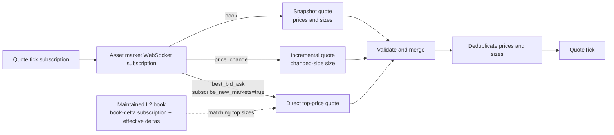

# Polymarket

Polymarket 创立于 2020 年，是一个去中心化预测市场平台，交易者通过买卖结果代币
对事件结果进行押注。

NautilusTrader 通过 Polymarket 的中心限价订单簿（CLOB）API 提供数据与执行的
交易场所集成。

适配器以 Rust 实现，并在 `nautilus_trader.adapters.polymarket`
暴露给 Python，因此数据、执行、签名与 WebSocket 操作在 Rust 与 Python 下行为
一致。

适配器为多种钱包配置处理订单准备与签名。本指南涵盖行情数据、交易执行、会话密钥
管理，以及 Deposit Wallet 的持仓操作。

## 安装 {#installation}

Python 包已包含 Polymarket 适配器，不需要额外的适配器专用 extra。

安装最新的预发布构建：

```bash
uv pip install --pre nautilus_trader
```

要从源码构建 Python 包，在仓库根目录运行：

```bash
make build-debug
```

开发用 wheel 与源码构建的前置条件见
[安装指南](./../getting_started/installation.md)。

## 示例 {#examples}

Rust 的维护中示例位于
[`crates/adapters/polymarket/examples`](https://github.com/nautechsystems/nautilus_trader/tree/develop/crates/adapters/polymarket/examples)。
Python 请使用 Rust 原生的
[数据测试器](https://github.com/nautechsystems/nautilus_trader/blob/develop/examples/live/polymarket/data_tester.py)、
[执行测试器](https://github.com/nautechsystems/nautilus_trader/blob/develop/examples/live/polymarket/exec_tester.py)
或 [Up/Down 冒烟测试器](https://github.com/nautechsystems/nautilus_trader/blob/develop/examples/live/polymarket/updown_smoke_tester.py)。
执行测试器的配置应用了 Polymarket 市价卖单所需的
[收尾精度](#exec-tester-close-residuals)。

## 二元期权 {#binary-options}

[二元期权](https://en.wikipedia.org/wiki/Binary_option)
是一种奇异期权合约，交易者就一个是或否的命题结果下注。预测正确则获得固定赔付，
否则一无所获。NautilusTrader 把 Polymarket 的结果代币表示为
`BinaryOption` 金融工具。

Polymarket 使用 [pUSD](#pusd) 作为交易抵押代币。

## Polymarket 文档 {#polymarket-documentation}

可用的 Polymarket 资源：

- [Polymarket Learn](https://learn.polymarket.com/)：平台用户指南。
- [Polymarket CLOB API](https://docs.polymarket.com/getting-started/api)：与
  Polymarket CLOB API 交互的开发者技术文档。

## 概览 {#overview}

下列 Rust 组件可组合或单独使用，实现实时行情与交易执行：

- `PolymarketWebSocketClient`：基于 Nautilus Rust
  `WebSocketClient` 的底层 WebSocket API 连接。
- `PolymarketInstrumentProvider`：`BinaryOption`
  金融工具的解析与加载。
- `PolymarketDataClient`：行情数据流管理器。
- `PolymarketExecutionClient`：交易执行网关。
- `PolymarketDataClientFactory`：Polymarket
  数据客户端工厂（由实时节点构建器使用）。
- `PolymarketExecutionClientFactory`：Polymarket
  执行客户端工厂（由实时节点构建器使用）。
- `PolymarketPositionClient`：Deposit Wallet
  的分拆、合并与赎回操作。
- `PolymarketSessionKeyClient`：由所有者操作的会话授权、列出与撤销。

:::note
Python 用户通过导出的配置与工厂类配置实时节点，通过
`PolymarketPositionClient`
调用持仓操作、通过 `PolymarketSessionKeyClient`
做会话管理。直接的 WebSocket、provider、数据客户端与执行客户端类型是仅 Rust
的实现组件。
:::

## pUSD {#pusd}

**pUSD** 是 Polymarket 交易使用的抵押代币，是 Polygon 上由 USDC
背书的标准 ERC-20 代币。

代理合约地址为 Polygon 上的
[0xC011a7E12a19f7B1f670d46F03B03f3342E82DFB](https://polygonscan.com/address/0xC011a7E12a19f7B1f670d46F03B03f3342E82DFB)。
直接的链上注资通过
[CollateralOnramp](https://docs.polymarket.com/resources/contracts)
把 Polygon USDC.e（跨链桥接的 USDC）包装为 pUSD。Bridge
API 也能从其他链存入受支持资产，转换后记入 pUSD。

## 钱包与账户 {#wallets-and-accounts}

要通过 NautilusTrader 在 Polymarket 交易，需使用 Polygon 兼容钱包，例如
MetaMask。

### 签名类型 {#signature-types}

Polymarket 为订单签名与校验支持多种签名类型：

| 签名类型     | 钱包类型                     | 说明                                                                      | 使用场景                                                                                     |
| ------------ | ---------------------------- | ------------------------------------------------------------------------- | ---------------------------------------------------------------------------------------------- |
| `0`          | EOA（外部拥有账户）          | 由直接掌握私钥的钱包产生标准 EIP-712 签名。                               | **适配器默认。** 出资方与签名方同一地址、且 EOA 在允许列表内的交易。                           |
| `1`          | Proxy Wallet                 | 通过邮箱或社交登录创建的旧版智能合约钱包。                                | 需要 Proxy Wallet 的 `funder` 地址。                                                           |
| `2`          | Safe Wallet                  | 用外部浏览器钱包创建的旧版 Gnosis Safe 钱包。                             | 需要 Safe Wallet 的 `funder` 地址。                                                            |
| `3`          | Deposit Wallet               | 新版 Polymarket 账户钱包使用的 ERC-1271 智能钱包。                        | 需要 Deposit Wallet 的 `funder`；API 凭据仍绑定在签名方上。                                   |

:::info
2026 年 5 月 4 日及之后部署的账户钱包，Polymarket 使用 Deposit
Wallet。直接 EOA 交易要求在允许列表内的 EOA。账户类型与设置流程见
Polymarket 的[钱包与鉴权指南](https://docs.polymarket.com/trading/wallets-auth)。
:::

NautilusTrader 默认使用签名类型 0（EOA）。要用其他受支持的钱包类型，设置
`signature_type`。代理签名客户端在构造时若 `funder`
缺失或等于签名地址，会直接失败。

环境变量为每个 trader 实例提供单一钱包地址。要用多个钱包，请配置独立的执行客户端
实例。

提交订单前先为钱包注入 pUSD。未注资的钱包会产生 "not enough balance or
allowance" API 错误。

### 设置 EOA 授权 {#setting-eoa-allowances}

适配器为 EOA 账户提供一条直接的链上授权命令。仅当出资钱包就是签名方
（`PolymarketSignatureType::Eoa`）时使用。给 EOA 注入 POL
作为 gas，设置 `POLYMARKET_PK`，然后运行：

```bash
cargo run -p nautilus-polymarket --bin polymarket-set-allowances
```

该命令为 CTF Exchange、Neg Risk CTF Exchange 与
`NegRiskCtfCollateralAdapter`
授予 pUSD 与 CTF 的最大授权。默认使用
`https://polygon.drpc.org`；要改用其他 Polygon RPC
端点，设置 `POLYGON_RPC_URL`。Polymarket
变更所需合约后请重新运行。

该命令只做授予，不撤销已不再是目标的合约上的既有授权。撤销要作为独立的链上操作
处理。提交撤销前，确认没有任何仍在进行的赎回或结算流程还需要那份旧授权。

### 设置智能钱包授权 {#setting-smart-wallet-allowances}

不要为 proxy、Safe 或 Deposit Wallet 出资方运行 EOA
命令。它用 EOA 私钥签名交易，无法从智能合约钱包授予授权。

用 Polymarket 的
[钱包与鉴权流程](https://docs.polymarket.com/trading/wallets-auth)
从账户钱包提交授权。Deposit Wallet
的授权使用由签名方授权、经 Relayer 提交的有序
`WALLET` 批次。Safe 与 Proxy Wallet 的授权需要各自钱包专用
SDK 载荷。

### 刷新与校验授权 {#refreshing-and-verifying-allowances}

授权交易确认后，刷新 CLOB
缓存。Rust 调用方可对 pUSD 用
`PolymarketClobHttpClient::update_balance_allowance`
配 `AssetType::Collateral`；条件代币授权则用
`AssetType::Conditional` 加条件代币
ID。两种形式都需要账户的签名类型。该带鉴权的请求映射到
`GET /balance-allowance/update`。Deposit Wallet
使用 `PolymarketSignatureType::Poly1271`。

balance-allowance 端点有两条解码路径：

| 路径                                              | 用途                                                 | 授权处理                                                                                                                                                                       | 成功含义                                                                           |
| ------------------------------------------------- | ---------------------------------------------------- | -------------------------------------------------------------------------------------------------------------------------------------------------------------------------------- | ------------------------------------------------------------------------------------ |
| `PolymarketClobHttpClient::get_balance_allowance` | 读取支出方授权证据。                                 | 要求复数 `allowances` 映射；拒绝缺失的映射、非空的旧版单数字段、畸形或非规范键，以及大小写变体这类语义重复。                                                                   | 余额加一份无歧义的映射；必需的目标与金额仍需检查。                                   |
| 内部仅余额投影                                    | 账户状态刷新与市价买单费用调整。                     | 忽略授权字段；其返回类型无法暴露或授予批准权限。                                                                                                                               | 仅余额；必需的 CLOB 支出方授权仍未证实。                                             |

凡决策依赖授权证据，就走严格路径，避免含混的线上数据变成批准权限。

### 账户余额 {#account-balances}

#### 余额计算 {#balance-calculation}

余额刷新使用交易场所报告的 pUSD
总额，锁定抵押品从执行客户端的本地状态推导：

- 该账户未结 BUY 订单的预占，用缓存的限价与剩余数量计算。
- 其 BUY
  成交的名义价值与佣金——场所总额可能仍包含它们。

预占不含已提交但尚未被接受的订单，也不不含不在执行缓存中的订单。SELL
订单预占的是结果代币而非 pUSD，不计入锁定抵押品。

**未结算的 BUY 支出**：已知
BUY 成交之后的下一次刷新，从其名义价值加佣金中扣减自由余额，同时扣减按同一快照
计量的其他未结算 BUY 支出。

当场所总额自该快照起下降至少达到合计金额时，这些金额一起释放，因此已被扣减的
总额不会被二次扣减。在那之前，锁定的未结算支出只是尚未被下降覆盖的那部分未结
支出。若刷新的场所总额没有变化，未结支出继续保持锁定。

**作废（void）**：一次作废立即从锁定抵押品中移除该笔成交的支出。后续的作废修订
是累计的，因此只移除增量。被作废的金额仍计入释放其他未结支出所要求的下降量。对
从未锁定的成交做作废，不会抬高该门槛。当不再有未结支出时，下一次刷新释放被作废
的金额并推进快照。

适配器不锁定以下 BUY 成交：

- 首次由终局 REST
  证据应用的成交，包括已确认的成交报告，因为这类证据只在交易确认后才被采纳。
- 比快照旧 15 秒以上的对账成交，或在任何快照之前收到的成交。

锁定抵押品以报告总额为上限，自由余额等于总额减锁定，遵循[余额模型](./../concepts/accounting.md#balance-model)。

#### 刷新时机 {#refresh-timing}

适配器在 connect
时从执行缓存为预占播种，并随核心处理订单事件（含对账事件）更新预占与未结算
BUY 支出。传输层重连保留未结算 BUY 支出，重置则清空它。首次余额刷新早于启动
对账，对账期间发现的订单在下一次刷新时影响余额。

刷新发生在 connect
时、账户查询后、已最终化的成交更新后，以及用户
WebSocket 重连时。若余额响应晚于更新的刷新、晚于执行客户端重连或晚于客户端重置到达，
则不予应用。用户 WebSocket
重连不会丢弃在途刷新，更新的刷新仍然优先。账户余额不随每个订单事件变化，余额刷新
不请求未结订单。

:::warning
**这些余额是估计值。** HTTP
余额响应与订单事件可能反映不同时刻，它们不保证资金在提交前已被预留。

时间效应包括：

- 抵押品入账（包括自有 SELL
  的结算）可能在场所总额已反映扣减之后，仍让未结算 BUY 支出保持锁定。该占用仅限
  尚未被下降覆盖的部分。
- 一笔无关的扣减可能在该成交真正扣减之前就释放这笔支出。
- 金额从未离开场所总额的作废，可能让那笔未覆盖的缺口在其他未结算支出仍未结期间
  保持锁定。
- 仍在扣减窗口内的确认，可能把终局 REST 的
  BUY 支出报告为自由余额，直到后续某次刷新。
- 在排队的成交被处理之前应用的刷新，可能让该成交在总额已扣减后仍保持锁定。

适配器不会锁定同一出资方上其他客户端的成交支出，也不会锁定它尚未收到的成交。
:::

## API 密钥 {#api-keys}

### CLOB 凭据 {#clob-credentials}

执行客户端需要 CLOB L2
凭据。用 Polymarket 的
[API 鉴权流程](https://docs.polymarket.com/getting-started/api#authentication)
创建或推导它们。适配器提供一条命令，读取
`POLYMARKET_PK`
并打印创建或推导出的凭据：

```bash
cargo run -p nautilus-polymarket --bin polymarket-create-api-key
```

把返回的值设为：

- `POLYMARKET_API_KEY`
- `POLYMARKET_API_SECRET`
- `POLYMARKET_PASSPHRASE`

这些凭据为私钥签名方鉴权，不是为
proxy 或 Deposit Wallet 出资方。数据客户端只在
[PolyBolt 参考价订阅](#polybolt-reference-prices)中需要它们。

### Relayer 凭据 {#relayer-credentials}

Deposit Wallet 的分拆、合并与赎回操作还需要
Relayer API 密钥。按
[连接你的账户](https://docs.polymarket.com/trading/wallets-auth#connect-your-account)
的说明在 Settings > API Keys > Relayer API Keys
下创建，然后设置：

- `POLYMARKET_RELAYER_API_KEY`
- `POLYMARKET_RELAYER_SIGNER_ADDRESS`

`POLYMARKET_RELAYER_SIGNER_ADDRESS`
是创建 Relayer 密钥时显示的签名方地址。持仓客户端还会读取
`POLYMARKET_PK` 与 `POLYMARKET_FUNDER`。

### Builder 凭据 {#builder-credentials}

会话授权与撤销需要为 session-key API
批准的 Builder 凭据，与持仓操作用的 Relayer API
密钥相互独立。按 Polymarket 的
[session-key 要求](https://docs.polymarket.com/trading/session-keys)操作，并把这些值
保存在所有者的管理环境中：

- `POLYMARKET_BUILDER_API_KEY`
- `POLYMARKET_BUILDER_API_SECRET`
- `POLYMARKET_BUILDER_PASSPHRASE`

### Deposit Wallet 校验 {#deposit-wallet-verification}

出资方等于签名地址时构造失败。签名之前，持仓客户端：

- 检查规范 Polygon
  工厂预测的当前与旧版 Deposit Wallet 地址。
- 要求钱包已部署合约代码，并校验签名方拥有该钱包。
- 从钱包的链上计数器读取签名 nonce。

Polygon RPC 默认
`https://polygon.drpc.org`。要改用其他受信任的 Polygon
端点，向 `PolymarketPositionClient`
构造函数传入 `base_url_rpc`。

## 会话密钥 {#session-keys}

会话密钥让独立的签名方为 Deposit Wallet
交易，而不把其所有者的私钥交给交易运行时。适配器支持
CLOB 作用域的授权。场所准入与 Builder
批准要求见 Polymarket 的
[session-key 文档](https://docs.polymarket.com/trading/session-keys)。

### 管理访问 {#administer-access}

在**所有者的管理环境**中运行
`PolymarketSessionKeyClient`，每个钱包只用一个管理进程。授权会话之前：

- 显式提供所有者私钥、所有者 CLOB
  凭据、Builder 凭据与 Deposit Wallet
  地址。客户端自身不读取环境变量。
- 另行生成并安全保存会话密钥对，只把其公开地址传给授权方法。

Python 示例从管理进程的环境读取凭据并传入客户端：

```python
import os

from nautilus_trader.adapters.polymarket import PolymarketSessionKeyClient
from nautilus_trader.adapters.polymarket import PolymarketSessionKeyClientConfig

admin = PolymarketSessionKeyClient(
    PolymarketSessionKeyClientConfig(
        private_key=os.environ["POLYMARKET_PK"],
        api_key=os.environ["POLYMARKET_API_KEY"],
        api_secret=os.environ["POLYMARKET_API_SECRET"],
        passphrase=os.environ["POLYMARKET_PASSPHRASE"],
        builder_api_key=os.environ["POLYMARKET_BUILDER_API_KEY"],
        builder_api_secret=os.environ["POLYMARKET_BUILDER_API_SECRET"],
        builder_passphrase=os.environ["POLYMARKET_BUILDER_PASSPHRASE"],
        funder=os.environ["POLYMARKET_FUNDER"],
    ),
)

# Use the public address derived from the separately stored session private key.
session_address = os.environ["SESSION_ADDRESS"]

# Run these calls from an async function in the administration process.
key = await admin.authorize_session_key(session_address)
keys = await admin.list_session_keys()
```

可选配置：

- `base_url_http` 覆盖生产 CLOB 端点。
- `base_url_relayer` 覆盖生产 Relayer 端点。
- `proxy_url` 为两个客户端配置 HTTP 或 HTTPS 代理。

Rust 示例提供同样的授权与列出操作：

```bash
cargo run -p nautilus-polymarket --example polymarket-session-keys -- authorize "$SESSION_ADDRESS"
cargo run -p nautilus-polymarket --example polymarket-session-keys -- list
```

每个管理方法各有明确的完成条件：

| 方法                    | 成功返回要求                                                                |
| ----------------------- | ---------------------------------------------------------------------------- |
| `authorize_session_key` | 链上确认；注册表与地址、CLOB 作用域及到期时间匹配                            |
| `list_session_keys`     | 校验通过的活跃、未过期注册表条目                                             |
| `revoke_session_key`    | 链上确认；密钥已不在活跃注册表中                                             |

#### 到期 {#expiration}

授权在 4,315 小时后到期，与官方 SDK 的线上取值一致。Polymarket 把该周期描述为
180 天，但其原始示例与 SDK 用的值短了 5 小时。返回的
`valid_until` 是 Unix 秒计的精确到期时间。

#### 恢复被中断的操作 {#recover-an-interrupted-operation}

授权或撤销超时、遇到传输失败或被取消后，用**同一操作、同一地址、同一客户端**
重试。客户端保留已签名的请求与幂等键，并在挂起操作定案之前拒绝其他变更。

保持客户端存活直到操作定案：挂起请求保存在内存中。结果未知的错误包含幂等键与
任何已知交易 ID，便于诊断。

:::warning
已签名批次有 **600 秒期限**。未被接受的请求过期后，重试无法创建新批次，客户端
保持阻塞。先对账注册表与 Relayer
结果，再创建新客户端。进程重启后同样需要这份对账。
:::

### 配置会话交易 {#configure-session-trading}

用**会话私钥**创建或推导 CLOB
凭据，走既有的 [CLOB
凭据流程](#clob-credentials)。会话模式要求：

- 显式的会话凭据与 `funder`，不回退到环境中的所有者凭据。
- `PolymarketSignatureType.Poly1271`，其他钱包签名类型一律拒绝。

:::info
把所有者与 Builder 凭据留在交易运行时之外。
:::

下例中 `session_private_key`
是另行保存的会话密钥，`session_api_key`、
`session_api_secret` 与
`session_passphrase` 是其返回的 CLOB 凭据：

```python
from nautilus_trader.adapters.polymarket import PolymarketExecutionClientConfig
from nautilus_trader.adapters.polymarket import PolymarketSignatureType
from nautilus_trader.adapters.polymarket import PolymarketSignerType

execution = PolymarketExecutionClientConfig(
    signer_type=PolymarketSignerType.Session,
    signature_type=PolymarketSignatureType.Poly1271,
    private_key=session_private_key,
    api_key=session_api_key,
    api_secret=session_api_secret,
    passphrase=session_passphrase,
    funder=deposit_wallet_address,
)
```

既有配置默认 `PolymarketSignerType.Owner`。

#### 对账与重启 {#reconciliation-and-restarts}

订单、成交与通知的作用域是会话的活动。对账要求会话 API
密钥与订单归属匹配，仅共享钱包地址不构成归属。

会话的 cancel-all
取消已知订单 ID，不使用钱包级的全市场取消。mass status
包含会话的订单与成交，但不含钱包级持仓。直接持仓查询返回错误，因为钱包持有量
无法确定会话的持仓。

据此配置节点：

- **持仓检查**：把
  `LiveExecutionEngineConfig.position_check_interval_secs=None`
  关闭节点的周期持仓检查。
- **跨重启的历史**：配置[缓存数据库持久化](./../concepts/cache.md#database-configuration)
  并保持 `load_cache=True`，保留订单与成交历史。

### 撤销或轮换访问 {#revoke-or-rotate-access}

在管理环境中轮换密钥。切换凭据前先协调好未结订单与对账：**新会话不会继承对旧
会话订单的可见性**。

要撤销密钥，用上面创建的管理客户端，在 async 函数中调用：

```python
await admin.revoke_session_key(session_address)
```

或运行 Rust 示例：

```bash
cargo run -p nautilus-polymarket --example polymarket-session-keys -- revoke "$SESSION_ADDRESS"
```

:::warning
过期或被撤销的权限会导致场所拒单。实时传输连接仍在，并不能证明授权仍然有效。
:::

## 持仓操作 {#position-operations}

`PolymarketPositionClient`
把 pUSD 拆分为完整的结果代币组，把完整组合并回
pUSD，并赎回已结算的持仓。该客户端仅支持 Deposit Wallet
（`PolymarketSignatureType::Poly1271`），Safe、Proxy
与 EOA 路径不可用。它不部署钱包、不合并无关调用批量提交、不支持把合并数量设为
`"max"`，也不自动赎回持仓。

### 输入与授权 {#inputs-and-approvals}

每个操作先按条件 ID
在公共 CLOB 上查找市场，`neg_risk`
缺失即报错，随后选定规范 pUSD 代币与标准或负风险抵押品适配器。调用方传入带
0x 前缀的 32 字节条件 ID，不需要提供合约地址。

- **拆分与合并数量**：正的 pUSD 小数，必须能被 6
  位小数精确表示，不做舍入。数量用 pUSD 单位而非最小单位，不接受 `"max"`。
- **赎回**：无数量参数，赎回两个二元索引组 `[1, 2]`。

**授权不会自动提交。** 提交操作前先在 Deposit Wallet 上完成授权：

| 操作         | 市场抵押品适配器所需授权             |
| ------------ | ------------------------------------ |
| 拆分         | 花费钱包的 pUSD                      |
| 合并或赎回   | 以 Conditional Tokens 运营者身份操作 |

`polymarket-set-allowances`
的授权计划中没有标准抵押品适配器，负风险适配器在其中。该命令用 EOA
签名授权，无法为 Deposit Wallet
授予任何一项。请用 Polymarket 的
[钱包与鉴权流程](https://docs.polymarket.com/trading/wallets-auth)
从 Deposit Wallet 授予持仓操作所需授权。

### 提交与等待 {#submit-and-wait}

下面的示例展示一次拆分提交。运行前把示意性的条件 ID
换成市场真实的条件 ID。

```python
from decimal import Decimal

from nautilus_trader.adapters.polymarket import PolymarketPositionClient

condition_id = "0x" + "11" * 32
client = PolymarketPositionClient()
transaction = await client.split_position(condition_id, Decimal("1"))
outcome = await transaction.wait()
```

`split_position` 与
`merge_positions`
接受条件 ID 和一个正的 pUSD
`Decimal`；`redeem_positions`
只接受条件 ID。每个方法在 Relayer
提交后返回 `PolymarketPositionTransaction`。
调用一次 `wait()` 轮询直到拿到
`PolymarketPositionOutcome`。同一个
Python 句柄上第二次 `wait()`
会抛出异常。句柄在开始等待后保留其
`transaction_id`，取消或出错之后也保留。

### 结果与错误 {#outcomes-and-errors}

| `PolymarketPositionOutcome.status` | 含义                                |
| ---------------------------------- | ----------------------------------- |
| `confirmed`                        | Relayer 报告 `STATE_CONFIRMED`。    |
| `failed`                           | Relayer 报告 `STATE_FAILED`。       |
| `invalid`                          | Relayer 报告 `STATE_INVALID`。      |

每个结果都暴露 `transaction_id`。confirmed 与 failed
结果在 Relayer 提供时暴露
`transaction_hash`；invalid 结果始终返回
`None`。failed 与 invalid
结果在 Relayer 提供时还暴露 `error_msg`。

#### 提交错误 {#submit-errors}

HTTP 拒绝发生在交易句柄存在之前。超时的提交，或没有
`transaction_id` 的成功响应，同样抛异常。链上结果未知。

客户端**不重试提交**。

#### 等待超时 {#wait-timeout}

默认 120 秒，在轮询请求之间检查。在途请求或轮询延迟会让实际耗时超过该值。超时
抛出的错误会带 Relayer 交易 ID，终态仍未知。Python
不暴露 Rust 的等待超时与轮询间隔设置方法。

#### 响应校验 {#response-validation}

Relayer 重定向会被拒绝；轮询会拒绝交易 ID
与提交 ID 不一致的响应。

### 提交协调 {#submission-coordination}

同一进程内的客户端为每个钱包共享提交状态。后续操作要求匹配的终局 Relayer
结果与已推进的钱包 nonce。未推进
nonce 的失败或无效操作会一直处于阻塞。

签名后，客户端在发送批次之前先记录一条预留。随后发生 HTTP
拒绝、超时、取消或无交易 ID 的响应时，即便重建客户端，该钱包的后续操作仍被阻塞。
预留之前的失败——例如非法数量或钱包校验失败——不会造成新的阻塞。仅凭 HTTP
状态无法证明已签名批次不会执行。

:::warning
不要重启后盲目重试一次结果未知的提交。进程重启清掉本地提交状态，但不会取消一笔
已签名的交易。每个钱包只用一个提交进程。协调不跨进程，也不覆盖外部钱包工具。
:::

### 恢复结果未知的提交 {#recover-an-unknown-submission}

#### 保留提交记录 {#retain-the-submission-record}

提交持仓操作之前开启并保留 INFO
日志。每次提交请求之前，客户端会输出一条
`Deposit Wallet submission`
记录，包含：

- 钱包地址、预留 nonce 与签名期限（Unix 秒）。
- 操作、目标合约与 value。
- 标识条件的未签名 calldata，拆分或合并时还含数量。

该记录不含签名与凭据，但含交易意图。请限制对保留日志的访问。返回句柄带交易 ID
时务必留存。

:::warning
日志不是持久化的交易日记。日志关闭或进程崩溃可能不留任何记录，导致没有进一步
证据就无法安全恢复。
:::

#### 重试之前先对账 {#reconcile-before-retrying}

1. **停止提交。** 包括使用该钱包的其他进程与外部钱包工具。
1. **确认操作是否已执行。** 找到提交记录与任何 Relayer
   交易 ID，把预定的钱包、目标与 calldata
   同最终化的链上交易回执及其效果做匹配。仅凭成功的 HTTP
   响应、Relayer 失败或已推进的 nonce，都不能确定预定操作是否执行。若已执行，
   不要重复。
1. **执行未知期间让钱包保持阻塞。** 要按到期对账，完成下面全部[到期检查](#expiry-checks)。
   若 nonce 已推进，检查消耗它的那笔交易，而不是假定失败。
1. **重启之前先证明重试是安全的。** 既要确定预定操作未执行，也要确定原签名批次
   已无法执行。若记录缺失、RPC
   无法提供一致的最终化状态，或合约行为未经验证，先与 Polymarket
   澄清不确定性再重试。

#### 到期检查 {#expiry-checks}

签名期限默认为签名后 1,800 秒。Rust
调用方可用 `with_deadline_secs`
修改。更长的期限会推迟基于到期的恢复。
`wait()` 超时既不缩短签名期限，也不取消批次。

先验证部署的钱包合约确实强制签名期限、并在批次执行时消耗其
nonce。然后用 `eth_call`
在 Polygon 的某个最终化区块读取钱包的
`nonce()`，并取得同一区块的时间戳。两者都要满足：

- nonce 相对预留值未变。
- 区块时间戳严格晚于签名期限。

本地经过的时间不足以作证明。nonce
已推进时必须检查消耗它的那笔交易，它不能证明失败。

客户端不会自动执行这些恢复检查或释放预留。识别部署合约时查
[Polymarket 合约注册表](https://docs.polymarket.com/resources/contracts)，按区块调用查
[JSON-RPC 参考](https://ethereum.org/en/developers/docs/apis/json-rpc/)。

## 配置 {#configuration}

通过下列参数或其环境变量回退配置签名与鉴权：

| 参数          | 环境变量                | 用途                                                         |
| ------------- | ----------------------- | -------------------------------------------------------------- |
| `private_key` | `POLYMARKET_PK`         | 按 `signature_type` 为订单签名的钱包密钥                     |
| `funder`      | `POLYMARKET_FUNDER`     | pUSD 出资钱包地址                                            |
| `api_key`     | `POLYMARKET_API_KEY`    | CLOB L2 API 密钥                                             |
| `api_secret`  | `POLYMARKET_API_SECRET` | CLOB L2 API secret                                           |
| `passphrase`  | `POLYMARKET_PASSPHRASE` | CLOB L2 API 口令                                             |

owner 模式下，参数未显式提供时客户端读取其环境变量。会话模式要求显式凭据与
funder。CLOB L2 凭据为私钥签名方鉴权。`POLY_1271`
下 Deposit Wallet 仍是 `funder`，但不是 L2 鉴权地址。

:::tip
用环境变量提供凭据，避免把凭据嵌进客户端配置代码。
:::

金融工具加载还有两个常用开关：

- `auto_load_missing_instruments`（默认
  `True`）：对未缓存金融工具的订阅与请求命令会触发一次临时
  Gamma API 加载。关闭时，订阅未缓存的金融工具直接返回错误。见[运行时金融工具加载](#runtime-instrument-loading)。
- `auto_load_debounce_ms`（默认 `100`）：把并发自动加载请求合并为单次批量
  Gamma 调用的窗口（毫秒）。

## 数据能力 {#data-capability}

Polymarket 支持实时 `L2_MBP`
订单簿增量、报价、成交，以及结算的
`InstrumentStatus`/`InstrumentClose`
事件。金融工具定义由引导加载、配置刷新、按需加载、单工具请求、新市场发现与
tick 尺寸变更发布。

## 订单能力 {#orders-capability}

Polymarket 支持下列订单类型与指令。

:::tip
Polymarket 实时执行请把断连超时与停机后延迟都设为 30
秒：`with_timeout_disconnection_secs(30)` 与
`with_delay_post_stop_secs(30)`。延迟让残余的订单与撤单事件在断连前到达。执行
断连在该超时内完成，不会等完在途命令的 HTTP 超时。
:::

断连收尾时仍在途的撤单会让订单停留在
`PENDING_CANCEL`，适配器既不发
`OrderCanceled` 也不发
`OrderCancelRejected`，场所可能应用了也可能没应用该撤单。下一次运行的启动
对账会将其定案。策略侧的撤单不会这样处理，因为订单已在待撤状态。其他在途的提交与
修改命令受同一界限约束，未确认的会保持未定案。

### 订单类型 {#order-types}

| 订单类型               | 二元期权 | 说明                                                                      |
| ---------------------- | -------- | --------------------------------------------------------------------------- |
| `MARKET`               | ✓        | **BUY 订单必须用 quote 数量**，SELL 订单必须用 base 数量。                  |
| `LIMIT`                | ✓        | BUY 可接受 base 或 quote 数量；SELL 必须用 base。                           |
| `STOP_MARKET`          | -        | *Polymarket 不支持*。                                                       |
| `STOP_LIMIT`           | -        | *Polymarket 不支持*。                                                       |
| `MARKET_IF_TOUCHED`    | -        | *Polymarket 不支持*。                                                       |
| `LIMIT_IF_TOUCHED`     | -        | *Polymarket 不支持*。                                                       |
| `TRAILING_STOP_MARKET` | -        | *Polymarket 不支持*。                                                       |

### 数量语义 {#quantity-semantics}

Polymarket 按订单类型、方向与
`quote_quantity` 设置不同地解释订单数量：

- **`quote_quantity=False` 的限价单**把
  `quantity` 解释为条件代币数量（base 单位）。
- **`quote_quantity=True` 的限价 BUY**把
  `quantity` 解释为 pUSD 抵押品。
- **市价 BUY** 把 `quantity` 解释为
  **pUSD** 的 quote 名义价值。
- **市价 SELL** 使用 base 单位数量。

不支持以 quote 计量的限价 SELL
订单，适配器在提交前拒绝。它也拒绝任何在两位小数的签名界限上 base 或 quote
数量被截断为零的限价单。

#### 限价 BUY 示例 {#limit-buy-example}

对 `quote_quantity=True` 的限价 BUY：

- 适配器把抵押品截断到分，签名为其 maker
  金额，并按市场的数量精度推导份额数。
- 在处理场所响应之前，把本地订单更新为签名的份额数量。
- 签名金额必须精确保住限价。否则适配器在 HTTP
  之前就拒绝订单。例如 10.00 pUSD 按
  0.33 无法表示，而 9.90 pUSD 按 0.33
  恰好产出 30 份。

要用抵押品上限约束限价 BUY，设置 `quote_quantity=True`：

```python
# Limit BUY with quote quantity (spend $10 pUSD at a limit price of 0.50)
order = strategy.order_factory.limit(
    instrument_id=instrument_id,
    order_side=OrderSide.BUY,
    quantity=instrument.make_qty(10.0),
    price=instrument.make_price(0.50),
    time_in_force=TimeInForce.GTC,
    quote_quantity=True,
)
strategy.submit_order(order)
```

#### 市价 BUY 示例 {#market-buy-example}

市价 BUY **必须用 quote 数量**：设置
`quote_quantity=True`。适配器在提交到 CLOB
之前把 quote 金额（pUSD）换算为签名的 base 单位份额数。Polymarket
执行客户端拒绝以 base 计价的市价买，以防意外成交。以
base 计价数量提交的市价 BUY 可能执行远超预期的规模。

```python
# Market BUY with quote quantity (spend $10 pUSD)
order = strategy.order_factory.market(
    instrument_id=instrument_id,
    order_side=OrderSide.BUY,
    quantity=instrument.make_qty(10.0),
    time_in_force=TimeInForce.IOC,  # Maps to Polymarket FAK
    quote_quantity=True,  # Interpret as pUSD notional
)
strategy.submit_order(order)
```

### 执行指令 {#execution-instructions}

| 指令          | 二元期权 | 说明                                                 |
| ------------- | -------- | ------------------------------------------------------ |
| `post_only`   | ✓        | 仅对 `GTC` 或 `GTD` 的限价单支持。                     |
| `reduce_only` | -        | *Polymarket 不支持*。                                  |

### 有效期选项 {#time-in-force-options}

Polymarket 把 `POST /order`
的该字段称为 `orderType`，在 NautilusTrader
中映射到 `TimeInForce`。合法组合取决于 Nautilus
订单类型：

| Nautilus TIF | Polymarket `orderType` | Nautilus 订单范围      | 说明                                                      |
| ------------ | ---------------------- | ---------------------- | ----------------------------------------------------------- |
| `GTC`        | `GTC`                  | 仅 `LIMIT`             | Good-Til-Cancelled；挂在订单簿上。                          |
| `GTD`        | `GTD`                  | 仅 `LIMIT`             | Good-Til-Date；挂到到期、成交或撤单。                       |
| `FOK`        | `FOK`                  | `LIMIT` 或 `MARKET`    | 立即全量成交，否则整单取消。                                |
| `IOC`        | `FAK`                  | `LIMIT` 或 `MARKET`    | 立即成交可得数量并取消剩余。                                |

Polymarket 对 NautilusTrader 称为
`IOC`（Immediate or Cancel）的语义使用
`FAK`（Fill-And-Kill）。Polymarket
文档把 `FOK` 与 `FAK`
归为市价订单类型，`GTC` 与 `GTD`
归为限价订单类型。对 Nautilus 的
`MARKET` 订单，适配器只接受
`IOC` 与 `FOK`；`GTC` 与
`GTD` 只对挂单的 `LIMIT` 订单有效。

#### GTD 到期 {#gtd-expiry}

`GTD` 到期时间至少要设在提交后三分钟。更短的到期适配器在签名前拒绝。它使用整
Unix 秒，接受恰好三分钟的边界。

Polymarket 把用户撤单与 GTD
到期都报告为 `CANCELED`。它比你给的到期时间提前一分钟过期，因此最短有效寿命约
两分钟。要获得 N 秒的有效寿命，提交
`now + 60 + N`，且仍受三分钟下限约束。

用户频道上，发生在那一分钟标记及之后的
`CANCELED` 事件会变成
`OrderExpired`；更早的撤单保持
`OrderCanceled`；经 REST
恢复的撤单也保持 `OrderCanceled`。未结订单载荷带到期时间，但没有撤单时间。

`manage_gtd_expiry` 保持
false。策略定时器在声明的到期时间触发并提交撤单，不发
`OrderExpired`。用户频道的到期已经会清掉该定时器。

若错过了到期消息，迟到的撤单不会收尾订单，仍需靠对账处理。见
[GTD 订单](https://docs.polymarket.com/trading/place-orders#limit-orders)。

### 最小订单规模 {#minimum-order-size}

从各市场的订单簿读取其
`min_order_size`，活跃市场通常报告 5
份。名义价值低于 **1 pUSD**
的可成交订单也可能被拒，
`invalid amount for a marketable BUY order … min size: $1`.

适配器不设置金融工具的
`min_quantity`，因为按 quote 计量的 BUY 数量用 pUSD，而按 base
计量的订单用份额。提交仍会把过小订单交给场所去拒。修改在撤单前后都检查缓存的份额
最小值。见[订单修改](#order-modification)。

### 高级订单功能 {#advanced-order-features}

| 功能         | 二元期权 | 说明                                                    |
| ------------ | -------- | --------------------------------------------------------- |
| 订单修改     | ✓        | 适配器为未结 `LIMIT` 订单管理的撤销-替换（cancel-replace）。 |
| 括号/OCO 单  | -        | *Polymarket 不支持*。                                     |
| 冰山单       | -        | *Polymarket 不支持*。                                     |

#### 订单修改 {#order-modification}

Polymarket 没有原地修改端点。执行客户端撤掉当前场所订单，对其最终确认的成交做
对账，再就剩余数量签名一笔替换单。

##### 替换数量与标识 {#replacement-quantity-and-identity}

`ModifyOrder.quantity`
设定的是逻辑订单的绝对目标值，不是替换腿的值。替换单保留原
`ClientOrderId`，并获得新的 `VenueOrderId`。

逻辑数量使用场所精度归一化之后的确切签名 base
数量，因此可能略低于请求的目标值。

##### 规模检查 {#size-checks}

撤单之前，适配器从目标值中减去已成交数量与已作废且不会重开的数量，并拒绝低于
0.01 份的替换。

缓存金融工具的 `info["min_order_size"]`
存在时，以下情形适配器也会拒绝修改：

- 该值不是正的小数字符串。
- 签名的替换份额数量低于该最小值。
- 无法推导出规模检查所需的最小签名金额。

键缺失时跳过市场最小值检查。对
`FAK` 或 `FOK` 的
BUY，检查使用由截断到分的 pUSD
预算推导的份额。

撤单之后，适配器对剩余数量重复规模检查，使用修改开始时捕获的市场最小值，不重新读
订单簿。

撤单期间的成交可能留下规模不足的余量，适配器不会挂出它：修改被拒绝，订单以已取消
收尾。撤单后仍可成交的替换单也可能因低于 1 pUSD 被拒。

##### 含义不明的结果 {#ambiguous-outcomes}

只有撤单响应、已取消订单状态与确认成交的合计三者一致，适配器才提交替换单。

- **撤单含义不明**：发出 `OrderModifyRejected`。
- **替换单含义不明**：按其确定性的签名订单哈希保持在途。后续的订单更新、成交或
  对账可以确立它，不需要第二次
  `OrderAccepted`。在此之前，后续的修改与撤单命令保持阻塞。

替换恢复状态不跨执行客户端进程重启持久化。

### 批量操作 {#batch-operations}

| 操作     | 二元期权 | 说明                                                                                                                                |
| -------- | -------- | ------------------------------------------------------------------------------------------------------------------------------------- |
| 批量提交 | ✓        | 适配器对独立的限价单批次使用 `POST /orders`（每次请求至多 15 单）。见[批量提交](#batch-submit)。                                      |
| 批量修改 | -        | *Polymarket 不支持*。                                                                                                                 |
| 批量撤单 | ✓        | 适配器使用 `DELETE /orders`。见[批量撤单](#batch-cancel)。                                                                            |

#### 批量提交 {#batch-submit}

`SubmitOrderList`
命令路由到 Polymarket 的
`POST /orders`
端点。该端点每次请求至多接受 15
单（`BATCH_ORDER_LIMIT`），更长的列表拆成按序执行的 15
单分块。

- 只有 `LIMIT` 订单参与批量。列表中的
  `MARKET` 订单走单订单路径：签名可成交订单，并按 Nautilus
  `time_in_force` 以 `FAK` 或 `FOK` 提交。
- `reduce_only` 订单、按 quote
  计量的 SELL 订单，以及配上市价有效期（`IOC` 或
  `FOK`）的 `post_only` 在提交前被拒绝。
- 只有一笔符合条件的订单时退回
  `POST /order`，以保留单订单的重试语义。批量路径刻意禁用重试，
  因为场所不暴露幂等键。
- 批量响应漏掉某条腿时，该订单保持已提交状态等待对账。适配器登记该签名订单的预期
  哈希，使后续的 WebSocket 事件与撤单仍能解析到本地订单。响应缺失不能证明场所
  拒绝了该订单。

#### 批量撤单 {#batch-cancel}

已解析出场所订单 ID 的
`BatchCancelOrders` 命令使用 Polymarket 的
[`DELETE /orders`](https://docs.polymarket.com/api-reference/trade/cancel-multiple-orders)
端点。适配器按序发送分块，每个新分块的大小取该端点 1,000
个 ID 上限与签名方当前撤单突发额度中较小者。签名方从 Standard
的 120
令牌突发起步，某次响应报告的层级作用于下一个新分块。

每个分块用相同的订单 ID
独立重试，除非响应报告的更低层级要求先缩小分块再重试。适配器合并已完成的响应，在
所有分块都成功后对每个被请求的订单只处理一次。若后面的分块耗尽重试，先前的分块可能
已改变场所状态。适配器不发出部分逐单结果，整体未知的结果由对账定案。

`CancelAllOrders` 按如下规则选择取消范围：

| 模式    | 方向过滤        | 范围                                                             | 端点                           |
| ------- | --------------- | ---------------------------------------------------------------- | ------------------------------ |
| Owner   | 无              | 所选结果代币，跨执行账户下所有策略                               | `DELETE /cancel-market-orders` |
| Owner   | `Buy` 或 `Sell` | 本地缓存中匹配的未结订单                                         | 分块 `DELETE /orders`          |
| Session | 任意            | 本地缓存中匹配的未结订单                                         | 分块 `DELETE /orders`          |

owner 路径在没有方向过滤时，把金融工具的原始代币 ID 作为
`asset_id` 发给
[`DELETE /cancel-market-orders`](https://docs.polymarket.com/api-reference/trade/cancel-orders-for-a-market)，
即便缓存中没有匹配。按 ID 的路径在没有匹配缓存订单时不发请求。已匹配但仍在等场所
订单 ID 的订单会保留一个挂起撤单，适配器在提交定案后发出。

### 提交响应处理 {#submit-response-handling}

Polymarket 的公开文档把成功的
[`POST /order`](https://docs.polymarket.com/api-reference/trade/post-a-new-order)
响应描述为带 `success`、`orderID`、`status` 与
`errorMsg`，并把
[API 错误](https://docs.polymarket.com/resources/error-codes)
记录为结构化错误响应。它没有把无 status 的客户端异常或传输失败记录为场所拒绝。

#### 成功响应 {#successful-responses}

对带非空 `orderID`
的成功响应，适配器用 `status`
选择 Nautilus 初始状态。对 `FOK`
有效期的订单，它还用 `status`
决定是否需要那次五秒 REST
检查。场所含义遵循 Polymarket 的
[订单生命周期](https://docs.polymarket.com/concepts/order-lifecycle)。

| 提交 `status` | 场所含义                       | Nautilus 初始状态                                                | `FOK` REST 检查    |
| ------------- | ------------------------------ | ---------------------------------------------------------------- | ------------------ |
| `live`        | 挂在订单簿上                   | `Accepted`                                                       | 保留               |
| `matched`     | 立即撮合                       | `Accepted`                                                       | 跳过               |
| `delayed`     | 撮合延迟进行中                 | `Submitted`，直到 WebSocket 或 REST 活动证明接受                 | 保留               |
| `unmatched`   | 延迟结束但未撮合，现已挂单     | `Accepted`                                                       | 保留               |
| 缺失或为空    | 未提供 status                  | `Accepted`，除非有被证实的 FOK/FAK 错误使其拒绝                  | 保留，除非被拒绝   |

提交的 `status`
描述提交结果。`delayed`
不是市场配置信号。`matched`
确认的立即撮合使 REST 检查不再必要。

status 缺失或为空时，为兼容性发出
`OrderAccepted`
并保留 REST 检查，除非有被证实的未成交
`FOK` 或无撮合
`FAK` 响应导致立即拒绝。对带非空
`orderID` 的成功响应，显式
`status` 优先于任一错误字符串。

#### 延迟响应 {#delayed-responses}

`delayed` 响应会：

- 立即登记场所订单标识与成交跟踪，并独立于有界重放缓存保留它们。后续的订单查询、
  WebSocket 事件与对账报告因此能解析到本地
  `ClientOrderId`。
- 让订单保持 `Submitted`，直到某笔成交、订单更新或 REST 结果证明接受。
- 在任何证明接受的成交、撤单、到期或已成交状态之前发出
  `OrderAccepted`。
- REST 返回 `UNMATCHED` 时，把未成交的
  `FOK` 直接定案为 `OrderRejected`。

#### 确定结果与含义不明结果 {#definitive-and-ambiguous-outcomes}

Polymarket 在其执行边界应用共享的
[命令结果策略](./../concepts/execution/policies.md#command-outcomes)，
以及适配器指南中的
[诊断与策略侧原因分界](./../developer_guide/adapters.md#separate-diagnostics-from-strategy-facing-reasons)。

含义不明的失败包括：

- 传输失败与超时。
- 结果未知的尝试之后重试耗尽。
- 响应序列化或解码失败。
- 本地 I/O 失败。
- 服务端失败。
- HTTP 425 响应。
- 缺少 CLOB 签名方限流器响应头的 HTTP 429 响应。

| 结果                                                                                      | Nautilus 结果               | 原因                                      |
| ----------------------------------------------------------------------------------------- | --------------------------- | ----------------------------------------- |
| `success=false`、有文档记录的处理错误，或其他不可重试的客户端/API 错误                    | `OrderRejected`             | 响应证明了拒绝。                          |
| 单/批 `FOK`：`success=true`、无 status 且为未成交错误                                     | 立即 `OrderRejected`        | 场所证明它撤掉了该订单。                  |
| 单/批 `IOC`/`FAK`：`success=true`、无 status 且为精确的无撮合错误                         | 立即 `OrderRejected`        | 场所证明没有数量撮合。                    |
| 批量某腿：`success=true`、`orderID` 为空且 `errorMsg` 有值                                | 带原因的 `OrderRejected`    | 场所证明它拒绝了该腿。                    |
| 无 `orderID` 也无原因                                                                     | 保持 `Submitted`            | 响应不能证明拒绝。                        |
| 任何含义不明的失败                                                                        | 保持 `Submitted`            | 适配器无法判定结果。                      |
| 早先含义不明尝试之后的确定性重试错误                                                      | 保持 `Submitted`            | 早先的尝试可能已成功。                    |
| `POST /order` 之前的失败，例如 pUSD 余额查询失败                                          | `OrderDenied`               | 适配器没有提交该订单。                    |

本地拒绝用 `OrderDeniedReason`
生成面向策略的原因，首个词元是稳定代码，例如
`VALIDATION_FAILED` 或 `UNSUPPORTED_ORDER_TYPE`。

被证实的未成交 `FOK`
与无撮合 `FAK` 响应按立即拒绝定案。
`FOK` 响应跳过 REST
检查。含义不明的单订单尝试之后，后续的 HTTP
错误或解码出的拒绝并不能证明第一次尝试失败。携带匹配有效订单
ID 的已接受响应可以确认那笔确定性的签名订单；拒绝不行，即便 ID 匹配。

#### 错误原因 {#error-reasons}

诊断错误保留 HTTP
状态与传输或限流上下文。面向策略的拒绝，在 HTTP
状态、限流与交易所错误时使用场所原因，其他失败使用有界的错误描述。

适配器按如下方式归一化响应原因：

- 依次从 `error`、`errorMsg`
  读取首个非空白字符串。
- 先对无效 UTF-8 做有损解码，再折叠空白与控制字符。
- 空响应体用 `empty response body`；纯文本或畸形响应用有界的回退。
- 有 HTML 标题时用标题，否则用可见文本。

原因长度上限 512
字符，含字面量 `... [truncated]`
标记及其前的空格。

在单订单与批量提交响应上，归一化后精确等于
`order_version_mismatch`
的原因会变成
`Polymarket CLOB order version mismatch; adapter supports V2 only`。其他提交响应原因在归一化后
保持不变。

场所把 post-only
跨价报告为 `invalid post-only order: order crosses book`。只有这个精确的归一化原因会把
`OrderRejected.due_post_only=true`。其他 post-only
错误仍是普通拒绝。

#### 重试分类 {#retry-classification}

受重试管理的单订单提交与撤单请求，对 HTTP 425、429 与 5xx
响应按配置的退避重试。重试耗尽后，提交的分类为：

| HTTP 状态                            | 是否重试 | 提交结果            | 说明                                                                                                                                   |
| ------------------------------------ | -------- | ------------------- | ---------------------------------------------------------------------------------------------------------------------------------------- |
| 425                                  | 是       | 保持 `Submitted`    | Too Early 不能证明拒绝。                                                                                                                 |
| 429 且带 CLOB 签名方限流器头         | 是       | `OrderRejected`     | 需要 `Poly-RateLimit-Remaining`、`Poly-RateLimit-Reset` 或 `Poly-RateLimit-Tier`。更早的结果未知尝试仍保持 `Submitted`。                |
| 429 且无上述头                       | 是       | 保持 `Submitted`    | 请求可能被 Cloudflare 或其他中间跳看到。                                                                                                 |
| 5xx                                  | 是       | 保持 `Submitted`    | 命令可能已被应用。                                                                                                                       |
| 400、401、403、404                   | 否       | `OrderRejected`     | 不可重试的客户端或 API 错误。                                                                                                            |

畸形的成功提交响应同样按未知处理并进入对账，而不是变成终局拒绝。

撤单的分类使用同样的证据类别。撤单已发出之后出现不可重试的客户端或 API
错误，或本地失败能证明撤单从未发出，都会发出
`OrderCancelRejected`。HTTP 425、无头的 429 与 5xx
让撤单保持在途。

#### 结果未知时的对账 {#unknown-outcome-reconciliation}

对结果未知的情况，适配器：

- 尽可能从签名的 EIP-712 订单推导预期的 Polymarket
  订单哈希，并把它作为 `VenueOrderId`
  缓存。后续的 WebSocket 事件与对账报告因此挂到本地
  `ClientOrderId`，而不是变成外部订单。
- 对以 quote 计量的市价 BUY，应用签名的 quote 到
  base 数量更新。
- 把挂起的撤单推迟到预期的场所订单 ID 已知。
- 在该场所订单 ID 下登记成交跟踪。

##### 订单与成交读取 {#order-and-trade-reads}

适配器从 REST
读取订单及其成交，用上限 30 秒的退避重试，直到场所状态已知。终局成交先经结算记录
应用，随后订单状态接受该订单并释放其成交。只要任一成交仍是临时状态，或已确认成交
尚不能覆盖场所的撮合数量，状态就等待。

签名提交等待确认期间发出的
`QueryOrder` 命令使用同一条结算路径。它们直接应用场所成交
ID，因此缓冲的 WebSocket 成交与之后的提交响应不会重复接受，也不会把同一成交计
两次。

##### 报告门控 {#report-gating}

覆盖该订单或其金融工具的报告，在该读取应用或读取停止之前一律失败，避免对账从部分
场所状态推断成交。

##### 读取超时 {#read-timeout}

10 分钟内未应用场所状态即停止读取。适配器记录警告、解除报告门控，并让订单保持
`Submitted`。

若本地订单在恢复完成前就收尾，适配器会撤掉仍被报告为
live 或 delayed
的场所订单。此后恢复需要一次终局订单读取，以及覆盖其撮合数量的成交证据。仅撤单不能
证明没有发生成交。失败或空的读取与 10
分钟超时都不会结束这项恢复，即便迟到的成交让本地订单重新打开。

:::warning
若本地订单在提交恢复完成前收尾，而场所持续返回空的订单查询，场所侧空查询会让该订单
的报告门控一直关闭。这会阻塞该订单、其金融工具乃至整个账户的报告。引擎无法应用的
成交，仍通过结算报告门控保持可见。
:::

### 持仓管理 {#position-management}

| 功能             | 二元期权 | 说明                                                                        |
| ---------------- | -------- | ----------------------------------------------------------------------------- |
| 查询持仓         | ✓        | 数据 API 的用户持仓，不含已结算余额。                                         |
| 拆分、合并、赎回 | ✓        | Deposit Wallet 操作；见[持仓操作](#position-operations)。                     |
| 持仓模式         | -        | 仅二元结果持仓。                                                              |
| 杠杆控制         | -        | 无杠杆可用。                                                                  |
| 保证金模式       | -        | 无保证金交易。                                                                |

### 订单查询 {#order-querying}

| 功能             | 二元期权 | 说明                           |
| ---------------- | -------- | -------------------------------- |
| 查询未结订单     | ✓        | 仅活跃订单。                     |
| 查询订单历史     | ✓        | 历史数据有限。                   |
| 订单状态更新     | ✓        | 实时订单状态变化。               |
| 成交历史         | ✓        | 执行与成交报告。                 |

### 或有订单 {#contingent-orders}

| 功能         | 二元期权 | 说明                                                                      |
| ------------ | -------- | --------------------------------------------------------------------------- |
| 订单列表     | -        | 存在独立的订单批次，但没有关联的或有语义。                                  |
| OCO 订单     | -        | *Polymarket 不支持*。                                                       |
| 括号订单     | -        | *Polymarket 不支持*。                                                       |
| 条件订单     | -        | *Polymarket 不支持*。                                                       |

### 精度限制 {#precision-limits}

Polymarket 按 tick 尺寸与 `orderType`
强制不同的精度约束。每个 Polymarket
`BinaryOption` 的规范
`price_precision` 固定为 4，与其当前生效的 tick
尺寸无关。金融工具的 `price_increment`
携带当前 tick，订单签名从该增量推导场所 tick 小数位。

二元期权金融工具在 0.0001 tick
尺寸下通常支持最多 6 位小数的金额。签名规则还取决于场所订单类型。

#### 市价订单类型：FAK 与 FOK {#market-order-types-fak-and-fok}

直接 maker 金额限定为 **2 位小数**。计算出的 taker
金额使用市场 tick 小数位加 2
位数量小数位。以 `FAK` 或 `FOK`
提交的限价单同样必须满足这条更严格的市价单金额校验。场所会拒绝对挂单合法、但对该
市价单类型不合法的值。

##### 以 base 计量的限价 BUY 订单 {#base-sized-limit-buy-orders}

`quantity`
是限价下的名义份额数量。带 `FAK` 或
`FOK` 时，Polymarket 花费的是
pUSD maker 预算，因此价格改善可能带回更多份额。

`quantity * price`
不是精确到分的金额时，适配器把该预算截断到 2
位小数，就该预算推导出的份额数量向上取整到市场数量精度后签名，使签名比例不超过
限价，并在挂出前把本地订单更新为该签名数量。单订单与批量提交都适用。

后续成交仍可能把数量提升到实际撮合规模。截断后为零的预算在签名前被拒绝。

##### 以抵押品计量的限价 BUY 订单 {#collateral-sized-limit-buy-orders}

适配器把直接 maker 金额截断到分。计算出的份额数量使用市场
tick 小数位加 2 位数量小数位。经过这一量化后，
签名的整数金额必须精确保住请求的限价。

#### 挂单类订单类型：GTC 与 GTD {#resting-limit-order-types-gtc-and-gtd}

挂单基于市场 tick 尺寸允许更宽松的精度。

### Tick 尺寸精度层级 {#tick-size-precision-hierarchy}

| Tick 尺寸 | Tick 小数位 | 数量小数位 | 金额小数位 |
| --------- | ----------- | ---------- | ---------- |
| 0.1       | 1           | 2          | 3          |
| 0.01      | 2           | 2          | 4          |
| 0.005     | 3           | 2          | 5          |
| 0.0025    | 4           | 2          | 6          |
| 0.001     | 3           | 2          | 5          |
| 0.0001    | 4           | 2          | 6          |

#### Tick 校验 {#tick-validation}

- 适配器在签名前校验 tick 尺寸。以 base
  计量的限价 `FAK` 或 `FOK`
  BUY，其分预算截断为零时在签名前被拒绝。见[以 base
  计量的限价 BUY 订单](#base-sized-limit-buy-orders)。
- 适配器要求金融工具的 tick
  尺寸能被 4 位小数精确表示，不满足的金融工具定义与
  tick 尺寸事件一律拒绝。被拒的事件让当前 tick 继续生效。
- Tick 小数位决定签名与金额精度，不改变金融工具规范的 4
  位小数价格精度。
- 以 base 计量的挂单 `GTC` 与
  `GTD` 限价单，以及全部 SELL
  订单，保持其按 tick 推导的金额精度。以抵押品计量的限价
  BUY 的直接 maker 金额用分，计算出的份额数量用按
  tick 推导的精度。
- 适配器在签名前拒绝落在当前市场
  `[tick_size, 1 - tick_size]`
  区间之外的限价。
- 发布的 `BinaryOption`
  把 `min_price` 与
  `max_price` 声称为 `tick_size` 与
  `1 - tick_size`，因此按金融工具边界做钳制的消费者会留在
  可接受范围内。
- 市价单的精度限制包括卖出数量的 2
  位小数，加上按 tick 推导的计算金额边界。
- tick 尺寸会在行情条件中动态变化，市场单边化时尤其如此。

### Tick 尺寸变更处理 {#tick-size-change-handling}

市场的 tick 尺寸变更（`tick_size_change`
WebSocket 事件）时，旧档位在新网格上可能无效（例如
`0.505` 符合 `0.001` tick
但不符合 `0.01` tick）。为了不让旧网格价格进入新纪元，适配器把该变更视为订单簿
纪元切换：

1. 发布更新后的 `BinaryOption`，带新的
   `price_increment`、规范的 4 位小数
   `price_precision`，以及随 tick 变化的
   `min_price`/`max_price` 边界。
1. 丢弃该金融工具的本地订单簿。
1. 让增量的 `price_change`
   订单簿增量等待一份新快照，并请求恢复。
1. 反复重订阅该市场，直到场所重放出一份快照。
1. 用该快照为订单簿重新播种，恢复正常处理。

成交明细与金融工具更新照常流动。报价处理遵循
`drop_quotes_missing_side`：开启时，报价明细需要同时具备买卖价格；关闭时，缺失的一侧用
Polymarket 边界价格与零数量补齐。适配器通过每次
`price_change` 里的
`best_bid` 与
`best_ask`，在缺口期间让报价持续流动。

在出现该代币的首次
`tick_size_change` 之前，Gamma
金融工具数据提供当前 tick。此后
WebSocket 的 tick 在后续 Gamma
刷新与金融工具请求中都保持权威。适配器按场所时间戳忽略更旧的
tick 尺寸事件。数据客户端重置会开启新世代，允许
Gamma 重新为每个代币提供 tick。

## 成交 {#trades}

Polymarket 上的成交可能有以下状态：

- `MATCHED_NOT_BROADCASTED`：订单在链上交易广播之前已撮合。
- `MATCHED`：成交已撮合并送交执行服务，执行服务把它作为交易提交给
  Exchange 合约。
- `MINED`：观察到成交已挖入链上，但尚未确立最终性阈值。
- `CONFIRMED`：成交已达到强概率最终性且成功。
- `RETRYING`：成交交易失败（revert 或重组），正由运营方重试/重提交。
- `FAILED`：成交已失败且不再重试。

`CONFIRMED` 与
`FAILED`
是终态，其余状态都是临时的：成交仍可能成功或失败。

### 结算更新 {#settlement-updates}

成交首次撮合后，后续状态更新经用户 WebSocket
送达。执行适配器把每笔成交的场所结算，与引擎是否已应用该账户的每笔成交，分开跟踪。
每笔成交与每次更正最多发出一次。

对本客户端在当前 WebSocket
会话中提交的订单，适配器在收到第一个临时状态（通常是
`MATCHED`）时发出一条
`OrderFilled`，把之后的临时状态当作结算更新处理而不再发成交。
`CONFIRMED` 记录最终性并刷新账户。经
WebSocket 撮合的成交在
`OrderFilled` 事件的
`info` 字段保留原始成交字段。

#### 失败成交与 REST 定案 {#failed-trades-and-rest-resolution}

WebSocket 的
`FAILED`
更新本身从不作废成交。以下情形适配器会把成交隔离，并按 ID
从带鉴权的 REST 成交端点（
`GET /data/trades`）读取它：

- WebSocket 报告 `FAILED`。
- WebSocket 证据与引擎尚未应用的成交矛盾，例如成交值变化或订单缺失。
- 成交消息校验失败。

首次读取立即开始。REST 返回终态之前，适配器在
500 ms 后重试并将延迟翻倍到上限 30
秒，因此漫长的 `RETRYING`
期间成交一直保持隔离。

第一个终态 REST 结果即为最终结果。针对矛盾的
WebSocket 状态，或引擎未应用成交的新证据/变更证据，会启动另一次
REST 读取，但它绝不推翻第一次结果。

##### REST `FAILED` 结果 {#rest-failed-result}

对引擎已应用的每笔成交，包括结果到达之后引擎才应用的成交，适配器发出一次
`OrderFillVoided` 并刷新账户。适配器尚未发出的成交永远不会
发出。更正不会重新挂出失败的金额，但保留 maker
订单已经在工作中的任何剩余部分。执行完毕的订单变为
`VOIDED`。

##### REST `CONFIRMED` 结果 {#rest-confirmed-result}

对引擎尚未应用的该账户成交，适配器用 REST
成交值发出它们，并刷新账户。

#### 重连与重启 {#reconnects-and-restarts}

临时状态只有在成交及其所涉及的全部该账户订单都属于当前不间断的
WebSocket 会话时才应用成交。流不会重放断线期间错过的更新，因此重连之后适配器
从 REST 读取：

- **已有订单上的新成交**：隔离它们直到 REST
  报告 `CONFIRMED` 或
  `FAILED`。重启后对从缓存恢复的订单同样适用，因此挂单上的成交
  可能落后于场所，直到链上确认。
- **已临时应用的成交**：按 ID
  逐笔读取。`CONFIRMED`
  保留成交，`FAILED`
  作废它。触及这些成交的报告在读取返回前失败。
- **断线期间撮合的成交**：对每个由本方提交或从缓存恢复且仍未结的订单，以及提交
   在途并在重连后成功的订单，逐单读取该订单与该账户在其市场中的成交，用 REST
   值把每笔未见过的成交恰好应用一次。订单状态留给 WebSocket
   与对账处理。从场所收养的订单不做读取，其成交经对账到达。

每轮定案至多读取 10
个订单，逐单用上限 30 秒的退避重试。只要订单还有任何成交处于临时状态，或已确认
成交还不能覆盖场所的撮合数量，触及该订单的报告就失败。10
分钟拿不到该证据即停止读取，同时解除报告门控。

connect
时，适配器从缓存的订单事件重建已应用成交与作废，因此重放的成交不会产生第二次
成交。这些重建的成交不再重新读取。

#### 结算故障 {#settlement-faults}

成交的场所结果与引擎状态无法对账时，该成交进入硬故障：

- 后续终态 REST 结果与第一次不同。
- 引擎拒绝适配器已发出的成交，且 REST 并未报告
  `FAILED`。
- 引擎拒绝更正作废，导致已应用成交无法回退。
- REST `CONFIRMED`
  的值与已应用成交矛盾，或终态 REST
  结果遗漏了引擎已应用的某笔该账户成交。

##### 成交与对账 {#fills-and-reconciliation}

硬故障的成交不再接纳任何成交或作废，唯一例外是 REST
报告 `FAILED`
之后才应用的成交所欠的那次作废。适配器按 error
级别记录故障、刷新账户，并在节点重启之前阻塞该成交的对账（见[结算优先级](#settlement-precedence)）。

##### 数量与撤单 {#quantity-and-cancellation}

硬故障会扣押本应由确认授权的数量归一化与
FAK
余量撤单，包括完全撮合时的
`associate_trades`
更新。已确认的场所结果保持原样；除那次所欠作废外，已应用的成交保留其数量、价格与
佣金。场所报告的撤单、到期或拒绝照常应用；从
`MATCHED`
欠成交推断出的则不应用。

##### 结算记录 {#settlement-records}

适配器在执行客户端的整个生命周期内保留结算记录。connect
之后累计超过 100,000
条记录时，客户端按失败关闭：报告断开连接并拒绝新命令，直到重启。connect
时从缓存重建的记录不计入该限制。

### 成交 ID 推导 {#trade-id-derivation}

Polymarket 不在
`last_trade_price`
行情事件上发布成交 ID。适配器用 Rust 的
`determine_trade_id`
函数，以 FNV-1a
从资产 ID、方向、价格、数量与时间戳推导确定性的
`TradeId`。

执行成交在 REST 对账与用户 WebSocket
中使用相同 ID，因此成交在各数据源与重放之间都能去重：

- **吃单成交**：用场所的成交 `id`。
- **Maker 成交**：把场所成交 ID 与 maker 的场所订单 ID
  组合，因为一笔成交可能同时吃掉用户多个挂单。

对历史的 Data API
成交，加载器用 `{transaction_hash[-24:]}-{token_id[-4:]}-{seq:06d}`
区分同一笔交易内的多笔成交。

## 金融工具元数据 {#instrument-metadata}

`BinaryOption.event_id`
包含 Gamma 父事件 ID。provider 的
[基于事件的发现](#instrument-provider-options)与
`PolymarketDataLoader.from_event_slug`
使用其所属事件。直接加载市场时使用市场
`events` 数组中的唯一 ID。关系缺失或有歧义时
`event_id` 保持未设置。两个结果金融工具共享同一事件 ID。

### 实时元数据 {#live-metadata}

实时金融工具在 `info["gamma_market"]`
中保留完整收到的 Gamma 市场
JSON 字符串，包括 Gamma 返回时的未知字段与嵌套的 events、tags、series。基于事件的
发现还在 `info["gamma_event"]`
中保留所属响应，含其完整的 `markets` 数组。

这份事件快照会为每个结果金融工具重复一次，因此市场众多的事件会增大元数据体积。
既有的归一化元数据键仍然可用，包括已知时的 `token_id`、
`condition_id`、`market_id` 与 `event_id`。

这些字符串是增强处理之前收到的 JSON 对象。tick
尺寸更新会保留它们。当前 tick
尺寸请使用金融工具的类型化价格增量。适配器不会仅为填充元数据而额外拉取相关资源。
存储原始 JSON 字符串能在不同序列化格式之间保留未知字段与数字精度。需要时这样解码：

```python
import json
from decimal import Decimal

market = json.loads(instrument.info["gamma_market"], parse_float=Decimal)
```

### 历史元数据 {#historical-metadata}

历史
`PolymarketDataLoader` 把这些 JSON
字符串保留在 `resolution_metadata["gamma_market"]`
下，而非 `instrument.info`。事件加载时还保留
`resolution_metadata["gamma_event"]`。拉取的响应可能包含历史
期间尚不可知的终局结果，因此加载器把它们留在结算元数据中。像上面那样用
`json.loads` 解码这些字符串。它们先于 CLOB
增强处理，因此原始代币 ID 与结果标签可能同构建出的金融工具不同。

## 数字精度 {#numeric-precision}

金融线上值直接解码为小数。超出支持的小数或域类型范围的值会导致 HTTP
解码失败或报告构建失败。WebSocket 与 PolyBolt
处理函数记录并跳过无效更新。报告构建不会用零替代无效的价格或数量。

## 费用 {#fees}

适配器读取每个金融工具的
`fee_schedule`，把其
`rate` 与 `exponent`
按如下应用：

```text
platform fee = shares * rate * (price * (1 - price)) ^ exponent
```

当前的公开费率表使用指数
`1`，即 Polymarket 公布的
`C * feeRate * p * (1 - p)`
公式。平台费在 `p = 0.50`
处最高，向两端对称递减，且只适用于吃单成交。

| 类别          | 吃单 `feeRate` | Maker `feeRate` | Maker 返佣 |
| ------------- | -------------- | --------------- | ---------- |
| 加密          | 0.07           | 0               | 20%        |
| 体育          | 0.05           | 0               | 15%        |
| 金融          | 0.04           | 0               | 25%        |
| 政治          | 0.04           | 0               | 25%        |
| 经济          | 0.05           | 0               | 25%        |
| 文化          | 0.05           | 0               | 25%        |
| 天气          | 0.05           | 0               | 25%        |
| 其他/通用     | 0.05           | 0               | 25%        |
| Mentions      | 0.04           | 0               | 25%        |
| 科技          | 0.04           | 0               | 25%        |
| 地缘政治      | 0              | 0               | -          |

适配器签名的每笔订单都携带硬编码的 Nautilus builder
代码。其 builder 费率固定为零，不可配置。

### 成交佣金处理 {#fill-commission-handling}

金融工具的 `fee_schedule`
元数据把小数参数存为字符串。读取方也接受旧版的数字元数据。

最新公开费率表见 Polymarket 的
[费用](https://docs.polymarket.com/trading/fees)文档。

实时费用曲线使用精确的小数运算，因此指数必须是整数。负费率、小数或负指数以及算术
溢出都返回错误。

`FillReport.commission`
以 pUSD 计价。它把平台费按线上的数量与价格向下取整到 5
位小数——而不是取整到金融工具精度后的价格——以匹配场所实际收取。场所把吃单费加到
BUY 的 pUSD 支出上、从 SELL 的
pUSD 收入中扣除，因此持仓数量等于成交份额。maker
佣金保持为零。

若精确结果无法表示为 `Money`，适配器返回错误而不是使用零或泛化佣金。见
[佣金失败契约](./../developer_guide/adapters.md#commission-failure-handling)。

#### 金融工具更新间的费用基准 {#fee-basis-across-instrument-updates}

首次在用户 WebSocket
或定向 REST 读取上收到的吃单成交，其费率与指数在执行客户端的整个生命周期内保留。
客户端重置会清掉这些记录。在费率表刷新之后才首次收到的成交，使用刷新后的费率表。

被保留成交后续的确认与成交报告，用该基准加进来的线上数量与价格重算佣金，不使用采纳
之后加载的费率表。

场所证据在其他方面不变时，已应用的成交保留其原始数量、价格与佣金，该成交既不被隔离
也不进硬故障。

保留的基准是本地金融工具元数据，不是场所报告的费用，不能证明场所收取了那个金额。首次
采纳时缺失或错误的费率表会一直跟在该成交上。

:::warning
由对账报告应用的成交，以及从缓存重建的成交，没有保留的基准。之后的费率表变化仍可能与
其已应用佣金冲突。适配器不把该基准存入缓存。
:::

#### 佣金错误 {#commission-errors}

佣金构建错误会让直接的成交报告请求、终局成交历史恢复或完整
mass status 失败。启动时返回
mass-status 错误，且不应用该客户端的报告。

活跃订单的成交历史请求失败时，适配器记录错误，并把撮合数量钳制到核心中已应用的成交，
对账此后推迟任何无支撑的残余数量。佣金构建与结算校验错误则直接让报告请求失败。

适配器不会一边丢弃失败的成交，一边返回可能在没有
Polymarket 佣金的情况下重建其数量的订单或持仓报告。

### 回测费用模型 {#backtest-fee-model}

包含吃单费与 maker
返佣的回测请使用
`PolymarketFeeModel`。该模型从每个二元期权金融工具的
`fee_schedule` 读取
`rate`、`rebateRate`、`exponent` 与
`takerOnly`。它要求 maker 或 taker
流动性侧、`[0,
1]` 内的成交价、以及指数为 `1` 的仅吃单费率表。不支持的金融工具与无效输入返回错误。
没有费率表的金融工具产出零佣金。

```rust tab="Rust"
use nautilus_execution::models::fee::FeeModelHandle;
use nautilus_polymarket::models::PolymarketFeeModel;

let fee_model = FeeModelHandle::new(PolymarketFeeModel);
```

```python tab="Python"
from nautilus_trader.adapters.polymarket import PolymarketFeeModel

fee_model = PolymarketFeeModel()
```

Rust 句柄经
`nautilus_backtest::config::SimulatedVenueConfig::builder().fee_model(...)`
传入。Python 中把模型作为 `fee_model`
传给 `BacktestEngine.add_venue`，或设在
`BacktestVenueConfig.fee_model` 上。

#### Maker 返佣近似 {#maker-rebate-approximation}

对 maker 成交，`fee_equivalent`
是用费率表的吃单 `rate`
代入上文平台费公式得到的值。模型把
`fee_equivalent * rebateRate`
作为负佣金计入。这是对 Polymarket
每日池分配的近似，因为回测不知道该市场中其他
maker 的总费用等值。

实时 maker 成交佣金为零，Polymarket
每天另行支付实际的 pUSD
返佣。模型不把这笔支付表示为独立事件，也不建模
maker 之间的竞争、每日聚合或最低派发门槛。场所公式见
Polymarket 的 [Maker Rebates
Program](https://docs.polymarket.com/programs/maker-rebates)。

## 对账 {#reconciliation}

Polymarket API
在被查询时，或返回全部活跃（未结）订单，或在按
Polymarket 订单 ID（`venue_order_id`）查询时返回特定订单。Polymarket
的执行对账流程如下：

- 为所有有活跃（未结）订单的金融工具生成订单报告，以 Polymarket 报告的为准。
- 为在启动前已收尾、且不在缓存中的订单，从确认成交生成已成交订单报告，使其成交按场所
  数量与佣金应用。对有持仓报告的金融工具，这些成交必须能解释该持仓。见[报告精度](#report-precision)。没有
  回看窗口时，只有这些金融工具符合条件，因为成交会遗漏赎回这类余额变化。见[缺失报告](#missing-reports)。
- 在 owner 模式下，从 Polymarket Data API
  报告的当前用户持仓生成持仓报告。session
  模式省略这些钱包级持仓。见[会话密钥](#session-keys)。
- 把这些报告同 Nautilus 执行状态比较。
- 生成缺失订单，让 Nautilus 执行状态与 Polymarket
  报告的持仓对齐。

### 持仓报告 {#position-reports}

#### 报告精度 {#report-precision}

Data API 把持仓规模与均价报告到 4
位小数。满足下列条件时，持仓报告改用确认
mass-status 成交的数量与平均开仓价：

- 这些成交从零构建一个多头持仓且未回到平仓。
- 其数量与报告规模的差小于 `0.0001`。
- 没有买单与卖单具有相同的撮合时间（那会使其顺序含混）。

启动时对符合条件的成交应用，不做合成的取整调整。

否则，包括缓存保留了其他成交构建的未结持仓时，报告保留
Data API 的值，且不报告该金融工具中已收尾订单的成交。这些报告把
`avg_px_open_precision` 设为
4，因此成交落在有界回看之外、被保留的持仓，仍能通过针对截断后均价的启动开仓价检查。见
[报告的开仓均价](./../concepts/execution/reconciliation.md#reported-entry-averages)。

#### 已结算余额 {#resolved-balances}

持仓报告省略已结算余额：

- Nautilus 已从
  `InstrumentClose` 结算的金融工具上的余额总是省略，因此对账无法
  重开已结算的敞口。
- Data API 标记为
  `redeemable` 的余额，在账户于该金融工具上没有未结
  Nautilus 持仓时省略。未结持仓仍持有它期间，余额保持报告直到结算平掉持仓。

适配器在金融工具映射之前丢弃这些余额，因此已过期、不再加载的金融工具不会让对账
失败。结果代币留在钱包中直到赎回。

#### 缺失报告 {#missing-reports}

缺失的持仓报告不是持仓归零的证据。赎回会在没有成交的情况下从
Data API 移除余额，且
Polymarket 可能在结果判定后不久自动赎回胜方代币。因此持续的持仓检查绝不平掉
Data API
不再报告的持仓。未结持仓只经成交或结算收尾。

### 结算优先级 {#settlement-precedence}

以下情形期间，订单状态、成交、持仓状态与
mass-status
报告一律失败，而不返回可能被对账用来推断成交的覆盖：

- 某成交被隔离、进硬故障、重连后等待 REST
  读取，或在等引擎应用成交或作废。
- 适配器正在读取一个结果未知的已提交订单，或某在 WebSocket
  断线期间活跃的订单的成交。
- 适配器在 connect 时重建其结算记录。

mass status
检查整个账户，其余报告检查所请求的金融工具或订单。若为消息校验失败而隔离的成交没有更早
被采纳的腿，它阻塞所有报告；否则适用这些腿的订单与金融工具作用域。成交如何定案见
[结算更新](#settlement-updates)。

`QueryOrder`
在其场所读取前后都检查结算。若该订单的结算证据仍未定案，查询不发出状态报告并保持本地
订单不变。针对未确认提交的查询仍走
[结果未知时的对账](#unknown-outcome-reconciliation)。

成交报告生成会检查保留的结算结果，并拒绝下列 `CONFIRMED`
成交行：

- 属于已按 `FAILED` 结算的成交。
- 与保留的终局腿矛盾。
- 给保留的终局成交添加一条腿。

拒绝让报告请求失败，不创建成交也不改变保留的结果。作用域受限的报告证据无法为完整成交
确立终局结果，只有
[定向终局 REST 读取](#failed-trades-and-rest-resolution)
能做到。已应用的成交值优先于非终局的 REST 副本。

订单报告用核心中已应用的成交与通过结算校验的成交报告为
`filled_qty` 设上限，每笔成交只计一次。无论有无回看窗口，该上限都适用。

### 缺失订单与 API 滞后 {#missing-orders-and-api-lag}

#### 未结订单检查 {#open-order-checks}

周期性未结订单检查默认关闭（`open_check_interval_secs=None`）。这些配置在节点的
`LiveExecutionEngineConfig` 上，独立于 Polymarket 客户端设置。启动对账与
WebSocket 处理不依赖该定时器是否开启。

在默认的 `open_check_open_only=True` 下，未出现在未结订单响应中**不**会推进缺失订单
重试计数，也不会收尾缓存中的订单。仅未结的响应可能漏掉刚刚成交或刚被撤的订单。因此
单开这个间隔并不能解决 WebSocket 错过的每一笔场所侧撤单。

`open_check_open_only=False` 时，缺失订单路径按如下工作：

1. 近期有本地订单活动时推迟动作。
   `open_check_threshold_ms=5000`
   是自本地活动起的稳定窗口，不只是自提交起的最小年龄。
1. 从覆盖责任客户端的成功报告中统计连续的合格缺失次数。正的订单报告重置计数。落在
   配置回看之外的订单，以及不完整的客户端覆盖，都不能证明订单缺失。
1. 达到
   `open_check_missing_retries=5`
   时，安排一次定向订单状态查询，受每轮查询上限与限流约束。这是第
   5 次合格缺失，不是额外 5 次查询。
1. 把返回的报告与其成交对账。定向查询失败或不完整时推迟定案。若完整的定向覆盖没有返回
   报告，引擎会保留未被确认的 Polymarket
   提交，把 `ACCEPTED` 定案为
   `REJECTED`，把 `PARTIALLY_FILLED` 定案为
   `CANCELED`。待更新或待撤状态保持在途。

订单查询为空时，Polymarket
会先尝试[从成交做单订单恢复](#single-order-recovery-from-trades)。对先前已被接受的
缓存订单，空的成交历史会产出一条带
`ORDER_NOT_FOUND_AT_VENUE` 的
`CANCELED` 报告。从未被接受的订单保持未定案。待处理的成交
（pending trades）则保持非终局状态。

:::warning
一次成功的空订单查询加上空的成交历史，无法区分场所撤单与副本滞后。因此该回退可能在
持续滞后期间收尾一个先前已被接受的本地订单。稳定窗口与重试次数能降低这一风险，但不能
证明订单已不存在。
:::

#### 持仓检查 {#position-checks}

持仓检查有自己的
`position_check_interval_secs`，同样默认关闭。未结订单检查不轮询钱包持仓。owner
模式的持仓报告来自 Data API，反映的时点可能与 CLOB
订单与成交不同。session 模式省略钱包级持仓报告。

把表面的持仓不一致当作需要对账的信号，而不是某笔成交为假的证据。Data
API 不再报告的持仓保持未结，直到成交或结算将其收尾。见
[缺失报告](#missing-reports)。

### Mass-status 对账 {#mass-status-reconciliation}

mass-status
对账把每份订单报告与其场所成交报告配对。它先应用真实成交以保留成交
ID 与佣金，之后只推断达到场所报告状态所需的残余数量。

mass status
用核心中已应用的成交与通过结算校验的已认证
`CONFIRMED`
成交报告为 REST 撮合数量设上限，每笔成交只计一次。这避免了待结算成交产生推断成交，
无论有无回看窗口。落在回看窗口之外、但已应用的成交仍计入该上限。

#### 恢复回看之外的成交 {#recovering-fills-outside-the-lookback}

有界回看时，适配器恢复每个范围内未结订单
`associate_trades`
引用的未应用成交：

- 复用窗口内已返回的成交，并按成交
  ID 无时间过滤地补拉缺失的引用。
- 采纳确认成交之前，先校验成交
  ID、订单腿、归属、金融工具与方向。重复引用与重叠历史为每个订单腿与成交
  ID 只产出一笔成交。
- 对已应用于缓存场所订单的引用跳过查询。其数量、成交
  ID 与佣金留在其历史中不再追加。窗口内返回的已应用成交仍会经过持仓对齐。

缺失的未缓存引用需要串行请求，可能超出节点的
`timeout_reconciliation`（默认
30 秒）导致启动失败。恢复带有许多较早引用的订单时请调大该超时。

缺失的未应用引用、矛盾证据与请求失败都会让
mass status 失败，而不是发布不完整的恢复。

无论撮合计数如何，引用都需要校验。在为有界的未结订单报告设上限之前，适配器会拒绝低于
其确认与缓存成交证据合计（每笔成交只计一次）的撮合数量。

恢复会在后续完成补齐剩余数量之前，用与实时成交相同的[成交
ID](#trade-id-derivation)、执行价格与重建的佣金，恢复挂着的
BUY 或 SELL
订单较早的部分成交。钱包持有量不能确定是哪笔订单成交。若场所遗漏成交引用，撮合数量
仍以确认证据与核心中已应用的成交为上限。

session 模式使用同样的恢复，但省略钱包级持仓。缓存为空时，启动恢复历史订单成交但
不建立 session 持仓。

恢复的吃单成交使用已加载的金融工具费率表，除非执行客户端保留了首次经用户
WebSocket 或定向 REST
读取采纳时的基准。已加载的费率表不能证明较早执行以来费用未变。maker
佣金保持为零。见[成交佣金处理](#fill-commission-handling)。

#### 持仓对齐与缓存历史 {#position-alignment-and-cache-history}

持仓对齐先使用合并窗口与恢复的成交。若这些成交无法与钱包持仓对齐，适配器对该持仓改试
原始窗口的成交，以保留有界窗口支撑的已收尾订单报告、真实成交
ID 与佣金。若持仓历史不完整、需要合成的开仓成交，重建的已收尾生命周期其已实现盈亏
只是估计值。

对没有保留未结持仓的金融工具，有界
mass status
会检查默认持仓对账是否保留了每一笔未应用的未结订单成交（包括窗口内的成交）。若该调整
丢弃了历史——例如其他订单平掉一个持仓又建立另一个——则失败。

重试这类重启之前，先恢复一份含真实订单成交及其持仓历史的自洽缓存。仅清缓存不能解决
被丢弃的历史。即便节点过滤持仓报告或把该金融工具排除在持仓对账之外，这项检查也假定
使用默认持仓对账。

:::warning
这项恢复不会把缓存中的推断成交迁移为场所成交。要复用含此类成交的订单与持仓，请先用干净
缓存启动，或用保留其历史的自定义脚本迁移。缓存的会话内清除方法会跳过未结订单与持仓。
[缓存数据库配置](./../concepts/cache.md#database-configuration)
说明了重启设置：`CacheConfig.flush_on_start
= true` 会清除该 trader 的全部缓存状态，包括其他适配器的数据。
:::

#### 完整性检查 {#completeness-checks}

有界 mass status 只有在下列条件全部满足时才算完整：

- 每个范围内的历史成交都能映射到金融工具。
- 每个窗口内的确认 maker
  成交都有归属的 maker 订单。
- 每个范围内的确认成交都有事件时间。
- 每笔成交都有订单报告或符合条件的缓存订单支撑。

符合条件的缓存订单必须匹配该成交的账户与金融工具，并携带其场所订单
ID。来自[订单修改](#order-modification)的较早
ID 只有在该成交已挂在该订单上时才算。
`instrument_config.load_ids`
非空时，金融工具还必须在列表中。缓存订单不能抵消未映射、无归属
maker 或无时间戳的成交。

窗口不完整时，适配器在引擎记录其不完整报告警告之前，记录一条警告列出每条不满足的条件。
对已收尾的缓存订单不再发出额外报告，因此对账不会重复应用该订单的数量或佣金。

#### 运行时检查与报告失败 {#runtime-checks-and-report-failures}

场所撮合数量超过本地订单已应用成交数量时，运行时订单检查会拉取确认的成交历史。未配对的
成交报告仍走常规的仅成交路径。

佣金构建错误会让完整的 REST
报告请求失败。启动时返回该错误且不应用
mass status；周期性与定向对账推迟受影响的工作。适配器不丢弃失败的成交，因为订单或
持仓报告随后可能在缺少 Polymarket 佣金的情况下重建其数量。

### 从成交做单订单恢复 {#single-order-recovery-from-trades}

`/data/order/{id}`
可以返回活跃或终局订单。当它对已知 ID
返回空订单时，`generate_order_status_report`
回退到 `/data/trades`，并按场所订单 ID
过滤返回的成交。这能恢复错过终局 WebSocket
更新的缓存订单，避免引擎把本地 `ACCEPTED`
订单定案为 `REJECTED`——那种误拒会丢弃场所上已经发生的成交。

只有 `CONFIRMED`
成交计入恢复的成交，待处理与失败的结算状态不计。

缓存订单通过 `client_order_id`
解析，只知道场所 ID 时回退到缓存的
`venue_order_id` 索引。请求提供或解析出
`client_order_id`
时，缓存订单必须是以 base 计量的
`LIMIT` 订单，否则请求返回错误。没有关联订单、也没有缓存订单的按场所订单
ID 的请求会交给引擎处理，而不是仅凭成交历史合成外部订单：

- 缓存订单 + 覆盖缓存数量的恢复成交：返回
  `Filled`。非 IOC 订单在正余量小于 0.01 份时也返回
  `Filled`。
- 缓存的 IOC/FAK 订单 + 任意正余量，或其他余量至少
  0.01 份的订单：返回带恢复
  `filled_qty` 的
  `Canceled`。定向对账在收尾余量之前先应用关联的成交报告。若终局数量仍有缺口，
  引擎推迟终局转换而不是丢弃缺失的成交。
- 先前已接受的缓存订单、无成交：返回带
  `cancel_reason="ORDER_NOT_FOUND_AT_VENUE"` 的
  `Canceled`。
- 从未被接受的缓存订单、无成交：返回
  `None`，保持其未定案状态。
- 带任何 `MATCHED`、
  `MINED` 或
  `RETRYING` 成交的缓存订单：单订单查询在终局
  REST 恢复等待 `CONFIRMED` 或
  `FAILED` 期间，保留本地已应用的撮合数量。
- 无缓存订单且无已知客户关联（无论有无成交）：返回
  `None`。引擎的"场所查无此单"路径负责定案本地条目。

批量未结订单响应本身不做这种逐单恢复。
`open_check_open_only=False`
时，引擎在缺失订单重试阈值之后发起该恢复。默认
`True` 时，缺席的订单保持未结留待后续对账。见
[缺失订单与 API 滞后](#missing-orders-and-api-lag)。

### 幽灵成交与累计数量 {#ghost-fills-and-cumulative-quantities}

重复投递、结算失败与滞后的 REST 快照需要分别处理。

#### 重复成交 {#duplicate-fills}

适配器跟踪每个场所成交 ID，该账户的每笔成交最多发出一次，因此重放的成交消息不会
重复发出。单笔执行成交对吃单用场所成交 ID，对 maker
用成交 ID 与 maker 订单 ID 的组合。REST 与
WebSocket 使用相同的成交标识，因此重放同一成交不会再次累加其数量。见[成交
ID 推导](#trade-id-derivation)与[成交恢复与去重](#fill-recovery-and-deduplication)。

#### 结算失败 {#failed-settlement}

对当前 WebSocket
会话中提交的订单，`MATCHED`
在最终结算之前就发出成交。`MINED` 与
`RETRYING` 不再发第二次成交。
`CONFIRMED`
可以恢复某笔此前更新被错过的成交。WebSocket 的
`FAILED` 把成交隔离，只有定向的 REST
`FAILED` 结果才作废本地已应用的成交并抑制该成交的缓冲腿。

因此敞口可能在最终性之前变化：当前会话的订单，适配器不等确认。重连或重启之后，已有
订单上的成交要等终局 REST
结果。见[结算更新](#settlement-updates)。

#### 累计报告 {#cumulative-reports}

`filled_qty`
是订单总量，不是持仓增量。对账应用未见过的成交，并在允许的情况下只推断剩余的正差值。
例如，总量 7 而本地已应用 5，最多贡献缺失的 2，而不是 7。

较低的持续订单报告本身不会逆转已应用的成交。成交作废事件与启动快照对账提供纠正路径，
因此本地总量不是不可逆的下限。

#### REST 证据与缓存状态 {#rest-evidence-and-cache-state}

运行时订单检查把 REST
撮合数量钳制到
`min(venue_matched, max(local_applied, settlement_validated_quantity))`。

经校验的数量由缓存订单历史中的有效成交与通过结算校验的成交报告合并：

- 每个场所成交 ID 在已应用成交与报告行之间只计一次。
- 核心推断成交只提供下限，不是额外的场所证据。同数量的后续场所报告无法抬高总量。
- 累计成交作废只移除被更正的数量。旧报告无法经由该上限把数量恢复回来。

若核心仍保留某腿的数量、而其定向 REST 结算为
`FAILED`，报告生成按失败关闭，而不是经由上限保留那份失败的敞口。

等待核心处理的 WebSocket 成交不抬高本地已应用成交下限，防止
REST `size_matched`
无依据的增长在保留已应用成交的同时变成推断成交。mass
status 无论有无回看窗口都使用同一经校验数量。见
[mass-status 对账](#mass-status-reconciliation)。

缓存保留处理重放所需的订单标识、已应用成交与更正历史。它对场所状态不是无条件的覆盖，
缺失或滞后的场所证据无法确立结算最终性。

## 成交数量归一化 {#fill-quantity-normalization}

Polymarket 线上金额使用 6
位小数的定点尾数。市价 SELL
签名把份额计价的 `makerAmount`
截断到 2 位小数，而市价 BUY
的 quote 换算可能让登记数量与成交数量之间残留几微份额的漂移。每笔成交都保留场所
数量。截断按绝对份额是固定的，因此欠成交时适配器使用
`DUST_SNAP_THRESHOLD_DEC = 0.01`
份。达到或超过该阈值的缺口仍是真实的欠成交。

| 方向   | 来源                                        | 适配器行为                                 |
| ------ | ------------------------------------------- | -------------------------------------------- |
| 超成交 | BUY 以低于限价成交，或 quote 换算漂移       | 把 BUY 订单数量抬到成交数量                  |
| 欠成交 | 签名或场所数量截断（`< 0.01`）              | 归一化原子 FOK；撤掉 FAK 余量                |

触及订单的硬故障成交会同时扣押该归一化与 FAK
余量撤单。见[结算故障](#settlement-faults)。

BUY 为什么会收到比签名更多的份额，见[BUY 超成交](#buy-overfills)。

### BUY 超成交 {#buy-overfills}

Polymarket 的 BUY 按花费的 pUSD
定规模，因此可能收到比签名更多的份额。限价 BUY
在挂出前换算为签名份额；市价 BUY 以
pUSD 挂出，在提交成功或结果未知时更新为签名份额。之后适配器保留场所成交数量并把订单
抬到一致。SELL 按份额定规模，场所不会多付。

:::info
BUY 订单的数量可能在提交后经
`OrderUpdated` 事件增加。请以其成交数量或持仓数量作为持有份额。
:::

#### BUY 为何多收份额 {#why-a-buy-receives-extra-shares}

签名订单设定
`makerAmount`（花费的 pUSD）与
`takerAmount`（应收份额）。交易所保证对任何执行部分至少按该比率交付份额，随后记入
实际交付的份额。部分执行花费更少、按比例收到更少份额。全部执行在两种情形下收到的份额
超过 `takerAmount`：

- 价格改善：按 0.58 买 9 份的限价 BUY
  承诺 5.22 pUSD。若全部按 0.56 成交，收到
  9.321429 份。
- 签名精度：市价 BUY
  签名的份额截断到 tick 小数位加两位，而结算用六位。按
  0.66 的 5 pUSD 市价 BUY 签名
  7.5757 份，实际收到 7.575758 份。

#### 适配器如何抬升订单数量 {#how-the-adapter-raises-the-order-quantity}

执行引擎默认拒绝超过订单数量的成交，因此数量先经
`OrderUpdated` 事件抬升：

| 路径                                                         | 抬升时机                                                                                 | 数量                                                                    |
| ------------------------------------------------------------ | ------------------------------------------------------------------------------------------ | ----------------------------------------------------------------------- |
| WebSocket 成交                                               | 适配器持有该订单，包括用户流缺口后发现的成交                                             | 累计成交数量                                                            |
| 带成交的 REST 报告，或执行引擎状态报告                       | 成交数量超过本地订单，包括待撤或待改期间                                                 | 证据上限内的成交数量，加上已作废且不会重开的数量                        |
| 独立成交报告                                                 | 订单尚未全部成交                                                                         | 成交数量加该笔成交                                                      |

独立成交保留其成交 ID 与佣金，重放不会重复应用。它覆盖持仓检查的成交，以及没有捕获到
订单上下文的上报成交。被修改订单的状态报告还包含较早场所订单上已作废且不会重开的数量，
独立报告则不包含。

佣金使用场所成交数量。`LiveExecutionEngineConfig.allow_overfills`
保持关闭。开启它会跳过独立抬升，直接让该成交超过订单数量应用。

#### 恢复的限制 {#recovery-limitations}

引擎会拒绝：

- 超过签名数量的 SELL 成交。
- 本地以 quote 计量的 BUY。
- 场所订单 ID 不属于该订单的成交。
- 已全成交订单上的后续成交。

下列成交被拒绝且不抬升数量：

- 启动时属于缓存订单、但没有匹配订单报告的成交。实时管理器会把它作为订单成交应用。
- 持仓检查中属于被修改订单较早场所订单 ID
  的成交。管理器因其与订单当前场所订单 ID
  不符而扣住。
- 实时管理器的纯状态报告。
- 成交数量未超过本地订单的挂起
  `Filled` 报告。其成交按未变的数量应用。

发送给执行引擎的运行时 mass-status
报告中未匹配的成交走独立抬升。

持仓检查无法应用某笔成交时，它会把持仓对账扣押到
`position_check_threshold_ms`
超时。之后的检查若启用了
`generate_missing_orders`，
会合成一笔不含场所佣金的纠正成交。

### 终局订单处理 {#terminal-order-handling}

终局数量归一化由挂单 maker
订单的 `MATCHED`
订单更新触发，或由原子 FOK
订单确认的吃单成交直接触发。它发出一条对账用的
`OrderUpdated`，把订单数量下调到累计场所成交量。它不发出成交，也不改变持仓、余额或
佣金。

IOC 映射为场所
FAK。吃单成交确认后，
`original_size` 与
`size_matched`
之间的每个正差值都是被场所杀掉的未成交余量。因此适配器在真实成交之后发出
`OrderCanceled`，而不是归一化数量或让订单保持部分成交。REST
报告中 `MATCHED` 的
FAK 若
`size_matched < original_size`
应用同一规则。

确认成交先于提交响应到达时，同样的处理在缓冲成交排空后运行。缓冲的
`Canceled`、`Expired` 或
`Rejected` 报告优先。

触及订单的硬故障成交会扣押该处理，包括缓冲成交排空之后。健康确认只发一次更新或撤单，
后续排空或相同证据不再重发。见[结算故障](#settlement-faults)。

### 佣金与跟踪范围 {#commissions-and-tracking-scope}

`FillReport.commission`
按场所报告的成交规模计算，即该成交携带的数量。

成交跟踪器以
`venue_order_id`
为键，在接受订单时登记、启动时恢复缓存的未结订单，因此
WebSocket 的超成交抬升只作用于它跟踪的订单。
`DUST_SNAP_THRESHOLD_DEC`
不能按策略配置，它位于
`nautilus_polymarket::common::consts`。

### 订单消息的规模计价 {#order-message-size-denomination}

用户频道在
`order`
消息上把
`original_size`
报告为签名的
`makerAmount`。对市价类型（`FAK` 或
`FOK`）的 BUY，该金额是
pUSD 预算而非份额数，因此按 0.01 买 100
份的 BUY 报告为
`1`。订单状态报告必须把该场所金额表达为份额时，适配器除以订单价格。本地提交的以
quote 计量的限价 BUY
以签名期间推导的份额数量作为其权威的成交跟踪数量。

SELL 以份额作为 maker
金额签名，无需换算。挂单类型（`GTC` 与
`GTD`）原样透传：其计价未获确认，把份额计量的规模做换算会错报所有外部管理的挂单。

### Exec tester 收尾残量 {#exec-tester-close-residuals}

`close_positions_qty_precision`
是
`ExecTesterConfig`
的选项，默认 `None`，即提交全部持仓数量。Rust 与
Python 的 Polymarket
示例把它设为 `2`，因为
[市价订单 maker 金额允许两位小数](#precision-limits)。示例还设置
`close_positions_time_in_force=IOC`。自定义配置必须用
`IOC` 或 `FOK`，因为 Polymarket
拒绝 `GTC` 市价单。

停机时，测试器只把提交的市价 SELL
数量截断到配置的小数精度，并以 WARN
级别记录精确差额。它不取整持仓状态，也不合成成交。

因此一笔成交 5.1975 份的 5
pUSD 买单会提交 5.19
份的收尾。场所成交该单后，持仓恰剩 0.0075
份未平。

- 若整个持仓不足 0.01 份，测试器告警且不提交零数量订单。
- 非零收尾必须满足场所订单约束，被拒会让全部持仓保持未平。

把停机收尾当作尽力而为，先检查持仓与告警再假定账户已平。不足 0.01
份的场所报告见[持仓报告限制](#limitations-and-considerations)。

## WebSocket {#websockets}

`PolymarketWebSocketClient` 使用 Nautilus Rust 的
`WebSocketClient`。

### 数据 {#data}

数据适配器随金融工具被请求而动态开启
`market` 订阅。它把这些订阅分散到一个市场
WebSocket 连接池中，使任何单条连接承载的资产都不超过
`ws_max_subscriptions`。连接池惰性扩容（资产数低于上限时始终只用一条连接），并在次级连接不再持有任何资产时把它关闭。

数据客户端 connect
时连接池不打开任何连接，除非设置了
`subscribe_new_markets`——该设置会为发现新市场打开主连接。否则由第一次资产订阅打开连接。

每条连接重连时只重放自己的资产。分片重连还会丢弃该分片的本地订单簿，并门控该分片的订单簿增量（以及由订单簿派生的
`best_bid_ask`
顶部），直到新快照到达。若快照在
`book_snapshot_timeout_secs`
之后仍缺失，一次性监视器会启动恢复。

场所首次订阅某资产时发送
`book`
快照，并忽略重复订阅。订单簿增量订阅可以加入已被报价、成交或结算订阅持有的资产。若订单簿没有已接受的快照，且尚无恢复流程或重连后的快照等待覆盖该订单簿，适配器就启动恢复。恢复会反复切换该资产的订阅，直到一份有效快照到达。

单个
`price_change`
载荷可以包含多个资产交错的更新。适配器按金融工具分组更新，每个金融工具发布一批原子订单簿增量，而报价处理保持场所载荷中的顺序。

#### 报价明细 {#quote-ticks}

适配器只暴露一种报价明细订阅类型，不为快照派生、价格变动派生与
`best_bid_ask`
报价分别暴露订阅。同一金融工具的报价、订单簿增量与成交订阅共用一条按资产作用的
`market` WebSocket
订阅。仅有订单簿增量订阅不发报价明细。报价输出始终由活跃的报价订阅门控。

| 场所消息       | 触发条件                                   | 价格来源                            | 数量来源                                                     |
| -------------- | ------------------------------------------ | ----------------------------------- | ------------------------------------------------------------ |
| `book`         | 订单簿快照                                 | 快照的最佳买卖价                    | 快照最佳档数量                                               |
| `price_change` | 已订阅档位更新                             | 消息的 `best_bid` 与 `best_ask`     | 变动的最佳档数量；否则用上一次的报价或零                     |
| `best_bid_ask` | `subscribe_new_markets = true` 时顶部移动  | 消息直接给出的最佳买卖价            | 按订单簿状态取维护中订单簿的顶部或上一次报价                 |



三条场所消息路径汇入同一条报价明细流。去重把价格与数量同上一次发出的报价比较，不区分
它来自哪种消息类型。

##### `best_bid_ask` 处理 {#best-bid-ask-handling}

启用
`subscribe_new_markets`
后，场所还在某资产订单簿顶部移动时发送
`best_bid_ask`
事件。每条市场连接都请求这些按资产作用的事件，只有主连接转发全局的新市场与结算事件。载荷只携带价格，因此适配器按如下规则选取每侧数量：

- 启用[有效增量](#effective-deltas)、有活跃的订单簿增量订阅、且订单簿更新未因等待有效快照而被门控时，某侧顶部价格与本地维护订单簿一致就从中取数量。首次快照之前，或顶部价格不一致时，数量为
  零。
- 未启用有效增量，或订单簿更新因等待有效快照而被门控时，某侧顶部价格一致就沿用上一次
  报价的数量。移动过或未知的一侧数量为零。

适配器忽略早于上一次发出报价、或（启用有效增量时）早于本地订单簿的事件，也拒绝锁定、
交叉、越界与偏离网格的事件。

价格为空、买价不大于零或卖价不小于
1
都算缺失一侧。默认
`drop_quotes_missing_side`
会丢弃该事件。允许缺失一侧时，缺失的价格用当前随
tick 变化的场所边界，其数量为零。

#### 订单簿快照校验 {#book-snapshot-validation}

`book`
快照带有哈希及其完整原像时，适配器用精确的线上值与档位顺序复算哈希。不一致时记录并拒绝，
不让该快照：

- 更新本地订单簿状态。
- 发出快照派生的增量或报价。
- 恢复被门控的订单簿增量。

对订单簿增量订阅者，不一致还会启动恢复：适配器反复重订阅直到有效快照到达，期间丢弃增量的
`price_change`
增量。恢复过程中的不一致让本次尝试失败并立即触发下一次重订阅，不等快照截止时间。

重试预算耗尽后，恢复以 1
分钟起步、翻倍至 15
分钟的间隔继续重试。

Polymarket
还会发送省略了服务端哈希原像字段（例如
`tick_size` 与
`last_trade_price`）的带哈希订单簿更新。适配器不经哈希校验接受这些更新，因为其精确哈希
原像不可得。无哈希的快照仍然兼容。

#### 价格变动突发 {#price-change-bursts}

Polymarket
把一次撮合报告为一组共享同一时间戳的
`price_change`
消息。吃单挂有余量时，余量先到，随后是它吃掉的每个对手档位各一条删除，最后一个
`book` 事件收尾这组突发。每条消息的
`best_bid` 与
`best_ask`
已经反映完成的撮合，因此逐条应用消息会让订单簿交叉，直到被吃掉的档位删除。

订单簿增量订阅从首份已接受快照起维护本地订单簿。当一批
`price_change`
让该订单簿交叉（买价高于卖价）时，适配器追加删除：高于该资产
`best_bid` 的买档与低于其
`best_ask` 的卖档。发出的批次由此保持订单簿不交叉，场所随后删除这些档位时不会删掉任何东西。不造成交叉的批次（包括锁定在单一价格的订单簿）原样通过。

`best_bid` 或
`best_ask`
缺失时其对应一侧不做修剪，无效时跳过修剪。发出的批次若仍让订单簿交叉，适配器记录一条警告。

#### 实时恢复校验 {#live-recovery-validation}

`polymarket-book-stress`
工具集是订单簿同步与恢复变更的开发工具。它使用
Polymarket 公开行情数据，不提交任何订单，并从
24 小时成交量最高的六个开放、接受订单的市场各订阅一个结果代币。每个订单簿有自己的连接（
`ws_max_subscriptions` 为 1）。

该工具集按订单簿流契约，以及对场所流最佳 20
档的独立重建，检查每个发出的订单簿。Polymarket
订单簿不带序号，因此重建用
`book` 事件对齐快照、用
`price_change`
事件按时间戳对齐更新，并对无法对齐的批次跳过。若某市场向该订单簿发送至少
10 条 `price_change`
事件后会话仍未发出任何增量更新，该会话也算失败。

在 Polymarket
服务的网络位置运行它。在仓库根目录执行：

```bash
CARGO_BUILD_JOBS=16 bash scripts/strip-adapter-env.bash \
  cargo test -p nautilus-polymarket --features examples --test polymarket-book-stress -- --timeout 10 --rounds 12
```

`--scenario` 选择运行方式：

- `churn`（默认）：每轮一个阶段——损坏的快照哈希、丢弃的初始快照、恢复中的订单簿被持有时
  重连、重连后丢弃快照、以及恢复期间重启。
- `boundaries`：把恢复中的订单簿扣押到耗尽重试预算，然后检查重试上限、在上限处重连、恢复
  期间退订、以及重连期间停机。

`--timeout`
设置快照超时秒数，`0`
表示禁用快照截止；`--rounds`
设置轮数（默认
12）。`--tokens`
接受逗号分隔的
6 个结果代币 ID（来自
6 个不同的开放、接受订单的市场）来替代成交最活跃的市场，因为清淡的订单簿可能错过恢复等待。

两种场所行为限制了该工具能强制的场景：

- Polymarket
  从不拒绝订阅，且一份无法校验的
  `book`
  事件可能在损坏的替身快照到达之前就完成恢复，因此该工具改为扣押替身快照。
- 重连重放也会为重恢复中的订单簿重新订阅，因此上限处重连的检查会显示恢复及时，除非隔离
  上限唤醒。

该工具需要市场
WebSocket
频道、Gamma 市场
API 与 CLOB
API。共享参数与输出格式见
[压力测试工具集](./../developer_guide/spec_data_testing.md#stress-harnesses)。

#### 有效增量 {#effective-deltas}

`compute_effective_deltas` 默认为
`false`。开启它是以额外处理换取更小的快照批次（见[数据客户端选项](#data-client-options)）：

- 有本地先前状态时，完整订单簿快照只发出净档位变化：新档位用
  `ADD`，改数量的档位用
  `UPDATE`，被移除档位用最后已知数量的
  `DELETE`。空操作快照什么都不发，最后一条记录携带
  `F_LAST`。
- 没有先前状态时，例如[
  tick 尺寸变更](#tick-size-change-handling)之后，快照原样通过，为新订单簿纪元播种。
- 增量的 `price_change`
  批次遵循[价格变动突发](#price-change-bursts)的处理并更新本地比较状态。
- 订阅了订单簿增量时，维护中的比较订单簿可以为
  `best_bid_ask`
  报价明细提供一致的数量。这可能改变这些报价的数量及其"报价未变"抑制，携带的数量也会影响
  后续的 `price_change`
  报价。成交不受影响。

#### PolyBolt 参考价格 {#polybolt-reference-prices}

数据客户端还支持
Polymarket 的 PolyBolt
参考价格频道：加密现货（
`price.crypto`）、60 秒
Chainlink 加密
TWAP（`price.crypto.twap`），以及股票、ETF、外汇、金属与大宗商品价格
（`price.equity`）。PolyBolt
于 2026 年 10 月取代了旧版
RTDS 价格主题。

PolyBolt 需要
CLOB L2 API 凭据。在
`PolymarketDataClientConfig` 上设置
`api_key`、`api_secret` 与
`passphrase`，或导出
`POLYMARKET_API_KEY`、`POLYMARKET_API_SECRET` 与
`POLYMARKET_PASSPHRASE`。不使用价格订阅时凭据可选。

显式凭据与完整的环境变量集在构造数据客户端时校验。畸形凭据让构造失败。环境变量的部分
集合被忽略并告警。没有凭据的价格订阅以配置错误被拒绝。

通过通用自定义数据订阅，要求携带非空的
`symbol`
元数据值。TWAP 订阅还要求
`window_seconds` 为
`60`——PolyBolt 只提供这一种窗口：

```python
from nautilus_trader.adapters.polymarket import POLYMARKET_CLIENT_ID
from nautilus_trader.adapters.polymarket import PolymarketCryptoPrice
from nautilus_trader.adapters.polymarket import PolymarketCryptoTwap
from nautilus_trader.adapters.polymarket import PolymarketEquityPrice
from nautilus_trader.model import DataType

crypto_type = DataType(
    PolymarketCryptoPrice.__name__,
    metadata={"symbol": "btcusd"},
)
equity_type = DataType(
    PolymarketEquityPrice.__name__,
    metadata={"symbol": "aapl"},
)
twap_type = DataType(
    PolymarketCryptoTwap.__name__,
    metadata={"symbol": "btcusd", "window_seconds": 60},
)

strategy.subscribe_data(crypto_type, client_id=POLYMARKET_CLIENT_ID)
strategy.subscribe_data(equity_type, client_id=POLYMARKET_CLIENT_ID)
strategy.subscribe_data(twap_type, client_id=POLYMARKET_CLIENT_ID)
```

##### 代码与取值 {#symbols-and-values}

代码为小写、以美元计价，例如
`btcusd`、`ethusd`、`aapl`、`eurusd` 或
`xauusd`。匹配不区分大小写，发布的代码为小写。订阅时适配器拒绝旧版
RTDS 写法
`btcusdt`（Binance，USDT
计价）与 `btc/usd`
并给出提示：PolyBolt
对它们会静默地什么都不提供，而
`usdt` 还会改变计价货币。加密现货现在默认用
Chainlink 的 USD 价格而非
Binance USDT。

参考价格使用
Rust 的
`Decimal`，因为场所精确的
`full_accuracy_value` 最多可带
18 位小数，超出
`Price` 的精度。Python
收到精确的小数字符串，用
`decimal.Decimal` 转换。现货频道只在精确字段缺失时才用展示的
`value`。TWAP 从不回退。

每个采样点还携带：

- `source`：提供数据的提供方，加密为
  `chainlink` 或
  `pyth`，股票为
  `pyth`、`massive` 或
  `chainlink`。
- `message_timestamp_ms`：PolyBolt
  信封时间。

股票快照点省略场所接收时间与结转元数据，适配器设
`received_at_ms=None` 与
`is_carried_forward=False`。这些默认值不意味着值是新近产生的。

##### 订阅、快照与重连 {#subscriptions-snapshots-and-reconnects}

数据源每条连接只鉴权一次，等待场所的
`authed` 确认后，才按每个
`(channel, symbol)`
发送一条订阅。每个新订阅先收到一份两分钟的快照，按顺序逐点发出，随后是实时更新。PolyBolt
每条连接允许 64
个订阅，第 65 个不同的
`(channel, symbol)` 以错误被拒绝。

##### 重连重放 {#reconnect-replay}

重连后数据源重新鉴权并重放保留的订阅。新快照可在其两分钟历史内回填断线区间。消费者可能收到
一批带原始事件时间戳（`ts_event`）与当前初始化时间戳（`ts_init`）的突发。

恢复受快照历史与重放接纳规则约束，不保证历史无损。不晚于最后发出时间戳的点被抑制，防止重复
发出。

TWAP 的重放守卫跨重连保持有效：

- 抑制重复与更旧的观测。
- 拒绝同一观测时间戳上的不同取值，并以 error
  级别记录频道、代码、时间戳、先前值与收到的值。
- 保持先前观测为权威，并在后续帧中更新的观测处恢复发出。

TWAP 快照处理在第一个冲突或无效点停止，丢弃该帧剩余部分。

##### 鉴权失败 {#authentication-failures}

| 场所错误                         | 适配器响应                                              |
| -------------------------------- | --------------------------------------------------------- |
| `auth_invalid` 或 `auth_expired` | 记录错误、停止鉴权帧并拒绝握手。                        |
| `auth_unavailable`               | 短暂延迟后重试，包括在数据客户端连接期间。              |
| `auth_attempts`                  | 切换到一条新连接。                                      |

connect
期间的凭据被拒会让连接失败并拆除半成品会话，包括其市场
socket。凭据在构造时解析一次：请用修正后的凭据重建客户端，因为重连同一客户端只会重试被拒的
凭据。

短暂的鉴权故障绝不会拖垮行情
socket。场所每条连接允许
8 个鉴权帧，因此长时间故障会在第
9 帧之前切换到新连接。

##### 序号缺口恢复 {#sequence-gap-recovery}

每个信封都携带按频道密集的
`seq`，在每条连接上重置。缺口、回退或正的
`dropped`
计数都会触发警告与一次新快照：该频道上的每个订阅都先退订再重新订阅。首个信封上就有正
`dropped`
计数时同样如此，即便此前不知道序号。

适配器在每次重连时重置序号跟踪。

重放守卫让回填不含重复。暴露缺口的实时信封仍会发出，因此不晚于该代码新近发出时间戳的缺失点被
抑制。新快照可以回填时间戳尚未越过缺失点的其他代码。

##### 请求节拍与关闭码 {#request-pacing-and-close-codes}

订阅与退订请求共用一份配额，每
53 ms
放行一帧，为场所合计每秒 20
帧的上限留出余量。数据源会合并所有受影响频道的恢复。同一频道上多个待处理缺口合并为一次重订阅。
重订阅进行中（包括其配额等待）发现的缺口，为该频道排队一次后续重订阅。

停机可打断服务端排空的重连延迟、恢复重试延迟与配额等待。

场所的关闭码遵循其文档记录的恢复策略：

- `4001`（鉴权失败）停止自动重连。请用修正后的
  CLOB API 凭据重建数据客户端。
- `4002`（消费者过慢）使用共享客户端的重连策略：稳定会话后的第一次重试立即执行，反复不稳定的
  重连使用指数退避与抖动。
- `4003`（服务端排空）暂停恢复，并在
  `[0, 10]` 秒的均匀随机延迟后重连一次。
- `4008`（策略违规）记录错误并停止自动重连。适配器会强制执行鉴权与订阅上限，因此该关闭可能
  表示适配器缺陷。请先排查并纠正被拒的请求或上限违规，再显式重连数据客户端。

其他关闭码按共享客户端的退避重连。

##### 从 RTDS 迁移 {#migrating-from-rtds}

RTDS
价格传输及其公开类型已移除，且没有兼容性别名。请更新代码与序列化的配置到新名称：

| 旧名称                      | 新名称                        |
| --------------------------- | ----------------------------- |
| `PolymarketRtdsCryptoPrice` | `PolymarketCryptoPrice`       |
| `PolymarketRtdsCryptoTwap`  | `PolymarketCryptoTwap`        |
| `PolymarketRtdsEquityPrice` | `PolymarketEquityPrice`       |
| `base_url_rtds`             | `base_url_reference_prices`   |
| `polymarket-rtds-streams`   | `polymarket-polybolt-streams` |

需要注意的行为变化：

- 参考价格订阅现在需要 CLOB L2
  凭据（`api_key`、`api_secret`、`passphrase`，或
  `POLYMARKET_*` 环境变量）。显式字段严格校验；环境变量只在三者都设置时生效，部分集合被忽略并
  告警。因此从不订阅参考价格的客户端仍能启动。
- 加密代码是形如
  `btcusd` 的小写美元对，`btcusdt` 与
  `btc/usd` 被拒绝。加密现货默认用
  Chainlink USD 价格而非 Binance USDT，且每个样本都携带提供数据的
  `source`。
- 30 秒 TWAP
  窗口已移除。`window_seconds` 必须是
  `60`；传 `30`
  直接拒绝而不是映射。
- 加密与股票样本上的
  `value` 用 Rust
  `Decimal` 取代了
  `Price`。Python
  在全部三种类型上暴露小数字符串。股票不再单独携带
  `full_accuracy_value`。

### 运行时金融工具加载 {#runtime-instrument-loading}

Polymarket
列出的活跃市场有成千上万个，且全天都有新市场出现，因此启动时预加载全部标的往往不切实际。
数据适配器按需自动加载缺失的金融工具，让策略能订阅缓存中没有的市场：

- 对未缓存的金融工具，下列策略调用会向适配器登记一个请求：

  - `subscribe_quotes`、`subscribe_trades` 与 `subscribe_book_deltas`。
  - `subscribe_instrument_status` 与 `subscribe_instrument_close`。
  - `request_instrument`。

  适配器等待
  `auto_load_debounce_ms`（默认 100 ms）以便合并并发请求。
- 随后发出一次批量的 Gamma API
  调用。超过 Gamma
  `condition_ids` 查询上限（约 100）的批次拆成多次调用再合并。
- 金融工具加载完成后发布到数据引擎（填充缓存），被推迟的订阅原子地打开其
  WebSocket 订阅。在自动加载进行中已退订的策略不会看到凭空打开的订阅。

#### 加载配置 {#loading-configuration}

该特性默认启用。在
`PolymarketDataClientConfig`
上设置 `auto_load_missing_instruments=False`
可禁用。若要改为在启动时预加载一组已知市场，在
`PolymarketInstrumentProviderConfig` 上提供以下任一项：

- `load_ids`
- `filters`
- `event_slugs`
- `market_slugs`
- `event_slug_builder`
- `series_ids`

这些作用域相互叠加而不是覆盖：过滤驱动的查询与任何显式的
slug 或系列作用域并行执行，`load_ids`
再额外叠加加载。只有存在显式作用域时，才会抑制无过滤的全标的拉取。

`update_instruments_interval_mins`
驱动的周期刷新适用同样的叠加规则。启动时配置的作用域在客户端整个生命周期内持续刷新，因此
引导与刷新的标的一致。

#### 等待 CLOB 元数据的市场 {#markets-awaiting-clob-metadata}

Gamma
可能在可用的
`clob_token_ids`
就绪之前就列出新上架市场，或在查询中把它省略。自动加载会以有界指数退避加抖动重试这些
Gamma 结果与请求失败。它不查询 CLOB
`GET /markets/{cid}` 来判断水合情况。

用
`auto_load_max_retries`（默认
12）、`auto_load_retry_delay_initial_secs`（默认
5.0）与
`auto_load_retry_delay_max_secs`（默认
15.0）调节节奏。默认重试延迟合计约三分钟，HTTP
请求与限流等待另外计入耗时。设
`auto_load_max_retries=0` 禁用重试。

5
分钟市场（例如加密的
Up/Down 市场）可能在场所提供可用 CLOB
元数据之前就已到期。请考虑这段延迟或调高重试上限。重试预算耗尽后，适配器把
Gamma 上仍缺失的条件记录为终局未命中。市场可用后再重新订阅。

### 市场结算事件 {#market-resolution-events}

Rust
数据客户端按
`condition_id`
跟踪 Polymarket
敞口，因此场所结算该市场时 YES 与
NO 两条腿一起收尾。持仓事件会把未平的
Polymarket
二元期权金融工具加入内部观察列表。数据客户端也可以在没有持仓的情况下观察某金融工具，方法是订阅
`InstrumentStatus`、`InstrumentClose` 或两者。

这些订阅彼此独立：状态订阅只发出状态收尾，结算订阅只发出结算价。退订其中一个不会移除另一个。

#### 订阅归属与待处理金融工具 {#subscription-ownership-and-pending-instruments}

已缓存的金融工具在订阅被接受时建立观察。缺失的金融工具先经过自动加载与配置的金融工具过滤。
退订只移除该数据属主，未平持仓保留其独立的归属。若加载无法产出可用元数据，则不创建自动观察。
已接受的未定案意图仍可用显式的手动结算选择器检查。

若某已订阅金融工具仍在加载时结果到达，客户端保留该结果直到其元数据通过配置的过滤。已被接纳的
数据与持仓属主立即结算，待处理的兄弟项不拖延它们。完成待处理订阅只发出其请求的事件，不重开
普通行情流。退订其最后一类事件，或其金融工具过滤被拒绝，都会丢弃保留的结果。

#### 自动结算路径 {#automatic-resolution-paths}

| 投递路径             | 配置与资格条件                                                    | 释放条件                                                     |
| -------------------- | ----------------------------------------------------------------- | -------------------------------------------------------------- |
| 自动加载结果。       | 拉取的 Gamma 载荷中含严格结果，与轮询无关。                       | 立即应用；自动加载任务结束。                                   |
| Gamma/CLOB 轮询。    | `resolve_poll_enabled=true`，处于基于到期时间的轮询窗口内。       | 结算、最后一个属主移除、超时或停机。                           |
| 结算 WebSocket。     | `subscribe_new_markets=true`，且有活跃、未暂停的数据观察。        | 结算、最后一个数据属主移除、超时或停机。                       |
| 手动请求。           | 任意配置，使用显式选择器或观察列表规则。                          | 请求完成；结算成功则移除观察。                                 |

出厂默认使用轮询，不带仅结算的 WebSocket
订阅。禁用轮询不会启用 WebSocket
结算：那条路径需要
`subscribe_new_markets=true`。两者都禁用时，后续恢复只能靠手动请求。

这些 WebSocket
归属规则针对数据订阅的代币，不针对独立配置的全场所发现
feed。释放该代币不会断开那个
feed；在那里收到的有效结算仍走共享的应用路径，处理已有的数据与持仓属主。

#### 胜者推断与结算 {#winner-inference-and-settlement}

结算使用严格的胜者推断：

- Gamma 必须返回一个已关闭的二元市场，恰有两个代币
  ID、两个结果，以及二元形态的 `outcomePrices`。
- 若 Gamma 未提供该条件的严格结果，客户端回退到
  CLOB `GET /markets/{condition_id}`，使用
  `tokens[].winner`。
- 非二元、有歧义、畸形或仍未结算的载荷会被跳过，留在观察列表上，直到轮询窗口超时或被手动
  请求结算。

自动加载无论来自常规查询还是肯定的关闭探测，都会立即应用严格结果。到期时间在未来、过期或
缺失，都不会丢弃已获得的结果。没有严格结果时，既有的到期截止仍然有效：晚到的订阅不会获得
新的轮询窗口，缺失到期时间也不会导致无限轮询。

结算按归属发出事件：

- 持仓所属的腿发出一条 `InstrumentStatus` 收尾与一条 `InstrumentClose`。
- 仅数据所属的腿只发出有活跃订阅的那些事件类型。

胜方按 `1`
收尾，负方按 `0`，收尾类型为
`InstrumentCloseType.CONTRACT_EXPIRED`。在实时节点中，执行引擎按该价格结算该腿上每个未平
持仓，发出一条不关联订单或成交的
`PositionClosed`。首个应用的收尾为权威（见
[合约到期时的结算](./../concepts/positions.md#settlement-at-contract-expiration)）。

结算不在链上赎回代币或申领资金。pUSD
余额只在赎回之后才包含派彩，因此账户余额在此之前不含未赎回的赢利。Deposit
Wallet 用户可用[持仓操作](#position-operations)赎回胜方代币。

#### 关闭与订阅释放 {#closure-and-subscription-release}

Gamma 肯定的
`closed=true`
证据会停止两个结果兄弟金融工具的常规报价、成交与订单簿增量流，即便该载荷无法产出可用
金融工具。仅关闭本身不确立胜者，也不发结算事件。既有的结算属主仍可参与轮询或手动恢复。启用且
未暂停的结算 WebSocket
可以保留到结算或超时。之后的实时订阅无法重开已关闭的条件。

自动加载结果、WebSocket 的
`market_resolved`
事件、自动轮询与手动请求都走同一条应用路径。结算成功时，为每个被接纳的属主恰好发出一次其事件
类型，移除这些属主与该条件的观察，并释放其
WebSocket
订阅。既有的待处理数据意图保留其结果直到被接纳或取消。新订阅无法让已结算的条件重新登记。自动
投递绝不绕过金融工具过滤的接纳。

#### 超时、重连与重置 {#timeout-reconnect-and-reset}

`resolve_poll_max_wait_secs`
之后观察暂停，并释放仅结算用途的 WebSocket
归属（包括轮询被禁用时）。未平市场独立的报价、成交或订单簿订阅不受该暂停影响。客户端保留结算
元数据与归属供手动恢复，手动请求不会重启自动截止。

- **断开**：停止网络工作。
- **重连**：继续未完成的加载，并重放已缓存的活跃结算 WebSocket 订阅。
- **重置**：丢弃保留的归属与结果，需要重新订阅。

#### 手动结算请求 {#manual-resolution-requests}

用数据类型的
`PolymarketResolveRequest` 调用
`request_data()` 可强制一次结算检查。请求接受以下任一参数：

| 参数             | 类型                 | 说明                                                         |
| ---------------- | -------------------- | -------------------------------------------------------------- |
| `condition_id`   | `str`                | 结算一个 Polymarket 条件。                                     |
| `condition_ids`  | `str` 或 `list[str]` | 结算一个或多个 Polymarket 条件。                               |
| `instrument_ids` | `str` 或 `list[str]` | 结算 Polymarket 金融工具 ID；其他场所的会被忽略。              |

请求省略全部选择器时，客户端使用观察列表。启用自动轮询时，回退选择已暂停或超时的条目；禁用
自动轮询时，选择所有已到期且符合条件的条目，便于运维手动执行恢复流程。

响应载荷是形状如下的自定义数据字典：

| 键                             | 含义                                                                      |
| ------------------------------ | ------------------------------------------------------------------------- |
| `requested_condition_ids`      | 该请求去重后检查的条件 ID。                                               |
| `fetched_markets`              | 批量查询返回的 Gamma 市场。                                               |
| `resolved_markets`             | 有严格 Gamma 结果或 CLOB 回退成功的条件。                                 |
| `skipped_non_binary_markets`   | 因非二元或有歧义的结算形态而跳过的 Gamma 市场。                           |
| `clob_fallback_successes`      | 经 CLOB 回退路径结算的条件。                                              |
| `emitted_condition_ids`        | 至少发出一条 `InstrumentClose` 的条件。                                   |
| `failed_condition_ids`         | Gamma 与 CLOB 查询都失败的条件。                                          |
| `used_watchlist_fallback`      | 该请求是否从观察列表选择了条件。                                          |
| `timed_out_watchlist`          | 回退选择期间看到的超时观察列表条目。                                      |
| `error`                        | 若发生过错误，这是首个概要错误。                                          |

赎回是独立的账户或执行工作流。不要把数据客户端的结算路径扩展去申领资金，它只向 Nautilus
发布市场结果的收尾事件。

### 运行时清除金融工具 {#purging-instruments-at-runtime}

Polymarket
按需自动加载金融工具，因此长时间运行的会话会随着市场结算、新市场出现、策略在不同事件间轮换而
不断增大缓存。用
`cache.purge_instrument`
丢弃策略不再跟踪的市场。该调用移除金融工具记录及其缓存的行情数据（订单簿、报价、成交、K
线）。订单与持仓历史保持索引直到单独清除，从而保留已实现盈亏报告。

```python
class PolymarketHousekeeping(Strategy):
    def on_position_closed(self, event: PositionClosed) -> None:
        # Drop the market once the position is closed and you have no further interest.
        instrument_id = event.instrument_id
        self.unsubscribe_quotes(instrument_id)
        self.unsubscribe_book_deltas(instrument_id)
        self.cache.purge_instrument(instrument_id)
```

Polymarket 上常见的触发时机：

- 市场结算且不再产生成交。
- 事件结束，策略从其市场上轮换下来。
- 策略滚动固定大小的观察列表并丢弃最旧条目。

清除会跳过仍有非终局订单（initialized、submitted、accepted、emulated、released 或
inflight）或未平仓位的金融工具，因此无需与执行客户端协调即可安全调用。活跃的
WebSocket 订阅归数据引擎所有，若不再需要更新，请先退订再清除。

缓存还暴露
`purge_order`、`purge_position`、`purge_closed_orders`、
`purge_closed_positions` 与
`purge_account_events`
用于修剪已收尾的执行状态。长时间运行的 Polymarket
节点请在
`LiveExecutionEngineConfig`
上调度批量清除（15 分钟间隔、60 分钟缓冲是合理的默认）。完整集合见
[缓存：清除缓存数据](./../concepts/cache.md#purging-cached-data)。

:::warning
由调用方决定金融工具何时不再需要。清除另一个参与者、策略或引擎仍依赖的金融工具，会造成
金融工具查找缺失并丢失行情历史。
:::

### 执行 {#execution}

执行客户端在启动其
WebSocket
或初始化账户状态之前，先查询无需鉴权的
`GET /version`。只有场所报告数值版本
`2` 时才继续启动；任何其他版本都以不支持版本错误停止启动。响应缺失、畸形或报错，则以版本查询失败停止启动。

执行适配器就账户范围的
`user`
频道订阅一次，用于订单与成交事件。它不为交易中遇到的金融工具打开市场频道订阅。

共享 WebSocket
客户端在重连前记录对端的关闭码与原因。畸形载荷警告与场所拒绝原因使用与 HTTP
响应相同的有界文本处理。经 WebSocket
或对账收到的订单拒绝，使用与提交响应完全相同的 post-only
分类。

#### 成交恢复与去重 {#fill-recovery-and-deduplication}

已撮合的 WebSocket
成交及其更正从缓存的订单历史恢复，并在重连之间去重。若成交在其金融工具可用之前到达，适配器
不把它纳入去重状态；重投的事件或之后的 REST
对账可以在金融工具加载完成后应用它。

适配器在发出某成交的任何成交腿之前，还会校验该成交的每一条属主腿（含其佣金）。校验失败时
不为该成交发出任何成交事件并将其隔离，由定向的终局 REST
读取按[失败成交与 REST 定案](#failed-trades-and-rest-resolution)所述定案。重放的
WebSocket 更新不会重试被隔离的成交。

#### 终局数量归一化 {#terminal-quantity-normalization}

对完全撮合的订单，终局数量归一化要等该订单
`associate_trades`
列表中的每个成交 ID
都确认之后，才把订单数量下调到实际成交。列表中的硬故障成交不会放行它。见[结算故障](#settlement-faults)。

WebSocket
缺口之后对确认成交的 REST
恢复，应用同样的仅订单归一化。若某条
`MATCHED` WebSocket
更新省略了
`associate_trades`，适配器不推断终局，下一次
REST 对账会在该成交达到
`CONFIRMED` 后恢复残量。

### 订阅上限 {#subscription-limits}

Polymarket
当前的限流文档没有公布
WebSocket 订阅上限。因此
`ws_max_subscriptions`（默认
200）是自选的保守单连接可靠性边界，而非场所强制的限制：已观察到单连接订阅数过高会让连接
静默停滞。

适配器把资产订阅分片到市场连接池来执行该边界。只有现有连接都满了才打开新连接，次级连接不再
持有任何资产后即关闭。

## 限流 {#rate-limiting}

Polymarket
对其各
API
施加 Cloudflare IP
限制，并对 CLOB
下单与撤单请求施加独立的按签名方令牌桶。适配器在进程内强制执行签名方限制。同一签名方的所有客户端共用同一个限流器，它含独立的下单与撤单桶。

### 按签名方的 CLOB 交易限制 {#per-signer-clob-trading-limits}

适配器把每个签名方按 Standard
层级起步。Polymarket
依据 maker 钱包累计的 30
日交易量决定层级资格——即便 maker 与签名方不同——并每三小时刷新一次分配。适配器不计算资格：被识别的
`Poly-RateLimit-Tier`
响应头选定下面某个编码档并更新两个桶，未知层级记录后忽略。

| 层级     | 30 日 maker 交易量 | 下单速率（令牌/秒） | 下单突发 | 撤单速率（令牌/秒） | 撤单突发 | 撤单余额可为负 |
| -------- | ------------------ | ------------------: | -------: | ------------------: | -------: | -------------- |
| Standard | -                  |                  40 |       60 |                  80 |      120 | 是             |
| Copper   | $30,000+           |                  60 |       90 |                 120 |      180 | 是             |
| Bronze   | $50,000+           |                  80 |      120 |                 160 |      240 | 是             |
| Silver   | $100,000+          |                 200 |      300 |                 400 |      600 | 是             |
| Gold     | $500,000+          |                 400 |      600 |                 800 |    1,200 | 是             |
| Platinum | $2.5M+             |                 450 |      675 |                 900 |    1,350 | 否             |
| Diamond  | $5M+               |                 525 |      787 |               1,050 |    1,575 | 否             |
| Elite    | $10M+              |                 600 |      900 |               1,200 |    1,800 | 否             |

#### 请求令牌成本 {#request-token-costs}

被覆盖的请求消耗：

| 桶     | 请求                             | 令牌成本                          |
| ------ | -------------------------------- | --------------------------------- |
| 下单   | `POST /order`                    | 1                                 |
| 下单   | `POST /orders`                   | 订单数                            |
| 撤单   | `DELETE /order`                  | 1                                 |
| 撤单   | `DELETE /orders`                 | 提交的订单 ID 数                  |
| 撤单   | `DELETE /cancel-all`             | 1 加上成功撤单数                  |
| 撤单   | `DELETE /cancel-market-orders`   | 1 加上成功匹配撤单数              |

请求等待其完整令牌成本。只有该成本超过当前层级突发时，适配器才在本地拒绝。

- 每个新的 `DELETE /orders`
  分块之前，适配器把其规模钳制到 1,000 个 ID
  与当前层级突发中的较小者。
- cancel-all 与
  cancel-market 请求在请求前扣一个令牌，响应后再逐个扣成功撤单的令牌。Standard 到
  Gold 层级可以进入撤单负债；Platinum 到
  Elite 层级把余额下限设为零。

#### 限流响应 {#rate-limit-responses}

`Poly-RateLimit-Remaining`
可以下调本地余额，
`Poly-RateLimit-Reset`
延长被拒或负债桶的等待。适配器收到
`Poly-RateLimit-Warning`
时记录端点、令牌成本、层级、剩余余额与重置时间。

带 `Retry-After`
的 `429 Too Many
Requests`
响应会把相应桶至少阻塞那么久再重试。没有
`Retry-After` 时重试管理器使用其配置的指数退避。425 与
429 的提交分类见[确定结果与含义不明结果](#definitive-and-ambiguous-outcomes)。

### 节选的基于 IP 的 REST 限制 {#selected-ip-based-rest-limits}

Polymarket
会随时间调整这些配额。截至 2026-08-04，官方限制为：

| 端点                                | 突发（10 秒） | 持续（10 分钟） | 说明                                        |
| ----------------------------------- | ------------- | --------------- | --------------------------------------------- |
| 通用限流                            | 15,000        | -               | 全局文档记录的限流。                          |
| 健康检查（`/ok`）                   | 100           | -               | 健康端点。                                    |
| CLOB 通用                           | 9,000         | -               | CLOB 各端点的合计。                           |
| CLOB `POST /order`                  | 5,000         | 120,000         | 单订单提交。                                  |
| CLOB `POST /orders`                 | 2,000         | 21,000          | 批量提交（每请求至多 15 单）。                |
| CLOB `DELETE /order`                | 5,000         | 120,000         | 单订单撤单。                                  |
| CLOB `DELETE /orders`               | 2,000         | 15,000          | 批量撤单。                                    |
| CLOB `DELETE /cancel-all`           | 250           | 6,000           | 撤销全部订单。                                |
| CLOB `DELETE /cancel-market-orders` | 1,500         | 21,000          | 撤销单个市场的订单。                          |
| CLOB `GET /balance-allowance`       | 200           | -               | 余额与授权查询。                              |
| CLOB API 密钥端点                   | 100           | -               | 密钥管理。                                    |
| Gamma 通用                          | 4,000         | -               | Gamma 各端点的合计。                          |
| Gamma `/markets`                    | 300           | -               | 市场元数据。                                  |
| Gamma `/events`                     | 500           | -               | 事件元数据。                                  |
| Data 通用                           | 1,000         | -               | Data API 各端点的合计。                       |
| Data `/trades`                      | 200           | -               | 成交历史。                                    |
| Data `/positions`                   | 150           | -               | 当前持仓。                                    |

### WebSocket 限制 {#websocket-limits}

WebSocket
配额不在公开的 REST
限流表中。适配器通过把订阅分片到市场连接池执行
`ws_max_subscriptions`（默认
200），并以共享配额为
PolyBolt
的订阅与退订请求节拍。见[订阅、快照与重连](#subscriptions-snapshots-and-reconnects)。

:::warning
超出基于 IP
的限制会触发 Cloudflare
限流。请求使用滑动窗口排队而不是立即被拒，但持续超额可能导致 HTTP 429
响应或临时封禁。
:::

最新限制见 Polymarket 官方的
[CLOB
交易限流](https://docs.polymarket.com/api-reference/trading-rate-limits)与
[通用限流](https://docs.polymarket.com/api-reference/rate-limits)。

## 限制与注意事项 {#limitations-and-considerations}

- 不支持 reduce-only 订单。
- 批量提交（`POST /orders`）每请求至多
  15 单。适配器把更大的
  `SubmitOrderList` 命令拆成按序的 15
  单分块。
- 批量撤单（`DELETE /orders`）每请求至多
  1,000 个订单 ID。适配器还把每个新分块限制在签名方当前的撤单突发内，并在每个分块前重新计算该限制。
- 持仓报告省略低于 0.01
  份的余额。不要把被省略的报告当作尘埃持仓已平
  的证据。低于最小值的残量无法按市场最小订单规模经市场退出。活跃市场通常报告最小
  5 份。因此持仓对账容忍 0.009999
  份以内的差异，并对 0.01
  份及以上的差异做对账。

## 客户端配置 {#client-configuration}

Rust 结构体与 Python
类暴露相同的客户端配置。仅有的 Rust
专属字段是
`PolymarketDataClientConfig`
上以编程方式传入的
`filters` 与 `new_market_filter` trait 对象。

### 数据客户端选项 {#data-client-options}

类/结构体：`PolymarketDataClientConfig`。

| 选项                                   | 默认值     | 说明                                                                                          |
| -------------------------------------- | ---------- | ------------------------------------------------------------------------------------------------- |
| `instrument_config`                    | `None`     | 引导作用域，以 `PolymarketInstrumentProviderConfig` 传入。                                    |
| `filters`                              | `[]`       | 仅 Rust：加载与发现期间应用的金融工具过滤。                                                   |
| `base_url_http`、`base_url_ws`         | `None`     | 覆盖 CLOB 的 HTTP 或 WebSocket 端点。                                                         |
| `base_url_gamma`、`base_url_data_api`  | `None`     | 覆盖 Gamma 或 Data API 端点。                                                                 |
| `base_url_reference_prices`            | `None`     | 覆盖 PolyBolt 参考价格端点。                                                                  |
| `api_key`、`api_secret`、`passphrase`  | `None`     | PolyBolt 价格频道的 CLOB L2 凭据；回退到 `POLYMARKET_*` 环境变量。                            |
| `proxy_url`                            | `None`     | 数据侧全部传输的 HTTP 或 HTTPS 代理。                                                         |
| `http_timeout_secs`、`ws_timeout_secs` | `60`、`30` | HTTP 与 WebSocket 超时秒数。                                                                  |
| `ws_max_subscriptions`                 | `200`      | 单连接订阅上限；市场连接池按该边界分片。                                                      |
| `update_instruments_interval_mins`     | `60`       | 金融工具目录刷新间隔分钟数；传 `None` 禁用。                                                  |
| `subscribe_new_markets`                | `false`    | 订阅发现与结算事件；同时启用 `best_bid_ask` 报价明细。                                        |
| `new_market_filter`                    | `None`     | 仅 Rust：在发出金融工具之前对新发现市场应用的过滤。                                           |
| `new_market_fetch_max_concurrency`     | `8`        | 限制来自发现事件的并发市场拉取。                                                              |
| `drop_quotes_missing_side`             | `true`     | 丢弃不同时含买卖价的报价。                                                                    |
| `compute_effective_deltas`             | `false`    | 存在先前订单簿状态时发出净快照变化。                                                          |
| `auto_load_missing_instruments`        | `true`     | 为受支持的请求与订阅加载未知金融工具。                                                        |
| `auto_load_debounce_ms`                | `100`      | 合并并发自动加载请求的窗口毫秒数。                                                            |
| `auto_load_max_retries`                | `12`       | 对 CLOB 元数据缺失或拉取失败的瞬态 Gamma 加载重试；`0` 禁用重试。                             |
| `auto_load_retry_delay_initial_secs`   | `5.0`      | 自动加载初始重试延迟秒数。                                                                    |
| `auto_load_retry_delay_max_secs`       | `15.0`     | 自动加载最大重试延迟秒数。                                                                    |
| `resolve_poll_enabled`                 | `true`     | 轮询已到期的被观察条件以结算。                                                                |
| `resolve_poll_interval_secs`           | `30`       | 结算轮询间隔秒数。                                                                            |
| `resolve_poll_grace_secs`              | `10`       | 到期之后开始轮询前的延迟秒数。                                                                |
| `resolve_poll_max_wait_secs`           | `1,800`    | 自到期起经过这么多秒后暂停自动轮询。                                                          |
| `transport_backend`                    | `Sockudo`  | WebSocket 传输实现。                                                                          |
| `book_snapshot_timeout_secs`           | `10`       | 重连后或恢复期间的最大快照等待秒数；`0` 禁用截止。                                            |
| `book_stale_check_interval_secs`       | `5`        | 订单簿 feed 陈旧检查间隔秒数。                                                                |
| `book_stale_threshold_secs`            | `0`        | 判定 feed 陈旧前的最大静默秒数；`0` 禁用该监视。                                              |

### 执行客户端选项 {#execution-client-options}

类/结构体：`PolymarketExecutionClientConfig`。

| 选项                                                  | 默认值                | 说明                                                                                                                  |
| ----------------------------------------------------- | --------------------- | ----------------------------------------------------------------------------------------------------------------------- |
| `account_id`                                          | `POLYMARKET-001`      | 本执行客户端的账户标识。                                                                                                |
| `private_key`                                         | `POLYMARKET_PK`       | EIP-712 签名密钥。                                                                                                      |
| `api_key`、`api_secret`、`passphrase`                 | 环境变量              | CLOB L2 鉴权凭据。                                                                                                      |
| `funder`                                              | `POLYMARKET_FUNDER`   | 出资钱包；proxy 与 deposit-wallet 签名要求它不同于签名地址。                                                            |
| `signature_type`                                      | `Eoa`                 | `Eoa`、`PolyProxy`、`PolyGnosisSafe` 或 `Poly1271`。                                                                    |
| `signer_type`                                         | `Owner`               | `Owner` 或 `Session`；会话需要显式凭据与 `Poly1271`。                                                                   |
| `base_url_http`、`base_url_ws`、`base_url_data_api`   | `None`                | 覆盖相应的生产端点。                                                                                                    |
| `proxy_url`                                           | `None`                | 执行侧全部传输的 HTTP 或 HTTPS 代理。                                                                                   |
| `http_timeout_secs`                                   | `60`                  | HTTP 超时秒数。                                                                                                         |
| `max_retries`                                         | `3`                   | 单订单提交/撤单请求以及每个批量撤单分块的重试次数。                                                                     |
| `retry_delay_initial_ms`                              | `1,000`               | 初始重试延迟毫秒数。                                                                                                    |
| `retry_delay_max_ms`                                  | `10,000`              | 最大重试延迟毫秒数。                                                                                                    |
| `heartbeat_enabled`                                   | `false`               | 执行就绪后立即发送带鉴权的订单安全 heartbeat，此后每五秒一次。                                                          |
| `transport_backend`                                   | `Sockudo`             | WebSocket 传输实现。                                                                                                    |
| `instrument_config`                                   | `None`                | 与数据客户端相同的 `PolymarketInstrumentProviderConfig`。未映射记录使用其 `load_ids`。                                  |

#### 订单安全 heartbeat {#order-safety-heartbeats}

`heartbeat_enabled`
只用于专用的自动化执行进程，并给每个持有
heartbeat 的进程专用的 CLOB API
凭据。只有当该进程停止响应时这些凭据下的所有订单都应被撤销，才启用它。

:::warning
正常断开就会停止
heartbeat，并在场所超时后触发撤销。若订单必须在客户端停机后存活，或另有进程使用同一
CLOB API 凭据，请保持 `heartbeat_enabled` 关闭。
:::

启用该选项会为这些凭据启动 Polymarket
的订单安全 heartbeat 契约：Polymarket
在 10 秒（外加 5 秒缓冲）内收不到
heartbeat 时就撤掉其未结订单。

适配器发送首个空
heartbeat ID，把每次返回的 ID 串接起来，并在 HTTP 400
响应时用其返回的替换 ID
重新同步。首次 heartbeat 被确认之前，执行客户端报告为未连接。以下任一失败后也报告为未连接：

- 鉴权或场所拒绝。
- 连续两次可重试的请求失败。
- 请求或重试延迟无法在 10
  秒安全截止前留出一秒余量完成。

出现这类失败后，请显式断开并重连客户端以恢复
heartbeat。

### 代理路由 {#proxy-routing}

设置
`proxy_url`
即可对该客户端拥有的全部传输应用同一个 HTTP 或 HTTPS
代理。数据客户端把 CLOB HTTP、Gamma HTTP、Data API
HTTP、市场 WebSocket
池与 PolyBolt 都经代理路由。执行客户端把带鉴权的 CLOB
HTTP、Data API HTTP 与带鉴权的用户
WebSocket 经它路由。数据与执行同时运行时，请在两个客户端上配置相同的值。

SOCKS URL 与畸形 URL
会在配置校验时失败。`proxy_url`
为 `None`
时适配器不配置显式代理：HTTP 使用环境代理设置，WebSocket
直连。带凭据的代理 URL
要当作机密对待，因为序列化的配置会包含所提供的 URL。Python
只暴露 `has_proxy_url`。配置的
`Debug` 输出与传输诊断会对代理凭据脱敏。

### 金融工具 provider 选项 {#instrument-provider-options}

把同一个
`PolymarketInstrumentProviderConfig`
作为 `instrument_config`
传给数据客户端配置与执行客户端配置。

`load_ids`
是唯一的对账作用域。该集合非空时，其中之外的未映射记录属于预期缺失。
`load_ids`
未设置或为空时，每个未映射的未结订单与持仓都在作用域内并让报告请求失败。

`event_slugs`、`market_slugs`、`series_ids`、`filters`
与
`event_slug_builder`
用于发现金融工具，不参与未映射记录的分类。用这些字段限定发现范围、又想要限定对账的节点，必须同时设置
`load_ids`。

| 选项                 | 默认值  | 说明                                                    |
| -------------------- | ------- | --------------------------------------------------------- |
| `load_all`           | `false` | 启动时加载完整场所目录。                                  |
| `load_ids`           | `None`  | 加载精确的 Nautilus 金融工具 ID。                         |
| `filters`            | `None`  | 经过校验的 Gamma 市场 keyset 过滤。                       |
| `event_slugs`        | `None`  | 引导时解析所列事件的全部市场。                            |
| `market_slugs`       | `None`  | 引导时加载所列 Gamma 市场 slug。                          |
| `event_slug_builder` | `None`  | Rust 实现的 Up/Down 事件 slug 生成器。                    |
| `series_ids`         | `None`  | 引导时加载所列 Gamma 系列的市场。                         |
| `log_warnings`       | `true`  | 发出 provider 警告。                                      |
| `use_gamma_markets`  | `false` | 保留的兼容字段，无额外作用。                              |

#### Gamma 查询过滤 {#gamma-query-filters}

适配器使用 Gamma
的市场与事件 keyset 端点。它在首个 HTTP
请求之前校验过滤条件，跟随
`next_cursor`，并应用每页 100
个市场、500 个事件的端点上限。

##### 市场 keyset 字段 {#market-keyset-fields}

| 类别     | 字段                                                                                                                                                                                                                                                                                                                      |
| -------- | -------------------------------------------------------------------------------------------------------------------------------------------------------------------------------------------------------------------------------------------------------------------------------------------------------------------------- |
| 标量     | `limit`、`order`、`ascending`、`closed`、`decimalized`、`liquidity_num_min`、`liquidity_num_max`、`volume_num_min`、`volume_num_max`、`start_date_min`、`start_date_max`、`end_date_min`、`end_date_max`、`related_tags`、`tag_match`、`cyom`、`rfq_enabled`、`uma_resolution_status`、`game_id`、`include_tag`、`locale` |
| 可重复   | `id`、`slug`、`clob_token_ids`、`condition_ids`、`question_ids`、`market_maker_address`、`tag_id`、`sports_market_types`                                                                                                                                                                                                  |
| 兼容     | `active`、`archived`                                                                                                                                                                                                                                                                                                      |
| 别名     | `is_active`                                                                                                                                                                                                                                                                                                               |
| 仅客户端 | `offset`、`max_markets`                                                                                                                                                                                                                                                                                                   |

provider 的
`filters`
字典只接受市场字段。Rust 调用方用
`EventParamsFilter` 与
`GetGammaEventsParams`
配置事件发现。`live`、`tag_slug`
这类事件专属字段不是有效的 provider 字典键。

##### 事件 keyset 字段 {#event-keyset-fields}

| 类别     | 字段                                                                                                                                                                                                                                                                                                                                                                                                                                                                                      |
| -------- | -------------------------------------------------------------------------------------------------------------------------------------------------------------------------------------------------------------------------------------------------------------------------------------------------------------------------------------------------------------------------------------------------------------------------------------------------------------------------------------------- |
| 标量     | `limit`、`order`、`ascending`、`closed`、`live`、`featured`、`cyom`、`title_search`、`liquidity_min`、`liquidity_max`、`volume_min`、`volume_max`、`start_date_min`、`start_date_max`、`end_date_min`、`end_date_max`、`start_time_min`、`start_time_max`、`tag_slug`、`related_tags`、`tag_match`、`event_date`、`event_week`、`featured_order`、`recurrence`、`parent_event_id`、`include_children`、`partner_slug`、`include_chat`、`include_template`、`include_best_lines`、`locale` |
| 可重复   | `id`、`slug`、`tag_id`、`exclude_tag_id`、`series_id`、`game_id`、`created_by`                                                                                                                                                                                                                                                                                                                                                                                                              |
| 兼容     | `active`、`archived`                                                                                                                                                                                                                                                                                                                                                                                                                                                                        |
| 仅客户端 | `offset`、`max_events`                                                                                                                                                                                                                                                                                                                                                                                                                                                                      |

##### 过滤取值与校验 {#filter-values-and-validation}

可重复字段作为重复的查询键发送。`offset`
在返回的 keyset
各页上应用，从不发给 Gamma。`max_markets`
在本地限制市场数，每个二元市场通常产出两个金融工具。
`max_events`
在本地限制事件数，每个事件可能包含许多市场。
`condition_ids` 至多接受 100
个值，事件的
`tag_id` 值不能与 `exclude_tag_id`
值重叠。

原生 Rust provider 的
`filters`
条目必须是字符串。映射形式的 Python
配置也接受
`bool`、`int`、有限 `float`、字符串，或由这些标量组成的列表；转换会忽略
`None` 条目。

`is_active=true`
等价于提供
`active=true`、`archived=false` 与
`closed=false`，显式值覆盖这些默认。Python
配置转换期间，未知键、畸形值、空列表、无效的日期或数字边界，以及无效组合都抛出
`ValueError`。

场所契约见官方
[market
keyset](https://docs.polymarket.com/api-reference/markets/list-markets-keyset-pagination)
与 [event
keyset](https://docs.polymarket.com/api-reference/events/list-events-keyset-pagination)
参考。

#### 过滤作用域 {#filter-scopes}

过滤有两种形式：
`PolymarketInstrumentProviderConfig`
上的
`filters` 映射，以及注册在客户端上的 Rust
`InstrumentFilter`。注册的过滤优先：两者同时存在时
`filters` 映射被忽略，provider 记录一条警告。

能拉取市场的过滤本身就是一个完整的引导作用域，不需要再配
`load_all` 或 slug/系列作用域。注册的过滤提供以下任一项时即能拉取市场：

- 市场或事件 slug
- Gamma 市场查询参数
- Gamma 事件参数
- 搜索参数

非空的 `filters`
映射按同一标准成立。只接受或拒绝金融工具的过滤（如
`PredicateFilter`）是对另一个来源结果的精化，仍需要其中一个与之搭配。

#### 事件 slug 生成器 {#event-slug-builder}

适配器把 Python
当作配置、工厂与用户策略边界，provider、数据与执行操作都在 Rust
中运行。因此
`event_slug_builder`
接受 Rust 实现的
`PolymarketUpDownEventSlugConfig`，不接受
Python 可调用路径。

它用于在不下载完整场所目录的情况下预测
Polymarket Up/Down
事件 slug。生成器按配置的对齐周期窗口产出形如
`{asset}-updown-{interval_mins}m-{unix_timestamp}` 的
slug：

```python
from nautilus_trader.adapters.polymarket import PolymarketInstrumentProviderConfig
from nautilus_trader.adapters.polymarket import PolymarketUpDownEventSlugConfig

instrument_config = PolymarketInstrumentProviderConfig(
    event_slug_builder=PolymarketUpDownEventSlugConfig(
        assets=["btc"],
        interval_mins=5,
        periods=3,
        start_offset_periods=0,
    ),
)
```

自定义事件模式请传显式
`event_slugs`、直接传
`market_slugs`、用
`series_ids` 限定范围，或添加 Rust
过滤/生成器。适配器拒绝 Python
可调用式的
`event_slug_builder`
值，使适配器操作在实时交易期间不跨入 Python。

#### 系列 ID {#series-ids}

Gamma
的*系列*（series）把一组周期性市场家族归在一起，例如
5 分钟加密
Up/Down
间隔或每日天气市场。用
`series_ids`
限定范围会加载这些系列中每个活跃、未结算事件的市场，避免每个间隔翻转时在客户端侧重建
slug：

```python
from nautilus_trader.adapters.polymarket import PolymarketInstrumentProviderConfig

instrument_config = PolymarketInstrumentProviderConfig(
    series_ids=[10684, 10192],
)
```

provider
用
`active=true` 与 `closed=false`
经 Gamma events
端点解析每个系列，然后加载匹配事件的市场。由于查询在每次刷新时重新求值，把
`series_ids`
与数据客户端的
`update_instruments_interval_mins`
配对，即可让滚动的一族市场保持最新，完全不需要
slug 运算。

某市场家族的系列 ID
在其 Gamma 事件载荷的 `series` 字段里。

## Python 发现与历史数据 {#python-discovery-and-historical-data}

Python
包导出了 Rust 实现的
`PolymarketDataLoader`，用于公开发现、金融工具构建与历史成交。它使用
Rust 的 Gamma、CLOB 与 Data API
客户端，因此不需要交易凭据，也不在 Python 中跑网络。

### 市场加载 {#market-loading}

所有网络方法都是异步的。用市场 slug 构建加载器，并按索引选择其结果代币：

```python
from nautilus_trader.adapters.polymarket import PolymarketDataLoader

loader = await PolymarketDataLoader.from_market_slug(
    "will-jd-vance-win-the-2028-us-presidential-election",
    token_index=0,
)

instrument = loader.instrument
token_id = loader.token_id
condition_id = loader.condition_id
```

### 结算元数据 {#resolution-metadata}

`instrument`
是归一化的
`BinaryOption`。来源字段可用时，结算数据按如下保留：

| 数据                 | `instrument.info`      | `resolution_metadata`                |
| -------------------- | ---------------------- | -------------------------------------- |
| 市场描述             | `description`          | -                                      |
| 事件开始             | `event_start_time`     | -                                      |
| 市场结束             | `end_date`             | -                                      |
| 结算来源             | `resolution_source`    | `resolutionSource`                     |
| 加密结算配置         | `crypto_market_config` | -                                      |
| 原始 Gamma 市场 JSON | -                      | `gamma_market`                         |
| 原始 Gamma 事件 JSON | -                      | `gamma_event`（事件加载）              |
| 关闭状态             | -                      | `closed`                               |
| 关闭时间             | -                      | `closedTime`                           |
| UMA 结算状态         | -                      | `umaResolutionStatus`                  |
| 代币结果/胜者状态    | -                      | `tokens`，含 `outcome` 与 `winner`     |

回测或模拟之后读取
`resolution_metadata` 可检查这一生命周期快照：

```python
metadata = loader.resolution_metadata
winner = next(
    (token["outcome"] for token in metadata["tokens"] if token["winner"]),
    None,
)
```

### 事件加载 {#event-loading}

事件工厂为事件中的每个市场返回一个加载器：

```python
loaders = await PolymarketDataLoader.from_event_slug(
    "how-many-fed-rate-cuts-in-2026",
    token_index=1,
)
```

负的代币索引，或超出某市场代币列表的索引，抛出
`ValueError`。Gamma 没有匹配的
slug，或 CLOB 尚未填入可用代币 ID
时，构建也会明确失败。

### 公开发现 {#public-discovery}

静态查询方法返回稳定的 Python
映射与列表，校验与分页由 Rust
负责。JSON 值与 Python 值的对应如下：

| JSON 值    | Python 值         | 范围                                                                     |
| ---------- | ----------------- | -------------------------------------------------------------------------- |
| 小数       | `decimal.Decimal` | 包括嵌套事件市场、费率表与 CLOB 奖励                                       |
| 整数       | `int`             | 金融字段按其 JSON token 可能是 `int` 或 `Decimal`                          |
| 字符串     | `str`             | `outcomePrices` 这类 JSON 编码字符串不再进一步解析                         |
| Null       | `None`            | 保留缺失语义                                                               |

对这些值做计算请使用小数操作数，Python 不混用
`Decimal` 与
`float` 运算。Gamma
竞争力分数经 Rust
近似的浮点转换后以 `Decimal` 返回。

```python
market = await PolymarketDataLoader.query_market_by_slug("some-market")
details = await PolymarketDataLoader.query_market_details(market["conditionId"])
event = await PolymarketDataLoader.query_event_by_slug("some-event")

markets = await PolymarketDataLoader.query_markets(
    filters={
        "is_active": True,
        "tag_id": [21, 42],
        "order": "volume",
        "max_markets": 200,
    },
)
events = await PolymarketDataLoader.query_events(
    filters={
        "active": True,
        "closed": False,
        "max_events": 100,
    },
)
tags = await PolymarketDataLoader.query_tags()
results = await PolymarketDataLoader.query_search(
    "bitcoin",
    events_status="active",
    limit_per_type=20,
)
```

市场与事件的过滤字典使用
[Gamma 查询过滤](#gamma-query-filters)下列出的字段。provider
配置只接受市场字段，`query_events`
接受事件字段。未知或畸形的过滤在任何请求之前抛出
`ValueError`。

### 历史成交 {#historical-trades}

`load_trades`
按时间顺序返回归一化的
`TradeTick` 对象：

```python
from datetime import UTC, datetime, timedelta

end = datetime.now(UTC)
start = end - timedelta(days=1)

trades = await loader.load_trades(
    start=start,
    end=end,
    limit=1_000,
)
```

#### 时间窗口与分页 {#time-window-and-pagination}

窗口是闭区间。Data API
把成交时间戳记为整秒，因此
Rust 保留
`start` 与 `end`
边界秒内的全部成交。

v2 condition feed
提供[固定的三年窗口](https://data-api.polymarket.com/v2/docs)并忽略
`start`/`end`
边界，因此适配器从不发送它们，而是在本地过滤该窗口。该
feed 按从新到旧分页。带
`start`
边界时，遍历持续到某一整页完全早于
`start`：

| 请求           | `limit` 的含义             | 遍历终止条件                                                                                     |
| -------------- | -------------------------- | -------------------------------------------------------------------------------------------------- |
| 带 `start`     | 窗口内最早的匹配成交       | 某一整页完全早于 `start`，或游标耗尽                                                               |
| 不带 `start`   | 最近期的匹配成交           | 匹配成交计数达到 `limit`；无 `limit` 时为 10,000 行遍历上限；或游标耗尽                            |

#### 保留期与请求限制 {#retention-and-request-limits}

游标耗尽且
`start`
早于大约三年的保留期界限时，Rust
记录结果可能不完整的警告。场所保留窗口之外的历史无法经该
feed 恢复。

既无
`start` 也无
`limit`
的请求，在某一页让保留的窗口内匹配行数达到至少
10,000 后停止，返回最新的不完整结果并记录警告。最后一页可能在该阈值之上再多带
999 行。

只带
`end`
的请求会先遍历晚于
`end`
的所有页面，再收集匹配的成交，因此其耗时随晚于
`end`
的数据量增长：上限约束的是保留的历史，不是请求数量。

### 已关闭市场清理 {#closed-market-cleanup}

Gamma 的
`endDate`
是计划结束时间，不是交易已停止的证据。只要
Gamma 仍报告
`closed=false`，客户端就保留缓存的金融工具，在肯定的
`closed=true` 之后移除其活跃状态。

关闭检查在每个
resolve-poll
周期上，针对已过期、仍被报告为开放且已缓存的金融工具运行。失败的请求在下一个周期重试，因此请求失败或场所数据延迟可能让清理推迟超过一个周期。某条件
ID
批次失败不会丢弃其他批次确认的关闭。若两次 Gamma
查询都遗漏某市场，客户端保留它，因为未观察到关闭。

只有活跃金融工具携带这一状态。历史数据加载器改用
`resolution_metadata`
报告终局状态，因此回测无法经
`instrument.info`
看到某市场当前的关闭情况。

## 参与贡献 {#contributing}

要为 Polymarket
适配器贡献功能或修复，见
[贡献指南](https://github.com/nautechsystems/nautilus_trader/blob/develop/CONTRIBUTING.md)。
