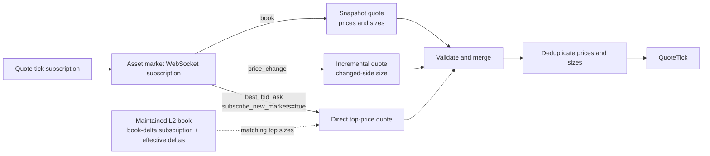

# Polymarket

Polymarket 创立于 2020 年，是一个去中心化预测市场平台，交易者通过买卖结果代币
对事件结果进行押注。

NautilusTrader 通过 Polymarket 的中心限价订单簿（CLOB）API 提供数据与执行的
交易场所集成。

适配器以 Rust 实现，并在 `nautilus_trader.adapters.polymarket`
暴露给 Python，因此数据、执行、签名与 WebSocket 操作在 Rust 与 Python 下行为
一致。

适配器为多种钱包配置处理订单准备与签名。本指南涵盖行情数据、交易执行、会话密钥
管理，以及 Deposit Wallet 的持仓操作。

## 安装 {#installation}

Python 包已包含 Polymarket 适配器，不需要额外的适配器专用 extra。

安装最新的预发布构建：

```bash
uv pip install --pre nautilus_trader
```

要从源码构建 Python 包，在仓库根目录运行：

```bash
make build-debug
```

开发用 wheel 与源码构建的前置条件见
[安装指南](./../getting_started/installation.md)。

## 示例 {#examples}

Rust 的维护中示例位于
[`crates/adapters/polymarket/examples`](https://github.com/nautechsystems/nautilus_trader/tree/develop/crates/adapters/polymarket/examples)。
Python 请使用 Rust 原生的
[数据测试器](https://github.com/nautechsystems/nautilus_trader/blob/develop/examples/live/polymarket/data_tester.py)、
[执行测试器](https://github.com/nautechsystems/nautilus_trader/blob/develop/examples/live/polymarket/exec_tester.py)
或 [Up/Down 冒烟测试器](https://github.com/nautechsystems/nautilus_trader/blob/develop/examples/live/polymarket/updown_smoke_tester.py)。
执行测试器的配置应用了 Polymarket 市价卖单所需的
[收尾精度](#exec-tester-close-residuals)。

## 二元期权 {#binary-options}

[二元期权](https://en.wikipedia.org/wiki/Binary_option)
是一种奇异期权合约，交易者就一个是或否的命题结果下注。预测正确则获得固定赔付，
否则一无所获。NautilusTrader 把 Polymarket 的结果代币表示为
`BinaryOption` 金融工具。

Polymarket 使用 [pUSD](#pusd) 作为交易抵押代币。

## Polymarket 文档 {#polymarket-documentation}

可用的 Polymarket 资源：

- [Polymarket Learn](https://learn.polymarket.com/)：平台用户指南。
- [Polymarket CLOB API](https://docs.polymarket.com/getting-started/api)：与
  Polymarket CLOB API 交互的开发者技术文档。

## 概览 {#overview}

下列 Rust 组件可组合或单独使用，实现实时行情与交易执行：

- `PolymarketWebSocketClient`：基于 Nautilus Rust
  `WebSocketClient` 的底层 WebSocket API 连接。
- `PolymarketInstrumentProvider`：`BinaryOption`
  金融工具的解析与加载。
- `PolymarketDataClient`：行情数据流管理器。
- `PolymarketExecutionClient`：交易执行网关。
- `PolymarketDataClientFactory`：Polymarket
  数据客户端工厂（由实时节点构建器使用）。
- `PolymarketExecutionClientFactory`：Polymarket
  执行客户端工厂（由实时节点构建器使用）。
- `PolymarketPositionClient`：Deposit Wallet
  的分拆、合并与赎回操作。
- `PolymarketSessionKeyClient`：由所有者操作的会话授权、列出与撤销。

:::note
Python 用户通过导出的配置与工厂类配置实时节点，通过
`PolymarketPositionClient`
调用持仓操作、通过 `PolymarketSessionKeyClient`
做会话管理。直接的 WebSocket、provider、数据客户端与执行客户端类型是仅 Rust
的实现组件。
:::

## pUSD {#pusd}

**pUSD** 是 Polymarket 交易使用的抵押代币，是 Polygon 上由 USDC
背书的标准 ERC-20 代币。

代理合约地址为 Polygon 上的
[0xC011a7E12a19f7B1f670d46F03B03f3342E82DFB](https://polygonscan.com/address/0xC011a7E12a19f7B1f670d46F03B03f3342E82DFB)。
直接的链上注资通过
[CollateralOnramp](https://docs.polymarket.com/resources/contracts)
把 Polygon USDC.e（跨链桥接的 USDC）包装为 pUSD。Bridge
API 也能从其他链存入受支持资产，转换后记入 pUSD。

## 钱包与账户 {#wallets-and-accounts}

要通过 NautilusTrader 在 Polymarket 交易，需使用 Polygon 兼容钱包，例如
MetaMask。

### 签名类型 {#signature-types}

Polymarket 为订单签名与校验支持多种签名类型：

| 签名类型     | 钱包类型                     | 说明                                                                      | 使用场景                                                                                     |
| ------------ | ---------------------------- | ------------------------------------------------------------------------- | ---------------------------------------------------------------------------------------------- |
| `0`          | EOA（外部拥有账户）          | 由直接掌握私钥的钱包产生标准 EIP-712 签名。                               | **适配器默认。** 出资方与签名方同一地址、且 EOA 在允许列表内的交易。                           |
| `1`          | Proxy Wallet                 | 通过邮箱或社交登录创建的旧版智能合约钱包。                                | 需要 Proxy Wallet 的 `funder` 地址。                                                           |
| `2`          | Safe Wallet                  | 用外部浏览器钱包创建的旧版 Gnosis Safe 钱包。                             | 需要 Safe Wallet 的 `funder` 地址。                                                            |
| `3`          | Deposit Wallet               | 新版 Polymarket 账户钱包使用的 ERC-1271 智能钱包。                        | 需要 Deposit Wallet 的 `funder`；API 凭据仍绑定在签名方上。                                   |

:::info
2026 年 5 月 4 日及之后部署的账户钱包，Polymarket 使用 Deposit
Wallet。直接 EOA 交易要求在允许列表内的 EOA。账户类型与设置流程见
Polymarket 的[钱包与鉴权指南](https://docs.polymarket.com/trading/wallets-auth)。
:::

NautilusTrader 默认使用签名类型 0（EOA）。要用其他受支持的钱包类型，设置
`signature_type`。代理签名客户端在构造时若 `funder`
缺失或等于签名地址，会直接失败。

环境变量为每个 trader 实例提供单一钱包地址。要用多个钱包，请配置独立的执行客户端
实例。

提交订单前先为钱包注入 pUSD。未注资的钱包会产生 "not enough balance or
allowance" API 错误。

### 设置 EOA 授权 {#setting-eoa-allowances}

适配器为 EOA 账户提供一条直接的链上授权命令。仅当出资钱包就是签名方
（`PolymarketSignatureType::Eoa`）时使用。给 EOA 注入 POL
作为 gas，设置 `POLYMARKET_PK`，然后运行：

```bash
cargo run -p nautilus-polymarket --bin polymarket-set-allowances
```

该命令为 CTF Exchange、Neg Risk CTF Exchange 与
`NegRiskCtfCollateralAdapter`
授予 pUSD 与 CTF 的最大授权。默认使用
`https://polygon.drpc.org`；要改用其他 Polygon RPC
端点，设置 `POLYGON_RPC_URL`。Polymarket
变更所需合约后请重新运行。

该命令只做授予，不撤销已不再是目标的合约上的既有授权。撤销要作为独立的链上操作
处理。提交撤销前，确认没有任何仍在进行的赎回或结算流程还需要那份旧授权。

### 设置智能钱包授权 {#setting-smart-wallet-allowances}

不要为 proxy、Safe 或 Deposit Wallet 出资方运行 EOA
命令。它用 EOA 私钥签名交易，无法从智能合约钱包授予授权。

用 Polymarket 的
[钱包与鉴权流程](https://docs.polymarket.com/trading/wallets-auth)
从账户钱包提交授权。Deposit Wallet
的授权使用由签名方授权、经 Relayer 提交的有序
`WALLET` 批次。Safe 与 Proxy Wallet 的授权需要各自钱包专用
SDK 载荷。

### 刷新与校验授权 {#refreshing-and-verifying-allowances}

授权交易确认后，刷新 CLOB
缓存。Rust 调用方可对 pUSD 用
`PolymarketClobHttpClient::update_balance_allowance`
配 `AssetType::Collateral`；条件代币授权则用
`AssetType::Conditional` 加条件代币
ID。两种形式都需要账户的签名类型。该带鉴权的请求映射到
`GET /balance-allowance/update`。Deposit Wallet
使用 `PolymarketSignatureType::Poly1271`。

balance-allowance 端点有两条解码路径：

| 路径                                              | 用途                                                 | 授权处理                                                                                                                                                                       | 成功含义                                                                           |
| ------------------------------------------------- | ---------------------------------------------------- | -------------------------------------------------------------------------------------------------------------------------------------------------------------------------------- | ------------------------------------------------------------------------------------ |
| `PolymarketClobHttpClient::get_balance_allowance` | 读取支出方授权证据。                                 | 要求复数 `allowances` 映射；拒绝缺失的映射、非空的旧版单数字段、畸形或非规范键，以及大小写变体这类语义重复。                                                                   | 余额加一份无歧义的映射；必需的目标与金额仍需检查。                                   |
| 内部仅余额投影                                    | 账户状态刷新与市价买单费用调整。                     | 忽略授权字段；其返回类型无法暴露或授予批准权限。                                                                                                                               | 仅余额；必需的 CLOB 支出方授权仍未证实。                                             |

凡决策依赖授权证据，就走严格路径，避免含混的线上数据变成批准权限。

### 账户余额 {#account-balances}

#### 余额计算 {#balance-calculation}

余额刷新使用交易场所报告的 pUSD
总额，锁定抵押品从执行客户端的本地状态推导：

- 该账户未结 BUY 订单的预占，用缓存的限价与剩余数量计算。
- 其 BUY
  成交的名义价值与佣金——场所总额可能仍包含它们。

预占不含已提交但尚未被接受的订单，也不不含不在执行缓存中的订单。SELL
订单预占的是结果代币而非 pUSD，不计入锁定抵押品。

**未结算的 BUY 支出**：已知
BUY 成交之后的下一次刷新，从其名义价值加佣金中扣减自由余额，同时扣减按同一快照
计量的其他未结算 BUY 支出。

当场所总额自该快照起下降至少达到合计金额时，这些金额一起释放，因此已被扣减的
总额不会被二次扣减。在那之前，锁定的未结算支出只是尚未被下降覆盖的那部分未结
支出。若刷新的场所总额没有变化，未结支出继续保持锁定。

**作废（void）**：一次作废立即从锁定抵押品中移除该笔成交的支出。后续的作废修订
是累计的，因此只移除增量。被作废的金额仍计入释放其他未结支出所要求的下降量。对
从未锁定的成交做作废，不会抬高该门槛。当不再有未结支出时，下一次刷新释放被作废
的金额并推进快照。

适配器不锁定以下 BUY 成交：

- 首次由终局 REST
  证据应用的成交，包括已确认的成交报告，因为这类证据只在交易确认后才被采纳。
- 比快照旧 15 秒以上的对账成交，或在任何快照之前收到的成交。

锁定抵押品以报告总额为上限，自由余额等于总额减锁定，遵循[余额模型](./../concepts/accounting.md#balance-model)。

#### 刷新时机 {#refresh-timing}

适配器在 connect
时从执行缓存为预占播种，并随核心处理订单事件（含对账事件）更新预占与未结算
BUY 支出。传输层重连保留未结算 BUY 支出，重置则清空它。首次余额刷新早于启动
对账，对账期间发现的订单在下一次刷新时影响余额。

刷新发生在 connect
时、账户查询后、已最终化的成交更新后，以及用户
WebSocket 重连时。若余额响应晚于更新的刷新、晚于执行客户端重连或晚于客户端重置到达，
则不予应用。用户 WebSocket
重连不会丢弃在途刷新，更新的刷新仍然优先。账户余额不随每个订单事件变化，余额刷新
不请求未结订单。

:::warning
**这些余额是估计值。** HTTP
余额响应与订单事件可能反映不同时刻，它们不保证资金在提交前已被预留。

时间效应包括：

- 抵押品入账（包括自有 SELL
  的结算）可能在场所总额已反映扣减之后，仍让未结算 BUY 支出保持锁定。该占用仅限
  尚未被下降覆盖的部分。
- 一笔无关的扣减可能在该成交真正扣减之前就释放这笔支出。
- 金额从未离开场所总额的作废，可能让那笔未覆盖的缺口在其他未结算支出仍未结期间
  保持锁定。
- 仍在扣减窗口内的确认，可能把终局 REST 的
  BUY 支出报告为自由余额，直到后续某次刷新。
- 在排队的成交被处理之前应用的刷新，可能让该成交在总额已扣减后仍保持锁定。

适配器不会锁定同一出资方上其他客户端的成交支出，也不会锁定它尚未收到的成交。
:::

## API 密钥 {#api-keys}

### CLOB 凭据 {#clob-credentials}

执行客户端需要 CLOB L2
凭据。用 Polymarket 的
[API 鉴权流程](https://docs.polymarket.com/getting-started/api#authentication)
创建或推导它们。适配器提供一条命令，读取
`POLYMARKET_PK`
并打印创建或推导出的凭据：

```bash
cargo run -p nautilus-polymarket --bin polymarket-create-api-key
```

把返回的值设为：

- `POLYMARKET_API_KEY`
- `POLYMARKET_API_SECRET`
- `POLYMARKET_PASSPHRASE`

这些凭据为私钥签名方鉴权，不是为
proxy 或 Deposit Wallet 出资方。数据客户端只在
[PolyBolt 参考价订阅](#polybolt-reference-prices)中需要它们。

### Relayer 凭据 {#relayer-credentials}

Deposit Wallet 的分拆、合并与赎回操作还需要
Relayer API 密钥。按
[连接你的账户](https://docs.polymarket.com/trading/wallets-auth#connect-your-account)
的说明在 Settings > API Keys > Relayer API Keys
下创建，然后设置：

- `POLYMARKET_RELAYER_API_KEY`
- `POLYMARKET_RELAYER_SIGNER_ADDRESS`

`POLYMARKET_RELAYER_SIGNER_ADDRESS`
是创建 Relayer 密钥时显示的签名方地址。持仓客户端还会读取
`POLYMARKET_PK` 与 `POLYMARKET_FUNDER`。

### Builder 凭据 {#builder-credentials}

会话授权与撤销需要为 session-key API
批准的 Builder 凭据，与持仓操作用的 Relayer API
密钥相互独立。按 Polymarket 的
[session-key 要求](https://docs.polymarket.com/trading/session-keys)操作，并把这些值
保存在所有者的管理环境中：

- `POLYMARKET_BUILDER_API_KEY`
- `POLYMARKET_BUILDER_API_SECRET`
- `POLYMARKET_BUILDER_PASSPHRASE`

### Deposit Wallet 校验 {#deposit-wallet-verification}

出资方等于签名地址时构造失败。签名之前，持仓客户端：

- 检查规范 Polygon
  工厂预测的当前与旧版 Deposit Wallet 地址。
- 要求钱包已部署合约代码，并校验签名方拥有该钱包。
- 从钱包的链上计数器读取签名 nonce。

Polygon RPC 默认
`https://polygon.drpc.org`。要改用其他受信任的 Polygon
端点，向 `PolymarketPositionClient`
构造函数传入 `base_url_rpc`。

## 会话密钥 {#session-keys}

会话密钥让独立的签名方为 Deposit Wallet
交易，而不把其所有者的私钥交给交易运行时。适配器支持
CLOB 作用域的授权。场所准入与 Builder
批准要求见 Polymarket 的
[session-key 文档](https://docs.polymarket.com/trading/session-keys)。

### 管理访问 {#administer-access}

在**所有者的管理环境**中运行
`PolymarketSessionKeyClient`，每个钱包只用一个管理进程。授权会话之前：

- 显式提供所有者私钥、所有者 CLOB
  凭据、Builder 凭据与 Deposit Wallet
  地址。客户端自身不读取环境变量。
- 另行生成并安全保存会话密钥对，只把其公开地址传给授权方法。

Python 示例从管理进程的环境读取凭据并传入客户端：

```python
import os

from nautilus_trader.adapters.polymarket import PolymarketSessionKeyClient
from nautilus_trader.adapters.polymarket import PolymarketSessionKeyClientConfig

admin = PolymarketSessionKeyClient(
    PolymarketSessionKeyClientConfig(
        private_key=os.environ["POLYMARKET_PK"],
        api_key=os.environ["POLYMARKET_API_KEY"],
        api_secret=os.environ["POLYMARKET_API_SECRET"],
        passphrase=os.environ["POLYMARKET_PASSPHRASE"],
        builder_api_key=os.environ["POLYMARKET_BUILDER_API_KEY"],
        builder_api_secret=os.environ["POLYMARKET_BUILDER_API_SECRET"],
        builder_passphrase=os.environ["POLYMARKET_BUILDER_PASSPHRASE"],
        funder=os.environ["POLYMARKET_FUNDER"],
    ),
)

# Use the public address derived from the separately stored session private key.
session_address = os.environ["SESSION_ADDRESS"]

# Run these calls from an async function in the administration process.
key = await admin.authorize_session_key(session_address)
keys = await admin.list_session_keys()
```

可选配置：

- `base_url_http` 覆盖生产 CLOB 端点。
- `base_url_relayer` 覆盖生产 Relayer 端点。
- `proxy_url` 为两个客户端配置 HTTP 或 HTTPS 代理。

Rust 示例提供同样的授权与列出操作：

```bash
cargo run -p nautilus-polymarket --example polymarket-session-keys -- authorize "$SESSION_ADDRESS"
cargo run -p nautilus-polymarket --example polymarket-session-keys -- list
```

每个管理方法各有明确的完成条件：

| 方法                    | 成功返回要求                                                                |
| ----------------------- | ---------------------------------------------------------------------------- |
| `authorize_session_key` | 链上确认；注册表与地址、CLOB 作用域及到期时间匹配                            |
| `list_session_keys`     | 校验通过的活跃、未过期注册表条目                                             |
| `revoke_session_key`    | 链上确认；密钥已不在活跃注册表中                                             |

#### 到期 {#expiration}

授权在 4,315 小时后到期，与官方 SDK 的线上取值一致。Polymarket 把该周期描述为
180 天，但其原始示例与 SDK 用的值短了 5 小时。返回的
`valid_until` 是 Unix 秒计的精确到期时间。

#### 恢复被中断的操作 {#recover-an-interrupted-operation}

授权或撤销超时、遇到传输失败或被取消后，用**同一操作、同一地址、同一客户端**
重试。客户端保留已签名的请求与幂等键，并在挂起操作定案之前拒绝其他变更。

保持客户端存活直到操作定案：挂起请求保存在内存中。结果未知的错误包含幂等键与
任何已知交易 ID，便于诊断。

:::warning
已签名批次有 **600 秒期限**。未被接受的请求过期后，重试无法创建新批次，客户端
保持阻塞。先对账注册表与 Relayer
结果，再创建新客户端。进程重启后同样需要这份对账。
:::

### 配置会话交易 {#configure-session-trading}

用**会话私钥**创建或推导 CLOB
凭据，走既有的 [CLOB
凭据流程](#clob-credentials)。会话模式要求：

- 显式的会话凭据与 `funder`，不回退到环境中的所有者凭据。
- `PolymarketSignatureType.Poly1271`，其他钱包签名类型一律拒绝。

:::info
把所有者与 Builder 凭据留在交易运行时之外。
:::

下例中 `session_private_key`
是另行保存的会话密钥，`session_api_key`、
`session_api_secret` 与
`session_passphrase` 是其返回的 CLOB 凭据：

```python
from nautilus_trader.adapters.polymarket import PolymarketExecutionClientConfig
from nautilus_trader.adapters.polymarket import PolymarketSignatureType
from nautilus_trader.adapters.polymarket import PolymarketSignerType

execution = PolymarketExecutionClientConfig(
    signer_type=PolymarketSignerType.Session,
    signature_type=PolymarketSignatureType.Poly1271,
    private_key=session_private_key,
    api_key=session_api_key,
    api_secret=session_api_secret,
    passphrase=session_passphrase,
    funder=deposit_wallet_address,
)
```

既有配置默认 `PolymarketSignerType.Owner`。

#### 对账与重启 {#reconciliation-and-restarts}

订单、成交与通知的作用域是会话的活动。对账要求会话 API
密钥与订单归属匹配，仅共享钱包地址不构成归属。

会话的 cancel-all
取消已知订单 ID，不使用钱包级的全市场取消。mass status
包含会话的订单与成交，但不含钱包级持仓。直接持仓查询返回错误，因为钱包持有量
无法确定会话的持仓。

据此配置节点：

- **持仓检查**：把
  `LiveExecutionEngineConfig.position_check_interval_secs=None`
  关闭节点的周期持仓检查。
- **跨重启的历史**：配置[缓存数据库持久化](./../concepts/cache.md#database-configuration)
  并保持 `load_cache=True`，保留订单与成交历史。

### 撤销或轮换访问 {#revoke-or-rotate-access}

在管理环境中轮换密钥。切换凭据前先协调好未结订单与对账：**新会话不会继承对旧
会话订单的可见性**。

要撤销密钥，用上面创建的管理客户端，在 async 函数中调用：

```python
await admin.revoke_session_key(session_address)
```

或运行 Rust 示例：

```bash
cargo run -p nautilus-polymarket --example polymarket-session-keys -- revoke "$SESSION_ADDRESS"
```

:::warning
过期或被撤销的权限会导致场所拒单。实时传输连接仍在，并不能证明授权仍然有效。
:::

## 持仓操作 {#position-operations}

`PolymarketPositionClient`
把 pUSD 拆分为完整的结果代币组，把完整组合并回
pUSD，并赎回已结算的持仓。该客户端仅支持 Deposit Wallet
（`PolymarketSignatureType::Poly1271`），Safe、Proxy
与 EOA 路径不可用。它不部署钱包、不合并无关调用批量提交、不支持把合并数量设为
`"max"`，也不自动赎回持仓。

### 输入与授权 {#inputs-and-approvals}

每个操作先按条件 ID
在公共 CLOB 上查找市场，`neg_risk`
缺失即报错，随后选定规范 pUSD 代币与标准或负风险抵押品适配器。调用方传入带
0x 前缀的 32 字节条件 ID，不需要提供合约地址。

- **拆分与合并数量**：正的 pUSD 小数，必须能被 6
  位小数精确表示，不做舍入。数量用 pUSD 单位而非最小单位，不接受 `"max"`。
- **赎回**：无数量参数，赎回两个二元索引组 `[1, 2]`。

**授权不会自动提交。** 提交操作前先在 Deposit Wallet 上完成授权：

| 操作         | 市场抵押品适配器所需授权             |
| ------------ | ------------------------------------ |
| 拆分         | 花费钱包的 pUSD                      |
| 合并或赎回   | 以 Conditional Tokens 运营者身份操作 |

`polymarket-set-allowances`
的授权计划中没有标准抵押品适配器，负风险适配器在其中。该命令用 EOA
签名授权，无法为 Deposit Wallet
授予任何一项。请用 Polymarket 的
[钱包与鉴权流程](https://docs.polymarket.com/trading/wallets-auth)
从 Deposit Wallet 授予持仓操作所需授权。

### 提交与等待 {#submit-and-wait}

下面的示例展示一次拆分提交。运行前把示意性的条件 ID
换成市场真实的条件 ID。

```python
from decimal import Decimal

from nautilus_trader.adapters.polymarket import PolymarketPositionClient

condition_id = "0x" + "11" * 32
client = PolymarketPositionClient()
transaction = await client.split_position(condition_id, Decimal("1"))
outcome = await transaction.wait()
```

`split_position` 与
`merge_positions`
接受条件 ID 和一个正的 pUSD
`Decimal`；`redeem_positions`
只接受条件 ID。每个方法在 Relayer
提交后返回 `PolymarketPositionTransaction`。
调用一次 `wait()` 轮询直到拿到
`PolymarketPositionOutcome`。同一个
Python 句柄上第二次 `wait()`
会抛出异常。句柄在开始等待后保留其
`transaction_id`，取消或出错之后也保留。

### 结果与错误 {#outcomes-and-errors}

| `PolymarketPositionOutcome.status` | 含义                                |
| ---------------------------------- | ----------------------------------- |
| `confirmed`                        | Relayer 报告 `STATE_CONFIRMED`。    |
| `failed`                           | Relayer 报告 `STATE_FAILED`。       |
| `invalid`                          | Relayer 报告 `STATE_INVALID`。      |

每个结果都暴露 `transaction_id`。confirmed 与 failed
结果在 Relayer 提供时暴露
`transaction_hash`；invalid 结果始终返回
`None`。failed 与 invalid
结果在 Relayer 提供时还暴露 `error_msg`。

#### 提交错误 {#submit-errors}

HTTP 拒绝发生在交易句柄存在之前。超时的提交，或没有
`transaction_id` 的成功响应，同样抛异常。链上结果未知。

客户端**不重试提交**。

#### 等待超时 {#wait-timeout}

默认 120 秒，在轮询请求之间检查。在途请求或轮询延迟会让实际耗时超过该值。超时
抛出的错误会带 Relayer 交易 ID，终态仍未知。Python
不暴露 Rust 的等待超时与轮询间隔设置方法。

#### 响应校验 {#response-validation}

Relayer 重定向会被拒绝；轮询会拒绝交易 ID
与提交 ID 不一致的响应。

### 提交协调 {#submission-coordination}

同一进程内的客户端为每个钱包共享提交状态。后续操作要求匹配的终局 Relayer
结果与已推进的钱包 nonce。未推进
nonce 的失败或无效操作会一直处于阻塞。

签名后，客户端在发送批次之前先记录一条预留。随后发生 HTTP
拒绝、超时、取消或无交易 ID 的响应时，即便重建客户端，该钱包的后续操作仍被阻塞。
预留之前的失败——例如非法数量或钱包校验失败——不会造成新的阻塞。仅凭 HTTP
状态无法证明已签名批次不会执行。

:::warning
不要重启后盲目重试一次结果未知的提交。进程重启清掉本地提交状态，但不会取消一笔
已签名的交易。每个钱包只用一个提交进程。协调不跨进程，也不覆盖外部钱包工具。
:::

### 恢复结果未知的提交 {#recover-an-unknown-submission}

#### 保留提交记录 {#retain-the-submission-record}

提交持仓操作之前开启并保留 INFO
日志。每次提交请求之前，客户端会输出一条
`Deposit Wallet submission`
记录，包含：

- 钱包地址、预留 nonce 与签名期限（Unix 秒）。
- 操作、目标合约与 value。
- 标识条件的未签名 calldata，拆分或合并时还含数量。

该记录不含签名与凭据，但含交易意图。请限制对保留日志的访问。返回句柄带交易 ID
时务必留存。

:::warning
日志不是持久化的交易日记。日志关闭或进程崩溃可能不留任何记录，导致没有进一步
证据就无法安全恢复。
:::

#### 重试之前先对账 {#reconcile-before-retrying}

1. **停止提交。** 包括使用该钱包的其他进程与外部钱包工具。
1. **确认操作是否已执行。** 找到提交记录与任何 Relayer
   交易 ID，把预定的钱包、目标与 calldata
   同最终化的链上交易回执及其效果做匹配。仅凭成功的 HTTP
   响应、Relayer 失败或已推进的 nonce，都不能确定预定操作是否执行。若已执行，
   不要重复。
1. **执行未知期间让钱包保持阻塞。** 要按到期对账，完成下面全部[到期检查](#expiry-checks)。
   若 nonce 已推进，检查消耗它的那笔交易，而不是假定失败。
1. **重启之前先证明重试是安全的。** 既要确定预定操作未执行，也要确定原签名批次
   已无法执行。若记录缺失、RPC
   无法提供一致的最终化状态，或合约行为未经验证，先与 Polymarket
   澄清不确定性再重试。

#### 到期检查 {#expiry-checks}

签名期限默认为签名后 1,800 秒。Rust
调用方可用 `with_deadline_secs`
修改。更长的期限会推迟基于到期的恢复。
`wait()` 超时既不缩短签名期限，也不取消批次。

先验证部署的钱包合约确实强制签名期限、并在批次执行时消耗其
nonce。然后用 `eth_call`
在 Polygon 的某个最终化区块读取钱包的
`nonce()`，并取得同一区块的时间戳。两者都要满足：

- nonce 相对预留值未变。
- 区块时间戳严格晚于签名期限。

本地经过的时间不足以作证明。nonce
已推进时必须检查消耗它的那笔交易，它不能证明失败。

客户端不会自动执行这些恢复检查或释放预留。识别部署合约时查
[Polymarket 合约注册表](https://docs.polymarket.com/resources/contracts)，按区块调用查
[JSON-RPC 参考](https://ethereum.org/en/developers/docs/apis/json-rpc/)。

## 配置 {#configuration}

通过下列参数或其环境变量回退配置签名与鉴权：

| 参数          | 环境变量                | 用途                                                         |
| ------------- | ----------------------- | -------------------------------------------------------------- |
| `private_key` | `POLYMARKET_PK`         | 按 `signature_type` 为订单签名的钱包密钥                     |
| `funder`      | `POLYMARKET_FUNDER`     | pUSD 出资钱包地址                                            |
| `api_key`     | `POLYMARKET_API_KEY`    | CLOB L2 API 密钥                                             |
| `api_secret`  | `POLYMARKET_API_SECRET` | CLOB L2 API secret                                           |
| `passphrase`  | `POLYMARKET_PASSPHRASE` | CLOB L2 API 口令                                             |

owner 模式下，参数未显式提供时客户端读取其环境变量。会话模式要求显式凭据与
funder。CLOB L2 凭据为私钥签名方鉴权。`POLY_1271`
下 Deposit Wallet 仍是 `funder`，但不是 L2 鉴权地址。

:::tip
用环境变量提供凭据，避免把凭据嵌进客户端配置代码。
:::

金融工具加载还有两个常用开关：

- `auto_load_missing_instruments`（默认
  `True`）：对未缓存金融工具的订阅与请求命令会触发一次临时
  Gamma API 加载。关闭时，订阅未缓存的金融工具直接返回错误。见[运行时金融工具加载](#runtime-instrument-loading)。
- `auto_load_debounce_ms`（默认 `100`）：把并发自动加载请求合并为单次批量
  Gamma 调用的窗口（毫秒）。

## 数据能力 {#data-capability}

Polymarket 支持实时 `L2_MBP`
订单簿增量、报价、成交，以及结算的
`InstrumentStatus`/`InstrumentClose`
事件。金融工具定义由引导加载、配置刷新、按需加载、单工具请求、新市场发现与
tick 尺寸变更发布。

## 订单能力 {#orders-capability}

Polymarket 支持下列订单类型与指令。

:::tip
Polymarket 实时执行请把断连超时与停机后延迟都设为 30
秒：`with_timeout_disconnection_secs(30)` 与
`with_delay_post_stop_secs(30)`。延迟让残余的订单与撤单事件在断连前到达。执行
断连在该超时内完成，不会等完在途命令的 HTTP 超时。
:::

断连收尾时仍在途的撤单会让订单停留在
`PENDING_CANCEL`，适配器既不发
`OrderCanceled` 也不发
`OrderCancelRejected`，场所可能应用了也可能没应用该撤单。下一次运行的启动
对账会将其定案。策略侧的撤单不会这样处理，因为订单已在待撤状态。其他在途的提交与
修改命令受同一界限约束，未确认的会保持未定案。

### 订单类型 {#order-types}

| 订单类型               | 二元期权 | 说明                                                                      |
| ---------------------- | -------- | --------------------------------------------------------------------------- |
| `MARKET`               | ✓        | **BUY 订单必须用 quote 数量**，SELL 订单必须用 base 数量。                  |
| `LIMIT`                | ✓        | BUY 可接受 base 或 quote 数量；SELL 必须用 base。                           |
| `STOP_MARKET`          | -        | *Polymarket 不支持*。                                                       |
| `STOP_LIMIT`           | -        | *Polymarket 不支持*。                                                       |
| `MARKET_IF_TOUCHED`    | -        | *Polymarket 不支持*。                                                       |
| `LIMIT_IF_TOUCHED`     | -        | *Polymarket 不支持*。                                                       |
| `TRAILING_STOP_MARKET` | -        | *Polymarket 不支持*。                                                       |

### 数量语义 {#quantity-semantics}

Polymarket 按订单类型、方向与
`quote_quantity` 设置不同地解释订单数量：

- **`quote_quantity=False` 的限价单**把
  `quantity` 解释为条件代币数量（base 单位）。
- **`quote_quantity=True` 的限价 BUY**把
  `quantity` 解释为 pUSD 抵押品。
- **市价 BUY** 把 `quantity` 解释为
  **pUSD** 的 quote 名义价值。
- **市价 SELL** 使用 base 单位数量。

不支持以 quote 计量的限价 SELL
订单，适配器在提交前拒绝。它也拒绝任何在两位小数的签名界限上 base 或 quote
数量被截断为零的限价单。

#### 限价 BUY 示例 {#limit-buy-example}

对 `quote_quantity=True` 的限价 BUY：

- 适配器把抵押品截断到分，签名为其 maker
  金额，并按市场的数量精度推导份额数。
- 在处理场所响应之前，把本地订单更新为签名的份额数量。
- 签名金额必须精确保住限价。否则适配器在 HTTP
  之前就拒绝订单。例如 10.00 pUSD 按
  0.33 无法表示，而 9.90 pUSD 按 0.33
  恰好产出 30 份。

要用抵押品上限约束限价 BUY，设置 `quote_quantity=True`：

```python
# Limit BUY with quote quantity (spend $10 pUSD at a limit price of 0.50)
order = strategy.order_factory.limit(
    instrument_id=instrument_id,
    order_side=OrderSide.BUY,
    quantity=instrument.make_qty(10.0),
    price=instrument.make_price(0.50),
    time_in_force=TimeInForce.GTC,
    quote_quantity=True,
)
strategy.submit_order(order)
```

#### 市价 BUY 示例 {#market-buy-example}

市价 BUY **必须用 quote 数量**：设置
`quote_quantity=True`。适配器在提交到 CLOB
之前把 quote 金额（pUSD）换算为签名的 base 单位份额数。Polymarket
执行客户端拒绝以 base 计价的市价买，以防意外成交。以
base 计价数量提交的市价 BUY 可能执行远超预期的规模。

```python
# Market BUY with quote quantity (spend $10 pUSD)
order = strategy.order_factory.market(
    instrument_id=instrument_id,
    order_side=OrderSide.BUY,
    quantity=instrument.make_qty(10.0),
    time_in_force=TimeInForce.IOC,  # Maps to Polymarket FAK
    quote_quantity=True,  # Interpret as pUSD notional
)
strategy.submit_order(order)
```

### 执行指令 {#execution-instructions}

| 指令          | 二元期权 | 说明                                                 |
| ------------- | -------- | ------------------------------------------------------ |
| `post_only`   | ✓        | 仅对 `GTC` 或 `GTD` 的限价单支持。                     |
| `reduce_only` | -        | *Polymarket 不支持*。                                  |

### 有效期选项 {#time-in-force-options}

Polymarket 把 `POST /order`
的该字段称为 `orderType`，在 NautilusTrader
中映射到 `TimeInForce`。合法组合取决于 Nautilus
订单类型：

| Nautilus TIF | Polymarket `orderType` | Nautilus 订单范围      | 说明                                                      |
| ------------ | ---------------------- | ---------------------- | ----------------------------------------------------------- |
| `GTC`        | `GTC`                  | 仅 `LIMIT`             | Good-Til-Cancelled；挂在订单簿上。                          |
| `GTD`        | `GTD`                  | 仅 `LIMIT`             | Good-Til-Date；挂到到期、成交或撤单。                       |
| `FOK`        | `FOK`                  | `LIMIT` 或 `MARKET`    | 立即全量成交，否则整单取消。                                |
| `IOC`        | `FAK`                  | `LIMIT` 或 `MARKET`    | 立即成交可得数量并取消剩余。                                |

Polymarket 对 NautilusTrader 称为
`IOC`（Immediate or Cancel）的语义使用
`FAK`（Fill-And-Kill）。Polymarket
文档把 `FOK` 与 `FAK`
归为市价订单类型，`GTC` 与 `GTD`
归为限价订单类型。对 Nautilus 的
`MARKET` 订单，适配器只接受
`IOC` 与 `FOK`；`GTC` 与
`GTD` 只对挂单的 `LIMIT` 订单有效。

#### GTD 到期 {#gtd-expiry}

`GTD` 到期时间至少要设在提交后三分钟。更短的到期适配器在签名前拒绝。它使用整
Unix 秒，接受恰好三分钟的边界。

Polymarket 把用户撤单与 GTD
到期都报告为 `CANCELED`。它比你给的到期时间提前一分钟过期，因此最短有效寿命约
两分钟。要获得 N 秒的有效寿命，提交
`now + 60 + N`，且仍受三分钟下限约束。

用户频道上，发生在那一分钟标记及之后的
`CANCELED` 事件会变成
`OrderExpired`；更早的撤单保持
`OrderCanceled`；经 REST
恢复的撤单也保持 `OrderCanceled`。未结订单载荷带到期时间，但没有撤单时间。

`manage_gtd_expiry` 保持
false。策略定时器在声明的到期时间触发并提交撤单，不发
`OrderExpired`。用户频道的到期已经会清掉该定时器。

若错过了到期消息，迟到的撤单不会收尾订单，仍需靠对账处理。见
[GTD 订单](https://docs.polymarket.com/trading/place-orders#limit-orders)。

### 最小订单规模 {#minimum-order-size}

从各市场的订单簿读取其
`min_order_size`，活跃市场通常报告 5
份。名义价值低于 **1 pUSD**
的可成交订单也可能被拒，
`invalid amount for a marketable BUY order … min size: $1`.

适配器不设置金融工具的
`min_quantity`，因为按 quote 计量的 BUY 数量用 pUSD，而按 base
计量的订单用份额。提交仍会把过小订单交给场所去拒。修改在撤单前后都检查缓存的份额
最小值。见[订单修改](#order-modification)。

### 高级订单功能 {#advanced-order-features}

| 功能         | 二元期权 | 说明                                                    |
| ------------ | -------- | --------------------------------------------------------- |
| 订单修改     | ✓        | 适配器为未结 `LIMIT` 订单管理的 cancel-replace。          |
| 括号/OCO 单  | -        | *Polymarket 不支持*。                                     |
| 冰山单       | -        | *Polymarket 不支持*。                                     |

#### 订单修改 {#order-modification}

Polymarket 没有原地修改端点。执行客户端撤掉当前场所订单，对其最终确认的成交做
对账，再就剩余数量签名一笔替换单。

##### 替换数量与标识 {#replacement-quantity-and-identity}

`ModifyOrder.quantity`
设定的是逻辑订单的绝对目标值，不是替换腿的值。替换单保留原
`ClientOrderId`，并获得新的 `VenueOrderId`。

逻辑数量使用场所精度归一化之后的确切签名 base
数量，因此可能略低于请求的目标值。

##### 规模检查 {#size-checks}

撤单之前，适配器从目标值中减去已成交数量与已作废且不会重开的数量，并拒绝低于
0.01 份的替换。

缓存金融工具的 `info["min_order_size"]`
存在时，以下情形适配器也会拒绝修改：

- 该值不是正的小数字符串。
- 签名的替换份额数量低于该最小值。
- 无法推导出规模检查所需的最小签名金额。

键缺失时跳过市场最小值检查。对
`FAK` 或 `FOK` 的
BUY，检查使用由截断到分的 pUSD
预算推导的份额。

撤单之后，适配器对剩余数量重复规模检查，使用修改开始时捕获的市场最小值，不重新读
订单簿。

撤单期间的成交可能留下规模不足的余量，适配器不会挂出它：修改被拒绝，订单以已取消
收尾。撤单后仍可成交的替换单也可能因低于 1 pUSD 被拒。

##### 含义不明的结果 {#ambiguous-outcomes}

只有撤单响应、已取消订单状态与确认成交的合计三者一致，适配器才提交替换单。

- **撤单含义不明**：发出 `OrderModifyRejected`。
- **替换单含义不明**：按其确定性的签名订单哈希保持在途。后续的订单更新、成交或
  对账可以确立它，不需要第二次
  `OrderAccepted`。在此之前，后续的修改与撤单命令保持阻塞。

替换恢复状态不跨执行客户端进程重启持久化。

### 批量操作 {#batch-operations}

| 操作     | 二元期权 | 说明                                                                                                                                |
| -------- | -------- | ------------------------------------------------------------------------------------------------------------------------------------- |
| 批量提交 | ✓        | 适配器对独立的限价单批次使用 `POST /orders`（每次请求至多 15 单）。见[批量提交](#batch-submit)。                                      |
| 批量修改 | -        | *Polymarket 不支持*。                                                                                                                 |
| 批量撤单 | ✓        | 适配器使用 `DELETE /orders`。见[批量撤单](#batch-cancel)。                                                                            |

#### 批量提交 {#batch-submit}

`SubmitOrderList`
命令路由到 Polymarket 的
`POST /orders`
端点。该端点每次请求至多接受 15
单（`BATCH_ORDER_LIMIT`），更长的列表拆成按序执行的 15
单分块。

- 只有 `LIMIT` 订单参与批量。列表中的
  `MARKET` 订单走单订单路径：签名可成交订单，并按 Nautilus
  `time_in_force` 以 `FAK` 或 `FOK` 提交。
- `reduce_only` 订单、按 quote
  计量的 SELL 订单，以及配上市价有效期（`IOC` 或
  `FOK`）的 `post_only` 在提交前被拒绝。
- 只有一笔符合条件的订单时退回
  `POST /order`，以保留单订单的重试语义。批量路径刻意禁用重试，
  因为场所不暴露幂等键。
- 批量响应漏掉某条腿时，该订单保持已提交状态等待对账。适配器登记该签名订单的预期
  哈希，使后续的 WebSocket 事件与撤单仍能解析到本地订单。响应缺失不能证明场所
  拒绝了该订单。

#### 批量撤单 {#batch-cancel}

已解析出场所订单 ID 的
`BatchCancelOrders` 命令使用 Polymarket 的
[`DELETE /orders`](https://docs.polymarket.com/api-reference/trade/cancel-multiple-orders)
端点。适配器按序发送分块，每个新分块的大小取该端点 1,000
个 ID 上限与签名方当前撤单突发额度中较小者。签名方从 Standard
的 120
令牌突发起步，某次响应报告的层级作用于下一个新分块。

每个分块用相同的订单 ID
独立重试，除非响应报告的更低层级要求先缩小分块再重试。适配器合并已完成的响应，在
所有分块都成功后对每个被请求的订单只处理一次。若后面的分块耗尽重试，先前的分块可能
已改变场所状态。适配器不发出部分逐单结果，整体未知的结果由对账定案。

`CancelAllOrders` 按如下规则选择取消范围：

| 模式    | 方向过滤        | 范围                                                             | 端点                           |
| ------- | --------------- | ---------------------------------------------------------------- | ------------------------------ |
| Owner   | 无              | 所选结果代币，跨执行账户下所有策略                               | `DELETE /cancel-market-orders` |
| Owner   | `Buy` 或 `Sell` | 本地缓存中匹配的未结订单                                         | 分块 `DELETE /orders`          |
| Session | 任意            | 本地缓存中匹配的未结订单                                         | 分块 `DELETE /orders`          |

owner 路径在没有方向过滤时，把金融工具的原始代币 ID 作为
`asset_id` 发给
[`DELETE /cancel-market-orders`](https://docs.polymarket.com/api-reference/trade/cancel-orders-for-a-market)，
即便缓存中没有匹配。按 ID 的路径在没有匹配缓存订单时不发请求。已匹配但仍在等场所
订单 ID 的订单会保留一个挂起撤单，适配器在提交定案后发出。

### 提交响应处理 {#submit-response-handling}

Polymarket 的公开文档把成功的
[`POST /order`](https://docs.polymarket.com/api-reference/trade/post-a-new-order)
响应描述为带 `success`、`orderID`、`status` 与
`errorMsg`，并把
[API 错误](https://docs.polymarket.com/resources/error-codes)
记录为结构化错误响应。它没有把无 status 的客户端异常或传输失败记录为场所拒绝。

#### 成功响应 {#successful-responses}

对带非空 `orderID`
的成功响应，适配器用 `status`
选择 Nautilus 初始状态。对 `FOK`
有效期的订单，它还用 `status`
决定是否需要那次五秒 REST
检查。场所含义遵循 Polymarket 的
[订单生命周期](https://docs.polymarket.com/concepts/order-lifecycle)。

| 提交 `status` | 场所含义                       | Nautilus 初始状态                                                | `FOK` REST 检查    |
| ------------- | ------------------------------ | ---------------------------------------------------------------- | ------------------ |
| `live`        | 挂在订单簿上                   | `Accepted`                                                       | 保留               |
| `matched`     | 立即撮合                       | `Accepted`                                                       | 跳过               |
| `delayed`     | 撮合延迟进行中                 | `Submitted`，直到 WebSocket 或 REST 活动证明接受                 | 保留               |
| `unmatched`   | 延迟结束但未撮合，现已挂单     | `Accepted`                                                       | 保留               |
| 缺失或为空    | 未提供 status                  | `Accepted`，除非有被证实的 FOK/FAK 错误使其拒绝                  | 保留，除非被拒绝   |

提交的 `status`
描述提交结果。`delayed`
不是市场配置信号。`matched`
确认的立即撮合使 REST 检查不再必要。

status 缺失或为空时，为兼容性发出
`OrderAccepted`
并保留 REST 检查，除非有被证实的未成交
`FOK` 或无撮合
`FAK` 响应导致立即拒绝。对带非空
`orderID` 的成功响应，显式
`status` 优先于任一错误字符串。

#### 延迟响应 {#delayed-responses}

`delayed` 响应会：

- 立即登记场所订单标识与成交跟踪，并独立于有界重放缓存保留它们。后续的订单查询、
  WebSocket 事件与对账报告因此能解析到本地
  `ClientOrderId`。
- 让订单保持 `Submitted`，直到某笔成交、订单更新或 REST 结果证明接受。
- 在任何证明接受的成交、撤单、到期或已成交状态之前发出
  `OrderAccepted`。
- REST 返回 `UNMATCHED` 时，把未成交的
  `FOK` 直接定案为 `OrderRejected`。

#### 确定结果与含义不明结果 {#definitive-and-ambiguous-outcomes}

Polymarket 在其执行边界应用共享的
[命令结果策略](./../concepts/execution/policies.md#command-outcomes)，
以及适配器指南中的
[诊断与策略侧原因分界](./../developer_guide/adapters.md#separate-diagnostics-from-strategy-facing-reasons)。

含义不明的失败包括：

- 传输失败与超时。
- 结果未知的尝试之后重试耗尽。
- 响应序列化或解码失败。
- 本地 I/O 失败。
- 服务端失败。
- HTTP 425 响应。
- 缺少 CLOB 签名方限流器响应头的 HTTP 429 响应。

| 结果                                                                                      | Nautilus 结果               | 原因                                      |
| ----------------------------------------------------------------------------------------- | --------------------------- | ----------------------------------------- |
| `success=false`、有文档记录的处理错误，或其他不可重试的客户端/API 错误                    | `OrderRejected`             | 响应证明了拒绝。                          |
| 单/批 `FOK`：`success=true`、无 status 且为未成交错误                                     | 立即 `OrderRejected`        | 场所证明它撤掉了该订单。                  |
| 单/批 `IOC`/`FAK`：`success=true`、无 status 且为精确的无撮合错误                         | 立即 `OrderRejected`        | 场所证明没有数量撮合。                    |
| 批量某腿：`success=true`、`orderID` 为空且 `errorMsg` 有值                                | 带原因的 `OrderRejected`    | 场所证明它拒绝了该腿。                    |
| 无 `orderID` 也无原因                                                                     | 保持 `Submitted`            | 响应不能证明拒绝。                        |
| 任何含义不明的失败                                                                        | 保持 `Submitted`            | 适配器无法判定结果。                      |
| 早先含义不明尝试之后的确定性重试错误                                                      | 保持 `Submitted`            | 早先的尝试可能已成功。                    |
| `POST /order` 之前的失败，例如 pUSD 余额查询失败                                          | `OrderDenied`               | 适配器没有提交该订单。                    |

本地拒绝用 `OrderDeniedReason`
生成面向策略的原因，首个词元是稳定代码，例如
`VALIDATION_FAILED` 或 `UNSUPPORTED_ORDER_TYPE`。

被证实的未成交 `FOK`
与无撮合 `FAK` 响应按立即拒绝定案。
`FOK` 响应跳过 REST
检查。含义不明的单订单尝试之后，后续的 HTTP
错误或解码出的拒绝并不能证明第一次尝试失败。携带匹配有效订单
ID 的已接受响应可以确认那笔确定性的签名订单；拒绝不行，即便 ID 匹配。

#### 错误原因 {#error-reasons}

诊断错误保留 HTTP
状态与传输或限流上下文。面向策略的拒绝，在 HTTP
状态、限流与交易所错误时使用场所原因，其他失败使用有界的错误描述。

适配器按如下方式归一化响应原因：

- 依次从 `error`、`errorMsg`
  读取首个非空白字符串。
- 先对无效 UTF-8 做有损解码，再折叠空白与控制字符。
- 空响应体用 `empty response body`；纯文本或畸形响应用有界的回退。
- 有 HTML 标题时用标题，否则用可见文本。

原因长度上限 512
字符，含字面量 `... [truncated]`
标记及其前的空格。

在单订单与批量提交响应上，归一化后精确等于
`order_version_mismatch`
的原因会变成
`Polymarket CLOB order version mismatch; adapter supports V2 only`。其他提交响应原因在归一化后
保持不变。

场所把 post-only
跨价报告为 `invalid post-only order: order crosses book`。只有这个精确的归一化原因会把
`OrderRejected.due_post_only=true`。其他 post-only
错误仍是普通拒绝。

#### 重试分类 {#retry-classification}

受重试管理的单订单提交与撤单请求，对 HTTP 425、429 与 5xx
响应按配置的退避重试。重试耗尽后，提交的分类为：

| HTTP 状态                            | 是否重试 | 提交结果            | 说明                                                                                                                                   |
| ------------------------------------ | -------- | ------------------- | ---------------------------------------------------------------------------------------------------------------------------------------- |
| 425                                  | 是       | 保持 `Submitted`    | Too Early 不能证明拒绝。                                                                                                                 |
| 429 且带 CLOB 签名方限流器头         | 是       | `OrderRejected`     | 需要 `Poly-RateLimit-Remaining`、`Poly-RateLimit-Reset` 或 `Poly-RateLimit-Tier`。更早的结果未知尝试仍保持 `Submitted`。                |
| 429 且无上述头                       | 是       | 保持 `Submitted`    | 请求可能被 Cloudflare 或其他中间跳看到。                                                                                                 |
| 5xx                                  | 是       | 保持 `Submitted`    | 命令可能已被应用。                                                                                                                       |
| 400、401、403、404                   | 否       | `OrderRejected`     | 不可重试的客户端或 API 错误。                                                                                                            |

畸形的成功提交响应同样按未知处理并进入对账，而不是变成终局拒绝。

撤单的分类使用同样的证据类别。撤单已发出之后出现不可重试的客户端或 API
错误，或本地失败能证明撤单从未发出，都会发出
`OrderCancelRejected`。HTTP 425、无头的 429 与 5xx
让撤单保持在途。

#### 结果未知时的对账 {#unknown-outcome-reconciliation}

对结果未知的情况，适配器：

- 尽可能从签名的 EIP-712 订单推导预期的 Polymarket
  订单哈希，并把它作为 `VenueOrderId`
  缓存。后续的 WebSocket 事件与对账报告因此挂到本地
  `ClientOrderId`，而不是变成外部订单。
- 对以 quote 计量的市价 BUY，应用签名的 quote 到
  base 数量更新。
- 把挂起的撤单推迟到预期的场所订单 ID 已知。
- 在该场所订单 ID 下登记成交跟踪。

##### 订单与成交读取 {#order-and-trade-reads}

适配器从 REST
读取订单及其成交，用上限 30 秒的退避重试，直到场所状态已知。终局成交先经结算记录
应用，随后订单状态接受该订单并释放其成交。只要任一成交仍是临时状态，或已确认成交
尚不能覆盖场所的撮合数量，状态就等待。

签名提交等待确认期间发出的
`QueryOrder` 命令使用同一条结算路径。它们直接应用场所成交
ID，因此缓冲的 WebSocket 成交与之后的提交响应不会重复接受，也不会把同一成交计
两次。

##### 报告门控 {#report-gating}

覆盖该订单或其金融工具的报告，在该读取应用或读取停止之前一律失败，避免对账从部分
场所状态推断成交。

##### 读取超时 {#read-timeout}

10 分钟内未应用场所状态即停止读取。适配器记录警告、解除报告门控，并让订单保持
`Submitted`。

若本地订单在恢复完成前就收尾，适配器会撤掉仍被报告为
live 或 delayed
的场所订单。此后恢复需要一次终局订单读取，以及覆盖其撮合数量的成交证据。仅撤单不能
证明没有发生成交。失败或空的读取与 10
分钟超时都不会结束这项恢复，即便迟到的成交让本地订单重新打开。

:::warning
若本地订单在提交恢复完成前收尾，而场所持续返回空的订单查询，场所侧空查询会让该订单
的报告门控一直关闭。这会阻塞该订单、其金融工具乃至整个账户的报告。引擎无法应用的
成交，仍通过结算报告门控保持可见。
:::

### 持仓管理 {#position-management}

| 功能             | 二元期权 | 说明                                                                        |
| ---------------- | -------- | ----------------------------------------------------------------------------- |
| 查询持仓         | ✓        | 数据 API 的用户持仓，不含已结算余额。                                         |
| 拆分、合并、赎回 | ✓        | Deposit Wallet 操作；见[持仓操作](#position-operations)。                     |
| 持仓模式         | -        | 仅二元结果持仓。                                                              |
| 杠杆控制         | -        | 无杠杆可用。                                                                  |
| 保证金模式       | -        | 无保证金交易。                                                                |

### 订单查询 {#order-querying}

| 功能             | 二元期权 | 说明                           |
| ---------------- | -------- | -------------------------------- |
| 查询未结订单     | ✓        | 仅活跃订单。                     |
| 查询订单历史     | ✓        | 历史数据有限。                   |
| 订单状态更新     | ✓        | 实时订单状态变化。               |
| 成交历史         | ✓        | 执行与成交报告。                 |

### 或有订单 {#contingent-orders}

| 功能         | 二元期权 | 说明                                                                      |
| ------------ | -------- | --------------------------------------------------------------------------- |
| 订单列表     | -        | 存在独立的订单批次，但没有关联的或有语义。                                  |
| OCO 订单     | -        | *Polymarket 不支持*。                                                       |
| 括号订单     | -        | *Polymarket 不支持*。                                                       |
| 条件订单     | -        | *Polymarket 不支持*。                                                       |

### 精度限制 {#precision-limits}

Polymarket 按 tick 尺寸与 `orderType`
强制不同的精度约束。每个 Polymarket
`BinaryOption` 的规范
`price_precision` 固定为 4，与其当前生效的 tick
尺寸无关。金融工具的 `price_increment`
携带当前 tick，订单签名从该增量推导场所 tick 小数位。

二元期权金融工具在 0.0001 tick
尺寸下通常支持最多 6 位小数的金额。签名规则还取决于场所订单类型。

#### 市价订单类型：FAK 与 FOK {#market-order-types-fak-and-fok}

直接 maker 金额限定为 **2 位小数**。计算出的 taker
金额使用市场 tick 小数位加 2
位数量小数位。以 `FAK` 或 `FOK`
提交的限价单同样必须满足这条更严格的市价单金额校验。场所会拒绝对挂单合法、但对该
市价单类型不合法的值。

##### 以 base 计量的限价 BUY 订单 {#base-sized-limit-buy-orders}

`quantity`
是限价下的名义份额数量。带 `FAK` 或
`FOK` 时，Polymarket 花费的是
pUSD maker 预算，因此价格改善可能带回更多份额。

`quantity * price`
不是精确到分的金额时，适配器把该预算截断到 2
位小数，就该预算推导出的份额数量向上取整到市场数量精度后签名，使签名比例不超过
限价，并在挂出前把本地订单更新为该签名数量。单订单与批量提交都适用。

后续成交仍可能把数量提升到实际撮合规模。截断后为零的预算在签名前被拒绝。

##### 以抵押品计量的限价 BUY 订单 {#collateral-sized-limit-buy-orders}

适配器把直接 maker 金额截断到分。计算出的份额数量使用市场
tick 小数位加 2 位数量小数位。经过这一量化后，
签名的整数金额必须精确保住请求的限价。

#### 挂单类订单类型：GTC 与 GTD {#resting-limit-order-types-gtc-and-gtd}

挂单基于市场 tick 尺寸允许更宽松的精度。

### Tick 尺寸精度层级 {#tick-size-precision-hierarchy}

| Tick 尺寸 | Tick 小数位 | 数量小数位 | 金额小数位 |
| --------- | ----------- | ---------- | ---------- |
| 0.1       | 1           | 2          | 3          |
| 0.01      | 2           | 2          | 4          |
| 0.005     | 3           | 2          | 5          |
| 0.0025    | 4           | 2          | 6          |
| 0.001     | 3           | 2          | 5          |
| 0.0001    | 4           | 2          | 6          |

#### Tick 校验 {#tick-validation}

- 适配器在签名前校验 tick 尺寸。以 base
  计量的限价 `FAK` 或 `FOK`
  BUY，其分预算截断为零时在签名前被拒绝。见[以 base
  计量的限价 BUY 订单](#base-sized-limit-buy-orders)。
- 适配器要求金融工具的 tick
  尺寸能被 4 位小数精确表示，不满足的金融工具定义与
  tick 尺寸事件一律拒绝。被拒的事件让当前 tick 继续生效。
- Tick 小数位决定签名与金额精度，不改变金融工具规范的 4
  位小数价格精度。
- 以 base 计量的挂单 `GTC` 与
  `GTD` 限价单，以及全部 SELL
  订单，保持其按 tick 推导的金额精度。以抵押品计量的限价
  BUY 的直接 maker 金额用分，计算出的份额数量用按
  tick 推导的精度。
- 适配器在签名前拒绝落在当前市场
  `[tick_size, 1 - tick_size]`
  区间之外的限价。
- 发布的 `BinaryOption`
  把 `min_price` 与
  `max_price` 声称为 `tick_size` 与
  `1 - tick_size`，因此按金融工具边界做钳制的消费者会留在
  可接受范围内。
- 市价单的精度限制包括卖出数量的 2
  位小数，加上按 tick 推导的计算金额边界。
- tick 尺寸会在行情条件中动态变化，市场单边化时尤其如此。

### Tick 尺寸变更处理 {#tick-size-change-handling}

市场的 tick 尺寸变更（`tick_size_change`
WebSocket 事件）时，旧档位在新网格上可能无效（例如
`0.505` 符合 `0.001` tick
但不符合 `0.01` tick）。为了不让旧网格价格进入新纪元，适配器把该变更视为订单簿
纪元切换：

1. 发布更新后的 `BinaryOption`，带新的
   `price_increment`、规范的 4 位小数
   `price_precision`，以及随 tick 变化的
   `min_price`/`max_price` 边界。
1. 丢弃该金融工具的本地订单簿。
1. 让增量的 `price_change`
   订单簿增量等待一份新快照，并请求恢复。
1. 反复重订阅该市场，直到场所重放出一份快照。
1. 用该快照为订单簿重新播种，恢复正常处理。

成交明细与金融工具更新照常流动。报价处理遵循
`drop_quotes_missing_side`：开启时，报价明细需要同时具备买卖价格；关闭时，缺失的一侧用
Polymarket 边界价格与零数量补齐。适配器通过每次
`price_change` 里的
`best_bid` 与
`best_ask`，在缺口期间让报价持续流动。

在出现该代币的首次
`tick_size_change` 之前，Gamma
金融工具数据提供当前 tick。此后
WebSocket 的 tick 在后续 Gamma
刷新与金融工具请求中都保持权威。适配器按场所时间戳忽略更旧的
tick 尺寸事件。数据客户端重置会开启新世代，允许
Gamma 重新为每个代币提供 tick。

## 成交 {#trades}

Polymarket 上的成交可能有以下状态：

- `MATCHED_NOT_BROADCASTED`：订单在链上交易广播之前已撮合。
- `MATCHED`：成交已撮合并送交执行服务，执行服务把它作为交易提交给
  Exchange 合约。
- `MINED`：观察到成交已挖入链上，但尚未确立最终性阈值。
- `CONFIRMED`：成交已达到强概率最终性且成功。
- `RETRYING`：成交交易失败（revert 或重组），正由运营方重试/重提交。
- `FAILED`：成交已失败且不再重试。

`CONFIRMED` 与
`FAILED`
是终态，其余状态都是临时的：成交仍可能成功或失败。

### 结算更新 {#settlement-updates}

成交首次撮合后，后续状态更新经用户 WebSocket
送达。执行适配器把每笔成交的场所结算，与引擎是否已应用该账户的每笔成交，分开跟踪。
每笔成交与每次更正最多发出一次。

对本客户端在当前 WebSocket
会话中提交的订单，适配器在收到第一个临时状态（通常是
`MATCHED`）时发出一条
`OrderFilled`，把之后的临时状态当作结算更新处理而不再发成交。
`CONFIRMED` 记录最终性并刷新账户。经
WebSocket 撮合的成交在
`OrderFilled` 事件的
`info` 字段保留原始成交字段。

#### 失败成交与 REST 定案 {#failed-trades-and-rest-resolution}

WebSocket 的
`FAILED`
更新本身从不作废成交。以下情形适配器会把成交隔离，并按 ID
从带鉴权的 REST 成交端点（
`GET /data/trades`）读取它：

- WebSocket 报告 `FAILED`。
- WebSocket 证据与引擎尚未应用的成交矛盾，例如成交值变化或订单缺失。
- 成交消息校验失败。

首次读取立即开始。REST 返回终态之前，适配器在
500 ms 后重试并将延迟翻倍到上限 30
秒，因此漫长的 `RETRYING`
期间成交一直保持隔离。

第一个终态 REST 结果即为最终结果。针对矛盾的
WebSocket 状态，或引擎未应用成交的新证据/变更证据，会启动另一次
REST 读取，但它绝不推翻第一次结果。

##### REST `FAILED` 结果 {#rest-failed-result}

对引擎已应用的每笔成交，包括结果到达之后引擎才应用的成交，适配器发出一次
`OrderFillVoided` 并刷新账户。适配器尚未发出的成交永远不会
发出。更正不会重新挂出失败的金额，但保留 maker
订单已经在工作中的任何剩余部分。执行完毕的订单变为
`VOIDED`。

##### REST `CONFIRMED` 结果 {#rest-confirmed-result}

对引擎尚未应用的该账户成交，适配器用 REST
成交值发出它们，并刷新账户。

#### 重连与重启 {#reconnects-and-restarts}

临时状态只有在成交及其所涉及的全部该账户订单都属于当前不间断的
WebSocket 会话时才应用成交。流不会重放断线期间错过的更新，因此重连之后适配器
从 REST 读取：

- **已有订单上的新成交**：隔离它们直到 REST
  报告 `CONFIRMED` 或
  `FAILED`。重启后对从缓存恢复的订单同样适用，因此挂单上的成交
  可能落后于场所，直到链上确认。
- **已临时应用的成交**：按 ID
  逐笔读取。`CONFIRMED`
  保留成交，`FAILED`
  作废它。触及这些成交的报告在读取返回前失败。
- **断线期间撮合的成交**：对每个由本方提交或从缓存恢复且仍未结的订单，以及提交
   在途并在重连后成功的订单，逐单读取该订单与该账户在其市场中的成交，用 REST
   值把每笔未见过的成交恰好应用一次。订单状态留给 WebSocket
   与对账处理。从场所收养的订单不做读取，其成交经对账到达。

每轮定案至多读取 10
个订单，逐单用上限 30 秒的退避重试。只要订单还有任何成交处于临时状态，或已确认
成交还不能覆盖场所的撮合数量，触及该订单的报告就失败。10
分钟拿不到该证据即停止读取，同时解除报告门控。

connect
时，适配器从缓存的订单事件重建已应用成交与作废，因此重放的成交不会产生第二次
成交。这些重建的成交不再重新读取。

#### 结算故障 {#settlement-faults}

成交的场所结果与引擎状态无法对账时，该成交进入硬故障：

- 后续终态 REST 结果与第一次不同。
- 引擎拒绝适配器已发出的成交，且 REST 并未报告
  `FAILED`。
- 引擎拒绝更正作废，导致已应用成交无法回退。
- REST `CONFIRMED`
  的值与已应用成交矛盾，或终态 REST
  结果遗漏了引擎已应用的某笔该账户成交。

##### 成交与对账 {#fills-and-reconciliation}

硬故障的成交不再接纳任何成交或作废，唯一例外是 REST
报告 `FAILED`
之后才应用的成交所欠的那次作废。适配器按 error
级别记录故障、刷新账户，并在节点重启之前阻塞该成交的对账（见[结算优先级](#settlement-precedence)）。

##### 数量与撤单 {#quantity-and-cancellation}

硬故障会扣押本应由确认授权的数量归一化与
FAK
余量撤单，包括完全撮合时的
`associate_trades`
更新。已确认的场所结果保持原样；除那次所欠作废外，已应用的成交保留其数量、价格与
佣金。场所报告的撤单、到期或拒绝照常应用；从
`MATCHED`
欠成交推断出的则不应用。

##### 结算记录 {#settlement-records}

适配器在执行客户端的整个生命周期内保留结算记录。connect
之后累计超过 100,000
条记录时，客户端按失败关闭：报告断开连接并拒绝新命令，直到重启。connect
时从缓存重建的记录不计入该限制。

### 成交 ID 推导 {#trade-id-derivation}

Polymarket 不在
`last_trade_price`
行情事件上发布成交 ID。适配器用 Rust 的
`determine_trade_id`
函数，以 FNV-1a
从资产 ID、方向、价格、数量与时间戳推导确定性的
`TradeId`。

执行成交在 REST 对账与用户 WebSocket
中使用相同 ID，因此成交在各数据源与重放之间都能去重：

- **吃单成交**：用场所的成交 `id`。
- **Maker 成交**：把场所成交 ID 与 maker 的场所订单 ID
  组合，因为一笔成交可能同时吃掉用户多个挂单。

对历史的 Data API
成交，加载器用 `{transaction_hash[-24:]}-{token_id[-4:]}-{seq:06d}`
区分同一笔交易内的多笔成交。

## 金融工具元数据 {#instrument-metadata}

`BinaryOption.event_id`
包含 Gamma 父事件 ID。provider 的
[基于事件的发现](#instrument-provider-options)与
`PolymarketDataLoader.from_event_slug`
使用其所属事件。直接加载市场时使用市场
`events` 数组中的唯一 ID。关系缺失或有歧义时
`event_id` 保持未设置。两个结果金融工具共享同一事件 ID。

### 实时元数据 {#live-metadata}

实时金融工具在 `info["gamma_market"]`
中保留完整收到的 Gamma 市场
JSON 字符串，包括 Gamma 返回时的未知字段与嵌套的 events、tags、series。基于事件的
发现还在 `info["gamma_event"]`
中保留所属响应，含其完整的 `markets` 数组。

这份事件快照会为每个结果金融工具重复一次，因此市场众多的事件会增大元数据体积。
既有的归一化元数据键仍然可用，包括已知时的 `token_id`、
`condition_id`、`market_id` 与 `event_id`。

这些字符串是增强处理之前收到的 JSON 对象。tick
尺寸更新会保留它们。当前 tick
尺寸请使用金融工具的类型化价格增量。适配器不会仅为填充元数据而额外拉取相关资源。
存储原始 JSON 字符串能在不同序列化格式之间保留未知字段与数字精度。需要时这样解码：

```python
import json
from decimal import Decimal

market = json.loads(instrument.info["gamma_market"], parse_float=Decimal)
```

### 历史元数据 {#historical-metadata}

历史
`PolymarketDataLoader` 把这些 JSON
字符串保留在 `resolution_metadata["gamma_market"]`
下，而非 `instrument.info`。事件加载时还保留
`resolution_metadata["gamma_event"]`。拉取的响应可能包含历史
期间尚不可知的终局结果，因此加载器把它们留在结算元数据中。像上面那样用
`json.loads` 解码这些字符串。它们先于 CLOB
增强处理，因此原始代币 ID 与结果标签可能同构建出的金融工具不同。

## 数字精度 {#numeric-precision}

金融线上值直接解码为小数。超出支持的小数或域类型范围的值会导致 HTTP
解码失败或报告构建失败。WebSocket 与 PolyBolt
处理函数记录并跳过无效更新。报告构建不会用零替代无效的价格或数量。

## 费用 {#fees}

适配器读取每个金融工具的
`fee_schedule`，把其
`rate` 与 `exponent`
按如下应用：

```text
platform fee = shares * rate * (price * (1 - price)) ^ exponent
```

当前的公开费率表使用指数
`1`，即 Polymarket 公布的
`C * feeRate * p * (1 - p)`
公式。平台费在 `p = 0.50`
处最高，向两端对称递减，且只适用于吃单成交。

| 类别          | 吃单 `feeRate` | Maker `feeRate` | Maker 返佣 |
| ------------- | -------------- | --------------- | ---------- |
| 加密          | 0.07           | 0               | 20%        |
| 体育          | 0.05           | 0               | 15%        |
| 金融          | 0.04           | 0               | 25%        |
| 政治          | 0.04           | 0               | 25%        |
| 经济          | 0.05           | 0               | 25%        |
| 文化          | 0.05           | 0               | 25%        |
| 天气          | 0.05           | 0               | 25%        |
| 其他/通用     | 0.05           | 0               | 25%        |
| Mentions      | 0.04           | 0               | 25%        |
| 科技          | 0.04           | 0               | 25%        |
| 地缘政治      | 0              | 0               | -          |

适配器签名的每笔订单都携带硬编码的 Nautilus builder
代码。其 builder 费率固定为零，不可配置。

### 成交佣金处理 {#fill-commission-handling}

金融工具的 `fee_schedule`
元数据把小数参数存为字符串。读取方也接受旧版的数字元数据。

最新公开费率表见 Polymarket 的
[费用](https://docs.polymarket.com/trading/fees)文档。

实时费用曲线使用精确的小数运算，因此指数必须是整数。负费率、小数或负指数以及算术
溢出都返回错误。

`FillReport.commission`
以 pUSD 计价。它把平台费按线上的数量与价格向下取整到 5
位小数——而不是取整到金融工具精度后的价格——以匹配场所实际收取。场所把吃单费加到
BUY 的 pUSD 支出上、从 SELL 的
pUSD 收入中扣除，因此持仓数量等于成交份额。maker
佣金保持为零。

若精确结果无法表示为 `Money`，适配器返回错误而不是使用零或泛化佣金。见
[佣金失败契约](./../developer_guide/adapters.md#commission-failure-handling)。

#### 金融工具更新间的费用基准 {#fee-basis-across-instrument-updates}

首次在用户 WebSocket
或定向 REST 读取上收到的吃单成交，其费率与指数在执行客户端的整个生命周期内保留。
客户端重置会清掉这些记录。在费率表刷新之后才首次收到的成交，使用刷新后的费率表。

被保留成交后续的确认与成交报告，用该基准加进来的线上数量与价格重算佣金，不使用采纳
之后加载的费率表。

场所证据在其他方面不变时，已应用的成交保留其原始数量、价格与佣金，该成交既不被隔离
也不进硬故障。

保留的基准是本地金融工具元数据，不是场所报告的费用，不能证明场所收取了那个金额。首次
采纳时缺失或错误的费率表会一直跟在该成交上。

:::warning
由对账报告应用的成交，以及从缓存重建的成交，没有保留的基准。之后的费率表变化仍可能与
其已应用佣金冲突。适配器不把该基准存入缓存。
:::

#### 佣金错误 {#commission-errors}

佣金构建错误会让直接的成交报告请求、终局成交历史恢复或完整
mass status 失败。启动时返回
mass-status 错误，且不应用该客户端的报告。

活跃订单的成交历史请求失败时，适配器记录错误，并把撮合数量钳制到核心中已应用的成交，
对账此后推迟任何无支撑的残余数量。佣金构建与结算校验错误则直接让报告请求失败。

适配器不会一边丢弃失败的成交，一边返回可能在没有
Polymarket 佣金的情况下重建其数量的订单或持仓报告。

### 回测费用模型 {#backtest-fee-model}

包含吃单费与 maker
返佣的回测请使用
`PolymarketFeeModel`。该模型从每个二元期权金融工具的
`fee_schedule` 读取
`rate`、`rebateRate`、`exponent` 与
`takerOnly`。它要求 maker 或 taker
流动性侧、`[0,
1]` 内的成交价、以及指数为 `1` 的仅吃单费率表。不支持的金融工具与无效输入返回错误。
没有费率表的金融工具产出零佣金。

```rust tab="Rust"
use nautilus_execution::models::fee::FeeModelHandle;
use nautilus_polymarket::models::PolymarketFeeModel;

let fee_model = FeeModelHandle::new(PolymarketFeeModel);
```

```python tab="Python"
from nautilus_trader.adapters.polymarket import PolymarketFeeModel

fee_model = PolymarketFeeModel()
```

Rust 句柄经
`nautilus_backtest::config::SimulatedVenueConfig::builder().fee_model(...)`
传入。Python 中把模型作为 `fee_model`
传给 `BacktestEngine.add_venue`，或设在
`BacktestVenueConfig.fee_model` 上。

#### Maker 返佣近似 {#maker-rebate-approximation}

对 maker 成交，`fee_equivalent`
是用费率表的吃单 `rate`
代入上文平台费公式得到的值。模型把
`fee_equivalent * rebateRate`
作为负佣金计入。这是对 Polymarket
每日池分配的近似，因为回测不知道该市场中其他
maker 的总费用等值。

实时 maker 成交佣金为零，Polymarket
每天另行支付实际的 pUSD
返佣。模型不把这笔支付表示为独立事件，也不建模
maker 之间的竞争、每日聚合或最低派发门槛。场所公式见
Polymarket 的 [Maker Rebates
Program](https://docs.polymarket.com/programs/maker-rebates)。

## 对账 {#reconciliation}

Polymarket API
在被查询时，或返回全部活跃（未结）订单，或在按
Polymarket 订单 ID（`venue_order_id`）查询时返回特定订单。Polymarket
的执行对账流程如下：

- 为所有有活跃（未结）订单的金融工具生成订单报告，以 Polymarket 报告的为准。
- 为在启动前已收尾、且不在缓存中的订单，从确认成交生成已成交订单报告，使其成交按场所
  数量与佣金应用。对有持仓报告的金融工具，这些成交必须能解释该持仓。见[报告精度](#report-precision)。没有
  回看窗口时，只有这些金融工具符合条件，因为成交会遗漏赎回这类余额变化。见[缺失报告](#missing-reports)。
- 在 owner 模式下，从 Polymarket Data API
  报告的当前用户持仓生成持仓报告。session
  模式省略这些钱包级持仓。见[会话密钥](#session-keys)。
- 把这些报告同 Nautilus 执行状态比较。
- 生成缺失订单，让 Nautilus 执行状态与 Polymarket
  报告的持仓对齐。

### 持仓报告 {#position-reports}

#### 报告精度 {#report-precision}

Data API 把持仓规模与均价报告到 4
位小数。满足下列条件时，持仓报告改用确认
mass-status 成交的数量与平均开仓价：

- 这些成交从零构建一个多头持仓且未回到平仓。
- 其数量与报告规模的差小于 `0.0001`。
- 没有买单与卖单具有相同的撮合时间（那会使其顺序含混）。

启动时对符合条件的成交应用，不做合成的取整调整。

否则，包括缓存保留了其他成交构建的未结持仓时，报告保留
Data API 的值，且不报告该金融工具中已收尾订单的成交。这些报告把
`avg_px_open_precision` 设为
4，因此成交落在有界回看之外、被保留的持仓，仍能通过针对截断后均价的启动开仓价检查。见
[报告的开仓均价](./../concepts/execution/reconciliation.md#reported-entry-averages)。

#### 已结算余额 {#resolved-balances}

持仓报告省略已结算余额：

- Nautilus 已从
  `InstrumentClose` 结算的金融工具上的余额总是省略，因此对账无法
  重开已结算的敞口。
- Data API 标记为
  `redeemable` 的余额，在账户于该金融工具上没有未结
  Nautilus 持仓时省略。未结持仓仍持有它期间，余额保持报告直到结算平掉持仓。

适配器在金融工具映射之前丢弃这些余额，因此已过期、不再加载的金融工具不会让对账
失败。结果代币留在钱包中直到赎回。

#### 缺失报告 {#missing-reports}

缺失的持仓报告不是持仓归零的证据。赎回会在没有成交的情况下从
Data API 移除余额，且
Polymarket 可能在结果判定后不久自动赎回胜方代币。因此持续的持仓检查绝不平掉
Data API
不再报告的持仓。未结持仓只经成交或结算收尾。

### 结算优先级 {#settlement-precedence}

以下情形期间，订单状态、成交、持仓状态与
mass-status
报告一律失败，而不返回可能被对账用来推断成交的覆盖：

- 某成交被隔离、进硬故障、重连后等待 REST
  读取，或在等引擎应用成交或作废。
- 适配器正在读取一个结果未知的已提交订单，或某在 WebSocket
  断线期间活跃的订单的成交。
- 适配器在 connect 时重建其结算记录。

mass status
检查整个账户，其余报告检查所请求的金融工具或订单。若为消息校验失败而隔离的成交没有更早
被采纳的腿，它阻塞所有报告；否则适用这些腿的订单与金融工具作用域。成交如何定案见
[结算更新](#settlement-updates)。

`QueryOrder`
在其场所读取前后都检查结算。若该订单的结算证据仍未定案，查询不发出状态报告并保持本地
订单不变。针对未确认提交的查询仍走
[结果未知时的对账](#unknown-outcome-reconciliation)。

成交报告生成会检查保留的结算结果，并拒绝下列 `CONFIRMED`
成交行：

- 属于已按 `FAILED` 结算的成交。
- 与保留的终局腿矛盾。
- 给保留的终局成交添加一条腿。

拒绝让报告请求失败，不创建成交也不改变保留的结果。作用域受限的报告证据无法为完整成交
确立终局结果，只有
[定向终局 REST 读取](#failed-trades-and-rest-resolution)
能做到。已应用的成交值优先于非终局的 REST 副本。

订单报告用核心中已应用的成交与通过结算校验的成交报告为
`filled_qty` 设上限，每笔成交只计一次。无论有无回看窗口，该上限都适用。

### 缺失订单与 API 滞后 {#missing-orders-and-api-lag}

#### 未结订单检查 {#open-order-checks}

周期性未结订单检查默认关闭（`open_check_interval_secs=None`）。这些配置在节点的
`LiveExecutionEngineConfig` 上，独立于 Polymarket 客户端设置。启动对账与
WebSocket 处理不依赖该定时器是否开启。

在默认的 `open_check_open_only=True` 下，未出现在未结订单响应中**不**会推进缺失订单
重试计数，也不会收尾缓存中的订单。仅未结的响应可能漏掉刚刚成交或刚被撤的订单。因此
单开这个间隔并不能解决 WebSocket 错过的每一笔场所侧撤单。

`open_check_open_only=False` 时，缺失订单路径按如下工作：

1. 近期有本地订单活动时推迟动作。
   `open_check_threshold_ms=5000`
   是自本地活动起的稳定窗口，不只是自提交起的最小年龄。
1. 从覆盖责任客户端的成功报告中统计连续的合格缺失次数。正的订单报告重置计数。落在
   配置回看之外的订单，以及不完整的客户端覆盖，都不能证明订单缺失。
1. 达到
   `open_check_missing_retries=5`
   时，安排一次定向订单状态查询，受每轮查询上限与限流约束。这是第
   5 次合格缺失，不是额外 5 次查询。
1. 把返回的报告与其成交对账。定向查询失败或不完整时推迟定案。若完整的定向覆盖没有返回
   报告，引擎会保留未被确认的 Polymarket
   提交，把 `ACCEPTED` 定案为
   `REJECTED`，把 `PARTIALLY_FILLED` 定案为
   `CANCELED`。待更新或待撤状态保持在途。

订单查询为空时，Polymarket
会先尝试[从成交做单订单恢复](#single-order-recovery-from-trades)。对先前已被接受的
缓存订单，空的成交历史会产出一条带
`ORDER_NOT_FOUND_AT_VENUE` 的
`CANCELED` 报告。从未被接受的订单保持未定案。待处理的成交
（pending trades）则保持非终局状态。

:::warning
一次成功的空订单查询加上空的成交历史，无法区分场所撤单与副本滞后。因此该回退可能在
持续滞后期间收尾一个先前已被接受的本地订单。稳定窗口与重试次数能降低这一风险，但不能
证明订单已不存在。
:::

#### 持仓检查 {#position-checks}

持仓检查有自己的
`position_check_interval_secs`，同样默认关闭。未结订单检查不轮询钱包持仓。owner
模式的持仓报告来自 Data API，反映的时点可能与 CLOB
订单与成交不同。session 模式省略钱包级持仓报告。

把表面的持仓不一致当作需要对账的信号，而不是某笔成交为假的证据。Data
API 不再报告的持仓保持未结，直到成交或结算将其收尾。见
[缺失报告](#missing-reports)。

### Mass-status 对账 {#mass-status-reconciliation}

mass-status
对账把每份订单报告与其场所成交报告配对。它先应用真实成交以保留成交
ID 与佣金，之后只推断达到场所报告状态所需的残余数量。

mass status
用核心中已应用的成交与通过结算校验的已认证
`CONFIRMED`
成交报告为 REST 撮合数量设上限，每笔成交只计一次。这避免了待结算成交产生推断成交，
无论有无回看窗口。落在回看窗口之外、但已应用的成交仍计入该上限。

#### 恢复回看之外的成交 {#recovering-fills-outside-the-lookback}

有界回看时，适配器恢复每个范围内未结订单
`associate_trades`
引用的未应用成交：

- 复用窗口内已返回的成交，并按成交
  ID 无时间过滤地补拉缺失的引用。
- 采纳确认成交之前，先校验成交
  ID、订单腿、归属、金融工具与方向。重复引用与重叠历史为每个订单腿与成交
  ID 只产出一笔成交。
- 对已应用于缓存场所订单的引用跳过查询。其数量、成交
  ID 与佣金留在其历史中不再追加。窗口内返回的已应用成交仍会经过持仓对齐。

缺失的未缓存引用需要串行请求，可能超出节点的
`timeout_reconciliation`（默认
30 秒）导致启动失败。恢复带有许多较早引用的订单时请调大该超时。

缺失的未应用引用、矛盾证据与请求失败都会让
mass status 失败，而不是发布不完整的恢复。

无论撮合计数如何，引用都需要校验。在为有界的未结订单报告设上限之前，适配器会拒绝低于
其确认与缓存成交证据合计（每笔成交只计一次）的撮合数量。

恢复会在后续完成补齐剩余数量之前，用与实时成交相同的[成交
ID](#trade-id-derivation)、执行价格与重建的佣金，恢复挂着的
BUY 或 SELL
订单较早的部分成交。钱包持有量不能确定是哪笔订单成交。若场所遗漏成交引用，撮合数量
仍以确认证据与核心中已应用的成交为上限。

session 模式使用同样的恢复，但省略钱包级持仓。缓存为空时，启动恢复历史订单成交但
不建立 session 持仓。

恢复的吃单成交使用已加载的金融工具费率表，除非执行客户端保留了首次经用户
WebSocket 或定向 REST
读取采纳时的基准。已加载的费率表不能证明较早执行以来费用未变。maker
佣金保持为零。见[成交佣金处理](#fill-commission-handling)。

#### 持仓对齐与缓存历史 {#position-alignment-and-cache-history}

持仓对齐先使用合并窗口与恢复的成交。若这些成交无法与钱包持仓对齐，适配器对该持仓改试
原始窗口的成交，以保留有界窗口支撑的已收尾订单报告、真实成交
ID 与佣金。若持仓历史不完整、需要合成的开仓成交，重建的已收尾生命周期其已实现盈亏
只是估计值。

对没有保留未结持仓的金融工具，有界
mass status
会检查默认持仓对账是否保留了每一笔未应用的未结订单成交（包括窗口内的成交）。若该调整
丢弃了历史——例如其他订单平掉一个持仓又建立另一个——则失败。

重试这类重启之前，先恢复一份含真实订单成交及其持仓历史的自洽缓存。仅清缓存不能解决
被丢弃的历史。即便节点过滤持仓报告或把该金融工具排除在持仓对账之外，这项检查也假定
使用默认持仓对账。

:::warning
这项恢复不会把缓存中的推断成交迁移为场所成交。要复用含此类成交的订单与持仓，请先用干净
缓存启动，或用保留其历史的自定义脚本迁移。缓存的会话内清除方法会跳过未结订单与持仓。
[缓存数据库配置](./../concepts/cache.md#database-configuration)
说明了重启设置：`CacheConfig.flush_on_start
= true` 会清除该 trader 的全部缓存状态，包括其他适配器的数据。
:::

#### 完整性检查 {#completeness-checks}

有界 mass status 只有在下列条件全部满足时才算完整：

- 每个范围内的历史成交都能映射到金融工具。
- 每个窗口内的确认 maker
  成交都有归属的 maker 订单。
- 每个范围内的确认成交都有事件时间。
- 每笔成交都有订单报告或符合条件的缓存订单支撑。

符合条件的缓存订单必须匹配该成交的账户与金融工具，并携带其场所订单
ID。来自[订单修改](#order-modification)的较早
ID 只有在该成交已挂在该订单上时才算。
`instrument_config.load_ids`
非空时，金融工具还必须在列表中。缓存订单不能抵消未映射、无归属
maker 或无时间戳的成交。

窗口不完整时，适配器在引擎记录其不完整报告警告之前，记录一条警告列出每条不满足的条件。
对已收尾的缓存订单不再发出额外报告，因此对账不会重复应用该订单的数量或佣金。

#### 运行时检查与报告失败 {#runtime-checks-and-report-failures}

场所撮合数量超过本地订单已应用成交数量时，运行时订单检查会拉取确认的成交历史。未配对的
成交报告仍走常规的仅成交路径。

佣金构建错误会让完整的 REST
报告请求失败。启动时返回该错误且不应用
mass status；周期性与定向对账推迟受影响的工作。适配器不丢弃失败的成交，因为订单或
持仓报告随后可能在缺少 Polymarket 佣金的情况下重建其数量。

### 从成交做单订单恢复 {#single-order-recovery-from-trades}

`/data/order/{id}`
可以返回活跃或终局订单。当它对已知 ID
返回空订单时，`generate_order_status_report`
回退到 `/data/trades`，并按场所订单 ID
过滤返回的成交。这能恢复错过终局 WebSocket
更新的缓存订单，避免引擎把本地 `ACCEPTED`
订单定案为 `REJECTED`——那种误拒会丢弃场所上已经发生的成交。

只有 `CONFIRMED`
成交计入恢复的成交，待处理与失败的结算状态不计。

缓存订单通过 `client_order_id`
解析，只知道场所 ID 时回退到缓存的
`venue_order_id` 索引。请求提供或解析出
`client_order_id`
时，缓存订单必须是以 base 计量的
`LIMIT` 订单，否则请求返回错误。没有关联订单、也没有缓存订单的按场所订单
ID 的请求会交给引擎处理，而不是仅凭成交历史合成外部订单：

- 缓存订单 + 覆盖缓存数量的恢复成交：返回
  `Filled`。非 IOC 订单在正余量小于 0.01 份时也返回
  `Filled`。
- 缓存的 IOC/FAK 订单 + 任意正余量，或其他余量至少
  0.01 份的订单：返回带恢复
  `filled_qty` 的
  `Canceled`。定向对账在收尾余量之前先应用关联的成交报告。若终局数量仍有缺口，
  引擎推迟终局转换而不是丢弃缺失的成交。
- 先前已接受的缓存订单、无成交：返回带
  `cancel_reason="ORDER_NOT_FOUND_AT_VENUE"` 的
  `Canceled`。
- 从未被接受的缓存订单、无成交：返回
  `None`，保持其未定案状态。
- 带任何 `MATCHED`、
  `MINED` 或
  `RETRYING` 成交的缓存订单：单订单查询在终局
  REST 恢复等待 `CONFIRMED` 或
  `FAILED` 期间，保留本地已应用的撮合数量。
- 无缓存订单且无已知客户关联（无论有无成交）：返回
  `None`。引擎的"场所查无此单"路径负责定案本地条目。

批量未结订单响应本身不做这种逐单恢复。
`open_check_open_only=False`
时，引擎在缺失订单重试阈值之后发起该恢复。默认
`True` 时，缺席的订单保持未结留待后续对账。见
[缺失订单与 API 滞后](#missing-orders-and-api-lag)。

### 幽灵成交与累计数量 {#ghost-fills-and-cumulative-quantities}

重复投递、结算失败与滞后的 REST 快照需要分别处理。

#### 重复成交 {#duplicate-fills}

适配器跟踪每个场所成交 ID，该账户的每笔成交最多发出一次，因此重放的成交消息不会
重复发出。单笔执行成交对吃单用场所成交 ID，对 maker
用成交 ID 与 maker 订单 ID 的组合。REST 与
WebSocket 使用相同的成交标识，因此重放同一成交不会再次累加其数量。见[成交
ID 推导](#trade-id-derivation)与[成交恢复与去重](#fill-recovery-and-deduplication)。

#### 结算失败 {#failed-settlement}

对当前 WebSocket
会话中提交的订单，`MATCHED`
在最终结算之前就发出成交。`MINED` 与
`RETRYING` 不再发第二次成交。
`CONFIRMED`
可以恢复某笔此前更新被错过的成交。WebSocket 的
`FAILED` 把成交隔离，只有定向的 REST
`FAILED` 结果才作废本地已应用的成交并抑制该成交的缓冲腿。

因此敞口可能在最终性之前变化：当前会话的订单，适配器不等确认。重连或重启之后，已有
订单上的成交要等终局 REST
结果。见[结算更新](#settlement-updates)。

#### 累计报告 {#cumulative-reports}

`filled_qty`
是订单总量，不是持仓增量。对账应用未见过的成交，并在允许的情况下只推断剩余的正差值。
例如，总量 7 而本地已应用 5，最多贡献缺失的 2，而不是 7。

较低的持续订单报告本身不会逆转已应用的成交。成交作废事件与启动快照对账提供纠正路径，
因此本地总量不是不可逆的下限。

#### REST 证据与缓存状态 {#rest-evidence-and-cache-state}

运行时订单检查把 REST
撮合数量钳制到
`min(venue_matched, max(local_applied, settlement_validated_quantity))`。

经校验的数量由缓存订单历史中的有效成交与通过结算校验的成交报告合并：

- 每个场所成交 ID 在已应用成交与报告行之间只计一次。
- 核心推断成交只提供下限，不是额外的场所证据。同数量的后续场所报告无法抬高总量。
- 累计成交作废只移除被更正的数量。旧报告无法经由该上限把数量恢复回来。

若核心仍保留某腿的数量、而其定向 REST 结算为
`FAILED`，报告生成按失败关闭，而不是经由上限保留那份失败的敞口。

等待核心处理的 WebSocket 成交不抬高本地已应用成交下限，防止
REST `size_matched`
无依据的增长在保留已应用成交的同时变成推断成交。mass
status 无论有无回看窗口都使用同一经校验数量。见
[mass-status 对账](#mass-status-reconciliation)。

缓存保留处理重放所需的订单标识、已应用成交与更正历史。它对场所状态不是无条件的覆盖，
缺失或滞后的场所证据无法确立结算最终性。

## 成交数量归一化 {#fill-quantity-normalization}

Polymarket 线上金额使用 6
位小数的定点尾数。市价 SELL
签名把份额计价的 `makerAmount`
截断到 2 位小数，而市价 BUY
的 quote 换算可能让登记数量与成交数量之间残留几微份额的漂移。每笔成交都保留场所
数量。截断按绝对份额是固定的，因此欠成交时适配器使用
`DUST_SNAP_THRESHOLD_DEC = 0.01`
份。达到或超过该阈值的缺口仍是真实的欠成交。

| 方向   | 来源                                        | 适配器行为                                 |
| ------ | ------------------------------------------- | -------------------------------------------- |
| 超成交 | BUY 以低于限价成交，或 quote 换算漂移       | 把 BUY 订单数量抬到成交数量                  |
| 欠成交 | 签名或场所数量截断（`< 0.01`）              | 归一化原子 FOK；撤掉 FAK 余量                |

触及订单的硬故障成交会同时扣押该归一化与 FAK
余量撤单。见[结算故障](#settlement-faults)。

BUY 为什么会收到比签名更多的份额，见[BUY 超成交](#buy-overfills)。

### BUY 超成交 {#buy-overfills}

Polymarket 的 BUY 按花费的 pUSD
定规模，因此可能收到比签名更多的份额。限价 BUY
在挂出前换算为签名份额；市价 BUY 以
pUSD 挂出，在提交成功或结果未知时更新为签名份额。之后适配器保留场所成交数量并把订单
抬到一致。SELL 按份额定规模，场所不会多付。

:::info
BUY 订单的数量可能在提交后经
`OrderUpdated` 事件增加。请以其成交数量或持仓数量作为持有份额。
:::

#### BUY 为何多收份额 {#why-a-buy-receives-extra-shares}

签名订单设定
`makerAmount`（花费的 pUSD）与
`takerAmount`（应收份额）。交易所保证对任何执行部分至少按该比率交付份额，随后记入
实际交付的份额。部分执行花费更少、按比例收到更少份额。全部执行在两种情形下收到的份额
超过 `takerAmount`：

- 价格改善：按 0.58 买 9 份的限价 BUY
  承诺 5.22 pUSD。若全部按 0.56 成交，收到
  9.321429 份。
- 签名精度：市价 BUY
  签名的份额截断到 tick 小数位加两位，而结算用六位。按
  0.66 的 5 pUSD 市价 BUY 签名
  7.5757 份，实际收到 7.575758 份。

#### 适配器如何抬升订单数量 {#how-the-adapter-raises-the-order-quantity}

执行引擎默认拒绝超过订单数量的成交，因此数量先经
`OrderUpdated` 事件抬升：

| 路径                                                         | 抬升时机                                                                                 | 数量                                                                    |
| ------------------------------------------------------------ | ------------------------------------------------------------------------------------------ | ----------------------------------------------------------------------- |
| WebSocket 成交                                               | 适配器持有该订单，包括用户流缺口后发现的成交                                             | 累计成交数量                                                            |
| 带成交的 REST 报告，或执行引擎状态报告                       | 成交数量超过本地订单，包括待撤或待改期间                                                 | 证据上限内的成交数量，加上已作废且不会重开的数量                        |
| 独立成交报告                                                 | 订单尚未全部成交                                                                         | 成交数量加该笔成交                                                      |

独立成交保留其成交 ID 与佣金，重放不会重复应用。它覆盖持仓检查的成交，以及没有捕获到
订单上下文的上报成交。被修改订单的状态报告还包含较早场所订单上已作废且不会重开的数量，
独立报告则不包含。

佣金使用场所成交数量。`LiveExecutionEngineConfig.allow_overfills`
保持关闭。开启它会跳过独立抬升，直接让该成交超过订单数量应用。

#### 恢复的限制 {#recovery-limitations}

引擎会拒绝：

- 超过签名数量的 SELL 成交。
- 本地以 quote 计量的 BUY。
- 场所订单 ID 不属于该订单的成交。
- 已全成交订单上的后续成交。

下列成交被拒绝且不抬升数量：

- 启动时属于缓存订单、但没有匹配订单报告的成交。实时管理器会把它作为订单成交应用。
- 持仓检查中属于被修改订单较早场所订单 ID
  的成交。管理器因其与订单当前场所订单 ID
  不符而扣住。
- 实时管理器的纯状态报告。
- 成交数量未超过本地订单的挂起
  `Filled` 报告。其成交按未变的数量应用。

发送给执行引擎的运行时 mass-status
报告中未匹配的成交走独立抬升。

持仓检查无法应用某笔成交时，它会把持仓对账扣押到
`position_check_threshold_ms`
超时。之后的检查若启用了
`generate_missing_orders`，
会合成一笔不含场所佣金的纠正成交。

### 终局订单处理 {#terminal-order-handling}

终局数量归一化由挂单 maker
订单的 `MATCHED`
订单更新触发，或由原子 FOK
订单确认的吃单成交直接触发。它发出一条对账用的
`OrderUpdated`，把订单数量下调到累计场所成交量。它不发出成交，也不改变持仓、余额或
佣金。

IOC 映射为场所
FAK。吃单成交确认后，
`original_size` 与
`size_matched`
之间的每个正差值都是被场所杀掉的未成交余量。因此适配器在真实成交之后发出
`OrderCanceled`，而不是归一化数量或让订单保持部分成交。REST
报告中 `MATCHED` 的
FAK 若
`size_matched < original_size`
应用同一规则。

确认成交先于提交响应到达时，同样的处理在缓冲成交排空后运行。缓冲的
`Canceled`、`Expired` 或
`Rejected` 报告优先。

触及订单的硬故障成交会扣押该处理，包括缓冲成交排空之后。健康确认只发一次更新或撤单，
后续排空或相同证据不再重发。见[结算故障](#settlement-faults)。

### 佣金与跟踪范围 {#commissions-and-tracking-scope}

`FillReport.commission`
按场所报告的成交规模计算，即该成交携带的数量。

成交跟踪器以
`venue_order_id`
为键，在接受订单时登记、启动时恢复缓存的未结订单，因此
WebSocket 的超成交抬升只作用于它跟踪的订单。
`DUST_SNAP_THRESHOLD_DEC`
不能按策略配置，它位于
`nautilus_polymarket::common::consts`。

### 订单消息的规模计价 {#order-message-size-denomination}

用户频道在
`order`
消息上把
`original_size`
报告为签名的
`makerAmount`。对市价类型（`FAK` 或
`FOK`）的 BUY，该金额是
pUSD 预算而非份额数，因此按 0.01 买 100
份的 BUY 报告为
`1`。订单状态报告必须把该场所金额表达为份额时，适配器除以订单价格。本地提交的以
quote 计量的限价 BUY
以签名期间推导的份额数量作为其权威的成交跟踪数量。

SELL 以份额作为 maker
金额签名，无需换算。挂单类型（`GTC` 与
`GTD`）原样透传：其计价未获确认，把份额计量的规模做换算会错报所有外部管理的挂单。

### Exec tester 收尾残量 {#exec-tester-close-residuals}

`close_positions_qty_precision`
是
`ExecTesterConfig`
的选项，默认 `None`，即提交全部持仓数量。Rust 与
Python 的 Polymarket
示例把它设为 `2`，因为
[市价订单 maker 金额允许两位小数](#precision-limits)。示例还设置
`close_positions_time_in_force=IOC`。自定义配置必须用
`IOC` 或 `FOK`，因为 Polymarket
拒绝 `GTC` 市价单。

停机时，测试器只把提交的市价 SELL
数量截断到配置的小数精度，并以 WARN
级别记录精确差额。它不取整持仓状态，也不合成成交。

因此一笔成交 5.1975 份的 5
pUSD 买单会提交 5.19
份的收尾。场所成交该单后，持仓恰剩 0.0075
份未平。

- 若整个持仓不足 0.01 份，测试器告警且不提交零数量订单。
- 非零收尾必须满足场所订单约束，被拒会让全部持仓保持未平。

把停机收尾当作尽力而为，先检查持仓与告警再假定账户已平。不足 0.01
份的场所报告见[持仓报告限制](#limitations-and-considerations)。

## WebSockets

`PolymarketWebSocketClient` uses the Nautilus Rust `WebSocketClient`.

### Data

The data adapter opens `market` subscriptions dynamically as instruments are requested. It spreads
those subscriptions across a pool of market WebSocket connections so that no single connection
carries more than `ws_max_subscriptions` assets. The pool grows lazily (a universe below the cap
stays on one connection) and closes a secondary connection once it owns no assets.

The pool does not open a connection when the data client connects, unless `subscribe_new_markets`
is set. That setting opens the primary connection for new-market discovery. Otherwise the first
asset subscription opens a connection.

Each connection replays only its own assets on reconnect. A shard reconnect also drops that shard's local
books. It gates the shard's book deltas (and book-derived `best_bid_ask` tops) until fresh snapshots arrive. A
one-shot monitor starts recovery if a snapshot is still missing after `book_snapshot_timeout_secs`.

The venue sends a `book` snapshot when an asset is first subscribed and ignores a duplicate subscribe. A book
delta subscription can join an asset already held by a quote, trade, or resolution subscription. If the book
has no accepted snapshot, the adapter starts recovery. It does so only if no recovery or post-reconnect
snapshot wait already covers the book. Recovery cycles the asset's subscription until a valid snapshot
arrives.

A single `price_change` payload can contain interleaved updates for several assets. The adapter
groups updates by instrument and publishes one atomic order book delta batch per instrument, while
quote processing remains in the venue payload order.

#### Quote ticks

The adapter exposes one quote tick subscription type. It does not expose separate subscriptions for
snapshot-derived, price-change-derived, and `best_bid_ask` quotes. Quote, book delta, and trade subscriptions
for the same instrument share one asset-scoped `market` WebSocket subscription. A book delta subscription
alone does not emit quote ticks. Quote output remains gated by an active quote subscription.

| Venue message  | Trigger                                      | Price source                      | Size source                                                 |
| -------------- | -------------------------------------------- | --------------------------------- | ----------------------------------------------------------- |
| `book`         | Book snapshot                                | Snapshot best bid and ask         | Snapshot best-level sizes                                   |
| `price_change` | Subscribed level update                      | Message `best_bid` and `best_ask` | Changed best-level size; previous quote or zero otherwise   |
| `best_bid_ask` | Top move with `subscribe_new_markets = true` | Direct message best bid and ask   | Maintained-book top or prior quote, depending on book state |



All three venue message paths converge on the same quote tick stream. Deduplication compares prices
and sizes with the last emitted quote regardless of which message type produced it.

##### `best_bid_ask` handling

With `subscribe_new_markets` enabled, the venue also sends `best_bid_ask` events when an asset's top of book
moves. Every market connection requests these asset-scoped events. Only the primary connection forwards global
new-market and resolution events. The payload carries prices only, so the adapter selects each side's size as
follows:

- With [effective deltas](#effective-deltas), an active book delta subscription, and book updates not
  gated pending a valid snapshot, a side takes its size from the maintained local book when its top
  price matches. Before the first snapshot, or when the top does not match, its size is zero.
- Without effective deltas, or while book updates are gated pending a valid snapshot, a side
  keeps the previous quote size when its top price matches. A moved or unknown side has zero size.

The adapter ignores events older than the last emitted quote or, with effective deltas, the local
book. It also rejects locked, crossed, out-of-range, and off-grid events.

An empty price, a bid at or below zero, or an ask at or above one is a missing side. By default,
`drop_quotes_missing_side` drops the event. When missing sides are allowed, the missing price uses
the current tick-relative venue bound and its size is zero.

#### Book snapshot validation

When a `book` snapshot includes a hash and its full preimage, the adapter reproduces it from the
exact wire values and level order. It logs and rejects a mismatch before the snapshot can:

- Update local book state.
- Emit snapshot-derived deltas or quotes.
- Resume gated book deltas.

For book-delta subscribers, a mismatch also starts recovery. The adapter resubscribes until a valid
snapshot arrives, dropping incremental `price_change` deltas meanwhile. A mismatch during recovery
fails the attempt and triggers the next resubscribe without waiting for the snapshot deadline.

After exhausting its retry budget, recovery retries at intervals that double from one to fifteen minutes.

Polymarket also sends hashed book updates that omit fields included in the server's hash preimage,
such as `tick_size` and `last_trade_price`. The adapter accepts these updates without hash
verification because their exact hash preimage is unavailable. Snapshots without a hash remain
compatible.

#### Price change bursts

Polymarket reports a match as a burst of `price_change` messages that share one timestamp. When the
taker order rests a remainder, that remainder arrives first, followed by one removal for each
opposite-side level it consumed, and a `book` event closes the burst. Each message's `best_bid` and
`best_ask` already reflect the completed match, so applying the messages one at a time can cross the
book until the consumed levels are removed.

A book delta subscription keeps a local book from its first accepted snapshot. When a
`price_change` batch leaves that book crossed, with a bid above an ask, the adapter appends deletes
for the bids above that asset's `best_bid` and the asks below its `best_ask`. The emitted batch then
leaves the book uncrossed, and the venue's later removals of those levels delete nothing. Batches
that leave the book uncrossed, including a book locked at one price, pass through unchanged.

A missing `best_bid` or `best_ask` leaves its side unpruned, and an invalid one skips pruning. The
adapter logs a warning whenever an emitted batch leaves the book crossed.

#### Live recovery validation

The `polymarket-book-stress` harness is a development tool for changes to book synchronization and
recovery. It uses Polymarket public market data, submits no orders, and subscribes one outcome token
from each of the six open, order-accepting markets with the highest 24-hour volume. Each book has
its own connection (`ws_max_subscriptions` is 1).

The harness checks every emitted book against the book stream contract and an independent reconstruction of
the venue feed's best 20 levels. Polymarket books carry no sequence. Thus, the reconstruction aligns snapshots
with `book` events and updates with `price_change` events by timestamp. It skips batches it cannot align. A
session also fails if a book emits no incremental updates after the venue sent it at least 10 `price_change`
events.

Run it from a network location Polymarket serves. From the repository root, run:

```bash
CARGO_BUILD_JOBS=16 bash scripts/strip-adapter-env.bash \
  cargo test -p nautilus-polymarket --features examples --test polymarket-book-stress -- --timeout 10 --rounds 12
```

`--scenario` selects the run:

- `churn` (default): one phase per round: a broken snapshot hash, a dropped initial snapshot, a
  reconnect while a recovering book is held, dropped snapshots after a reconnect, and a restart
  during recovery.
- `boundaries`: holds a recovering book through the retry budget, then checks the retry ceiling, a
  reconnect at the ceiling, unsubscribe during recovery, and shutdown during a reconnect.

`--timeout` sets the snapshot timeout in seconds, where `0` disables snapshot deadlines, and
`--rounds` sets the number of rounds (12 by default). `--tokens` takes comma-separated outcome
token IDs from six distinct open, order-accepting markets to test instead of the most traded
markets, since a quiet book can miss the recovery waits.

Two venue behaviors limit what the harness can force:

- Polymarket never rejects a subscription, and an unverifiable `book` event can complete recovery
  before a corrupted replacement arrives, so the harness withholds replacement snapshots instead.
- Reconnect replay also resubscribes a recovering book, so the ceiling reconnect check shows prompt
  recovery without isolating the ceiling wake.

The harness requires the market WebSocket channel, the Gamma markets API, and the CLOB API. See
[Stress harnesses](./../developer_guide/spec_data_testing.md#stress-harnesses) for the shared flags
and output format.

#### Effective deltas

`compute_effective_deltas` defaults to `false`. Enable it to trade extra processing for smaller
snapshot batches (see [Data client options](#data-client-options)):

- A full book snapshot with prior local state emits only net level changes: `ADD` for new levels,
  `UPDATE` for resized levels, and `DELETE` with the last known size for removed levels. No-op
  snapshots emit nothing, and the final record carries `F_LAST`.
- Without prior state, such as after a [tick size change](#tick-size-change-handling), the snapshot
  passes through unchanged to seed the new book epoch.
- Incremental `price_change` batches follow [price change bursts](#price-change-bursts) handling
  and update the local comparison state.
- When book deltas are subscribed, the maintained comparison book can supply matching sizes to
  `best_bid_ask` quote ticks. This can change those quote sizes and their unchanged-quote
  suppression, and the carried sizes can affect later `price_change` quotes. Trades are unchanged.

#### PolyBolt reference prices

The data client also supports Polymarket's PolyBolt reference-price channels: crypto spot
(`price.crypto`), 60-second Chainlink crypto TWAP (`price.crypto.twap`), and equity, ETF, forex,
metal, and commodity prices (`price.equity`). PolyBolt replaced the legacy RTDS price topics in
October 2026.

PolyBolt requires CLOB L2 API credentials. Set `api_key`, `api_secret`, and `passphrase` on
`PolymarketDataClientConfig`, or export `POLYMARKET_API_KEY`, `POLYMARKET_API_SECRET`, and
`POLYMARKET_PASSPHRASE`. Credentials are optional when no price subscriptions are used.

Explicit credentials and a complete environment set are validated when the data client is constructed.
Malformed credentials fail construction. A partial environment set is ignored with a warning. A price
subscription without credentials is rejected with a configuration error.

Subscribe through generic custom data with a required, non-empty `symbol` metadata value. TWAP
subscriptions also require `window_seconds` equal to `60`, the only window PolyBolt serves:

```python
from nautilus_trader.adapters.polymarket import POLYMARKET_CLIENT_ID
from nautilus_trader.adapters.polymarket import PolymarketCryptoPrice
from nautilus_trader.adapters.polymarket import PolymarketCryptoTwap
from nautilus_trader.adapters.polymarket import PolymarketEquityPrice
from nautilus_trader.model import DataType

crypto_type = DataType(
    PolymarketCryptoPrice.__name__,
    metadata={"symbol": "btcusd"},
)
equity_type = DataType(
    PolymarketEquityPrice.__name__,
    metadata={"symbol": "aapl"},
)
twap_type = DataType(
    PolymarketCryptoTwap.__name__,
    metadata={"symbol": "btcusd", "window_seconds": 60},
)

strategy.subscribe_data(crypto_type, client_id=POLYMARKET_CLIENT_ID)
strategy.subscribe_data(equity_type, client_id=POLYMARKET_CLIENT_ID)
strategy.subscribe_data(twap_type, client_id=POLYMARKET_CLIENT_ID)
```

##### Symbols and values

Symbols are lowercase and USD-quoted, for example `btcusd`, `ethusd`, `aapl`, `eurusd`, or `xauusd`. Matching
is case-insensitive and published symbols are lowercase. At subscription time, the adapter rejects legacy RTDS
spellings `btcusdt` (Binance, USDT-quoted) and `btc/usd` with a hint. PolyBolt would silently serve nothing
for them, and `usdt` would change the quote currency. Crypto spot now defaults to Chainlink USD prices rather
than Binance USDT.

Reference prices use Rust `Decimal` because the venue's exact `full_accuracy_value` can carry up to 18
fractional digits, beyond `Price` precision. Python receives the exact decimal string. Convert it with
`decimal.Decimal`. Spot channels use the display `value` only when the exact field is absent. TWAP never falls
back.

Each sample also carries:

- `source`: The served provider, `chainlink` or `pyth` for crypto. `pyth`, `massive`, or `chainlink` for
  equities.
- `message_timestamp_ms`: The PolyBolt envelope time.

Equity snapshot points omit venue receipt and carried-forward metadata. The adapter sets `received_at_ms=None`
and `is_carried_forward=False`. These defaults do not imply a fresh value.

##### Subscriptions, snapshots, and reconnects

The feed authenticates once per connection, waits for the venue's `authed` acknowledgement, and only then
sends one subscription per `(channel, symbol)`. Every new subscription first receives a two-minute snapshot,
emitted point by point in order, and then live updates. PolyBolt allows 64 subscriptions per connection. The
65th distinct `(channel, symbol)` is rejected with an error.

##### Reconnect replay

After reconnecting, the feed re-authenticates and replays retained subscriptions. A fresh snapshot
can backfill the disconnect interval within its two-minute history. Consumers may receive a burst
with original event timestamps (`ts_event`) and current initialization timestamps (`ts_init`).

Recovery is bounded by snapshot history and replay-admission rules. It does not guarantee lossless history.
Points at or before the last emitted timestamp are suppressed, preventing duplicate emission.

The TWAP replay guard survives reconnects:

- Suppresses repeated and older observations.
- Rejects a different value at the same observation timestamp and logs the channel, symbol,
  timestamp, prior value, and received value at error level.
- Keeps the prior observation authoritative and resumes emission at a newer observation in a subsequent frame.

TWAP snapshot processing stops at the first conflicting or invalid point and discards the rest of that frame.

##### Authentication failures

| Venue error                      | Adapter response                                                    |
| -------------------------------- | ------------------------------------------------------------------- |
| `auth_invalid` or `auth_expired` | Log an error, stop auth frames, and reject the handshake.           |
| `auth_unavailable`               | Retry after a short delay, including during data-client connection. |
| `auth_attempts`                  | Move to a fresh connection.                                         |

A credential rejection during connect fails the connection and tears down the partial session,
including its market socket. Credentials are resolved once at construction: recreate the client
with corrected credentials, because reconnecting the same client retries the rejected ones.

A transient auth outage never takes down the market data socket. The venue allows eight auth frames
per connection, so a prolonged outage moves to a fresh connection before the ninth frame.

##### Sequence gap recovery

Every envelope carries a dense per-channel `seq` that resets on each connection. A gap,
regression, or positive `dropped` count triggers a warning and a fresh snapshot: every subscription
on that channel is unsubscribed and subscribed again. This also applies to a positive `dropped`
count on the first envelope, before a previous sequence is known.

The adapter resets sequence tracking on every reconnect.

The replay guard keeps backfill free of duplicates. The live envelope revealing a gap is still
emitted, so missing points at or before that symbol's newly emitted timestamp are suppressed.
The fresh snapshot can backfill other symbols whose timestamps have not advanced past the missing points.

##### Request pacing and close codes

Subscription and unsubscription requests share a quota that admits one frame every 53 ms,
leaving room under the venue's combined 20-frame-per-second limit. The feed batches recovery for
all affected channels. Multiple pending gaps on a channel coalesce into one resubscription.
Gaps detected during an in-flight resubscription, including its quota wait, queue a follow-up
resubscription for the affected channel.

Shutdown interrupts the server-drain reconnect delay, recovery retry delays, and quota waits.

The venue's close codes follow their documented recovery policies:

- `4001` (authentication failed) stops automatic reconnects. Recreate the data client with
  corrected CLOB API credentials.
- `4002` (slow consumer) uses the shared client's reconnect policy: the first retry after a stable session is
  immediate. Repeated unstable reconnects use exponential backoff and jitter.
- `4003` (server draining) pauses recovery and reconnects once after a uniform random delay in
  `[0, 10]` seconds.
- `4008` (policy violation) logs an error and stops automatic reconnects. The adapter enforces
  auth and subscription limits, so this close can indicate an adapter fault. Investigate and
  correct the rejected request or limit violation before explicitly reconnecting the data client.

Other close codes reconnect with the shared client's backoff.

##### Migrating from RTDS

The RTDS price transport and its public types were removed without compatibility aliases. Update
code and serialized configurations to the new names:

| Previous name               | New name                      |
| --------------------------- | ----------------------------- |
| `PolymarketRtdsCryptoPrice` | `PolymarketCryptoPrice`       |
| `PolymarketRtdsCryptoTwap`  | `PolymarketCryptoTwap`        |
| `PolymarketRtdsEquityPrice` | `PolymarketEquityPrice`       |
| `base_url_rtds`             | `base_url_reference_prices`   |
| `polymarket-rtds-streams`   | `polymarket-polybolt-streams` |

Behavioral changes to account for:

- Reference-price subscriptions now require CLOB L2 credentials (`api_key`, `api_secret`, `passphrase`, or the
  `POLYMARKET_*` environment variables). Explicit fields are validated strictly. Environment variables apply
  only when all three are set. A partial set is ignored with a warning. Thus, clients that never subscribe to
  reference prices still start.
- Crypto symbols are lowercase USD pairs such as `btcusd`. `btcusdt` and `btc/usd` are rejected. Crypto spot
  defaults to Chainlink USD prices rather than Binance USDT, and every sample carries the serving `source`.
- The 30-second TWAP window was removed. `window_seconds` must be `60`. `30` is rejected rather than mapped.
- `value` uses Rust `Decimal` in place of `Price` on crypto and equity samples. Python exposes a decimal
  string on all three types. Equity no longer carries a separate `full_accuracy_value`.

### Runtime instrument loading

Polymarket lists thousands of active markets and new markets appear throughout the day, so preloading
the full universe at startup is rarely practical. The data adapter auto-loads missing instruments on
demand so that strategies can subscribe to markets that are not in the cache:

- For an uncached instrument, these strategy calls register a request with the adapter:

  - `subscribe_quotes`, `subscribe_trades`, and `subscribe_book_deltas`.
  - `subscribe_instrument_status` and `subscribe_instrument_close`.
  - `request_instrument`.

  The adapter waits `auto_load_debounce_ms` (default 100 ms) so concurrent requests coalesce.
- It then issues a single batched Gamma API call. Batches larger than the Gamma `condition_ids`
  query ceiling (about 100) are split across multiple calls and merged.
- Once the instruments are loaded, they are published to the data engine (populating the cache)
  and the deferred subscriptions open their WebSocket subscriptions atomically. A strategy that
  unsubscribes while the auto-load is in flight does not see a spurious subscription opened.

#### Loading configuration

The feature is enabled by default. Disable it by setting `auto_load_missing_instruments=False` on
`PolymarketDataClientConfig`. To preload a known set of markets at startup instead, supply any of
these on `PolymarketInstrumentProviderConfig`:

- `load_ids`
- `filters`
- `event_slugs`
- `market_slugs`
- `event_slug_builder`
- `series_ids`

These scopes compose rather than override each other: filter-driven queries run alongside any
explicit slug or series scope, and `load_ids` loads additively on top. Only the unfiltered
full-universe fetch is suppressed once an explicit scope is present.

The same composition applies to periodic refreshes driven by `update_instruments_interval_mins`.
Scopes configured at startup keep refreshing for the client's lifetime, so bootstrap and refresh
universes match.

#### Markets awaiting CLOB metadata

Gamma can report a newly listed market before usable `clob_token_ids` are available, or omit it from a
lookup. Auto-load retries these Gamma results and fetch failures with bounded exponential backoff plus
jitter. It does not query CLOB `GET /markets/{cid}` to classify hydration.

Tune the cadence with `auto_load_max_retries` (default 12), `auto_load_retry_delay_initial_secs` (default
5.0), and `auto_load_retry_delay_max_secs` (default 15.0). The default retry delays total approximately three
minutes. HTTP requests and rate-limit waits add to elapsed time. Set `auto_load_max_retries=0` to disable
retry.

Five-minute markets, such as Up/Down crypto markets, can expire before the venue supplies usable
CLOB metadata. Account for that delay or raise the retry cap. After the retry budget is exhausted,
the adapter logs a condition still missing on Gamma as a terminal miss. Resubscribe after the
market becomes available.

### Market resolution events

The Rust data client tracks Polymarket exposure by `condition_id` so both YES and NO legs
close together when the venue resolves the market. Position events add open Polymarket binary
option instruments to an internal watchlist. Data clients can also watch an instrument without a
position by subscribing to `InstrumentStatus`, `InstrumentClose`, or both.

The subscriptions are independent: a status subscription emits only the status close, while a close
subscription emits only the settlement price. Unsubscribing from one does not remove the other.

#### Subscription ownership and pending instruments

Cached instruments establish a watch when the subscription is accepted. Missing instruments first pass through
auto-loading and the configured instrument filters. Unsubscribing removes only that data owner. Open positions
retain their independent ownership. If loading cannot produce usable metadata, no automatic watch is created.
An accepted unresolved intent can still be checked with an explicit manual resolution selector.

If an outcome arrives while a subscribed instrument is still loading, the client retains that outcome until
its metadata passes the configured filters. Already admitted data and position owners settle immediately. A
pending sibling does not delay them. Completing the pending subscription emits only its requested events and
does not reopen ordinary market-data streams. Unsubscribing its last event type or rejecting its instrument
filter discards the retained outcome.

#### Automatic resolution paths

Once a watched condition expires, the data client waits `resolve_poll_grace_secs`, then polls Gamma
every `resolve_poll_interval_secs` until the condition resolves or
`resolve_poll_max_wait_secs` elapses.

| Delivery path         | Configuration and eligibility                                         | Release                                                      |
| --------------------- | --------------------------------------------------------------------- | ------------------------------------------------------------ |
| Auto-load outcome.    | A strict outcome in a fetched Gamma payload, regardless of polling.   | Applied immediately; the auto-load task completes.           |
| Gamma/CLOB polling.   | `resolve_poll_enabled=true`, within the expiration-based poll window. | Resolution, last owner removal, timeout, or shutdown.        |
| Resolution WebSocket. | `subscribe_new_markets=true`, with an active, unpaused data watch.    | Resolution, last data owner removal, timeout, or shutdown.   |
| Manual request.       | Any configuration, using explicit selectors or the watchlist rules.   | Request completion; successful resolution removes the watch. |

The shipped defaults use polling, without a resolution-only WebSocket subscription. Disabling
polling does not enable WebSocket resolution: that path requires `subscribe_new_markets=true`.
With both disabled, later recovery requires a manual request.

These WebSocket ownership rules apply to the data subscription's token, not the independently
configured venue-wide discovery feed. Releasing the token does not disconnect that feed. Valid
resolutions received there still use the shared apply path for existing data and position owners.

#### Winner inference and settlement

Resolution uses strict winner inference:

- Gamma must return a closed binary market with exactly two token IDs, two outcomes, and a binary
  `outcomePrices` shape.
- If Gamma does not provide a strict result for the condition, the client falls back to CLOB
  `GET /markets/{condition_id}` and uses `tokens[].winner`.
- Non-binary, ambiguous, malformed, or still-unresolved payloads are skipped. They remain on the
  watchlist until the poll window times out or a manual request resolves them.

Auto-loading applies a strict outcome from either its normal lookup or positive closure probe
immediately. An expiration that is future, stale, or missing does not discard an outcome already
obtained. Without a strict outcome, existing expiration deadlines still apply: late subscriptions
do not receive a fresh polling window, and missing expiration does not cause indefinite polling.

Resolution emits events by ownership:

- Position-owned legs emit one `InstrumentStatus` close and one `InstrumentClose`.
- Data-only legs emit whichever event types have active subscriptions.

The winner closes at `1`, the loser at `0`, with close type `InstrumentCloseType.CONTRACT_EXPIRED`. In a live
node, the execution engine settles each open position in the leg at that price. It emits one `PositionClosed`
without an order or fill. The first close applied is authoritative (see
[Settlement at contract expiration](./../concepts/positions.md#settlement-at-contract-expiration)).

Settlement does not redeem tokens or claim funds on-chain. The pUSD balance includes the payout
only after redemption, so account balances exclude unredeemed winnings until then. Deposit Wallet
users can redeem winning tokens with [Position operations](#position-operations).

#### Closure and subscription release

Gamma's positive `closed=true` evidence stops normal quote, trade, and book-delta streams for both outcome
siblings, even when the payload cannot produce usable instruments. Closure alone does not establish a winner
or emit settlement events. Existing resolution owners remain available for polling or manual recovery. An
enabled, unpaused resolution WebSocket may remain until resolution or timeout. Later live subscriptions cannot
reopen the closed condition.

The same apply path handles auto-load outcomes, WebSocket `market_resolved` events, automatic polling, and
manual requests. Successful resolution emits each admitted owner's event types once, removes those owners and
the condition's watch, and releases its WebSocket subscriptions. Existing pending data intents retain their
outcome until admission or cancellation. New subscriptions cannot re-enroll the resolved condition. Automatic
delivery never bypasses instrument-filter admission.

#### Timeout, reconnect, and reset

After `resolve_poll_max_wait_secs`, the watch pauses and releases resolution-only WebSocket ownership,
including when polling is disabled. An open market's independent quote, trade, or book subscriptions are
unaffected by this pause. The client retains settlement metadata and ownership for manual recovery. A manual
request does not restart the automatic deadline.

- **Disconnect**: Stops network work.
- **Reconnect**: Resumes unfinished loading and replays cached, active resolution WebSocket subscriptions.
- **Reset**: Discards retained ownership and outcomes. Requires fresh subscriptions.

#### Manual resolution requests

Use `request_data()` with data type `PolymarketResolveRequest` to force a resolution check. The
request accepts any of these params:

| Param            | Type                 | Description                                                  |
| ---------------- | -------------------- | ------------------------------------------------------------ |
| `condition_id`   | `str`                | Resolve one Polymarket condition.                            |
| `condition_ids`  | `str` or `list[str]` | Resolve one or more Polymarket conditions.                   |
| `instrument_ids` | `str` or `list[str]` | Resolve Polymarket instrument IDs; other venues are ignored. |

If a request omits all selectors, the client uses the watchlist. With automatic polling enabled,
the fallback selects paused or timed-out entries. With automatic polling disabled, it selects all
expired eligible entries, so operators can run the recovery flow manually.

The response payload is custom data with this dictionary shape:

| Key                          | Meaning                                                                   |
| ---------------------------- | ------------------------------------------------------------------------- |
| `requested_condition_ids`    | Deduplicated condition IDs checked by the request.                        |
| `fetched_markets`            | Gamma markets returned across the batched lookup.                         |
| `resolved_markets`           | Conditions with a strict Gamma result or successful CLOB fallback result. |
| `skipped_non_binary_markets` | Gamma markets skipped for non-binary or ambiguous resolution shape.       |
| `clob_fallback_successes`    | Conditions resolved through the CLOB fallback path.                       |
| `emitted_condition_ids`      | Conditions that emitted at least one `InstrumentClose`.                   |
| `failed_condition_ids`       | Conditions where both Gamma and CLOB lookup failed.                       |
| `used_watchlist_fallback`    | Whether the request selected conditions from the watchlist.               |
| `timed_out_watchlist`        | Timed-out watchlist entries seen during fallback selection.               |
| `error`                      | First summary error, if one occurred.                                     |

Redemption is a separate account or execution workflow. Do not extend the data client resolution path to claim
funds. It only publishes market-outcome close events into Nautilus.

### Purging instruments at runtime

Polymarket auto-loads instruments on demand, so a long-running session keeps growing the cache as
markets resolve, new markets appear, and strategies cycle through events. Use `cache.purge_instrument`
to drop markets the strategy no longer tracks. The call removes the instrument record and its
cached market data (order book, quotes, trades, bars). Order and position history remains indexed
until purged separately, preserving realized PnL reporting.

```python
class PolymarketHousekeeping(Strategy):
    def on_position_closed(self, event: PositionClosed) -> None:
        # Drop the market once the position is closed and you have no further interest.
        instrument_id = event.instrument_id
        self.unsubscribe_quotes(instrument_id)
        self.unsubscribe_book_deltas(instrument_id)
        self.cache.purge_instrument(instrument_id)
```

Common triggers on Polymarket:

- A market resolves and produces no further trades.
- An event ends and the strategy rotates off its markets.
- The strategy rotates a fixed-size watchlist and drops the oldest entry.

The purge skips any instrument that still has non-terminal orders (initialized, submitted,
accepted, emulated, released, or inflight) or non-closed positions, so it is safe to call without
coordinating with the execution client. Active WebSocket subscriptions belong to the data engine.
Unsubscribe before purging if you no longer want updates.

The cache also exposes `purge_order`, `purge_position`, `purge_closed_orders`,
`purge_closed_positions`, and `purge_account_events` for trimming closed execution state.
For long-running Polymarket nodes, schedule the bulk purges from `LiveExecutionEngineConfig`
(15 min interval, 60 min buffer is a sensible default). See
[Cache: purging cached data](./../concepts/cache.md#purging-cached-data) for the full set.

:::warning
The caller decides when an instrument is no longer needed. Purging an instrument that another
actor, strategy, or engine still relies on causes missing instrument lookups and loses market-data
history.
:::

### Execution

Before starting its WebSocket or initializing account state, the execution client queries unauthenticated
`GET /version`. Startup continues only when the venue reports numeric version `2`. Any other version stops
startup with an unsupported-version error. A missing, malformed, or errored response stops startup with a
version-query failure.

The execution adapter subscribes once to an account-wide `user` channel for order and trade events.
It does not open market-channel subscriptions for instruments seen during trading.

The shared WebSocket client logs a peer close code and reason before reconnecting. Malformed payload
warnings and venue rejection reasons use the same bounded text handling as HTTP responses. Order
rejections received through WebSocket or reconciliation use the same exact post-only classification
as submit responses.

#### Fill recovery and deduplication

Matched WebSocket fills and their corrections are restored from cached order history and
deduplicated across reconnects. If a trade arrives before its instrument is available, the adapter
leaves it out of the dedup state. A redelivered event or later REST reconciliation can apply it after
instrument loading completes.

The adapter also validates every owned leg of a trade, including its commission, before emitting any
fill for it. If validation fails, it emits no fill for that trade and quarantines it, and a targeted
terminal REST read settles it as described in
[Failed trades and REST resolution](#failed-trades-and-rest-resolution). Replayed WebSocket updates do
not retry a quarantined trade.

#### Terminal quantity normalization

For a fully matched order, terminal quantity normalization waits for every trade ID in the order's
`associate_trades` list to confirm before lowering the order quantity to its actual fills. A hard-faulted
trade in that list does not release it. See [Settlement faults](#settlement-faults).

REST recovery of a confirmed trade after a WebSocket gap applies the same order-only normalization.
If a `MATCHED` WebSocket update omits `associate_trades`, the adapter does not infer finality. The
next REST reconciliation recovers the residual after the trade reaches `CONFIRMED`.

### Subscription limits

Polymarket does not publish a WebSocket subscription cap in its current rate-limit documentation.
`ws_max_subscriptions` (default 200) is therefore a conservative, self-chosen per-connection
reliability bound rather than a venue-enforced limit: high per-connection subscription counts have
been observed to silently stall a connection.

The adapter enforces the bound by sharding asset subscriptions across a pool of market connections. It opens a
connection only when the existing ones are full. It closes a secondary connection once it owns no assets.

## Rate limiting

Polymarket applies Cloudflare IP limits to its APIs and separate per-signer token buckets to CLOB
order and cancellation requests. The adapter enforces the signer limits in process. All clients
for one signer use the same limiter, which has independent order and cancellation buckets.

### Per-signer CLOB trading limits

The adapter starts each signer at the Standard tier. Polymarket determines tier eligibility from
the maker wallet's cumulative 30-day trading volume, even when the maker differs from the signer,
and refreshes assignments every three hours. The adapter does not calculate eligibility: a
recognized `Poly-RateLimit-Tier` response header selects one of these encoded profiles and updates
both buckets, while an unknown tier is logged and ignored.

| Tier     | 30-day maker volume | Order rate (tokens/s) | Order burst | Cancel rate (tokens/s) | Cancel burst | Negative cancel balance |
| -------- | ------------------- | --------------------: | ----------: | ---------------------: | -----------: | ----------------------- |
| Standard | -                   |                    40 |          60 |                     80 |          120 | Yes                     |
| Copper   | $30,000+            |                    60 |          90 |                    120 |          180 | Yes                     |
| Bronze   | $50,000+            |                    80 |         120 |                    160 |          240 | Yes                     |
| Silver   | $100,000+           |                   200 |         300 |                    400 |          600 | Yes                     |
| Gold     | $500,000+           |                   400 |         600 |                    800 |        1,200 | Yes                     |
| Platinum | $2.5M+              |                   450 |         675 |                    900 |        1,350 | No                      |
| Diamond  | $5M+                |                   525 |         787 |                  1,050 |        1,575 | No                      |
| Elite    | $10M+               |                   600 |         900 |                  1,200 |        1,800 | No                      |

#### Request token costs

Covered requests consume:

| Bucket       | Request                        | Token cost                               |
| ------------ | ------------------------------ | ---------------------------------------- |
| Order        | `POST /order`                  | 1                                        |
| Order        | `POST /orders`                 | Number of orders                         |
| Cancellation | `DELETE /order`                | 1                                        |
| Cancellation | `DELETE /orders`               | Number of submitted order IDs            |
| Cancellation | `DELETE /cancel-all`           | 1 plus successful cancellations          |
| Cancellation | `DELETE /cancel-market-orders` | 1 plus successful matching cancellations |

A request waits for its full token cost. The adapter rejects it locally only if that cost exceeds
the current tier's burst.

- Before each new `DELETE /orders` chunk, the adapter caps its size at the smaller of 1,000 IDs and
  the current tier's burst.
- Cancel-all and cancel-market requests debit one token before the request, then each successful cancellation
  after the response. Standard through Gold tiers can enter cancellation debt. Platinum through Elite tiers
  floor the balance at zero.

#### Rate-limit responses

`Poly-RateLimit-Remaining` can lower the local balance, and `Poly-RateLimit-Reset` extends a rejected
or indebted bucket's wait. The adapter logs `Poly-RateLimit-Warning` responses with the endpoint,
token cost, tier, remaining balance, and reset time.

A `429 Too Many Requests` response with `Retry-After` blocks the applicable bucket for at least that
delay before retry. Without `Retry-After`, the retry manager uses its configured exponential
backoff. Submit classification of 425 and 429 is in
[Definitive and ambiguous outcomes](#definitive-and-ambiguous-outcomes).

### Selected IP-based REST limits

Polymarket changes these quotas over time. As of 2026-08-04, the official limits are:

| Endpoint                            | Burst (10s) | Sustained (10 min) | Notes                                       |
| ----------------------------------- | ----------- | ------------------ | ------------------------------------------- |
| General rate limiting               | 15,000      | -                  | Global documented rate limit.               |
| Health check (`/ok`)                | 100         | -                  | Health endpoint.                            |
| CLOB general                        | 9,000       | -                  | Aggregate across CLOB endpoints.            |
| CLOB `POST /order`                  | 5,000       | 120,000            | Single-order submit.                        |
| CLOB `POST /orders`                 | 2,000       | 21,000             | Batch submit (up to 15 orders per request). |
| CLOB `DELETE /order`                | 5,000       | 120,000            | Single-order cancel.                        |
| CLOB `DELETE /orders`               | 2,000       | 15,000             | Batch cancel.                               |
| CLOB `DELETE /cancel-all`           | 250         | 6,000              | Cancel all orders.                          |
| CLOB `DELETE /cancel-market-orders` | 1,500       | 21,000             | Cancel orders for one market.               |
| CLOB `GET /balance-allowance`       | 200         | -                  | Balance and allowance queries.              |
| CLOB API key endpoints              | 100         | -                  | Key management.                             |
| Gamma general                       | 4,000       | -                  | Aggregate across Gamma endpoints.           |
| Gamma `/markets`                    | 300         | -                  | Market metadata.                            |
| Gamma `/events`                     | 500         | -                  | Event metadata.                             |
| Data general                        | 1,000       | -                  | Aggregate across Data API endpoints.        |
| Data `/trades`                      | 200         | -                  | Trade history.                              |
| Data `/positions`                   | 150         | -                  | Current positions.                          |

### WebSocket limits

The WebSocket quotas are not part of the published REST rate-limits table. The adapter enforces
`ws_max_subscriptions` (default 200) by sharding subscriptions across a pool of market connections. The
adapter also paces PolyBolt subscription and unsubscription requests under a shared quota. See
[Subscriptions, snapshots, and reconnects](#subscriptions-snapshots-and-reconnects).

:::warning
Exceeding the IP-based limits triggers Cloudflare throttling. Requests are queued using sliding
windows rather than rejected immediately, but sustained overshoot can result in HTTP 429 responses
or temporary blocking.
:::

For the latest limits, see the official Polymarket
[CLOB trading rate limits](https://docs.polymarket.com/api-reference/trading-rate-limits) and
[general rate limits](https://docs.polymarket.com/api-reference/rate-limits).

## Limitations and considerations

- Reduce-only orders are not supported.
- Batch submit (`POST /orders`) accepts at most 15 orders per request. The adapter splits larger
  `SubmitOrderList` commands into sequential 15-order chunks.
- Batch cancel (`DELETE /orders`) accepts at most 1,000 order IDs per request. The adapter also limits each
  new chunk to the signer's current cancellation burst. It recomputes that limit before each chunk.
- Position reports omit balances below 0.01 shares. Do not treat an omitted report as proof that a dust
  position is flat. A sub-minimum residual cannot be exited through the market's minimum order size. Active
  markets commonly report a minimum of five shares. Position reconciliation therefore tolerates differences
  through 0.009999 shares and reconciles differences of 0.01 shares or more.

## Client configuration

Rust structs and Python classes expose the same client configuration. The only Rust-only fields
are the programmatic `filters` and `new_market_filter` trait objects on
`PolymarketDataClientConfig`.

### Data client options

Class/struct: `PolymarketDataClientConfig`.

| Option                                 | Default    | Description                                                                                   |
| -------------------------------------- | ---------- | --------------------------------------------------------------------------------------------- |
| `instrument_config`                    | `None`     | Bootstrap scope, passed as `PolymarketInstrumentProviderConfig`.                              |
| `filters`                              | `[]`       | Rust-only instrument filters applied during loading and discovery.                            |
| `base_url_http`, `base_url_ws`         | `None`     | Override the CLOB HTTP or WebSocket endpoint.                                                 |
| `base_url_gamma`, `base_url_data_api`  | `None`     | Override the Gamma or Data API endpoint.                                                      |
| `base_url_reference_prices`            | `None`     | Override the PolyBolt reference-price endpoint.                                               |
| `api_key`, `api_secret`, `passphrase`  | `None`     | CLOB L2 credentials for PolyBolt price channels; fall back to `POLYMARKET_*` variables.       |
| `proxy_url`                            | `None`     | HTTP or HTTPS proxy for every data transport.                                                 |
| `http_timeout_secs`, `ws_timeout_secs` | `60`, `30` | HTTP and WebSocket timeout in seconds.                                                        |
| `ws_max_subscriptions`                 | `200`      | Per-connection subscription cap; the market pool shards across connections at this bound.     |
| `update_instruments_interval_mins`     | `60`       | Instrument catalog refresh interval in minutes; pass `None` to disable it.                    |
| `subscribe_new_markets`                | `false`    | Subscribe to discovery and resolution events; also enables `best_bid_ask` quote ticks.        |
| `new_market_filter`                    | `None`     | Rust-only filter applied to newly discovered markets before instrument emission.              |
| `new_market_fetch_max_concurrency`     | `8`        | Bound concurrent market fetches from discovery events.                                        |
| `drop_quotes_missing_side`             | `true`     | Drop quotes that do not contain both a bid and an ask.                                        |
| `compute_effective_deltas`             | `false`    | Emit net snapshot changes when prior book state exists.                                       |
| `auto_load_missing_instruments`        | `true`     | Load unknown instruments for supported requests and subscriptions.                            |
| `auto_load_debounce_ms`                | `100`      | Window in milliseconds for coalescing concurrent auto-load requests.                          |
| `auto_load_max_retries`                | `12`       | Retry transient Gamma loads with missing CLOB metadata or fetch failures; `0` disables retry. |
| `auto_load_retry_delay_initial_secs`   | `5.0`      | Initial auto-load retry delay in seconds.                                                     |
| `auto_load_retry_delay_max_secs`       | `15.0`     | Maximum auto-load retry delay in seconds.                                                     |
| `resolve_poll_enabled`                 | `true`     | Poll expired watched conditions for resolution.                                               |
| `resolve_poll_interval_secs`           | `30`       | Resolution polling interval in seconds.                                                       |
| `resolve_poll_grace_secs`              | `10`       | Delay in seconds after expiry before polling begins.                                          |
| `resolve_poll_max_wait_secs`           | `1,800`    | Pause automatic polling after this many seconds from expiration.                              |
| `transport_backend`                    | `Sockudo`  | WebSocket transport implementation.                                                           |
| `book_snapshot_timeout_secs`           | `10`       | Maximum snapshot wait in seconds after reconnect or during recovery; `0` disables deadlines.  |
| `book_stale_check_interval_secs`       | `5`        | Book feed staleness check interval in seconds.                                                |
| `book_stale_threshold_secs`            | `0`        | Maximum book feed silence in seconds before reporting stale; `0` disables the monitor.        |

### Execution client options

Class/struct: `PolymarketExecutionClientConfig`.

| Option                                              | Default               | Description                                                                                                           |
| --------------------------------------------------- | --------------------- | --------------------------------------------------------------------------------------------------------------------- |
| `account_id`                                        | `POLYMARKET-001`      | Account identifier for this execution client.                                                                         |
| `private_key`                                       | `POLYMARKET_PK`       | EIP-712 signing key.                                                                                                  |
| `api_key`, `api_secret`, `passphrase`               | environment variables | CLOB L2 authentication credentials.                                                                                   |
| `funder`                                            | `POLYMARKET_FUNDER`   | Funding wallet; proxy and deposit-wallet signatures require it to differ from the signing address.                    |
| `signature_type`                                    | `Eoa`                 | `Eoa`, `PolyProxy`, `PolyGnosisSafe`, or `Poly1271`.                                                                  |
| `signer_type`                                       | `Owner`               | `Owner` or `Session`; sessions require explicit credentials and `Poly1271`.                                           |
| `base_url_http`, `base_url_ws`, `base_url_data_api` | `None`                | Override the respective production endpoint.                                                                          |
| `proxy_url`                                         | `None`                | HTTP or HTTPS proxy for every execution transport.                                                                    |
| `http_timeout_secs`                                 | `60`                  | HTTP timeout in seconds.                                                                                              |
| `max_retries`                                       | `3`                   | Retries for single-order submit/cancel requests and for each batch-cancel chunk.                                      |
| `retry_delay_initial_ms`                            | `1,000`               | Initial retry delay in milliseconds.                                                                                  |
| `retry_delay_max_ms`                                | `10,000`              | Maximum retry delay in milliseconds.                                                                                  |
| `heartbeat_enabled`                                 | `false`               | Send an authenticated order-safety heartbeat immediately after execution readiness and every five seconds thereafter. |
| `transport_backend`                                 | `Sockudo`             | WebSocket transport implementation.                                                                                   |
| `instrument_config`                                 | `None`                | Same `PolymarketInstrumentProviderConfig` as the data client. Unmapped records use its `load_ids`.                    |

#### Order-safety heartbeats

Use `heartbeat_enabled` only for a dedicated automated execution process. Give each heartbeat-owning process
dedicated CLOB API credentials. Enable it only if all orders under those credentials should be canceled when
that process stops responding.

:::warning
A normal disconnect stops heartbeats and causes cancellation after the venue timeout. Leave
`heartbeat_enabled` disabled when orders must survive client shutdown or another process uses the
same CLOB API credentials.
:::

Enabling this option starts Polymarket's order-safety heartbeat contract for those credentials.
Polymarket cancels their open orders when it does not receive a heartbeat within 10 seconds, with
an additional 5-second buffer.

The adapter sends the first empty heartbeat ID, chains each returned ID, and uses a replacement ID
from an HTTP 400 response to resynchronize. The execution client reports as disconnected until the
first heartbeat is acknowledged. It also reports as disconnected after any of these failures:

- Authentication or venue rejection.
- Two consecutive retryable request failures.
- A request or retry delay that cannot finish with a one-second margin before the 10-second safety deadline.

After such a failure, explicitly disconnect and reconnect the client to restore heartbeats.

### Proxy routing

Set `proxy_url` to apply one HTTP or HTTPS proxy to every transport owned by that client. The data
client routes CLOB HTTP, Gamma HTTP, Data API HTTP, the market WebSocket pool, and PolyBolt through the
proxy. The execution client routes authenticated CLOB HTTP, Data API HTTP, and the authenticated
user WebSocket through it. Configure the same value on both clients when running data and execution
together.

SOCKS URLs and malformed URLs fail configuration validation. When `proxy_url` is `None`, the adapter does not
configure an explicit proxy: HTTP uses environment proxy settings and WebSockets connect directly. Treat
credential-bearing proxy URLs as secrets because serialized configs contain the supplied URL. Python exposes
only `has_proxy_url`. Configuration `Debug` output and transport diagnostics redact proxy credentials.

### Instrument provider options

Pass the same `PolymarketInstrumentProviderConfig` as `instrument_config` on the data client
config and the execution client config.

`load_ids` is the only reconciliation scope. When that set is non-empty, unmapped records
outside it are expected absences. When `load_ids` is unset or empty, every unmapped open
order and position is in scope and fails the report request.

`event_slugs`, `market_slugs`, `series_ids`, `filters`, and `event_slug_builder` discover instruments. They do
not classify unmapped records. A node that scopes discovery with those fields and still wants scoped
reconciliation must also set `load_ids`.

| Option               | Default | Description                                             |
| -------------------- | ------- | ------------------------------------------------------- |
| `load_all`           | `false` | Load the full venue catalog at startup.                 |
| `load_ids`           | `None`  | Load exact Nautilus instrument IDs.                     |
| `filters`            | `None`  | Validated Gamma market keyset filters.                  |
| `event_slugs`        | `None`  | Resolve all markets for the listed events at bootstrap. |
| `market_slugs`       | `None`  | Load the listed Gamma market slugs at bootstrap.        |
| `event_slug_builder` | `None`  | Rust-backed Up/Down event-slug generator.               |
| `series_ids`         | `None`  | Load markets for the listed Gamma series at bootstrap.  |
| `log_warnings`       | `true`  | Emit provider warnings.                                 |
| `use_gamma_markets`  | `false` | Reserved compatibility field with no additional effect. |

#### Gamma query filters

The adapter uses the Gamma market and event keyset endpoints. It validates filters before
the first HTTP request, follows `next_cursor`, and applies the endpoint page ceilings of 100 markets
and 500 events.

##### Market keyset fields

| Class         | Fields                                                                                                                                                                                                                                                                                                                    |
| ------------- | ------------------------------------------------------------------------------------------------------------------------------------------------------------------------------------------------------------------------------------------------------------------------------------------------------------------------- |
| Scalar        | `limit`, `order`, `ascending`, `closed`, `decimalized`, `liquidity_num_min`, `liquidity_num_max`, `volume_num_min`, `volume_num_max`, `start_date_min`, `start_date_max`, `end_date_min`, `end_date_max`, `related_tags`, `tag_match`, `cyom`, `rfq_enabled`, `uma_resolution_status`, `game_id`, `include_tag`, `locale` |
| Repeated      | `id`, `slug`, `clob_token_ids`, `condition_ids`, `question_ids`, `market_maker_address`, `tag_id`, `sports_market_types`                                                                                                                                                                                                  |
| Compatibility | `active`, `archived`                                                                                                                                                                                                                                                                                                      |
| Alias         | `is_active`                                                                                                                                                                                                                                                                                                               |
| Client only   | `offset`, `max_markets`                                                                                                                                                                                                                                                                                                   |

The provider `filters` dictionary accepts only market fields. Rust callers configure event discovery with
`EventParamsFilter` and `GetGammaEventsParams`. Event-only fields such as `live` or `tag_slug` are not valid
provider dictionary keys.

##### Event keyset fields

| Class         | Fields                                                                                                                                                                                                                                                                                                                                                                                                                                                                                    |
| ------------- | ----------------------------------------------------------------------------------------------------------------------------------------------------------------------------------------------------------------------------------------------------------------------------------------------------------------------------------------------------------------------------------------------------------------------------------------------------------------------------------------- |
| Scalar        | `limit`, `order`, `ascending`, `closed`, `live`, `featured`, `cyom`, `title_search`, `liquidity_min`, `liquidity_max`, `volume_min`, `volume_max`, `start_date_min`, `start_date_max`, `end_date_min`, `end_date_max`, `start_time_min`, `start_time_max`, `tag_slug`, `related_tags`, `tag_match`, `event_date`, `event_week`, `featured_order`, `recurrence`, `parent_event_id`, `include_children`, `partner_slug`, `include_chat`, `include_template`, `include_best_lines`, `locale` |
| Repeated      | `id`, `slug`, `tag_id`, `exclude_tag_id`, `series_id`, `game_id`, `created_by`                                                                                                                                                                                                                                                                                                                                                                                                            |
| Compatibility | `active`, `archived`                                                                                                                                                                                                                                                                                                                                                                                                                                                                      |
| Client only   | `offset`, `max_events`                                                                                                                                                                                                                                                                                                                                                                                                                                                                    |

##### Filter values and validation

Repeated fields are sent as repeated query keys. `offset` is applied across returned keyset pages and is never
sent to Gamma. `max_markets` caps markets locally, with each binary market normally producing two instruments.
`max_events` caps events locally. Each event can contain many markets. `condition_ids` accepts at most 100
values, and event `tag_id` values cannot overlap `exclude_tag_id` values.

Native Rust provider `filters` entries must be strings. Mapping-shaped Python configs also accept `bool`,
`int`, finite `float`, string, or lists of those scalars. Conversion ignores `None` entries.

`is_active=true` supplies `active=true`, `archived=false`, and `closed=false`. Explicit values override
those defaults. Unknown keys, malformed values, empty lists, invalid date or numeric bounds, and
invalid combinations raise `ValueError` during Python config conversion.

See the official [market keyset](https://docs.polymarket.com/api-reference/markets/list-markets-keyset-pagination)
and [event keyset](https://docs.polymarket.com/api-reference/events/list-events-keyset-pagination)
references for the venue contract.

#### Filter scopes

Filters come in two forms: the `filters` map on `PolymarketInstrumentProviderConfig`, and Rust
`InstrumentFilter`s registered on the client. Registered filters take precedence: when both are
present the `filters` map is ignored and the provider logs a warning.

A filter that sources markets is a complete bootstrap scope on its own and does not need
`load_all` or a slug or series scope alongside it. A registered filter sources markets when it
supplies any of:

- Market or event slugs
- Gamma market query params
- Gamma event params
- Search params

A non-empty `filters` map qualifies on the same basis. A filter that only accepts or rejects
instruments, such as `PredicateFilter`, refines another source's results and still needs one of
those alongside it.

#### Event slug builder

The adapter treats Python as a configuration, factory, and user strategy boundary. Provider, data, and
execution operations run in Rust. `event_slug_builder` therefore accepts a Rust-backed
`PolymarketUpDownEventSlugConfig`. It does not accept Python callable paths.

Use this for predictable Polymarket Up/Down event slugs without downloading the full venue
catalog. The builder emits slugs with the pattern
`{asset}-updown-{interval_mins}m-{unix_timestamp}` for the configured window of aligned periods.

```python
from nautilus_trader.adapters.polymarket import PolymarketInstrumentProviderConfig
from nautilus_trader.adapters.polymarket import PolymarketUpDownEventSlugConfig

instrument_config = PolymarketInstrumentProviderConfig(
    event_slug_builder=PolymarketUpDownEventSlugConfig(
        assets=["btc"],
        interval_mins=5,
        periods=3,
        start_offset_periods=0,
    ),
)
```

For custom event patterns, pass explicit `event_slugs`, pass direct `market_slugs`, scope by
`series_ids`, or add a Rust filter or builder. The adapter rejects Python callable
`event_slug_builder` values so adapter operations do not cross into Python during live trading.

#### Series IDs

A Gamma *series* groups a recurring market family, such as the 5-minute Up/Down crypto intervals or
a daily weather market. Scoping by `series_ids` loads the markets of every active, unresolved event
in those series, which avoids reconstructing slugs client-side as each interval rolls over:

```python
from nautilus_trader.adapters.polymarket import PolymarketInstrumentProviderConfig

instrument_config = PolymarketInstrumentProviderConfig(
    series_ids=[10684, 10192],
)
```

The provider resolves each series through the Gamma events endpoint with `active=true` and
`closed=false`, then loads the markets of the matching events. Because the query is re-evaluated on
every refresh, pairing `series_ids` with `update_instruments_interval_mins` on the data client keeps
a rolling family of markets current without any slug arithmetic.

Find the series ID for a market family in the `series` field of its Gamma event payload.

## Python discovery and historical data

The Python package exports a Rust-backed `PolymarketDataLoader` for public discovery,
instrument construction, and historical trades. It uses the Rust Gamma, CLOB, and Data API clients,
so it does not require trading credentials or run networking in Python.

### Market loading

All network methods are asynchronous. Build a loader from a market slug and select its outcome token
by index:

```python
from nautilus_trader.adapters.polymarket import PolymarketDataLoader

loader = await PolymarketDataLoader.from_market_slug(
    "will-jd-vance-win-the-2028-us-presidential-election",
    token_index=0,
)

instrument = loader.instrument
token_id = loader.token_id
condition_id = loader.condition_id
```

### Resolution metadata

`instrument` is a normalized `BinaryOption`. When the source fields are available, resolution data
is retained as follows:

| Data                       | `instrument.info`      | `resolution_metadata`                |
| -------------------------- | ---------------------- | ------------------------------------ |
| Market description         | `description`          | -                                    |
| Event start                | `event_start_time`     | -                                    |
| Market end                 | `end_date`             | -                                    |
| Resolution source          | `resolution_source`    | `resolutionSource`                   |
| Crypto resolution config   | `crypto_market_config` | -                                    |
| Raw Gamma market JSON      | -                      | `gamma_market`                       |
| Raw Gamma event JSON       | -                      | `gamma_event` (event loading)        |
| Closed state               | -                      | `closed`                             |
| Closure time               | -                      | `closedTime`                         |
| UMA resolution status      | -                      | `umaResolutionStatus`                |
| Token outcome/winner state | -                      | `tokens` with `outcome` and `winner` |

Read `resolution_metadata` after a backtest or simulation to inspect the lifecycle snapshot:

```python
metadata = loader.resolution_metadata
winner = next(
    (token["outcome"] for token in metadata["tokens"] if token["winner"]),
    None,
)
```

### Event loading

An event factory returns one loader for each market in the event:

```python
loaders = await PolymarketDataLoader.from_event_slug(
    "how-many-fed-rate-cuts-in-2026",
    token_index=1,
)
```

A negative token index or an index outside a market's token list raises `ValueError`. Construction
also fails clearly when Gamma has no matching slug or CLOB has not populated usable token IDs.

### Public discovery

Static query methods return stable Python mappings and lists while Rust owns validation and
pagination. JSON values map to Python as follows:

| JSON value        | Python value      | Scope                                                                    |
| ----------------- | ----------------- | ------------------------------------------------------------------------ |
| Fractional number | `decimal.Decimal` | Includes nested event markets, fee schedules, and CLOB rewards           |
| Integer           | `int`             | A financial field can be `int` or `Decimal`, depending on its JSON token |
| String            | `str`             | JSON-encoded strings such as `outcomePrices` are not parsed further      |
| Null              | `None`            | Preserves absence                                                        |

Use decimal operands when calculating with these values. Python does not mix `Decimal` and `float` arithmetic.
The Gamma competitiveness score is returned as `Decimal` after an approximate Rust floating-point conversion.

```python
market = await PolymarketDataLoader.query_market_by_slug("some-market")
details = await PolymarketDataLoader.query_market_details(market["conditionId"])
event = await PolymarketDataLoader.query_event_by_slug("some-event")

markets = await PolymarketDataLoader.query_markets(
    filters={
        "is_active": True,
        "tag_id": [21, 42],
        "order": "volume",
        "max_markets": 200,
    },
)
events = await PolymarketDataLoader.query_events(
    filters={
        "active": True,
        "closed": False,
        "max_events": 100,
    },
)
tags = await PolymarketDataLoader.query_tags()
results = await PolymarketDataLoader.query_search(
    "bitcoin",
    events_status="active",
    limit_per_type=20,
)
```

Market and event filter dictionaries use the fields listed under
[Gamma query filters](#gamma-query-filters). The provider config accepts only the market fields,
while `query_events` accepts the event fields. Unknown or malformed filters raise `ValueError`
before any request.

### Historical trades

`load_trades` returns normalized `TradeTick` objects in chronological order:

```python
from datetime import UTC, datetime, timedelta

end = datetime.now(UTC)
start = end - timedelta(days=1)

trades = await loader.load_trades(
    start=start,
    end=end,
    limit=1_000,
)
```

#### Time window and pagination

The window is inclusive. The Data API records trade timestamps in whole seconds, so Rust keeps all
trades in the `start` and `end` boundary seconds.

The v2 condition feed serves a [fixed three-year window](https://data-api.polymarket.com/v2/docs) and ignores
`start`/`end` bounds, so the adapter never sends them and filters the window locally instead. The feed serves
pages newest-first. With a `start` bound the walk continues until a whole page precedes `start`:

| Request         | Meaning of `limit`                     | Walk termination                                                                                           |
| --------------- | -------------------------------------- | ---------------------------------------------------------------------------------------------------------- |
| With `start`    | Earliest matching trades in the window | A whole page precedes `start`, or the cursor exhausts                                                      |
| Without `start` | Most recent matching trades            | The matching-trade count reaches `limit`; without `limit`, the 10,000-row walk cap; or the cursor exhausts |

#### Retention and request limits

When the cursor exhausts and `start` predates the approximate three-year retention horizon,
Rust logs a warning that results may be incomplete. History outside the venue's retention window
cannot be recovered through this feed.

A request with neither `start` nor `limit` stops after a page brings the retained count to at least 10,000
window-matching rows. It returns the newest partial results with a logged warning. The final page can add up
to 999 rows beyond that threshold.

An end-only request traverses all pages newer than `end` before collecting matching trades.
Its duration therefore grows with the volume newer than `end`: the cap bounds retained history,
not the number of requests.

### Closed market cleanup

Gamma `endDate` is a scheduled end, not proof that trading stopped. The client keeps cached
instruments while Gamma reports `closed=false` and removes live state after a positive `closed=true`.

The closure check runs on every resolve-poll tick for expired cached instruments still reported
open. It retries failed requests on the next tick, so request failures or delayed venue data can
delay retirement beyond one cycle. A failed condition ID batch does not discard the closures
confirmed by the other batches. If both Gamma lookups omit a market, the client keeps it because
closure was not observed.

Only live instruments carry this state. The historical data loader reports terminal state through
`resolution_metadata` instead, so a backtest cannot see a market's current closure through
`instrument.info`.

## Contributing

To contribute features or fixes to the Polymarket adapter, see the
[contributing guide](https://github.com/nautechsystems/nautilus_trader/blob/develop/CONTRIBUTING.md).
