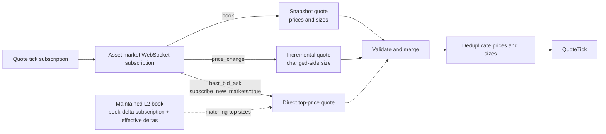

# Polymarket

Polymarket 创立于 2020 年，是一个去中心化预测市场平台，交易者通过买卖结果代币
对事件结果进行押注。

NautilusTrader 通过 Polymarket 的中心限价订单簿（CLOB）API 提供数据与执行的
交易场所集成。

适配器以 Rust 实现，并在 `nautilus_trader.adapters.polymarket`
暴露给 Python，因此数据、执行、签名与 WebSocket 操作在 Rust 与 Python 下行为
一致。

适配器为多种钱包配置处理订单准备与签名。本指南涵盖行情数据、交易执行、会话密钥
管理，以及 Deposit Wallet 的持仓操作。

## 安装 {#installation}

Python 包已包含 Polymarket 适配器，不需要额外的适配器专用 extra。

安装最新的预发布构建：

```bash
uv pip install --pre nautilus_trader
```

要从源码构建 Python 包，在仓库根目录运行：

```bash
make build-debug
```

开发用 wheel 与源码构建的前置条件见
[安装指南](./../getting_started/installation.md)。

## 示例 {#examples}

Rust 的维护中示例位于
[`crates/adapters/polymarket/examples`](https://github.com/nautechsystems/nautilus_trader/tree/develop/crates/adapters/polymarket/examples)。
Python 请使用 Rust 原生的
[数据测试器](https://github.com/nautechsystems/nautilus_trader/blob/develop/examples/live/polymarket/data_tester.py)、
[执行测试器](https://github.com/nautechsystems/nautilus_trader/blob/develop/examples/live/polymarket/exec_tester.py)
或 [Up/Down 冒烟测试器](https://github.com/nautechsystems/nautilus_trader/blob/develop/examples/live/polymarket/updown_smoke_tester.py)。
执行测试器的配置应用了 Polymarket 市价卖单所需的
[收尾精度](#exec-tester-close-residuals)。

## 二元期权 {#binary-options}

[二元期权](https://en.wikipedia.org/wiki/Binary_option)
是一种奇异期权合约，交易者就一个是或否的命题结果下注。预测正确则获得固定赔付，
否则一无所获。NautilusTrader 把 Polymarket 的结果代币表示为
`BinaryOption` 金融工具。

Polymarket 使用 [pUSD](#pusd) 作为交易抵押代币。

## Polymarket 文档 {#polymarket-documentation}

可用的 Polymarket 资源：

- [Polymarket Learn](https://learn.polymarket.com/)：平台用户指南。
- [Polymarket CLOB API](https://docs.polymarket.com/getting-started/api)：与
  Polymarket CLOB API 交互的开发者技术文档。

## 概览 {#overview}

下列 Rust 组件可组合或单独使用，实现实时行情与交易执行：

- `PolymarketWebSocketClient`：基于 Nautilus Rust
  `WebSocketClient` 的底层 WebSocket API 连接。
- `PolymarketInstrumentProvider`：`BinaryOption`
  金融工具的解析与加载。
- `PolymarketDataClient`：行情数据流管理器。
- `PolymarketExecutionClient`：交易执行网关。
- `PolymarketDataClientFactory`：Polymarket
  数据客户端工厂（由实时节点构建器使用）。
- `PolymarketExecutionClientFactory`：Polymarket
  执行客户端工厂（由实时节点构建器使用）。
- `PolymarketPositionClient`：Deposit Wallet
  的分拆、合并与赎回操作。
- `PolymarketSessionKeyClient`：由所有者操作的会话授权、列出与撤销。

:::note
Python 用户通过导出的配置与工厂类配置实时节点，通过
`PolymarketPositionClient`
调用持仓操作、通过 `PolymarketSessionKeyClient`
做会话管理。直接的 WebSocket、provider、数据客户端与执行客户端类型是仅 Rust
的实现组件。
:::

## pUSD {#pusd}

**pUSD** 是 Polymarket 交易使用的抵押代币，是 Polygon 上由 USDC
背书的标准 ERC-20 代币。

代理合约地址为 Polygon 上的
[0xC011a7E12a19f7B1f670d46F03B03f3342E82DFB](https://polygonscan.com/address/0xC011a7E12a19f7B1f670d46F03B03f3342E82DFB)。
直接的链上注资通过
[CollateralOnramp](https://docs.polymarket.com/resources/contracts)
把 Polygon USDC.e（跨链桥接的 USDC）包装为 pUSD。Bridge
API 也能从其他链存入受支持资产，转换后记入 pUSD。

## 钱包与账户 {#wallets-and-accounts}

要通过 NautilusTrader 在 Polymarket 交易，需使用 Polygon 兼容钱包，例如
MetaMask。

### 签名类型 {#signature-types}

Polymarket 为订单签名与校验支持多种签名类型：

| 签名类型     | 钱包类型                     | 说明                                                                      | 使用场景                                                                                     |
| ------------ | ---------------------------- | ------------------------------------------------------------------------- | ---------------------------------------------------------------------------------------------- |
| `0`          | EOA（外部拥有账户）          | 由直接掌握私钥的钱包产生标准 EIP-712 签名。                               | **适配器默认。** 出资方与签名方同一地址、且 EOA 在允许列表内的交易。                           |
| `1`          | Proxy Wallet                 | 通过邮箱或社交登录创建的旧版智能合约钱包。                                | 需要 Proxy Wallet 的 `funder` 地址。                                                           |
| `2`          | Safe Wallet                  | 用外部浏览器钱包创建的旧版 Gnosis Safe 钱包。                             | 需要 Safe Wallet 的 `funder` 地址。                                                            |
| `3`          | Deposit Wallet               | 新版 Polymarket 账户钱包使用的 ERC-1271 智能钱包。                        | 需要 Deposit Wallet 的 `funder`；API 凭据仍绑定在签名方上。                                   |

:::info
2026 年 5 月 4 日及之后部署的账户钱包，Polymarket 使用 Deposit
Wallet。直接 EOA 交易要求在允许列表内的 EOA。账户类型与设置流程见
Polymarket 的[钱包与鉴权指南](https://docs.polymarket.com/trading/wallets-auth)。
:::

NautilusTrader 默认使用签名类型 0（EOA）。要用其他受支持的钱包类型，设置
`signature_type`。代理签名客户端在构造时若 `funder`
缺失或等于签名地址，会直接失败。

环境变量为每个 trader 实例提供单一钱包地址。要用多个钱包，请配置独立的执行客户端
实例。

提交订单前先为钱包注入 pUSD。未注资的钱包会产生 "not enough balance or
allowance" API 错误。

### 设置 EOA 授权 {#setting-eoa-allowances}

适配器为 EOA 账户提供一条直接的链上授权命令。仅当出资钱包就是签名方
（`PolymarketSignatureType::Eoa`）时使用。给 EOA 注入 POL
作为 gas，设置 `POLYMARKET_PK`，然后运行：

```bash
cargo run -p nautilus-polymarket --bin polymarket-set-allowances
```

该命令为 CTF Exchange、Neg Risk CTF Exchange 与
`NegRiskCtfCollateralAdapter`
授予 pUSD 与 CTF 的最大授权。默认使用
`https://polygon.drpc.org`；要改用其他 Polygon RPC
端点，设置 `POLYGON_RPC_URL`。Polymarket
变更所需合约后请重新运行。

该命令只做授予，不撤销已不再是目标的合约上的既有授权。撤销要作为独立的链上操作
处理。提交撤销前，确认没有任何仍在进行的赎回或结算流程还需要那份旧授权。

### 设置智能钱包授权 {#setting-smart-wallet-allowances}

不要为 proxy、Safe 或 Deposit Wallet 出资方运行 EOA
命令。它用 EOA 私钥签名交易，无法从智能合约钱包授予授权。

用 Polymarket 的
[钱包与鉴权流程](https://docs.polymarket.com/trading/wallets-auth)
从账户钱包提交授权。Deposit Wallet
的授权使用由签名方授权、经 Relayer 提交的有序
`WALLET` 批次。Safe 与 Proxy Wallet 的授权需要各自钱包专用
SDK 载荷。

### 刷新与校验授权 {#refreshing-and-verifying-allowances}

授权交易确认后，刷新 CLOB
缓存。Rust 调用方可对 pUSD 用
`PolymarketClobHttpClient::update_balance_allowance`
配 `AssetType::Collateral`；条件代币授权则用
`AssetType::Conditional` 加条件代币
ID。两种形式都需要账户的签名类型。该带鉴权的请求映射到
`GET /balance-allowance/update`。Deposit Wallet
使用 `PolymarketSignatureType::Poly1271`。

balance-allowance 端点有两条解码路径：

| 路径                                              | 用途                                                 | 授权处理                                                                                                                                                                       | 成功含义                                                                           |
| ------------------------------------------------- | ---------------------------------------------------- | -------------------------------------------------------------------------------------------------------------------------------------------------------------------------------- | ------------------------------------------------------------------------------------ |
| `PolymarketClobHttpClient::get_balance_allowance` | 读取支出方授权证据。                                 | 要求复数 `allowances` 映射；拒绝缺失的映射、非空的旧版单数字段、畸形或非规范键，以及大小写变体这类语义重复。                                                                   | 余额加一份无歧义的映射；必需的目标与金额仍需检查。                                   |
| 内部仅余额投影                                    | 账户状态刷新与市价买单费用调整。                     | 忽略授权字段；其返回类型无法暴露或授予批准权限。                                                                                                                               | 仅余额；必需的 CLOB 支出方授权仍未证实。                                             |

凡决策依赖授权证据，就走严格路径，避免含混的线上数据变成批准权限。

### 账户余额 {#account-balances}

#### 余额计算 {#balance-calculation}

余额刷新使用交易场所报告的 pUSD
总额，锁定抵押品从执行客户端的本地状态推导：

- 该账户未结 BUY 订单的预占，用缓存的限价与剩余数量计算。
- 其 BUY
  成交的名义价值与佣金——场所总额可能仍包含它们。

预占不含已提交但尚未被接受的订单，也不不含不在执行缓存中的订单。SELL
订单预占的是结果代币而非 pUSD，不计入锁定抵押品。

**未结算的 BUY 支出**：已知
BUY 成交之后的下一次刷新，从其名义价值加佣金中扣减自由余额，同时扣减按同一快照
计量的其他未结算 BUY 支出。

当场所总额自该快照起下降至少达到合计金额时，这些金额一起释放，因此已被扣减的
总额不会被二次扣减。在那之前，锁定的未结算支出只是尚未被下降覆盖的那部分未结
支出。若刷新的场所总额没有变化，未结支出继续保持锁定。

**作废（void）**：一次作废立即从锁定抵押品中移除该笔成交的支出。后续的作废修订
是累计的，因此只移除增量。被作废的金额仍计入释放其他未结支出所要求的下降量。对
从未锁定的成交做作废，不会抬高该门槛。当不再有未结支出时，下一次刷新释放被作废
的金额并推进快照。

适配器不锁定以下 BUY 成交：

- 首次由终局 REST
  证据应用的成交，包括已确认的成交报告，因为这类证据只在交易确认后才被采纳。
- 比快照旧 15 秒以上的对账成交，或在任何快照之前收到的成交。

锁定抵押品以报告总额为上限，自由余额等于总额减锁定，遵循[余额模型](./../concepts/accounting.md#balance-model)。

#### 刷新时机 {#refresh-timing}

适配器在 connect
时从执行缓存为预占播种，并随核心处理订单事件（含对账事件）更新预占与未结算
BUY 支出。传输层重连保留未结算 BUY 支出，重置则清空它。首次余额刷新早于启动
对账，对账期间发现的订单在下一次刷新时影响余额。

刷新发生在 connect
时、账户查询后、已最终化的成交更新后，以及用户
WebSocket 重连时。若余额响应晚于更新的刷新、晚于执行客户端重连或晚于客户端重置到达，
则不予应用。用户 WebSocket
重连不会丢弃在途刷新，更新的刷新仍然优先。账户余额不随每个订单事件变化，余额刷新
不请求未结订单。

:::warning
**这些余额是估计值。** HTTP
余额响应与订单事件可能反映不同时刻，它们不保证资金在提交前已被预留。

时间效应包括：

- 抵押品入账（包括自有 SELL
  的结算）可能在场所总额已反映扣减之后，仍让未结算 BUY 支出保持锁定。该占用仅限
  尚未被下降覆盖的部分。
- 一笔无关的扣减可能在该成交真正扣减之前就释放这笔支出。
- 金额从未离开场所总额的作废，可能让那笔未覆盖的缺口在其他未结算支出仍未结期间
  保持锁定。
- 仍在扣减窗口内的确认，可能把终局 REST 的
  BUY 支出报告为自由余额，直到后续某次刷新。
- 在排队的成交被处理之前应用的刷新，可能让该成交在总额已扣减后仍保持锁定。

适配器不会锁定同一出资方上其他客户端的成交支出，也不会锁定它尚未收到的成交。
:::

## API 密钥 {#api-keys}

### CLOB 凭据 {#clob-credentials}

执行客户端需要 CLOB L2
凭据。用 Polymarket 的
[API 鉴权流程](https://docs.polymarket.com/getting-started/api#authentication)
创建或推导它们。适配器提供一条命令，读取
`POLYMARKET_PK`
并打印创建或推导出的凭据：

```bash
cargo run -p nautilus-polymarket --bin polymarket-create-api-key
```

把返回的值设为：

- `POLYMARKET_API_KEY`
- `POLYMARKET_API_SECRET`
- `POLYMARKET_PASSPHRASE`

这些凭据为私钥签名方鉴权，不是为
proxy 或 Deposit Wallet 出资方。数据客户端只在
[PolyBolt 参考价订阅](#polybolt-reference-prices)中需要它们。

### Relayer 凭据 {#relayer-credentials}

Deposit Wallet 的分拆、合并与赎回操作还需要
Relayer API 密钥。按
[连接你的账户](https://docs.polymarket.com/trading/wallets-auth#connect-your-account)
的说明在 Settings > API Keys > Relayer API Keys
下创建，然后设置：

- `POLYMARKET_RELAYER_API_KEY`
- `POLYMARKET_RELAYER_SIGNER_ADDRESS`

`POLYMARKET_RELAYER_SIGNER_ADDRESS`
是创建 Relayer 密钥时显示的签名方地址。持仓客户端还会读取
`POLYMARKET_PK` 与 `POLYMARKET_FUNDER`。

### Builder 凭据 {#builder-credentials}

会话授权与撤销需要为 session-key API
批准的 Builder 凭据，与持仓操作用的 Relayer API
密钥相互独立。按 Polymarket 的
[session-key 要求](https://docs.polymarket.com/trading/session-keys)操作，并把这些值
保存在所有者的管理环境中：

- `POLYMARKET_BUILDER_API_KEY`
- `POLYMARKET_BUILDER_API_SECRET`
- `POLYMARKET_BUILDER_PASSPHRASE`

### Deposit Wallet 校验 {#deposit-wallet-verification}

出资方等于签名地址时构造失败。签名之前，持仓客户端：

- 检查规范 Polygon
  工厂预测的当前与旧版 Deposit Wallet 地址。
- 要求钱包已部署合约代码，并校验签名方拥有该钱包。
- 从钱包的链上计数器读取签名 nonce。

Polygon RPC 默认
`https://polygon.drpc.org`。要改用其他受信任的 Polygon
端点，向 `PolymarketPositionClient`
构造函数传入 `base_url_rpc`。

## 会话密钥 {#session-keys}

会话密钥让独立的签名方为 Deposit Wallet
交易，而不把其所有者的私钥交给交易运行时。适配器支持
CLOB 作用域的授权。场所准入与 Builder
批准要求见 Polymarket 的
[session-key 文档](https://docs.polymarket.com/trading/session-keys)。

### 管理访问 {#administer-access}

在**所有者的管理环境**中运行
`PolymarketSessionKeyClient`，每个钱包只用一个管理进程。授权会话之前：

- 显式提供所有者私钥、所有者 CLOB
  凭据、Builder 凭据与 Deposit Wallet
  地址。客户端自身不读取环境变量。
- 另行生成并安全保存会话密钥对，只把其公开地址传给授权方法。

Python 示例从管理进程的环境读取凭据并传入客户端：

```python
import os

from nautilus_trader.adapters.polymarket import PolymarketSessionKeyClient
from nautilus_trader.adapters.polymarket import PolymarketSessionKeyClientConfig

admin = PolymarketSessionKeyClient(
    PolymarketSessionKeyClientConfig(
        private_key=os.environ["POLYMARKET_PK"],
        api_key=os.environ["POLYMARKET_API_KEY"],
        api_secret=os.environ["POLYMARKET_API_SECRET"],
        passphrase=os.environ["POLYMARKET_PASSPHRASE"],
        builder_api_key=os.environ["POLYMARKET_BUILDER_API_KEY"],
        builder_api_secret=os.environ["POLYMARKET_BUILDER_API_SECRET"],
        builder_passphrase=os.environ["POLYMARKET_BUILDER_PASSPHRASE"],
        funder=os.environ["POLYMARKET_FUNDER"],
    ),
)

# Use the public address derived from the separately stored session private key.
session_address = os.environ["SESSION_ADDRESS"]

# Run these calls from an async function in the administration process.
key = await admin.authorize_session_key(session_address)
keys = await admin.list_session_keys()
```

可选配置：

- `base_url_http` 覆盖生产 CLOB 端点。
- `base_url_relayer` 覆盖生产 Relayer 端点。
- `proxy_url` 为两个客户端配置 HTTP 或 HTTPS 代理。

Rust 示例提供同样的授权与列出操作：

```bash
cargo run -p nautilus-polymarket --example polymarket-session-keys -- authorize "$SESSION_ADDRESS"
cargo run -p nautilus-polymarket --example polymarket-session-keys -- list
```

每个管理方法各有明确的完成条件：

| 方法                    | 成功返回要求                                                                |
| ----------------------- | ---------------------------------------------------------------------------- |
| `authorize_session_key` | 链上确认；注册表与地址、CLOB 作用域及到期时间匹配                            |
| `list_session_keys`     | 校验通过的活跃、未过期注册表条目                                             |
| `revoke_session_key`    | 链上确认；密钥已不在活跃注册表中                                             |

#### 到期 {#expiration}

授权在 4,315 小时后到期，与官方 SDK 的线上取值一致。Polymarket 把该周期描述为
180 天，但其原始示例与 SDK 用的值短了 5 小时。返回的
`valid_until` 是 Unix 秒计的精确到期时间。

#### 恢复被中断的操作 {#recover-an-interrupted-operation}

授权或撤销超时、遇到传输失败或被取消后，用**同一操作、同一地址、同一客户端**
重试。客户端保留已签名的请求与幂等键，并在挂起操作定案之前拒绝其他变更。

保持客户端存活直到操作定案：挂起请求保存在内存中。结果未知的错误包含幂等键与
任何已知交易 ID，便于诊断。

:::warning
已签名批次有 **600 秒期限**。未被接受的请求过期后，重试无法创建新批次，客户端
保持阻塞。先对账注册表与 Relayer
结果，再创建新客户端。进程重启后同样需要这份对账。
:::

### 配置会话交易 {#configure-session-trading}

用**会话私钥**创建或推导 CLOB
凭据，走既有的 [CLOB
凭据流程](#clob-credentials)。会话模式要求：

- 显式的会话凭据与 `funder`，不回退到环境中的所有者凭据。
- `PolymarketSignatureType.Poly1271`，其他钱包签名类型一律拒绝。

:::info
把所有者与 Builder 凭据留在交易运行时之外。
:::

下例中 `session_private_key`
是另行保存的会话密钥，`session_api_key`、
`session_api_secret` 与
`session_passphrase` 是其返回的 CLOB 凭据：

```python
from nautilus_trader.adapters.polymarket import PolymarketExecutionClientConfig
from nautilus_trader.adapters.polymarket import PolymarketSignatureType
from nautilus_trader.adapters.polymarket import PolymarketSignerType

execution = PolymarketExecutionClientConfig(
    signer_type=PolymarketSignerType.Session,
    signature_type=PolymarketSignatureType.Poly1271,
    private_key=session_private_key,
    api_key=session_api_key,
    api_secret=session_api_secret,
    passphrase=session_passphrase,
    funder=deposit_wallet_address,
)
```

既有配置默认 `PolymarketSignerType.Owner`。

#### 对账与重启 {#reconciliation-and-restarts}

订单、成交与通知的作用域是会话的活动。对账要求会话 API
密钥与订单归属匹配，仅共享钱包地址不构成归属。

会话的 cancel-all
取消已知订单 ID，不使用钱包级的全市场取消。mass status
包含会话的订单与成交，但不含钱包级持仓。直接持仓查询返回错误，因为钱包持有量
无法确定会话的持仓。

据此配置节点：

- **持仓检查**：把
  `LiveExecutionEngineConfig.position_check_interval_secs=None`
  关闭节点的周期持仓检查。
- **跨重启的历史**：配置[缓存数据库持久化](./../concepts/cache.md#database-configuration)
  并保持 `load_cache=True`，保留订单与成交历史。

### 撤销或轮换访问 {#revoke-or-rotate-access}

在管理环境中轮换密钥。切换凭据前先协调好未结订单与对账：**新会话不会继承对旧
会话订单的可见性**。

要撤销密钥，用上面创建的管理客户端，在 async 函数中调用：

```python
await admin.revoke_session_key(session_address)
```

或运行 Rust 示例：

```bash
cargo run -p nautilus-polymarket --example polymarket-session-keys -- revoke "$SESSION_ADDRESS"
```

:::warning
过期或被撤销的权限会导致场所拒单。实时传输连接仍在，并不能证明授权仍然有效。
:::

## 持仓操作 {#position-operations}

`PolymarketPositionClient`
把 pUSD 拆分为完整的结果代币组，把完整组合并回
pUSD，并赎回已结算的持仓。该客户端仅支持 Deposit Wallet
（`PolymarketSignatureType::Poly1271`），Safe、Proxy
与 EOA 路径不可用。它不部署钱包、不合并无关调用批量提交、不支持把合并数量设为
`"max"`，也不自动赎回持仓。

### 输入与授权 {#inputs-and-approvals}

每个操作先按条件 ID
在公共 CLOB 上查找市场，`neg_risk`
缺失即报错，随后选定规范 pUSD 代币与标准或负风险抵押品适配器。调用方传入带
0x 前缀的 32 字节条件 ID，不需要提供合约地址。

- **拆分与合并数量**：正的 pUSD 小数，必须能被 6
  位小数精确表示，不做舍入。数量用 pUSD 单位而非最小单位，不接受 `"max"`。
- **赎回**：无数量参数，赎回两个二元索引组 `[1, 2]`。

**授权不会自动提交。** 提交操作前先在 Deposit Wallet 上完成授权：

| 操作         | 市场抵押品适配器所需授权             |
| ------------ | ------------------------------------ |
| 拆分         | 花费钱包的 pUSD                      |
| 合并或赎回   | 以 Conditional Tokens 运营者身份操作 |

`polymarket-set-allowances`
的授权计划中没有标准抵押品适配器，负风险适配器在其中。该命令用 EOA
签名授权，无法为 Deposit Wallet
授予任何一项。请用 Polymarket 的
[钱包与鉴权流程](https://docs.polymarket.com/trading/wallets-auth)
从 Deposit Wallet 授予持仓操作所需授权。

### 提交与等待 {#submit-and-wait}

下面的示例展示一次拆分提交。运行前把示意性的条件 ID
换成市场真实的条件 ID。

```python
from decimal import Decimal

from nautilus_trader.adapters.polymarket import PolymarketPositionClient

condition_id = "0x" + "11" * 32
client = PolymarketPositionClient()
transaction = await client.split_position(condition_id, Decimal("1"))
outcome = await transaction.wait()
```

`split_position` 与
`merge_positions`
接受条件 ID 和一个正的 pUSD
`Decimal`；`redeem_positions`
只接受条件 ID。每个方法在 Relayer
提交后返回 `PolymarketPositionTransaction`。
调用一次 `wait()` 轮询直到拿到
`PolymarketPositionOutcome`。同一个
Python 句柄上第二次 `wait()`
会抛出异常。句柄在开始等待后保留其
`transaction_id`，取消或出错之后也保留。

### 结果与错误 {#outcomes-and-errors}

| `PolymarketPositionOutcome.status` | 含义                                |
| ---------------------------------- | ----------------------------------- |
| `confirmed`                        | Relayer 报告 `STATE_CONFIRMED`。    |
| `failed`                           | Relayer 报告 `STATE_FAILED`。       |
| `invalid`                          | Relayer 报告 `STATE_INVALID`。      |

每个结果都暴露 `transaction_id`。confirmed 与 failed
结果在 Relayer 提供时暴露
`transaction_hash`；invalid 结果始终返回
`None`。failed 与 invalid
结果在 Relayer 提供时还暴露 `error_msg`。

#### 提交错误 {#submit-errors}

HTTP 拒绝发生在交易句柄存在之前。超时的提交，或没有
`transaction_id` 的成功响应，同样抛异常。链上结果未知。

客户端**不重试提交**。

#### 等待超时 {#wait-timeout}

默认 120 秒，在轮询请求之间检查。在途请求或轮询延迟会让实际耗时超过该值。超时
抛出的错误会带 Relayer 交易 ID，终态仍未知。Python
不暴露 Rust 的等待超时与轮询间隔设置方法。

#### 响应校验 {#response-validation}

Relayer 重定向会被拒绝；轮询会拒绝交易 ID
与提交 ID 不一致的响应。

### 提交协调 {#submission-coordination}

同一进程内的客户端为每个钱包共享提交状态。后续操作要求匹配的终局 Relayer
结果与已推进的钱包 nonce。未推进
nonce 的失败或无效操作会一直处于阻塞。

签名后，客户端在发送批次之前先记录一条预留。随后发生 HTTP
拒绝、超时、取消或无交易 ID 的响应时，即便重建客户端，该钱包的后续操作仍被阻塞。
预留之前的失败——例如非法数量或钱包校验失败——不会造成新的阻塞。仅凭 HTTP
状态无法证明已签名批次不会执行。

:::warning
不要重启后盲目重试一次结果未知的提交。进程重启清掉本地提交状态，但不会取消一笔
已签名的交易。每个钱包只用一个提交进程。协调不跨进程，也不覆盖外部钱包工具。
:::

### 恢复结果未知的提交 {#recover-an-unknown-submission}

#### 保留提交记录 {#retain-the-submission-record}

提交持仓操作之前开启并保留 INFO
日志。每次提交请求之前，客户端会输出一条
`Deposit Wallet submission`
记录，包含：

- 钱包地址、预留 nonce 与签名期限（Unix 秒）。
- 操作、目标合约与 value。
- 标识条件的未签名 calldata，拆分或合并时还含数量。

该记录不含签名与凭据，但含交易意图。请限制对保留日志的访问。返回句柄带交易 ID
时务必留存。

:::warning
日志不是持久化的交易日记。日志关闭或进程崩溃可能不留任何记录，导致没有进一步
证据就无法安全恢复。
:::

#### 重试之前先对账 {#reconcile-before-retrying}

1. **停止提交。** 包括使用该钱包的其他进程与外部钱包工具。
1. **确认操作是否已执行。** 找到提交记录与任何 Relayer
   交易 ID，把预定的钱包、目标与 calldata
   同最终化的链上交易回执及其效果做匹配。仅凭成功的 HTTP
   响应、Relayer 失败或已推进的 nonce，都不能确定预定操作是否执行。若已执行，
   不要重复。
1. **执行未知期间让钱包保持阻塞。** 要按到期对账，完成下面全部[到期检查](#expiry-checks)。
   若 nonce 已推进，检查消耗它的那笔交易，而不是假定失败。
1. **重启之前先证明重试是安全的。** 既要确定预定操作未执行，也要确定原签名批次
   已无法执行。若记录缺失、RPC
   无法提供一致的最终化状态，或合约行为未经验证，先与 Polymarket
   澄清不确定性再重试。

#### 到期检查 {#expiry-checks}

签名期限默认为签名后 1,800 秒。Rust
调用方可用 `with_deadline_secs`
修改。更长的期限会推迟基于到期的恢复。
`wait()` 超时既不缩短签名期限，也不取消批次。

先验证部署的钱包合约确实强制签名期限、并在批次执行时消耗其
nonce。然后用 `eth_call`
在 Polygon 的某个最终化区块读取钱包的
`nonce()`，并取得同一区块的时间戳。两者都要满足：

- nonce 相对预留值未变。
- 区块时间戳严格晚于签名期限。

本地经过的时间不足以作证明。nonce
已推进时必须检查消耗它的那笔交易，它不能证明失败。

客户端不会自动执行这些恢复检查或释放预留。识别部署合约时查
[Polymarket 合约注册表](https://docs.polymarket.com/resources/contracts)，按区块调用查
[JSON-RPC 参考](https://ethereum.org/en/developers/docs/apis/json-rpc/)。

## 配置 {#configuration}

通过下列参数或其环境变量回退配置签名与鉴权：

| 参数          | 环境变量                | 用途                                                         |
| ------------- | ----------------------- | -------------------------------------------------------------- |
| `private_key` | `POLYMARKET_PK`         | 按 `signature_type` 为订单签名的钱包密钥                     |
| `funder`      | `POLYMARKET_FUNDER`     | pUSD 出资钱包地址                                            |
| `api_key`     | `POLYMARKET_API_KEY`    | CLOB L2 API 密钥                                             |
| `api_secret`  | `POLYMARKET_API_SECRET` | CLOB L2 API secret                                           |
| `passphrase`  | `POLYMARKET_PASSPHRASE` | CLOB L2 API 口令                                             |

owner 模式下，参数未显式提供时客户端读取其环境变量。会话模式要求显式凭据与
funder。CLOB L2 凭据为私钥签名方鉴权。`POLY_1271`
下 Deposit Wallet 仍是 `funder`，但不是 L2 鉴权地址。

:::tip
用环境变量提供凭据，避免把凭据嵌进客户端配置代码。
:::

金融工具加载还有两个常用开关：

- `auto_load_missing_instruments`（默认
  `True`）：对未缓存金融工具的订阅与请求命令会触发一次临时
  Gamma API 加载。关闭时，订阅未缓存的金融工具直接返回错误。见[运行时金融工具加载](#runtime-instrument-loading)。
- `auto_load_debounce_ms`（默认 `100`）：把并发自动加载请求合并为单次批量
  Gamma 调用的窗口（毫秒）。

## 数据能力 {#data-capability}

Polymarket 支持实时 `L2_MBP`
订单簿增量、报价、成交，以及结算的
`InstrumentStatus`/`InstrumentClose`
事件。金融工具定义由引导加载、配置刷新、按需加载、单工具请求、新市场发现与
tick 尺寸变更发布。

## 订单能力 {#orders-capability}

Polymarket 支持下列订单类型与指令。

:::tip
Polymarket 实时执行请把断连超时与停机后延迟都设为 30
秒：`with_timeout_disconnection_secs(30)` 与
`with_delay_post_stop_secs(30)`。延迟让残余的订单与撤单事件在断连前到达。执行
断连在该超时内完成，不会等完在途命令的 HTTP 超时。
:::

断连收尾时仍在途的撤单会让订单停留在
`PENDING_CANCEL`，适配器既不发
`OrderCanceled` 也不发
`OrderCancelRejected`，场所可能应用了也可能没应用该撤单。下一次运行的启动
对账会将其定案。策略侧的撤单不会这样处理，因为订单已在待撤状态。其他在途的提交与
修改命令受同一界限约束，未确认的会保持未定案。

### 订单类型 {#order-types}

| 订单类型               | 二元期权 | 说明                                                                      |
| ---------------------- | -------- | --------------------------------------------------------------------------- |
| `MARKET`               | ✓        | **BUY 订单必须用 quote 数量**，SELL 订单必须用 base 数量。                  |
| `LIMIT`                | ✓        | BUY 可接受 base 或 quote 数量；SELL 必须用 base。                           |
| `STOP_MARKET`          | -        | *Polymarket 不支持*。                                                       |
| `STOP_LIMIT`           | -        | *Polymarket 不支持*。                                                       |
| `MARKET_IF_TOUCHED`    | -        | *Polymarket 不支持*。                                                       |
| `LIMIT_IF_TOUCHED`     | -        | *Polymarket 不支持*。                                                       |
| `TRAILING_STOP_MARKET` | -        | *Polymarket 不支持*。                                                       |

### 数量语义 {#quantity-semantics}

Polymarket 按订单类型、方向与
`quote_quantity` 设置不同地解释订单数量：

- **`quote_quantity=False` 的限价单**把
  `quantity` 解释为条件代币数量（base 单位）。
- **`quote_quantity=True` 的限价 BUY**把
  `quantity` 解释为 pUSD 抵押品。
- **市价 BUY** 把 `quantity` 解释为
  **pUSD** 的 quote 名义价值。
- **市价 SELL** 使用 base 单位数量。

不支持以 quote 计量的限价 SELL
订单，适配器在提交前拒绝。它也拒绝任何在两位小数的签名界限上 base 或 quote
数量被截断为零的限价单。

#### 限价 BUY 示例 {#limit-buy-example}

对 `quote_quantity=True` 的限价 BUY：

- 适配器把抵押品截断到分，签名为其 maker
  金额，并按市场的数量精度推导份额数。
- 在处理场所响应之前，把本地订单更新为签名的份额数量。
- 签名金额必须精确保住限价。否则适配器在 HTTP
  之前就拒绝订单。例如 10.00 pUSD 按
  0.33 无法表示，而 9.90 pUSD 按 0.33
  恰好产出 30 份。

要用抵押品上限约束限价 BUY，设置 `quote_quantity=True`：

```python
# Limit BUY with quote quantity (spend $10 pUSD at a limit price of 0.50)
order = strategy.order_factory.limit(
    instrument_id=instrument_id,
    order_side=OrderSide.BUY,
    quantity=instrument.make_qty(10.0),
    price=instrument.make_price(0.50),
    time_in_force=TimeInForce.GTC,
    quote_quantity=True,
)
strategy.submit_order(order)
```

#### 市价 BUY 示例 {#market-buy-example}

市价 BUY **必须用 quote 数量**：设置
`quote_quantity=True`。适配器在提交到 CLOB
之前把 quote 金额（pUSD）换算为签名的 base 单位份额数。Polymarket
执行客户端拒绝以 base 计价的市价买，以防意外成交。以
base 计价数量提交的市价 BUY 可能执行远超预期的规模。

```python
# Market BUY with quote quantity (spend $10 pUSD)
order = strategy.order_factory.market(
    instrument_id=instrument_id,
    order_side=OrderSide.BUY,
    quantity=instrument.make_qty(10.0),
    time_in_force=TimeInForce.IOC,  # Maps to Polymarket FAK
    quote_quantity=True,  # Interpret as pUSD notional
)
strategy.submit_order(order)
```

### 执行指令 {#execution-instructions}

| 指令          | 二元期权 | 说明                                                 |
| ------------- | -------- | ------------------------------------------------------ |
| `post_only`   | ✓        | 仅对 `GTC` 或 `GTD` 的限价单支持。                     |
| `reduce_only` | -        | *Polymarket 不支持*。                                  |

### 有效期选项 {#time-in-force-options}

Polymarket 把 `POST /order`
的该字段称为 `orderType`，在 NautilusTrader
中映射到 `TimeInForce`。合法组合取决于 Nautilus
订单类型：

| Nautilus TIF | Polymarket `orderType` | Nautilus 订单范围      | 说明                                                      |
| ------------ | ---------------------- | ---------------------- | ----------------------------------------------------------- |
| `GTC`        | `GTC`                  | 仅 `LIMIT`             | Good-Til-Cancelled；挂在订单簿上。                          |
| `GTD`        | `GTD`                  | 仅 `LIMIT`             | Good-Til-Date；挂到到期、成交或撤单。                       |
| `FOK`        | `FOK`                  | `LIMIT` 或 `MARKET`    | 立即全量成交，否则整单取消。                                |
| `IOC`        | `FAK`                  | `LIMIT` 或 `MARKET`    | 立即成交可得数量并取消剩余。                                |

Polymarket 对 NautilusTrader 称为
`IOC`（Immediate or Cancel）的语义使用
`FAK`（Fill-And-Kill）。Polymarket
文档把 `FOK` 与 `FAK`
归为市价订单类型，`GTC` 与 `GTD`
归为限价订单类型。对 Nautilus 的
`MARKET` 订单，适配器只接受
`IOC` 与 `FOK`；`GTC` 与
`GTD` 只对挂单的 `LIMIT` 订单有效。

#### GTD 到期 {#gtd-expiry}

`GTD` 到期时间至少要设在提交后三分钟。更短的到期适配器在签名前拒绝。它使用整
Unix 秒，接受恰好三分钟的边界。

Polymarket 把用户撤单与 GTD
到期都报告为 `CANCELED`。它比你给的到期时间提前一分钟过期，因此最短有效寿命约
两分钟。要获得 N 秒的有效寿命，提交
`now + 60 + N`，且仍受三分钟下限约束。

用户频道上，发生在那一分钟标记及之后的
`CANCELED` 事件会变成
`OrderExpired`；更早的撤单保持
`OrderCanceled`；经 REST
恢复的撤单也保持 `OrderCanceled`。未结订单载荷带到期时间，但没有撤单时间。

`manage_gtd_expiry` 保持
false。策略定时器在声明的到期时间触发并提交撤单，不发
`OrderExpired`。用户频道的到期已经会清掉该定时器。

若错过了到期消息，迟到的撤单不会收尾订单，仍需靠对账处理。见
[GTD 订单](https://docs.polymarket.com/trading/place-orders#limit-orders)。

### 最小订单规模 {#minimum-order-size}

从各市场的订单簿读取其
`min_order_size`，活跃市场通常报告 5
份。名义价值低于 **1 pUSD**
的可成交订单也可能被拒，
`invalid amount for a marketable BUY order … min size: $1`.

The adapter leaves instrument
`min_quantity` unset because quote-sized BUY quantities use pUSD while base-sized orders use
shares. Submit still sends an undersized order for the venue to reject. Modify checks the cached
share minimum before and after cancellation. See [Order modification](#order-modification).

### Advanced order features

| Feature            | Binary options | Notes                                                   |
| ------------------ | -------------- | ------------------------------------------------------- |
| Order modification | ✓              | Adapter-managed cancel-replace for open `LIMIT` orders. |
| Bracket/OCO orders | -              | *Not supported by Polymarket.*                          |
| Iceberg orders     | -              | *Not supported by Polymarket.*                          |

#### Order modification

Polymarket has no in-place modify endpoint. The execution client cancels the current venue order,
reconciles its final confirmed fills, and signs a replacement for the remaining quantity.

##### Replacement quantity and identity

`ModifyOrder.quantity` sets the absolute target for the logical order, not the replacement leg.
The replacement keeps the `ClientOrderId` and receives a new `VenueOrderId`.

The logical quantity uses the exact signed base quantity after venue precision normalization,
so it can be slightly lower than the requested target.

##### Size checks

Before canceling, the adapter subtracts filled quantity and quantity voided without reopening from
the target. It rejects a replacement below 0.01 shares.

When cached instrument `info["min_order_size"]` is present, the adapter also rejects the modify if:

- The value is not a positive decimal string.
- The signed replacement share quantity is below that minimum.
- The signed amounts needed for the minimum check cannot be derived.

A missing key skips the market minimum check. For a `FAK` or `FOK` BUY, the check uses shares
derived from the cent-truncated pUSD budget.

After cancellation, the adapter repeats the size checks on the remaining quantity. It uses the
market minimum captured at modify start, without a fresh order-book read.

Fills during cancellation can leave an undersized remainder. The adapter does not post it: the
modify is rejected and the order closes as canceled. A marketable replacement can still be rejected
below 1 pUSD after cancellation.

##### Ambiguous outcomes

The adapter submits no replacement unless the cancel response, canceled order state, and confirmed
trade totals agree.

- **Ambiguous cancel**: Emits `OrderModifyRejected`.
- **Ambiguous replacement**: Stays in flight under its deterministic signed order hash. A later
  order update, fill, or reconciliation can establish it without a second `OrderAccepted`.
  Later modify and cancel commands remain blocked until then.

Replacement recovery state does not persist across an execution-client process restart.

### Batch operations

| Operation    | Binary options | Notes                                                                                                                               |
| ------------ | -------------- | ----------------------------------------------------------------------------------------------------------------------------------- |
| Batch submit | ✓              | The adapter uses `POST /orders` for independent limit-order batches (max 15 orders per request). See [Batch submit](#batch-submit). |
| Batch modify | -              | *Not supported by Polymarket*.                                                                                                      |
| Batch cancel | ✓              | The adapter uses `DELETE /orders`. See [Batch cancel](#batch-cancel).                                                               |

#### Batch submit

`SubmitOrderList` commands are routed to Polymarket's `POST /orders` endpoint. The endpoint accepts at most 15
orders per request (`BATCH_ORDER_LIMIT`). Larger lists are split into sequential 15-order chunks.

- Only `LIMIT` orders are batched. `MARKET` orders inside the list are routed to the
  single-order path, which signs a marketable order and submits it with `FAK` or `FOK`
  based on Nautilus `time_in_force`.
- `reduce_only` orders, quote-sized SELL orders, and `post_only` with market TIF (`IOC` or `FOK`)
  are denied before submission.
- A single eligible order falls through to `POST /order` so it keeps the single-order retry semantics. The
  batch path deliberately disables retry because the venue does not expose an idempotency key.
- If the batch response omits a leg, that order stays submitted for reconciliation. The adapter
  registers the signed order's expected hash so later WebSocket events and cancels still resolve to
  the local order. An omitted response cannot prove that the venue rejected the order.

#### Batch cancel

`BatchCancelOrders` commands with resolved venue order IDs use Polymarket's
[`DELETE /orders`](https://docs.polymarket.com/api-reference/trade/cancel-multiple-orders)
endpoint. The adapter sends sequential chunks and chooses each new chunk from the smaller of the
endpoint's 1,000-ID limit and the signer's current cancellation burst. A signer starts with the
Standard 120-token burst, and a tier reported by one response applies to the next new chunk.

Each chunk retries independently with the same order IDs unless a lower reported tier requires smaller chunks
before the retry. The adapter merges the completed responses and processes each requested order once after
every chunk succeeds. If a later chunk exhausts its retries, earlier chunks may already have changed venue
state. The adapter emits no partial per-order results. Reconciliation resolves the unknown overall outcome.

`CancelAllOrders` selects its cancellation scope as follows:

| Mode    | Side filter     | Scope                                                            | Endpoint                       |
| ------- | --------------- | ---------------------------------------------------------------- | ------------------------------ |
| Owner   | None            | Selected outcome token across the execution account's strategies | `DELETE /cancel-market-orders` |
| Owner   | `Buy` or `Sell` | Matching open orders in the local cache                          | Chunked `DELETE /orders`       |
| Session | Any             | Matching open orders in the local cache                          | Chunked `DELETE /orders`       |

The owner path without a side filter sends the instrument's raw token ID as `asset_id` to
[`DELETE /cancel-market-orders`](https://docs.polymarket.com/api-reference/trade/cancel-orders-for-a-market),
even when the cache has no matches. The ID-based paths send no request without matching cached orders.
A matching order awaiting its venue order ID retains a pending cancellation, which the adapter
sends after submission resolves.

### Submit response handling

Polymarket's public documentation describes successful
[`POST /order`](https://docs.polymarket.com/api-reference/trade/post-a-new-order) responses
with `success`, `orderID`, `status`, and `errorMsg`, and documents
[API errors](https://docs.polymarket.com/resources/error-codes) as structured error responses.
It does not document statusless client exceptions or transport failures as venue rejections.

#### Successful responses

For a successful response with a non-empty `orderID`, the adapter uses `status` to choose the initial Nautilus
state. For an order with `FOK` time-in-force, it also uses `status` to decide whether the five-second REST
check is needed. The venue meanings follow Polymarket's
[order lifecycle](https://docs.polymarket.com/concepts/order-lifecycle).

| Submit `status` | Venue meaning                                | Initial Nautilus state                                         | `FOK` REST check     |
| --------------- | -------------------------------------------- | -------------------------------------------------------------- | -------------------- |
| `live`          | Resting on the book                          | `Accepted`                                                     | Kept                 |
| `matched`       | Matched immediately                          | `Accepted`                                                     | Skipped              |
| `delayed`       | Matching delay in progress                   | `Submitted` until WebSocket or REST activity proves acceptance | Kept                 |
| `unmatched`     | Delay completed without a match; now resting | `Accepted`                                                     | Kept                 |
| Absent or empty | No status supplied                           | `Accepted` unless a proven FOK/FAK error rejects it            | Kept unless rejected |

Submit `status` describes the submission outcome. `delayed` is not a market configuration signal. The
immediate match confirmed by `matched` makes the REST check unnecessary.

An absent or empty status emits `OrderAccepted` for compatibility and keeps the REST check unless
a proven unfilled `FOK` or no-match `FAK` response causes immediate rejection. For a successful
response with a non-empty `orderID`, explicit `status` takes precedence over either error string.

#### Delayed responses

A `delayed` response:

- Registers the venue order identity and fill tracking immediately and retains them independently of
  bounded replay caches. Later order queries, WebSocket events, and reconciliation reports can then
  resolve the local `ClientOrderId`.
- Leaves the order `Submitted` until a fill, order update, or REST result proves acceptance.
- Emits `OrderAccepted` before any fill, cancellation, expiry, or filled status that proves
  acceptance.
- Resolves an unfilled `FOK` directly as `OrderRejected` when REST returns `UNMATCHED`.

#### Definitive and ambiguous outcomes

Polymarket applies the shared
[command outcome policy](./../concepts/execution/policies.md#command-outcomes) and
the adapter guide's
[diagnostic and strategy reason boundary](./../developer_guide/adapters.md#separate-diagnostics-from-strategy-facing-reasons)
at its execution boundary.

Ambiguous failures include:

- Transport failures and timeouts.
- Retry exhaustion after an attempt with an unknown outcome.
- Response serialization or decoding failures.
- Local I/O failures.
- Server-side failures.
- HTTP 425 responses.
- HTTP 429 responses that lack CLOB signer-limiter headers.

| Outcome                                                                                   | Nautilus result             | Reason                                    |
| ----------------------------------------------------------------------------------------- | --------------------------- | ----------------------------------------- |
| `success=false`, a documented processing error, or another non-retryable client/API error | `OrderRejected`             | The response proves rejection.            |
| Single or batch `FOK`: `success=true`, no status, and the unfilled error                  | Immediate `OrderRejected`   | The venue proves it killed the order.     |
| Single or batch `IOC`/`FAK`: `success=true`, no status, and the exact no-match error      | Immediate `OrderRejected`   | The venue proves no quantity matched.     |
| Batch leg: `success=true`, empty `orderID`, and a populated `errorMsg`                    | `OrderRejected` with reason | The venue proves it rejected that leg.    |
| No `orderID` and no reason                                                                | Remains `Submitted`         | The response does not prove rejection.    |
| Any ambiguous failure                                                                     | Remains `Submitted`         | The adapter cannot determine the outcome. |
| Definitive retry error after an earlier ambiguous attempt                                 | Remains `Submitted`         | The earlier attempt may have succeeded.   |
| Failure before `POST /order`, such as a failed pUSD balance lookup                        | `OrderDenied`               | The adapter did not submit the order.     |

Local denials format the strategy-facing reason from `OrderDeniedReason`. The leading token is the
stable code, such as `VALIDATION_FAILED` or `UNSUPPORTED_ORDER_TYPE`.

The proven unfilled `FOK` and no-match `FAK` responses resolve as immediate rejections. The `FOK` response
skips the REST check. After an ambiguous single-order attempt, a later HTTP error or decoded rejection does
not prove that the first attempt failed. An accepted response carrying the matching valid order ID confirms
the deterministic signed order. A rejection does not, even with a matching ID.

#### Error reasons

Diagnostic errors retain the HTTP status and transport or rate-limit context. Strategy-facing rejections use
the venue reason for HTTP status, rate-limit, and exchange errors. Other failures use the bounded error
description.

The adapter normalizes response reasons as follows:

- Reads the first non-blank string from `error`, then `errorMsg`.
- Collapses whitespace and control characters, decoding invalid UTF-8 lossily first.
- Uses `empty response body` for an empty body and a bounded fallback for plain-text or malformed responses.
- Uses an HTML title when available, or visible text otherwise.

Reasons are limited to 512 characters, including the literal `... [truncated]` marker and its
preceding space.

On single and batch submit responses, the exact normalized reason `order_version_mismatch` becomes
`Polymarket CLOB order version mismatch; adapter supports V2 only`. Other submit response reasons
remain unchanged after normalization.

The venue reports a post-only crossing as `invalid post-only order: order crosses book`. Only that exact
normalized reason sets `OrderRejected.due_post_only=true`. Other post-only errors remain ordinary rejections.

#### Retry classification

Retry-managed single-order submit and cancel requests retry HTTP 425, 429, and 5xx responses with the
configured backoff. After retries are exhausted, submit classification is:

| HTTP status                          | Retried | Submit result       | Notes                                                                                                                                |
| ------------------------------------ | ------- | ------------------- | ------------------------------------------------------------------------------------------------------------------------------------ |
| 425                                  | Yes     | Remains `Submitted` | Too Early does not prove rejection.                                                                                                  |
| 429 with CLOB signer-limiter headers | Yes     | `OrderRejected`     | Requires `Poly-RateLimit-Remaining`, `Poly-RateLimit-Reset`, or `Poly-RateLimit-Tier`. An earlier unknown attempt stays `Submitted`. |
| 429 without those headers            | Yes     | Remains `Submitted` | Cloudflare or another hop may have seen the request.                                                                                 |
| 5xx                                  | Yes     | Remains `Submitted` | The command may already have been applied.                                                                                           |
| 400, 401, 403, 404                   | No      | `OrderRejected`     | Non-retryable client or API error.                                                                                                   |

A malformed successful submit response also remains unknown and enters reconciliation instead of
becoming a terminal rejection.

Cancel classification uses the same evidence classes. A non-retryable client or API error after the
cancel is sent, or a local failure that proves the cancel was never transmitted, emits
`OrderCancelRejected`. HTTP 425, headerless 429, and 5xx leave the cancel in flight.

#### Unknown-outcome reconciliation

For an unknown outcome, the adapter:

- Derives the expected Polymarket order hash from the signed EIP-712 order when possible and caches
  it as the `VenueOrderId`. Later WebSocket events and reconciliation reports attach to the local
  `ClientOrderId` instead of becoming external orders.
- Applies the signed quote-to-base quantity update for a quote-quantity market BUY.
- Defers a pending cancel until the expected venue order ID is known.
- Registers fill tracking under that venue order ID.

##### Order and trade reads

The adapter reads the order and its trades from REST, retrying with backoff capped at 30 seconds
until the venue state is known. Terminal trades apply through the settlement records first, then the
order status accepts the order and releases its fills. The status waits while any trade is still
provisional or while confirmed trades do not yet cover the venue's matched quantity.

`QueryOrder` commands made while a signed submission awaits acknowledgement use the same settlement path.
They apply venue trade IDs directly, so buffered WebSocket trades and the later submit response do
not repeat acceptance or count the same fill twice.

##### Report gating

Reports that cover the order or its instrument fail until that read applies or reading stops, so
reconciliation does not infer fills from partial venue state.

##### Read timeout

Reading stops after 10 minutes without applying the venue state. The adapter logs a warning, lifts
the report gate, and leaves the order `Submitted`.

If the local order closes before recovery completes, the adapter cancels any venue order still
reported as live or delayed. Recovery then requires a terminal order read and trade evidence covering
its matched quantity. Cancellation alone does not establish that no fill occurred. Failed or empty
reads and the 10-minute timeout do not end this recovery, even if a late fill reopens the local order.

:::warning
If the local order closes before submission recovery completes, an empty venue order lookup keeps its report
gate closed indefinitely. This blocks reports for that order, its instrument, and the whole account while the
venue keeps returning an empty lookup. Fills that the engine cannot apply remain visible through the
settlement report gate.
:::

### Position management

| Feature              | Binary options | Notes                                                                       |
| -------------------- | -------------- | --------------------------------------------------------------------------- |
| Query positions      | ✓              | Data API user positions, excluding resolved balances.                       |
| Split, merge, redeem | ✓              | Deposit Wallet operations; see [Position operations](#position-operations). |
| Position mode        | -              | Binary outcome positions only.                                              |
| Leverage control     | -              | No leverage available.                                                      |
| Margin mode          | -              | No margin trading.                                                          |

### Order querying

| Feature              | Binary options | Notes                          |
| -------------------- | -------------- | ------------------------------ |
| Query open orders    | ✓              | Active orders only.            |
| Query order history  | ✓              | Limited historical data.       |
| Order status updates | ✓              | Real-time order state changes. |
| Trade history        | ✓              | Execution and fill reports.    |

### Contingent orders

| Feature            | Binary options | Notes                                                                     |
| ------------------ | -------------- | ------------------------------------------------------------------------- |
| Order lists        | -              | Independent order batches exist, but linked contingency semantics do not. |
| OCO orders         | -              | *Not supported by Polymarket*.                                            |
| Bracket orders     | -              | *Not supported by Polymarket*.                                            |
| Conditional orders | -              | *Not supported by Polymarket*.                                            |

### Precision limits

Polymarket enforces different precision constraints based on tick size and `orderType`.
Every Polymarket `BinaryOption` uses a canonical `price_precision` of 4, independent of its active
tick size. The instrument's `price_increment` carries the active tick, and order signing derives
the venue tick decimals from that increment.

Binary option instruments typically support up to six decimal places for amounts with a 0.0001 tick size.
The signing rules also depend on the venue order type.

#### Market order types: FAK and FOK

The direct maker amount is limited to **two decimal places**. The computed taker amount uses the market tick
decimals plus two size decimals. A limit order submitted with `FAK` or `FOK` must also satisfy this stricter
market-order amount validation. The venue rejects values that are valid for a resting order but not for that
market-order type.

##### Base-sized limit BUY orders

`quantity` is the nominal share quantity at the limit price. With `FAK` or `FOK`, Polymarket spends
a pUSD maker budget, so price improvement can return more shares.

When `quantity * price` is not an exact cent amount, the adapter truncates that budget to two
decimal places. It signs the share quantity derived from that budget, rounded up to the market
amount precision, so the signed ratio does not exceed the limit price. It updates the local order
to that signed quantity before posting. This applies to single and batch submissions.

A later fill can still raise the quantity to the actual matched size. A budget that truncates to
zero is denied before signing.

##### Collateral-sized limit BUY orders

The adapter truncates the direct maker amount to cents. The computed share amount uses the market tick
decimals plus two size decimals. The signed integer amounts must preserve the requested limit price
exactly after this quantization.

#### Resting limit order types: GTC and GTD

Resting orders allow more flexible precision based on market tick size.

### Tick size precision hierarchy

| Tick size | Tick decimals | Size decimals | Amount decimals |
| --------- | ------------- | ------------- | --------------- |
| 0.1       | 1             | 2             | 3               |
| 0.01      | 2             | 2             | 4               |
| 0.005     | 3             | 2             | 5               |
| 0.0025    | 4             | 2             | 6               |
| 0.001     | 3             | 2             | 5               |
| 0.0001    | 4             | 2             | 6               |

#### Tick validation

- The adapter validates tick size before signing. A base-sized limit `FAK` or `FOK` BUY whose cent
  budget truncates to zero is denied before signing. See
  [Base-sized limit BUY orders](#base-sized-limit-buy-orders).
- The adapter requires instrument tick sizes to be exactly representable at four decimals. It rejects
  instrument definitions and tick-size events that do not meet this requirement. A rejected event leaves the
  current tick active.
- Tick decimals control signing and amount precision. They do not change the instrument's canonical
  four-decimal price precision.
- Base-sized resting `GTC` and `GTD` limit orders and all SELL orders keep their tick-derived amount
  precision. Collateral-sized limit BUYs use cents for the direct maker amount and tick-derived
  precision for the computed share amount.
- The adapter rejects limit prices outside the current market's `[tick_size, 1 - tick_size]`
  interval before signing.
- The published `BinaryOption` advertises `min_price` and `max_price` equal to `tick_size` and
  `1 - tick_size`, so consumers that clamp to the instrument bounds stay within that accepted range.
- Market-order precision limits include two decimals for the sell size plus tick-derived bounds
  for the computed amount.
- Tick sizes can change dynamically during market conditions, particularly when markets become one-sided.

### Tick size change handling

When a market's tick size changes (`tick_size_change` WebSocket event), old
book levels can be invalid on the new grid (for example `0.505` fits a `0.001`
tick but not a `0.01` tick). To keep old-grid prices out of the new epoch, the
adapter treats the change as a book epoch transition:

1. Publish the updated `BinaryOption` with the new `price_increment`, canonical four-decimal
   `price_precision`, and tick-relative `min_price`/`max_price` bounds.
1. Drop the local order book for the instrument.
1. Gate incremental `price_change` book deltas on a fresh snapshot and request recovery.
1. Resubscribe the market until the venue replays a snapshot.
1. Reseed the book from the snapshot and resume normal processing.

Trade ticks and the instrument update flow through unchanged. Quote handling follows
`drop_quotes_missing_side`: when enabled, quote ticks require both bid and ask prices. When disabled, missing
sides use Polymarket boundary prices with zero size. The adapter can keep quotes flowing during the gap by
reading `best_bid` and `best_ask` from each `price_change`.

Gamma instrument data supplies the active tick until the first `tick_size_change` for that token.
The WebSocket tick then remains authoritative across later Gamma refreshes and instrument requests.
The adapter ignores older tick-size events by venue timestamp. A data-client reset starts a new
generation and allows Gamma to supply each token's tick again.

## Trades

Trades on Polymarket can have the following statuses:

- `MATCHED_NOT_BROADCASTED`: The orders matched before an on-chain transaction was broadcast.
- `MATCHED`: Trade has been matched and sent to the executor service. The executor submits it as
  a transaction to the Exchange contract.
- `MINED`: Trade is observed to be mined into the chain, and no finality threshold is established.
- `CONFIRMED`: Trade has achieved strong probabilistic finality and was successful.
- `RETRYING`: Trade transaction has failed (revert or reorg) and is being retried/resubmitted by the operator.
- `FAILED`: Trade has failed and is not being retried.

`CONFIRMED` and `FAILED` are terminal. The other statuses are provisional: the trade can still
succeed or fail.

### Settlement updates

Once a trade is initially matched, subsequent status updates arrive through the user WebSocket. The execution
adapter tracks each trade's venue settlement separately from whether the engine has applied each of the
account's fills. It emits each fill and each correction at most once.

For an order this client submitted in the current WebSocket session, the adapter emits one
`OrderFilled` at the first provisional status it receives, usually `MATCHED`. It treats later
provisional statuses as settlement updates without emitting another fill. `CONFIRMED` records
finality and refreshes the account. Matched WebSocket fills retain the raw trade fields in the
`info` field of the `OrderFilled` event.

#### Failed trades and REST resolution

A WebSocket `FAILED` update never voids a fill by itself. The adapter quarantines a trade and reads
it by ID from the authenticated REST trades endpoint (`GET /data/trades`) when:

- The WebSocket reports `FAILED`.
- WebSocket evidence contradicts a fill the engine has not applied, such as changed fill values or a
  missing owned order.
- A trade message fails validation.

The first read starts immediately. Until REST returns a terminal status, the adapter retries after
500 ms, doubling the delay up to 30 seconds, so a long `RETRYING` period leaves the trade quarantined.

The first terminal REST result is final. Another REST read starts for a contradictory WebSocket status or new
or changed evidence for fills the engine has not applied. It never reverses the first result.

##### REST `FAILED` result

The adapter emits one `OrderFillVoided` for each fill the engine applied, including a fill the engine
applies after the result arrives, and refreshes the account. Fills the adapter had not yet emitted
are never emitted. The correction does not relist the failed quantity, but it preserves any
maker-order remainder that was already working. An execution-complete order becomes `VOIDED`.

##### REST `CONFIRMED` result

The adapter emits any of the account's fills that the engine has not applied, using the REST trade
values, and refreshes the account.

#### Reconnects and restarts

A provisional status applies a fill only when the trade and all of the account's orders in it
belong to the current uninterrupted WebSocket session. The stream does not replay updates missed
while disconnected, so after a reconnect the adapter reads from REST:

- **New trades on existing orders**: the adapter quarantines them until REST reports `CONFIRMED` or
  `FAILED`. This also applies after a restart to orders restored from the cache, so fills on a
  resting order can lag the venue until on-chain confirmation.
- **Provisionally applied trades**: the adapter reads each by ID. `CONFIRMED` keeps the fill and
  `FAILED` voids it. Reports touching these trades fail until the read returns.
- **Trades matched while disconnected**: the adapter reads each open order it submitted or restored from the
  cache, and each order whose submit was in flight and succeeds after the reconnect. It reads the order and
  the account's trades in its market. It applies each unseen trade exactly once with the REST values. It
  leaves the order status to the WebSocket and reconciliation. Orders adopted from the venue are not read.
  Their fills arrive through reconciliation.

The adapter reads at most 10 orders per resolution pass, retrying each with backoff capped at 30
seconds. Reports touching an order fail until none of its trades is provisional and confirmed trades
cover the venue's matched quantity. Reading stops after 10 minutes without that evidence, which also
lifts the report gate.

On connect, the adapter rebuilds applied fills and voids from the cached order events, so a replayed
trade does not produce a second fill. Those rebuilt fills are not read again.

#### Settlement faults

A trade enters a hard fault when its venue outcome and the engine's state cannot be reconciled:

- A later terminal REST result differs from the first one.
- The engine declines a fill the adapter emitted, unless REST already reported `FAILED`.
- The engine declines a correction void, so the applied fill cannot be reversed.
- REST `CONFIRMED` values contradict an applied fill, or the terminal REST result omits one of the
  account's fills that the engine applied.

##### Fills and reconciliation

A hard-faulted trade admits no further fills or voids, except the one void owed for a fill applied
after REST reported `FAILED`. The adapter logs the fault at error level, refreshes the account, and
blocks reconciliation for the trade (see [settlement precedence](#settlement-precedence)) until the
node restarts.

##### Quantity and cancellation

A hard fault withholds the quantity normalization and FAK remainder cancellation that confirmation would
authorize, including the fully matched `associate_trades` update. The confirmed venue outcome stays in place,
and an applied fill keeps its quantity, price, and commission apart from that owed void. A cancellation,
expiry, or rejection that the venue reports still applies. One inferred from a `MATCHED` underfill does not.

##### Settlement records

The adapter keeps settlement records for the lifetime of the execution client. If more than 100,000
records accumulate after connect, the client faults closed: it reports disconnected and refuses new
commands until restart. Records rebuilt from the cache on connect do not count toward this limit.

### Trade ID derivation

Polymarket does not publish a trade ID on `last_trade_price` market-data events.
The adapter derives a deterministic `TradeId` from the asset ID, side, price,
size, and timestamp via the Rust `determine_trade_id` function using FNV-1a.

Execution fills use the same IDs in REST reconciliation and the user WebSocket, so fills deduplicate
across sources and replays:

- **Taker fills**: Use the venue's trade `id`.
- **Maker fills**: Combine the venue trade ID with the maker venue order ID, because one trade can
  fill several of the user's resting orders.

For historical Data API trades, the loader uses
`{transaction_hash[-24:]}-{token_id[-4:]}-{seq:06d}` to distinguish fills in one transaction.

## Instrument metadata

`BinaryOption.event_id` contains the Gamma parent event ID. The provider's
[event-based discovery](#instrument-provider-options) and `PolymarketDataLoader.from_event_slug` use the
enclosing event. Direct market loading uses the unique ID in the market's `events` array. Missing or ambiguous
relationships leave `event_id` unset. Both outcome instruments share the same event ID.

### Live metadata

Live instruments retain the complete received Gamma market JSON string in `info["gamma_market"]`, including
unknown fields and nested events, tags, and series when returned by Gamma. Event-based discovery also
retains the enclosing response in `info["gamma_event"]`, including its full `markets` array.

This event snapshot repeats for each outcome instrument, so events with many markets increase metadata size.
The existing normalized metadata keys remain available, including `token_id`, `condition_id`, `market_id`,
and `event_id` when known.

These strings contain the received JSON objects before enrichment. Tick-size updates preserve them. Use the
instrument's typed price increment for the current tick size. The adapter does not fetch additional related
resources solely to populate metadata. Storing the original JSON strings preserves unknown fields and numeric
precision across serialization formats. Decode them when needed:

```python
import json
from decimal import Decimal

market = json.loads(instrument.info["gamma_market"], parse_float=Decimal)
```

### Historical metadata

The historical `PolymarketDataLoader` retains these JSON strings under `resolution_metadata["gamma_market"]`
instead of `instrument.info`. For event loading, it also retains `resolution_metadata["gamma_event"]`. Fetched
responses can contain terminal outcomes unknown during the historical period, so the loader keeps them in
resolution metadata. Decode these strings with `json.loads` as above. They precede CLOB enrichment, so the raw
token IDs and outcome labels can differ from the constructed instrument.

## Numeric precision

Financial wire values are decoded directly as decimals. Values outside the supported decimal or
domain-type range fail HTTP decoding or report construction. WebSocket and PolyBolt handlers log and
skip invalid updates. Report construction does not substitute zero for an invalid price or quantity.

## Fees

The adapter reads each instrument's `fee_schedule` and applies its `rate` and `exponent` as:

```text
platform fee = shares * rate * (price * (1 - price)) ^ exponent
```

The current public schedule uses exponent `1`, which is Polymarket's published
`C * feeRate * p * (1 - p)` formula. Platform fees peak at `p = 0.50`, decrease
symmetrically toward the extremes, and apply only to taker fills.

| Category        | Taker `feeRate` | Maker `feeRate` | Maker rebate |
| --------------- | --------------- | --------------- | ------------ |
| Crypto          | 0.07            | 0               | 20%          |
| Sports          | 0.05            | 0               | 15%          |
| Finance         | 0.04            | 0               | 25%          |
| Politics        | 0.04            | 0               | 25%          |
| Economics       | 0.05            | 0               | 25%          |
| Culture         | 0.05            | 0               | 25%          |
| Weather         | 0.05            | 0               | 25%          |
| Other / General | 0.05            | 0               | 25%          |
| Mentions        | 0.04            | 0               | 25%          |
| Tech            | 0.04            | 0               | 25%          |
| Geopolitics     | 0               | 0               | -            |

Every order signed by the adapter carries the hard-coded Nautilus builder code. Its builder fee
rate is fixed at zero and is not configurable.

### Fill commission handling

Instrument `fee_schedule` metadata stores decimal parameters as strings. Readers also accept legacy numeric
metadata.

For the latest public schedule, see Polymarket's
[Fees](https://docs.polymarket.com/trading/fees) documentation.

The live fee curve uses exact decimal arithmetic, so the exponent must be a whole number. Negative
rates, fractional or negative exponents, and arithmetic overflow return errors.

`FillReport.commission` is denominated in pUSD. It floors the platform fee to five decimal places
from the wire size and price, not a price snapped to instrument precision, matching the venue charge.
The venue adds BUY taker fees to the pUSD spend and deducts SELL taker fees from the pUSD proceeds,
so the position quantity equals the shares filled. Maker commission remains zero.

If the exact result cannot be represented as `Money`, the adapter returns an error instead of using
zero or a generic commission. See the
[commission failure contract](./../developer_guide/adapters.md#commission-failure-handling).

#### Fee basis across instrument updates

A taker fill first received on the user WebSocket or from a targeted REST read retains its fee rate and
exponent for the execution client's lifetime. A client reset clears those records. A trade first received
after a schedule refresh uses the refreshed schedule.

Later confirmation and fill reports for a retained trade recompute commission from that basis and
the incoming wire size and price. They do not use fee schedules loaded after admission.

When venue evidence is otherwise unchanged, the applied fill keeps its original quantity, price,
and commission. The trade is neither quarantined nor hard-faulted.

The retained basis is local instrument metadata, not a venue-reported fee. It does not prove the
venue charged that amount. A schedule that was missing or wrong at first admission stays on that
fill.

:::warning
Fills applied from reconciliation reports, and fills rebuilt from the cache, have no retained
basis. A later fee-schedule change can still conflict with their applied commission. The adapter
does not store the basis in the cache.
:::

#### Commission errors

A commission construction error fails a direct fill report request, terminal trade-history recovery,
or complete mass status. Startup returns a mass-status error without applying that client's reports.

When an active order's trade-history request fails, the adapter logs the error and caps matched
quantity to fills already applied in core. Reconciliation then defers any unsupported residual
quantity. Commission construction and settlement validation errors instead fail the report request.

The adapter does not drop a failed fill while returning an order or position report that could
recreate its quantity without the Polymarket commission.

### Backtest fee model

Use `PolymarketFeeModel` for backtests that include taker fees and maker rebates. The model reads `rate`,
`rebateRate`, `exponent`, and `takerOnly` from each binary option instrument's `fee_schedule`. It requires a
maker or taker liquidity side, a fill price in `[0, 1]`, and a taker-only schedule with exponent `1`.
Unsupported instruments and invalid inputs return an error. An instrument without a fee schedule produces zero
commission.

```rust tab="Rust"
use nautilus_execution::models::fee::FeeModelHandle;
use nautilus_polymarket::models::PolymarketFeeModel;

let fee_model = FeeModelHandle::new(PolymarketFeeModel);
```

```python tab="Python"
from nautilus_trader.adapters.polymarket import PolymarketFeeModel

fee_model = PolymarketFeeModel()
```

Pass the Rust handle through
`nautilus_backtest::config::SimulatedVenueConfig::builder().fee_model(...)`. In Python, pass the model
to `BacktestEngine.add_venue` as `fee_model` or set it on `BacktestVenueConfig.fee_model`.

#### Maker rebate approximation

For maker fills, `fee_equivalent` is the platform fee formula above using the schedule's taker
`rate`. The model credits `fee_equivalent * rebateRate` as negative commission. This approximates
Polymarket's daily pool allocation because a backtest does not know the total fee equivalent from
other makers in that market.

Live maker fills have zero commission. Polymarket pays the actual pUSD rebate separately each day. The model
does not represent that payment as a separate event, and it does not model competition between makers, daily
aggregation, or the minimum payout threshold. See Polymarket's
[Maker Rebates Program](https://docs.polymarket.com/programs/maker-rebates) for the venue formula.

## Reconciliation

The Polymarket API returns either all active (open) orders or specific orders when queried by
the Polymarket order ID (`venue_order_id`). The execution reconciliation procedure for Polymarket
is as follows:

- Generate order reports for all instruments with active (open) orders, as reported by Polymarket.
- Generate filled order reports from confirmed trades for orders that closed before startup and are not in the
  cache, so their fills apply with the venue quantity and commission. For an instrument with a position
  report, the fills must explain that position. See [report precision](#report-precision). Without a lookback
  window, only those instruments qualify, because fills miss balance changes such as redemption. See
  [missing reports](#missing-reports).
- In owner mode, generate position reports from current user positions reported by Polymarket's Data API.
  Session mode omits these wallet-wide positions. See [session keys](#session-keys).
- Compare these reports with Nautilus execution state.
- Generate missing orders to bring Nautilus execution state in line with positions reported by
  Polymarket.

### Position reports

#### Report precision

The Data API reports position size and average price to four decimal places. A position report
instead uses the quantity and average entry price from confirmed mass-status fills when:

- The fills build one long position from zero without returning to flat.
- Their quantity differs from the reported size by less than `0.0001`.
- No buy and sell have the same match time, which would make their order ambiguous.

Startup applies qualifying fills without a synthetic rounding adjustment.

Otherwise, including when the cache retains an open position that other trades built, the report
keeps the Data API values, and the fills of closed orders in that instrument are not reported.
These reports set `avg_px_open_precision` to 4, so a retained position whose fills fell outside a
bounded lookback still passes the startup entry-price check against the truncated average. See [reported entry averages](./../concepts/execution/reconciliation.md#reported-entry-averages).

#### Resolved balances

Position reports omit resolved balances:

- A balance in an instrument that Nautilus settled from an `InstrumentClose` is always omitted, so
  reconciliation cannot reopen settled exposure.
- A balance that the Data API marks `redeemable` is omitted when the account has no open Nautilus
  position in that instrument. While an open position still holds it, the balance stays reported
  until settlement closes the position.

The adapter drops these balances before instrument mapping, so an expired instrument that is no
longer loaded does not fail reconciliation. The outcome tokens stay in the wallet until redeemed.

#### Missing reports

A missing position report is not evidence of a flat position. Redemption removes a balance from the Data API
without a trade, and Polymarket can redeem winning tokens automatically shortly after resolution. Continuous
position checks therefore never close a position that the Data API no longer reports. Open positions close
through fills or settlement.

### Settlement precedence

Order status, fill, position status, and mass-status reports fail instead of returning coverage
that reconciliation could use to infer fills while:

- A trade is quarantined, hard-faulted, awaiting a REST read after a reconnect, or waiting for the
  engine to apply a fill or void.
- The adapter reads a submitted order with an unknown outcome, or the trades of an order that was
  live during a WebSocket disconnect.
- The adapter rebuilds its settlement records on connect.

Mass status checks the whole account. The other reports check the requested instrument or order. If a trade
quarantined for message validation failure has no earlier admitted legs, it blocks every report. Otherwise the
order and instrument scope of those legs applies. See [settlement updates](#settlement-updates) for how trades
resolve.

`QueryOrder` checks settlement before and after its venue reads. If settlement evidence for the
order remains unresolved, the query emits no status report and leaves the local order unchanged.
Queries for an unacknowledged submission still use
[unknown-outcome reconciliation](#unknown-outcome-reconciliation).

Fill-report generation checks retained settlement outcomes and rejects a `CONFIRMED` trade row that:

- Belongs to a trade already settled as `FAILED`.
- Contradicts a retained terminal leg.
- Adds a leg to a retained terminal trade.

Rejection fails the report request without creating a fill or changing the retained outcome. Scoped report
evidence cannot establish a terminal outcome for the complete trade. Only the
[targeted terminal REST read](#failed-trades-and-rest-resolution) can do that. Applied fill values take
precedence over non-terminal REST copies.

Order reports cap `filled_qty` using fills already applied in core and fill reports that pass
settlement validation, counting each fill once. This cap applies with or without a lookback window.

### Missing orders and API lag

#### Open-order checks

Periodic open-order checks are disabled by default (`open_check_interval_secs=None`). Configure
these checks on the node's `LiveExecutionEngineConfig`, separately from the Polymarket client.
Startup reconciliation and WebSocket processing do not depend on enabling this timer.

With the default `open_check_open_only=True`, absence from an open-order response does **not**
advance the missing-order retry counter or close a cached order. An open-only response can omit
an order that has just filled or been canceled. Enabling the interval alone therefore does not
resolve every venue-side cancellation missed by the WebSocket.

With `open_check_open_only=False`, the missing-order path works as follows:

1. Defer action during recent local order activity. `open_check_threshold_ms=5000` is a settling
   window since local activity, not simply a minimum age since submission.
1. Count consecutive eligible misses from successful reports covering the responsible client.
   A positive order report resets the counter. Orders outside a configured lookback and incomplete
   client coverage do not establish that an order is missing.
1. At `open_check_missing_retries=5`, schedule a targeted order-status query, subject to per-cycle
   query limits and throttling. This is the fifth eligible miss, not five additional queries.
1. Reconcile a returned report with its fills. A failed or incomplete targeted query defers
   resolution. If complete targeted coverage returns no report, the engine retains unacknowledged
   Polymarket submissions. It resolves `ACCEPTED` as `REJECTED`, and `PARTIALLY_FILLED` as `CANCELED`.
   Pending update or cancel states remain in flight.

Polymarket first attempts [single-order recovery from trades](#single-order-recovery-from-trades) when its
order lookup is empty. For a previously accepted cached order, empty trade history produces a `CANCELED`
report with `ORDER_NOT_FOUND_AT_VENUE`. An order that was never accepted remains unresolved. Pending trades
instead preserve a non-terminal state.

:::warning
A successful empty order lookup plus empty trade history cannot distinguish venue cancellation from replica
lag. The fallback can therefore close a previously accepted local order during sustained lag. The settling
window and retry count reduce this risk. They do not prove that an order no longer exists.
:::

#### Position checks

Position checks have their own `position_check_interval_secs`, also disabled by default. Open-order checks do
not poll wallet positions. Owner-mode position reports come from the Data API and can reflect a different
point in time from CLOB orders and trades. Session mode omits wallet-wide position reports.

Treat an apparent position mismatch as requiring reconciliation, not as proof that a particular fill is false.
A position the Data API no longer reports stays open until a fill or settlement closes it. See
[missing reports](#missing-reports).

### Mass-status reconciliation

Mass-status reconciliation pairs each order report with its venue fill reports. It applies the real fills
first to preserve trade IDs and commissions, then infers only any residual quantity needed to reach the
venue-reported status.

Mass status caps REST matched quantity using fills already applied in core and authenticated
`CONFIRMED` fill reports that pass settlement validation, counting each fill once. This prevents
pending settlement from creating an inferred fill, with or without a lookback window. Applied fills
outside the lookback window still contribute to the cap.

#### Recovering fills outside the lookback

For a bounded lookback, the adapter recovers unapplied trades referenced by each in-scope open
order's `associate_trades`:

- Reuses trades returned within the window and fetches missing references by trade ID without a
  time filter.
- Validates the trade ID, order leg, ownership, instrument, and side before admitting a confirmed
  fill. Duplicate references and overlapping history produce one fill per order leg and trade ID.
- Skips lookups for references already applied to the cached venue order. Their quantities, trade
  IDs, and commissions remain in its history and are not appended again. Applied fills returned
  within the window still pass through position reconciliation.

Missing uncached references require serial requests and can exceed the node's `timeout_reconciliation`
(30 seconds by default), failing startup. Increase the timeout when restoring orders with many
older references.

Missing unapplied references, contradictory evidence, and request failures fail mass status rather
than publish incomplete recovery.

References require validation regardless of the matched counter. Before capping a bounded
open-order report, the adapter rejects a matched quantity below its
combined confirmed and cached fill evidence, counting each fill once.

Recovery restores a resting BUY or SELL order's older partial fill with the same [trade ID as live
fills](#trade-id-derivation), execution price, and reconstructed commission before later completion
adds the remaining quantity. Wallet holdings do not establish which order filled. If the venue
omits trade references, matched quantity stays capped to confirmed evidence and fills applied in core.

Session mode uses the same recovery but omits wallet-wide positions. On an empty cache, startup
restores historical order fills without opening a session position.

Recovered taker fills use the loaded instrument fee schedule unless the execution client retains
a basis from first admission on the user WebSocket or a targeted REST read. The loaded schedule
does not prove that fees are unchanged since an older execution. Maker commission remains zero.
See [Fill commission handling](#fill-commission-handling).

#### Position alignment and cache history

Position alignment first uses the combined window and recovered fills. If those fills do not align
with a wallet position, the adapter tries the original window fills for that position. This preserves
closed order reports, real trade IDs, and commissions supported by the bounded window. If incomplete
position history requires a synthetic opening fill, realized PnL for reconstructed closed lifecycles
is an estimate.

For instruments without a retained open position, bounded mass status checks that default position
reconciliation preserves every unapplied open-order fill, including fills within the window. It
fails if the adjustment discards history, for example when other orders close one position and open another.

Before retrying such a restart, restore a consistent cache containing the real order fills and
their position history. Clearing the cache alone does not resolve discarded history. This check
assumes default position reconciliation even if the node filters position reports or excludes the
instrument from position reconciliation.

:::warning
This recovery does not migrate cached inferred fills into venue fills. Before reusing orders and
positions containing such fills, start with a clean cache or migrate them with a custom script that
preserves their history. The cache's in-session purge methods skip open orders and positions.
[Cache database configuration](./../concepts/cache.md#database-configuration) describes restart settings:
`CacheConfig.flush_on_start = true` clears all of the trader's cached state, including data for other adapters.
:::

#### Completeness checks

A bounded mass status is complete only when:

- Every in-scope historical fill maps to an instrument.
- Every in-window confirmed maker trade has an owned maker order.
- Every in-scope confirmed trade has an event time.
- Every fill is backed by an order report or an eligible cached order.

An eligible cached order must match the fill's account and instrument and carry its venue order ID.
An earlier ID from an [order modification](#order-modification) counts only if the fill is already
on that order. When `instrument_config.load_ids` is non-empty, the instrument must also be listed.
Cached orders do not offset unmapped, unowned maker, or untimestamped trades.

For an incomplete window, the adapter logs a warning listing each failing condition before the
engine logs its incomplete-report warning. It emits no additional report for a cached closed order, so
reconciliation does not apply that order's quantity or commission again.

#### Runtime checks and report failures

Runtime order checks fetch confirmed trade history when the venue's matched quantity exceeds the
local order's applied fill quantity. Unpaired fill reports retain the normal fill-only path.

A commission construction error fails the complete REST report request. Startup returns the error without
applying a mass status. Periodic and targeted reconciliation defer the affected work. The adapter does not
drop the failed fill because an order or position report could then recreate its quantity without the
Polymarket commission.

### Single-order recovery from trades

`/data/order/{id}` can return live or terminal orders. When it returns no order for a known ID,
`generate_order_status_report` falls back to `/data/trades` and filters the returned trades by the venue order
ID. This recovers a cached order whose terminal WebSocket update was missed. It prevents the engine from
resolving a local `ACCEPTED` order as `REJECTED`. That false rejection would discard fills that already
happened at the venue.

Only `CONFIRMED` trades contribute to recovered fills. Pending and failed settlement states do not.

The cached order is resolved via `client_order_id`, falling back to the cache's `venue_order_id` index when
only the venue ID is known. When the request supplies or resolves to a `client_order_id`, the cached order
must be a base-denominated `LIMIT` order. Otherwise the request returns an error. An unassociated venue-order
request without a cached order defers to the engine rather than synthesizing an external order from trade
history alone:

- Cached order + recovered fills covering the cached quantity: returns `Filled`. Non-IOC orders
  also return `Filled` when the positive remainder is less than 0.01 shares.
- Cached IOC/FAK order + any positive remainder, or another order with a remainder of at least
  0.01 shares:
  returns `Canceled` with the recovered `filled_qty`. Targeted reconciliation applies the associated
  fill reports before closing the remainder. If terminal quantity is still unaccounted for, the
  engine defers the terminal transition rather than discarding the missing fills.
- Previously accepted cached order, no trades: returns `Canceled` with
  `cancel_reason="ORDER_NOT_FOUND_AT_VENUE"`.
- Cached order that was never accepted, no trades: returns `None`, preserving its unresolved state.
- Cached order with any `MATCHED`, `MINED`, or `RETRYING` trade: a singular order query preserves
  the locally applied matched quantity while terminal REST recovery waits for `CONFIRMED` or
  `FAILED`.
- No cached order and no known client association (regardless of trades): returns `None`. The engine's
  not-found-at-venue path resolves the local entry.

The bulk open-order response does not itself perform this per-order recovery. With
`open_check_open_only=False`, the engine requests it after the missing-order retry threshold. With the default
`True`, absent orders remain open for later reconciliation. See
[missing orders and API lag](#missing-orders-and-api-lag).

### Ghost fills and cumulative quantities

Duplicate delivery, failed settlement, and delayed REST snapshots require different handling.

#### Duplicate fills

The adapter tracks each venue trade ID and emits each of the account's fills at most once, so a
replayed trade message does not emit again. Individual execution fills use the venue trade ID for
takers and a composite of trade ID and maker order ID for makers. REST and WebSocket use the same
fill identifiers, so replaying the same fill does not add its quantity again. See [trade ID
derivation](#trade-id-derivation) and [fill recovery and
deduplication](#fill-recovery-and-deduplication).

#### Failed settlement

For orders submitted in the current WebSocket session, `MATCHED` emits a fill before final settlement. `MINED`
and `RETRYING` do not emit another fill. `CONFIRMED` can recover a fill whose earlier update was missed. A
WebSocket `FAILED` quarantines the trade. Only a targeted REST `FAILED` result voids locally applied fills and
suppresses buffered fills for that trade.

Exposure can therefore change before finality: for current-session orders the adapter does not wait
for confirmation. After a reconnect or restart, fills on existing orders wait for a terminal REST
result. See [settlement updates](#settlement-updates).

#### Cumulative reports

`filled_qty` is an order total, not a position delta. Reconciliation applies unseen fills and, where
permitted, infers only the remaining positive difference. For example, a total of 7 against 5 already
applied contributes at most the missing 2, not 7.

A lower continuous order report does not by itself reverse applied fills. Fill void events and startup
snapshot reconciliation provide correction paths, so the local total is not an irreversible floor.

#### REST evidence and cache state

For runtime order checks, the adapter caps REST matched quantity at
`min(venue_matched, max(local_applied, settlement_validated_quantity))`.

The validated quantity combines effective fills in cached order history with fill reports that pass
settlement validation:

- Each venue fill ID counts once across applied fills and report rows.
- Inferred core fills provide a floor rather than additional venue evidence. A later venue report
  for the same quantity cannot inflate the total.
- Cumulative fill voids remove only the corrected quantity. An older report cannot restore that
  quantity through the cap.

If core still retains quantity for a leg whose targeted REST settlement is `FAILED`, report generation
fails closed rather than preserving that failed exposure through the cap.

WebSocket fills awaiting core processing do not raise the local applied-fill floor. This prevents an
unsupported increase in REST `size_matched` from becoming an inferred fill while preserving applied fills.
Mass status uses the same validated quantity with or without a lookback window. See
[mass-status reconciliation](#mass-status-reconciliation).

The cache retains order identity, applied fills, and correction history used for replay handling. It is
not an unconditional override of venue state, and missing or lagging venue evidence cannot establish
settlement finality.

## Fill quantity normalization

Polymarket wire amounts use six-decimal fixed-point mantissas. Market SELL signing truncates the
share-denominated `makerAmount` to two decimal places, while market BUY quote conversion can leave a few
microshares of drift between the registered and filled quantities. Every fill keeps the venue quantity.
Truncation is fixed in absolute share terms, so for underfill the adapter uses
`DUST_SNAP_THRESHOLD_DEC = 0.01` shares. A shortfall at or above that threshold remains a real partial fill.

| Direction | Source                                         | Adapter behavior                             |
| --------- | ---------------------------------------------- | -------------------------------------------- |
| Overfill  | BUY filled below its limit, or quote drift     | Raise the BUY order quantity to the fill     |
| Underfill | Signed or venue quantity truncation (`< 0.01`) | Normalize atomic FOK; cancel a FAK remainder |

A hard-faulted trade that touches the order withholds that normalization and the FAK remainder
cancellation. See [Settlement faults](#settlement-faults).

See [BUY overfills](#buy-overfills) for how a BUY can receive more shares than it signed.

### BUY overfills

A Polymarket BUY is sized by the pUSD it spends, so it can receive more shares than it signed. A
limit BUY is converted to signed shares before posting. A market BUY is posted in pUSD and updated
to signed shares when the submit succeeds or its outcome is unknown. The adapter then keeps the
venue fill quantity and raises the order to match. A SELL is sized in shares, and the venue does
not credit more than signed.

:::info
A BUY order's quantity can increase after submission, through an `OrderUpdated` event. Treat its
filled quantity, or the position quantity, as the shares held.
:::

#### Why a BUY receives extra shares

The signed order sets `makerAmount` (pUSD to spend) and `takerAmount` (shares to receive). The
exchange guarantees at least that ratio of shares per pUSD for whatever part executes, then credits
the shares actually delivered. A partial execution spends less and receives proportionally fewer
shares. A full execution receives more than `takerAmount` in two cases:

- Price improvement: a limit BUY of 9 shares at 0.58 commits 5.22 pUSD. Filled entirely at 0.56, it
  receives 9.321429 shares.
- Signing precision: a market BUY signs shares truncated to the tick's decimal places plus two,
  while settlement uses six. A 5 pUSD market BUY at 0.66 signs 7.5757 shares and receives 7.575758.

#### How the adapter raises the order quantity

The execution engine rejects a fill past the order quantity by default, so the quantity rises
first through an `OrderUpdated` event:

| Path                                                         | Raises when                                                                              | Quantity                                                                |
| ------------------------------------------------------------ | ---------------------------------------------------------------------------------------- | ----------------------------------------------------------------------- |
| WebSocket fill                                               | The adapter holds the order, including a trade found after a user-stream gap             | Cumulative filled quantity                                              |
| REST report with fills, or an execution-engine status report | The filled quantity exceeds the local order, including during a pending cancel or modify | Evidence-capped filled quantity, plus quantity voided without reopening |
| Standalone fill report                                       | The order is not already filled                                                          | Filled quantity plus that fill                                          |

A standalone fill keeps its trade ID and commission, and a replay does not apply it again. It
covers a position-check fill and a fill reported with no captured order context. A status report
for a modified order also includes quantity voided without reopening on earlier venue orders. A
standalone report does not.

Commission uses the venue fill quantity. Leave `LiveExecutionEngineConfig.allow_overfills`
disabled. Enabling it skips the standalone raise and applies that fill past the order quantity.

#### Recovery limitations

The engine rejects:

- A SELL fill past the signed quantity.
- A BUY that is quote-sized locally.
- A fill whose venue order ID is not one of the order's.
- A later fill on an already filled order.

These fills are rejected without a quantity raise:

- A startup fill for a cached order with no matching order report. The live manager applies it as
  an order fill.
- A position-check fill for an earlier venue order ID of a modified order. The manager holds it
  back because it does not match the order's current venue order ID.
- A status-only report from the live manager.
- A pending `Filled` report whose filled quantity does not exceed the local order. The fills apply
  against the unchanged quantity.

An unmatched fill in a runtime mass-status report sent to the execution engine uses the standalone
raise.

If the position check cannot apply a fill, it holds position reconciliation until
`position_check_threshold_ms` passes. A later check then synthesizes a correcting fill, without the
venue commission, when `generate_missing_orders` is enabled.

### Terminal order handling

Terminal quantity normalization triggers from the `MATCHED` order update for resting maker
orders, or directly on the confirming taker trade for atomic FOK orders. It emits a reconciliation
`OrderUpdated` which lowers the order quantity to the cumulative venue fill. It does not emit a
fill and does not change positions, balances, or commissions.

IOC maps to venue FAK. Once a taker trade confirms, every positive difference between
`original_size` and `size_matched` is an unfilled remainder which the venue has killed. The adapter
therefore emits `OrderCanceled` after the real fills instead of normalizing quantity or leaving the
order partially filled. REST reports apply the same rule when a `MATCHED` FAK has
`size_matched < original_size`.

When a confirmed trade arrives before the submit response, the same handling runs after buffered
fills drain. A buffered `Canceled`, `Expired`, or `Rejected` report takes precedence.

A hard-faulted trade that touches the order withholds this handling, including after buffered fills drain.
Healthy confirmation emits the update or the cancellation once. A later drain or the same evidence does not
emit it again. See [Settlement faults](#settlement-faults).

### Commissions and tracking scope

`FillReport.commission` is computed from the venue-reported fill size, the same quantity the fill
carries.

The fill tracker is keyed by `venue_order_id`. It registers orders on accept and restores cached open orders
on startup, so the WebSocket overfill raise applies only to orders it tracks. `DUST_SNAP_THRESHOLD_DEC` is not
configurable per-strategy. It lives in `nautilus_polymarket::common::consts`.

### Order message size denomination

The user channel reports `original_size` on an `order` message as the signed `makerAmount`. For a
market order type (`FAK` or `FOK`) BUY that amount is the pUSD budget rather than a share count, so
a BUY of 100 shares at 0.01 reports `1`. The adapter divides by the order price when it must express
that venue amount as shares in an order status report. Locally submitted quote-sized limit BUYs use
the share quantity derived during signing as their authoritative fill-tracker quantity.

A SELL signs shares as its maker amount and needs no conversion. Resting types (`GTC` and `GTD`)
pass through unchanged: their denomination is unconfirmed, and converting a share-denominated size
would misreport every externally-managed resting order.

### Exec tester close residuals

`close_positions_qty_precision` is an `ExecTesterConfig` option. It defaults to `None`, which submits the full
position quantity. The Rust and Python Polymarket examples set it to `2` because
[market order maker amounts allow two decimals](#precision-limits). The examples also set
`close_positions_time_in_force=IOC`. Custom configurations must use `IOC` or `FOK` because Polymarket rejects
`GTC` market orders.

On stop, the tester truncates only the submitted market SELL quantity to the configured decimal
precision and logs the exact difference at WARN level. It does not round the position state or
create a synthetic fill.

A 5 pUSD BUY that fills 5.1975 shares therefore submits a 5.19-share close. After the venue fills
that order, the position remains open at exactly 0.0075 shares.

- If the whole position is below 0.01 shares, the tester warns and submits no zero-quantity order.
- A non-zero close must satisfy the venue's order constraints. Rejection leaves the full position open.

Treat close-on-stop as best-effort. Check the position and warning before assuming the account is
flat. See the [position reporting limitation](#limitations-and-considerations) for sub-0.01-share venue reports.

## WebSockets

`PolymarketWebSocketClient` uses the Nautilus Rust `WebSocketClient`.

### Data

The data adapter opens `market` subscriptions dynamically as instruments are requested. It spreads
those subscriptions across a pool of market WebSocket connections so that no single connection
carries more than `ws_max_subscriptions` assets. The pool grows lazily (a universe below the cap
stays on one connection) and closes a secondary connection once it owns no assets.

The pool does not open a connection when the data client connects, unless `subscribe_new_markets`
is set. That setting opens the primary connection for new-market discovery. Otherwise the first
asset subscription opens a connection.

Each connection replays only its own assets on reconnect. A shard reconnect also drops that shard's local
books. It gates the shard's book deltas (and book-derived `best_bid_ask` tops) until fresh snapshots arrive. A
one-shot monitor starts recovery if a snapshot is still missing after `book_snapshot_timeout_secs`.

The venue sends a `book` snapshot when an asset is first subscribed and ignores a duplicate subscribe. A book
delta subscription can join an asset already held by a quote, trade, or resolution subscription. If the book
has no accepted snapshot, the adapter starts recovery. It does so only if no recovery or post-reconnect
snapshot wait already covers the book. Recovery cycles the asset's subscription until a valid snapshot
arrives.

A single `price_change` payload can contain interleaved updates for several assets. The adapter
groups updates by instrument and publishes one atomic order book delta batch per instrument, while
quote processing remains in the venue payload order.

#### Quote ticks

The adapter exposes one quote tick subscription type. It does not expose separate subscriptions for
snapshot-derived, price-change-derived, and `best_bid_ask` quotes. Quote, book delta, and trade subscriptions
for the same instrument share one asset-scoped `market` WebSocket subscription. A book delta subscription
alone does not emit quote ticks. Quote output remains gated by an active quote subscription.

| Venue message  | Trigger                                      | Price source                      | Size source                                                 |
| -------------- | -------------------------------------------- | --------------------------------- | ----------------------------------------------------------- |
| `book`         | Book snapshot                                | Snapshot best bid and ask         | Snapshot best-level sizes                                   |
| `price_change` | Subscribed level update                      | Message `best_bid` and `best_ask` | Changed best-level size; previous quote or zero otherwise   |
| `best_bid_ask` | Top move with `subscribe_new_markets = true` | Direct message best bid and ask   | Maintained-book top or prior quote, depending on book state |



All three venue message paths converge on the same quote tick stream. Deduplication compares prices
and sizes with the last emitted quote regardless of which message type produced it.

##### `best_bid_ask` handling

With `subscribe_new_markets` enabled, the venue also sends `best_bid_ask` events when an asset's top of book
moves. Every market connection requests these asset-scoped events. Only the primary connection forwards global
new-market and resolution events. The payload carries prices only, so the adapter selects each side's size as
follows:

- With [effective deltas](#effective-deltas), an active book delta subscription, and book updates not
  gated pending a valid snapshot, a side takes its size from the maintained local book when its top
  price matches. Before the first snapshot, or when the top does not match, its size is zero.
- Without effective deltas, or while book updates are gated pending a valid snapshot, a side
  keeps the previous quote size when its top price matches. A moved or unknown side has zero size.

The adapter ignores events older than the last emitted quote or, with effective deltas, the local
book. It also rejects locked, crossed, out-of-range, and off-grid events.

An empty price, a bid at or below zero, or an ask at or above one is a missing side. By default,
`drop_quotes_missing_side` drops the event. When missing sides are allowed, the missing price uses
the current tick-relative venue bound and its size is zero.

#### Book snapshot validation

When a `book` snapshot includes a hash and its full preimage, the adapter reproduces it from the
exact wire values and level order. It logs and rejects a mismatch before the snapshot can:

- Update local book state.
- Emit snapshot-derived deltas or quotes.
- Resume gated book deltas.

For book-delta subscribers, a mismatch also starts recovery. The adapter resubscribes until a valid
snapshot arrives, dropping incremental `price_change` deltas meanwhile. A mismatch during recovery
fails the attempt and triggers the next resubscribe without waiting for the snapshot deadline.

After exhausting its retry budget, recovery retries at intervals that double from one to fifteen minutes.

Polymarket also sends hashed book updates that omit fields included in the server's hash preimage,
such as `tick_size` and `last_trade_price`. The adapter accepts these updates without hash
verification because their exact hash preimage is unavailable. Snapshots without a hash remain
compatible.

#### Price change bursts

Polymarket reports a match as a burst of `price_change` messages that share one timestamp. When the
taker order rests a remainder, that remainder arrives first, followed by one removal for each
opposite-side level it consumed, and a `book` event closes the burst. Each message's `best_bid` and
`best_ask` already reflect the completed match, so applying the messages one at a time can cross the
book until the consumed levels are removed.

A book delta subscription keeps a local book from its first accepted snapshot. When a
`price_change` batch leaves that book crossed, with a bid above an ask, the adapter appends deletes
for the bids above that asset's `best_bid` and the asks below its `best_ask`. The emitted batch then
leaves the book uncrossed, and the venue's later removals of those levels delete nothing. Batches
that leave the book uncrossed, including a book locked at one price, pass through unchanged.

A missing `best_bid` or `best_ask` leaves its side unpruned, and an invalid one skips pruning. The
adapter logs a warning whenever an emitted batch leaves the book crossed.

#### Live recovery validation

The `polymarket-book-stress` harness is a development tool for changes to book synchronization and
recovery. It uses Polymarket public market data, submits no orders, and subscribes one outcome token
from each of the six open, order-accepting markets with the highest 24-hour volume. Each book has
its own connection (`ws_max_subscriptions` is 1).

The harness checks every emitted book against the book stream contract and an independent reconstruction of
the venue feed's best 20 levels. Polymarket books carry no sequence. Thus, the reconstruction aligns snapshots
with `book` events and updates with `price_change` events by timestamp. It skips batches it cannot align. A
session also fails if a book emits no incremental updates after the venue sent it at least 10 `price_change`
events.

Run it from a network location Polymarket serves. From the repository root, run:

```bash
CARGO_BUILD_JOBS=16 bash scripts/strip-adapter-env.bash \
  cargo test -p nautilus-polymarket --features examples --test polymarket-book-stress -- --timeout 10 --rounds 12
```

`--scenario` selects the run:

- `churn` (default): one phase per round: a broken snapshot hash, a dropped initial snapshot, a
  reconnect while a recovering book is held, dropped snapshots after a reconnect, and a restart
  during recovery.
- `boundaries`: holds a recovering book through the retry budget, then checks the retry ceiling, a
  reconnect at the ceiling, unsubscribe during recovery, and shutdown during a reconnect.

`--timeout` sets the snapshot timeout in seconds, where `0` disables snapshot deadlines, and
`--rounds` sets the number of rounds (12 by default). `--tokens` takes comma-separated outcome
token IDs from six distinct open, order-accepting markets to test instead of the most traded
markets, since a quiet book can miss the recovery waits.

Two venue behaviors limit what the harness can force:

- Polymarket never rejects a subscription, and an unverifiable `book` event can complete recovery
  before a corrupted replacement arrives, so the harness withholds replacement snapshots instead.
- Reconnect replay also resubscribes a recovering book, so the ceiling reconnect check shows prompt
  recovery without isolating the ceiling wake.

The harness requires the market WebSocket channel, the Gamma markets API, and the CLOB API. See
[Stress harnesses](./../developer_guide/spec_data_testing.md#stress-harnesses) for the shared flags
and output format.

#### Effective deltas

`compute_effective_deltas` defaults to `false`. Enable it to trade extra processing for smaller
snapshot batches (see [Data client options](#data-client-options)):

- A full book snapshot with prior local state emits only net level changes: `ADD` for new levels,
  `UPDATE` for resized levels, and `DELETE` with the last known size for removed levels. No-op
  snapshots emit nothing, and the final record carries `F_LAST`.
- Without prior state, such as after a [tick size change](#tick-size-change-handling), the snapshot
  passes through unchanged to seed the new book epoch.
- Incremental `price_change` batches follow [price change bursts](#price-change-bursts) handling
  and update the local comparison state.
- When book deltas are subscribed, the maintained comparison book can supply matching sizes to
  `best_bid_ask` quote ticks. This can change those quote sizes and their unchanged-quote
  suppression, and the carried sizes can affect later `price_change` quotes. Trades are unchanged.

#### PolyBolt reference prices

The data client also supports Polymarket's PolyBolt reference-price channels: crypto spot
(`price.crypto`), 60-second Chainlink crypto TWAP (`price.crypto.twap`), and equity, ETF, forex,
metal, and commodity prices (`price.equity`). PolyBolt replaced the legacy RTDS price topics in
October 2026.

PolyBolt requires CLOB L2 API credentials. Set `api_key`, `api_secret`, and `passphrase` on
`PolymarketDataClientConfig`, or export `POLYMARKET_API_KEY`, `POLYMARKET_API_SECRET`, and
`POLYMARKET_PASSPHRASE`. Credentials are optional when no price subscriptions are used.

Explicit credentials and a complete environment set are validated when the data client is constructed.
Malformed credentials fail construction. A partial environment set is ignored with a warning. A price
subscription without credentials is rejected with a configuration error.

Subscribe through generic custom data with a required, non-empty `symbol` metadata value. TWAP
subscriptions also require `window_seconds` equal to `60`, the only window PolyBolt serves:

```python
from nautilus_trader.adapters.polymarket import POLYMARKET_CLIENT_ID
from nautilus_trader.adapters.polymarket import PolymarketCryptoPrice
from nautilus_trader.adapters.polymarket import PolymarketCryptoTwap
from nautilus_trader.adapters.polymarket import PolymarketEquityPrice
from nautilus_trader.model import DataType

crypto_type = DataType(
    PolymarketCryptoPrice.__name__,
    metadata={"symbol": "btcusd"},
)
equity_type = DataType(
    PolymarketEquityPrice.__name__,
    metadata={"symbol": "aapl"},
)
twap_type = DataType(
    PolymarketCryptoTwap.__name__,
    metadata={"symbol": "btcusd", "window_seconds": 60},
)

strategy.subscribe_data(crypto_type, client_id=POLYMARKET_CLIENT_ID)
strategy.subscribe_data(equity_type, client_id=POLYMARKET_CLIENT_ID)
strategy.subscribe_data(twap_type, client_id=POLYMARKET_CLIENT_ID)
```

##### Symbols and values

Symbols are lowercase and USD-quoted, for example `btcusd`, `ethusd`, `aapl`, `eurusd`, or `xauusd`. Matching
is case-insensitive and published symbols are lowercase. At subscription time, the adapter rejects legacy RTDS
spellings `btcusdt` (Binance, USDT-quoted) and `btc/usd` with a hint. PolyBolt would silently serve nothing
for them, and `usdt` would change the quote currency. Crypto spot now defaults to Chainlink USD prices rather
than Binance USDT.

Reference prices use Rust `Decimal` because the venue's exact `full_accuracy_value` can carry up to 18
fractional digits, beyond `Price` precision. Python receives the exact decimal string. Convert it with
`decimal.Decimal`. Spot channels use the display `value` only when the exact field is absent. TWAP never falls
back.

Each sample also carries:

- `source`: The served provider, `chainlink` or `pyth` for crypto. `pyth`, `massive`, or `chainlink` for
  equities.
- `message_timestamp_ms`: The PolyBolt envelope time.

Equity snapshot points omit venue receipt and carried-forward metadata. The adapter sets `received_at_ms=None`
and `is_carried_forward=False`. These defaults do not imply a fresh value.

##### Subscriptions, snapshots, and reconnects

The feed authenticates once per connection, waits for the venue's `authed` acknowledgement, and only then
sends one subscription per `(channel, symbol)`. Every new subscription first receives a two-minute snapshot,
emitted point by point in order, and then live updates. PolyBolt allows 64 subscriptions per connection. The
65th distinct `(channel, symbol)` is rejected with an error.

##### Reconnect replay

After reconnecting, the feed re-authenticates and replays retained subscriptions. A fresh snapshot
can backfill the disconnect interval within its two-minute history. Consumers may receive a burst
with original event timestamps (`ts_event`) and current initialization timestamps (`ts_init`).

Recovery is bounded by snapshot history and replay-admission rules. It does not guarantee lossless history.
Points at or before the last emitted timestamp are suppressed, preventing duplicate emission.

The TWAP replay guard survives reconnects:

- Suppresses repeated and older observations.
- Rejects a different value at the same observation timestamp and logs the channel, symbol,
  timestamp, prior value, and received value at error level.
- Keeps the prior observation authoritative and resumes emission at a newer observation in a subsequent frame.

TWAP snapshot processing stops at the first conflicting or invalid point and discards the rest of that frame.

##### Authentication failures

| Venue error                      | Adapter response                                                    |
| -------------------------------- | ------------------------------------------------------------------- |
| `auth_invalid` or `auth_expired` | Log an error, stop auth frames, and reject the handshake.           |
| `auth_unavailable`               | Retry after a short delay, including during data-client connection. |
| `auth_attempts`                  | Move to a fresh connection.                                         |

A credential rejection during connect fails the connection and tears down the partial session,
including its market socket. Credentials are resolved once at construction: recreate the client
with corrected credentials, because reconnecting the same client retries the rejected ones.

A transient auth outage never takes down the market data socket. The venue allows eight auth frames
per connection, so a prolonged outage moves to a fresh connection before the ninth frame.

##### Sequence gap recovery

Every envelope carries a dense per-channel `seq` that resets on each connection. A gap,
regression, or positive `dropped` count triggers a warning and a fresh snapshot: every subscription
on that channel is unsubscribed and subscribed again. This also applies to a positive `dropped`
count on the first envelope, before a previous sequence is known.

The adapter resets sequence tracking on every reconnect.

The replay guard keeps backfill free of duplicates. The live envelope revealing a gap is still
emitted, so missing points at or before that symbol's newly emitted timestamp are suppressed.
The fresh snapshot can backfill other symbols whose timestamps have not advanced past the missing points.

##### Request pacing and close codes

Subscription and unsubscription requests share a quota that admits one frame every 53 ms,
leaving room under the venue's combined 20-frame-per-second limit. The feed batches recovery for
all affected channels. Multiple pending gaps on a channel coalesce into one resubscription.
Gaps detected during an in-flight resubscription, including its quota wait, queue a follow-up
resubscription for the affected channel.

Shutdown interrupts the server-drain reconnect delay, recovery retry delays, and quota waits.

The venue's close codes follow their documented recovery policies:

- `4001` (authentication failed) stops automatic reconnects. Recreate the data client with
  corrected CLOB API credentials.
- `4002` (slow consumer) uses the shared client's reconnect policy: the first retry after a stable session is
  immediate. Repeated unstable reconnects use exponential backoff and jitter.
- `4003` (server draining) pauses recovery and reconnects once after a uniform random delay in
  `[0, 10]` seconds.
- `4008` (policy violation) logs an error and stops automatic reconnects. The adapter enforces
  auth and subscription limits, so this close can indicate an adapter fault. Investigate and
  correct the rejected request or limit violation before explicitly reconnecting the data client.

Other close codes reconnect with the shared client's backoff.

##### Migrating from RTDS

The RTDS price transport and its public types were removed without compatibility aliases. Update
code and serialized configurations to the new names:

| Previous name               | New name                      |
| --------------------------- | ----------------------------- |
| `PolymarketRtdsCryptoPrice` | `PolymarketCryptoPrice`       |
| `PolymarketRtdsCryptoTwap`  | `PolymarketCryptoTwap`        |
| `PolymarketRtdsEquityPrice` | `PolymarketEquityPrice`       |
| `base_url_rtds`             | `base_url_reference_prices`   |
| `polymarket-rtds-streams`   | `polymarket-polybolt-streams` |

Behavioral changes to account for:

- Reference-price subscriptions now require CLOB L2 credentials (`api_key`, `api_secret`, `passphrase`, or the
  `POLYMARKET_*` environment variables). Explicit fields are validated strictly. Environment variables apply
  only when all three are set. A partial set is ignored with a warning. Thus, clients that never subscribe to
  reference prices still start.
- Crypto symbols are lowercase USD pairs such as `btcusd`. `btcusdt` and `btc/usd` are rejected. Crypto spot
  defaults to Chainlink USD prices rather than Binance USDT, and every sample carries the serving `source`.
- The 30-second TWAP window was removed. `window_seconds` must be `60`. `30` is rejected rather than mapped.
- `value` uses Rust `Decimal` in place of `Price` on crypto and equity samples. Python exposes a decimal
  string on all three types. Equity no longer carries a separate `full_accuracy_value`.

### Runtime instrument loading

Polymarket lists thousands of active markets and new markets appear throughout the day, so preloading
the full universe at startup is rarely practical. The data adapter auto-loads missing instruments on
demand so that strategies can subscribe to markets that are not in the cache:

- For an uncached instrument, these strategy calls register a request with the adapter:

  - `subscribe_quotes`, `subscribe_trades`, and `subscribe_book_deltas`.
  - `subscribe_instrument_status` and `subscribe_instrument_close`.
  - `request_instrument`.

  The adapter waits `auto_load_debounce_ms` (default 100 ms) so concurrent requests coalesce.
- It then issues a single batched Gamma API call. Batches larger than the Gamma `condition_ids`
  query ceiling (about 100) are split across multiple calls and merged.
- Once the instruments are loaded, they are published to the data engine (populating the cache)
  and the deferred subscriptions open their WebSocket subscriptions atomically. A strategy that
  unsubscribes while the auto-load is in flight does not see a spurious subscription opened.

#### Loading configuration

The feature is enabled by default. Disable it by setting `auto_load_missing_instruments=False` on
`PolymarketDataClientConfig`. To preload a known set of markets at startup instead, supply any of
these on `PolymarketInstrumentProviderConfig`:

- `load_ids`
- `filters`
- `event_slugs`
- `market_slugs`
- `event_slug_builder`
- `series_ids`

These scopes compose rather than override each other: filter-driven queries run alongside any
explicit slug or series scope, and `load_ids` loads additively on top. Only the unfiltered
full-universe fetch is suppressed once an explicit scope is present.

The same composition applies to periodic refreshes driven by `update_instruments_interval_mins`.
Scopes configured at startup keep refreshing for the client's lifetime, so bootstrap and refresh
universes match.

#### Markets awaiting CLOB metadata

Gamma can report a newly listed market before usable `clob_token_ids` are available, or omit it from a
lookup. Auto-load retries these Gamma results and fetch failures with bounded exponential backoff plus
jitter. It does not query CLOB `GET /markets/{cid}` to classify hydration.

Tune the cadence with `auto_load_max_retries` (default 12), `auto_load_retry_delay_initial_secs` (default
5.0), and `auto_load_retry_delay_max_secs` (default 15.0). The default retry delays total approximately three
minutes. HTTP requests and rate-limit waits add to elapsed time. Set `auto_load_max_retries=0` to disable
retry.

Five-minute markets, such as Up/Down crypto markets, can expire before the venue supplies usable
CLOB metadata. Account for that delay or raise the retry cap. After the retry budget is exhausted,
the adapter logs a condition still missing on Gamma as a terminal miss. Resubscribe after the
market becomes available.

### Market resolution events

The Rust data client tracks Polymarket exposure by `condition_id` so both YES and NO legs
close together when the venue resolves the market. Position events add open Polymarket binary
option instruments to an internal watchlist. Data clients can also watch an instrument without a
position by subscribing to `InstrumentStatus`, `InstrumentClose`, or both.

The subscriptions are independent: a status subscription emits only the status close, while a close
subscription emits only the settlement price. Unsubscribing from one does not remove the other.

#### Subscription ownership and pending instruments

Cached instruments establish a watch when the subscription is accepted. Missing instruments first pass through
auto-loading and the configured instrument filters. Unsubscribing removes only that data owner. Open positions
retain their independent ownership. If loading cannot produce usable metadata, no automatic watch is created.
An accepted unresolved intent can still be checked with an explicit manual resolution selector.

If an outcome arrives while a subscribed instrument is still loading, the client retains that outcome until
its metadata passes the configured filters. Already admitted data and position owners settle immediately. A
pending sibling does not delay them. Completing the pending subscription emits only its requested events and
does not reopen ordinary market-data streams. Unsubscribing its last event type or rejecting its instrument
filter discards the retained outcome.

#### Automatic resolution paths

Once a watched condition expires, the data client waits `resolve_poll_grace_secs`, then polls Gamma
every `resolve_poll_interval_secs` until the condition resolves or
`resolve_poll_max_wait_secs` elapses.

| Delivery path         | Configuration and eligibility                                         | Release                                                      |
| --------------------- | --------------------------------------------------------------------- | ------------------------------------------------------------ |
| Auto-load outcome.    | A strict outcome in a fetched Gamma payload, regardless of polling.   | Applied immediately; the auto-load task completes.           |
| Gamma/CLOB polling.   | `resolve_poll_enabled=true`, within the expiration-based poll window. | Resolution, last owner removal, timeout, or shutdown.        |
| Resolution WebSocket. | `subscribe_new_markets=true`, with an active, unpaused data watch.    | Resolution, last data owner removal, timeout, or shutdown.   |
| Manual request.       | Any configuration, using explicit selectors or the watchlist rules.   | Request completion; successful resolution removes the watch. |

The shipped defaults use polling, without a resolution-only WebSocket subscription. Disabling
polling does not enable WebSocket resolution: that path requires `subscribe_new_markets=true`.
With both disabled, later recovery requires a manual request.

These WebSocket ownership rules apply to the data subscription's token, not the independently
configured venue-wide discovery feed. Releasing the token does not disconnect that feed. Valid
resolutions received there still use the shared apply path for existing data and position owners.

#### Winner inference and settlement

Resolution uses strict winner inference:

- Gamma must return a closed binary market with exactly two token IDs, two outcomes, and a binary
  `outcomePrices` shape.
- If Gamma does not provide a strict result for the condition, the client falls back to CLOB
  `GET /markets/{condition_id}` and uses `tokens[].winner`.
- Non-binary, ambiguous, malformed, or still-unresolved payloads are skipped. They remain on the
  watchlist until the poll window times out or a manual request resolves them.

Auto-loading applies a strict outcome from either its normal lookup or positive closure probe
immediately. An expiration that is future, stale, or missing does not discard an outcome already
obtained. Without a strict outcome, existing expiration deadlines still apply: late subscriptions
do not receive a fresh polling window, and missing expiration does not cause indefinite polling.

Resolution emits events by ownership:

- Position-owned legs emit one `InstrumentStatus` close and one `InstrumentClose`.
- Data-only legs emit whichever event types have active subscriptions.

The winner closes at `1`, the loser at `0`, with close type `InstrumentCloseType.CONTRACT_EXPIRED`. In a live
node, the execution engine settles each open position in the leg at that price. It emits one `PositionClosed`
without an order or fill. The first close applied is authoritative (see
[Settlement at contract expiration](./../concepts/positions.md#settlement-at-contract-expiration)).

Settlement does not redeem tokens or claim funds on-chain. The pUSD balance includes the payout
only after redemption, so account balances exclude unredeemed winnings until then. Deposit Wallet
users can redeem winning tokens with [Position operations](#position-operations).

#### Closure and subscription release

Gamma's positive `closed=true` evidence stops normal quote, trade, and book-delta streams for both outcome
siblings, even when the payload cannot produce usable instruments. Closure alone does not establish a winner
or emit settlement events. Existing resolution owners remain available for polling or manual recovery. An
enabled, unpaused resolution WebSocket may remain until resolution or timeout. Later live subscriptions cannot
reopen the closed condition.

The same apply path handles auto-load outcomes, WebSocket `market_resolved` events, automatic polling, and
manual requests. Successful resolution emits each admitted owner's event types once, removes those owners and
the condition's watch, and releases its WebSocket subscriptions. Existing pending data intents retain their
outcome until admission or cancellation. New subscriptions cannot re-enroll the resolved condition. Automatic
delivery never bypasses instrument-filter admission.

#### Timeout, reconnect, and reset

After `resolve_poll_max_wait_secs`, the watch pauses and releases resolution-only WebSocket ownership,
including when polling is disabled. An open market's independent quote, trade, or book subscriptions are
unaffected by this pause. The client retains settlement metadata and ownership for manual recovery. A manual
request does not restart the automatic deadline.

- **Disconnect**: Stops network work.
- **Reconnect**: Resumes unfinished loading and replays cached, active resolution WebSocket subscriptions.
- **Reset**: Discards retained ownership and outcomes. Requires fresh subscriptions.

#### Manual resolution requests

Use `request_data()` with data type `PolymarketResolveRequest` to force a resolution check. The
request accepts any of these params:

| Param            | Type                 | Description                                                  |
| ---------------- | -------------------- | ------------------------------------------------------------ |
| `condition_id`   | `str`                | Resolve one Polymarket condition.                            |
| `condition_ids`  | `str` or `list[str]` | Resolve one or more Polymarket conditions.                   |
| `instrument_ids` | `str` or `list[str]` | Resolve Polymarket instrument IDs; other venues are ignored. |

If a request omits all selectors, the client uses the watchlist. With automatic polling enabled,
the fallback selects paused or timed-out entries. With automatic polling disabled, it selects all
expired eligible entries, so operators can run the recovery flow manually.

The response payload is custom data with this dictionary shape:

| Key                          | Meaning                                                                   |
| ---------------------------- | ------------------------------------------------------------------------- |
| `requested_condition_ids`    | Deduplicated condition IDs checked by the request.                        |
| `fetched_markets`            | Gamma markets returned across the batched lookup.                         |
| `resolved_markets`           | Conditions with a strict Gamma result or successful CLOB fallback result. |
| `skipped_non_binary_markets` | Gamma markets skipped for non-binary or ambiguous resolution shape.       |
| `clob_fallback_successes`    | Conditions resolved through the CLOB fallback path.                       |
| `emitted_condition_ids`      | Conditions that emitted at least one `InstrumentClose`.                   |
| `failed_condition_ids`       | Conditions where both Gamma and CLOB lookup failed.                       |
| `used_watchlist_fallback`    | Whether the request selected conditions from the watchlist.               |
| `timed_out_watchlist`        | Timed-out watchlist entries seen during fallback selection.               |
| `error`                      | First summary error, if one occurred.                                     |

Redemption is a separate account or execution workflow. Do not extend the data client resolution path to claim
funds. It only publishes market-outcome close events into Nautilus.

### Purging instruments at runtime

Polymarket auto-loads instruments on demand, so a long-running session keeps growing the cache as
markets resolve, new markets appear, and strategies cycle through events. Use `cache.purge_instrument`
to drop markets the strategy no longer tracks. The call removes the instrument record and its
cached market data (order book, quotes, trades, bars). Order and position history remains indexed
until purged separately, preserving realized PnL reporting.

```python
class PolymarketHousekeeping(Strategy):
    def on_position_closed(self, event: PositionClosed) -> None:
        # Drop the market once the position is closed and you have no further interest.
        instrument_id = event.instrument_id
        self.unsubscribe_quotes(instrument_id)
        self.unsubscribe_book_deltas(instrument_id)
        self.cache.purge_instrument(instrument_id)
```

Common triggers on Polymarket:

- A market resolves and produces no further trades.
- An event ends and the strategy rotates off its markets.
- The strategy rotates a fixed-size watchlist and drops the oldest entry.

The purge skips any instrument that still has non-terminal orders (initialized, submitted,
accepted, emulated, released, or inflight) or non-closed positions, so it is safe to call without
coordinating with the execution client. Active WebSocket subscriptions belong to the data engine.
Unsubscribe before purging if you no longer want updates.

The cache also exposes `purge_order`, `purge_position`, `purge_closed_orders`,
`purge_closed_positions`, and `purge_account_events` for trimming closed execution state.
For long-running Polymarket nodes, schedule the bulk purges from `LiveExecutionEngineConfig`
(15 min interval, 60 min buffer is a sensible default). See
[Cache: purging cached data](./../concepts/cache.md#purging-cached-data) for the full set.

:::warning
The caller decides when an instrument is no longer needed. Purging an instrument that another
actor, strategy, or engine still relies on causes missing instrument lookups and loses market-data
history.
:::

### Execution

Before starting its WebSocket or initializing account state, the execution client queries unauthenticated
`GET /version`. Startup continues only when the venue reports numeric version `2`. Any other version stops
startup with an unsupported-version error. A missing, malformed, or errored response stops startup with a
version-query failure.

The execution adapter subscribes once to an account-wide `user` channel for order and trade events.
It does not open market-channel subscriptions for instruments seen during trading.

The shared WebSocket client logs a peer close code and reason before reconnecting. Malformed payload
warnings and venue rejection reasons use the same bounded text handling as HTTP responses. Order
rejections received through WebSocket or reconciliation use the same exact post-only classification
as submit responses.

#### Fill recovery and deduplication

Matched WebSocket fills and their corrections are restored from cached order history and
deduplicated across reconnects. If a trade arrives before its instrument is available, the adapter
leaves it out of the dedup state. A redelivered event or later REST reconciliation can apply it after
instrument loading completes.

The adapter also validates every owned leg of a trade, including its commission, before emitting any
fill for it. If validation fails, it emits no fill for that trade and quarantines it, and a targeted
terminal REST read settles it as described in
[Failed trades and REST resolution](#failed-trades-and-rest-resolution). Replayed WebSocket updates do
not retry a quarantined trade.

#### Terminal quantity normalization

For a fully matched order, terminal quantity normalization waits for every trade ID in the order's
`associate_trades` list to confirm before lowering the order quantity to its actual fills. A hard-faulted
trade in that list does not release it. See [Settlement faults](#settlement-faults).

REST recovery of a confirmed trade after a WebSocket gap applies the same order-only normalization.
If a `MATCHED` WebSocket update omits `associate_trades`, the adapter does not infer finality. The
next REST reconciliation recovers the residual after the trade reaches `CONFIRMED`.

### Subscription limits

Polymarket does not publish a WebSocket subscription cap in its current rate-limit documentation.
`ws_max_subscriptions` (default 200) is therefore a conservative, self-chosen per-connection
reliability bound rather than a venue-enforced limit: high per-connection subscription counts have
been observed to silently stall a connection.

The adapter enforces the bound by sharding asset subscriptions across a pool of market connections. It opens a
connection only when the existing ones are full. It closes a secondary connection once it owns no assets.

## Rate limiting

Polymarket applies Cloudflare IP limits to its APIs and separate per-signer token buckets to CLOB
order and cancellation requests. The adapter enforces the signer limits in process. All clients
for one signer use the same limiter, which has independent order and cancellation buckets.

### Per-signer CLOB trading limits

The adapter starts each signer at the Standard tier. Polymarket determines tier eligibility from
the maker wallet's cumulative 30-day trading volume, even when the maker differs from the signer,
and refreshes assignments every three hours. The adapter does not calculate eligibility: a
recognized `Poly-RateLimit-Tier` response header selects one of these encoded profiles and updates
both buckets, while an unknown tier is logged and ignored.

| Tier     | 30-day maker volume | Order rate (tokens/s) | Order burst | Cancel rate (tokens/s) | Cancel burst | Negative cancel balance |
| -------- | ------------------- | --------------------: | ----------: | ---------------------: | -----------: | ----------------------- |
| Standard | -                   |                    40 |          60 |                     80 |          120 | Yes                     |
| Copper   | $30,000+            |                    60 |          90 |                    120 |          180 | Yes                     |
| Bronze   | $50,000+            |                    80 |         120 |                    160 |          240 | Yes                     |
| Silver   | $100,000+           |                   200 |         300 |                    400 |          600 | Yes                     |
| Gold     | $500,000+           |                   400 |         600 |                    800 |        1,200 | Yes                     |
| Platinum | $2.5M+              |                   450 |         675 |                    900 |        1,350 | No                      |
| Diamond  | $5M+                |                   525 |         787 |                  1,050 |        1,575 | No                      |
| Elite    | $10M+               |                   600 |         900 |                  1,200 |        1,800 | No                      |

#### Request token costs

Covered requests consume:

| Bucket       | Request                        | Token cost                               |
| ------------ | ------------------------------ | ---------------------------------------- |
| Order        | `POST /order`                  | 1                                        |
| Order        | `POST /orders`                 | Number of orders                         |
| Cancellation | `DELETE /order`                | 1                                        |
| Cancellation | `DELETE /orders`               | Number of submitted order IDs            |
| Cancellation | `DELETE /cancel-all`           | 1 plus successful cancellations          |
| Cancellation | `DELETE /cancel-market-orders` | 1 plus successful matching cancellations |

A request waits for its full token cost. The adapter rejects it locally only if that cost exceeds
the current tier's burst.

- Before each new `DELETE /orders` chunk, the adapter caps its size at the smaller of 1,000 IDs and
  the current tier's burst.
- Cancel-all and cancel-market requests debit one token before the request, then each successful cancellation
  after the response. Standard through Gold tiers can enter cancellation debt. Platinum through Elite tiers
  floor the balance at zero.

#### Rate-limit responses

`Poly-RateLimit-Remaining` can lower the local balance, and `Poly-RateLimit-Reset` extends a rejected
or indebted bucket's wait. The adapter logs `Poly-RateLimit-Warning` responses with the endpoint,
token cost, tier, remaining balance, and reset time.

A `429 Too Many Requests` response with `Retry-After` blocks the applicable bucket for at least that
delay before retry. Without `Retry-After`, the retry manager uses its configured exponential
backoff. Submit classification of 425 and 429 is in
[Definitive and ambiguous outcomes](#definitive-and-ambiguous-outcomes).

### Selected IP-based REST limits

Polymarket changes these quotas over time. As of 2026-08-04, the official limits are:

| Endpoint                            | Burst (10s) | Sustained (10 min) | Notes                                       |
| ----------------------------------- | ----------- | ------------------ | ------------------------------------------- |
| General rate limiting               | 15,000      | -                  | Global documented rate limit.               |
| Health check (`/ok`)                | 100         | -                  | Health endpoint.                            |
| CLOB general                        | 9,000       | -                  | Aggregate across CLOB endpoints.            |
| CLOB `POST /order`                  | 5,000       | 120,000            | Single-order submit.                        |
| CLOB `POST /orders`                 | 2,000       | 21,000             | Batch submit (up to 15 orders per request). |
| CLOB `DELETE /order`                | 5,000       | 120,000            | Single-order cancel.                        |
| CLOB `DELETE /orders`               | 2,000       | 15,000             | Batch cancel.                               |
| CLOB `DELETE /cancel-all`           | 250         | 6,000              | Cancel all orders.                          |
| CLOB `DELETE /cancel-market-orders` | 1,500       | 21,000             | Cancel orders for one market.               |
| CLOB `GET /balance-allowance`       | 200         | -                  | Balance and allowance queries.              |
| CLOB API key endpoints              | 100         | -                  | Key management.                             |
| Gamma general                       | 4,000       | -                  | Aggregate across Gamma endpoints.           |
| Gamma `/markets`                    | 300         | -                  | Market metadata.                            |
| Gamma `/events`                     | 500         | -                  | Event metadata.                             |
| Data general                        | 1,000       | -                  | Aggregate across Data API endpoints.        |
| Data `/trades`                      | 200         | -                  | Trade history.                              |
| Data `/positions`                   | 150         | -                  | Current positions.                          |

### WebSocket limits

The WebSocket quotas are not part of the published REST rate-limits table. The adapter enforces
`ws_max_subscriptions` (default 200) by sharding subscriptions across a pool of market connections. The
adapter also paces PolyBolt subscription and unsubscription requests under a shared quota. See
[Subscriptions, snapshots, and reconnects](#subscriptions-snapshots-and-reconnects).

:::warning
Exceeding the IP-based limits triggers Cloudflare throttling. Requests are queued using sliding
windows rather than rejected immediately, but sustained overshoot can result in HTTP 429 responses
or temporary blocking.
:::

For the latest limits, see the official Polymarket
[CLOB trading rate limits](https://docs.polymarket.com/api-reference/trading-rate-limits) and
[general rate limits](https://docs.polymarket.com/api-reference/rate-limits).

## Limitations and considerations

- Reduce-only orders are not supported.
- Batch submit (`POST /orders`) accepts at most 15 orders per request. The adapter splits larger
  `SubmitOrderList` commands into sequential 15-order chunks.
- Batch cancel (`DELETE /orders`) accepts at most 1,000 order IDs per request. The adapter also limits each
  new chunk to the signer's current cancellation burst. It recomputes that limit before each chunk.
- Position reports omit balances below 0.01 shares. Do not treat an omitted report as proof that a dust
  position is flat. A sub-minimum residual cannot be exited through the market's minimum order size. Active
  markets commonly report a minimum of five shares. Position reconciliation therefore tolerates differences
  through 0.009999 shares and reconciles differences of 0.01 shares or more.

## Client configuration

Rust structs and Python classes expose the same client configuration. The only Rust-only fields
are the programmatic `filters` and `new_market_filter` trait objects on
`PolymarketDataClientConfig`.

### Data client options

Class/struct: `PolymarketDataClientConfig`.

| Option                                 | Default    | Description                                                                                   |
| -------------------------------------- | ---------- | --------------------------------------------------------------------------------------------- |
| `instrument_config`                    | `None`     | Bootstrap scope, passed as `PolymarketInstrumentProviderConfig`.                              |
| `filters`                              | `[]`       | Rust-only instrument filters applied during loading and discovery.                            |
| `base_url_http`, `base_url_ws`         | `None`     | Override the CLOB HTTP or WebSocket endpoint.                                                 |
| `base_url_gamma`, `base_url_data_api`  | `None`     | Override the Gamma or Data API endpoint.                                                      |
| `base_url_reference_prices`            | `None`     | Override the PolyBolt reference-price endpoint.                                               |
| `api_key`, `api_secret`, `passphrase`  | `None`     | CLOB L2 credentials for PolyBolt price channels; fall back to `POLYMARKET_*` variables.       |
| `proxy_url`                            | `None`     | HTTP or HTTPS proxy for every data transport.                                                 |
| `http_timeout_secs`, `ws_timeout_secs` | `60`, `30` | HTTP and WebSocket timeout in seconds.                                                        |
| `ws_max_subscriptions`                 | `200`      | Per-connection subscription cap; the market pool shards across connections at this bound.     |
| `update_instruments_interval_mins`     | `60`       | Instrument catalog refresh interval in minutes; pass `None` to disable it.                    |
| `subscribe_new_markets`                | `false`    | Subscribe to discovery and resolution events; also enables `best_bid_ask` quote ticks.        |
| `new_market_filter`                    | `None`     | Rust-only filter applied to newly discovered markets before instrument emission.              |
| `new_market_fetch_max_concurrency`     | `8`        | Bound concurrent market fetches from discovery events.                                        |
| `drop_quotes_missing_side`             | `true`     | Drop quotes that do not contain both a bid and an ask.                                        |
| `compute_effective_deltas`             | `false`    | Emit net snapshot changes when prior book state exists.                                       |
| `auto_load_missing_instruments`        | `true`     | Load unknown instruments for supported requests and subscriptions.                            |
| `auto_load_debounce_ms`                | `100`      | Window in milliseconds for coalescing concurrent auto-load requests.                          |
| `auto_load_max_retries`                | `12`       | Retry transient Gamma loads with missing CLOB metadata or fetch failures; `0` disables retry. |
| `auto_load_retry_delay_initial_secs`   | `5.0`      | Initial auto-load retry delay in seconds.                                                     |
| `auto_load_retry_delay_max_secs`       | `15.0`     | Maximum auto-load retry delay in seconds.                                                     |
| `resolve_poll_enabled`                 | `true`     | Poll expired watched conditions for resolution.                                               |
| `resolve_poll_interval_secs`           | `30`       | Resolution polling interval in seconds.                                                       |
| `resolve_poll_grace_secs`              | `10`       | Delay in seconds after expiry before polling begins.                                          |
| `resolve_poll_max_wait_secs`           | `1,800`    | Pause automatic polling after this many seconds from expiration.                              |
| `transport_backend`                    | `Sockudo`  | WebSocket transport implementation.                                                           |
| `book_snapshot_timeout_secs`           | `10`       | Maximum snapshot wait in seconds after reconnect or during recovery; `0` disables deadlines.  |
| `book_stale_check_interval_secs`       | `5`        | Book feed staleness check interval in seconds.                                                |
| `book_stale_threshold_secs`            | `0`        | Maximum book feed silence in seconds before reporting stale; `0` disables the monitor.        |

### Execution client options

Class/struct: `PolymarketExecutionClientConfig`.

| Option                                              | Default               | Description                                                                                                           |
| --------------------------------------------------- | --------------------- | --------------------------------------------------------------------------------------------------------------------- |
| `account_id`                                        | `POLYMARKET-001`      | Account identifier for this execution client.                                                                         |
| `private_key`                                       | `POLYMARKET_PK`       | EIP-712 signing key.                                                                                                  |
| `api_key`, `api_secret`, `passphrase`               | environment variables | CLOB L2 authentication credentials.                                                                                   |
| `funder`                                            | `POLYMARKET_FUNDER`   | Funding wallet; proxy and deposit-wallet signatures require it to differ from the signing address.                    |
| `signature_type`                                    | `Eoa`                 | `Eoa`, `PolyProxy`, `PolyGnosisSafe`, or `Poly1271`.                                                                  |
| `signer_type`                                       | `Owner`               | `Owner` or `Session`; sessions require explicit credentials and `Poly1271`.                                           |
| `base_url_http`, `base_url_ws`, `base_url_data_api` | `None`                | Override the respective production endpoint.                                                                          |
| `proxy_url`                                         | `None`                | HTTP or HTTPS proxy for every execution transport.                                                                    |
| `http_timeout_secs`                                 | `60`                  | HTTP timeout in seconds.                                                                                              |
| `max_retries`                                       | `3`                   | Retries for single-order submit/cancel requests and for each batch-cancel chunk.                                      |
| `retry_delay_initial_ms`                            | `1,000`               | Initial retry delay in milliseconds.                                                                                  |
| `retry_delay_max_ms`                                | `10,000`              | Maximum retry delay in milliseconds.                                                                                  |
| `heartbeat_enabled`                                 | `false`               | Send an authenticated order-safety heartbeat immediately after execution readiness and every five seconds thereafter. |
| `transport_backend`                                 | `Sockudo`             | WebSocket transport implementation.                                                                                   |
| `instrument_config`                                 | `None`                | Same `PolymarketInstrumentProviderConfig` as the data client. Unmapped records use its `load_ids`.                    |

#### Order-safety heartbeats

Use `heartbeat_enabled` only for a dedicated automated execution process. Give each heartbeat-owning process
dedicated CLOB API credentials. Enable it only if all orders under those credentials should be canceled when
that process stops responding.

:::warning
A normal disconnect stops heartbeats and causes cancellation after the venue timeout. Leave
`heartbeat_enabled` disabled when orders must survive client shutdown or another process uses the
same CLOB API credentials.
:::

Enabling this option starts Polymarket's order-safety heartbeat contract for those credentials.
Polymarket cancels their open orders when it does not receive a heartbeat within 10 seconds, with
an additional 5-second buffer.

The adapter sends the first empty heartbeat ID, chains each returned ID, and uses a replacement ID
from an HTTP 400 response to resynchronize. The execution client reports as disconnected until the
first heartbeat is acknowledged. It also reports as disconnected after any of these failures:

- Authentication or venue rejection.
- Two consecutive retryable request failures.
- A request or retry delay that cannot finish with a one-second margin before the 10-second safety deadline.

After such a failure, explicitly disconnect and reconnect the client to restore heartbeats.

### Proxy routing

Set `proxy_url` to apply one HTTP or HTTPS proxy to every transport owned by that client. The data
client routes CLOB HTTP, Gamma HTTP, Data API HTTP, the market WebSocket pool, and PolyBolt through the
proxy. The execution client routes authenticated CLOB HTTP, Data API HTTP, and the authenticated
user WebSocket through it. Configure the same value on both clients when running data and execution
together.

SOCKS URLs and malformed URLs fail configuration validation. When `proxy_url` is `None`, the adapter does not
configure an explicit proxy: HTTP uses environment proxy settings and WebSockets connect directly. Treat
credential-bearing proxy URLs as secrets because serialized configs contain the supplied URL. Python exposes
only `has_proxy_url`. Configuration `Debug` output and transport diagnostics redact proxy credentials.

### Instrument provider options

Pass the same `PolymarketInstrumentProviderConfig` as `instrument_config` on the data client
config and the execution client config.

`load_ids` is the only reconciliation scope. When that set is non-empty, unmapped records
outside it are expected absences. When `load_ids` is unset or empty, every unmapped open
order and position is in scope and fails the report request.

`event_slugs`, `market_slugs`, `series_ids`, `filters`, and `event_slug_builder` discover instruments. They do
not classify unmapped records. A node that scopes discovery with those fields and still wants scoped
reconciliation must also set `load_ids`.

| Option               | Default | Description                                             |
| -------------------- | ------- | ------------------------------------------------------- |
| `load_all`           | `false` | Load the full venue catalog at startup.                 |
| `load_ids`           | `None`  | Load exact Nautilus instrument IDs.                     |
| `filters`            | `None`  | Validated Gamma market keyset filters.                  |
| `event_slugs`        | `None`  | Resolve all markets for the listed events at bootstrap. |
| `market_slugs`       | `None`  | Load the listed Gamma market slugs at bootstrap.        |
| `event_slug_builder` | `None`  | Rust-backed Up/Down event-slug generator.               |
| `series_ids`         | `None`  | Load markets for the listed Gamma series at bootstrap.  |
| `log_warnings`       | `true`  | Emit provider warnings.                                 |
| `use_gamma_markets`  | `false` | Reserved compatibility field with no additional effect. |

#### Gamma query filters

The adapter uses the Gamma market and event keyset endpoints. It validates filters before
the first HTTP request, follows `next_cursor`, and applies the endpoint page ceilings of 100 markets
and 500 events.

##### Market keyset fields

| Class         | Fields                                                                                                                                                                                                                                                                                                                    |
| ------------- | ------------------------------------------------------------------------------------------------------------------------------------------------------------------------------------------------------------------------------------------------------------------------------------------------------------------------- |
| Scalar        | `limit`, `order`, `ascending`, `closed`, `decimalized`, `liquidity_num_min`, `liquidity_num_max`, `volume_num_min`, `volume_num_max`, `start_date_min`, `start_date_max`, `end_date_min`, `end_date_max`, `related_tags`, `tag_match`, `cyom`, `rfq_enabled`, `uma_resolution_status`, `game_id`, `include_tag`, `locale` |
| Repeated      | `id`, `slug`, `clob_token_ids`, `condition_ids`, `question_ids`, `market_maker_address`, `tag_id`, `sports_market_types`                                                                                                                                                                                                  |
| Compatibility | `active`, `archived`                                                                                                                                                                                                                                                                                                      |
| Alias         | `is_active`                                                                                                                                                                                                                                                                                                               |
| Client only   | `offset`, `max_markets`                                                                                                                                                                                                                                                                                                   |

The provider `filters` dictionary accepts only market fields. Rust callers configure event discovery with
`EventParamsFilter` and `GetGammaEventsParams`. Event-only fields such as `live` or `tag_slug` are not valid
provider dictionary keys.

##### Event keyset fields

| Class         | Fields                                                                                                                                                                                                                                                                                                                                                                                                                                                                                    |
| ------------- | ----------------------------------------------------------------------------------------------------------------------------------------------------------------------------------------------------------------------------------------------------------------------------------------------------------------------------------------------------------------------------------------------------------------------------------------------------------------------------------------- |
| Scalar        | `limit`, `order`, `ascending`, `closed`, `live`, `featured`, `cyom`, `title_search`, `liquidity_min`, `liquidity_max`, `volume_min`, `volume_max`, `start_date_min`, `start_date_max`, `end_date_min`, `end_date_max`, `start_time_min`, `start_time_max`, `tag_slug`, `related_tags`, `tag_match`, `event_date`, `event_week`, `featured_order`, `recurrence`, `parent_event_id`, `include_children`, `partner_slug`, `include_chat`, `include_template`, `include_best_lines`, `locale` |
| Repeated      | `id`, `slug`, `tag_id`, `exclude_tag_id`, `series_id`, `game_id`, `created_by`                                                                                                                                                                                                                                                                                                                                                                                                            |
| Compatibility | `active`, `archived`                                                                                                                                                                                                                                                                                                                                                                                                                                                                      |
| Client only   | `offset`, `max_events`                                                                                                                                                                                                                                                                                                                                                                                                                                                                    |

##### Filter values and validation

Repeated fields are sent as repeated query keys. `offset` is applied across returned keyset pages and is never
sent to Gamma. `max_markets` caps markets locally, with each binary market normally producing two instruments.
`max_events` caps events locally. Each event can contain many markets. `condition_ids` accepts at most 100
values, and event `tag_id` values cannot overlap `exclude_tag_id` values.

Native Rust provider `filters` entries must be strings. Mapping-shaped Python configs also accept `bool`,
`int`, finite `float`, string, or lists of those scalars. Conversion ignores `None` entries.

`is_active=true` supplies `active=true`, `archived=false`, and `closed=false`. Explicit values override
those defaults. Unknown keys, malformed values, empty lists, invalid date or numeric bounds, and
invalid combinations raise `ValueError` during Python config conversion.

See the official [market keyset](https://docs.polymarket.com/api-reference/markets/list-markets-keyset-pagination)
and [event keyset](https://docs.polymarket.com/api-reference/events/list-events-keyset-pagination)
references for the venue contract.

#### Filter scopes

Filters come in two forms: the `filters` map on `PolymarketInstrumentProviderConfig`, and Rust
`InstrumentFilter`s registered on the client. Registered filters take precedence: when both are
present the `filters` map is ignored and the provider logs a warning.

A filter that sources markets is a complete bootstrap scope on its own and does not need
`load_all` or a slug or series scope alongside it. A registered filter sources markets when it
supplies any of:

- Market or event slugs
- Gamma market query params
- Gamma event params
- Search params

A non-empty `filters` map qualifies on the same basis. A filter that only accepts or rejects
instruments, such as `PredicateFilter`, refines another source's results and still needs one of
those alongside it.

#### Event slug builder

The adapter treats Python as a configuration, factory, and user strategy boundary. Provider, data, and
execution operations run in Rust. `event_slug_builder` therefore accepts a Rust-backed
`PolymarketUpDownEventSlugConfig`. It does not accept Python callable paths.

Use this for predictable Polymarket Up/Down event slugs without downloading the full venue
catalog. The builder emits slugs with the pattern
`{asset}-updown-{interval_mins}m-{unix_timestamp}` for the configured window of aligned periods.

```python
from nautilus_trader.adapters.polymarket import PolymarketInstrumentProviderConfig
from nautilus_trader.adapters.polymarket import PolymarketUpDownEventSlugConfig

instrument_config = PolymarketInstrumentProviderConfig(
    event_slug_builder=PolymarketUpDownEventSlugConfig(
        assets=["btc"],
        interval_mins=5,
        periods=3,
        start_offset_periods=0,
    ),
)
```

For custom event patterns, pass explicit `event_slugs`, pass direct `market_slugs`, scope by
`series_ids`, or add a Rust filter or builder. The adapter rejects Python callable
`event_slug_builder` values so adapter operations do not cross into Python during live trading.

#### Series IDs

A Gamma *series* groups a recurring market family, such as the 5-minute Up/Down crypto intervals or
a daily weather market. Scoping by `series_ids` loads the markets of every active, unresolved event
in those series, which avoids reconstructing slugs client-side as each interval rolls over:

```python
from nautilus_trader.adapters.polymarket import PolymarketInstrumentProviderConfig

instrument_config = PolymarketInstrumentProviderConfig(
    series_ids=[10684, 10192],
)
```

The provider resolves each series through the Gamma events endpoint with `active=true` and
`closed=false`, then loads the markets of the matching events. Because the query is re-evaluated on
every refresh, pairing `series_ids` with `update_instruments_interval_mins` on the data client keeps
a rolling family of markets current without any slug arithmetic.

Find the series ID for a market family in the `series` field of its Gamma event payload.

## Python discovery and historical data

The Python package exports a Rust-backed `PolymarketDataLoader` for public discovery,
instrument construction, and historical trades. It uses the Rust Gamma, CLOB, and Data API clients,
so it does not require trading credentials or run networking in Python.

### Market loading

All network methods are asynchronous. Build a loader from a market slug and select its outcome token
by index:

```python
from nautilus_trader.adapters.polymarket import PolymarketDataLoader

loader = await PolymarketDataLoader.from_market_slug(
    "will-jd-vance-win-the-2028-us-presidential-election",
    token_index=0,
)

instrument = loader.instrument
token_id = loader.token_id
condition_id = loader.condition_id
```

### Resolution metadata

`instrument` is a normalized `BinaryOption`. When the source fields are available, resolution data
is retained as follows:

| Data                       | `instrument.info`      | `resolution_metadata`                |
| -------------------------- | ---------------------- | ------------------------------------ |
| Market description         | `description`          | -                                    |
| Event start                | `event_start_time`     | -                                    |
| Market end                 | `end_date`             | -                                    |
| Resolution source          | `resolution_source`    | `resolutionSource`                   |
| Crypto resolution config   | `crypto_market_config` | -                                    |
| Raw Gamma market JSON      | -                      | `gamma_market`                       |
| Raw Gamma event JSON       | -                      | `gamma_event` (event loading)        |
| Closed state               | -                      | `closed`                             |
| Closure time               | -                      | `closedTime`                         |
| UMA resolution status      | -                      | `umaResolutionStatus`                |
| Token outcome/winner state | -                      | `tokens` with `outcome` and `winner` |

Read `resolution_metadata` after a backtest or simulation to inspect the lifecycle snapshot:

```python
metadata = loader.resolution_metadata
winner = next(
    (token["outcome"] for token in metadata["tokens"] if token["winner"]),
    None,
)
```

### Event loading

An event factory returns one loader for each market in the event:

```python
loaders = await PolymarketDataLoader.from_event_slug(
    "how-many-fed-rate-cuts-in-2026",
    token_index=1,
)
```

A negative token index or an index outside a market's token list raises `ValueError`. Construction
also fails clearly when Gamma has no matching slug or CLOB has not populated usable token IDs.

### Public discovery

Static query methods return stable Python mappings and lists while Rust owns validation and
pagination. JSON values map to Python as follows:

| JSON value        | Python value      | Scope                                                                    |
| ----------------- | ----------------- | ------------------------------------------------------------------------ |
| Fractional number | `decimal.Decimal` | Includes nested event markets, fee schedules, and CLOB rewards           |
| Integer           | `int`             | A financial field can be `int` or `Decimal`, depending on its JSON token |
| String            | `str`             | JSON-encoded strings such as `outcomePrices` are not parsed further      |
| Null              | `None`            | Preserves absence                                                        |

Use decimal operands when calculating with these values. Python does not mix `Decimal` and `float` arithmetic.
The Gamma competitiveness score is returned as `Decimal` after an approximate Rust floating-point conversion.

```python
market = await PolymarketDataLoader.query_market_by_slug("some-market")
details = await PolymarketDataLoader.query_market_details(market["conditionId"])
event = await PolymarketDataLoader.query_event_by_slug("some-event")

markets = await PolymarketDataLoader.query_markets(
    filters={
        "is_active": True,
        "tag_id": [21, 42],
        "order": "volume",
        "max_markets": 200,
    },
)
events = await PolymarketDataLoader.query_events(
    filters={
        "active": True,
        "closed": False,
        "max_events": 100,
    },
)
tags = await PolymarketDataLoader.query_tags()
results = await PolymarketDataLoader.query_search(
    "bitcoin",
    events_status="active",
    limit_per_type=20,
)
```

Market and event filter dictionaries use the fields listed under
[Gamma query filters](#gamma-query-filters). The provider config accepts only the market fields,
while `query_events` accepts the event fields. Unknown or malformed filters raise `ValueError`
before any request.

### Historical trades

`load_trades` returns normalized `TradeTick` objects in chronological order:

```python
from datetime import UTC, datetime, timedelta

end = datetime.now(UTC)
start = end - timedelta(days=1)

trades = await loader.load_trades(
    start=start,
    end=end,
    limit=1_000,
)
```

#### Time window and pagination

The window is inclusive. The Data API records trade timestamps in whole seconds, so Rust keeps all
trades in the `start` and `end` boundary seconds.

The v2 condition feed serves a [fixed three-year window](https://data-api.polymarket.com/v2/docs) and ignores
`start`/`end` bounds, so the adapter never sends them and filters the window locally instead. The feed serves
pages newest-first. With a `start` bound the walk continues until a whole page precedes `start`:

| Request         | Meaning of `limit`                     | Walk termination                                                                                           |
| --------------- | -------------------------------------- | ---------------------------------------------------------------------------------------------------------- |
| With `start`    | Earliest matching trades in the window | A whole page precedes `start`, or the cursor exhausts                                                      |
| Without `start` | Most recent matching trades            | The matching-trade count reaches `limit`; without `limit`, the 10,000-row walk cap; or the cursor exhausts |

#### Retention and request limits

When the cursor exhausts and `start` predates the approximate three-year retention horizon,
Rust logs a warning that results may be incomplete. History outside the venue's retention window
cannot be recovered through this feed.

A request with neither `start` nor `limit` stops after a page brings the retained count to at least 10,000
window-matching rows. It returns the newest partial results with a logged warning. The final page can add up
to 999 rows beyond that threshold.

An end-only request traverses all pages newer than `end` before collecting matching trades.
Its duration therefore grows with the volume newer than `end`: the cap bounds retained history,
not the number of requests.

### Closed market cleanup

Gamma `endDate` is a scheduled end, not proof that trading stopped. The client keeps cached
instruments while Gamma reports `closed=false` and removes live state after a positive `closed=true`.

The closure check runs on every resolve-poll tick for expired cached instruments still reported
open. It retries failed requests on the next tick, so request failures or delayed venue data can
delay retirement beyond one cycle. A failed condition ID batch does not discard the closures
confirmed by the other batches. If both Gamma lookups omit a market, the client keeps it because
closure was not observed.

Only live instruments carry this state. The historical data loader reports terminal state through
`resolution_metadata` instead, so a backtest cannot see a market's current closure through
`instrument.info`.

## Contributing

To contribute features or fixes to the Polymarket adapter, see the
[contributing guide](https://github.com/nautechsystems/nautilus_trader/blob/develop/CONTRIBUTING.md).
