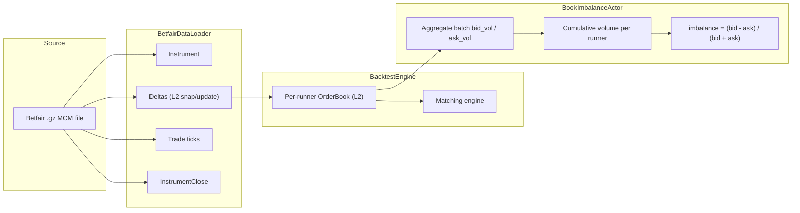
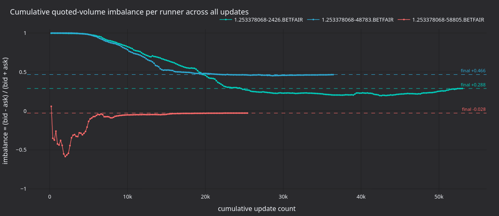
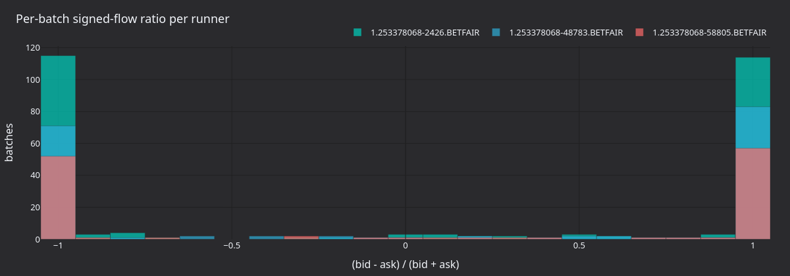

# 订单簿失衡回测（Betfair） {#book-imbalance-backtest-betfair}

:::note
本教程**仅用 Rust**，把 Betfair 原始流式数据直接送入 Rust `BacktestEngine`，
不使用 Python 或 Parquet。
:::

本教程在 Betfair MATCH_ODDS 市场上回测 `BookImbalanceActor`。它加载原始历史流式
`.gz` 文件，送入 Rust `BacktestEngine`，并按 runner 跟踪买/卖挂单量的失衡。

## 简介 {#introduction}

Betfair 是体育博彩交易所，参与者以十进制赔率对赛果 back（买，相当于 bid）和 lay
（卖，相当于 ask）。每个 runner 都有自己的 L2 订单簿，行为与金融订单簿类似。

Actor 为每个 runner 读取 `OrderBookDeltas`，维护买盘量（back 订单）与卖盘量（lay
订单）的批次与累计总量。批次失衡与累计失衡按下面的公式计算：

```text
imbalance = (bid_volume - ask_volume) / (bid_volume + ask_volume)
```

值为正说明该赛果的 back 量大于 lay 量。体育交易员把它作为初始信号，常与价格动量
或全市场特征一起使用。

release 构建在撮合引擎完整维护订单簿的情况下，每秒可处理约三百万个数据点。



## 前置条件 {#prerequisites}

- 可用的 Rust 工具链（[rustup.rs](https://rustup.rs)）。
- 已克隆并能构建 NautilusTrader 仓库。
- 一个含 MCM（Market Change Message）数据的 Betfair 历史 `.gz` 文件。可从
  [Betfair historic data](https://historicdata.betfair.com/)、第三方归档获取，
  或自行录制 Exchange Streaming API。

把文件放到：

```text
test_data/local/betfair/1.253378068.gz
```

示例的 `DATA_FILE` 常量指向这个被 gitignore 的路径。下文结果使用一个自录的足球
MATCH_ODDS 市场：3 个 runner，18 天内约 82,000 行 MCM。仓库不包含该文件。没有它
也可以运行：传入 `test_data/betfair/` 中自带的样本，例如
`test_data/betfair/1-166811431.bz2`。加载器同样支持 `.bz2` 文件。

## 加载数据 {#loading-the-data}

`BetfairDataLoader` 读取 gzip 压缩的 Betfair Exchange Streaming API 文件，把每一行
解析为 Nautilus 领域对象：

```rust
use nautilus_betfair::loader::{BetfairDataItem, BetfairDataLoader};
use nautilus_model::types::Currency;

let mut loader = BetfairDataLoader::new(Currency::GBP(), None);
let items = loader.load(&filepath)?;
```

加载器返回 `Vec<BetfairDataItem>`：

| 变体                | 说明                                          | 映射到 `Data` 枚举？          |
| :------------------ | :--------------------------------------------- | :---------------------------- |
| `Instrument`        | 由市场定义得到的 runner 定义。                 | 否（单独添加）                |
| `Status`            | 市场状态迁移（PreOpen、Trading…）。            | 是，`Data::InstrumentStatus`  |
| `Deltas`            | 订单簿快照或增量更新。                         | 是，`Data::BookDeltas`        |
| `Trade`             | 由累计成交量得到的逐笔成交 tick。              | 是，`Data::Trade`             |
| `Ticker`            | 最新成交价、成交量、BSP 远近范围。             | -                             |
| `StartingPrice`     | 某个 runner 的 Betfair Starting Price。        | -                             |
| `BspBookDelta`      | BSP 专属的订单簿增量。                         | -                             |
| `InstrumentClose`   | 结算事件。                                     | 是，`Data::InstrumentClose`   |
| `SequenceCompleted` | 批次完成标记。                                 | -                             |
| `RaceRunnerData`    | GPS 跟踪数据（赛马/赛狗）。                    | -                             |
| `RaceProgress`      | 赛事级别的进度数据。                           | -                             |
| `CricketMatch`      | 板球比赛数据（来自 CCM）。                     | -                             |

回测引擎接受 `Data` 枚举。示例转换所需的几个变体，跳过 `Status` 和 Betfair 特有类型：

```rust
use nautilus_model::data::Data;

let mut instruments = AHashMap::new();
let mut data: Vec<Data> = Vec::new();

for item in items {
    match item {
        BetfairDataItem::Instrument(inst) => {
            instruments.insert(inst.id(), *inst);
        }
        BetfairDataItem::Deltas(d) => {
            data.push(Data::BookDeltas(Box::new(d)));
        }
        BetfairDataItem::Trade(t) => {
            data.push(Data::Trade(t));
        }
        BetfairDataItem::InstrumentClose(c) => {
            data.push(Data::InstrumentClose(c));
        }
        _ => {}
    }
}
```

`Data::BookDeltas` 把 `OrderBookDeltas` 载荷装箱（box），以保持枚举体积小巧。

加载器在每次市场定义更新时都会发出金融工具。用 map 去重，并保留每个金融工具的
最新版本。

:::warning
`Status` 变体携带市场状态迁移（PreOpen、Trading、Suspended、Closed）。本例跳过了
它，因此不会回放状态迁移。若要扩展成会下单的策略，加一个
`BetfairDataItem::Status(s) => data.push(Data::InstrumentStatus(s))` 分支。
引擎会把 `Data::InstrumentStatus` 路由给撮合引擎，撮合引擎从而能看到流中的市场
暂停与关闭。
:::

## Actor {#the-actor}

NautilusTrader 在 trading crate 的 examples 模块中自带 `BookImbalanceActor`。示例
用按 runner 的金融工具列表和日志间隔把它接起来：

```rust
use nautilus_trading::examples::actors::BookImbalanceActor;

let actor = BookImbalanceActor::new(instrument_ids, 5000, None);
engine.add_actor(actor)?;
```

第二个参数是日志间隔：每个 runner 每 5,000 次更新输出一行进度。示例通过
`LOG_INTERVAL` 常量设置该间隔。想要更细的面板数据，把常量改成 `200` 再重新构建
示例。

完整源码见
[`crates/trading/src/examples/actors/imbalance/actor.rs`](https://github.com/nautechsystems/nautilus_trader/tree/develop/crates/trading/src/examples/actors/imbalance/actor.rs)。

### 工作原理 {#how-it-works}

Rust 中一个 `DataActor` 需要三部分：

1. 一个含 `DataActorCore` 字段和自有状态的 struct。
1. `nautilus_actor!(YourType)` 用于接入 core，外加一个 `Debug`
   实现。
1. 带回调的 `DataActor` trait 实现。

框架为运行时 actor 提供了 `Actor` 与 `Component` 的 blanket 实现。对含
`DataActorCore` 的 struct，`nautilus_actor!` 宏提供原生运行时连接。Actor 代码只需
实现自己用到的回调。

启动时，actor 为每个金融工具订阅 `OrderBookDeltas`。每次更新时，它按方向累加各条
增量的量并更新总量。停止时，为每个金融工具打印一份摘要。

`subscribe_book_deltas` 里 `managed: false` 时，数据引擎不会为该 actor 在缓存中另
建订单簿。交易所撮合引擎仍会在每条增量上通过 `book.apply_delta()` 维护自己的订单簿。
若 actor 需要 `self.cache().order_book(&instrument_id)` 的完整订单簿状态，把
`managed` 设为 `true`。

## 回测引擎设置 {#backtest-engine-setup}

### 创建引擎与交易场所 {#create-the-engine-and-venue}

Betfair 是现金结算的博彩交易所。交易场所使用 `AccountType::Cash`、
`OmsType::Netting` 和 `BookType::L2_MBP`：

```rust
let mut engine = BacktestEngine::new(BacktestEngineConfig::default())?;

engine.add_venue(
    SimulatedVenueConfig::builder()
        .venue(Venue::from("BETFAIR"))
        .oms_type(OmsType::Netting)
        .account_type(AccountType::Cash)
        .book_type(BookType::L2_MBP)
        .starting_balances(vec![Money::from("1_000_000 GBP")])
        .fee_model(FeeModelAny::MakerTaker(MakerTakerFeeModel::zero()).into())
        .build()?,
)?;
```

### 添加金融工具、actor 与数据 {#add-instruments-actor-and-data}

```rust
for instrument in instruments.values() {
    engine.add_instrument(instrument)?;
}

let actor = BookImbalanceActor::new(instrument_ids, 5000, None);
engine.add_actor(actor)?;

engine.add_data(data, None, true, true)?;
```

`add_data` 的参数是 `(data, client_id, validate, sort)`。`validate: true` 时，引擎
检查首个元素的金融工具已注册，并假定整批数据同构。`sort: true` 时按时间戳排序。

### 运行 {#run}

```rust
engine.run(None, None, None, false)?;
```

四个参数是 `(start, end, run_config_id, streaming)`。`start` 和 `end`
传 `None` 时，引擎使用已加载数据的完整时间范围。

## 运行期间发生了什么 {#what-happens-during-the-run}

引擎按时间戳顺序对每个数据点执行：

1. 把时钟推进到数据的时间戳。
1. 把数据路由给模拟交易所，交易所把每条增量应用到对应金融工具的 `OrderBook`
   并执行一轮撮合。
1. 通过数据引擎和消息总线发布数据，触发 actor 的 `on_book_deltas` 回调。
1. 排空命令队列并结算交易场所（处理所有待处理订单）。

撮合引擎为每个金融工具维护完整订单簿。本例没有订单可撮合。若把 actor 换成
`Strategy`，策略就能使用这份订单簿状态。

## 结果 {#results}

自录的 MATCH_ODDS 数据集有 3 个 runner、143,098 个数据点。release 构建约 48 ms
跑完：

```text
--- Book imbalance summary ---
  1.253378068-2426.BETFAIR   updates: 53197  bid_vol: 212225339.34  ask_vol: 117422531.85  imbalance:  0.2876
  1.253378068-48783.BETFAIR  updates: 36475  bid_vol:  52506905.49  ask_vol:  19104694.72  imbalance:  0.4664
  1.253378068-58805.BETFAIR  updates: 25426  bid_vol:  24295351.82  ask_vol:  25692733.11  imbalance: -0.0280
```

Runner `2426`（最终赢家，按 BSP 2.22 结算）收于 +0.288，整场市场 back 流持续大于
lay 流。Runner `48783` 更新次数更少但 back 压力更强（+0.466）。Runner `58805`
收于接近中性（-0.028）。



**图 1.** *市场全部约 143k 次更新中每个 runner 的累计 `(bid - ask) / (bid + ask)`。
虚线标出各 runner 的最终失衡值。*



**图 2.** *每个 runner 按 `LOG_INTERVAL = 200` 分批次有向流比
`(bid - ask) / (bid + ask)` 的分布。各 runner 批次分布的形态比累计失衡是更强的
信号。*


**图 3.** *每个 runner 的累计 back（bid）与 lay（ask）量。两侧都非单调：即使累计
失衡保持为正，lay 流偶尔也会在短促脉冲中超过 back 流。*

### 重新生成图表面板 {#regenerate-the-panels}

Actor 每 N 次更新输出一行
`[runner] update #N: batch bid=B ask=A cumulative imbalance=I`。
渲染器解析这些行，用 `nautilus_dark` tearsheet 主题写出静态 PNG。

先把 `betfair_backtest.rs` 中的 `LOG_INTERVAL` 常量改为 `200`。
从源码构建 NautilusTrader 后，在仓库根目录运行：

```bash
make sync

cargo run -p nautilus-betfair --features examples --release \
    --example betfair-backtest > /tmp/betfair.log 2>&1

BETFAIR_LOG=/tmp/betfair.log \
    uv run --project python --no-sync \
        python docs/tutorials/assets/backtest_book_imbalance_betfair/render_panels.py
```

## 运行示例 {#running-the-example}

```bash
# Debug build
cargo run -p nautilus-betfair --features examples --example betfair-backtest

# Release build (recommended)
cargo run -p nautilus-betfair --features examples --release --example betfair-backtest

# Custom data file
cargo run -p nautilus-betfair --features examples --release --example betfair-backtest -- path/to/file.gz

# Shipped sample file
cargo run -p nautilus-betfair --features examples --release --example betfair-backtest -- test_data/betfair/1-166811431.bz2
```

## 完整源码 {#complete-source}

完整示例见
[`crates/adapters/betfair/examples/betfair_backtest.rs`](https://github.com/nautechsystems/nautilus_trader/tree/develop/crates/adapters/betfair/examples/betfair_backtest.rs)。

## 后续步骤 {#next-steps}

- **策略**：把 actor 换成一个 `Strategy` 实现，基于失衡信号下 back/lay 订单。
  模式参考 `crates/trading/src/examples/strategies/ema_cross/strategy.rs` 中的
  `EmaCross` 示例。
- **托管订单簿**：在 `subscribe_book_deltas` 中设 `managed: true`，
  通过 `self.cache().order_book(&id)` 读取完整订单簿，用于最优报价价差、深度比或
  加权中间价。
- **多市场**：加载多个 `.gz` 文件跑同一个引擎，测试跨市场信号。
