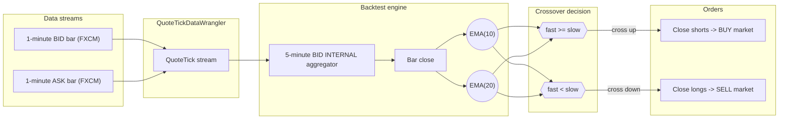
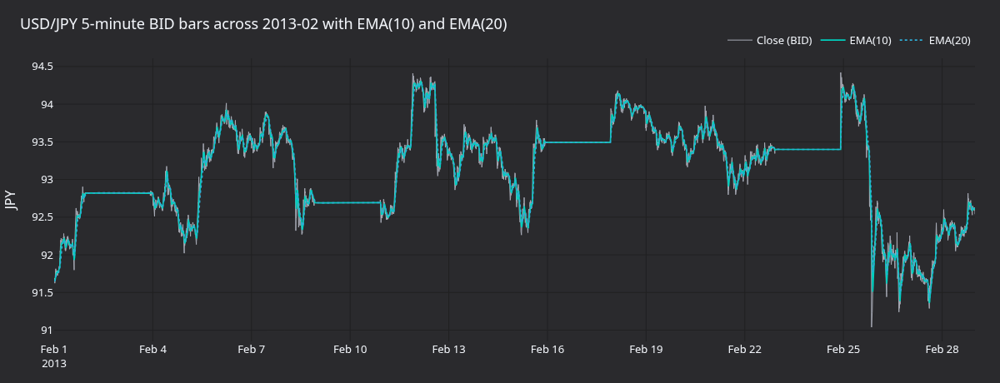
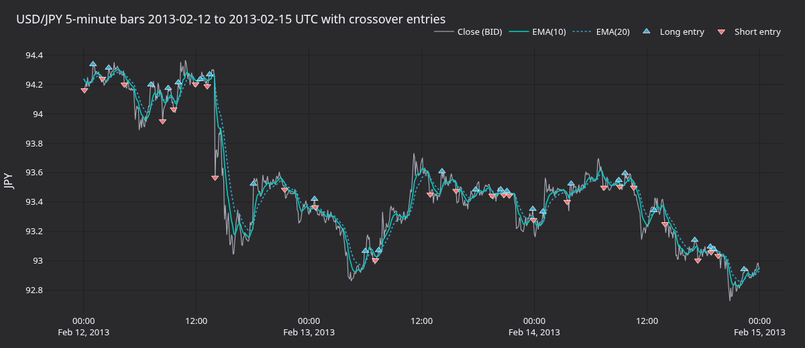
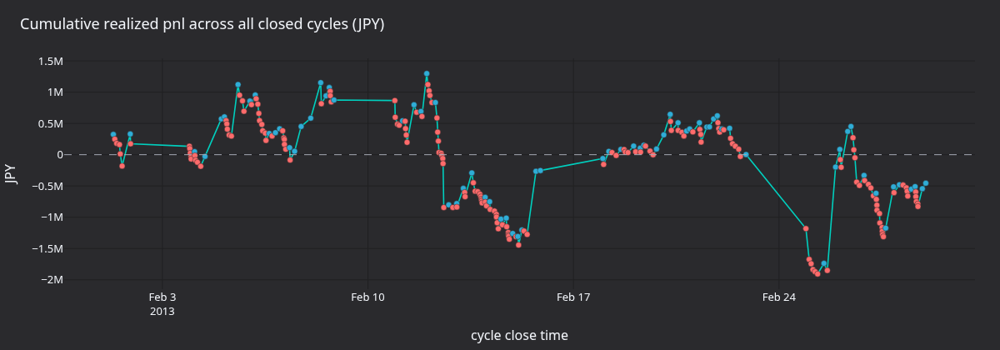
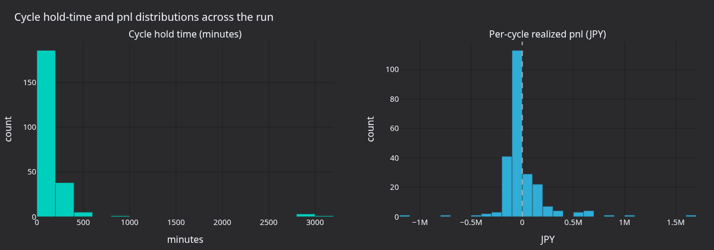

# 使用 FX K 线数据回测 {#backtest-with-fx-bar-data}

在 USD/JPY 1 分钟买卖 K 线上运行 EMA 交叉策略，模拟 FX 隔夜利息并启用概率成交模型。数据来自
NautilusTrader 测试数据：源码检出时从本地读取，其他安装方式每次运行时从 GitHub 下载，因此需要网络访问。

[在 GitHub 上查看源码](https://github.com/nautechsystems/nautilus_trader/blob/develop/docs/tutorials/backtest_fx_bars.py).

## 简介 {#introduction}

策略是 `EMACross`，一个教学示例：在 K 线收盘价上比较快速 EMA 与慢速 EMA：

- **快速 EMA 上穿慢速 EMA**：平掉空头持仓，开新的多头。
- **快速 EMA 下穿慢速 EMA**：平掉多头持仓，开新的空头。

交易场所是模拟的 FX ECN，使用 `MARGIN` 账户、`HEDGING` OMS，多币种初始余额为
1,000,000 USD 和 10,000,000 JPY。`FillModel` 引入 50% 概率的一 tick 滑点，
`FXRolloverInterestModule` 按相关短期利差每日计提隔夜利息。

`EMACross` 只是教学策略，没有任何优势（edge）。



## 前置条件 {#prerequisites}

- Python 3.13+
- 已安装 [NautilusTrader](https://pypi.org/project/nautilus_trader/) 2.x
  （`pip install -U --pre nautilus_trader`）。`visualization` extra 只有在
  想重新生成文末的图表面板时才需要。
- pandas（`pip install pandas`）。wheel 包本身不声明任何运行时依赖。
- 同级目录的
  [`ema_cross.py`](https://github.com/nautechsystems/nautilus_trader/blob/develop/docs/tutorials/ema_cross.py)
  文件。下载或用 Jupytext 转换时，把它和本教程放在一起。

```python
from decimal import Decimal

from nautilus_trader.common import LogLevel
from nautilus_trader.config import BacktestEngineConfig
from nautilus_trader.backtest import BacktestEngine
from nautilus_trader.backtest import FXRolloverInterestModule
from nautilus_trader.backtest import InterestRateRecord
from nautilus_trader.config import LoggerConfig
from nautilus_trader.config import RiskEngineConfig
from nautilus_trader.execution import MakerTakerFeeModel
from nautilus_trader.execution import ProbabilisticFillModel
from nautilus_trader.model import AccountType
from nautilus_trader.model import BarType
from nautilus_trader.model import Currency
from nautilus_trader.model import Money
from nautilus_trader.model import OmsType
from nautilus_trader.model import TraderId
from nautilus_trader.model import Venue
from nautilus_trader.testkit.providers import TestDataProvider
from nautilus_trader.testkit.providers import TestInstrumentProvider

from ema_cross import EMACross
from ema_cross import EMACrossConfig


JPY = Currency.from_str("JPY")
USD = Currency.from_str("USD")
```

## 引擎设置 {#engine-setup}

绕过盘前风控检查，让策略的市价单直接抵达撮合引擎。

```python
config = BacktestEngineConfig(
    trader_id=TraderId.from_str("BACKTESTER-001"),
    logging=LoggerConfig(stdout_level=LogLevel.ERROR),
    risk_engine=RiskEngineConfig(bypass=True),
)
engine = BacktestEngine(config=config)
```

## 模拟模块 {#simulation-modules}

`FXRolloverInterestModule` 在固定的纽约时间 17:00 切点，对未平仓持仓按 OECD
短期利率序列的示例 `short-term-interest.csv` 利率收取或记入隔夜利息。没有它，
跨多个交易日的回测会忽略套利持有成本（carry）。

```python
provider = TestDataProvider()
interest_rate_data = provider.read_csv("short-term-interest.csv")
interest_rate_records = [
    InterestRateRecord(location=row.LOCATION, time=row.TIME, value=row.Value)
    for row in interest_rate_data.itertuples(index=False)
]
fx_rollover_interest = FXRolloverInterestModule(records=interest_rate_records)
```

## 成交模型 {#fill-model}

限价单在价格触及时每 tick 有 20% 的概率成交；市价单或可成交订单以 50% 的概率
抛硬币决定承受一个 tick 的滑点。设定随机种子保证运行可复现。

```python
fill_model = ProbabilisticFillModel(
    prob_fill_on_limit=0.2,
    prob_slippage=0.5,
    random_seed=42,
)
```

## 交易场所 {#venue}

`OmsType.HEDGING` 允许策略在同一金融工具上同时持有多头和空头，由交易场所分配
持仓 ID。账户为多币种，因此 USD/JPY 的盈亏以 JPY 累积，而不是每次成交都换算。

```python
SIM = Venue("SIM")
engine.add_venue(
    venue=SIM,
    oms_type=OmsType.HEDGING,
    account_type=AccountType.MARGIN,
    base_currency=None,
    starting_balances=[Money(1_000_000, USD), Money(10_000_000, JPY)],
    fill_model=fill_model,
    fee_model=MakerTakerFeeModel(
        maker_rate=Decimal("0.00002"),
        taker_rate=Decimal("0.00002"),
    ),
    modules=[fx_rollover_interest],
)
```

## 金融工具与数据 {#instrument-and-data}

`TestDataProvider.quotes_from_fxcm_bars` 从示例 FXCM 买卖 CSV 中每分钟的高开低收
合成报价 tick。策略声明的是 `5-MINUTE-BID-INTERNAL`，因此引擎从报价流内部聚合出
5 分钟 BID K 线。

```python
USDJPY_SIM = TestInstrumentProvider.default_fx_ccy("USD/JPY", SIM)
engine.add_instrument(USDJPY_SIM)

ticks = provider.quotes_from_fxcm_bars(
    instrument=USDJPY_SIM,
    bid_csv="fxcm/usdjpy-m1-bid-2013.csv",
    ask_csv="fxcm/usdjpy-m1-ask-2013.csv",
)
engine.add_data(ticks)
```

## 策略 {#strategy}

每笔订单交易 100 万美元。EMACross 在每次交叉时平旧仓开新仓，因此几乎整月都持有
某个方向的仓位。

```python
strategy_config = EMACrossConfig(
    instrument_id=USDJPY_SIM.id,
    bar_type=BarType.from_str("USD/JPY.SIM-5-MINUTE-BID-INTERNAL"),
    fast_ema_period=10,
    slow_ema_period=20,
    trade_size=Decimal(1_000_000),
)
strategy = EMACross(config=strategy_config)
engine.add_strategy(strategy=strategy)
```

## 运行 {#run}

引擎按时间戳顺序处理每个报价 tick 和 K 线，数据耗尽后返回。

```python
engine.run()
```

## 报告 {#reports}

`engine.generate_*` 返回覆盖账户状态、成交和已平持仓的 DataFrame。

```python
engine.generate_account_report(SIM)
```

```python
engine.generate_order_fills_report()
```

```python
engine.generate_positions_report()
```

## 运行结果 {#what-the-run-produces}

28 天的运行输出 8,065 根 5 分钟 K 线，触发 234 个已平回合、共 468 笔成交
（首次交叉之后，每次交叉都会对旧仓位产生一笔平仓成交，并对新仓位产生一笔开仓成交）。
234 个回合中 70 个盈利。已实现盈亏最终为 -1,326,300 JPY，其中 871,300 JPY 是
佣金：典型的在噪声较大的 5 分钟序列上被来回打脸（whipsaw）的结果。



**图 1.** *2013 年 2 月整月的 USD/JPY BID 5 分钟收盘价，叠加 EMA(10) 与 EMA(20)。
水平平坦段是 FXCM 买价数据源中的周末空档。*



**图 2.** *2013-02-12 至 2013-02-15 UTC 的三天放大图。每个标记是一次交叉入场：
上三角为做多，下三角为做空。*



**图 3.** *全部已平回合的累计 JPY 已实现盈亏（未含佣金）。标记颜色表示单回合盈亏：
蓝色为正，红色为负。*



**图 4.** *回合持仓时长与单回合盈亏分布。多数回合持仓不足三小时；盈亏分布大致对称，
且高度集中在零附近。*

### 重新生成图表面板 {#regenerate-the-panels}

以上面板由一个自包含的渲染器生成：它重跑回测，从引擎缓存中取出 K 线和成交，
使用共享的 `nautilus_dark` tearsheet 主题写出 PNG。

从源码构建 NautilusTrader 后，在仓库根目录运行：

```bash
make sync
uv run --project python --no-sync \
    python docs/tutorials/assets/backtest_fx_bars/render_panels.py
```

## 后续步骤 {#next-steps}

- **放慢信号**。默认的 10/20 EMA 在低趋势时段会来回抖动。可尝试同样的 K 线用
  20/60，或改用 15 分钟 K 线以减少回合数。
- **加市场状态过滤**。实际波幅低于阈值时抑制入场，让策略只在有方向性运动的时段
  交易。
- **对比聚合方式**。用 `BarType.from_str("USD/JPY.SIM-5-MINUTE-BID-INTERNAL")`
  从原始 tick 数据构建 K 线，再与外部聚合的数据集对比，确认两条路径结果一致。
