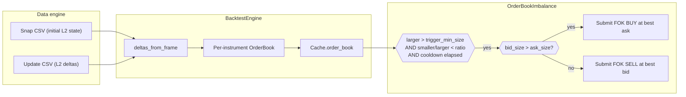
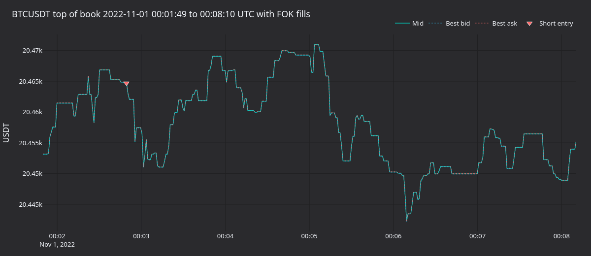
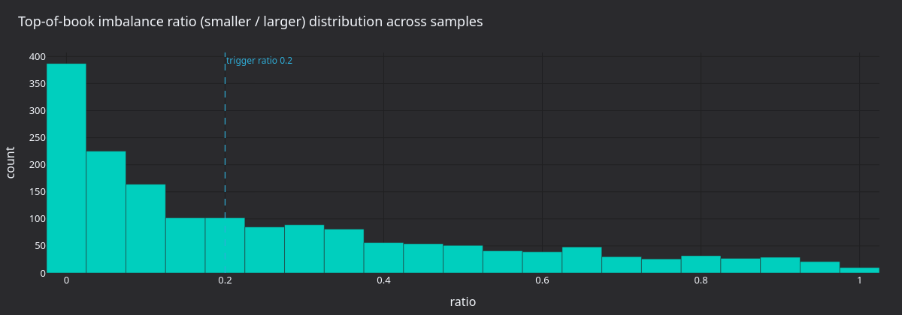
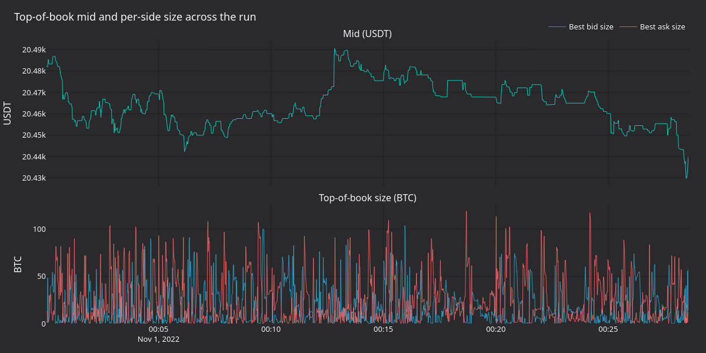
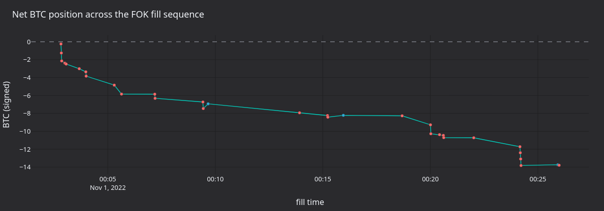

# 使用订单簿深度数据回测（Binance） {#backtest-with-order-book-depth-data-binance}

通过 `BacktestNode` 回放 Binance T_DEPTH 订单簿增量，运行一个失衡策略：当订单簿一侧明显厚于另一侧时，发出 fill-or-kill（FOK）限价单。同样的模式适用于任何交易场所的 L2 增量数据流。

[在 GitHub 上查看源码](https://github.com/nautechsystems/nautilus_trader/blob/develop/docs/tutorials/backtest_orderbook_binance.py).

## 简介 {#introduction}

最优报价失衡是一个微观结构信号：当 BBO 上较薄一侧的挂单量远低于较大一侧时，说明订单簿出现了倾斜。本教程的 `OrderBookImbalance` 策略在每次订单簿更新时分两步处理：

- 计算 `min(bid_size, ask_size) / max(bid_size, ask_size)`。值越高越均衡，越低越倾斜。
- 当较大一侧超过 `trigger_min_size` 且该比值低于 `trigger_imbalance_ratio` 时，朝较薄一侧发出单笔 FOK 限价单：买盘更大时以最优卖价买入，否则以最优买价卖出。`min_seconds_between_triggers` 设置的触发冷却期可防止策略在每次微小更新后重复触发。

该策略刻意保持简单，没有优势（edge）。



## 前置条件 {#prerequisites}

- Python 3.13+
- 已安装 [NautilusTrader](https://pypi.org/project/nautilus_trader/) 2.x
  （`pip install -U --pre nautilus_trader`）
- pandas（`pip install pandas`）。wheel 包本身不声明任何运行时依赖。
- 同级目录的
  [`orderbook_data.py`](https://github.com/nautechsystems/nautilus_trader/blob/develop/docs/tutorials/orderbook_data.py)
  和
  [`orderbook_imbalance.py`](https://github.com/nautechsystems/nautilus_trader/blob/develop/docs/tutorials/orderbook_imbalance.py)
  文件。下载或用 Jupytext 转换时，把它们和本教程放在一起。
- 可选：自备想回放的那一天的 Binance USD-M 期货 T_DEPTH CSV。文中示例运行用的是
  2022-11-01 的 BTCUSDT，放在 `NAUTILUS_DATA_DIR/Binance/` 下（默认
  `~/Downloads/Data/Binance/`）。没有这些文件时，教程会回退到 NautilusTrader 测试数据
  中每个文件的前 100 行样本；非源码检出环境下首次运行会从 GitHub 下载。样本可以完整
  跑通，但太短，触发不了策略。

```python
import os
import shutil
from decimal import Decimal
from pathlib import Path

import pandas as pd
from nautilus_trader.adapters.binance import load_binance_order_book_deltas
from nautilus_trader.backtest import BacktestNode
from nautilus_trader.common import LogLevel
from nautilus_trader.config import (
    BacktestDataConfig,
    BacktestEngineConfig,
    BacktestRunConfig,
    BacktestVenueConfig,
    ImportableStrategyConfig,
    LoggerConfig,
)
from nautilus_trader.core.datetime import dt_to_unix_nanos
from nautilus_trader.execution import MakerTakerFeeModel
from nautilus_trader.model import (
    AccountType,
    BookType,
    Currency,
    CurrencyPair,
    InstrumentId,
    NautilusDataType,
    OmsType,
    Price,
    Quantity,
    Symbol,
    Venue,
)
from nautilus_trader.persistence import ParquetDataCatalog

from orderbook_data import deltas_from_frame, sample_data_path
```

## 加载数据 {#loading-data}

`_depth_snap.csv` 和 `_depth_update.csv` 的每一行是单个 L2 档位事件。
`load_binance_order_book_deltas` 返回每事件一行的 pandas DataFrame：快照行
（`update_type="snap"`）转为带 `F_SNAPSHOT` 标志的 `ADD` 动作；更新行转为
`UPDATE`，数量为零时转为 `DELETE`。BTCUSDT 2022-11-01 的完整更新文件约 12 GB
（约 1.1 亿行），因此教程把读取量限制在 1,000,000 行。

```python
DATA_DIR = Path(os.environ.get("NAUTILUS_DATA_DIR", "~/Downloads/Data")).expanduser() / "Binance"
```

```python
path_snap = DATA_DIR / "BTCUSDT_T_DEPTH_2022-11-01_depth_snap.csv"
path_update = DATA_DIR / "BTCUSDT_T_DEPTH_2022-11-01_depth_update.csv"

if not (path_snap.is_file() and path_update.is_file()):
    path_snap = sample_data_path("binance/btcusdt-depth-snap.csv")
    path_update = sample_data_path("binance/btcusdt-depth-update.csv")

path_snap, path_update
```

```python
# Initial L2 snapshot of the book at session open.
df_snap = load_binance_order_book_deltas(path_snap)
df_snap.head()
```

```python
# Per-level deltas for the day; capped to 1M rows for a reasonable run time.
nrows = 1_000_000
df_update = load_binance_order_book_deltas(path_update, nrows=nrows)
df_update.head()
```

### 构建当前版本的模型对象 {#build-current-model-objects}

用公开的模型 API 定义金融工具，再把加载器的每一行转成 `OrderBookDelta`。按
`ts_init` 排序，使数据引擎看到的增量顺序与真实发布顺序一致，不受快照文件与更新
文件交错方式的影响。

```python
BTCUSDT_BINANCE = CurrencyPair(
    instrument_id=InstrumentId(Symbol("BTCUSDT"), Venue("BINANCE")),
    raw_symbol=Symbol("BTCUSDT"),
    base_currency=Currency.from_str("BTC"),
    quote_currency=Currency.from_str("USDT"),
    price_precision=2,
    size_precision=6,
    price_increment=Price(0.01, precision=2),
    size_increment=Quantity(0.000001, precision=6),
    ts_event=0,
    ts_init=0,
)

deltas = deltas_from_frame(df_snap, BTCUSDT_BINANCE)
deltas += deltas_from_frame(df_update, BTCUSDT_BINANCE)
deltas.sort(key=lambda x: x.ts_init)
deltas[:10]
```

### 搭建数据目录 {#set-up-the-data-catalog}

把金融工具和增量写入一个全新的 `ParquetDataCatalog`，让 `BacktestNode` 能按时间
范围惰性加载。教程把目录写到工作目录下的 `catalog/`，每次运行都会替换该目录。

```python
CATALOG_PATH = Path.cwd() / "catalog"
if CATALOG_PATH.exists():
    shutil.rmtree(CATALOG_PATH)
CATALOG_PATH.mkdir()

catalog = ParquetDataCatalog(str(CATALOG_PATH))
```

```python
catalog.write_instruments([BTCUSDT_BINANCE])
catalog.write_order_book_deltas(deltas)
```

```python
catalog.instruments()
```

```python
start = dt_to_unix_nanos(pd.Timestamp("2022-11-01", tz="UTC"))
end = dt_to_unix_nanos(pd.Timestamp("2022-11-04", tz="UTC"))

deltas = catalog.query_order_book_deltas(
    identifiers=[str(BTCUSDT_BINANCE.id)],
    start=start,
    end=end,
)
print(len(deltas))
deltas[:10]
```

## 配置回测 {#configure-the-backtest}

`BacktestNode` 从数据目录摄取数据，并为每个 `BacktestRunConfig` 构建一个
`BacktestEngine`。交易场所的 book 类型必须与数据匹配：增量携带完整的 L2 信息，
因此使用 `L2_MBP`。

```python
instrument = catalog.instruments()[0]
book_type = BookType.L2_MBP

data_configs = [
    BacktestDataConfig(
        catalog_path=str(CATALOG_PATH),
        data_type=NautilusDataType.OrderBookDelta,
        instrument_id=instrument.id,
    ),
]

venues_configs = [
    BacktestVenueConfig(
        name="BINANCE",
        oms_type=OmsType.NETTING,
        account_type=AccountType.CASH,
        base_currency=None,
        starting_balances=["20 BTC", "100000 USDT"],
        book_type=book_type,
        fee_model=MakerTakerFeeModel(
            maker_rate=Decimal("0.001"),
            taker_rate=Decimal("0.001"),
        ),
    ),
]

strategy_config = ImportableStrategyConfig(
    strategy_path="orderbook_imbalance:OrderBookImbalance",
    config_path="orderbook_imbalance:OrderBookImbalanceConfig",
    config={
        "instrument_id": str(instrument.id),
        "book_type": book_type.name,
        "max_trade_size": "1.000",
        "min_seconds_between_triggers": 1.0,
    },
)

config = BacktestRunConfig(
    engine=BacktestEngineConfig(
        logging=LoggerConfig(stdout_level=LogLevel.ERROR),
    ),
    data=data_configs,
    venues=venues_configs,
    dispose_on_completion=False,
)

config
```

## 运行回测 {#run-the-backtest}

```python
node = BacktestNode(configs=[config])
node.build()
node.add_strategy_from_config(config.id, strategy_config)

result = node.run()
```

```python
result
```

```python
node.generate_order_fills_report(config.id)
```

```python
node.generate_positions_report(config.id)
```

```python
node.generate_account_report(config.id, venue=Venue("BINANCE"))
```

## 运行结果 {#what-the-run-produces}

下面的图来自完整的 T_DEPTH 文件。测试数据样本每个文件只含 100 行，因此跑完也不会发出任何订单。

一百万条更新的数据，在重建初始快照后大约覆盖交易日的前十一分钟。下面的渲染器用了
三百万条更新（约 25 分钟），让面板展示足够多的触发事件以便观察；策略在默认较小的
窗口上的触发方式相同。

在活跃更新窗口内，策略共提交 47 笔 FOK 限价单，净积累 14 BTC 空头。每次触发都落在
买盘一侧，说明在记录窗口内几乎每次失衡事件中卖盘量都大于买盘量。



**图 1.** *FOK 触发窗口内的 BTCUSDT 中间价、最优买价与最优卖价。下三角是在买价上的
做空入场，叉号是平仓成交。策略全程都在买盘一侧成交。*



**图 2.** *全部采样的最优报价快照上的 `smaller / larger` 比值分布，标出 0.20 触发
阈值。阈值左侧的密集区就是可触发的区间。*



**图 3.** *活跃更新窗口内的中间价（上）与最优买卖量（BTC，下）。最优报价挂单量在
很大范围内波动，而中间价只在窄幅内漂移。*



**图 4.** *FOK 成交序列上带符号的累计 BTC 数量。每个标记是一笔成交；橙色为卖出，
蓝色为买入。策略在 25 分钟内逐步建仓至 -14 BTC 空头。*

### 重新生成图表面板 {#regenerate-the-panels}

一个自包含的渲染器会重跑回测，附带一个每秒采样一次最优报价的 sampling actor，
然后使用共享的 `nautilus_dark` tearsheet 主题把 PNG 面板写到资源目录。

从源码构建 NautilusTrader 后，在仓库根目录运行：

```bash
make sync
NAUTILUS_DATA_DIR=test_data/local \
    uv run --project python --no-sync \
        python docs/tutorials/assets/backtest_orderbook_binance/render_panels.py
```

把 `NAUTILUS_DATA_DIR` 设为你的 `Binance/` 数据目录所在位置。

## 后续步骤 {#next-steps}

- **收紧触发条件**。把 `trigger_imbalance_ratio` 降到 0.10，要求十倍倾斜才触发。
  入场次数会大幅减少，命中率也会下降。
- **拉长窗口**。把 `nrows` 提到一千万或两千万，回放几个小时，观察策略在更多样的
  时段下的表现。
- **改用报价 tick 而非增量**。报价驱动的失衡策略见
  [黄金永续合约订单簿失衡](./gold_book_imbalance_ax.md) 教程。
