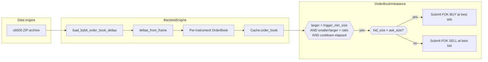
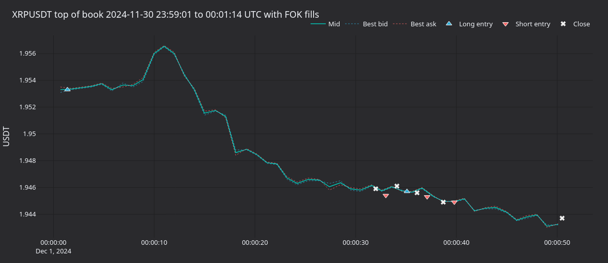
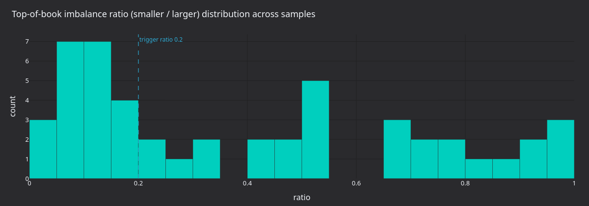
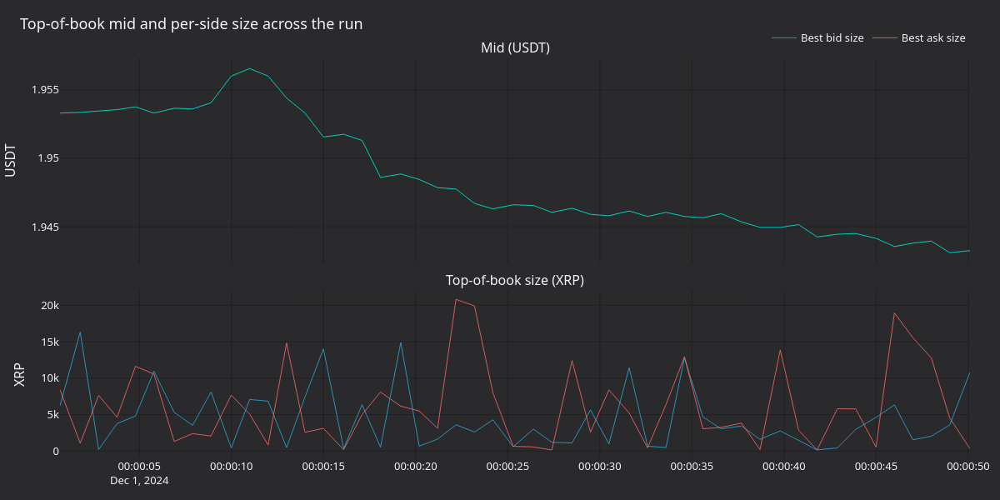
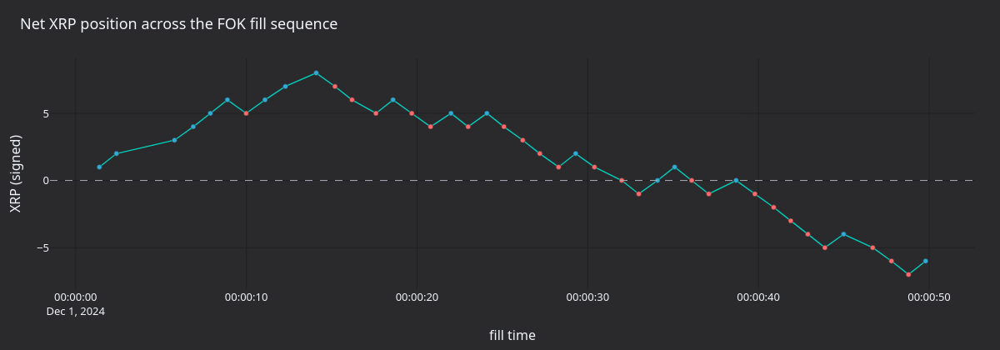

# 使用订单簿深度数据回测（Bybit） {#backtest-with-order-book-depth-data-bybit}

通过 `BacktestNode` 回放 Bybit `ob500` 订单簿增量，运行 `OrderBookImbalance` 策略。整体结构与
[Binance 版本](https://github.com/nautechsystems/nautilus_trader/blob/develop/docs/tutorials/backtest_orderbook_binance.py)
相同，只是加载器和金融工具不同。

[在 GitHub 上查看源码](https://github.com/nautechsystems/nautilus_trader/blob/develop/docs/tutorials/backtest_orderbook_bybit.py).

## 简介 {#introduction}

Bybit 为每个合约发布单个深度为 500 的 L2 增量归档。教程把每日 ZIP 读入 DataFrame。策略与
Binance 教程中的 `OrderBookImbalance` 相同：当 BBO 较薄一侧低于较大一侧的
`trigger_imbalance_ratio` 时，朝较薄一侧发出单笔 FOK 限价单：买盘更大时以最优卖价买入，
否则以最优买价卖出。

`OrderBookImbalance` 是教学策略，没有优势（edge）。



## 前置条件 {#prerequisites}

- Python 3.13+
- 已安装 [NautilusTrader](https://pypi.org/project/nautilus_trader/) 2.x
  （`pip install -U --pre nautilus_trader`）
- pandas（`pip install pandas`）。wheel 包本身不声明任何运行时依赖。
- 同级目录的
  [`orderbook_data.py`](https://github.com/nautechsystems/nautilus_trader/blob/develop/docs/tutorials/orderbook_data.py)
  和
  [`orderbook_imbalance.py`](https://github.com/nautechsystems/nautilus_trader/blob/develop/docs/tutorials/orderbook_imbalance.py)
  文件。下载或用 Jupytext 转换时，把它们和本教程放在一起。
- 可选：一份 Bybit 每日 `ob500` ZIP，例如从 Bybit 数据 CDN 下载的
  [`2024-12-01_XRPUSDT_ob500.data.zip`](https://quote-saver.bycsi.com/orderbook/linear/XRPUSDT/2024-12-01_XRPUSDT_ob500.data.zip)
  （约 377 MB）。没有该文件时，教程回退到 NautilusTrader 测试数据中该归档的
  50 条消息样本；非源码检出环境下首次运行会从 GitHub 下载。样本会完整跑通，
  只覆盖订单簿的几秒钟。

```python
import os
import shutil
from decimal import Decimal
from pathlib import Path

import pandas as pd
from nautilus_trader.backtest import BacktestNode
from nautilus_trader.common import LogLevel
from nautilus_trader.config import (
    BacktestDataConfig,
    BacktestEngineConfig,
    BacktestRunConfig,
    BacktestVenueConfig,
    ImportableStrategyConfig,
    LoggerConfig,
)
from nautilus_trader.core.datetime import dt_to_unix_nanos
from nautilus_trader.execution import MakerTakerFeeModel
from nautilus_trader.model import (
    AccountType,
    BookType,
    CryptoPerpetual,
    Currency,
    InstrumentId,
    NautilusDataType,
    OmsType,
    Price,
    Quantity,
    Symbol,
    Venue,
)
from nautilus_trader.persistence import ParquetDataCatalog

from orderbook_data import (
    deltas_from_frame,
    load_bybit_order_book_deltas,
    sample_data_path,
)
```

## 加载数据 {#loading-data}

要回放完整一天，把每日归档放到 `NAUTILUS_DATA_DIR/Bybit/`（默认
`~/Downloads/Data/Bybit/`）。否则教程读取测试数据样本。

```python
DATA_DIR = Path(os.environ.get("NAUTILUS_DATA_DIR", "~/Downloads/Data")).expanduser() / "Bybit"
```

```python
path_update = DATA_DIR / "2024-12-01_XRPUSDT_ob500.data.zip"
if not path_update.is_file():
    path_update = sample_data_path("bybit/xrpusdt-ob500.data.zip")

path_update
```

```python
# Read the first 1M deltas; the full file is larger.
nrows = 1_000_000
df_raw = load_bybit_order_book_deltas(path_update, nrows=nrows)
df_raw.head()
```

### 构建当前版本的模型对象 {#build-current-model-objects}

```python
XRPUSDT_BYBIT = CryptoPerpetual(
    instrument_id=InstrumentId(Symbol("XRPUSDT-LINEAR"), Venue("BYBIT")),
    raw_symbol=Symbol("XRPUSDT"),
    base_currency=Currency.from_str("XRP"),
    quote_currency=Currency.from_str("USDT"),
    settlement_currency=Currency.from_str("USDT"),
    is_inverse=False,
    price_precision=4,
    size_precision=0,
    price_increment=Price(0.0001, precision=4),
    size_increment=Quantity(1, precision=0),
    ts_event=0,
    ts_init=0,
)

deltas = deltas_from_frame(df_raw, XRPUSDT_BYBIT)
deltas.sort(key=lambda x: x.ts_init)
deltas[:10]
```

### 搭建数据目录 {#set-up-the-data-catalog}

教程把目录写到工作目录下的 `catalog/`，每次运行都会替换该目录。

```python
CATALOG_PATH = Path.cwd() / "catalog"
if CATALOG_PATH.exists():
    shutil.rmtree(CATALOG_PATH)
CATALOG_PATH.mkdir()

catalog = ParquetDataCatalog(str(CATALOG_PATH))
```

```python
catalog.write_instruments([XRPUSDT_BYBIT])
catalog.write_order_book_deltas(deltas)
```

```python
catalog.instruments()
```

```python
start = dt_to_unix_nanos(pd.Timestamp("2024-11-30", tz="UTC"))
end = dt_to_unix_nanos(pd.Timestamp("2024-12-04", tz="UTC"))

deltas = catalog.query_order_book_deltas(
    identifiers=[str(XRPUSDT_BYBIT.id)],
    start=start,
    end=end,
)
print(len(deltas))
deltas[:10]
```

## 配置回测 {#configure-the-backtest}

```python
instrument = catalog.instruments()[0]
book_type = BookType.L2_MBP

data_configs = [
    BacktestDataConfig(
        catalog_path=str(CATALOG_PATH),
        data_type=NautilusDataType.OrderBookDelta,
        instrument_id=instrument.id,
    ),
]

venues_configs = [
    BacktestVenueConfig(
        name="BYBIT",
        oms_type=OmsType.NETTING,
        account_type=AccountType.MARGIN,
        base_currency=None,
        starting_balances=["200000 XRP", "100000 USDT"],
        book_type=book_type,
        fee_model=MakerTakerFeeModel(
            maker_rate=Decimal("0.0002"),
            taker_rate=Decimal("0.00055"),
        ),
    ),
]

strategy_config = ImportableStrategyConfig(
    strategy_path="orderbook_imbalance:OrderBookImbalance",
    config_path="orderbook_imbalance:OrderBookImbalanceConfig",
    config={
        "instrument_id": str(instrument.id),
        "book_type": book_type.name,
        "max_trade_size": "1",
        "min_seconds_between_triggers": 1.0,
    },
)

config = BacktestRunConfig(
    engine=BacktestEngineConfig(
        logging=LoggerConfig(stdout_level=LogLevel.ERROR),
    ),
    data=data_configs,
    venues=venues_configs,
    dispose_on_completion=False,
)

config
```

## 运行回测 {#run-the-backtest}

```python
node = BacktestNode(configs=[config])
node.build()
node.add_strategy_from_config(config.id, strategy_config)

result = node.run()
```

```python
result
```

```python
node.generate_order_fills_report(config.id)
```

```python
node.generate_positions_report(config.id)
```

```python
node.generate_account_report(config.id, venue=Venue("BYBIT"))
```

## 运行结果 {#what-the-run-produces}

下面的图来自一整天的 `ob500` 归档。测试数据样本回放 3,967 条增量，触发其中 2 笔订单。

Bybit 的 `ob500` 归档有时会从文件标称日期的前一分钟开始，因此最早的交易落在 UTC
午夜前不久，其余的落在文件当天之内。1M 增量上限下，活跃窗口大约是第一分钟。策略在该
窗口内触发 43 笔 FOK 订单。



**图 1.** *触发窗口内的 XRPUSDT 中间价、最优买价与最优卖价。三角形是入场（上为多头，
下为空头），叉号是平仓成交。*



**图 2.** *全部采样的最优报价快照上的 `smaller / larger` BBO 挂单量比值分布，
标出 0.20 触发阈值。*



**图 3.** *活跃窗口内的中间价（上）与最优买卖量（XRP，下）。*



**图 4.** *FOK 成交序列上带符号的累计 XRP 持仓。每个标记是一笔成交：蓝色为买入，
橙色为卖出。*

### 重新生成图表面板 {#regenerate-the-panels}

一个自包含的渲染器会重跑回测，附带一个每秒采样一次最优报价的 sampling actor，
然后使用共享的 `nautilus_dark` tearsheet 主题把 PNG 面板写到资源目录。

从源码构建 NautilusTrader 后，在仓库根目录运行：

```bash
make sync
NAUTILUS_DATA_DIR=test_data/local \
    uv run --project python --no-sync \
        python docs/tutorials/assets/backtest_orderbook_bybit/render_panels.py
```

## 后续步骤 {#next-steps}

- **收紧触发条件**。把 `trigger_imbalance_ratio` 降到 0.10，要求十倍倾斜。
- **拉长窗口**。把 `nrows` 提到一千万或两千万，回放数小时。
- **跨场所回放**。在两个引擎（一个 Bybit、一个 Binance）中运行同一策略，对比
  失衡分布。
