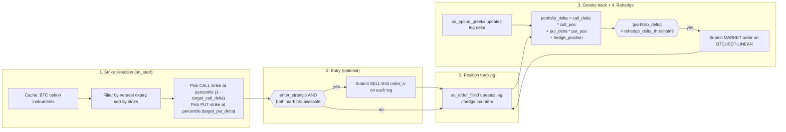
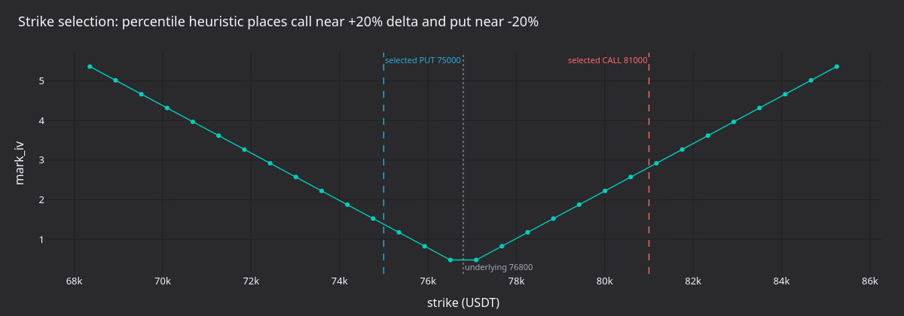

# Delta 中性期权策略（Bybit） {#deltaneutral-options-strategy-bybit}

:::note
本教程**仅用 Rust**，通过 Rust `LiveNode` 在 Bybit 上实时运行 delta 中性的卖出波动率
策略。
:::

本教程在 Bybit BTC 期权上卖出虚值（OTM）宽跨式组合（strangle），并用 BTCUSDT 永续合约
做 delta 对冲。策略启动时选好 call 和 put 的行权价，通过隐含波动率限价单入场，依据交易
场所提供的 Greeks 跟踪组合 delta。delta 超出阈值后，在永续合约上提交市价对冲单。

:::warning
该策略在主网上交易真实资金。设 `enter_strangle: false`
只禁用初始的宽跨式入场订单。
策略启动时仍会从缓存加载已有持仓，
组合 delta 越过阈值时仍会在永续合约上提交对冲订单。
若账户中还留有上一轮会话的期权或对冲仓位，策略就会交易。
:::

## 前置条件 {#prerequisites}

- 已完成[期权数据教程](./options_data_bybit.md)，该教程讲解金融工具发现、Greeks
  订阅和 `DataActor` 模式。
- 一个带期权与线性永续**交易权限**的 Bybit API key。
- Bybit 主网的环境变量。示例默认面向主网（testnet 见[运行示例](#running-the-example)）：

```bash
export BYBIT_API_KEY="your-api-key"
export BYBIT_API_SECRET="your-api-secret"
```

## 策略概览 {#strategy-overview}

`DeltaNeutralVol` 策略位于 trading crate 的 `examples` 模块，运行分五个阶段：

1. **选择行权价**：从金融工具缓存查询所有 BTC 期权，过滤到最近到期日，按百分位
   排名选出虚值 call 和 put 的行权价。
1. **入场**：两条腿各挂一笔 SELL 限价单，价格由隐含波动率决定（通过 Bybit 的
   `order_iv` 参数）。入场是可选的，示例中默认关闭。
1. **Greeks 跟踪**：订阅两条腿的 `OptionGreeks`。
   delta 与 IV 直接来自 Bybit 的期权行情流。
1. **再对冲**：计算组合 delta，超过阈值时在 BTCUSDT 永续上提交市价单。每次
   Greeks 更新以及周期性安全定时器都会触发检查。
1. **持仓跟踪**：通过 `on_order_filled` 跟踪 call、put 和对冲持仓。
   启动时从缓存加载已有持仓。



### 组合 delta {#portfolio-delta}

策略按下式计算净敞口：

```text
portfolio_delta = call_delta * call_position
                + put_delta * put_position
                + hedge_position
```

卖出宽跨式入场时接近 delta 中性，因为 call 与 put 的 delta 相互抵消。默认
`target_call_delta = 0.20`、`target_put_delta = -0.20`，两条腿在入场时正好抵消。
标的移动后净 delta 漂移，策略通过对冲把它拉回零附近。

## 配置 {#configuration}

示例文件
[`crates/adapters/bybit/examples/node_delta_neutral.rs`](https://github.com/nautechsystems/nautilus_trader/tree/develop/crates/adapters/bybit/examples/node_delta_neutral.rs)
的配置：

```rust
let hedge_instrument_id = InstrumentId::from("BTCUSDT-LINEAR.BYBIT");

let strategy_config = DeltaNeutralVolConfig::builder()
    .option_family("BTC".to_string())
    .hedge_instrument_id(hedge_instrument_id)
    .client_id(client_id)
    .contracts(1)
    .rehedge_delta_threshold(0.5)
    .rehedge_interval_secs(30)
    .enter_strangle(false)
    .iv_param_key("order_iv".to_string())
    .build();

let strategy = DeltaNeutralVol::new(strategy_config);
```

下表列出结构体默认值与示例覆盖值。示例把 `enter_strangle` 覆盖为 `false`、
`iv_param_key` 覆盖为 `"order_iv"`：

| 参数                      | 默认值     | 示例             | 说明                                        |
| ------------------------- | ---------- | ---------------- | ------------------------------------------- |
| `option_family`           | 必填       | `"BTC"`          | 金融工具发现的标的过滤。                    |
| `hedge_instrument_id`     | 必填       | `BTCUSDT-LINEAR` | 用于 delta 对冲的永续合约。                 |
| `client_id`               | 必填       | `"BYBIT"`        | 数据与执行客户端标识。                      |
| `target_call_delta`       | `0.20`     | -                | 选行权价时的目标 call delta。               |
| `target_put_delta`        | `-0.20`    | -                | 选行权价时的目标 put delta。                |
| `contracts`               | `1`        | -                | 每条腿的合约数。                            |
| `rehedge_delta_threshold` | `0.5`      | -                | 触发对冲的组合 delta。                      |
| `rehedge_interval_secs`   | `30`       | -                | 周期性再对冲定时器间隔。                    |
| `enter_strangle`          | `true`     | `false`          | Greeks 到达后是否挂入场单。                 |
| `entry_iv_offset`         | `0.0`      | -                | 入场定价相对标记 IV 下调的波动点数。        |
| `iv_param_key`            | `"px_vol"` | `"order_iv"`     | 适配器专属的 IV 参数键。                    |

`iv_param_key` 各交易场所不同。Bybit 用 `order_iv`，适配器把它映射到下单 API 的
`orderIv` 字段；OKX 用 `px_vol`。按 IV 下单时必须为交易场所设置正确的键。

## 节点设置 {#node-setup}

示例为数据与执行客户端都配置 `Option` 和 `Linear` 产品类型：

```rust
let data_config = BybitDataClientConfig {
    api_key: None,
    api_secret: None,
    product_types: vec![BybitProductType::Option, BybitProductType::Linear],
    ..Default::default()
};

let exec_config = BybitExecutionClientConfig {
    api_key: None,
    api_secret: None,
    product_types: vec![BybitProductType::Option, BybitProductType::Linear],
    account_id: Some(account_id),
    ..Default::default()
};
```

两种产品类型都不可少：`Option` 用于宽跨式的两条腿，`Linear` 用于 BTCUSDT 永续对冲
工具。执行客户端需要 `account_id` 来跟踪订单身份。

```rust
let mut node = LiveNode::builder(trader_id, environment)?
    .with_name("BYBIT-DELTA-NEUTRAL-001".to_string())
    .add_data_client(None, Box::new(data_factory), Box::new(data_config))?
    .add_exec_client(None, Box::new(exec_factory), Box::new(exec_config))?
    .with_reconciliation(true)
    .with_delay_post_stop_secs(5)
    .build()?;

node.add_strategy(strategy)?;
node.run().await?;
```

启动时 `with_reconciliation(true)` 会向 Bybit 查询未结订单与持仓，在对账把缓存加载
完成后策略才启动，随后从缓存载入上一轮会话遗留的持仓。

## 策略工作原理 {#how-the-strategy-works}

### 选择行权价 {#strike-selection}

启动时策略从缓存查询所有匹配 `option_family` 的期权工具，剔除已到期合约，取最近
到期日。再把 call 和 put 分开，各按行权价排序。

在排好序的列表上按百分位选择行权价：

- **Call**：index = `(1.0 - target_call_delta) * count`。目标 delta 0.20、
  50 个 call 时，选中第 40 个行权价（第 80 百分位，虚值）。
- **Put**：index = `|target_put_delta| * count`。目标 delta -0.20 时，
  选中第 10 个行权价（第 20 百分位，虚值）。

这是一个启发式方法。同一到期日的期权，行权价排序近似于 delta 排序。生产级策略会
先订阅全部行权价的 Greeks，再按真实 delta 选择。

### 按隐含波动率入场 {#entry-via-implied-volatility}

`enter_strangle` 为 `true` 且两条腿的标记 IV 都已到达时，策略用 `order_iv`
参数挂 SELL 限价单：

```rust
let mut call_params = Params::new();
call_params.insert("order_iv".to_string(), json!(call_entry_iv.to_string()));

self.submit_order(call_order, None, Some(client_id), Some(call_params))?;
```

Bybit 在服务端把 `orderIv` 换算成限价，并优先于任何显式价格。`entry_iv_offset`
设置从标记 IV 中减去若干波动点。offset 为 0.02 时，按低于标记两个波动点卖出，
更容易成交。

:::note
在 Bybit 的 demo 环境中，新订单可以通过 HTTP 创建订单端点携带 `order_iv`。
demo 不支持通过 `order_iv` 修改订单。适配器会在请求到达 API 前丢弃该修改并输出警告。
:::

### 再对冲 {#rehedging}

有两个触发点检查组合 delta：

- **Greeks 更新**：每次更新时，`on_option_greeks` 先更新该腿的 delta 值，再重新计算组合 delta。
- **周期定时器**：每 `rehedge_interval_secs` 检查一次，Greeks 更新中断时也会触发。

当 `|portfolio_delta| > rehedge_delta_threshold` 时，策略在对冲工具上提交一笔市价
单。`hedge_pending` 标志防止订单在途时重复提交。

### 持仓跟踪 {#position-tracking}

策略通过 `on_order_filled` 跟踪持仓，不会每个 tick 查询缓存。每笔成交更新对应的
持仓计数（call、put 或对冲）。

启动时，策略从对账填充的缓存载入计数器：对选中的 call、选中的 put 和对冲工具，
分别累加每个未平持仓的带符号数量。它不按策略过滤，因此这些工具上在别处开的仓位
也会被计入；其他行权价的期权仓位不计入。

:::warning
使用在对冲工具上没有无关仓位的账户。启动时策略会把任何未平的
`BTCUSDT-LINEAR` 持仓当成对冲的一部分。若没有期权持仓，账户上一笔大于
`rehedge_delta_threshold` 的无关永续仓位，在两条腿的 Greeks 到达后就会越过阈值，
策略随即提交市价单把它平掉。
:::

### 停止 {#shutdown}

停止时策略撤销未结订单、退订全部数据源并重置 hedge-pending 标志，但不平仓。要平掉
宽跨式和对冲，需手工操作或另用出场策略。

## 运行结果 {#what-the-run-produces}

在干净的账户上以 `enter_strangle: false` 在主网运行 30 秒不会下任何订单。策略
记录发现的金融工具与行权价选择：

```text
Selected call: BTC-28APR26-81000-C-USDT-OPTION.BYBIT (strike=81000)
Selected put: BTC-28APR26-75000-P-USDT-OPTION.BYBIT (strike=75000)
Strangle: 1 contracts per leg, hedge on BTCUSDT-LINEAR.BYBIT
```

日志展示的是金融工具发现与行权价选择。下面的面板图围绕实际选中的行权价
（75,000 / 81,000）和捕获时的标的价格展示其机制。


**图 1.** *卖出 75,000 PUT 加卖出 81,000 CALL 组合到期的盈亏，假定总权利金 1,500
USDT、零贴水。平坦顶部是两行权价之间只赚权利金的区间；越过任一行权价后亏损线性增长。*


**图 2.** *`rehedge_delta_threshold=0.5` 时合成的布朗 delta 漂移，150 秒。虚线是
未对冲的漂移；实线是每次市价对冲（叉号）后策略的组合 delta。*


**图 3.** *示意性的空头 call 与空头 put delta，覆盖入场价上下 5% 的现货区间，并
给出对冲前的组合 delta。负 gamma 使曲线在两翼变平、在行权价之间变陡。*



**图 4.** *行权价选择启发式叠加示意性的 IV 微笑曲线。CALL 行权价在 (1 - 0.20)
百分位，PUT 在 0.20 百分位。两条腿都是虚值，delta 绝对值在标的附近大致相等。*

### 重新生成图表面板 {#regenerate-the-panels}

日志来自实盘交易二进制 `bybit-delta-neutral`，用你的 API key 连接 Bybit 主网。
默认配置不下入场订单；若账户在所选腿或对冲工具上有持仓，会提交对冲订单。

从源码构建 NautilusTrader 后，在仓库根目录运行：

```bash
make sync

cargo build --release --example bybit-delta-neutral --package nautilus-bybit --features examples
timeout 30 ./target/release/examples/bybit-delta-neutral > /tmp/bybit_dn.log 2>&1

DN_LOG=/tmp/bybit_dn.log \
    uv run --project python --no-sync \
        python docs/tutorials/assets/delta_neutral_options_bybit/render_panels.py
```

渲染器从日志解析选中的行权价。面板图是示意性的：捕获该日志的运行使用干净账户，
没有下单。

## 风险考量 {#risk-considerations}

- **Gamma 风险**：卖出宽跨式 gamma 为负。标的大幅波动时，delta 敞口的增长快于
  再对冲定时器的响应。收紧 `rehedge_delta_threshold`、缩短
  `rehedge_interval_secs` 可以更快响应，代价是更多对冲交易。
- **Vega 风险**：IV 飙升会加大空头期权的盯市亏损。策略不管理 vega 敞口。
- **流动性**：虚值加密期权价差可能很宽。标的跳空或永续以较粗的数量步长成交时，
  对冲质量会下降。
- **生命周期风险**：策略停止就不再对冲。持仓保持未平且未对冲，直到人工处理。

## 运行示例 {#running-the-example}

:::warning
示例默认在 Bybit **主网**交易。它没有网络常量：两个客户端配置都用
`..Default::default()`，即选择 `BybitEnvironment::Mainnet` 并读取
`BYBIT_API_KEY` 和 `BYBIT_API_SECRET`。要在 testnet 运行：

1. 在 `node_delta_neutral.rs` 中从 `nautilus_bybit::common::enums` 导入
   `BybitEnvironment`。
1. 给 `data_config` 和 `exec_config` 都加上 `environment: BybitEnvironment::Testnet`。
1. 重新构建示例。

testnet 下适配器读取 `BYBIT_TESTNET_API_KEY` 和 `BYBIT_TESTNET_API_SECRET`。
:::

```bash
cargo run --example bybit-delta-neutral --package nautilus-bybit --features examples
```

示例默认 `enter_strangle: false`，不会挂宽跨式入场单，但仍会加载已有持仓，且
组合 delta 越过阈值时仍会提交对冲订单。干净账户、无历史持仓时，策略不下任何订单。

Ctrl+C 停止。策略会先撤销未结订单并退订数据，然后关闭。

## 完整源码 {#complete-source}

- 示例运行器：[`crates/adapters/bybit/examples/node_delta_neutral.rs`](https://github.com/nautechsystems/nautilus_trader/tree/develop/crates/adapters/bybit/examples/node_delta_neutral.rs)
- 策略实现：[`crates/trading/src/examples/strategies/delta_neutral_vol/`](https://github.com/nautechsystems/nautilus_trader/tree/develop/crates/trading/src/examples/strategies/delta_neutral_vol/)
- 含完整配置参考的策略 README：[`crates/trading/src/examples/strategies/delta_neutral_vol/README.md`](https://github.com/nautechsystems/nautilus_trader/tree/develop/crates/trading/src/examples/strategies/delta_neutral_vol/README.md)

## 参见 {#see-also}

- [Bybit 期权数据与 Greeks](./options_data_bybit.md)：前置教程，
  讲解 Greeks 订阅与期权链快照。
- [期权](./../concepts/options.md)：期权工具类型与数据架构。
- [Bybit 集成](./../integrations/bybit.md#options-trading)：包含
  `order_iv` 与 `mmp` 的期权订单参数。
