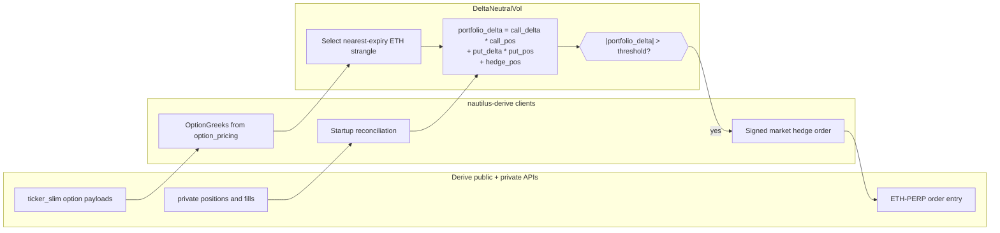
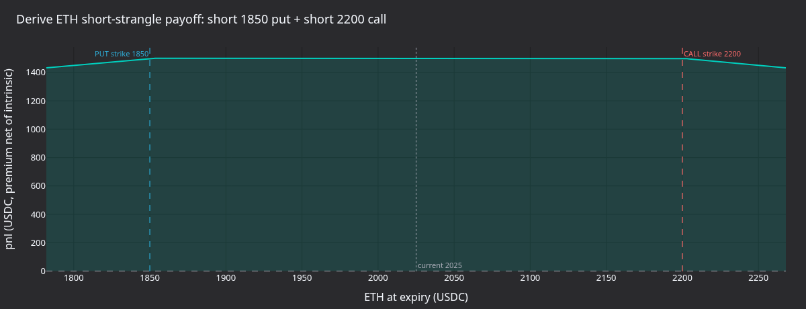

# Delta 中性期权策略（Derive） {#deltaneutral-options-strategy-derive}

:::note
本教程**仅用 Rust**，通过 Rust `LiveNode` 在 Derive 上实时运行 delta 中性的卖出
波动率策略。
:::

本教程把共享的 `DeltaNeutralVol` 策略配合 Derive 适配器使用。自带的示例发现 ETH
期权并选出一个虚值 call 和一个虚值 put，订阅交易场所提供的 Greeks，用
`ETH-PERP.DERIVE` 做 delta 对冲。

Derive 运行器以仅对冲（hedge-only）模式启动。它设置 `enter_strangle: false`，
不挂初始期权入场订单。对冲默认开启（`HEDGE_ENABLED = true`）。对账仍会加载已有
持仓。组合 delta 超过配置的阈值时，策略可以在永续合约上提交市价对冲订单。

运行器的设置读取示例文件顶部的常量，不读环境变量。要做不产生对冲订单的冒烟测试，
把 `HEDGE_ENABLED` 设为 `false` 并重新构建；策略仍会加载金融工具、对账账户并订阅
Greeks。要做入场订单的冒烟测试，把 `ENTER_STRANGLE` 设为 `true`，运行器就会提交
Derive 权利金定价的期权订单，而不是 IV 定价的期权订单。

:::warning
该策略可能在主网上交易真实资金。`enter_strangle: false` 只禁用初始的
宽跨式入场订单。若所选期权腿或对冲工具已有未平持仓，策略就可能提交对冲订单。
:::

## 前置条件 {#prerequisites}

- 已完成 [Derive 集成指南](./../integrations/derive.md)，包括钱包、子账户、
  session key 和资金准备。
- 一个 Derive testnet 或主网子账户，USDC 抵押品要足够支付你打算放行的对冲订单。
- 可用的 Rust 工具链和已构建的 NautilusTrader 工作区。
- 示例所面向的 Derive 环境的凭据环境变量。配置中凭据字段留空时，执行客户端会
  读取它们。

testnet：

```bash
export DERIVE_TESTNET_WALLET_ADDRESS="0x..."
export DERIVE_TESTNET_SESSION_PRIVATE_KEY="0x..."
export DERIVE_TESTNET_SUBACCOUNT_ID="12345"
```

主网：

```bash
export DERIVE_WALLET_ADDRESS="0x..."
export DERIVE_SESSION_PRIVATE_KEY="0x..."
export DERIVE_SUBACCOUNT_ID="12345"
```

示例通过 `node_delta_neutral.rs` 中的 `DERIVE_ENVIRONMENT` 常量
（`DeriveEnvironment::Testnet`）面向 testnet，不从环境读取网络。只有在动用真实
资金运行时，才把该常量改为 `DeriveEnvironment::Mainnet` 并重新构建。

## 策略概览 {#strategy-overview}

`DeltaNeutralVol` 策略位于 trading crate 的 examples 模块。Derive 运行器分五个
阶段使用它：

1. **加载金融工具**：Derive 数据客户端配置 `currencies: ["ETH"]`，适配器因此
   把 ETH 永续和期权加载进缓存。
1. **选择行权价**：把缓存过滤到存续的 ETH 期权，取最近到期日，按百分位排名
   选出虚值 call 和 put 行权价。
1. **Greeks 跟踪**：订阅两条腿的 `OptionGreeks`。Derive 的 Greeks 来自共享的
   `ticker_slim` 数据流和 `option_pricing` 载荷。
1. **再对冲**：计算组合 delta，超过阈值时在 `ETH-PERP.DERIVE` 上提交 Derive
   市价订单。
1. **持仓跟踪**：通过成交记录跟踪 call、put 和对冲持仓。对账在策略启动前
   加载已有持仓。



### 组合 delta {#portfolio-delta}

策略按下式计算净敞口：

```text
portfolio_delta = call_delta * call_position
                + put_delta * put_position
                + hedge_position
```

call 与 put 的 delta 相互抵消时，卖出宽跨式在入场时接近 delta 中性。标的移动后
净 delta 漂移，策略用永续合约对冲，把组合拉回零附近。

## 配置 {#configuration}

示例运行器 `crates/adapters/derive/examples/node_delta_neutral.rs` 通过文件顶部的
常量配置。要改变运行方式，修改这些常量并重新构建示例；编辑后 `cargo run`
命令会自动重建示例。

```rust
const DERIVE_ENVIRONMENT: DeriveEnvironment = DeriveEnvironment::Testnet;

const OPTION_FAMILY: &str = "ETH";
const HEDGE_INSTRUMENT_ID: &str = "ETH-PERP.DERIVE";

const ENTER_STRANGLE: bool = false;
const HEDGE_ENABLED: bool = true;
const REHEDGE_DELTA_THRESHOLD: f64 = 0.5;
const REHEDGE_INTERVAL_SECS: u64 = 30;

const TARGET_CALL_DELTA: f64 = 0.20;
const TARGET_PUT_DELTA: f64 = -0.20;
const CONTRACTS: u64 = 1;
const ENTRY_IV_OFFSET: f64 = 0.0;
const ENTRY_PREMIUM_OFFSET_TICKS: i32 = 1;
const EXPIRY_FILTER: Option<&str> = None;

const MAX_FEE_PER_CONTRACT: &str = "1000";
const MARKET_ORDER_SLIPPAGE_BPS: u32 = 50;
```

运行器用这些常量构建策略配置：

```rust
// Disable rehedging by pushing the threshold beyond any reachable delta.
let rehedge_delta_threshold = if HEDGE_ENABLED {
    REHEDGE_DELTA_THRESHOLD
} else {
    1.0e12
};

let mut strategy_config = DeltaNeutralVolConfig::builder()
    .option_family(option_family)
    .hedge_instrument_id(hedge_instrument_id)
    .client_id(client_id)
    .target_call_delta(TARGET_CALL_DELTA)
    .target_put_delta(TARGET_PUT_DELTA)
    .contracts(CONTRACTS)
    .rehedge_delta_threshold(rehedge_delta_threshold)
    .rehedge_interval_secs(REHEDGE_INTERVAL_SECS)
    .enter_strangle(ENTER_STRANGLE)
    .entry_iv_offset(ENTRY_IV_OFFSET)
    .entry_premium_offset_ticks(ENTRY_PREMIUM_OFFSET_TICKS)
    .build();

if let Some(expiry) = EXPIRY_FILTER {
    strategy_config.expiry_filter = Some(expiry.to_string());
}

let strategy = DeltaNeutralVol::new(strategy_config);
```

`HEDGE_ENABLED` 没有对应的策略字段。设为 `false` 时，`rehedge_delta_threshold`
被抬高到 `1.0e12`，策略就永远不会提交对冲订单。

参数：

| 参数                         | 默认值     | Derive 运行器 | 说明                                         |
| ---------------------------- | ---------- | ------------- | -------------------------------------------- |
| `option_family`              | 必填       | `"ETH"`       | 金融工具发现的标的过滤。                     |
| `hedge_instrument_id`        | 必填       | `ETH-PERP`    | 用于 delta 对冲的永续合约。                  |
| `client_id`                  | 必填       | `"DERIVE"`    | 数据与执行客户端标识。                       |
| `target_call_delta`          | `0.20`     | `0.20`        | 选行权价时的目标 call delta。                |
| `target_put_delta`           | `-0.20`    | `-0.20`       | 选行权价时的目标 put delta。                 |
| `contracts`                  | `1`        | `1`           | 每条期权腿的合约数。                         |
| `rehedge_delta_threshold`    | `0.5`      | `0.5`         | 触发对冲的组合 delta。                       |
| `rehedge_interval_secs`      | `30`       | `30`          | 周期性再对冲定时器间隔。                     |
| `expiry_filter`              | `None`     | 未设置        | 可选的到期日子串过滤。                       |
| `enter_strangle`             | `true`     | `false`       | 权利金数据到达后是否挂入场订单。             |
| `entry_premium_offset_ticks` | `None`     | `1`           | 卖出入场相对期权卖价的 tick 偏移。           |
| `entry_iv_offset`            | `0.0`      | `0.0`         | 仅在关闭权利金模式时使用。                   |
| `iv_param_key`               | `"px_vol"` | 未使用        | IV 定价交易场所的 IV 参数键。                |

Derive 为显式权利金限价签名。运行器用 `entry_premium_offset_ticks=1` 启用策略的
权利金入场模式。入场订单在有实时期权卖价时使用卖价；报价侧为空时改用 Derive 的 IV
字段。Bybit 和 OKX 走共享的 IV 参数路径。

## 节点设置 {#node-setup}

Derive 运行器使用 live 环境，由 `DERIVE_ENVIRONMENT` 常量决定 testnet 还是主网：

```rust
let environment = Environment::Live;
let derive_environment = DERIVE_ENVIRONMENT;
let trader_id = TraderId::from(TRADER_ID);
let account_id = AccountId::from(ACCOUNT_ID);
let client_id = *DERIVE_CLIENT_ID;
```

数据客户端批量加载 ETH 金融工具。这一点很重要，因为策略在 `on_start` 期间从缓存
选择期权腿。

```rust
let data_config = DeriveDataClientConfig {
    environment: derive_environment,
    currencies: vec![option_family.clone()],
    ..Default::default()
};
```

配置字段留空时，执行客户端从 Derive 环境变量读取钱包、session key 和子账户的值。
示例设置了费用上限和市价单滑点界。

```rust
let exec_config = DeriveExecutionClientConfig {
    account_id,
    environment: derive_environment,
    max_fee_per_contract: Some(Decimal::from_str_exact(MAX_FEE_PER_CONTRACT)?),
    market_order_slippage_bps: MARKET_ORDER_SLIPPAGE_BPS,
    ..Default::default()
};
```

节点启用对账，在策略启动前加载未结订单、持仓、余额与报告：

```rust
let mut node = LiveNode::builder(trader_id, environment)?
    .with_name("DERIVE-DELTA-NEUTRAL-001".to_string())
    .add_data_client(None, Box::new(data_factory), Box::new(data_config))?
    .add_exec_client(None, Box::new(exec_factory), Box::new(exec_config))?
    .with_reconciliation(true)
    .with_delay_post_stop_secs(5)
    .build()?;

node.add_strategy(strategy)?;
node.run().await?;
```

## 策略工作原理 {#how-the-strategy-works}

### 选择行权价 {#strike-selection}

启动时策略从缓存查询所有匹配 `option_family` 的期权工具。Derive 场景中示例用
`ETH`，匹配的金融工具代码形如 `ETH-20260626-3000-C.DERIVE`。

它剔除已到期期权，若设置了 `expiry_filter` 则应用之；没有过滤器时取最近到期日。
call 和 put 各按行权价排序：

- **Call**：index = `(1.0 - target_call_delta) * count`。默认 `0.20`
  时，选中的行权价约在第 80 百分位。
- **Put**：index = `abs(target_put_delta) * count`。默认 `-0.20`
  时，选中的行权价约在第 20 百分位。

这是按行权价排序的启发式方法。生产级策略可以先订阅整条期权链的 Greeks，再按真实
delta 选择。

### Greeks 与共享行情流 {#greeks-and-shared-ticker-feeds}

Derive 在报价使用的同一 `ticker_slim` 通道上发布期权定价字段。适配器从
`option_pricing` 派生 `OptionGreeks`，因此策略只需订阅选中的两条期权腿：

```rust
self.subscribe_option_greeks(call_id, Some(client_id), None);
self.subscribe_option_greeks(put_id, Some(client_id), None);
```

适配器对底层行情订阅做引用计数。同一金融工具的下列数据类型可共享单个 WebSocket
通道：

- 报价。
- 标记价格。
- 指数价格。
- 资金费率。
- 期权 Greeks。

### Derive 上的再对冲 {#rehedging-on-derive}

Derive 执行适配器把市价单作为带滑点界限价的签名订单发送。签名之前，适配器先刷新
对冲工具的行情快照，把最差可接受价格写入 EIP-712 载荷。`market_order_slippage_bps`
默认 `50`。

当选定的两条期权腿都已发出 Greeks 且满足下式时，策略提交对冲：

```text
abs(portfolio_delta) > rehedge_delta_threshold
```

组合 delta 为正时在 `ETH-PERP.DERIVE` 上 SELL；为负时 BUY。`hedge_pending`
标志在订单在途时阻止重复提交。

### 持仓跟踪 {#position-tracking}

策略通过 `on_order_filled` 跟踪持仓，不会每次更新都轮询持仓。对账在启动时加载
已有持仓，之后的成交更新内存中的 call、put 和对冲计数器。

### 停止 {#shutdown}

停止时，策略撤销所选期权腿和对冲工具上的未结订单，退订数据源，但不平仓。要平掉
宽跨式和对冲，需手工操作或另用出场策略。

## 运行结果 {#what-the-run-produces}

在 testnet 上以 `enter_strangle: false` 运行时，策略应能发现选中的腿、订阅
Greeks，且不下入场订单。选中的代码取决于 Derive 的实时期权链：

```text
Selected call: ETH-<expiry>-<strike>-C.DERIVE (strike=<strike>)
Selected put: ETH-<expiry>-<strike>-P.DERIVE (strike=<strike>)
Strangle: 1 contracts per leg, hedge on ETH-PERP.DERIVE
Strangle entry disabled: hedging externally-held positions only.
```

没有已有持仓时，该运行在启动后应保持只收数据不下单。若账户在所选腿或对冲工具上
已有持仓，周期性再对冲定时器就可能提交对冲订单。

下面的面板与 Derive 运行器使用同样的选中行权价机制：能从冒烟测试日志解析出行权价
就用之，否则退回示意性的 ETH 行权价。



**图 1.** *卖出 ETH put 加卖出 ETH call 组合到期的盈亏，假定固定 USDC 权利金、
零贴水。平坦顶部是两行权价之间只赚权利金的区间；越过任一行权价后亏损线性增长。*


**图 2.** *示意性的空头 call 与空头 put delta 在入场价附近的形态，及其导致的
对冲前组合 delta。*


**图 3.** *`rehedge_delta_threshold=0.5` 时合成的布朗 delta 漂移，150 秒。
叉号标出开启对冲时策略会提交对冲订单的位置。*


**图 4.** *行权价选择启发式叠加示意性 IV 微笑曲线。call 行权价位于
`(1 - target_call_delta)` 百分位附近，put 位于 `abs(target_put_delta)` 附近。*

### 重新生成图表面板 {#regenerate-the-panels}

日志来自实盘运行器，用你的凭据连接 Derive。运行前先编辑 `node_delta_neutral.rs`：

1. 把 `DERIVE_ENVIRONMENT` 设为 `DeriveEnvironment::Mainnet`。
1. 把 `HEDGE_ENABLED` 设为 `false`。
1. `ENTER_STRANGLE` 保持 `false`。
1. 导出主网凭据。

`HEDGE_ENABLED` 与 `ENTER_STRANGLE` 都为 `false` 时，运行不会提交任何订单。
跑完后把常量恢复原状。

从源码构建 NautilusTrader 后，在仓库根目录运行：

```bash
make sync

timeout 45 cargo run --example derive-delta-neutral --package nautilus-derive --features examples \
    > /tmp/derive_dn.log 2>&1

export DN_LOG=/tmp/derive_dn.log
uv run --project python --no-sync \
    python docs/tutorials/assets/delta_neutral_options_derive/render_panels.py
```

渲染器只用日志来选行权价。由于不下单的冒烟配置禁用了入场与对冲提交，图仍是
示意性的。

## 风险考量 {#risk-considerations}

- **Gamma 风险**：卖出宽跨式 gamma 为负。ETH 大幅波动时，delta 敞口的增长可能
  快于再对冲定时器的响应。
- **滑点风险**：Derive 市价订单在提交前对滑点界限价签名。界太紧可能拒掉有用的
  对冲；界太松可能以差于预期的价格成交。
- **入场价格风险**：Derive 入场用实时期权卖价加 tick 偏移；报价侧为空时按 Derive
  的 IV 字段计算权利金。偏移过小或为负会直接吃穿订单簿并立即成交。
- **抵押品风险**：子账户初始保证金余量不足时 Derive 会拒绝订单。启用实时对冲前，
  先查 `private/get_subaccount` 或适配器的账户快照。
- **生命周期风险**：策略停止就不再对冲。持仓保持未平且未对冲，直到在别处处理。

## 运行示例 {#running-the-example}

按自带常量，示例面向 Derive testnet：禁用宽跨式入场、启用对冲。若子账户在所选腿
或对冲工具上有持仓，组合 delta 可能超过阈值，策略就会在 `ETH-PERP.DERIVE` 上提交
对冲订单。

```bash
cargo run --example derive-delta-neutral --package nautilus-derive --features examples
```

Ctrl+C 停止。策略会先撤销未结订单并退订数据再关闭，但不平仓。

要做只加载交易场所与账户、不提交订单的冒烟测试，把 `HEDGE_ENABLED` 设为 `false`，
`ENTER_STRANGLE` 保持 `false`。要在主网运行，再把 `DERIVE_ENVIRONMENT` 设为
`DeriveEnvironment::Mainnet`。然后运行：

```bash
timeout 45 cargo run --example derive-delta-neutral --package nautilus-derive --features examples
```

要做会提交 Derive 权利金期权入场订单的冒烟测试，把 `ENTER_STRANGLE` 设为 `true`
（`ENTRY_PREMIUM_OFFSET_TICKS` 已是 `1`）。订单发往 `DERIVE_ENVIRONMENT` 选定的
网络，除非 `HEDGE_ENABLED` 为 `false`，对冲保持开启。然后运行：

```bash
timeout --signal=INT 45 cargo run --example derive-delta-neutral --package nautilus-derive \
    --features examples
```

## 完整源码 {#complete-source}

- 示例运行器：`crates/adapters/derive/examples/node_delta_neutral.rs`
- 策略实现：`crates/trading/src/examples/strategies/delta_neutral_vol/`
- 策略 README：`crates/trading/src/examples/strategies/delta_neutral_vol/README.md`

## 参见 {#see-also}

- [Derive 集成](./../integrations/derive.md)：环境搭建、代码体系、能力与
  执行语义。
- [期权](./../concepts/options.md)：期权工具类型与数据架构。
- [Bybit 上的 Delta 中性期权策略](./delta_neutral_options_bybit.md)：同一个
  共享策略，使用 Bybit 专属的 IV 入场参数。
