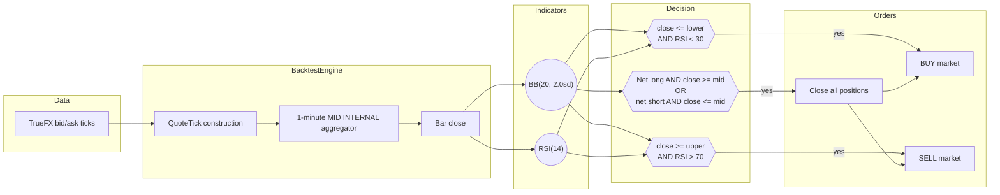
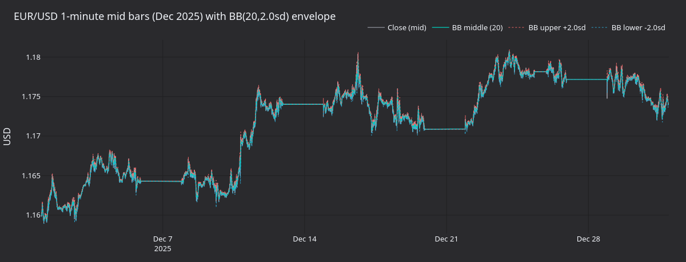
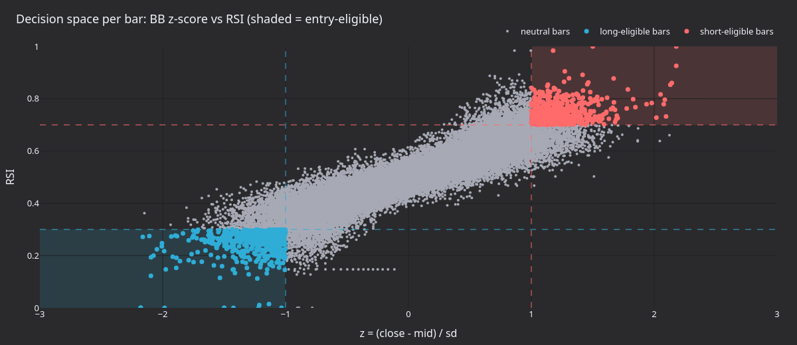

# 代理 FX 数据均值回归（AX Exchange） {#mean-reversion-with-proxy-fx-data-ax-exchange}

本教程在 [AX Exchange](https://architect.exchange) 的 **EURUSD-PERP** 上回测一个布林带均值回归策略，
使用 [TrueFX](https://www.truefx.com) 的 EUR/USD 现货 tick 作为代理数据。

## 简介 {#introduction}

策略在 1 分钟中间价 K 线上组合两个指标：

- **布林带**（`BBMeanReversion` 的 `BB(20, 2.0sd)`）：滚动 20 根 K 线的均值和 ±2 倍标准差的包络。
  布林带用于标记价格相对近期波动率是否超涨超跌。
- **相对强弱指数**（`RSI(14)`）：14 根 K 线的动量振荡指标，取值 `[0, 100]`，
  按常规的 30/70 阈值使用。

入场要求两个信号同时满足：

- 触及下轨且 `RSI < 30` 时开多。
- 触及上轨且 `RSI > 70` 时开空。

出场只看收盘价条件：收盘价重新穿越 BB 中轨时平掉所有持仓。新入场前先平掉反方向的
已有持仓。

自带的 `BBMeanReversion` 策略刻意保持简单，没有优势（edge）。



### 为什么用代理数据 {#why-proxy-data}

历史数据供应商尚未覆盖 AX Exchange。[TrueFX](https://www.truefx.com) 免费发布来自
Integral 和 Jefferies 池的机构级 EUR/USD 现货 tick 归档，可作为 AX EURUSD-PERP 回测的
代理数据。

## 前置条件 {#prerequisites}

- Python 3.13+
- 已[安装 NautilusTrader](./../getting_started/installation.md)，并带上提供 pandas 的
  [`visualization` extra](./../getting_started/installation.md#extras)。
- 仓库源码检出。回测从 `examples/live/architect_ax/strategies.py` 导入
  `BBMeanReversion`，已安装的包不包含该文件。
- 一个免费的 TrueFX 账户，用于下载月度 tick 归档。

## 数据准备 {#data-preparation}

### 下载 TrueFX EUR/USD tick {#download-truefx-eurusd-ticks}

1. 打开 [TrueFX 历史数据下载页](https://www.truefx.com/truefx-historical-downloads/)。
1. 选择 **EUR/USD** 和某个月份，例如 **December 2025**。
1. 解压 ZIP。CSV 无表头，列为
   `pair, timestamp, bid, ask`。

### 加载为 Nautilus 报价 tick {#load-into-nautilus-quote-ticks}

先运行下一节的代码定义 `EURUSD_PERP` 和 `instrument_id`，再运行这段代码。

```python
from pathlib import Path

import pandas as pd

from nautilus_trader.model import Quantity
from nautilus_trader.model import QuoteTick

df = pd.read_csv(
    Path("EURUSD-2025-12.csv"),
    header=None,
    names=["pair", "timestamp", "bid", "ask"],
)
df["timestamp"] = pd.to_datetime(
    df["timestamp"],
    format="%Y%m%d %H:%M:%S.%f",
    utc=True,
)
df = df.set_index("timestamp")[["bid", "ask"]].sort_index()

ticks = []
for timestamp, row in df.iterrows():
    ts_ns = pd.Timestamp(str(timestamp)).value
    ticks.append(
        QuoteTick(
            instrument_id=instrument_id,
            bid_price=EURUSD_PERP.make_price(float(row.bid)),
            ask_price=EURUSD_PERP.make_price(float(row.ask)),
            bid_size=Quantity.from_int(1),
            ask_size=Quantity.from_int(1),
            ts_event=ts_ns,
            ts_init=ts_ns,
        ),
    )
```

每条报价携带代理金融工具 ID，买卖量各设一个单位。策略声明的是
`1-MINUTE-MID-INTERNAL`，因此引擎从 tick 流内部聚合出 1 分钟 MID K 线。

## 金融工具定义 {#instrument-definition}

代理数据需要手工定义金融工具。`multiplier` 取 `1000`，使一张合约的名义价值为
1,000 EUR。

```python
from decimal import Decimal

from nautilus_trader.model import AssetClass
from nautilus_trader.model import Currency
from nautilus_trader.model import InstrumentId
from nautilus_trader.model import PerpetualContract
from nautilus_trader.model import Price
from nautilus_trader.model import Quantity
from nautilus_trader.model import Symbol

USD = Currency.from_str("USD")

instrument_id = InstrumentId.from_str("EURUSD-PERP.AX")

EURUSD_PERP = PerpetualContract(
    instrument_id=instrument_id,
    raw_symbol=Symbol("EURUSD-PERP"),
    underlying="EUR",
    asset_class=AssetClass.FX,
    quote_currency=USD,
    settlement_currency=USD,
    is_inverse=False,
    price_precision=5,
    size_precision=0,
    price_increment=Price.from_str("0.00001"),
    size_increment=Quantity.from_int(1),
    multiplier=Quantity.from_int(1000),
    lot_size=Quantity.from_int(1),
    margin_init=Decimal("0.05"),
    margin_maint=Decimal("0.025"),
    ts_event=0,
    ts_init=0,
)
```

费用和保证金是回测中显式设定的假设。当前费率请查阅
[AX Exchange 文档](https://docs.architect.exchange/)。

## 配置 {#configuration}

| 参数                 | 取值   | 说明                                                       |
| -------------------- | ------ | ---------------------------------------------------------- |
| `bb_period`          | `20`   | BB 均值与标准差的滚动窗口。                                |
| `bb_std`             | `2.0`  | 带宽，以标准差为单位。                                     |
| `rsi_period`         | `14`   | RSI 回看根数。                                             |
| `rsi_buy_threshold`  | `30.0` | 做多入场的确认条件（RSI 取值 `[0, 100]`）。                |
| `rsi_sell_threshold` | `70.0` | 做空入场的确认条件。                                       |
| `trade_size`         | `1`    | 每次交易一张合约（名义价值 1,000 EUR）。                   |

## 回测设置 {#backtest-setup}

在仓库根目录执行：

```python
import sys
from decimal import Decimal
from pathlib import Path

from nautilus_trader.backtest import BacktestEngine
from nautilus_trader.common import LogLevel
from nautilus_trader.config import BacktestEngineConfig
from nautilus_trader.config import LoggerConfig
from nautilus_trader.execution import MakerTakerFeeModel
from nautilus_trader.model import AccountType
from nautilus_trader.model import BarType
from nautilus_trader.model import Money
from nautilus_trader.model import OmsType
from nautilus_trader.model import TraderId
from nautilus_trader.model import Venue

sys.path.insert(0, str(Path("examples/live/architect_ax")))

from strategies import BBMeanReversion
from strategies import BBMeanReversionConfig

engine = BacktestEngine(
    BacktestEngineConfig(
        trader_id=TraderId.from_str("BACKTESTER-001"),
        logging=LoggerConfig(stdout_level=LogLevel.INFO),
    ),
)

AX = Venue("AX")
engine.add_venue(
    venue=AX,
    oms_type=OmsType.NETTING,
    account_type=AccountType.MARGIN,
    base_currency=USD,
    starting_balances=[Money.from_str("100000 USD")],
    fee_model=MakerTakerFeeModel(
        maker_rate=Decimal("0.0002"),
        taker_rate=Decimal("0.0005"),
    ),
)

engine.add_instrument(EURUSD_PERP)
engine.add_data(ticks)

strategy = BBMeanReversion(
    config=BBMeanReversionConfig(
        instrument_id=instrument_id,
        bar_type=BarType.from_str("EURUSD-PERP.AX-1-MINUTE-MID-INTERNAL"),
        trade_size=Decimal("1"),
        bb_period=20,
        bb_std=2.0,
        rsi_period=14,
        rsi_buy_threshold=30.0,
        rsi_sell_threshold=70.0,
    ),
)
engine.add_strategy(strategy)
engine.run()
```

从引擎获取报告：

```python
print(engine.generate_account_report(venue=AX))
print(engine.generate_order_fills_report())
print(engine.generate_positions_report())

engine.reset()
engine.dispose()
```

自带数据、可直接运行的完整示例使用内置的 AUD/USD 测试夹具，策略与设置模式相同，见
[`architect_ax_mean_reversion.py`](https://github.com/nautechsystems/nautilus_trader/tree/develop/examples/backtest/architect_ax_mean_reversion.py)。

## 运行结果 {#what-the-run-produces}

把 TrueFX EUR/USD 2025 年 12 月的数据重放给 `BBMeanReversion(20, 2sd, RSI 14)`，
得到 44,591 根 1 分钟中间价 K 线，平仓 1,089 笔、共 2,178 笔成交。累计已实现盈亏最终为
**-1,287 USD**。策略整月稳定亏损，市场状态切换后也没有明显好转。没有市场状态过滤的
均值回归，每个回合都在支付点差。EUR/USD 在 12 月下半月强势上行，策略反复逆势交易。



**图 1.** *2025 年 12 月整月的 EUR/USD 1 分钟中间价 K 线，叠加 BB 中轨与 ±2sd 包络。
水平平坦段是 TrueFX 数据源中的周末空档。*


**图 2.** *数据集时间中点附近 12 小时的放大图。上：中间价与 BB 包络、做多入场（上三角）、
做空入场（下三角）、平仓成交（叉号）。下：RSI(14) 及 30 买入 / 70 卖出阈值。*



**图 3.** *整月每根 K 线的 BB z 分数对 RSI 的散点图。阴影区域标记可入场象限：
左下（做多）与右上（做空）。对角线状的团块是带内相对价格与 RSI 的天然联动。*


**图 4.** *按已平持仓的累计 USD 已实现盈亏。曲线近似线性下滑，主要来自每个回合支付的
点差和小额不利波动。*

### 重新生成图表面板 {#regenerate-the-panels}

一个自包含的渲染器重跑回测，在捕获的 K 线上计算 BB 与 RSI，使用共享的 `nautilus_dark`
tearsheet 主题写出 PNG 面板。

从源码构建 NautilusTrader 后，在仓库根目录运行：

```bash
make sync
TRUEFX_CSV=test_data/local/truefx/EURUSD-2025-12.csv \
    uv run --project python --no-sync \
        python docs/tutorials/assets/fx_mean_reversion_ax/render_panels.py
```

把 `TRUEFX_CSV` 设为你的 EUR/USD 归档路径。

## 后续步骤 {#next-steps}

- **市场状态过滤**：回撤集中在趋势性时段。当实际波幅或更慢的趋势过滤器显示市场有
  方向时，抑制入场。
- **阈值**：更宽的布林带（`bb_std=2.5`）或更严的 RSI 截断（`25` / `75`）会减少入场，
  并要求更强的确认。
- **止损**：硬性止损单可限制每个回合的下行。避免策略一直持有亏损仓位等价格回到
  BB 中轨。
- **AX 沙盒**：回测表现符合预期后，接入 AX 沙盒做模拟交易。环境搭建见
  [AX Exchange 集成指南](./../integrations/architect_ax.md)。

## 实时运行 {#running-live}

同一个 `BBMeanReversion` 策略可以直连 AX Exchange 实时运行。启动脚本使用 `LiveNode`，
以 AX 数据与执行客户端替代 `BacktestEngine`。实时示例见
[`ax_mean_reversion.py`](https://github.com/nautechsystems/nautilus_trader/tree/develop/examples/live/architect_ax/ax_mean_reversion.py)。
脚本面向 AX 沙盒（两个客户端配置均设 `AxEnvironment.SANDBOX`），会在沙盒中下真实订单。
脚本还设置了 `LiveRiskEngineConfig(bypass=True)`，跳过盘前风控检查和订单频率限制。

连接设置与 API key 配置见
[AX Exchange 集成指南](./../integrations/architect_ax.md)。

## 延伸阅读 {#further-reading}

- [`BBMeanReversion` 策略源码](https://github.com/nautechsystems/nautilus_trader/blob/develop/examples/live/architect_ax/strategies.py)
- [黄金永续合约订单簿失衡教程](./gold_book_imbalance_ax.md)
- [Architect Exchange 文档](https://docs.architect.exchange/)
