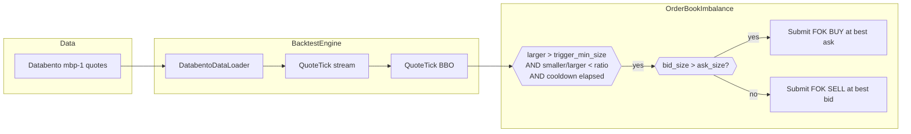
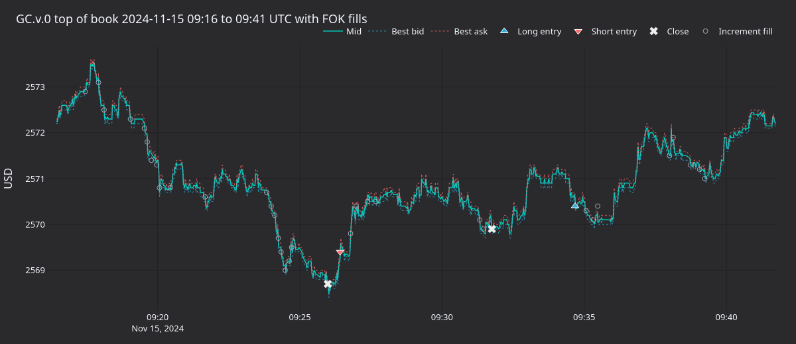

# 代理期货数据黄金永续订单簿失衡（AX Exchange） {#gold-perpetual-book-imbalance-with-proxy-futures-data-ax-exchange}

本教程在 [AX Exchange](https://architect.exchange) 的 **XAU-PERP** 上回测一个最优报价失衡
策略，使用 [Databento](https://databento.com) CME 黄金期货（`GC.v.0`）的 `mbp-1` 报价作为
代理数据。

## 简介 {#introduction}

最优报价失衡是一个微观结构信号。当 BBO 一侧的挂单量远大于另一侧时，订单簿向该侧倾斜。
随着较重一侧吸收订单流，短期价格常向较薄一侧移动。

AX 示例的 `OrderBookImbalance` 策略提交一笔 FOK（fill-or-kill）限价单去吃较薄一侧。
例如买盘挂单更多时以卖价买入。每当两侧比值低于阈值且冷却期已过，就提交一笔订单。

策略只需要 BBO，因此使用 `mbp-1`（market by price，单一最优买卖价）报价数据，不需要
完整 L2 订单簿，可降低回测的数据成本。

`OrderBookImbalance` 是教学策略，没有优势（edge）。



### 为什么用代理数据 {#why-proxy-data}

Databento 尚未覆盖 AX Exchange。CME `GC` 黄金期货是全球流动性最好的黄金衍生品，
能为黄金策略回测提供有代表性的微观结构。连续合约 `GC.v.0` 把成交量最大合约的数据
跨到期日拼接起来，跟随流动性的方式与永续合约一致。

`stype_in="continuous"` 参数在请求时通过 Databento 的连续映射解析代码。加载时覆盖
`instrument_id` 是安全的，因为该映射在任意时刻只选中一个标的金融工具。

关于订单簿失衡特征的预测能力，详见 Databento 的博文
[用 sklearn 做 HFT 信号](https://databento.com/blog/hft-sklearn-python)。

## 前置条件 {#prerequisites}

- Python 3.13+
- 已[安装 NautilusTrader](./../getting_started/installation.md)。
- NautilusTrader 仓库克隆。下面的代码要读取
  `crates/adapters/databento/publishers.json` 并从 `examples/live/architect_ax`
  导入策略，因此在仓库根目录运行：

```bash
git clone https://github.com/nautechsystems/nautilus_trader
cd nautilus_trader
```

- 一个 Databento API key：

```bash
export DATABENTO_API_KEY="your-api-key"
```

- Databento Python 客户端：`pip install databento`。

## 数据准备 {#data-preparation}

### 下载 CME 黄金期货报价 {#download-cme-gold-futures-quotes}

```python
import databento as db
from pathlib import Path

data_path = Path("gc_gold_quotes.dbn.zst")

if not data_path.exists():
    client = db.Historical()
    data = client.timeseries.get_range(
        dataset="GLBX.MDP3",
        symbols=["GC.v.0"],
        stype_in="continuous",
        schema="mbp-1",
        start="2024-11-15",
        end="2024-11-16",
    )
    data.to_file(data_path)
```

该请求下载一个交易日。后续运行复用同一个文件。

### 加载为 Nautilus 报价 tick {#load-into-nautilus-quote-ticks}

`DatabentoDataLoader.load_quotes` 解析 `.dbn.zst` 归档并产出 `QuoteTick` 对象。
`instrument_id` 参数覆盖 Databento 的代码体系，使每条 tick 都使用 `XAU-PERP.AX`。
加载器无法为该 ID 解析价格精度，需显式传入 `price_precision`，且必须与下面的
金融工具定义一致。

```python
from nautilus_trader.adapters.databento import DatabentoDataLoader
from nautilus_trader.model import InstrumentId

instrument_id = InstrumentId.from_str("XAU-PERP.AX")

publishers_path = Path("crates/adapters/databento/publishers.json")
loader = DatabentoDataLoader(publishers_path)
quotes = loader.load_quotes(
    filepath=data_path,
    instrument_id=instrument_id,
    price_precision=2,
)
```

## 金融工具定义 {#instrument-definition}

代理数据需要手工定义金融工具。价格精度、最小变动价位和保证金参数都是回测假设。
`0.01` 的 tick 比 CME `GC` 的 tick（`0.10`）和 AX `XAU-PERP` 的 tick（`0.1`）都更细。

```python
from decimal import Decimal

from nautilus_trader.model import AssetClass
from nautilus_trader.model import Currency
from nautilus_trader.model import PerpetualContract
from nautilus_trader.model import Price
from nautilus_trader.model import Quantity
from nautilus_trader.model import Symbol

USD = Currency.from_str("USD")

XAU_PERP = PerpetualContract(
    instrument_id=instrument_id,
    raw_symbol=Symbol("XAU-PERP"),
    underlying="XAU",
    asset_class=AssetClass.COMMODITY,
    quote_currency=USD,
    settlement_currency=USD,
    is_inverse=False,
    price_precision=2,
    size_precision=0,
    price_increment=Price.from_str("0.01"),
    size_increment=Quantity.from_int(1),
    multiplier=Quantity.from_int(1),
    lot_size=Quantity.from_int(1),
    margin_init=Decimal("0.08"),
    margin_maint=Decimal("0.04"),
    ts_event=0,
    ts_init=0,
)
```

费用是回测中显式设定的假设。当前费率请查阅
[AX 文档](https://docs.architect.exchange/)。

## 策略配置 {#strategy-configuration}

策略订阅报价，在每个 `QuoteTick` 上比较买卖挂单量，不订阅 L2 订单簿增量。

| 参数                           | 取值   | 说明                                       |
| ------------------------------ | ------ | ------------------------------------------ |
| `max_trade_size`               | `10`   | 每笔 FOK 订单的合约数上限。                |
| `trigger_min_size`             | `1`    | 较大一侧须挂单超过一张合约。               |
| `trigger_imbalance_ratio`      | `0.10` | 较小 / 较大 < 10% 时触发。                 |
| `min_seconds_between_triggers` | `5.0`  | 连续触发之间的冷却时间。                   |

AX 示例中的策略定义在
[`examples/live/architect_ax/strategies.py`](https://github.com/nautechsystems/nautilus_trader/blob/develop/examples/live/architect_ax/strategies.py)。
在仓库根目录执行：

```python
import sys
from pathlib import Path

sys.path.insert(0, str(Path("examples/live/architect_ax")))
from strategies import OrderBookImbalance
from strategies import OrderBookImbalanceConfig

strategy = OrderBookImbalance(
    OrderBookImbalanceConfig(
        instrument_id=instrument_id,
        max_trade_size=Decimal(10),
        trigger_min_size=Decimal(1),
        trigger_imbalance_ratio=Decimal("0.10"),
        min_seconds_between_triggers=5.0,
    ),
)
```

## 回测设置 {#backtest-setup}

```python
from decimal import Decimal

from nautilus_trader.common import LogLevel
from nautilus_trader.backtest import BacktestEngine
from nautilus_trader.config import BacktestEngineConfig
from nautilus_trader.config import LoggerConfig
from nautilus_trader.execution import MakerTakerFeeModel
from nautilus_trader.model import AccountType
from nautilus_trader.model import Money
from nautilus_trader.model import OmsType
from nautilus_trader.model import TraderId
from nautilus_trader.model import Venue

engine = BacktestEngine(
    BacktestEngineConfig(
        trader_id=TraderId.from_str("BACKTESTER-001"),
        logging=LoggerConfig(stdout_level=LogLevel.INFO),
    ),
)

AX = Venue("AX")
engine.add_venue(
    venue=AX,
    oms_type=OmsType.NETTING,
    account_type=AccountType.MARGIN,
    base_currency=USD,
    starting_balances=[Money.from_str("100000 USD")],
    fee_model=MakerTakerFeeModel(
        maker_rate=Decimal("0.0002"),
        taker_rate=Decimal("0.0005"),
    ),
)

engine.add_instrument(XAU_PERP)
engine.add_data(quotes)
engine.add_strategy(strategy)
engine.run()
```

从引擎获取报告：

```python
print(engine.generate_account_report(venue=AX))
print(engine.generate_order_fills_report())
print(engine.generate_positions_report())

engine.reset()
engine.dispose()
```

可直接运行的示例见
[`architect_ax_book_imbalance.py`](https://github.com/nautechsystems/nautilus_trader/tree/develop/examples/backtest/architect_ax_book_imbalance.py)。

## 运行结果 {#what-the-run-produces}

把 2024-11-15 的 GC.v.0 mbp-1（一个交易日）重放给
`OrderBookImbalance(0.10, 1.0, 5s)`，产生 2,378 笔 FOK 成交，净归为 5 个已平回合。
累计已实现盈亏最终为 **-4,170 USD**。策略全天稳定亏损，主要来自加仓 FOK 成交支付的
点差成本。



**图 1.** *GC.v.0 最优报价：约 09:26 做空入场、约 09:31 出场，随后做多再入场直至
09:35。三角形是空仓状态下的入场，叉号是回到空仓，空心圆是使仓位增大的加仓 FOK 成交。*


**图 2.** *全部采样的最优报价快照上的 `smaller / larger` BBO 挂单量比值分布，标出
0.10 触发阈值。阈值左侧的密集区就是可触发的区间。*


**图 3.** *整个交易日内的中间价（上）与最优买卖量（合约数，下）。最优报价挂单量在约
两张到五十张合约之间闪烁，中间价走过约十五美元的区间。*


**图 4.** *五个已平回合的累计 USD 已实现盈亏。斜率持续为负，单回合盈亏以点差主导。*

### 重新生成图表面板 {#regenerate-the-panels}

一个自包含的渲染器附带报价采样 actor 重跑回测，使用 `nautilus_dark` tearsheet 主题
把 PNG 写到资源目录。

从源码构建 NautilusTrader 后，在仓库根目录运行：

```bash
make sync
GC_DBN=gc_gold_quotes.dbn.zst \
    uv run --project python --no-sync \
        python docs/tutorials/assets/gold_book_imbalance_ax/render_panels.py
```

## 后续步骤 {#next-steps}

- **收紧触发条件**：把 `trigger_imbalance_ratio` 降到 `0.05`，或把
  `trigger_min_size` 提到 `5`，要求更强的信号再下单。
- **换时段**：只回放常规交易时段（RTH），或回放多天数据，对比不同市场状态下的行为。
- **换金融工具**：AX 还提供 FX 永续（`EURUSD-PERP`、`GBPUSD-PERP`）与白银
  （`XAG-PERP`）。用对应的 CME 期货，同样的代理方案都适用。
- **AX 沙盒**：回测表现符合预期后，见
  [AX Exchange 集成指南](./../integrations/architect_ax.md)。

## 实时运行 {#running-live}

同一个 `OrderBookImbalance` 策略可直连 AX 沙盒实时运行。启动脚本用 `LiveNode` 替代
`BacktestEngine`，为 `AxEnvironment.SANDBOX` 配置 AX 数据与执行客户端。实时示例见
[`ax_book_imbalance.py`](https://github.com/nautechsystems/nautilus_trader/tree/develop/examples/live/architect_ax/ax_book_imbalance.py)。

连接设置与 API key 配置见
[AX Exchange 集成指南](./../integrations/architect_ax.md)。

## 延伸阅读 {#further-reading}

- [`OrderBookImbalance` 策略源码](https://github.com/nautechsystems/nautilus_trader/blob/develop/examples/live/architect_ax/strategies.py)
- [代理 FX 数据均值回归教程](./fx_mean_reversion_ax.md)
- [Architect Exchange 文档](https://docs.architect.exchange/)
- [Databento：用 sklearn 做 HFT 信号](https://databento.com/blog/hft-sklearn-python)
