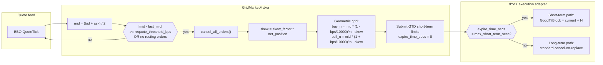
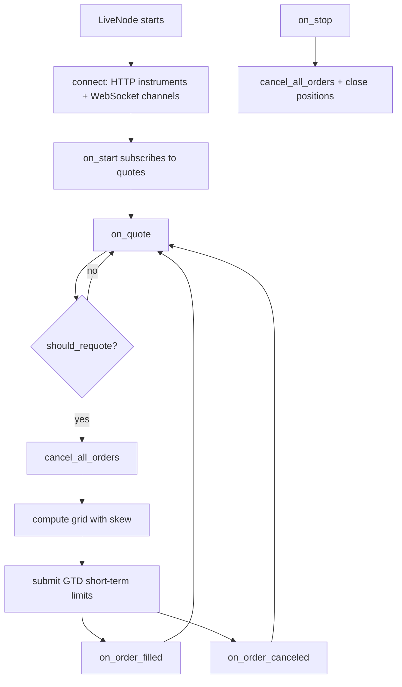
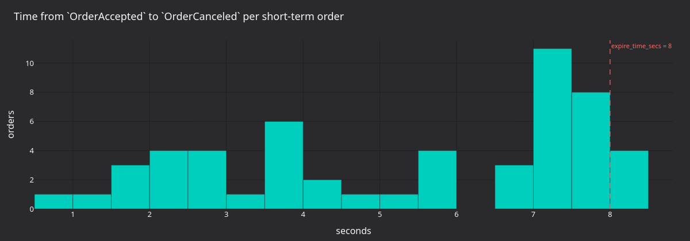
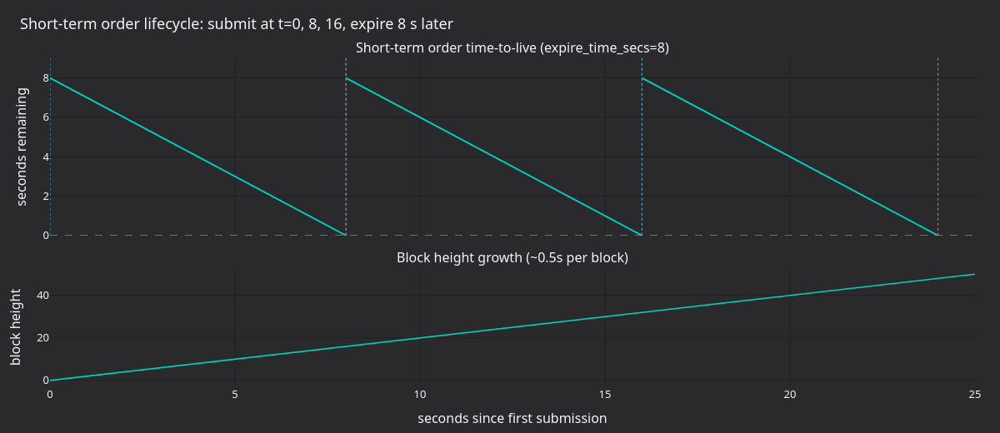

# 链上短周期挂单网格做市（dYdX） {#onchain-grid-market-making-with-shortterm-orders-dydx}

本教程通过 Rust `LiveNode` 在 dYdX v4 上运行自带的 `GridMarketMaker` 策略。策略围绕
中间价挂对称限价单，并通过网格偏移（skew）管理库存。交易场所让短期订单按
time-to-block 到期循环更替，不显式撤单。

## 简介 {#introduction}

网格做市商在当前中间价上下按固定价格间隔维护一档买、卖限价挂单。订单成交时，
策略赚取买入档与卖出档之间的价差。库存管理把净敞口控制在 `max_position` 以内，
使网格不会积累方向性仓位。



### 库存偏移（受 Avellaneda-Stoikov 启发） {#inventory-skew}

多头仓位增加时，整个网格下移（买更便宜、卖也更便宜），促使卖侧成交；空头仓位
增加时网格上移。这是 Avellaneda-Stoikov 框架在离散网格上的改编。

### 为什么选 dYdX v4 {#why-dydx-v4}

dYdX v4 具备这些利于做市的特性：

- **短期订单**约 20 秒到期：低延迟提交，无链上存储成本。
- **约 0.5 秒的出块时间**，确认循环快。
- **撤单不收 gas**：在 GTB 重放保护下短期撤单免费。
- **链上订单簿**，逐块确定性撮合。
- **批量撤单**：一条 `MsgBatchCancel` 清空全部短期订单。

## 前置条件 {#prerequisites}

### 有资金的 dYdX 账户 {#funded-dydx-account}

需要一个有 USDC 抵押品的 dYdX 账户。示例默认在主网交易；
[运行示例](#run-the-example)说明如何切到 testnet。创建并充值 testnet 账户的步骤见
集成指南的 [Testnet 设置](./../integrations/dydx.md#testnet-setup)一节。
API trading key 是可选的：除非配置了
[受权 key 交易](./../integrations/dydx.md#permissioned-key-trading)，
适配器一律用账户自己的私钥签名。

### 环境变量 {#environment-variables}

```bash
# Mainnet
export DYDX_PRIVATE_KEY="0x..."
export DYDX_WALLET_ADDRESS="dydx1..."

# Testnet
export DYDX_TESTNET_PRIVATE_KEY="0x..."
export DYDX_TESTNET_WALLET_ADDRESS="dydx1..."
```

## 策略概览 {#strategy-overview}

### 几何网格定价 {#geometric-grid-pricing}

每一档距中间价固定百分比（基点）：

```text
Buy level N:  mid * (1 - bps/10000)^N - skew
Sell level N: mid * (1 + bps/10000)^N - skew
```

其中 `skew = skew_factor * net_position`。

中间价 1000.00、`grid_step_bps=100`（1%）的三档网格：

```text
                        Sell 3: 1030.30
                    Sell 2: 1020.10
                Sell 1: 1010.00
            ─── Mid: 1000.00 ───
                Buy 1:  990.00
                    Buy 2:  980.10
                        Buy 3:  970.30
```

持有 2 个单位多头、`skew_factor=1.0` 时，整个网格下移 2.0：

```text
                        Sell 3: 1028.30
                    Sell 2: 1018.10
                Sell 1: 1008.00
            ─── Mid: 1000.00 ───
                Buy 1:  988.00
                    Buy 2:  978.10
                        Buy 3:  968.30
```

### 库存管理 {#inventory-management}

策略通过两个机制强制执行仓位限制：

- **`max_position`**：净敞口（多头或空头）的硬上限。某一档的预计敞口超过上限时
  跳过该档。
- **预计敞口**：逐档下单前，策略跟踪每一侧的最坏情况敞口（当前仓位 + 全部挂单
  买单 / 卖单），防止超出限制的承诺。

`cancel_all_orders` 是异步的。撤单请求与确认之间，挂单仍可能成交。逐侧的最坏
情况敞口检查可防止撤单-重报价切换期间瞬时超限。

### 重报价阈值 {#requote-threshold}

`requote_threshold_bps` 控制中间价要移动多少，策略才撤销全部挂单并重铺网格：

- **阈值较低**（5 bps）：响应更快，撤单/挂单交易更多。
- **阈值较高**（50 bps）：交易更少，但挂单可能偏离当前价格更远。

## 配置 {#configuration}

| 参数                    | 类型           | 默认值     | 说明                                                                       |
| ----------------------- | -------------- | ---------- | -------------------------------------------------------------------------- |
| `instrument_id`         | `InstrumentId` | *必填*     | 交易的金融工具（如 `ETH-USD-PERP.DYDX`）。                                 |
| `max_position`          | `Quantity`     | *必填*     | 最大净敞口（多头或空头）。                                                 |
| `trade_size`            | `Quantity`     | `None`     | 每档的规模。`None` 时使用金融工具的 `min_quantity` 或 1.0。                |
| `num_levels`            | `usize`        | `3`        | 买卖档位数。                                                               |
| `grid_step_bps`         | `u32`          | `10`       | 网格间距（基点，10 即 0.1%）。                                             |
| `skew_factor`           | `f64`          | `0.0`      | 依据库存移动网格的激进程度。                                               |
| `requote_threshold_bps` | `u32`          | `5`        | 触发重报价的中间价最小移动（bps）。                                        |
| `expire_time_secs`      | `Option<u64>`  | `None`     | 订单到期秒数。设置后用 GTD，否则 GTC。                                     |
| `on_cancel_resubmit`    | `bool`         | `false`    | 意外撤单后，下一条报价重铺网格。                                           |

### 参数选择 {#choosing-parameters}

- **`grid_step_bps`**：波动大的市场用 [50, 100] bps，平稳时 [5, 20] bps。
  网格越宽每笔成交赚的价差越大，但成交频率更低。
- **`skew_factor`**：从 `0.0` 开始。取 `0.5` 时每单位净持仓把网格移动
  0.5 个价格单位。偏移过大会使整张网格完全跑到中间价上方或下方。
- **`expire_time_secs`**：dYdX 短期订单建议设 `8` 秒，落在 40 块
  （约 20 秒）的短期窗口内，使订单保持在快速的短期路径上。`None` 时订单走 GTC
  和长期路径。
- **`on_cancel_resubmit`**：策略未主动发起的撤单（索引器发出的短期订单到期、
  自成交防止、风控限制）之后，下一条报价 tick 触发重新提交。索引器会在每笔短期订单
  到期块后不久发出一个撤单事件。该标志重置重报价锚点，使下一条报价重建网格，
  即使中间价尚未超出 `requote_threshold_bps`。

## dYdX 专属注意事项 {#dydx-specific-considerations}

### 短期订单到期 {#short-term-order-expiry}

`expire_time_secs=8` 时，适配器把订单归类为短期订单：

1. 适配器检查 `8s < max_short_term_secs`（40 块 × 约 0.5s = 约 20s）。
1. 适配器按短期路径提交订单，`GoodTilBlock = current_height + N`。
1. 订单若未成交，约八秒后在链上到期。到期不花 gas（GTB 重放保护在链上处理）。
   索引器仍会在到期块后不久为每笔到期订单发出 `OrderCanceled` 事件，
   因此策略通过正常的撤单事件路径感知到期。

这是做市的推荐配置，因为：

- 短期订单延迟更低。
- 到期无链上 gas 成本。
- 持续重报价（`on_cancel_resubmit=true` 时由索引器发出的撤单事件驱动）会补上
  到期的订单。

完整细节见集成指南的[订单分类](./../integrations/dydx.md#order-classification)一节。

### 意外撤单与 `on_cancel_resubmit` {#unexpected-cancels-and-on_cancel_resubmit}

`pending_self_cancels` 集合用于区分自发撤单与意外撤单：

1. 策略调用 `cancel_all_orders` 时，把所有未结订单 ID 记入
   `pending_self_cancels`。
1. `on_order_canceled` 执行时：
   - 订单 ID 在 `pending_self_cancels` 中，说明是自发撤单，无需动作。
   - 否则该撤单不是策略发起的（短期订单到期、自成交防止或风控限制）。
     `on_cancel_resubmit=true` 时重置 `last_quoted_mid`，让下一条报价触发整张网格
     重新提交。

这样策略自身的撤单请求不会引起不必要的重报价，同时对意外撤单仍有响应。

`on_order_filled` 回调也会把完全成交的订单从 `pending_self_cancels` 移除。订单在
撤单确认到达前成交时，可避免残留过期条目。部分成交保留订单 ID，之后的自发撤单仍能
正确识别。

### 订单量化 {#order-quantization}

适配器的 `OrderMessageBuilder` 会自动量化 dYdX 市场的价格与数量，无需手工舍入或
换算。细节见[价格与数量量化](./../integrations/dydx.md#price-and-size-quantization)。

### Post-only 订单 {#post-only-orders}

策略的所有网格订单都带 `post_only=true`。post-only 订单若在撮合时会穿越价差，
交易所会先接受、随即撤销。策略看到的是 `OrderCanceled` 而不是 `OrderRejected`。
因此每笔成交都按 maker 费率计费，网格在重报价切换中也不会吃掉自己的挂单。

## 运行与停止 {#running-and-stopping}

### 环境设置 {#environment-setup}

凭据从环境变量或项目根目录的 `.env` 文件加载（通过 `dotenvy` 自动加载）：

```bash
# Direct export
export DYDX_PRIVATE_KEY="0x..."
export DYDX_WALLET_ADDRESS="dydx1..."
```

```bash
# .env equivalent
DYDX_PRIVATE_KEY=0x...
DYDX_WALLET_ADDRESS=dydx1...
```

### 运行示例 {#run-the-example}

:::warning
该命令默认在 **dYdX 主网**下真实订单。`crates/adapters/dydx/examples/node_grid_mm.rs`
顶部的 `DYDX_NETWORK` 常量为 `DydxNetwork::Mainnet`。
示例读取 `DYDX_PRIVATE_KEY` 和 `DYDX_WALLET_ADDRESS`。
要跑 testnet，把 `DYDX_NETWORK` 设为 `DydxNetwork::Testnet` 并重新构建，
示例改读
`DYDX_TESTNET_PRIVATE_KEY` 和 `DYDX_TESTNET_WALLET_ADDRESS`。
:::

```bash
cargo run --example dydx-grid-mm --package nautilus-dydx --features examples
```

### 优雅关闭 {#graceful-shutdown}

按 **Ctrl+C** 停止节点。关闭流程：

1. 节点收到 SIGINT，trader 停止，`on_stop` 执行。
1. 策略撤销全部订单并平仓。
1. 节点在 5 秒宽限期（`delay_post_stop_secs`）内处理残余事件。
1. 客户端断开，节点退出。

## 代码走读 {#code-walkthrough}

`main` 函数位于
[`crates/adapters/dydx/examples/node_grid_mm.rs`](https://github.com/nautechsystems/nautilus_trader/tree/develop/crates/adapters/dydx/examples/node_grid_mm.rs)。
下面这份简化版把示例的常量内联进来：

```rust
const DYDX_NETWORK: DydxNetwork = DydxNetwork::Mainnet;

#[tokio::main]
async fn main() -> Result<(), Box<dyn std::error::Error>> {
    dotenvy::dotenv().ok();

    let network = DYDX_NETWORK;

    let environment = Environment::Live;
    let trader_id = TraderId::from("TESTER-001");
    let account_id = AccountId::from("DYDX-001");
    let node_name = "DYDX-GRID-MM-001".to_string();
    let instrument_id = InstrumentId::from("ETH-USD-PERP.DYDX");

    let data_config = DydxDataClientConfig {
        network,
        ..Default::default()
    };

    let exec_config = DydxExecutionClientConfig {
        account_id,
        network,
        ..Default::default()
    };

    let data_factory = DydxDataClientFactory::new();
    let exec_factory = DydxExecutionClientFactory::new();

    let log_config = LoggerConfig {
        stdout_level: LevelFilter::Info,
        ..Default::default()
    };

    let mut node = LiveNode::builder(trader_id, environment)?
        .with_name(node_name)
        .with_logging(log_config)
        .add_data_client(None, Box::new(data_factory), Box::new(data_config))?
        .add_exec_client(None, Box::new(exec_factory), Box::new(exec_config))?
        .with_reconciliation(false)
        .with_delay_post_stop_secs(5)
        .build()?;

    let config = GridMarketMakerConfig::builder()
        .instrument_id(instrument_id)
        .max_position(Quantity::from("0.10"))
        .num_levels(3)
        .grid_step_bps(100)
        .skew_factor(0.5)
        .requote_threshold_bps(10)
        .expire_time_secs(8)
        .on_cancel_resubmit(true)
        .build();
    let strategy = GridMarketMaker::new(config);

    node.add_strategy(strategy)?;
    node.run().await?;

    Ok(())
}
```

配置要点：

- **`dotenvy::dotenv().ok()`**：项目根目录有 `.env` 就加载。
- **`with_reconciliation(false)`**：为简单起见关闭；生产环境应启用，以便重启后
  恢复状态。
- **`with_delay_post_stop_secs(5)`**：关闭时留给待处理撤单与平仓事件落地的宽限期。

### 事件流 {#event-flow}



## 策略内部实现 {#strategy-internals}

下面的 Rust 片段简化自策略源码
[`crates/trading/src/examples/strategies/grid_mm/strategy.rs`](https://github.com/nautechsystems/nautilus_trader/blob/develop/crates/trading/src/examples/strategies/grid_mm/strategy.rs)，
原文件还包含这些片段省略的错误处理与状态跟踪。

### 交易规模解析（`on_start`） {#trade-size-resolution}

策略按以下顺序从金融工具缓存解析交易规模：

1. 配置值。
1. 金融工具的 `min_quantity`。
1. 兜底的 `1.0`。

```rust
fn on_start(&mut self) -> anyhow::Result<()> {
    let instrument_id = self.config.instrument_id;
    let (instrument, size_precision, min_quantity) = {
        let cache = self.cache();
        let instrument = cache
            .instrument(&instrument_id)
            .ok_or_else(|| anyhow::anyhow!("Instrument {instrument_id} not found in cache"))?;
        (
            instrument.clone(),
            instrument.size_precision(),
            instrument.min_quantity(),
        )
    };
    self.price_precision = Some(instrument.price_precision());
    self.instrument = Some(instrument);

    if self.trade_size.is_none() {
        self.trade_size =
            Some(min_quantity.unwrap_or_else(|| Quantity::new(1.0, size_precision)));
    }

    self.subscribe_quotes(instrument_id, None, None);
    Ok(())
}
```

### 报价处理器（`on_quote`，节选） {#quote-handler}

```rust
fn on_quote(&mut self, quote: &QuoteTick) -> anyhow::Result<()> {
    let mid_f64 = (quote.bid_price.as_f64() + quote.ask_price.as_f64()) / 2.0;
    let mid = Price::new(
        mid_f64,
        self.price_precision
            .expect("price_precision should be resolved in on_start"),
    );

    if !self.should_requote(mid) {
        return Ok(()); // Mid hasn't moved enough, keep existing grid
    }

    self.cancel_all_orders(
        instrument_id,
        None,
        None,
        true, // Restrict cancellation to this strategy.
        None,
    )?;

    let (net_position, worst_long, worst_short) = { /* ... */ };

    let grid = self.grid_orders(mid, net_position, worst_long, worst_short);

    if grid.is_empty() {
        return Ok(()); // Don't advance requote anchor when fully constrained
    }

    let (tif, expire_time) = match self.config.expire_time_secs {
        Some(secs) => {
            let now_ns = self.clock().timestamp_ns();
            let expire_ns = now_ns + secs * 1_000_000_000;
            (Some(TimeInForce::Gtd), Some(expire_ns))
        }
        None => (None, None),
    };

    for (side, price) in grid {
        let order = self.order().limit(
            instrument_id,
            side,
            trade_size,
            price,
            tif,
            expire_time,
            Some(true), // post_only
        );
        self.submit_order(order, None, None)?;
    }

    self.last_quoted_mid = Some(mid);
    Ok(())
}
```

### 网格定价（`grid_orders`） {#grid-pricing}

`grid_orders` 方法计算几何网格价格，并逐档执行 `max_position`：

```rust
fn grid_orders(
    &self,
    mid: Price,
    net_position: f64,
    worst_long: Decimal,
    worst_short: Decimal,
) -> Vec<(OrderSide, Price)> {
    let instrument = self
        .instrument
        .as_ref()
        .expect("instrument should be resolved in on_start");
    let mid_f64 = mid.as_f64();
    let skew_f64 = self.config.skew_factor * net_position;
    let pct = self.config.grid_step_bps as f64 / 10_000.0;
    let trade_size = self
        .trade_size
        .expect("trade_size should be resolved in on_start")
        .as_decimal();
    let max_pos = self.config.max_position.as_decimal();
    let mut projected_long = worst_long;
    let mut projected_short = worst_short;
    let mut orders = Vec::new();

    for level in 1..=self.config.num_levels {
        let buy_f64 = mid_f64 * (1.0 - pct).powi(level as i32) - skew_f64;
        let sell_f64 = mid_f64 * (1.0 + pct).powi(level as i32) - skew_f64;
        let buy_price = instrument.next_bid_price(buy_f64, 0);
        let sell_price = instrument.next_ask_price(sell_f64, 0);

        if let Some(buy_price) = buy_price
            && projected_long + trade_size <= max_pos
        {
            orders.push((OrderSide::Buy, buy_price));
            projected_long += trade_size;
        }

        if let Some(sell_price) = sell_price
            && projected_short - trade_size >= -max_pos
        {
            orders.push((OrderSide::Sell, sell_price));
            projected_short -= trade_size;
        }
    }

    orders
}
```

## 35 秒主网运行的产出 {#what-a-35-second-mainnet-run-produces}

按示例配置（`grid_step_bps=100`、`num_levels=3`、`skew_factor=0.5`、
`requote_threshold_bps=10`、`expire_time_secs=8`）在 `ETH-USD-PERP.DYDX` 上主网
运行 35 秒，捕获到 47 次重报价事件、276 次订单提交、67 次接受和 54 次撤单。ETH
价格在 2,281 USD 附近，从未移动足够幅度触发 10 bps 的重报价阈值，因此多数循环由
8 秒短期订单的周期性到期启动，而非价格移动。


**图 1.** *每次重报价时的 ETH-USD-PERP 中间价，叠加六条理论网格带（两侧各 3 档、
步长 100 bps）。中间价约 2,281 USD，内外层买卖档约在 2,258 和 2,304 USD。*



**图 2.** *每笔短期订单从 `OrderAccepted` 到 `OrderCanceled` 的时长（秒）。
[7, 8] 秒附近的密集区与 `expire_time_secs=8` 的设置吻合；6 秒以下较小的簇是重报价
切换期间策略主动发起的撤单。*


**图 3.** *每 250 毫秒桶的订单提交数，按方向拆分。每次重报价循环挂 6 笔订单
（3 买 + 3 卖）。突发簇之间的间隔就是重报价间隔。*



**图 4.** *`expire_time_secs=8`、出块 0.5 秒下的理论短期订单时间线。下方面板展示
链上区块高度的推进；每笔订单的 `GoodTilBlock` 目标设在约 16 块之后，对应八秒的
到期时间。*

### 重新生成图表面板 {#regenerate-the-panels}

:::warning
捕获数据的运行默认在 dYdX 主网下真实订单。要捕获 testnet 运行，构建前把
`DYDX_NETWORK` 设为 `DydxNetwork::Testnet`（见[运行示例](#run-the-example)）。
:::

从源码构建 NautilusTrader 后，在仓库根目录运行：

```bash
make sync

cargo build --release --example dydx-grid-mm --package nautilus-dydx --features examples

# Capture a 35-second mainnet run.
timeout 35 ./target/release/examples/dydx-grid-mm > /tmp/dydx_main.log 2>&1

DYDX_LOG=/tmp/dydx_main.log \
    uv run --project python --no-sync \
        python docs/tutorials/assets/grid_market_maker_dydx/render_panels.py
```

## 监控与输出解读 {#monitoring-and-understanding-output}

### 日志消息 {#log-messages}

| 日志消息                                              | 含义                                                              |
| ----------------------------------------------------- | ----------------------------------------------------------------- |
| `Requoting grid: mid=X, last_mid=Y`                   | 阈值移动、锚点重置或网格为空后的网格刷新。                        |
| `Submit short-term order N`                           | 订单经短期广播路径提交。                                          |
| `BatchCancel N short-term orders`                     | 对到期/过期订单执行了批量撤单。                                   |
| `benign cancel error, treating as success`            | 对已成交或已到期订单的撤单（正常）。                              |
| `Sequence mismatch detected, will resync and retry`   | Cosmos SDK sequence 错误，自动恢复中。                            |

`Submit short-term order`、`BatchCancel` 与良性撤单这几行以 DEBUG 级别记录。示例
设的是 `stdout_level: LevelFilter::Info`，要看它们需改成 `LevelFilter::Debug`。

### 预期行为模式 {#expected-behavior-patterns}

1. **启动**：加载金融工具、建立 WebSocket 连接，第一条报价触发初始网格。
1. **稳态**：网格跨 tick 保持。中间价移动至少 `requote_threshold_bps`、网格为空
   或某事件重置锚点时才重报价。拒单与到期事件都会重置锚点；
   `on_cancel_resubmit=true` 时意外撤单也会重置。
1. **成交**：仓位更新，skew 调整，下一次重报价平移网格。
1. **到期**：短期订单约八秒后在链上到期。索引器为每笔发出撤单事件，下一条报价刷新
   网格。
1. **关闭**：撤销全部订单、平仓、断开 WebSocket。

## 定制建议 {#customization-tips}

### 高波动与低波动 {#high-vs-low-volatility}

| 市况     | 调整                                                                          |
| -------- | ----------------------------------------------------------------------------- |
| 高波动   | 加宽 `grid_step_bps`（[100, 200]），减少 `num_levels`，降低 `skew_factor`。   |
| 低波动   | 收窄 `grid_step_bps`（[10, 30]），增加 `num_levels`，提高 `skew_factor`。     |
| 流动性薄 | 增大 `requote_threshold_bps` 以降低撤单频率。                                 |

### 多金融工具 {#multiple-instruments}

每个金融工具跑独立的 `GridMarketMaker` 实例。每个实例各自管理自己的网格、仓位和
撤单状态：

```rust
let btc_config = GridMarketMakerConfig::builder()
    .instrument_id(InstrumentId::from("BTC-USD-PERP.DYDX"))
    .max_position(Quantity::from("0.001"))
    .base(
        StrategyConfig::builder()
            .strategy_id(StrategyId::from("GRID_MM-BTC"))
            .order_id_tag("BTC".to_string())
            .build()?,
    )
    .grid_step_bps(50)
    .build();

let eth_config = GridMarketMakerConfig::builder()
    .instrument_id(InstrumentId::from("ETH-USD-PERP.DYDX"))
    .max_position(Quantity::from("0.10"))
    .base(
        StrategyConfig::builder()
            .strategy_id(StrategyId::from("GRID_MM-ETH"))
            .order_id_tag("ETH".to_string())
            .build()?,
    )
    .grid_step_bps(100)
    .build();

node.add_strategy(GridMarketMaker::new(btc_config))?;
node.add_strategy(GridMarketMaker::new(eth_config))?;
```

### 主网与 testnet 切换 {#mainnet-vs-testnet-toggle}

示例从文件顶部附近的 `DYDX_NETWORK` 常量选择网络（默认 `DydxNetwork::Mainnet`）。
改为 `DydxNetwork::Testnet` 并重新构建即可跑 testnet。

## 延伸阅读 {#further-reading}

- [dYdX v4 集成指南](./../integrations/dydx.md)：完整的适配器参考。
- [dYdX 协议文档](https://docs.dydx.xyz/)：官方协议文档。
- [订单类型](https://docs.dydx.xyz/concepts/trading/orders)：
  协议层的订单机制。
