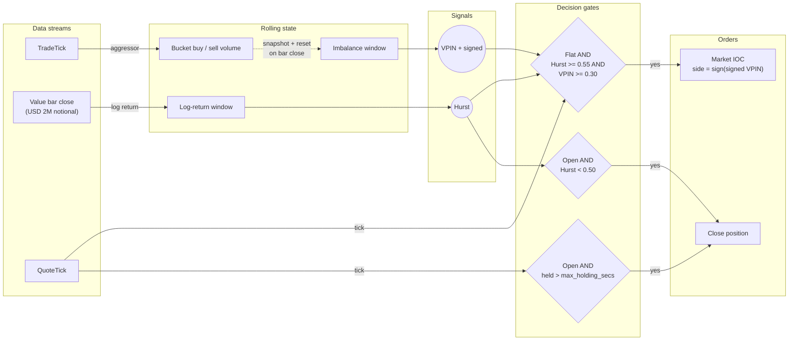
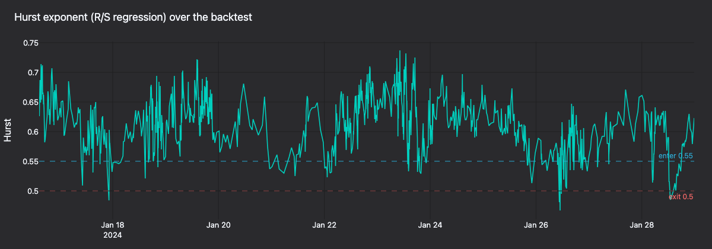

# Hurst/VPIN 方向性策略（Kraken Futures） {#hurstvpin-directional-strategy-kraken-futures}

:::note
本教程**仅用 Rust**，策略、回测设置和测试都来自编译后的核心库。
:::

本教程在 **PF_XBTUSD**——[Kraken Futures](https://futures.kraken.com) 上的 USD 保证金
比特币永续合约——上回测一个方向性策略。策略把 **Hurst 指数市场状态过滤**与 **VPIN**
（Volume-synchronized Probability of Informed Trading，成交量同步知情交易概率）流信号
结合。Rust `BacktestEngine` 回放来自 [Tardis.dev](https://tardis.dev) 的历史成交与报价。

## 简介 {#introduction}

策略把来自 K 线的慢速市场状态过滤与来自成交记录的快速知情流信号结合。只有两个信号
一致时，才由报价驱动入场。

- **Hurst 指数**：在固定名义额（value）K 线上采样，方法遵循 Lopez de Prado
  《Advances in Financial Machine Learning》第 2 章。重标极差（R/S）估计大于
  `0.55` 表示持续的趋势行为；小于 `0.50` 表示均值回归或噪声。

- **VPIN**：每根完成的美元 K 线是一个成交量桶。VPIN 是最近五十桶中主动买量与主动卖量
  绝对失衡的均值。带符号的失衡给出具名的知情方向。

- **报价驱动入场**：两个信号一致后，策略在下一个报价 tick 上开仓。入场时机始终
  挂钩实时最优报价，而不是 K 线收盘。

Hurst 估计回落跌破较低阈值，或达到持仓时长上限时，策略平仓。

策略以
[`HurstVpinDirectional`](https://github.com/nautechsystems/nautilus_trader/tree/develop/crates/trading/src/examples/strategies/hurst_vpin_directional)
的形式发布在 `nautilus_trading::examples::strategies` 模块中。与所有自带的示例
策略一样，它刻意保持简单，没有 alpha 优势。

### 为什么选 Kraken Futures {#why-kraken-futures}

Kraken Futures 以上市两种形式的比特币和以太币永续合约：

- **`PI_` 反向永续**：以 USD 报价，以标的币种保证金和结算。
- **`PF_` 线性永续**：以 USD 报价，以 USD 保证金和结算（通过多抵押品）。

教程使用 **`PF_XBTUSD`**，使账户货币、报价货币和美元 K 线采样框架都是 USD。

### 为什么美元 K 线与 VPIN 搭配 {#why-dollar-bars-and-vpin-together}

VPIN 定义在*成交量*桶上，而非*时间*桶。美元 K 线（NautilusTrader 的 `VALUE` 聚合）
在固定名义额成交后收盘，采样框架随市场活跃度自适应。每个 VPIN 桶就是一根美元 K 线，
Hurst 也用同一批 K 线。两个信号因此共用同一时钟与采样框架。

## 前置条件 {#prerequisites}

- 可用的 Rust 工具链（见 [rustup.rs](https://rustup.rs)）。
- 已克隆并能构建 NautilusTrader 仓库。
- 可访问互联网，下载免费的 Tardis 样本（每月第一天的数据无需 API key）。

## 数据准备 {#data-preparation}

Tardis 以历史 slug `cryptofacilities` 发布 Kraken Futures。每月第一天免费，无需 API
key。做单日环境检查这份样本够用。完整回测至少需要两个交易日才能填满 128 根的 Hurst
窗口，这些历史区间需要付费的 Tardis API key（见下方提示）。

```bash
mkdir -p /tmp/tardis_kraken

curl -L -o /tmp/tardis_kraken/PF_XBTUSD_trades.csv.gz \
  https://datasets.tardis.dev/v1/cryptofacilities/trades/2024-01-01/PF_XBTUSD.csv.gz

curl -L -o /tmp/tardis_kraken/PF_XBTUSD_quotes.csv.gz \
  https://datasets.tardis.dev/v1/cryptofacilities/quotes/2024-01-01/PF_XBTUSD.csv.gz
```

可直接运行的示例二进制默认从 `/tmp/tardis_kraken/` 读取。下载到该目录后，`cargo run`
无需修改示例的路径常量。

:::tip
完整的历史区间需要付费的 Tardis API key。超出单日的批量下载请使用
[Tardis 下载工具](https://docs.tardis.dev/downloadable-csv-files)。
:::

Rust 的 Tardis 加载器直接解析 `.csv.gz`，并把传入的金融工具 ID 赋给每条记录，策略
因此不需要代码映射：

```rust
use nautilus_model::identifiers::InstrumentId;
use nautilus_tardis::csv::load::{load_quotes, load_trades};

let instrument_id = InstrumentId::from("PF_XBTUSD.KRAKEN");
let trades = load_trades(
    "/tmp/tardis_kraken/PF_XBTUSD_trades.csv.gz",
    Some(1),               // price_precision
    Some(4),               // size_precision
    Some(instrument_id),
    None,                  // limit
)?;
let quotes = load_quotes(
    "/tmp/tardis_kraken/PF_XBTUSD_quotes.csv.gz",
    Some(1),
    Some(4),
    Some(instrument_id),
    None,
)?;
```

显式传入金融工具的 `price_precision` 和 `size_precision`。否则加载器从前几条记录
推断精度；若样本日没有小数价格，可能推断为 `0`。撮合引擎会拒绝精度与金融工具声明
不符的报价 tick。

## 金融工具定义 {#instrument-definition}

本教程直接加载 CSV 数据，不用实时的 Kraken 适配器，因此手工把 `PF_XBTUSD` 定义为
[`CryptoPerpetual`](https://github.com/nautechsystems/nautilus_trader/blob/develop/crates/model/src/instruments/crypto_perpetual.rs)。
Kraken Futures 的线性永续以 USD 报价并以 USD 计保证金：

```rust
use nautilus_model::{
    identifiers::{InstrumentId, Symbol},
    instruments::CryptoPerpetual,
    types::{Currency, Price, Quantity},
};
use rust_decimal_macros::dec;

let instrument = CryptoPerpetual::builder()
    .instrument_id(InstrumentId::from("PF_XBTUSD.KRAKEN"))
    .raw_symbol(Symbol::from("PF_XBTUSD"))
    .base_currency(Currency::BTC())       // base
    .quote_currency(Currency::USD())      // quote
    .settlement_currency(Currency::USD()) // settlement (linear)
    .is_inverse(false)
    .price_precision(1)
    .size_precision(4)
    .price_increment(Price::from("0.5"))
    .size_increment(Quantity::from("0.0001"))
    .margin_init(dec!(0.02))
    .margin_maint(dec!(0.01))
    .ts_event(0.into())
    .ts_init(0.into())
    .build()
    .unwrap();
```

保证金和费率是回测中显式设定的假设。本例使用 maker 0.02%、taker 0.05% 的
maker/taker 费用模型。当前费率请查阅
[Kraken Futures 费率表](https://futures.kraken.com/features/fee-schedule)。

## 美元 K 线采样 {#dollar-bar-sampling}

NautilusTrader 自带 AFML 第 2 章的全部信息驱动 K 线聚合器：tick、volume、value
（美元），以及各自的 imbalance 和 runs 变体。本教程使用普通的 `VALUE` K 线，在
成交带累计固定名义额后收盘。

K 线类型用字符串表达。`INTERNAL` 后缀让引擎在 NautilusTrader 内部从底层成交流
（价格类型 `LAST`）聚合：

```rust
use nautilus_model::data::BarType;

let bar_type = BarType::from("PF_XBTUSD.KRAKEN-2000000-VALUE-LAST-INTERNAL");
```

每成交 **2,000,000 USD** 名义额收盘一根 K 线。一个交易日通常产出不足 150 根，可能
凑不满 128 根的 Hurst 窗口，因此默认配置需要多个交易日预热。单日运行时把 K 线规模
降到 **500,000 USD**，或相应调小 `hurst_window` 和 `vpin_window`。完整的多日回测
用默认值。

:::note
`VALUE` K 线是成交带的*视图*。回测引擎消费的就是驱动 VPIN 的同一条流，
K 线不会导致重复计数。
:::

## 策略概览 {#strategy-overview}

`HurstVpinDirectional` 策略并行运行三条管道，在 K 线收盘处同步：

- 成交记录喂给桶累加器。
- K 线收盘触发新的信号计算。
- 报价驱动入场与超时检查。



- **每笔成交**：策略通过 `TradeTick::aggressor_side` 把主动买量与主动卖量累加进
  当前美元 K 线桶。
- **每根 K 线**（桶收盘）：策略把该 K 线的对数收益追加到 Hurst 窗口，计算该桶的
  带符号失衡与绝对失衡，然后重置累加器；重新估计滚动 Hurst 与 VPIN，清除
  `exit_cooldown`，并检查市场状态出场。
- **每条报价**：空仓策略要开出市价 IOC 订单，必须 Hurst 与 VPIN 两个信号一致：
  Hurst 达到 `hurst_enter`，VPIN 达到 `vpin_threshold`，且带符号失衡非零。
  已有持仓时则检查持仓时长上限。

市场状态出场发生在 K 线管道：Hurst 回落到低于 `hurst_exit`。持仓超时出场发生在
报价管道：持仓时间长于 `max_holding_secs`。


**图 1.** *2024-01-16 14:09-16:15 UTC 的信号面板：收盘价、Hurst、VPIN。标记位于
实际成交价，虚线连接显示相对 K 线收盘线的滑点。*

### Hurst 估计器 {#hurst-estimator}

策略使用经典重标极差（R/S）回归。对 `(4, 8, 16, 32)` 中的每个滞后 `k`，把收益窗口
切成长度为 `k` 的不重叠块，计算每块的重标极差并记录平均 R/S。在滞后集合上对
`log(R/S)` 与 `log(k)` 回归，斜率即 Hurst 估计。



**图 2.** *PF_XBTUSD 十四天（2024-01-15 至 2024-01-28）的滚动 Hurst，
入场 0.55、出场 0.50 阈值。*

### VPIN 估计器 {#vpin-estimator}

交易场所数据流带有明确的成交主动方向，VPIN 简化为

```text
VPIN = mean_k ( |V_B_k - V_S_k| / (V_B_k + V_S_k) )
```

在最近 `k` 个完成的美元 K 线桶上取均值。带符号变体保留 `V_B - V_S` 的符号，用于
选择方向。这比 Easley/Lopez de Prado 原始公式中的成交量批量分类更精确——那种分类
只在主动方向不可直接观测时才必要。


**图 3.** *全部 K 线上的 VPIN 分布，入场阈值 0.30。*

### 配置 {#configuration}

| 参数               | 取值             | 说明                                                              |
| ------------------ | ---------------- | ----------------------------------------------------------------- |
| `bar_type`         | `2M-VALUE-LAST`  | 每成交 2,000,000 USD 名义额收盘一根的美元 K 线。                  |
| `trade_size`       | `0.0100`         | 每次交易 0.0100 XBT（与金融工具精度一致）。                       |
| `hurst_window`     | `128`            | 美元 K 线对数收益的滚动窗口。                                     |
| `hurst_lags`       | `[4, 8, 16, 32]` | R/S 回归使用的滞后集合。                                          |
| `hurst_enter`      | `0.55`           | 判定趋势状态所需的最低 Hurst。                                    |
| `hurst_exit`       | `0.50`           | 低于此值时清空持仓。                                              |
| `vpin_window`      | `50`             | 计算 VPIN 取均值的已完成成交量桶数。                              |
| `vpin_threshold`   | `0.30`           | 认定成交流为知情流所需的最低 VPIN。                               |
| `max_holding_secs` | `1800`           | 持仓秒数上限（默认 `3600`，此处覆盖）。                           |

`hurst_window` 和 `vpin_window` 取值范围 `[1, 16_384]`。

:::tip
美元 K 线规模、Hurst 滞后和 VPIN 窗口三者互相耦合。更小的 K 线反应更快但 Hurst
噪声更大；更大的 K 线让两个信号都更平滑，但单日回测可能样本不足。
:::

## 回测设置 {#backtest-setup}

配置带 Kraken 交易场所和 USD 初始余额的 `BacktestEngine`：

```rust
use nautilus_backtest::{
    config::{BacktestEngineConfig, SimulatedVenueConfig},
    engine::BacktestEngine,
};
use nautilus_execution::models::fee::{FeeModelAny, MakerTakerFeeModel};
use nautilus_model::{
    data::Data,
    enums::{AccountType, BookType, OmsType},
    identifiers::Venue,
    instruments::{Instrument, InstrumentAny},
    types::Money,
};

let mut engine = BacktestEngine::new(BacktestEngineConfig::default())?;

engine.add_venue(
    SimulatedVenueConfig::builder()
        .venue(Venue::from("KRAKEN"))
        .oms_type(OmsType::Netting)
        .account_type(AccountType::Margin)
        .book_type(BookType::L1_MBP)
        .starting_balances(vec![Money::from("100_000 USD")])
        .fee_model(
            FeeModelAny::MakerTaker(MakerTakerFeeModel::new(dec!(0.0002), dec!(0.0005))).into(),
        )
        .build()?,
)?;

engine.add_instrument(&InstrumentAny::CryptoPerpetual(instrument))?;
```

把加载的成交与报价作为 `Data` 枚举变体输入：

```rust
let mut data: Vec<Data> = trades.into_iter().map(Data::Trade).collect();
data.extend(quotes.into_iter().map(Data::Quote));
engine.add_data(data, None, true, true)?;
```

### 添加策略 {#add-the-strategy}

```rust
use nautilus_model::types::Quantity;
use nautilus_trading::examples::strategies::{
    HurstVpinDirectional, HurstVpinDirectionalConfig,
};

let config = HurstVpinDirectionalConfig::builder()
    .instrument_id(instrument_id)
    .bar_type(bar_type)
    .trade_size(Quantity::from("0.0100")) // match instrument size_precision
    .max_holding_secs(1800)
    .build();

engine.add_strategy(HurstVpinDirectional::new(config))?;
```

### 运行回测 {#run-the-backtest}

```rust
engine.run(None, None, None, false)?;
```

用默认的 128/50 窗口和 2,000,000 USD 的 K 线，单日样本整段都在预热中。引擎聚合
美元 K 线，并用逐笔成交与报价驱动策略；窗口填满前 Hurst 和 VPIN 不会输出。要在
单日看到信号更新和出入场，按上文所述减小 K 线规模或窗口，或者提供两个以上交易日的
数据。

按这套配置跑 14 天（2024-01-15 至 2024-01-28），输出 1,224 根 K 线，只有 2 次入场、
1 次部分回补和 1 次平仓。入场稀疏是设计使然：Hurst 与 VPIN 必须在同一条报价上同时
达标。部分 IOC 回补后剩余的数量在剩余会话中保持挂敞口。Netting OMS 下，出场 IOC
只成交一部分仓位时会留下这份残余持仓。

上面的接线已作为可运行的二进制发布：

```bash
cargo run -p nautilus-kraken --features examples \
  --example kraken-hurst-vpin-backtest --release
```

默认从 `/tmp/tardis_kraken/` 读取 `PF_XBTUSD_trades.csv.gz` 和
`PF_XBTUSD_quotes.csv.gz`。要读其他文件，编辑
`crates/adapters/kraken/examples/engine_hurst_vpin_backtest.rs` 中的
`TRADES_PATH` 和 `QUOTES_PATH` 常量。


**图 4.** *2024-01-16 14:09-16:15 UTC 的收盘价。青色带标记 `Hurst >= 0.55` 的
K 线，金色带标记持仓时段。标记位于实际成交价；虚线连接显示相对 K 线收盘线的滑点。*


**图 5.** *回测中每根 K 线的 Hurst 对 VPIN 散点，按带符号 VPIN 着色。
阴影象限标记可入场区域。*

### 重新生成图表面板 {#regenerate-the-panels}

回测策略在每次 K 线收盘记录 `Hurst=… VPIN=… signed=… bar_close=…`，
并在出入场时记录标准的 `OrderFilled` 事件。凭这些日志，上面的面板可以从运行的
stdout 完整复现。

从源码构建 NautilusTrader 后，在仓库根目录运行：

```bash
make sync

RUST_LOG=info cargo run -p nautilus-kraken --features examples \
    --example kraken-hurst-vpin-backtest --release > /tmp/backtest.log 2>&1

BACKTEST_LOG=/tmp/backtest.log \
    uv run --project python --no-sync \
        python docs/tutorials/assets/hurst_vpin_kraken/render_panels.py
```

渲染器使用共享的 `nautilus_dark` tearsheet 主题，通过 Plotly 的 Kaleido 导出器
写出静态 PNG。

## 后续步骤 {#next-steps}

- **采样框架**：试试更大或更小的美元 K 线阈值。`VALUE_IMBALANCE` 和
  `VALUE_RUNS` 聚合器产生的 K 线在信息到达时收盘，是固定名义额采样的替代。
- **阈值**：`hurst_enter`、`hurst_exit` 与 `vpin_threshold` 相互影响：
  更高的入场阈值让信号更稀少但更精准；更紧的出场阈值缩短平均持仓时间。
- **波动率闸门**：在同一批 K 线上加一个实际波动率估计器，在明显混乱的时段
  抑制入场。
- **实时交易**：回测表现符合预期后，通过 Kraken 的实时客户端工厂驱动同一个
  策略。可运行的实时接线以 `kraken-hurst-vpin-live` 发布。

示例默认在 **Kraken Futures 生产环境用真实资金**交易：两个客户端都用默认的
`KrakenEnvironment::Live`，读取 `KRAKEN_FUTURES_API_KEY` 和
`KRAKEN_FUTURES_API_SECRET`。要改为在 [demo-futures.kraken.com](https://demo-futures.kraken.com)
模拟交易，先编辑 `crates/adapters/kraken/examples/node_hurst_vpin_live.rs`：

  1. 给 `KrakenCredential::resolve_futures` 的 `demo` 参数传 `true`。
  1. 给 `KrakenDataClientConfig` 和 `KrakenExecutionClientConfig` 都设置
     `environment: KrakenEnvironment::Demo`（来自 `nautilus_kraken::common::enums`）。

示例随后读取 `KRAKEN_FUTURES_DEMO_API_KEY` 和 `KRAKEN_FUTURES_DEMO_API_SECRET`。

  ```bash
  cargo run -p nautilus-kraken --features examples \
    --example kraken-hurst-vpin-live
  ```

## 延伸阅读 {#further-reading}

- [`HurstVpinDirectional` 策略源码](https://github.com/nautechsystems/nautilus_trader/tree/develop/crates/trading/src/examples/strategies/hurst_vpin_directional)
- [数据概念：K 线类型与聚合](./../concepts/data/index.md#bars-and-aggregation)
- [Tardis 集成指南](./../integrations/tardis.md)
- [Kraken 集成指南](./../integrations/kraken.md)
- [Kraken Futures 文档](https://docs.kraken.com/api/docs/futures-api)
- Lopez de Prado, M. (2018). *Advances in Financial Machine Learning*,
  Wiley。第 2 章（信息驱动 K 线）与第 19 章（VPIN）。
