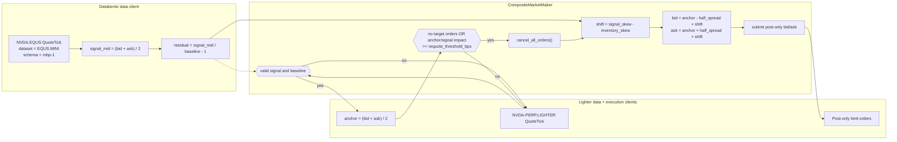
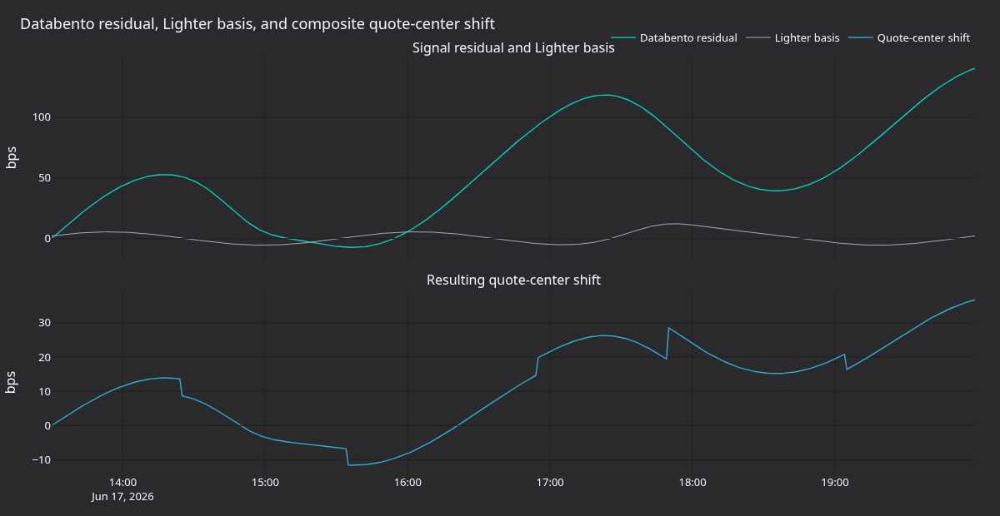
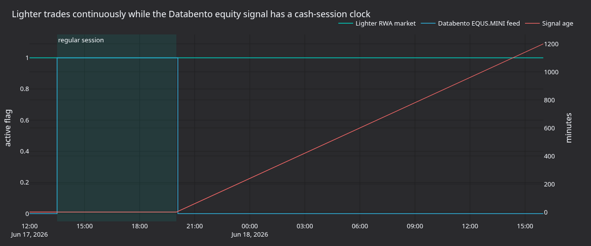

# Lighter RWA 组合做市（配合 Databento 美股 NVDA） {#composite-market-making-on-lighter-rwa-with-databento-us-equities-nvda}

本教程在 Lighter 的 `NVDA-PERP.LIGHTER` RWA 市场上运行自带的
[`CompositeMarketMaker`][composite-market-maker] 策略，用 Databento 的 `NVDA.EQUS`
报价作为外部信号。策略围绕 Lighter 中间价挂一笔 post-only 买单和一笔 post-only
卖单，并按归一化的 Databento 残差与当前 Lighter 库存移动两侧报价。

该方案使用 Rust 的 [`LiveNode`][live-node] 和原生 Rust
`CompositeMarketMaker` 策略。刚接触 Lighter 适配器的话，先完成
[Lighter 入门][lighter-get-started]。那份指南分别讲解 Rust 与 Python 的数据客户端
路径。本教程在其基础上加入 Databento 信号数据与实时订单流。

## 简介 {#introduction}

Lighter 上架持续交易的真实世界资产（RWA）永续合约，含单只股票的市场。当前交易场所
细节见 Lighter 的 [RWA 文档]与[市场规格]。Databento 的
[US Equities][Databento US Equities]数据集提供 `NVDA` 的美股最优报价数据，
经 Nautilus Databento 适配器可用 `mbp-1`。

`CompositeMarketMaker` 是一个小型双输入做市商：

- **目标金融工具**是要报价的 Lighter 市场：`NVDA-PERP.LIGHTER`。
- **信号金融工具**是 Databento 参考数据流：`NVDA.EQUS`。
- **锚点**是 Lighter 中间价。
- **信号残差**是 `(databento_mid / baseline) - 1.0`。
- **报价平移量**是 `signal_skew_factor * residual - inventory_skew_factor * net_position`。

未配置基线时，策略用第一条有效的 `NVDA.EQUS` 中间价作为参考价。残差从零起算，
衡量的是 NVDA 相对首个信号中间价的移动，而不是 Lighter/Databento 基差。要确定性
运行，把示例源码中的 `SIGNAL_BASELINE` 常量设为固定参考价。

在这套配置中，Lighter BBO 始终是价差锚点。Databento 通过归一化残差上下移动报价
中心。



本教程展示同一个引擎如何连接直连的美股数据流与加密原生的 RWA 交易场所。订单
生命周期、库存与报价状态都留在同一个事件驱动运行时内。

## 前置条件 {#prerequisites}

- Rust 工具链（MSRV 1.99.0 或更新）。
- 一个 Cargo 项目，把 Nautilus、Lighter、Databento 的 crate 作为依赖（见
  [项目设置](#project-setup)）。
- Python 3.13+，用于重新生成渲染面板。
- 一个 Databento API key，需有 Databento US Equities Mini（`EQUS.MINI`）的实时
  访问权限，这是自带 `NVDA.EQUS` 路由的默认数据集。`EQUS.PLUS` 等更高等级需要
  单独的 Databento 许可。账户有该权限时，用 `venue_dataset_map` 选择等级。
- 所配置环境（默认 testnet）的 Lighter API 凭据（数字账户索引、API key 索引和
  API secret），仅在需要连接和提交订单时必需。
- Lighter 集成指南：[Lighter](./../integrations/lighter.md)。
- Databento 集成指南：[Databento](./../integrations/databento.md)。

示例从环境变量读取凭据，策略参数保留为可编辑的 Rust 常量。默认
`LighterEnvironment::Testnet`，因此按
[账户与 API key 设置](./../integrations/lighter.md#account-and-api-key-setup)
设置 testnet 的 Lighter 凭据：

```bash
export DATABENTO_API_KEY="your-databento-api-key"
export LIGHTER_TESTNET_ACCOUNT_INDEX="123456"
export LIGHTER_TESTNET_API_KEY_INDEX="4"
export LIGHTER_TESTNET_API_SECRET="your-lighter-api-secret"
```

主网运行需把源码中的 `LIGHTER_ENVIRONMENT` 改为
`LighterEnvironment::Mainnet`，并使用集成指南中描述的主网 `LIGHTER_*` 凭据变量。
运行示例前先设置 `DATABENTO_API_KEY`。

## 项目设置 {#project-setup}

策略、节点与适配器都以 crate 形式发布，你自己的 Cargo 项目可以直接使用，不需要
在 NautilusTrader 检出目录内工作。在你的 `Cargo.toml` 中加入下列内容。所有
Nautilus 依赖指向同一个 `develop` git 源，保证各 crate 解析到一致版本：

```toml
[dependencies]
nautilus-common = { git = "https://github.com/nautechsystems/nautilus_trader.git", branch = "develop", features = ["live"] }
nautilus-core = { git = "https://github.com/nautechsystems/nautilus_trader.git", branch = "develop" }
nautilus-databento = { git = "https://github.com/nautechsystems/nautilus_trader.git", branch = "develop", features = ["high-precision", "live"] }
nautilus-lighter = { git = "https://github.com/nautechsystems/nautilus_trader.git", branch = "develop", features = ["examples", "high-precision"] }
nautilus-live = { git = "https://github.com/nautechsystems/nautilus_trader.git", branch = "develop", features = ["node"] }
nautilus-model = { git = "https://github.com/nautechsystems/nautilus_trader.git", branch = "develop", features = ["high-precision"] }
nautilus-trading = { git = "https://github.com/nautechsystems/nautilus_trader.git", branch = "develop", features = ["examples", "high-precision"] }

tokio = { version = "1", features = ["full"] }
```

`nautilus-trading` 的 `examples` feature 暴露 `CompositeMarketMaker` 策略，
Lighter 的加密原生定价需要 `high-precision`。crate 总体布局、feature 标志以及
git 源的 crates.io 替代方案，见 Rust [项目设置指南][project-setup]。

Databento 客户端还需要一个把交易场所映射到数据集的 publishers 文件。自己的项目
要从 Databento 适配器 crate 下载 [`publishers.json`][databento-publishers]，
并把 `publishers_filepath` 指向本地副本。自带示例按检出目录的相对路径解析同一
文件，所以只有自己的项目需要这一步。

## 为什么选 NVDA {#why-nvda}

`NVDA` 是流动性好的纳斯达克上市个股，Lighter 把它的 RWA 永续映射为
`NVDA-PERP.LIGHTER`。这样把有授权的 Databento 信号与 Lighter 的交易市场配对：

| 角色         | 金融工具 ID           | 来源      | 说明                                  |
| ------------ | --------------------- | --------- | ------------------------------------- |
| 信号工具     | `NVDA.EQUS`           | Databento | EQUS.MINI 最优报价更新。              |
| 目标工具     | `NVDA-PERP.LIGHTER`   | Lighter   | 经 Lighter 交易的 RWA 永续合约。      |

默认情况下，订阅 `NVDA.EQUS` 会向 Databento 的 `EQUS.MINI` 数据集请求 `NVDA` 的
最优报价（`mbp-1`）。适配器把这些报价作为单条 `QuoteTick` 流交付。`EQUS.MINI` 是
成本最低的合并美股等级。`EQUS.PLUS` 等更丰富的等级需要单独的 Databento 许可；账户
有该权限时，用客户端的 `venue_dataset_map` 选择等级（例如
`{"EQUS": "EQUS.PLUS"}`）。

适配器从 publishers 文件解析 `EQUS` 交易场所。示例把 `DatabentoDataClientConfig`
指向 Databento 适配器自带的 `publishers.json`。映射规则见
[金融工具 ID 与代码体系][databento-symbology]。

一些老账户和历史示例中出现的是旧的 Databento Equities Basic（`DBEQ.BASIC`）数据集
名。新的 Databento 订阅使用 Databento US Equities 产品线，因此本教程使用合并后的
`EQUS` 交易场所。在本教程的接线中，把最优报价流当作有授权的信号代理，而不是完整
深度的 Nasdaq TotalView 订单簿。

示例从 `trade_size=0.05` 起步，与教程验证时观察到的 Lighter NVDA 最小基础数量一致。
加大规模或更换金融工具前，先查看所配置环境的市场详情端点：

- [Testnet][testnet market details]，示例默认。
- [Mainnet][market details endpoint]。

## 时段约束 {#session-constraint}

Lighter RWA 市场持续交易，而 `NVDA.EQUS` 遵循美股行情数据的交易时段。首次实时
测试应在常规现货时段（[13:30, 20:00] UTC，美国夏令时）内运行，节假日和半日市需
特别处理。

`CompositeMarketMaker` 没有内置时段闸门或信号时效守卫。生产使用时，加一个 actor
或策略变体，在 Databento 信号过期时撤销报价。教程使用自带的策略，这一运行约束
需要显式处理。

## 示例节点 {#example-node}

示例有两种运行方式：

- 在 NautilusTrader 检出目录中，使用自带的
  [Lighter NVDA 组合做市二进制][example-script]。
- 在自己的项目中，把下面的节点设置复制进 `main`，配合
  [项目设置](#project-setup)中的 crate。

Python 示例 [`examples/live/lighter/nvda_composite_mm.py`][python-example-script]
通过 PyO3 使用同一个 Rust 策略。

在检出目录中设置好凭据变量后，自带的二进制连接数据与执行客户端。默认为
`DRY_RUN = false`，即添加会提交订单的策略。

:::warning
该命令可能提交实盘订单。先在有资金的 testnet 账户、或为亏损做好尺寸控制的主网
账户上，用最小的可接受规模起步。运行前确认当前金融工具 ID、账户 ID、数字账户
索引和 Lighter 凭据。
:::

```bash
cargo run --bin lighter-nvda-composite-mm --package nautilus-tutorials --features examples
```

Databento 是没有固定场所路由的多场所数据客户端，引擎把它用作 `NVDA.EQUS` 的默认
路由。Lighter 以 `LIGHTER` 场所路由注册，接收 `NVDA-PERP.LIGHTER` 的订阅。

这套设置把三客户端节点与 `CompositeMarketMaker` 组合起来。下面的节选有省略，
未包含这些内容及其他一些行：

- 源码常量。
- `publishers_filepath`、`max_position` 和 `trade_size` 的定义。
- 最后的 `node.run().await?` 调用。

完整的 `main` 见[示例源码][example-script]：

```rust
use nautilus_live::node::config::LiveExecutionEngineConfig;

let lighter_environment = LIGHTER_ENVIRONMENT;
let trader_id = TraderId::from(TRADER_ID);
let account_id = AccountId::from(ACCOUNT_ID);
let instrument_id = InstrumentId::from(INSTRUMENT_ID);
let signal_instrument_id = InstrumentId::from(SIGNAL_INSTRUMENT_ID);

let api_key = get_env_var("DATABENTO_API_KEY")?;
let databento_config =
    DatabentoDataClientConfig::new(api_key, publishers_filepath, true, true);
let lighter_data_config = LighterDataClientConfig::builder()
    .environment(lighter_environment)
    .build();
let lighter_exec_config = LighterExecutionClientConfig::builder()
    .account_id(account_id)
    .environment(lighter_environment)
    .build();

let mut strategy_config = CompositeMarketMakerConfig::builder()
    .instrument_id(instrument_id)
    .signal_instrument_id(signal_instrument_id)
    .max_position(max_position)
    .trade_size(trade_size)
    .half_spread_bps(HALF_SPREAD_BPS)
    .inventory_skew_factor(INVENTORY_SKEW_FACTOR)
    .signal_skew_factor(SIGNAL_SKEW_FACTOR)
    .requote_threshold_bps(REQUOTE_THRESHOLD_BPS)
    .on_cancel_resubmit(ON_CANCEL_RESUBMIT)
    .build();
strategy_config.base.strategy_id = Some(StrategyId::from("NVDA_COMPOSITE_MM-001"));
strategy_config.base.order_id_tag = Some("001".to_string());

let mut node = LiveNode::builder(trader_id, Environment::Live)?
    .with_name("LIGHTER-NVDA-COMPOSITE-MM-001".to_string())
    .with_exec_engine_config(LiveExecutionEngineConfig {
        reconciliation_lookback_mins: Some(60),
        reconciliation_instrument_ids: Some(vec![instrument_id.to_string()]),
        ..Default::default()
    })
    .with_reconciliation(!DRY_RUN)
    .with_delay_post_stop_secs(5)
    .add_data_client(
        None,
        Box::new(DatabentoDataClientFactory::new()),
        Box::new(databento_config),
    )?
    .add_data_client(
        None,
        Box::new(LighterDataClientFactory::new()),
        Box::new(lighter_data_config),
    )?
    .add_exec_client(
        None,
        Box::new(LighterExecutionClientFactory::new()),
        Box::new(lighter_exec_config),
    )?
    .build()?;

if !DRY_RUN {
    node.add_strategy(CompositeMarketMaker::new(strategy_config))?;
}
```

要只连接而不添加会提交订单的策略，编辑示例源码顶部的常量：

```rust
const DRY_RUN: bool = true;
```

然后运行同一条命令：

```bash
cargo run --bin lighter-nvda-composite-mm --package nautilus-tutorials --features examples
```

testnet 冒烟运行时，`LIGHTER_ENVIRONMENT` 保持
`LighterEnvironment::Testnet`，使用 `LIGHTER_TESTNET_*` 凭据变量。若运行时间在
Databento 美股现货时段之外，仍可验证节点启动、路由与 Lighter 数据。策略会等
有效的 `NVDA.EQUS` 报价才提交首批订单，因此验证订单生命周期需要 Databento 信号。

启用对账时，两个示例都只对账配置的 Lighter 目标金融工具，回看 60 分钟，跳过账户
上其他 Lighter 市场的报告。停止时，策略撤销自己的目标订单，并用 reduce-only 市价
单平掉自己的目标持仓。

开始时让账户上的目标仓位为零。Lighter 会把一个市场里的全部敞口净额合并，而策略
只对属于自己的仓位设上限并平仓。关闭后确认运行期间没有遗留的订单或持仓——撤单待
处理期间仍可能有成交到达。

## 策略参数 {#strategy-parameters}

| 参数                    | 取值                | 说明                                                           |
| ----------------------- | ------------------- | -------------------------------------------------------------- |
| `instrument_id`         | `NVDA-PERP.LIGHTER` | 要报价的 Lighter RWA 永续。                                    |
| `signal_instrument_id`  | `NVDA.EQUS`         | Databento US Equities Mini 信号流。                            |
| `trade_size`            | `0.05`              | 每笔买单或卖单的规模。                                         |
| `max_position`          | `0.20`              | 策略目标敞口的硬上限。                                         |
| `half_spread_bps`       | `25`                | 围绕 Lighter 锚点的半价差。                                    |
| `inventory_skew_factor` | `2.0`               | 每单位净持仓对应的价格单位。                                   |
| `signal_skew_factor`    | `55.0`              | 每单位归一化 Databento 残差对应的价格单位。                    |
| `signal_baseline`       | 首个有效中间价      | Databento 残差的可选参考价。                                   |
| `requote_threshold_bps` | `5`                 | 触发撤单与重报价的锚点或信号影响移动（bps）。                  |

Lighter 中间价 `207.00`、`half_spread_bps=25` 时，未偏移的半价差为 `0.5175`
USD。若 Databento 高出基线 30 bps，`signal_skew_factor` 为 `55.0` 会在库存偏移
之前把两侧上移 `0.165` USD。持有 `0.05` 多头、`inventory_skew_factor=2.0` 时，
两侧下移 `0.10` USD。

## 重报价行为 {#requote-behavior}

信号 tick 只更新内部状态，本身不提交订单。`signal_skew_factor` 非零时，目标 tick
要等这两个条件都满足：

- 信号报价的买卖价均为正且未交叉。
- 基线为有限正数。

未设置 `signal_baseline` 时，第一条有效信号中间价提供基线。显式基线保持不变，但仍
需要有效信号报价。基线无效则不报价。`signal_skew_factor=0` 时，策略无需信号或
基线即可报价。

就绪之后，下一条 Lighter 报价 tick 读取最新信号残差并检查报价状态。满足以下任一
条件就执行一轮报价：

- 没有未结或在途的目标订单。
- Lighter 锚点移动至少 `requote_threshold_bps`。
- 信号残差变化的价格影响达到同一阈值。

随后策略执行这些动作：

1. 撤销未结订单。
1. 从缓存读取当前净持仓与待处理敞口。
1. 计算一笔买价和一笔卖价。
1. 去掉超过 `max_position` 的一侧。
1. 把剩下的侧以 post-only 限价单提交。

## 面板图 {#panels}

下面的面板使用确定性重放数据，展示报价机制与现货时段约束，不是真实捕获的 Lighter
实盘成交轨迹。


**图 1.** *Databento `NVDA.EQUS` 中间价、Lighter `NVDA-PERP.LIGHTER` 中间价、
组合买价、组合卖价与报价中心。*



**图 2.** *Databento 残差、Lighter 基差与报价中心平移量（bps）。*


**图 3.** *净持仓、信号平移、库存调整与总平移，交易规模 `0.05` NVDA、仓位上限
`0.20` NVDA。*



**图 4.** *Lighter 的 RWA 连续市场时钟对照 Databento 美股现货时段的信号，以及
常规时段结束后的信号时效。*

## 重新生成图表面板 {#regenerate-the-panels}

从源码构建 NautilusTrader 后，在仓库根目录运行：

```bash
make sync
uv run --project python --no-sync \
    python docs/tutorials/assets/lighter_rwa_composite_mm/render_panels.py
```

渲染器把四张 PNG 写到
`docs/tutorials/assets/lighter_rwa_composite_mm/`。它使用 `nautilus_dark`
Plotly 主题和确定性重放数据，使文档构建不依赖数据供应商许可或交易所实时访问。

## 扩展方向 {#extensions}

信号时效闸门可以把 Databento 信号变成显式的运行依赖。例如：现货时段内最新
`NVDA.EQUS` 报价超过 30 秒时撤销全部 Lighter 订单；现货时段收盘后立即撤销。

要做纯公允价值策略，沿用本教程的客户端设置，写一个小变体直接把买卖价锚定在
Databento 中间价上，只在检查 post-only 与基差限制时看 Lighter BBO。

[composite-market-maker]: https://github.com/nautechsystems/nautilus_trader/blob/develop/crates/trading/src/examples/strategies/composite_market_maker/strategy.rs
[live-node]: https://github.com/nautechsystems/nautilus_trader/blob/develop/docs/how_to/run_rust_live_trading.md
[project-setup]: https://github.com/nautechsystems/nautilus_trader/blob/develop/docs/concepts/rust.md#project-setup
[lighter-get-started]: https://github.com/nautechsystems/nautilus_trader/blob/develop/docs/how_to/get_started_lighter.md
[databento-symbology]: https://github.com/nautechsystems/nautilus_trader/blob/develop/docs/integrations/databento.md#instrument-ids-and-symbology
[databento-publishers]: https://github.com/nautechsystems/nautilus_trader/blob/develop/crates/adapters/databento/publishers.json
[RWA docs]: https://docs.lighter.xyz/trading/real-world-assets-rwas
[market specifications]: https://docs.lighter.xyz/trading/real-world-assets-rwas/market-specifications
[market details endpoint]: https://mainnet.zklighter.elliot.ai/api/v1/orderBookDetails
[testnet market details]: https://testnet.zklighter.elliot.ai/api/v1/orderBookDetails
[Databento US Equities]: https://databento.com/blog/introducing-databento-us-equities
[example-script]: https://github.com/nautechsystems/nautilus_trader/blob/develop/examples/tutorials/src/bin/lighter_nvda_composite_mm.rs
[python-example-script]: https://github.com/nautechsystems/nautilus_trader/blob/develop/examples/live/lighter/nvda_composite_mm.py
