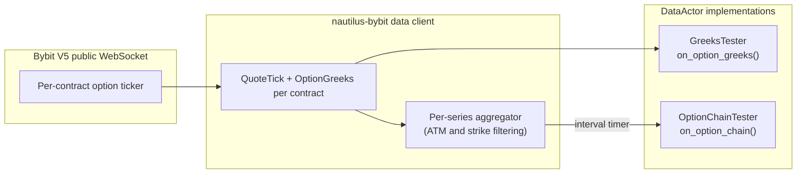
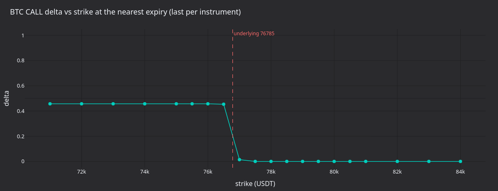
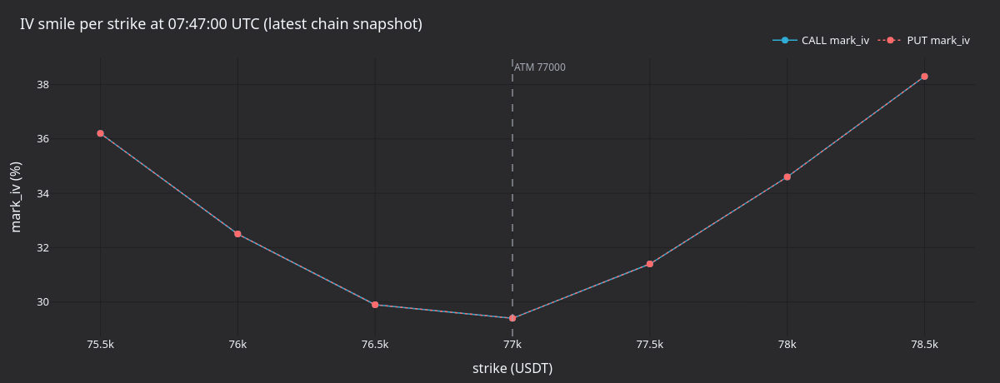
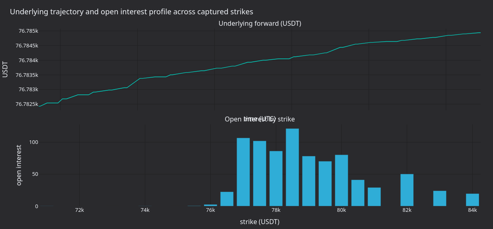

# 期权数据与 Greeks（Bybit） {#options-data-and-greeks-bybit}

:::note
本教程**仅用 Rust**，通过 Rust `LiveNode` 配合 Bybit 适配器流式获取实时期权
Greeks 与聚合的期权链快照。
:::

本教程连接 Bybit 的实时期权市场，通过两个 `DataActor` 示例消费 Greeks 与期权链
数据，覆盖金融工具发现、交易场所提供的 Greeks 订阅，以及带 ATM 相对行权价过滤的
周期性期权链快照。

## 简介 {#introduction}

Bybit 在每条期权行情更新中同时发布 Greeks（delta、gamma、vega、theta）与隐含
波动率。NautilusTrader 以两个层级暴露这些数据：

- **逐工具 Greeks**：订阅单个期权合约，每次行情更新收到一个 `OptionGreeks` 事件。
- **期权链快照**：订阅整个到期日序列，周期性收到
  `OptionChainSlice` 事件，聚合序列内全部活跃行权价的报价与 Greeks。

两个示例二进制分别展示这两种模式：第一个订阅单个合约的 Greeks 数据流；第二个订阅
带 ATM 相对行权价过滤的聚合期权链。



## 前置条件 {#prerequisites}

- 可用的 Rust 工具链（[rustup.rs](https://rustup.rs)）。
- 已克隆并能构建 NautilusTrader 仓库。

示例不需要 Bybit API key：`api_key` 与 `api_secret` 留空，数据客户端使用 Bybit
的公共行情端点，不从环境读取凭据。

:::warning
Bybit 的 demo 交易只在私有数据流上使用 `stream-demo.bybit.com`。
公共期权行情使用主网公共流 `wss://stream.bybit.com/v5/public/option`。
:::

## DataActor 模式 {#the-dataactor-pattern}

Rust 的 `DataActor` 需要三部分：

1. 一个含 `core: DataActorCore` 字段和自有状态的 struct。
1. `nautilus_actor!(YourType)` 宏加一个 `Debug` 实现。
1. 带回调的 `DataActor` trait 实现。

宏提供 blanket `Actor` 与 `Component` 实现所需的原生运行时连接，你只需实现
用到的回调。每个回调都有默认的 no-op 实现。

## 第一部分：逐工具 Greeks {#part-1-per-instrument-greeks}

`bybit-greeks-tester` 示例为最近到期日的所有 BTC CALL 期权订阅 `OptionGreeks`，
并记录每条更新。

### Actor 结构 {#actor-structure}

```rust
#[derive(Debug)]
struct GreeksTester {
    core: DataActorCore,
    client_id: ClientId,
    subscribed_instruments: Vec<InstrumentId>,
}

nautilus_actor!(GreeksTester);

impl GreeksTester {
    fn new(client_id: ClientId) -> Self {
        Self {
            core: DataActorCore::new(DataActorConfig {
                actor_id: Some("GREEKS_TESTER-001".into()),
                ..Default::default()
            }),
            client_id,
            subscribed_instruments: Vec::new(),
        }
    }
}
```

宏要求 `core` 字段。`client_id` 标识订阅所用的数据客户端。
`subscribed_instruments` 向量记录订阅列表，actor 停止时据此退订。

### 发现金融工具 {#discovering-instruments}

启动时，actor 从缓存查询所有期权金融工具，过滤出未到期的 BTC CALL，并找到最近
到期日：

```rust
fn on_start(&mut self) -> anyhow::Result<()> {
    let venue = Venue::new("BYBIT");
    let underlying_filter = Ustr::from("BTC");

    let mut options: Vec<(InstrumentId, f64, u64)> = {
        let cache = self.cache();
        let instruments = cache.instruments(&venue, Some(&underlying_filter));

        instruments
            .iter()
            .filter_map(|inst| {
                if inst.option_kind() == Some(OptionKind::Call) {
                    let expiry = inst.expiration_ns()?.as_u64();
                    let strike = inst.strike_price()?.as_f64();
                    Some((inst.id(), strike, expiry))
                } else {
                    None
                }
            })
            .collect()
    }; // cache borrow dropped here

    let now_ns = self.timestamp_ns().as_u64();
    options.retain(|(_, _, exp)| *exp > now_ns);

    let nearest_expiry = options.iter().map(|(_, _, exp)| *exp).min().unwrap();
    options.retain(|(_, _, exp)| *exp == nearest_expiry);
    options.sort_by(|(_, a, _), (_, b, _)| a.partial_cmp(b).unwrap());

    // ...subscribe to each
}
```

:::warning
调用任何订阅方法前先释放缓存借用。缓存内部使用 `Rc<RefCell<...>>`，
订阅方法可能需要借用它。把拥有的数据收集到本地 `Vec`，释放缓存引用，
然后再订阅。
:::

### 订阅 Greeks {#subscribing-to-greeks}

发现金融工具后逐一订阅：

```rust
let client_id = self.client_id;
for (instrument_id, _, _) in &options {
    self.subscribe_option_greeks(*instrument_id, Some(client_id), None);
    self.subscribed_instruments.push(*instrument_id);
}
```

### 处理更新 {#handling-updates}

Bybit 的每条行情更新都会以 `OptionGreeks` 事件触发 `on_option_greeks`：

```rust
fn on_option_greeks(&mut self, greeks: &OptionGreeks) -> anyhow::Result<()> {
    log::info!(
        "GREEKS | {} | delta={:.4} gamma={:.6} vega={:.4} theta={:.4} rho={:.6} | \
         mark_iv={} bid_iv={} ask_iv={} | underlying={} oi={}",
        greeks.instrument_id,
        greeks.delta,
        greeks.gamma,
        greeks.vega,
        greeks.theta,
        greeks.rho,
        greeks.mark_iv.map_or("-".to_string(), |v| format!("{v:.2}")),
        greeks.bid_iv.map_or("-".to_string(), |v| format!("{v:.2}")),
        greeks.ask_iv.map_or("-".to_string(), |v| format!("{v:.2}")),
        greeks.underlying_price.map_or("-".to_string(), |v| format!("{v:.2}")),
        greeks.open_interest.map_or("-".to_string(), |v| format!("{v:.1}")),
    );
    Ok(())
}
```

`OptionGreeks` 的字段：

| 字段               | 类型               | 说明                                                            |
| ------------------ | ------------------ | --------------------------------------------------------------- |
| `instrument_id`    | `InstrumentId`     | 期权合约。                                                      |
| `convention`       | `GreeksConvention` | Greeks 约定（`BlackScholes` 或 `PriceAdjusted`）。              |
| `delta`            | `f64`              | 价格对标的的敏感度。                                            |
| `gamma`            | `f64`              | delta 对标的的敏感度。                                          |
| `vega`             | `f64`              | 价格对波动率变化 1% 的敏感度。                                  |
| `theta`            | `f64`              | 每日时间衰减。                                                  |
| `rho`              | `f64`              | 对利率变化的敏感度。                                            |
| `mark_iv`          | `Option<f64>`      | 标记价格的隐含波动率。                                          |
| `bid_iv`           | `Option<f64>`      | 买价隐含波动率。                                                |
| `ask_iv`           | `Option<f64>`      | 卖价隐含波动率。                                                |
| `underlying_price` | `Option<f64>`      | 交易场所给出的该到期日参考价。                                  |
| `open_interest`    | `Option<f64>`      | 该合约的未平仓合约数。                                          |
| `ts_event`         | `UnixNanos`        | 事件发生时刻的 UNIX 时间戳（纳秒）。                            |
| `ts_init`          | `UnixNanos`        | 实例初始化时刻的 UNIX 时间戳（纳秒）。                          |

`delta`、`gamma`、`vega`、`theta`、`rho` 存放在嵌套的 `greeks: OptionGreekValues`
结构体中。`OptionGreeks` 实现了 `Deref<Target = OptionGreekValues>`，因此可以像
上面那样通过 `greeks.delta` 等字段直接访问。

Bybit 不提供 rho，适配器把它置为 `0.0`。

### 清理 {#cleanup}

停止时退订全部金融工具：

```rust
fn on_stop(&mut self) -> anyhow::Result<()> {
    let ids: Vec<InstrumentId> = self.subscribed_instruments.drain(..).collect();
    let client_id = self.client_id;
    for instrument_id in ids {
        self.unsubscribe_option_greeks(instrument_id, Some(client_id), None);
    }
    log::info!("Unsubscribed from all option greeks");
    Ok(())
}
```

## 第二部分：期权链快照 {#part-2-option-chain-snapshots}

`bybit-option-chain` 示例订阅聚合期权链，周期性记录快照，展示每个行权价的 call 与
put 及其报价和 Greeks。

### 为什么用期权链 {#why-use-option-chains}

逐工具订阅便于控制单个合约，但要看整条曲面就得管理一条条独立数据流，还要跨行权价
关联更新。期权链订阅通过 `DataEngine` 完成这件事：聚合序列中所有行权价的报价与
Greeks，按定时器发布单个 `OptionChainSlice`。

这一聚合发生在 NautilusTrader 内部。Bybit 按合约发布期权行情，其 V5 公共
WebSocket 文档没有定义原生的期权链数据流。

### 期权链类型 {#chain-types}

**`OptionSeriesId`** 标识单个到期日序列：

```rust
let series_id = OptionSeriesId::new_derived(
    Venue::new("BYBIT"),    // venue
    Ustr::from("BTC"),      // underlying
    Ustr::from("USDT"),     // settlement currency
    UnixNanos::from(expiry), // expiration timestamp
);
```

**`StrikeRange`** 控制哪些行权价处于激活状态：

| 变体          | 说明                                                                      |
| ------------- | ------------------------------------------------------------------------- |
| `Fixed`       | 固定的行权价集合。                                                        |
| `AtmRelative` | ATM 上方 `strikes_above` 个、下方 `strikes_below` 个行权价。              |
| `AtmPercent`  | ATM 价格 `pct` 范围内的全部行权价。                                       |
| `Delta`       | call 或 put 绝对 delta 与 `target` 之差在 `tolerance` 内的行权价。        |

动态行权价范围会等引擎从交易场所参考价确定 ATM 价格后才生效。

### 订阅 {#subscribing}

```rust
let strike_range = StrikeRange::AtmRelative {
    strikes_above: 3,
    strikes_below: 3,
};

let snapshot_interval_ms = Some(5_000); // snapshot every 5 seconds

self.subscribe_option_chain(
    series_id,
    strike_range,
    snapshot_interval_ms,
    Some(client_id),
    None, // params
);
```

原始模式下 `snapshot_interval_ms` 传 `None`：每条报价或 Greeks 更新都立即发布
一个切片。

### 处理快照 {#handling-snapshots}

`on_option_chain` 回调收到 `OptionChainSlice`，包含全部活跃行权价及其 call 和
put 数据：

```rust
fn on_option_chain(&mut self, slice: &OptionChainSlice) -> anyhow::Result<()> {
    log::info!(
        "OPTION_CHAIN | {} | atm={} | calls={} puts={} | strikes={}",
        slice.series_id,
        slice.atm_strike.map_or("-".to_string(), |p| format!("{p}")),
        slice.call_count(),
        slice.put_count(),
        slice.strike_count(),
    );

    for strike in slice.strikes() {
        let call_info = slice.get_call(&strike).map(|d| {
            let greeks_str = d.greeks.as_ref().map_or("-".to_string(), |g| {
                format!(
                    "d={:.3} g={:.5} v={:.2} iv={:.1}%",
                    g.delta, g.gamma, g.vega,
                    g.mark_iv.unwrap_or(0.0) * 100.0,
                )
            });
            format!("bid={} ask={} [{}]", d.quote.bid_price, d.quote.ask_price, greeks_str)
        });

        let put_info = slice.get_put(&strike).map(|d| {
            let greeks_str = d.greeks.as_ref().map_or("-".to_string(), |g| {
                format!(
                    "d={:.3} g={:.5} v={:.2} iv={:.1}%",
                    g.delta, g.gamma, g.vega,
                    g.mark_iv.unwrap_or(0.0) * 100.0,
                )
            });
            format!("bid={} ask={} [{}]", d.quote.bid_price, d.quote.ask_price, greeks_str)
        });

        log::info!(
            "  K={} | CALL: {} | PUT: {}",
            strike,
            call_info.unwrap_or_else(|| "-".to_string()),
            put_info.unwrap_or_else(|| "-".to_string()),
        );
    }

    Ok(())
}
```

`OptionChainSlice` 的字段与方法：

| 名称             | 类型 / 返回                 | 说明                                   |
| ---------------- | --------------------------- | -------------------------------------- |
| `series_id`      | `OptionSeriesId`            | 该快照覆盖的序列。                     |
| `atm_strike`     | `Option<Price>`             | 由参考价确定的 ATM 行权价。            |
| `call_count()`   | `usize`                     | 有数据的 call 行权价数量。             |
| `put_count()`    | `usize`                     | 有数据的 put 行权价数量。              |
| `strike_count()` | `usize`                     | 全部行权价的并集数量。                 |
| `strikes()`      | `Vec<Price>`                | 全部行权价的有序列表。                 |
| `get_call(k)`    | `Option<&OptionStrikeData>` | 行权价 `k` 的 call 报价与 Greeks。     |
| `get_put(k)`     | `Option<&OptionStrikeData>` | 行权价 `k` 的 put 报价与 Greeks。      |

每个 `OptionStrikeData` 含一个 `quote: QuoteTick`（买卖价）和可选的
`greeks: Option<OptionGreeks>`。

## 节点设置 {#node-setup}

两个示例使用相同的 `LiveNode` 模式。只用数据时不需要执行客户端：

```rust
#[tokio::main]
async fn main() -> Result<(), Box<dyn std::error::Error>> {
    dotenvy::dotenv().ok();

    let environment = Environment::Live;
    let trader_id = TraderId::from("TESTER-001");
    let client_id = ClientId::new("BYBIT");

    let bybit_config = BybitDataClientConfig {
        api_key: None,    // public market data needs no credentials
        api_secret: None,
        product_types: vec![BybitProductType::Option],
        ..Default::default()
    };

    let client_factory = BybitDataClientFactory::new();

    let mut node = LiveNode::builder(trader_id, environment)?
        .with_name("BYBIT-OPTIONS-001".to_string())
        .add_data_client(None, Box::new(client_factory), Box::new(bybit_config))?
        .with_delay_post_stop_secs(5)
        .build()?;

    let actor = GreeksTester::new(client_id); // or OptionChainTester
    node.add_actor(actor)?;
    node.run().await?;

    Ok(())
}
```

`product_types` 设为 `[BybitProductType::Option]` 时，客户端只加载期权金融工具。
启动时会等金融工具提供器拉取并解析全部挂牌期权。

## 运行示例 {#running-the-examples}

```bash
# Per-instrument Greeks
cargo run --example bybit-greeks-tester --package nautilus-bybit --features examples

# Option chain snapshots
cargo run --example bybit-option-chain --package nautilus-bybit --features examples
```

Ctrl+C 停止任一示例。actor 的 `on_stop` 回调会在关闭前退订全部数据流。

## 示例产出 {#what-the-examples-produce}

4 月 28 日主网运行 30 秒（BTC 约 76,800 USDT，到期日 2026-04-28 08:00 UTC），
结果如下：

- 逐工具测试器在 22 个 BTC CALL 合约上捕获 **938 条 Greeks 更新**。
- 期权链测试器捕获 **5 个链快照**，每个含 7 个行权价。

### 逐工具 Greeks 输出 {#per-instrument-greeks-output}

```text
Found 22 BTC CALL options at nearest expiry (ts=1777359600000000000)
Subscribed to option greeks for 22 instruments
GREEKS | BTC-28APR26-72000-C-USDT-OPTION.BYBIT | delta=0.4733 gamma=0.000000 vega=0.0000 theta=-0.0000 rho=0.000000 | mark_iv=0.66 bid_iv=0.00 ask_iv=5.00 | underlying=76782.43 oi=0.0
GREEKS | BTC-28APR26-71000-C-USDT-OPTION.BYBIT | delta=0.4733 gamma=0.000000 vega=0.0000 theta=-0.0000 rho=0.000000 | mark_iv=0.74 bid_iv=0.00 ask_iv=5.00 | underlying=76782.43 oi=0.1
GREEKS | BTC-28APR26-73000-C-USDT-OPTION.BYBIT | delta=0.4733 gamma=0.000000 vega=0.0000 theta=-0.0000 rho=0.000000 | mark_iv=0.57 bid_iv=0.00 ask_iv=5.00 | underlying=76782.43 oi=0.0
```

### 期权链输出 {#option-chain-output}

```text
OPTION_CHAIN | BYBIT:BTC:USDT:2026-04-28T08:00:00Z | atm=77000 | calls=7 puts=7 | strikes=7
  K=75500 | CALL: bid=1210 ask=1430 [d=0.445 g=0.00000 v=0.00 iv=36.2%] | PUT: bid=0 ask=5 [d=0.000 g=0.00000 v=0.00 iv=36.2%]
  K=76000 | CALL: bid=700 ask=850 [d=0.445 g=0.00000 v=0.00 iv=32.5%] | PUT: bid=0 ask=5 [d=0.000 g=0.00000 v=0.00 iv=32.5%]
  K=76500 | CALL: bid=265 ask=370 [d=0.442 g=0.00000 v=0.07 iv=29.9%] | PUT: bid=0 ask=5 [d=-0.003 g=0.00000 v=0.07 iv=29.9%]
```

### 面板图 {#panels}



**图 1.** *最近到期日每个 BTC CALL 行权价的最后 delta，标的约 77,000 USDT 已标记。
delta 从标的下方的约 0.45 跌到标的上方接近零。Bybit 在临近到期、gamma 近零的合约上
给出的 delta 在 ATM 附近压缩成阶梯状。*



**图 2.** *最新链快照每个行权价的标记 IV（CALL 与 PUT 叠加）。微笑曲线关于
77,000 USDT 的 ATM 对称：IV 从 75,500 的 36% 降到 77,000 的 30%，再升到
78,500 的 38%。*



**图 3.** *Bybit 在每条 Greeks 更新中报告的标的价格（上）与最后一次更新时按行权价
统计的未平仓合约数（下）。OI 集中在 [70,000, 76,000] USDT 区间：平值到轻度虚值的
行权价。*


**图 4.** *每个链快照的 CALL 平均买卖价差（USDT）。快照每五秒到达一次
（`snapshot_interval_ms=5000`）。*

### 重新生成图表面板 {#regenerate-the-panels}

从源码构建 NautilusTrader 后，在仓库根目录运行：

```bash
make sync

cargo build --release --package nautilus-bybit --features examples \
    --example bybit-greeks-tester --example bybit-option-chain
timeout 30 ./target/release/examples/bybit-greeks-tester > /tmp/bybit_greeks.log 2>&1
timeout 30 ./target/release/examples/bybit-option-chain > /tmp/bybit_chain.log 2>&1

GREEKS_LOG=/tmp/bybit_greeks.log CHAIN_LOG=/tmp/bybit_chain.log \
    uv run --project python --no-sync \
        python docs/tutorials/assets/options_data_bybit/render_panels.py
```

## 完整源码 {#complete-source}

- [`crates/adapters/bybit/examples/node_greeks.rs`](https://github.com/nautechsystems/nautilus_trader/tree/develop/crates/adapters/bybit/examples/node_greeks.rs)
- [`crates/adapters/bybit/examples/node_option_chain.rs`](https://github.com/nautechsystems/nautilus_trader/tree/develop/crates/adapters/bybit/examples/node_option_chain.rs)

## 后续步骤 {#next-steps}

- **组合模式**：在同一个 actor 里，近 ATM 合约用逐工具 Greeks，整体用聚合链视图。
  想单独跟踪的合约订阅 Greeks，看曲面用期权链。
- **报价订阅**：对单个期权合约调用 `subscribe_quotes`
  获取最优报价 `QuoteTick` 更新。
- **期权执行**：
  [Delta 中性策略教程](./delta_neutral_options_bybit.md)讲解带永续对冲的卖出
  宽跨式，包括通过 Bybit 的 `order_iv` 参数按 IV 下单。

## 参见 {#see-also}

- [期权](./../concepts/options.md)：期权工具类型、Greeks 数据类型与期权链架构。
- [Bybit 集成](./../integrations/bybit.md)：完整的 Bybit 适配器参考，含期权
  订单参数与限制。
